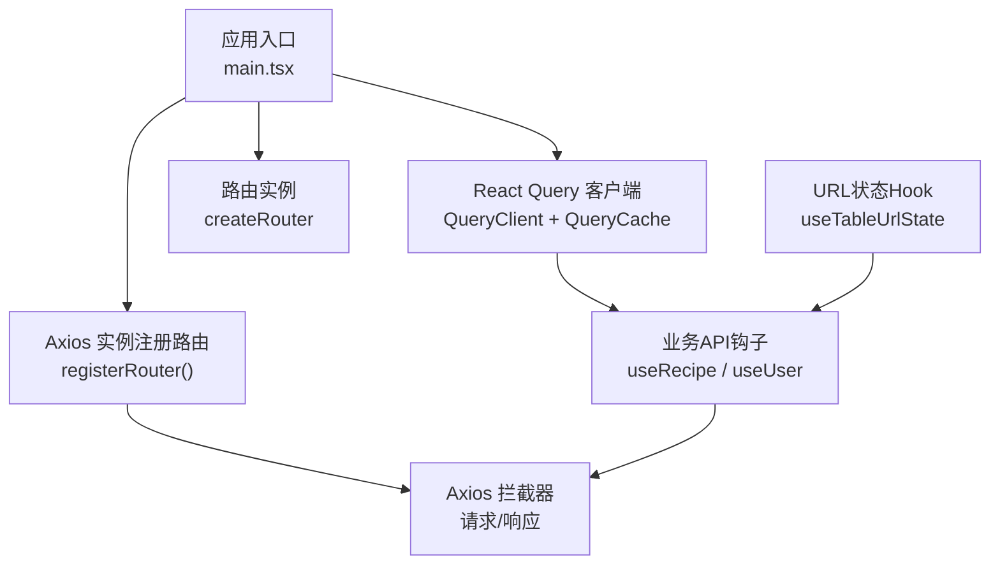
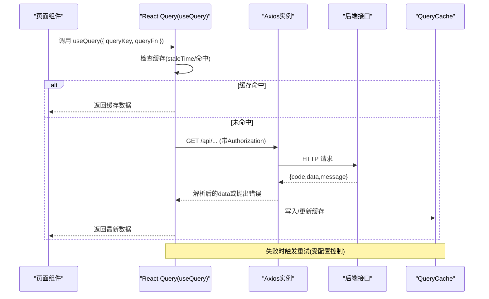
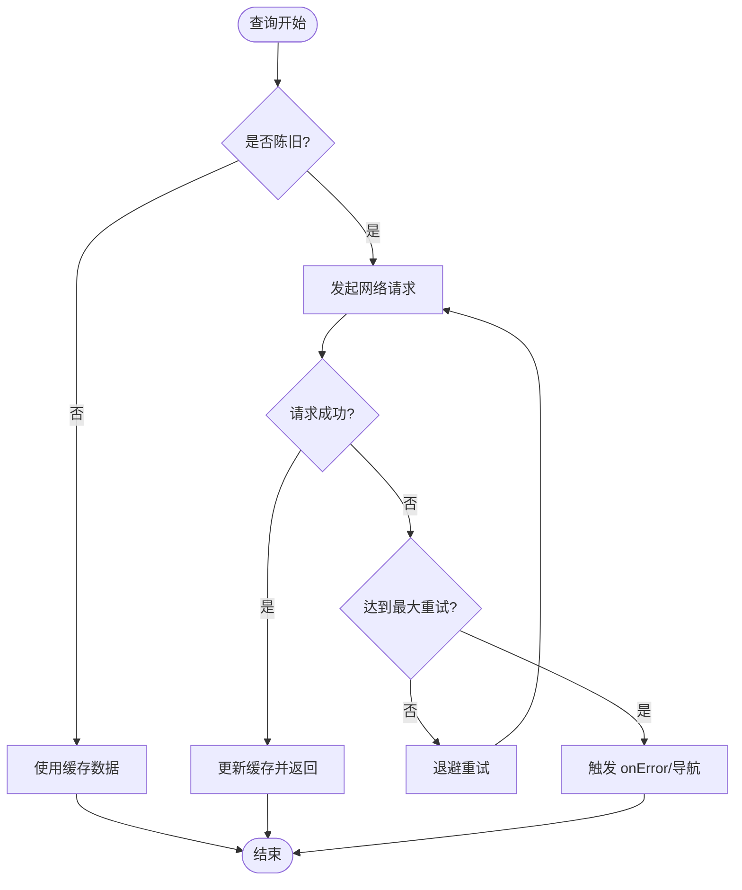
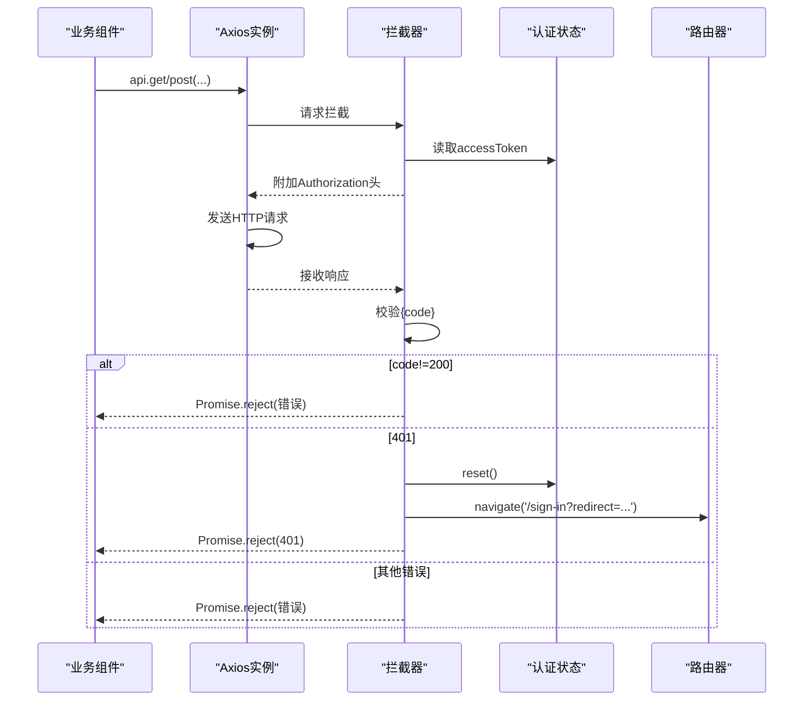
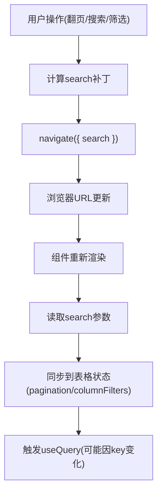
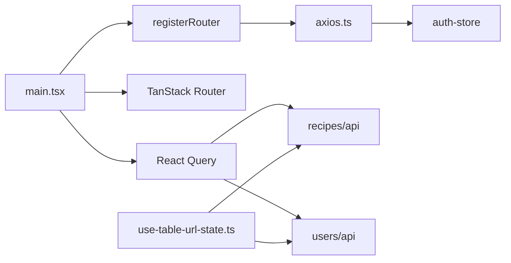

# 数据获取与缓存

<cite>
**本文引用的文件**
- [main.tsx](file://web_client/shadcn-admin/src/main.tsx)
- [axios.ts](file://web_client/shadcn-admin/src/lib/axios.ts)
- [handle-server-error.ts](file://web_client/shadcn-admin/src/lib/handle-server-error.ts)
- [use-table-url-state.ts](file://web_client/shadcn-admin/src/hooks/use-table-url-state.ts)
- [recipe-api.ts](file://web_client/shadcn-admin/src/features/recipes/api/recipe-api.ts)
- [user-api.ts](file://web_client/shadcn-admin/src/features/users/api/user-api.ts)
- [ws_client_demo.py](file://py_server/scripts/ws_client_demo.py)
</cite>

## 目录
1. [简介](#简介)
2. [项目结构](#项目结构)
3. [核心组件](#核心组件)
4. [架构总览](#架构总览)
5. [详细组件分析](#详细组件分析)
6. [依赖关系分析](#依赖关系分析)
7. [性能考量](#性能考量)
8. [故障排查指南](#故障排查指南)
9. [结论](#结论)
10. [附录](#附录)

## 简介
本技术文档围绕 Shadcn Admin 前端的数据获取与缓存体系展开，重点说明基于 React Query（TanStack Query）的查询配置、缓存策略与失效机制；Axios 拦截器的请求头设置、错误处理与重试逻辑；URL 状态同步（搜索参数、分页、筛选条件持久化）；以及 API 调用示例（RESTful、WebSocket、文件上传）。同时给出数据预取、增量更新与离线支持策略，并总结数据缓存优化与内存管理最佳实践。

## 项目结构
Shadcn Admin 在应用入口集中初始化 React Query Client、路由与全局错误处理；网络层通过 Axios 实例统一封装请求拦截与响应处理；业务模块按功能域组织 API 调用（如 recipes、users），并通过 React Query 钩子进行数据获取与变更；表格与列表页使用自定义 Hook 将 URL 查询参数与表格状态双向同步。

图表来源
- [main.tsx:24-82](file://web_client/shadcn-admin/src/main.tsx#L24-L82)
- [axios.ts:34-86](file://web_client/shadcn-admin/src/lib/axios.ts#L34-L86)
- [use-table-url-state.ts:68-219](file://web_client/shadcn-admin/src/hooks/use-table-url-state.ts#L68-L219)
- [recipe-api.ts:87-131](file://web_client/shadcn-admin/src/features/recipes/api/recipe-api.ts#L87-L131)
- [user-api.ts:42-86](file://web_client/shadcn-admin/src/features/users/api/user-api.ts#L42-L86)

章节来源
- [main.tsx:24-82](file://web_client/shadcn-admin/src/main.tsx#L24-L82)
- [axios.ts:34-86](file://web_client/shadcn-admin/src/lib/axios.ts#L34-L86)
- [use-table-url-state.ts:68-219](file://web_client/shadcn-admin/src/hooks/use-table-url-state.ts#L68-L219)
- [recipe-api.ts:87-131](file://web_client/shadcn-admin/src/features/recipes/api/recipe-api.ts#L87-L131)
- [user-api.ts:42-86](file://web_client/shadcn-admin/src/features/users/api/user-api.ts#L42-L86)

## 核心组件
- React Query 客户端与缓存：在应用启动时创建 QueryClient，配置查询重试、窗口聚焦后是否重新获取、staleTime；提供 QueryCache 全局错误处理，区分 500/403 等错误并导航到错误页。
- Axios 网络层：统一 baseURL、超时与默认头；请求拦截器注入 Authorization 头；响应拦截器对后端统一返回体进行校验，并对 401 进行登出与重定向。
- URL 状态同步：useTableUrlState 将分页、全局搜索与列筛选映射到 URL 查询参数，并在变化时触发导航以持久化状态。
- 业务 API 钩子：recipes 与 users 模块分别暴露 useRecipeList、useRecipe、useCreateRecipe 等，结合 invalidateQueries 实现写后失效与增量更新。

章节来源
- [main.tsx:24-71](file://web_client/shadcn-admin/src/main.tsx#L24-L71)
- [axios.ts:34-86](file://web_client/shadcn-admin/src/lib/axios.ts#L34-L86)
- [use-table-url-state.ts:68-219](file://web_client/shadcn-admin/src/hooks/use-table-url-state.ts#L68-L219)
- [recipe-api.ts:87-131](file://web_client/shadcn-admin/src/features/recipes/api/recipe-api.ts#L87-L131)
- [user-api.ts:42-86](file://web_client/shadcn-admin/src/features/users/api/user-api.ts#L42-L86)

## 架构总览
下图展示了从页面发起数据请求到缓存命中、再到 UI 更新的完整链路，包括 Axios 拦截器与 React Query 的协作。

图表来源
- [main.tsx:24-71](file://web_client/shadcn-admin/src/main.tsx#L24-L71)
- [axios.ts:42-86](file://web_client/shadcn-admin/src/lib/axios.ts#L42-L86)
- [recipe-api.ts:87-131](file://web_client/shadcn-admin/src/features/recipes/api/recipe-api.ts#L87-L131)

## 详细组件分析

### React Query 配置与缓存策略
- 重试策略：开发环境不重试，生产环境超过一定失败次数停止重试；对 401/403 直接终止重试，交由拦截器处理鉴权。
- 窗口聚焦刷新：生产环境启用 refetchOnWindowFocus，提升多标签页一致性。
- staleTime：设置为较短时间，使数据更快进入“陈旧”状态，便于后续交互触发按需更新。
- 全局错误处理：QueryCache.onError 捕获服务端错误，500 提示并跳转错误页，403 可预留权限处理。

图表来源
- [main.tsx:24-71](file://web_client/shadcn-admin/src/main.tsx#L24-L71)

章节来源
- [main.tsx:24-71](file://web_client/shadcn-admin/src/main.tsx#L24-L71)

### Axios 拦截器：请求头、错误处理与重试
- 请求拦截器：从全局状态读取 JWT，自动附加 Authorization 头。
- 响应拦截器：
  - 成功分支：校验后端统一返回码，非 200 则拒绝 Promise。
  - 失败分支：401 时弹出提示、重置登录态并重定向至登录页，携带 redirect 参数以便登录后回跳。
- 路由集成：通过 registerRouter 将 TanStack Router 注入拦截器，实现在非组件上下文的导航。

图表来源
- [axios.ts:42-86](file://web_client/shadcn-admin/src/lib/axios.ts#L42-L86)
- [main.tsx:74-82](file://web_client/shadcn-admin/src/main.tsx#L74-L82)

章节来源
- [axios.ts:42-86](file://web_client/shadcn-admin/src/lib/axios.ts#L42-L86)
- [main.tsx:74-82](file://web_client/shadcn-admin/src/main.tsx#L74-L82)

### URL 状态同步：搜索参数、分页与筛选持久化
- 分页：将 page/pageSize 映射为 URL 查询参数，默认值可配置；当回到默认值时自动清理参数以保持 URL 简洁。
- 全局搜索：filter 字段持久化，支持 trim 与开关控制；变化时重置到第一页。
- 列筛选：支持字符串与数组类型，可自定义序列化/反序列化；空值清理对应键。
- 边界保护：ensurePageInRange 在数据变更后确保当前页有效，必要时替换历史跳转到首/末页。

图表来源
- [use-table-url-state.ts:68-219](file://web_client/shadcn-admin/src/hooks/use-table-url-state.ts#L68-L219)

章节来源
- [use-table-url-state.ts:68-219](file://web_client/shadcn-admin/src/hooks/use-table-url-state.ts#L68-L219)

### API 调用示例：RESTful、WebSocket、文件上传
- RESTful 列表与详情：
  - 列表：useRecipeList/useUserList 通过 queryKey 包含分页与筛选参数，配合 invalidateQueries 实现写后失效与增量更新。
  - 详情：useRecipe/useUser 根据 id 拉取单条记录，enabled 控制条件加载。
- WebSocket：
  - 后端提供 ws/chat 流式对话端点，Python 脚本演示了连接、发送消息与接收 token/done/error 事件。
  - 前端可在聊天场景建立 WebSocket 连接，按消息类型追加流式内容，完成后关闭连接。
- 文件上传：
  - 使用 FormData 与 axios 的 multipart/form-data 模式上传文件；注意在请求拦截器中避免覆盖 Content-Type，由浏览器自动设置 boundary。
  - 上传成功后可触发相关查询失效，保证列表/详情即时刷新。

章节来源
- [recipe-api.ts:87-131](file://web_client/shadcn-admin/src/features/recipes/api/recipe-api.ts#L87-L131)
- [user-api.ts:42-86](file://web_client/shadcn-admin/src/features/users/api/user-api.ts#L42-L86)
- [ws_client_demo.py:1-52](file://py_server/scripts/ws_client_demo.py#L1-L52)

### 数据预取、增量更新与离线支持
- 数据预取：
  - 利用路由 defaultPreload/defaultPreloadStaleTime 与 React Query 的 prefetchQuery/preloadQuery，在路由切换或鼠标悬停时提前拉取数据。
  - 在列表页根据可见项或下一页 key 进行预取，减少首屏等待。
- 增量更新：
  - 写操作成功后使用 invalidateQueries 精确失效相关 key（如 ['recipes']），让 React Query 按需重新拉取。
  - 对于实时性要求高的场景，可结合 WebSocket 推送，使用 setQueryData 做乐观更新与回滚。
- 离线支持：
  - 借助 Service Worker 与缓存策略（如 Cache First 或 Network First）对静态资源与只读接口进行缓存。
  - 在网络不可用时降级展示缓存数据，并提供“重试”入口。

[本节为概念性说明，不直接分析具体文件]

## 依赖关系分析
- main.tsx 负责装配 QueryClient、QueryCache、Router，并将 Router 注入 Axios 拦截器。
- axios.ts 提供统一的网络能力，依赖认证状态与 Toast 提示。
- use-table-url-state.ts 依赖路由导航函数与表格状态类型，实现 URL 与状态的双向绑定。
- 业务 API 钩子依赖 axios 实例与 React Query，通过 invalidateQueries 维护缓存一致性。

图表来源
- [main.tsx:24-82](file://web_client/shadcn-admin/src/main.tsx#L24-L82)
- [axios.ts:34-86](file://web_client/shadcn-admin/src/lib/axios.ts#L34-L86)
- [use-table-url-state.ts:68-219](file://web_client/shadcn-admin/src/hooks/use-table-url-state.ts#L68-L219)
- [recipe-api.ts:87-131](file://web_client/shadcn-admin/src/features/recipes/api/recipe-api.ts#L87-L131)
- [user-api.ts:42-86](file://web_client/shadcn-admin/src/features/users/api/user-api.ts#L42-L86)

章节来源
- [main.tsx:24-82](file://web_client/shadcn-admin/src/main.tsx#L24-L82)
- [axios.ts:34-86](file://web_client/shadcn-admin/src/lib/axios.ts#L34-L86)
- [use-table-url-state.ts:68-219](file://web_client/shadcn-admin/src/hooks/use-table-url-state.ts#L68-L219)
- [recipe-api.ts:87-131](file://web_client/shadcn-admin/src/features/recipes/api/recipe-api.ts#L87-L131)
- [user-api.ts:42-86](file://web_client/shadcn-admin/src/features/users/api/user-api.ts#L42-L86)

## 性能考量
- 合理设置 staleTime：短 staleTime 提高数据新鲜度，但会增加请求频率；长 staleTime 降低请求但可能显示旧数据。建议按数据特性差异化配置。
- 精准失效：写操作后仅失效相关 queryKey，避免全量刷新。
- 去抖与节流：搜索输入与频繁翻页应结合防抖/节流，减少无效请求。
- 分页与虚拟滚动：大数据集使用分页与虚拟化渲染，降低内存占用。
- 取消重复请求：相同 queryKey 并发请求合并；必要时使用 AbortController 取消过时请求。
- 内存管理：及时清理 WebSocket 连接、定时器与订阅；避免在组件卸载后继续更新状态。

[本节为通用指导，不直接分析具体文件]

## 故障排查指南
- 401 未登录/过期：
  - 现象：多次请求失败，页面跳转至登录页。
  - 定位：检查 Axios 响应拦截器对 401 的处理与路由跳转逻辑。
  - 修复：确认 Token 存在且未过期；必要时延长 Token 有效期或刷新 Token。
- 500 服务器错误：
  - 现象：Toast 提示并跳转错误页（生产环境）。
  - 定位：查看 QueryCache.onError 与 handleServerError 的错误信息提取逻辑。
  - 修复：核对后端返回结构与错误码；完善错误提示文案。
- 网络不可用：
  - 现象：请求失败提示网络不可用。
  - 定位：检查错误处理分支对无响应的处理。
  - 修复：提供离线缓存与重试入口，改善用户体验。
- URL 状态不同步：
  - 现象：翻页或筛选后 URL 未更新或状态错乱。
  - 定位：检查 useTableUrlState 的 onPaginationChange/onColumnFiltersChange 与 ensurePageInRange。
  - 修复：确认默认值与清理逻辑正确；避免多余参数污染。

章节来源
- [axios.ts:61-83](file://web_client/shadcn-admin/src/lib/axios.ts#L61-L83)
- [handle-server-error.ts:4-29](file://web_client/shadcn-admin/src/lib/handle-server-error.ts#L4-L29)
- [use-table-url-state.ts:122-208](file://web_client/shadcn-admin/src/hooks/use-table-url-state.ts#L122-L208)

## 结论
Shadcn Admin 通过 React Query 与 Axios 的组合，构建了稳定高效的数据获取与缓存体系。React Query 负责查询生命周期管理与缓存策略，Axios 统一处理鉴权与错误，URL 状态 Hook 保障状态可分享与可回溯。结合精准失效、预取与 WebSocket 推送，可实现快速、可靠且体验友好的数据交互。在生产环境中，建议持续监控缓存命中率与错误率，并根据业务特性调优 staleTime、重试策略与失效粒度。

[本节为总结性内容，不直接分析具体文件]

## 附录
- 关键配置参考路径：
  - React Query 客户端与缓存：[main.tsx:24-71](file://web_client/shadcn-admin/src/main.tsx#L24-L71)
  - Axios 实例与拦截器：[axios.ts:34-86](file://web_client/shadcn-admin/src/lib/axios.ts#L34-L86)
  - 全局错误处理：[handle-server-error.ts:4-29](file://web_client/shadcn-admin/src/lib/handle-server-error.ts#L4-L29)
  - URL 状态同步：[use-table-url-state.ts:68-219](file://web_client/shadcn-admin/src/hooks/use-table-url-state.ts#L68-L219)
  - 业务 API 示例：
    - 菜谱：[recipe-api.ts:87-131](file://web_client/shadcn-admin/src/features/recipes/api/recipe-api.ts#L87-L131)
    - 用户：[user-api.ts:42-86](file://web_client/shadcn-admin/src/features/users/api/user-api.ts#L42-L86)
  - WebSocket 联调脚本：[ws_client_demo.py:1-52](file://py_server/scripts/ws_client_demo.py#L1-L52)