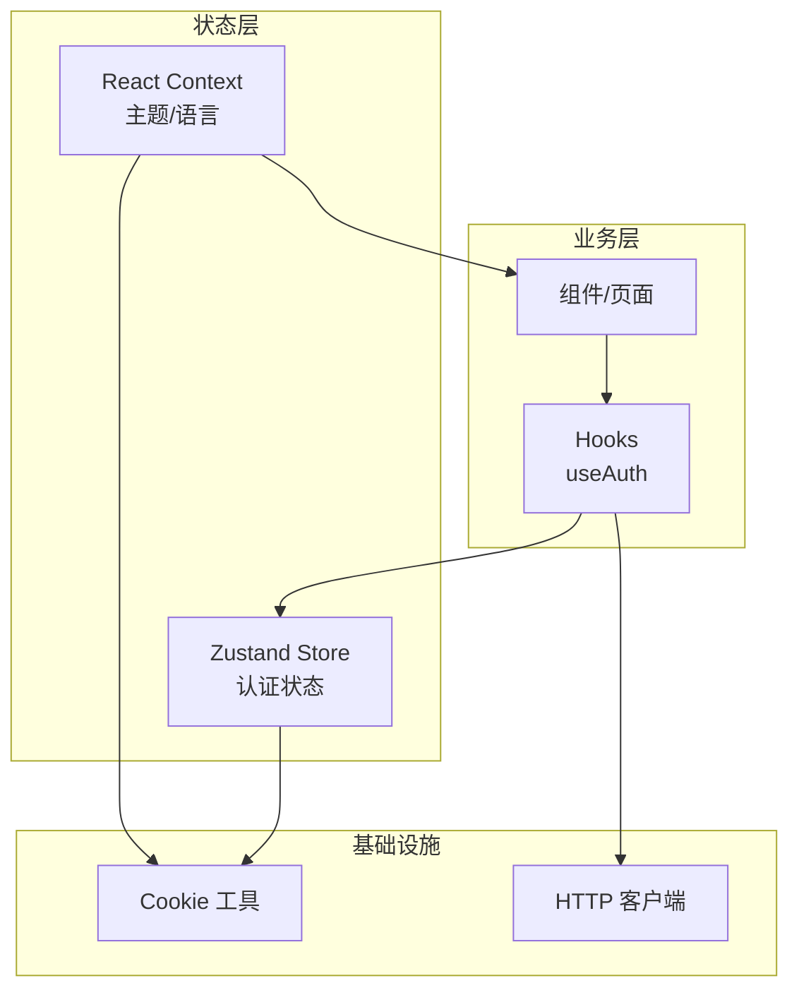
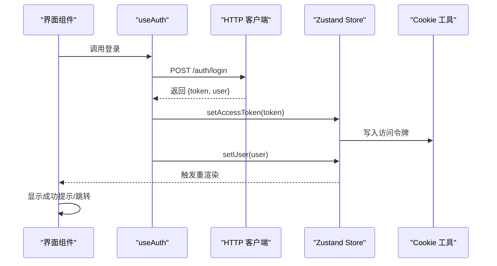
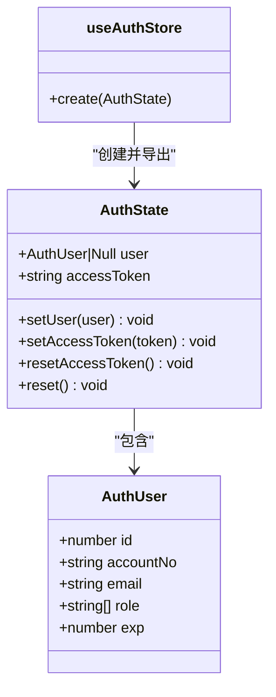
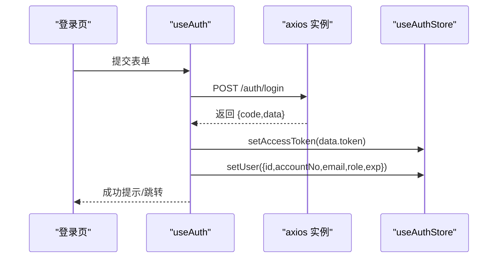
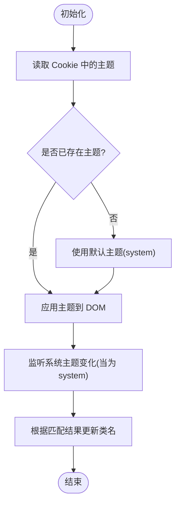
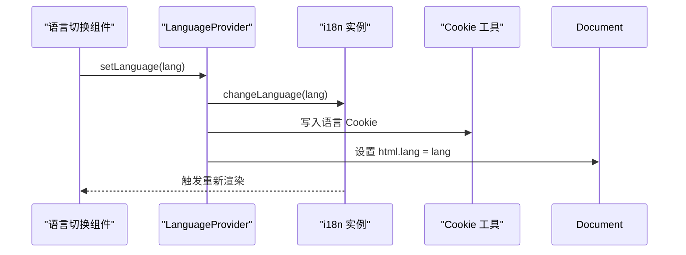
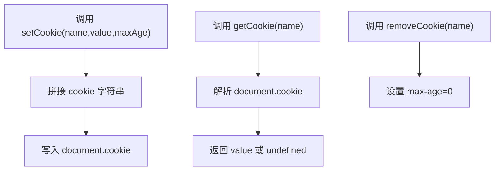
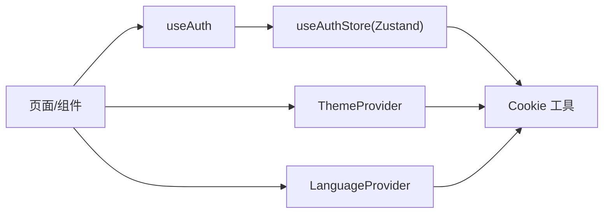

# 状态管理模式

<cite>
**本文引用的文件**
- [auth-store.ts](file://web_client/shadcn-admin/src/stores/auth-store.ts)
- [auth-store.test.ts](file://web_client/shadcn-admin/src/stores/auth-store.test.ts)
- [use-auth.ts](file://web_client/shadcn-admin/src/hooks/use-auth.ts)
- [language-provider.tsx](file://web_client/shadcn-admin/src/context/language-provider.tsx)
- [theme-provider.tsx](file://web_client/shadcn-admin/src/context/theme-provider.tsx)
- [cookies.ts](file://web_client/shadcn-admin/src/lib/cookies.ts)
</cite>

## 目录
1. [简介](#简介)
2. [项目结构](#项目结构)
3. [核心组件](#核心组件)
4. [架构总览](#架构总览)
5. [详细组件分析](#详细组件分析)
6. [依赖关系分析](#依赖关系分析)
7. [性能考虑](#性能考虑)
8. [故障排查指南](#故障排查指南)
9. [结论](#结论)
10. [附录](#附录)

## 简介
本技术文档聚焦 Shadcn Admin 前端的状态管理方案，围绕 Zustand 的 store 设计、状态持久化与异步处理展开，系统阐述认证状态（登录态、权限控制、会话管理）、主题与语言状态的实现方式与切换策略，并提供用户信息存储、设置状态管理与全局访问模式的实践示例。同时涵盖状态调试工具使用、性能优化技巧以及状态迁移与版本管理的最佳实践。

## 项目结构
Shadcn Admin 在 web_client/shadcn-admin 中采用“功能域 + 共享能力”的组织方式：
- stores：基于 Zustand 的全局状态（如认证状态）
- hooks：封装业务逻辑与副作用（如登录/注册流程）
- context：React Context 提供主题、语言等 UI 级状态
- lib：通用工具（如 Cookie 读写）
- features：按业务领域组织页面与子模块

图表来源
- [auth-store.ts:1-55](file://web_client/shadcn-admin/src/stores/auth-store.ts#L1-L55)
- [use-auth.ts:1-82](file://web_client/shadcn-admin/src/hooks/use-auth.ts#L1-L82)
- [theme-provider.tsx:1-111](file://web_client/shadcn-admin/src/context/theme-provider.tsx#L1-L111)
- [language-provider.tsx:1-39](file://web_client/shadcn-admin/src/context/language-provider.tsx#L1-L39)
- [cookies.ts:1-44](file://web_client/shadcn-admin/src/lib/cookies.ts#L1-L44)

章节来源
- [auth-store.ts:1-55](file://web_client/shadcn-admin/src/stores/auth-store.ts#L1-L55)
- [use-auth.ts:1-82](file://web_client/shadcn-admin/src/hooks/use-auth.ts#L1-L82)
- [theme-provider.tsx:1-111](file://web_client/shadcn-admin/src/context/theme-provider.tsx#L1-L111)
- [language-provider.tsx:1-39](file://web_client/shadcn-admin/src/context/language-provider.tsx#L1-L39)
- [cookies.ts:1-44](file://web_client/shadcn-admin/src/lib/cookies.ts#L1-L44)

## 核心组件
- 认证状态 Store（Zustand）
  - 职责：维护当前用户、访问令牌、登录/登出操作；与 Cookie 同步以持久化会话
  - 关键接口：setUser、setAccessToken、resetAccessToken、reset
- 认证 Hook（useAuth）
  - 职责：封装登录/注册请求、错误提示、成功后写入 Store 并导航
- 主题 Provider（ThemeProvider）
  - 职责：管理主题模式（亮/暗/跟随系统），持久化到 Cookie，响应系统主题变化
- 语言 Provider（LanguageProvider）
  - 职责：通过 i18n 切换语言，持久化到 Cookie，同步 html lang 属性

章节来源
- [auth-store.ts:1-55](file://web_client/shadcn-admin/src/stores/auth-store.ts#L1-L55)
- [use-auth.ts:1-82](file://web_client/shadcn-admin/src/hooks/use-auth.ts#L1-L82)
- [theme-provider.tsx:1-111](file://web_client/shadcn-admin/src/context/theme-provider.tsx#L1-L111)
- [language-provider.tsx:1-39](file://web_client/shadcn-admin/src/context/language-provider.tsx#L1-L39)

## 架构总览
下图展示了从界面触发登录到状态落库的完整链路，包括 HTTP 调用、Store 更新与 Cookie 持久化。

图表来源
- [use-auth.ts:25-51](file://web_client/shadcn-admin/src/hooks/use-auth.ts#L25-L51)
- [auth-store.ts:25-53](file://web_client/shadcn-admin/src/stores/auth-store.ts#L25-L53)
- [cookies.ts:26-34](file://web_client/shadcn-admin/src/lib/cookies.ts#L26-L34)

## 详细组件分析

### 认证状态（Zustand Store）
- 设计要点
  - 将用户信息与访问令牌聚合在 auth 命名空间下，避免扁平状态污染
  - 通过 Cookie 持久化访问令牌，保证刷新后仍保持登录态
  - 提供 reset/resetAccessToken 用于安全退出与仅清理令牌
- 数据结构
  - AuthUser：包含 id、accountNo、email、role、exp 等字段
  - AuthState.auth：user、accessToken 及对应操作方法
- 复杂度与性能
  - 每次更新仅替换局部对象，Zustand 会基于引用比较进行细粒度订阅，避免全量重渲染
- 错误处理
  - 由上层 Hook 统一捕获网络错误并提示；Store 本身不抛出异常

图表来源
- [auth-store.ts:6-23](file://web_client/shadcn-admin/src/stores/auth-store.ts#L6-L23)
- [auth-store.ts:25-53](file://web_client/shadcn-admin/src/stores/auth-store.ts#L25-L53)

章节来源
- [auth-store.ts:1-55](file://web_client/shadcn-admin/src/stores/auth-store.ts#L1-L55)
- [auth-store.test.ts:1-77](file://web_client/shadcn-admin/src/stores/auth-store.test.ts#L1-L77)

### 认证流程（useAuth Hook）
- 职责
  - 封装登录/注册请求，成功后写入 Store 并给出用户反馈
  - 失败时统一提示错误信息
- 数据流
  - 调用后端登录接口 -> 获取 token 与用户信息 -> 写入 Store -> 提示并导航
- 与 Store 的协作
  - 通过 useAuthStore 暴露的 auth 方法完成状态更新与持久化

图表来源
- [use-auth.ts:25-51](file://web_client/shadcn-admin/src/hooks/use-auth.ts#L25-L51)
- [auth-store.ts:25-53](file://web_client/shadcn-admin/src/stores/auth-store.ts#L25-L53)

章节来源
- [use-auth.ts:1-82](file://web_client/shadcn-admin/src/hooks/use-auth.ts#L1-L82)

### 主题状态（ThemeProvider）
- 设计要点
  - 支持 dark/light/system 三种模式，system 模式下监听系统主题变化
  - 主题选择持久化到 Cookie，刷新后恢复
  - 通过 documentElement 类名切换主题样式
- 性能优化
  - 使用 useMemo 计算 resolvedTheme，减少重复计算
  - 事件监听仅在 effect 中注册一次，并在卸载时移除

图表来源
- [theme-provider.tsx:35-86](file://web_client/shadcn-admin/src/context/theme-provider.tsx#L35-L86)

章节来源
- [theme-provider.tsx:1-111](file://web_client/shadcn-admin/src/context/theme-provider.tsx#L1-L111)

### 语言状态（LanguageProvider）
- 设计要点
  - 基于 react-i18next 切换语言，并通过 Cookie 持久化
  - 同步 html lang 属性，提升可访问性与 SEO
- 使用方式
  - 通过 useLanguage 钩子获取当前语言与切换方法

图表来源
- [language-provider.tsx:15-38](file://web_client/shadcn-admin/src/context/language-provider.tsx#L15-L38)
- [cookies.ts:26-34](file://web_client/shadcn-admin/src/lib/cookies.ts#L26-L34)

章节来源
- [language-provider.tsx:1-39](file://web_client/shadcn-admin/src/context/language-provider.tsx#L1-L39)

### 状态持久化与 Cookie 工具
- 统一抽象
  - getCookie/setCookie/removeCookie 封装 document.cookie，提供跨环境安全访问
- 使用场景
  - 认证令牌、主题、语言等需要跨刷新保留的状态均通过 Cookie 持久化

图表来源
- [cookies.ts:11-43](file://web_client/shadcn-admin/src/lib/cookies.ts#L11-L43)

章节来源
- [cookies.ts:1-44](file://web_client/shadcn-admin/src/lib/cookies.ts#L1-L44)

## 依赖关系分析
- 组件/页面依赖 Hooks（如 useAuth）
- Hooks 依赖 Zustand Store（useAuthStore）与 HTTP 客户端
- Store 依赖 Cookie 工具进行持久化
- Context（主题/语言）独立于 Store，但同样依赖 Cookie 工具

图表来源
- [use-auth.ts:1-82](file://web_client/shadcn-admin/src/hooks/use-auth.ts#L1-L82)
- [auth-store.ts:1-55](file://web_client/shadcn-admin/src/stores/auth-store.ts#L1-L55)
- [theme-provider.tsx:1-111](file://web_client/shadcn-admin/src/context/theme-provider.tsx#L1-L111)
- [language-provider.tsx:1-39](file://web_client/shadcn-admin/src/context/language-provider.tsx#L1-L39)
- [cookies.ts:1-44](file://web_client/shadcn-admin/src/lib/cookies.ts#L1-L44)

章节来源
- [use-auth.ts:1-82](file://web_client/shadcn-admin/src/hooks/use-auth.ts#L1-L82)
- [auth-store.ts:1-55](file://web_client/shadcn-admin/src/stores/auth-store.ts#L1-L55)
- [theme-provider.tsx:1-111](file://web_client/shadcn-admin/src/context/theme-provider.tsx#L1-L111)
- [language-provider.tsx:1-39](file://web_client/shadcn-admin/src/context/language-provider.tsx#L1-L39)
- [cookies.ts:1-44](file://web_client/shadcn-admin/src/lib/cookies.ts#L1-L44)

## 性能考虑
- 细粒度订阅
  - Zustand 基于选择器/路径订阅，仅更新相关组件，避免整树重渲染
- 计算缓存
  - 主题 resolvedTheme 使用 useMemo 缓存，减少重复计算
- 事件监听最小化
  - 系统主题监听仅在 effect 内注册一次，并在卸载时移除
- 持久化开销
  - Cookie 写入频率低（登录/切换主题/语言时），对性能影响可忽略
- 建议
  - 将大对象拆分到独立 Store，按需订阅
  - 对高频更新的状态使用 selector 精确订阅
  - 避免在 render 中执行昂贵计算，必要时使用 useMemo/useCallback

## 故障排查指南
- 登录后未保持登录态
  - 检查 setAccessToken 是否正确写入 Cookie，且 Store 初始化时从 Cookie 读取
  - 参考测试用例验证持久化行为
- 主题切换无效
  - 确认 Cookie 写入成功，且 documentElement 类名已更新
  - 检查系统主题监听是否生效
- 语言切换未生效
  - 确认 i18n.changeLanguage 被调用，html lang 已同步
  - 检查 Cookie 是否写入成功
- 常见问题定位
  - 使用浏览器开发者工具的 Application/Cookies 面板查看键值
  - 使用 React DevTools 观察 Store 变更与组件重渲染范围
  - 使用控制台日志或 toast 提示定位错误来源

章节来源
- [auth-store.test.ts:1-77](file://web_client/shadcn-admin/src/stores/auth-store.test.ts#L1-L77)
- [theme-provider.tsx:55-86](file://web_client/shadcn-admin/src/context/theme-provider.tsx#L55-L86)
- [language-provider.tsx:18-33](file://web_client/shadcn-admin/src/context/language-provider.tsx#L18-L33)
- [cookies.ts:11-43](file://web_client/shadcn-admin/src/lib/cookies.ts#L11-L43)

## 结论
本项目以 Zustand 为核心构建全局状态，结合 React Context 管理 UI 级主题与语言状态，并通过统一的 Cookie 工具实现关键状态的持久化。认证流程清晰、解耦良好，具备可扩展性。遵循本文的性能优化与故障排查建议，可在复杂业务场景中保持稳定与高效。

## 附录

### 状态管理示例与实践
- 用户信息存储
  - 登录成功后通过 setUser 写入用户信息，包含角色与过期时间
  - 通过 useAuthStore 在任何组件中读取当前用户
- 设置状态管理
  - 主题与语言通过 Context 管理，并提供 setTheme/setLanguage 方法
  - 所有设置项均持久化到 Cookie，确保刷新后一致
- 全局状态访问模式
  - 在组件中使用对应的 Hook（useAuthStore、useTheme、useLanguage）直接访问状态与方法
  - 避免在组件内部维护重复状态，统一由 Store/Context 管理

### 状态调试工具
- React DevTools
  - 查看组件树与状态变更，定位不必要的重渲染
- 浏览器开发者工具
  - Application/Cookies 面板检查持久化键值
  - Network 面板查看登录请求与响应
- 单元测试
  - 使用 Vitest 对 Store 行为进行断言，覆盖持久化与重置场景

### 状态迁移与版本管理最佳实践
- 版本化键名
  - 为 Cookie 键名增加版本号前缀，便于后续迁移与兼容
- 渐进式迁移
  - 新增字段时提供默认值，旧字段逐步废弃
- 回滚策略
  - 在迁移脚本中检测旧版本并执行降级逻辑
- 测试保障
  - 针对迁移逻辑编写单测，确保不同版本下的正确性