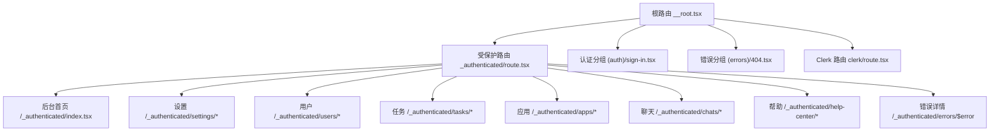
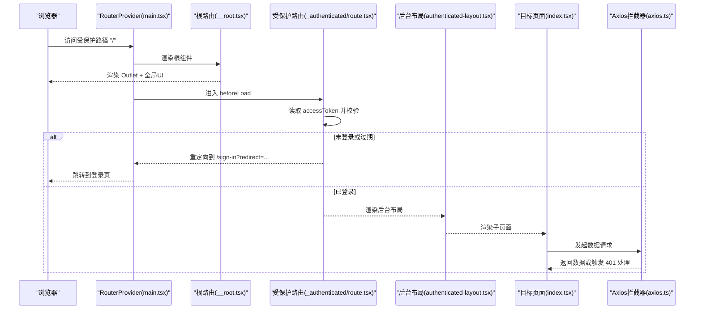
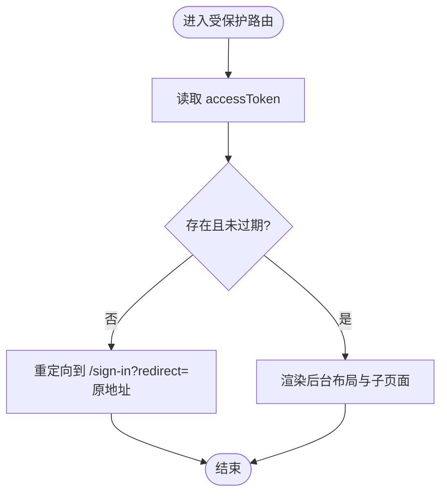
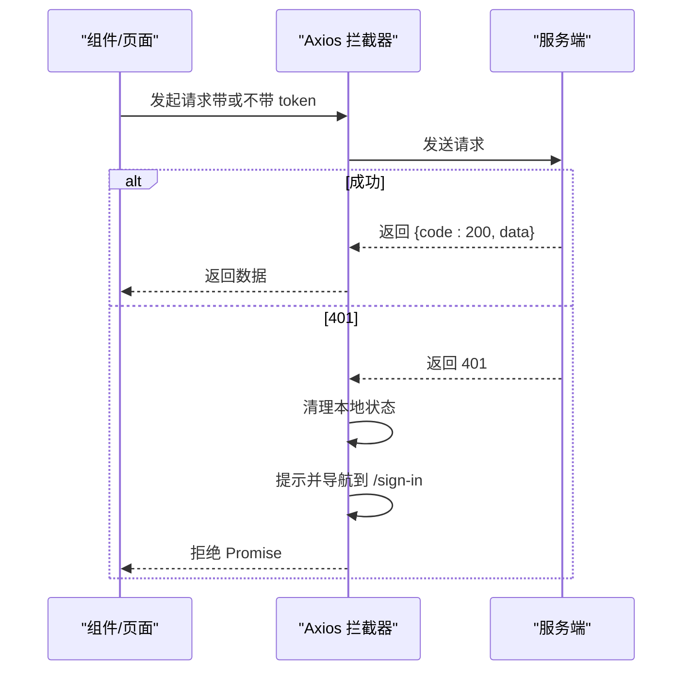
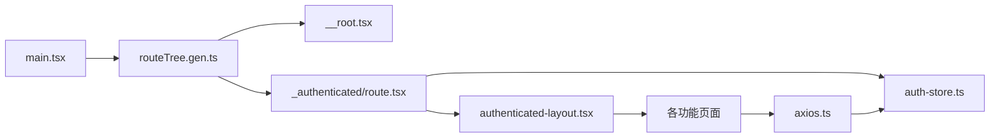

# 路由系统架构

<cite>
**本文引用的文件**
- [main.tsx](file://web_client/shadcn-admin/src/main.tsx)
- [__root.tsx](file://web_client/shadcn-admin/src/routes/__root.tsx)
- [route.tsx（受保护路由）](file://web_client/shadcn-admin/src/routes/_authenticated/route.tsx)
- [sign-in.tsx（登录页）](file://web_client/shadcn-admin/src/routes/(auth)/sign-in.tsx)
- [404.tsx（错误页）](file://web_client/shadcn-admin/src/routes/(errors)/404.tsx)
- [axios.ts（请求与鉴权拦截）](file://web_client/shadcn-admin/src/lib/axios.ts)
- [auth-store.ts（认证状态管理）](file://web_client/shadcn-admin/src/stores/auth-store.ts)
- [authenticated-layout.tsx（后台布局）](file://web_client/shadcn-admin/src/components/layout/authenticated-layout.tsx)
- [clerk/route.tsx（Clerk 集成路由）](file://web_client/shadcn-admin/src/routes/clerk/route.tsx)
- [routeTree.gen.ts（自动生成的路由树）](file://web_client/shadcn-admin/src/routeTree.gen.ts)
</cite>

## 目录
1. [简介](#简介)
2. [项目结构](#项目结构)
3. [核心组件](#核心组件)
4. [架构总览](#架构总览)
5. [详细组件分析](#详细组件分析)
6. [依赖关系分析](#依赖关系分析)
7. [性能考虑](#性能考虑)
8. [故障排查指南](#故障排查指南)
9. [结论](#结论)
10. [附录](#附录)

## 简介
本技术文档聚焦于 Shadcn Admin 前端的路由系统，基于 TanStack Router 的文件路由约定，系统性阐述以下主题：
- 嵌套路由、动态路由与分组路由的组织方式
- 认证路由保护机制：守卫逻辑、权限校验与重定向流程
- 路由上下文管理与全局配置选项
- 典型路由配置示例：登录页面、管理后台首页、错误页面
- 懒加载、代码分割与性能优化策略
- 路由调试工具与开发环境配置

## 项目结构
本项目采用 TanStack Router 的“文件系统路由”约定：
- 根路由位于 routes/__root.tsx，提供全局 UI 壳层、错误与未找到处理、以及开发期调试工具挂载。
- 受保护路由通过 _authenticated 前缀目录实现，作为需要鉴权的父级路由，统一执行 beforeLoad 守卫。
- 认证相关页面使用 (auth) 分组路由，用于将登录、注册等页面在 URL 中隐藏分组标识。
- 错误页面使用 (errors) 分组路由，集中管理 401/403/404/500/503 等错误视图。
- 可选的 Clerk 集成位于 routes/clerk，提供独立的认证流与子路由。
- 自动生成路由树 routeTree.gen.ts 由构建时扫描 src/routes 生成，包含所有路由路径、父子关系与类型定义。

图表来源
- [__root.tsx:10-30](file://web_client/shadcn-admin/src/routes/__root.tsx#L10-L30)
- [route.tsx（受保护路由）:6-19](file://web_client/shadcn-admin/src/routes/_authenticated/route.tsx#L6-L19)
- [sign-in.tsx:9-12](file://web_client/shadcn-admin/src/routes/(auth)/sign-in.tsx#L9-L12)
- [404.tsx:4-6](file://web_client/shadcn-admin/src/routes/(errors)/404.tsx#L4-L6)
- [clerk/route.tsx:14-37](file://web_client/shadcn-admin/src/routes/clerk/route.tsx#L14-L37)
- [routeTree.gen.ts:44-205](file://web_client/shadcn-admin/src/routeTree.gen.ts#L44-L205)

章节来源
- [__root.tsx:10-30](file://web_client/shadcn-admin/src/routes/__root.tsx#L10-L30)
- [routeTree.gen.ts:44-205](file://web_client/shadcn-admin/src/routeTree.gen.ts#L44-L205)

## 核心组件
- 根路由（__root.tsx）
  - 提供全局 UI 容器（导航进度条、消息提示）、错误与未找到组件挂载，并在开发模式注入 React Query Devtools 与 TanStack Router Devtools。
  - 通过 createRootRouteWithContext 声明全局上下文类型（如 QueryClient）。
- 受保护路由（_authenticated/route.tsx）
  - 使用 beforeLoad 进行鉴权守卫：读取本地存储中的 accessToken，若缺失或已过期则重定向到登录页并携带 redirect 参数。
  - 渲染 AuthenticatedLayout 作为后台布局壳层。
- 认证分组路由（(auth)/sign-in.tsx）
  - 使用 createFileRoute 定义登录页路由，并通过 validateSearch 对查询参数进行 Zod 校验（例如 redirect）。
- 错误分组路由（(errors)/404.tsx）
  - 映射到 NotFoundError 组件，用于展示未找到页面。
- 请求与鉴权拦截（lib/axios.ts）
  - 在请求拦截器中附加 Authorization 头；在响应拦截器中处理 401 场景：清除本地状态、提示并跳转登录页。
  - 提供 isTokenExpired 函数用于本地 JWT 过期判断。
- 认证状态管理（stores/auth-store.ts）
  - 使用 Zustand 维护用户信息与 accessToken，并提供持久化到 Cookie 的能力。
- 后台布局（components/layout/authenticated-layout.tsx）
  - 提供侧边栏、内容区与搜索等上下文提供者，承载受保护路由的子页面。

章节来源
- [__root.tsx:10-30](file://web_client/shadcn-admin/src/routes/__root.tsx#L10-L30)
- [route.tsx（受保护路由）:6-19](file://web_client/shadcn-admin/src/routes/_authenticated/route.tsx#L6-L19)
- [sign-in.tsx:9-12](file://web_client/shadcn-admin/src/routes/(auth)/sign-in.tsx#L9-L12)
- [404.tsx:4-6](file://web_client/shadcn-admin/src/routes/(errors)/404.tsx#L4-L6)
- [axios.ts:22-83](file://web_client/shadcn-admin/src/lib/axios.ts#L22-L83)
- [auth-store.ts:14-54](file://web_client/shadcn-admin/src/stores/auth-store.ts#L14-L54)
- [authenticated-layout.tsx:14-42](file://web_client/shadcn-admin/src/components/layout/authenticated-layout.tsx#L14-L42)

## 架构总览
下图展示了从入口到具体页面的完整调用链，包括鉴权守卫、布局渲染与错误处理。

图表来源
- [main.tsx:74-102](file://web_client/shadcn-admin/src/main.tsx#L74-L102)
- [__root.tsx:10-30](file://web_client/shadcn-admin/src/routes/__root.tsx#L10-L30)
- [route.tsx（受保护路由）:6-19](file://web_client/shadcn-admin/src/routes/_authenticated/route.tsx#L6-L19)
- [axios.ts:42-83](file://web_client/shadcn-admin/src/lib/axios.ts#L42-L83)

## 详细组件分析

### 根路由与全局上下文
- 作用
  - 提供全局 UI 容器（导航进度、消息提示），并在开发环境挂载调试面板。
  - 通过 createRootRouteWithContext 声明全局上下文类型，便于子路由消费。
- 关键点
  - notFoundComponent 与 errorComponent 分别处理未找到与全局错误。
  - 在 main.tsx 中创建 Router 实例并注入 QueryClient 上下文。

章节来源
- [__root.tsx:10-30](file://web_client/shadcn-admin/src/routes/__root.tsx#L10-L30)
- [main.tsx:24-79](file://web_client/shadcn-admin/src/main.tsx#L24-L79)

### 受保护路由与守卫逻辑
- 作用
  - 在路由进入前进行鉴权检查，确保只有持有有效 token 的用户可访问受保护页面。
- 流程
  - 读取本地存储中的 accessToken。
  - 若缺失或已过期，抛出重定向到登录页，并附带原始地址以便登录后回跳。
  - 否则渲染后台布局与子页面。
- 扩展
  - 可在 beforeLoad 中增加角色/权限校验逻辑，结合后端接口或本地权限表。

图表来源
- [route.tsx（受保护路由）:6-19](file://web_client/shadcn-admin/src/routes/_authenticated/route.tsx#L6-L19)
- [axios.ts:22-32](file://web_client/shadcn-admin/src/lib/axios.ts#L22-L32)

章节来源
- [route.tsx（受保护路由）:6-19](file://web_client/shadcn-admin/src/routes/_authenticated/route.tsx#L6-L19)
- [axios.ts:22-32](file://web_client/shadcn-admin/src/lib/axios.ts#L22-L32)

### 认证分组路由（登录页）
- 作用
  - 提供登录入口，支持通过 search 参数传递 redirect 以完成登录后回跳。
- 关键点
  - 使用 validateSearch 对查询参数进行类型校验，提升健壮性。
  - 可与受保护路由的重定向配合，形成完整的登录-回跳闭环。

章节来源
- [sign-in.tsx:9-12](file://web_client/shadcn-admin/src/routes/(auth)/sign-in.tsx#L9-L12)

### 错误分组路由（404）
- 作用
  - 为未匹配的路径提供友好的错误页面。
- 关键点
  - 根路由同时设置了全局 notFoundComponent，可作为兜底；分组路由可覆盖特定场景。

章节来源
- [404.tsx:4-6](file://web_client/shadcn-admin/src/routes/(errors)/404.tsx#L4-L6)
- [__root.tsx:28-30](file://web_client/shadcn-admin/src/routes/__root.tsx#L28-L30)

### Axios 拦截器与 401 处理
- 作用
  - 统一为请求附加 Authorization 头；在响应中处理业务包装格式与异常。
  - 针对 401 进行全局处理：提示、清理本地状态并重定向到登录页。
- 关键点
  - registerRouter 将 Router 实例注入拦截器，使非组件上下文也能导航。
  - isTokenExpired 提前 30 秒判定过期，避免边界竞态问题。

图表来源
- [axios.ts:42-83](file://web_client/shadcn-admin/src/lib/axios.ts#L42-L83)

章节来源
- [axios.ts:42-83](file://web_client/shadcn-admin/src/lib/axios.ts#L42-L83)

### 认证状态管理（Zustand）
- 作用
  - 集中管理用户信息与 accessToken，并提供持久化到 Cookie 的方法。
- 关键点
  - setAccessToken/reset/resetAccessToken 等方法用于登录、登出与状态重置。
  - 与路由守卫和 Axios 拦截器协同工作，保证一致的状态与行为。

章节来源
- [auth-store.ts:14-54](file://web_client/shadcn-admin/src/stores/auth-store.ts#L14-L54)

### 后台布局（AuthenticatedLayout）
- 作用
  - 提供侧边栏、内容区域与搜索等上下文，承载所有受保护页面。
- 关键点
  - 通过 SidebarProvider 控制侧边栏默认展开状态。
  - 使用 Outlet 渲染子路由内容。

章节来源
- [authenticated-layout.tsx:14-42](file://web_client/shadcn-admin/src/components/layout/authenticated-layout.tsx#L14-L42)

### Clerk 集成路由（可选）
- 作用
  - 提供基于 Clerk 的认证方案，封装 ClerkProvider 并配置登录/注册/回调地址。
- 关键点
  - 当缺少发布密钥时会显示引导界面，指导开发者配置环境变量。
  - 该模块独立于主认证流程，可按需启用或移除。

章节来源
- [clerk/route.tsx:14-37](file://web_client/shadcn-admin/src/routes/clerk/route.tsx#L14-L37)

## 依赖关系分析
- 入口与路由树
  - main.tsx 创建 Router 实例并注入 QueryClient 上下文，导入自动生成路由树。
  - routeTree.gen.ts 汇总所有路由及其父子关系，供 Router 使用。
- 鉴权链路
  - 受保护路由 beforeLoad 依赖 auth-store 与 axios 的 isTokenExpired。
  - Axios 拦截器依赖 auth-store 进行状态清理与导航。
- 布局与页面
  - 受保护路由渲染后台布局，布局内通过 Outlet 渲染具体页面。
- 错误处理
  - 根路由提供全局错误与未找到组件；分组路由可覆盖特定错误场景。

图表来源
- [main.tsx:74-102](file://web_client/shadcn-admin/src/main.tsx#L74-L102)
- [routeTree.gen.ts:44-205](file://web_client/shadcn-admin/src/routeTree.gen.ts#L44-L205)
- [__root.tsx:10-30](file://web_client/shadcn-admin/src/routes/__root.tsx#L10-L30)
- [route.tsx（受保护路由）:6-19](file://web_client/shadcn-admin/src/routes/_authenticated/route.tsx#L6-L19)
- [axios.ts:42-83](file://web_client/shadcn-admin/src/lib/axios.ts#L42-L83)

章节来源
- [main.tsx:74-102](file://web_client/shadcn-admin/src/main.tsx#L74-L102)
- [routeTree.gen.ts:44-205](file://web_client/shadcn-admin/src/routeTree.gen.ts#L44-L205)

## 性能考虑
- 路由懒加载与代码分割
  - TanStack Router 基于文件系统路由，天然支持按路由拆分代码；建议保持页面组件按需引入，避免一次性加载全部资源。
- 预取与缓存
  - 通过 defaultPreload 与 defaultPreloadStaleTime 控制路由预取策略，减少首屏与切换时的等待时间。
  - React Query 的 staleTime 与 refetchOnWindowFocus 可优化数据获取频率与一致性。
- 错误与未找到处理
  - 合理设置全局与分组错误组件，避免不必要的重试与网络开销。
- 鉴权守卫成本
  - beforeLoad 仅做轻量校验（读取本地状态与简单过期判断），避免阻塞路由切换。

[本节为通用性能建议，不直接分析具体文件]

## 故障排查指南
- 无法进入受保护页面
  - 检查本地是否保存了有效的 accessToken；确认 isTokenExpired 判定逻辑是否符合预期。
  - 查看受保护路由 beforeLoad 是否抛出重定向；必要时在控制台打印 location.href 以确认回跳参数。
- 登录后无法回跳
  - 确认登录页是否正确解析 redirect 参数；检查受保护路由重定向时是否携带该参数。
- 401 频繁出现
  - 检查 Axios 响应拦截器是否正确处理 401；确认是否在多处重复触发清理与导航。
  - 核对服务端返回的 token 有效期与客户端判定逻辑是否一致。
- 未找到页面未生效
  - 确认路由路径是否与 routeTree.gen.ts 中定义一致；必要时检查分组路由与父级路由的 path 配置。

章节来源
- [route.tsx（受保护路由）:6-19](file://web_client/shadcn-admin/src/routes/_authenticated/route.tsx#L6-L19)
- [axios.ts:62-83](file://web_client/shadcn-admin/src/lib/axios.ts#L62-L83)
- [sign-in.tsx:9-12](file://web_client/shadcn-admin/src/routes/(auth)/sign-in.tsx#L9-L12)

## 结论
本项目基于 TanStack Router 的文件路由约定，构建了清晰的路由分层与鉴权体系：
- 通过 _authenticated 前缀实现统一的受保护路由守卫，结合本地 token 校验与 Axios 401 处理，形成端到端的认证闭环。
- 使用 (auth) 与 (errors) 分组路由组织认证与错误页面，提升可读性与可维护性。
- 借助自动生成路由树与类型定义，保障路由安全与开发体验。
- 通过合理的预取、缓存与错误处理策略，兼顾性能与稳定性。

[本节为总结性内容，不直接分析具体文件]

## 附录

### 典型路由配置示例（路径参考）
- 登录页面
  - 路径：/(auth)/sign-in
  - 说明：使用 validateSearch 校验 redirect 参数，支持登录后回跳。
  - 参考：[sign-in.tsx:9-12](file://web_client/shadcn-admin/src/routes/(auth)/sign-in.tsx#L9-L12)
- 管理后台首页
  - 路径：/_authenticated/
  - 说明：受保护路由下的首页，需通过 beforeLoad 鉴权。
  - 参考：[route.tsx（受保护路由）:6-19](file://web_client/shadcn-admin/src/routes/_authenticated/route.tsx#L6-L19)、[index.tsx](file://web_client/shadcn-admin/src/routes/_authenticated/index.tsx)
- 错误页面
  - 路径：/(errors)/404
  - 说明：未找到页面，可由根路由全局兜底。
  - 参考：[404.tsx:4-6](file://web_client/shadcn-admin/src/routes/(errors)/404.tsx#L4-L6)

### 路由调试工具与开发环境配置
- 根路由在开发模式下挂载 React Query Devtools 与 TanStack Router Devtools，便于观察查询与路由状态。
- main.tsx 中创建 Router 实例并注入 QueryClient 上下文，便于全局调试。
- 参考：
  - [__root.tsx:18-24](file://web_client/shadcn-admin/src/routes/__root.tsx#L18-L24)
  - [main.tsx:24-79](file://web_client/shadcn-admin/src/main.tsx#L24-L79)