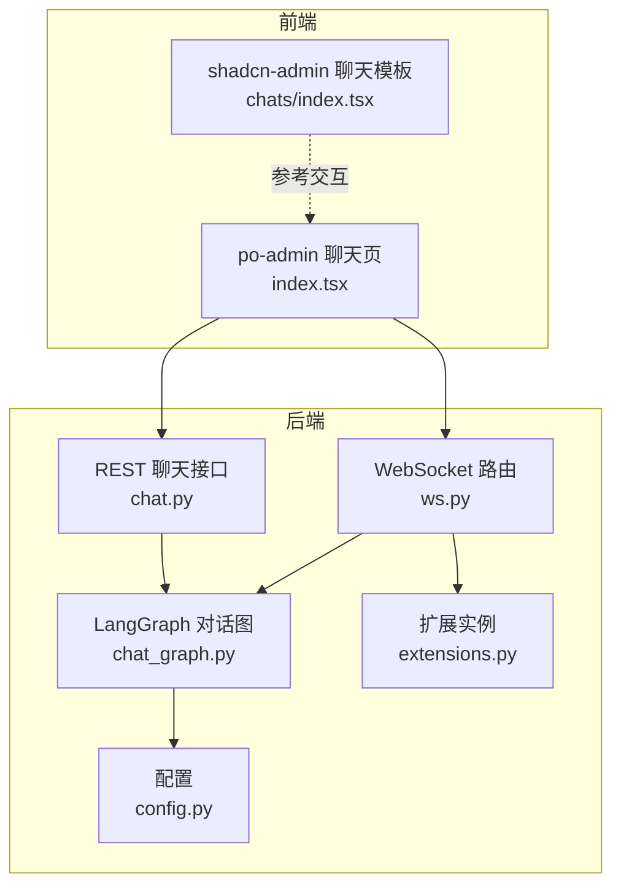
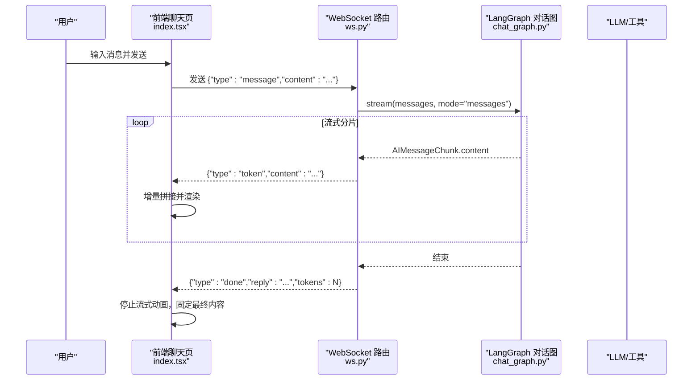
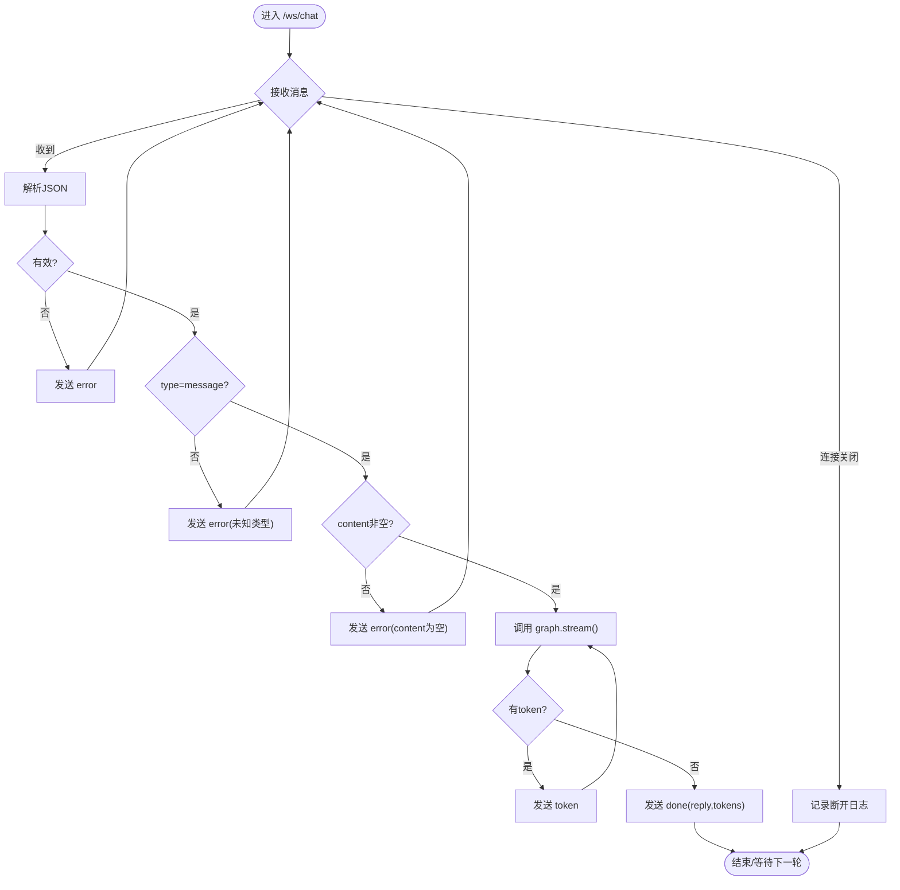
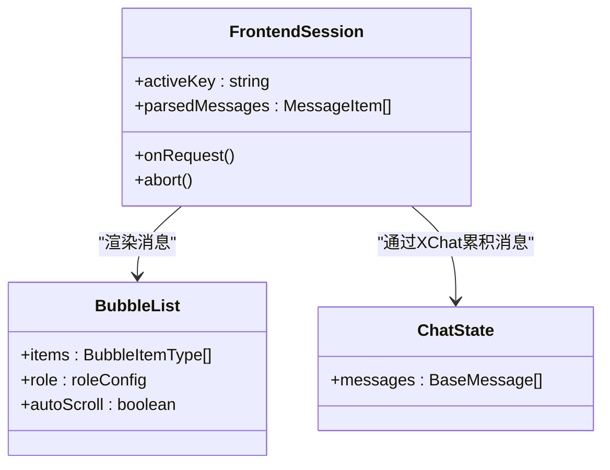
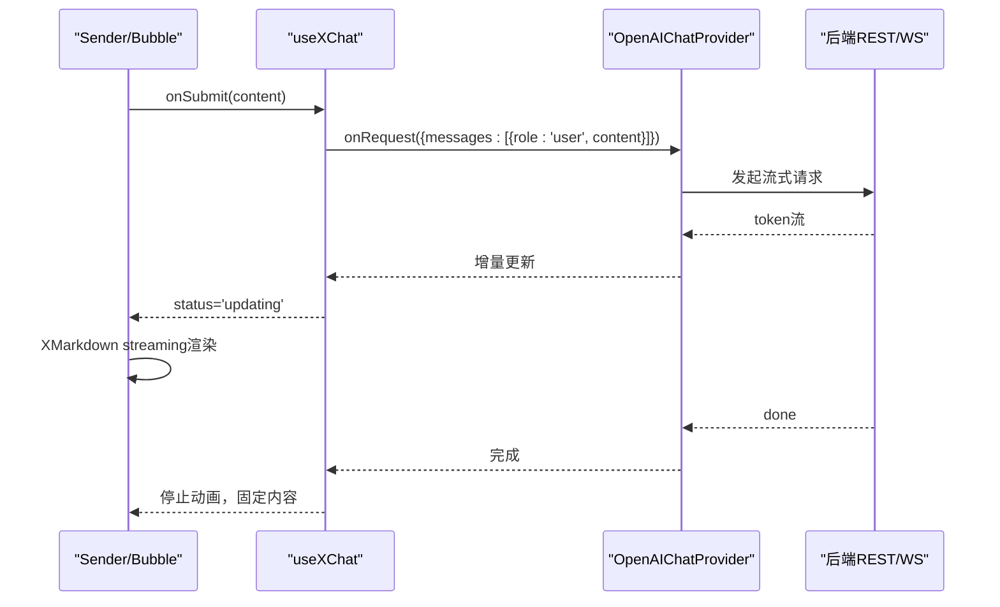
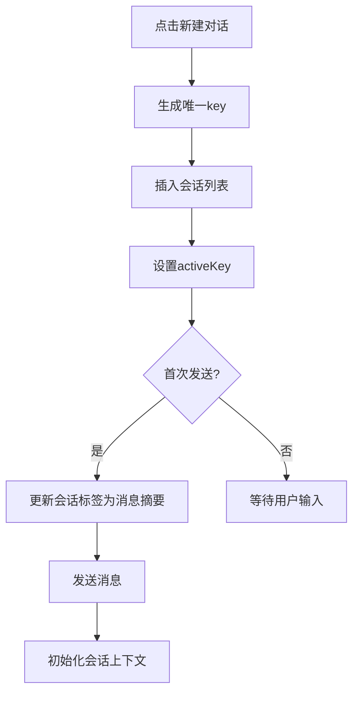
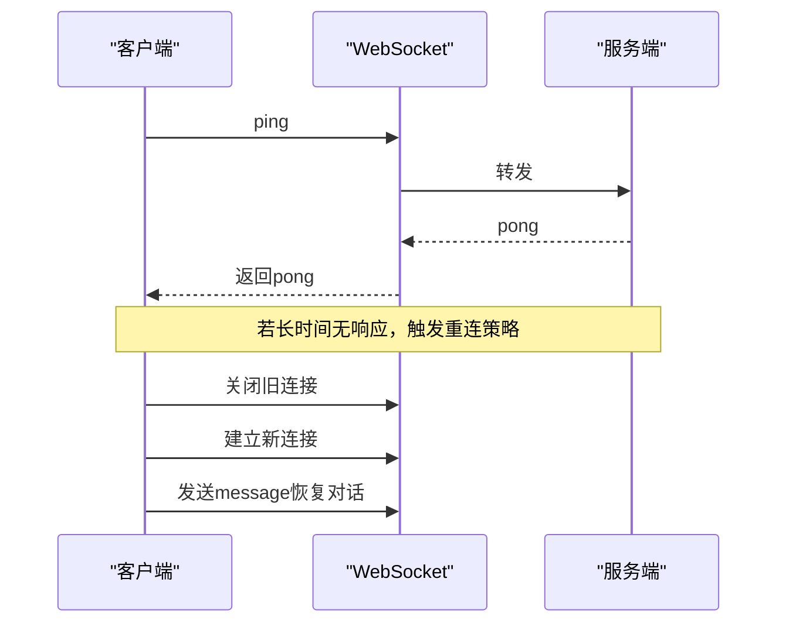
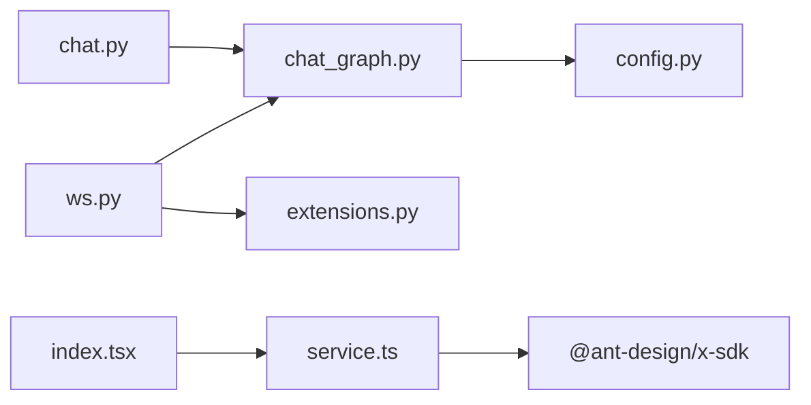

# AI对话模块

<cite>
**本文引用的文件**
- [py_server/blueprints/ws.py](file://py_server/blueprints/ws.py)
- [py_server/blueprints/chat.py](file://py_server/blueprints/chat.py)
- [py_server/agents/chat_graph.py](file://py_server/agents/chat_graph.py)
- [py_server/extensions.py](file://py_server/extensions.py)
- [py_server/config.py](file://py_server/config.py)
- [py_server/scripts/ws_client_demo.py](file://py_server/scripts/ws_client_demo.py)
- [web_client/po-admin/src/pages/chatbot/index.tsx](file://web_client/po-admin/src/pages/chatbot/index.tsx)
- [web_client/po-admin/src/pages/chatbot/service.ts](file://web_client/po-admin/src/pages/chatbot/service.ts)
- [web_client/po-admin/src/pages/chatbot/data.d.ts](file://web_client/po-admin/src/pages/chatbot/data.d.ts)
- [web_client/po-admin/src/pages/chatbot/style.ts](file://web_client/po-admin/src/pages/chatbot/style.ts)
- [web_client/shadcn-admin/src/features/chats/index.tsx](file://web_client/shadcn-admin/src/features/chats/index.tsx)
</cite>

## 目录
1. [简介](#简介)
2. [项目结构](#项目结构)
3. [核心组件](#核心组件)
4. [架构总览](#架构总览)
5. [详细组件分析](#详细组件分析)
6. [依赖关系分析](#依赖关系分析)
7. [性能与内存优化](#性能与内存优化)
8. [故障排查指南](#故障排查指南)
9. [结论](#结论)
10. [附录：集成示例与最佳实践](#附录集成示例与最佳实践)

## 简介
本技术文档围绕AI对话模块，系统性阐述WebSocket实时通信、对话状态管理、聊天界面设计模式、新对话创建流程、错误重连策略以及性能优化与用户体验改进。后端基于Flask + LangChain/LangGraph实现流式对话；前端采用Ant Design X的XChat能力进行消息渲染与流式更新，并提供多会话管理与输入处理。

## 项目结构
本项目包含三个主要部分：
- Python后端服务（py_server）：提供REST与WebSocket接口，封装LangGraph智能体图，支持流式输出与工具调用。
- Web前端（web_client/po-admin）：基于Ant Design Pro/X生态的聊天页面，负责会话列表、消息渲染、流式响应展示与用户输入。
- 另一个Web前端（web_client/shadcn-admin）：通用聊天UI模板，用于参考交互布局与样式。

图表来源
- [py_server/blueprints/ws.py:1-90](file://py_server/blueprints/ws.py#L1-L90)
- [py_server/blueprints/chat.py:1-24](file://py_server/blueprints/chat.py#L1-L24)
- [py_server/agents/chat_graph.py:1-92](file://py_server/agents/chat_graph.py#L1-L92)
- [py_server/extensions.py:1-7](file://py_server/extensions.py#L1-L7)
- [py_server/config.py:1-25](file://py_server/config.py#L1-L25)
- [web_client/po-admin/src/pages/chatbot/index.tsx:1-333](file://web_client/po-admin/src/pages/chatbot/index.tsx#L1-L333)

章节来源
- [py_server/blueprints/ws.py:1-90](file://py_server/blueprints/ws.py#L1-L90)
- [py_server/blueprints/chat.py:1-24](file://py_server/blueprints/chat.py#L1-L24)
- [py_server/agents/chat_graph.py:1-92](file://py_server/agents/chat_graph.py#L1-L92)
- [web_client/po-admin/src/pages/chatbot/index.tsx:1-333](file://web_client/po-admin/src/pages/chatbot/index.tsx#L1-L333)

## 核心组件
- WebSocket流式对话服务端：接收客户端消息，逐token推送AI回复，并发送完成信号与错误信息。
- REST一次性回复接口：用于非流式场景或兼容旧客户端。
- LangGraph对话图：维护消息历史（自动累加），支持工具调用与条件边控制。
- 前端聊天页面：会话列表、消息气泡、流式Markdown渲染、输入框与取消请求。
- 配置与扩展：统一加载环境变量、注册CORS与Sock扩展。

章节来源
- [py_server/blueprints/ws.py:1-90](file://py_server/blueprints/ws.py#L1-L90)
- [py_server/blueprints/chat.py:1-24](file://py_server/blueprints/chat.py#L1-L24)
- [py_server/agents/chat_graph.py:1-92](file://py_server/agents/chat_graph.py#L1-L92)
- [web_client/po-admin/src/pages/chatbot/index.tsx:1-333](file://web_client/po-admin/src/pages/chatbot/index.tsx#L1-L333)
- [py_server/extensions.py:1-7](file://py_server/extensions.py#L1-L7)
- [py_server/config.py:1-25](file://py_server/config.py#L1-L25)

## 架构总览
整体数据流：
- 前端通过WebSocket向/ws/chat发送消息帧，服务端解析后调用LangGraph图流式生成回复，逐token推送到前端。
- 前端使用XChat与OpenAIChatProvider将token增量拼接为完整回复，并通过Markdown渲染器实时更新显示。
- REST接口作为备选方案，一次性返回完整回复。

图表来源
- [py_server/blueprints/ws.py:30-89](file://py_server/blueprints/ws.py#L30-L89)
- [py_server/agents/chat_graph.py:40-86](file://py_server/agents/chat_graph.py#L40-L86)
- [web_client/po-admin/src/pages/chatbot/index.tsx:77-114](file://web_client/po-admin/src/pages/chatbot/index.tsx#L77-L114)

## 详细组件分析

### WebSocket实时通信与服务端处理
- 协议定义：客户端发送“message”、“ping”，服务端返回“token”、“done”、“pong”、“error”。
- 连接生命周期：进入路由记录日志，循环接收消息，捕获连接关闭异常，finally中记录断开日志。
- 消息校验：JSON解析失败、未知类型、空content均返回错误帧。
- 流式输出：通过LangGraph的stream_mode="messages"获取增量片段，过滤AIMessageChunk文本并逐条推送。
- 完成信号：拼接所有片段为完整回复，附带tokens计数。

图表来源
- [py_server/blueprints/ws.py:30-89](file://py_server/blueprints/ws.py#L30-L89)

章节来源
- [py_server/blueprints/ws.py:1-90](file://py_server/blueprints/ws.py#L1-L90)

### 对话状态管理（消息历史、会话切换、上下文保持）
- 后端状态：LangGraph的ChatState以add_messages注解维护消息列表，自动追加历史消息，保证上下文连贯。
- 前端状态：使用useXChat与conversationKey区分不同会话；parsedMessages按会话聚合；Bubble.List根据status与loading控制渲染。
- 会话切换：Conversations组件维护activeKey，切换时重新绑定useXChat上下文，确保消息历史隔离。
- 上下文保持：每次请求携带当前会话的全部消息（由XChat内部累积），后端通过state中的messages维持上下文。

图表来源
- [py_server/agents/chat_graph.py:40-44](file://py_server/agents/chat_graph.py#L40-L44)
- [web_client/po-admin/src/pages/chatbot/index.tsx:116-176](file://web_client/po-admin/src/pages/chatbot/index.tsx#L116-L176)
- [web_client/po-admin/src/pages/chatbot/index.tsx:199-222](file://web_client/po-admin/src/pages/chatbot/index.tsx#L199-L222)

章节来源
- [py_server/agents/chat_graph.py:40-86](file://py_server/agents/chat_graph.py#L40-L86)
- [web_client/po-admin/src/pages/chatbot/index.tsx:116-222](file://web_client/po-admin/src/pages/chatbot/index.tsx#L116-L222)

### 聊天界面设计模式（消息渲染、流式响应显示、用户输入处理）
- 角色配置：user与ai两类气泡，ai侧使用XMarkdown并启用streaming模式，根据status='updating'动态切换流式动画。
- 思考内容：对assistant消息进行正则解析，提取<think>...</think>作为header显示，提升可解释性。
- 输入处理：Sender组件绑定onChange/onSubmit/onCancel，支持多行输入与取消请求；发送前清空输入框并更新会话草稿标签。
- 欢迎态：无消息时显示打字机效果标题，增强引导体验。

图表来源
- [web_client/po-admin/src/pages/chatbot/index.tsx:77-114](file://web_client/po-admin/src/pages/chatbot/index.tsx#L77-L114)
- [web_client/po-admin/src/pages/chatbot/index.tsx:178-188](file://web_client/po-admin/src/pages/chatbot/index.tsx#L178-L188)
- [web_client/po-admin/src/pages/chatbot/service.ts:1-19](file://web_client/po-admin/src/pages/chatbot/service.ts#L1-L19)

章节来源
- [web_client/po-admin/src/pages/chatbot/index.tsx:23-114](file://web_client/po-admin/src/pages/chatbot/index.tsx#L23-L114)
- [web_client/po-admin/src/pages/chatbot/index.tsx:178-188](file://web_client/po-admin/src/pages/chatbot/index.tsx#L178-L188)
- [web_client/po-admin/src/pages/chatbot/service.ts:1-19](file://web_client/po-admin/src/pages/chatbot/service.ts#L1-L19)

### 新对话创建流程（参数配置、模型选择、对话初始化）
- 前端新建对话：点击“新建对话”生成唯一key，插入到会话列表顶部，并设置为activeKey；首次发送时将草稿标签更新为消息摘要。
- 模型与流式参数：通过OpenAIChatProvider传入request参数model与stream=true，适配后端兼容OpenAI协议的流式接口。
- 后端模型选择：通过环境变量OPENAI_MODEL指定模型；未配置API Key时降级为离线演示模式，便于联调。

图表来源
- [web_client/po-admin/src/pages/chatbot/index.tsx:118-122](file://web_client/po-admin/src/pages/chatbot/index.tsx#L118-L122)
- [web_client/po-admin/src/pages/chatbot/index.tsx:190-197](file://web_client/po-admin/src/pages/chatbot/index.tsx#L190-L197)
- [web_client/po-admin/src/pages/chatbot/service.ts:12-18](file://web_client/po-admin/src/pages/chatbot/service.ts#L12-L18)
- [py_server/config.py:20-24](file://py_server/config.py#L20-L24)

章节来源
- [web_client/po-admin/src/pages/chatbot/index.tsx:118-197](file://web_client/po-admin/src/pages/chatbot/index.tsx#L118-L197)
- [web_client/po-admin/src/pages/chatbot/service.ts:1-19](file://web_client/po-admin/src/pages/chatbot/service.ts#L1-L19)
- [py_server/config.py:1-25](file://py_server/config.py#L1-L25)

### 错误重连策略与心跳机制
- 心跳保活：客户端可发送ping，服务端返回pong，用于检测连接存活。
- 连接关闭处理：服务端捕获ConnectionClosed并退出循环，记录日志；客户端在联调脚本中显式关闭连接避免挂起。
- 前端错误处理：结合全局ErrorBoundary与网络状态监听，提示离线或重试；对于流式中断，可在上层增加重连逻辑（如指数退避）。

图表来源
- [py_server/blueprints/ws.py:51-53](file://py_server/blueprints/ws.py#L51-L53)
- [py_server/scripts/ws_client_demo.py:19-48](file://py_server/scripts/ws_client_demo.py#L19-L48)

章节来源
- [py_server/blueprints/ws.py:30-89](file://py_server/blueprints/ws.py#L30-L89)
- [py_server/scripts/ws_client_demo.py:1-52](file://py_server/scripts/ws_client_demo.py#L1-L52)

## 依赖关系分析
- 后端依赖：
  - Flask蓝图组织路由（ws.py、chat.py）。
  - LangGraph StateGraph构建对话图，消息自动累加，支持工具节点与条件边。
  - 扩展实例sock与cors统一管理。
  - 配置类读取.env环境变量，支持模型与端口等配置。
- 前端依赖：
  - Ant Design X的Bubble、Conversations、Sender、XMarkdown与useXChat。
  - OpenAIChatProvider封装流式请求与历史累积。
  - 样式与类型定义分离，便于维护。

图表来源
- [py_server/blueprints/ws.py:20-21](file://py_server/blueprints/ws.py#L20-L21)
- [py_server/blueprints/chat.py:5-6](file://py_server/blueprints/chat.py#L5-L6)
- [py_server/agents/chat_graph.py:18-23](file://py_server/agents/chat_graph.py#L18-L23)
- [web_client/po-admin/src/pages/chatbot/service.ts:1-19](file://web_client/po-admin/src/pages/chatbot/service.ts#L1-L19)

章节来源
- [py_server/blueprints/ws.py:1-90](file://py_server/blueprints/ws.py#L1-L90)
- [py_server/blueprints/chat.py:1-24](file://py_server/blueprints/chat.py#L1-L24)
- [py_server/agents/chat_graph.py:1-92](file://py_server/agents/chat_graph.py#L1-L92)
- [web_client/po-admin/src/pages/chatbot/service.ts:1-19](file://web_client/po-admin/src/pages/chatbot/service.ts#L1-L19)

## 性能与内存优化
- 后端
  - 对话图编译缓存：get_chat_graph使用lru_cache，进程内单例复用，减少重复构建开销。
  - 流式输出：stream_mode="messages"逐token推送，降低首屏延迟，提升用户体验。
  - 生产部署：建议使用gevent worker支撑大量长连接（flask-sock特性）。
- 前端
  - 流式渲染：XMarkdown streaming模式按需更新，避免全量重绘。
  - 会话隔离：conversationKey隔离消息历史，防止跨会话污染。
  - 样式与组件拆分：样式集中管理，减少重复计算。
- 内存管理
  - 后端：消息列表随会话增长，注意限制最大历史长度或定期清理。
  - 前端：及时释放无用引用，避免大对象滞留；流式过程中避免频繁创建中间字符串。

章节来源
- [py_server/agents/chat_graph.py:75-86](file://py_server/agents/chat_graph.py#L75-L86)
- [py_server/blueprints/ws.py:67-82](file://py_server/blueprints/ws.py#L67-L82)
- [web_client/po-admin/src/pages/chatbot/index.tsx:77-114](file://web_client/po-admin/src/pages/chatbot/index.tsx#L77-L114)

## 故障排查指南
- 常见错误
  - JSON解析失败：检查客户端发送帧格式，确保type与content字段正确。
  - 未知消息类型：仅支持message与ping，其他类型会返回错误。
  - content为空：服务端校验content非空，需在前端做输入校验。
  - 连接关闭：捕获ConnectionClosed，检查网络与代理设置。
- 调试建议
  - 使用联调脚本验证链路：python scripts/ws_client_demo.py "测试消息"。
  - 查看服务端日志：连接建立、断开与异常堆栈。
  - 前端控制台：观察流式token与done事件是否到达。

章节来源
- [py_server/blueprints/ws.py:43-65](file://py_server/blueprints/ws.py#L43-L65)
- [py_server/scripts/ws_client_demo.py:19-48](file://py_server/scripts/ws_client_demo.py#L19-L48)

## 结论
本模块通过WebSocket实现低延迟流式对话，结合LangGraph的状态管理与工具调用，提供可扩展的AI能力。前端采用成熟的XChat生态，实现了良好的消息渲染与交互体验。通过合理的错误处理、心跳机制与性能优化，系统具备高可用性与良好用户体验。后续可进一步增强重连策略、消息持久化与多模型路由能力。

## 附录：集成示例与最佳实践
- 对接不同AI服务
  - 通过环境变量配置OPENAI_BASE_URL与OPENAI_MODEL，即可接入任意OpenAI兼容接口（如DeepSeek、通义千问等）。
  - 未配置API Key时自动降级为离线演示模式，便于联调。
- 自定义消息类型
  - 前端可通过parser扩展消息结构，例如支持think内容、图片、代码块等。
  - 后端可根据业务需求扩展消息类型，并在ws.py中增加分支处理。
- 最佳实践
  - 前端：合理设置流式动画开关，避免过度刷新；对长消息进行分页或虚拟滚动。
  - 后端：限制消息历史长度，避免内存膨胀；在生产环境使用gevent worker。
  - 安全：对输入进行校验与过滤，防止注入攻击；对敏感信息进行脱敏。

章节来源
- [py_server/config.py:20-24](file://py_server/config.py#L20-L24)
- [web_client/po-admin/src/pages/chatbot/index.tsx:51-72](file://web_client/po-admin/src/pages/chatbot/index.tsx#L51-L72)
- [py_server/blueprints/ws.py:49-65](file://py_server/blueprints/ws.py#L49-L65)