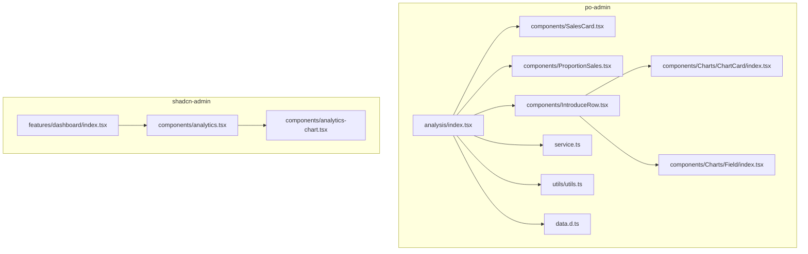
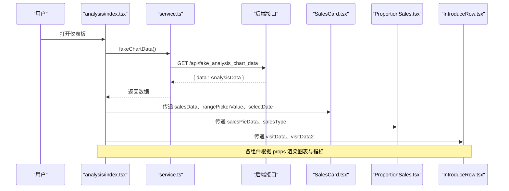
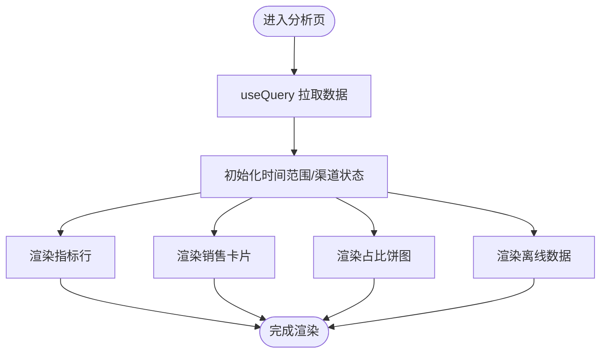
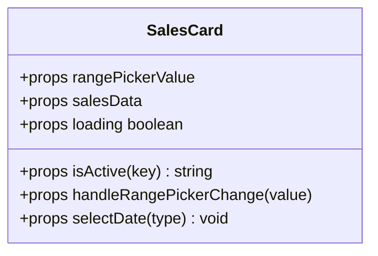
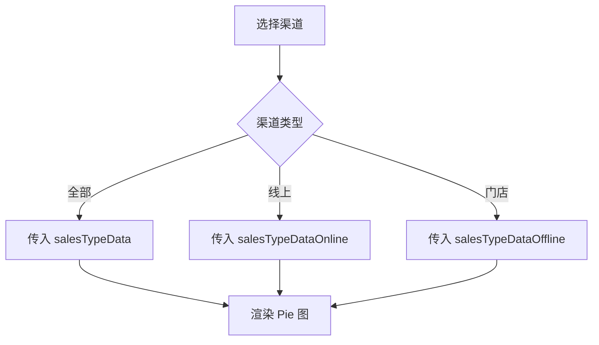
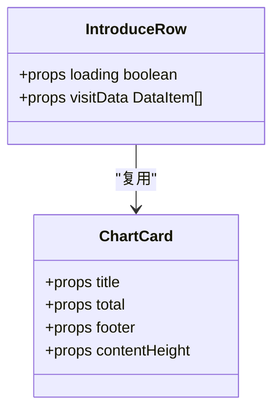
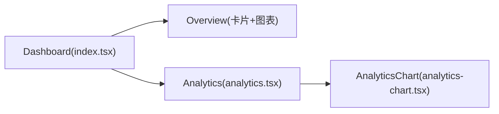
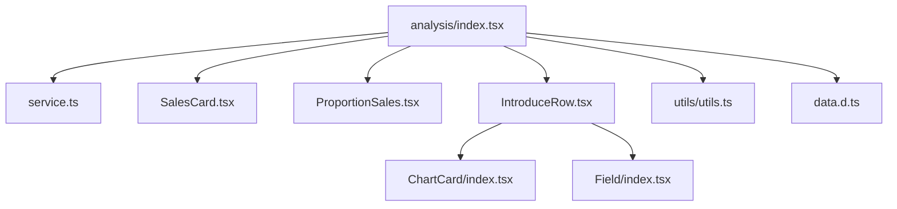

# 仪表板模块

<cite>
**本文引用的文件**
- [web_client/po-admin/src/pages/dashboard/analysis/index.tsx](file://web_client/po-admin/src/pages/dashboard/analysis/index.tsx)
- [web_client/po-admin/src/pages/dashboard/analysis/components/SalesCard.tsx](file://web_client/po-admin/src/pages/dashboard/analysis/components/SalesCard.tsx)
- [web_client/po-admin/src/pages/dashboard/analysis/components/ProportionSales.tsx](file://web_client/po-admin/src/pages/dashboard/analysis/components/ProportionSales.tsx)
- [web_client/po-admin/src/pages/dashboard/analysis/components/IntroduceRow.tsx](file://web_client/po-admin/src/pages/dashboard/analysis/components/IntroduceRow.tsx)
- [web_client/po-admin/src/pages/dashboard/analysis/components/Charts/ChartCard/index.tsx](file://web_client/po-admin/src/pages/dashboard/analysis/components/Charts/ChartCard/index.tsx)
- [web_client/po-admin/src/pages/dashboard/analysis/components/Charts/Field/index.tsx](file://web_client/po-admin/src/pages/dashboard/analysis/components/Charts/Field/index.tsx)
- [web_client/po-admin/src/pages/dashboard/analysis/service.ts](file://web_client/po-admin/src/pages/dashboard/analysis/service.ts)
- [web_client/po-admin/src/pages/dashboard/analysis/utils/utils.ts](file://web_client/po-admin/src/pages/dashboard/analysis/utils/utils.ts)
- [web_client/po-admin/src/pages/dashboard/analysis/data.d.ts](file://web_client/po-admin/src/pages/dashboard/analysis/data.d.ts)
- [web_client/shadcn-admin/src/features/dashboard/index.tsx](file://web_client/shadcn-admin/src/features/dashboard/index.tsx)
- [web_client/shadcn-admin/src/features/dashboard/components/analytics.tsx](file://web_client/shadcn-admin/src/features/dashboard/components/analytics.tsx)
- [web_client/shadcn-admin/src/features/dashboard/components/analytics-chart.tsx](file://web_client/shadcn-admin/src/features/dashboard/components/analytics-chart.tsx)
</cite>

## 目录
1. [简介](#简介)
2. [项目结构](#项目结构)
3. [核心组件](#核心组件)
4. [架构总览](#架构总览)
5. [详细组件分析](#详细组件分析)
6. [依赖关系分析](#依赖关系分析)
7. [性能考虑](#性能考虑)
8. [故障排查指南](#故障排查指南)
9. [结论](#结论)
10. [附录](#附录)

## 简介
本技术文档聚焦于“仪表板模块”的数据可视化实现、布局设计、数据分析与实时更新机制，并提供图表定制示例与性能优化建议。仓库包含两套前端实现：
- Ant Design Pro（po-admin）：基于 @ant-design/plots 的图表方案，使用 React Query 进行数据请求与缓存，结合日期选择器与分段控件完成时间维度与渠道维度的筛选。
- Shadcn Admin：基于 Recharts 的轻量级图表方案，提供概览与分析页签，便于对比不同技术栈下的实现差异。

## 项目结构
仪表板模块主要位于 web_client 下两个子工程：
- po-admin：完整的分析型仪表板页面，包含指标卡片、销售卡片、占比饼图、搜索排行等组件，并通过 service 层统一发起数据请求。
- shadcn-admin：简洁的仪表板骨架与图表展示，侧重可组合性与主题化。

**图示来源**
- [web_client/po-admin/src/pages/dashboard/analysis/index.tsx:1-161](file://web_client/po-admin/src/pages/dashboard/analysis/index.tsx#L1-L161)
- [web_client/shadcn-admin/src/features/dashboard/index.tsx:1-221](file://web_client/shadcn-admin/src/features/dashboard/index.tsx#L1-L221)

**章节来源**
- [web_client/po-admin/src/pages/dashboard/analysis/index.tsx:1-161](file://web_client/po-admin/src/pages/dashboard/analysis/index.tsx#L1-L161)
- [web_client/shadcn-admin/src/features/dashboard/index.tsx:1-221](file://web_client/shadcn-admin/src/features/dashboard/index.tsx#L1-L221)

## 核心组件
- 分析页入口（analysis/index.tsx）
  - 使用 React Query 获取分析数据，管理时间范围与销售渠道状态，组装并分发至各子组件。
  - 通过 GridContent 包裹整体布局，配合 Row/Col 栅格实现响应式排列。
- 销售卡片（SalesCard.tsx）
  - 基于 @ant-design/plots 的 Column 柱状图展示销售额与访问量，右侧为门店排名列表。
  - 顶部提供“今日/本周/本月/本年”快捷按钮与 RangePicker 自定义时间范围。
- 销售占比（ProportionSales.tsx）
  - 基于 @ant-design/plots 的 Pie 环形图，支持“全部渠道/线上/门店”切换。
- 指标行（IntroduceRow.tsx）
  - 四个指标卡片：总销售额、访问量、支付笔数、运营活动效果；内部复用 ChartCard 与 Field 等基础组件。
  - 使用 Area/Column/Progress 等图表与进度条呈现趋势与完成率。
- 通用卡片（ChartCard/index.tsx）
  - 封装标题、操作区、总量、内容区与底部字段，支持加载态与固定高度内容区。
- 字段（Field/index.tsx）
  - 标签与数值成对展示的轻量组件。
- 数据服务（service.ts）
  - 统一调用 /api/fake_analysis_chart_data 获取分析数据。
- 工具函数（utils/utils.ts）
  - 根据类型生成“今日/本周/本月/本年”的时间区间，供 RangePicker 使用。
- 类型定义（data.d.ts）
  - 统一定义 visitData、salesData、offlineData 等数据结构。

**章节来源**
- [web_client/po-admin/src/pages/dashboard/analysis/index.tsx:1-161](file://web_client/po-admin/src/pages/dashboard/analysis/index.tsx#L1-L161)
- [web_client/po-admin/src/pages/dashboard/analysis/components/SalesCard.tsx:1-226](file://web_client/po-admin/src/pages/dashboard/analysis/components/SalesCard.tsx#L1-L226)
- [web_client/po-admin/src/pages/dashboard/analysis/components/ProportionSales.tsx:1-70](file://web_client/po-admin/src/pages/dashboard/analysis/components/ProportionSales.tsx#L1-L70)
- [web_client/po-admin/src/pages/dashboard/analysis/components/IntroduceRow.tsx:1-163](file://web_client/po-admin/src/pages/dashboard/analysis/components/IntroduceRow.tsx#L1-L163)
- [web_client/po-admin/src/pages/dashboard/analysis/components/Charts/ChartCard/index.tsx:1-111](file://web_client/po-admin/src/pages/dashboard/analysis/components/Charts/ChartCard/index.tsx#L1-L111)
- [web_client/po-admin/src/pages/dashboard/analysis/components/Charts/Field/index.tsx:1-18](file://web_client/po-admin/src/pages/dashboard/analysis/components/Charts/Field/index.tsx#L1-L18)
- [web_client/po-admin/src/pages/dashboard/analysis/service.ts:1-7](file://web_client/po-admin/src/pages/dashboard/analysis/service.ts#L1-L7)
- [web_client/po-admin/src/pages/dashboard/analysis/utils/utils.ts:1-58](file://web_client/po-admin/src/pages/dashboard/analysis/utils/utils.ts#L1-L58)
- [web_client/po-admin/src/pages/dashboard/analysis/data.d.ts:1-46](file://web_client/po-admin/src/pages/dashboard/analysis/data.d.ts#L1-L46)

## 架构总览
po-admin 的分析仪表板采用“页面容器 + 业务组件 + 图表库 + 数据服务”的分层结构：
- 页面容器负责状态管理与数据装配。
- 业务组件专注渲染与交互。
- 图表库负责可视化渲染。
- 数据服务统一网络请求与错误处理。

**图示来源**
- [web_client/po-admin/src/pages/dashboard/analysis/index.tsx:34-156](file://web_client/po-admin/src/pages/dashboard/analysis/index.tsx#L34-L156)
- [web_client/po-admin/src/pages/dashboard/analysis/service.ts:4-6](file://web_client/po-admin/src/pages/dashboard/analysis/service.ts#L4-L6)

**章节来源**
- [web_client/po-admin/src/pages/dashboard/analysis/index.tsx:1-161](file://web_client/po-admin/src/pages/dashboard/analysis/index.tsx#L1-L161)
- [web_client/po-admin/src/pages/dashboard/analysis/service.ts:1-7](file://web_client/po-admin/src/pages/dashboard/analysis/service.ts#L1-L7)

## 详细组件分析

### 分析页入口（analysis/index.tsx）
- 数据获取与缓存
  - 使用 useQuery 以查询键 ['dashboard-analysis'] 拉取数据，天然具备缓存与重试能力。
- 时间范围与渠道筛选
  - 通过 getTimeDistance 计算默认时间范围，RangePicker 变更时更新状态。
  - 根据 salesType 动态选择全量/线上/门店的饼图数据。
- 布局与响应式
  - 使用 Row/Col 栅格在不同断点下调整列宽，保证移动端可读性。
- 子组件装配
  - IntroduceRow、SalesCard、ProportionSales、OfflineData 均接收 loading 与对应数据。

**图示来源**
- [web_client/po-admin/src/pages/dashboard/analysis/index.tsx:27-156](file://web_client/po-admin/src/pages/dashboard/analysis/index.tsx#L27-L156)
- [web_client/po-admin/src/pages/dashboard/analysis/utils/utils.ts:10-57](file://web_client/po-admin/src/pages/dashboard/analysis/utils/utils.ts#L10-L57)

**章节来源**
- [web_client/po-admin/src/pages/dashboard/analysis/index.tsx:1-161](file://web_client/po-admin/src/pages/dashboard/analysis/index.tsx#L1-L161)
- [web_client/po-admin/src/pages/dashboard/analysis/utils/utils.ts:1-58](file://web_client/po-admin/src/pages/dashboard/analysis/utils/utils.ts#L1-L58)

### 销售卡片（SalesCard.tsx）
- 图表与交互
  - 使用 Column 分别展示“销售额”和“访问量”，配置 x/y 字段、刻度内边距与 Tooltip。
  - 顶部 Tabs 切换视图，Extra 区域提供快捷时间与 RangePicker。
- 排名列表
  - 右侧展示门店销售额/访问量排名，前几名高亮显示。
- 数据绑定
  - 通过 props 接收 salesData、rangePickerValue、selectDate、isActive 等，保持无状态与可测试性。

**图示来源**
- [web_client/po-admin/src/pages/dashboard/analysis/components/SalesCard.tsx:23-224](file://web_client/po-admin/src/pages/dashboard/analysis/components/SalesCard.tsx#L23-L224)

**章节来源**
- [web_client/po-admin/src/pages/dashboard/analysis/components/SalesCard.tsx:1-226](file://web_client/po-admin/src/pages/dashboard/analysis/components/SalesCard.tsx#L1-L226)

### 销售占比（ProportionSales.tsx）
- 图表配置
  - 使用 Pie 环形图，angleField/colorField 映射 y/x，label 显示类别与数值。
- 渠道切换
  - 通过 Segmented 在“全部渠道/线上/门店”间切换，父组件根据当前值传入对应数据。
- 样式与尺寸
  - 设置 radius/innerRadius 控制环大小，height 固定高度确保对齐。

**图示来源**
- [web_client/po-admin/src/pages/dashboard/analysis/components/ProportionSales.tsx:9-66](file://web_client/po-admin/src/pages/dashboard/analysis/components/ProportionSales.tsx#L9-L66)

**章节来源**
- [web_client/po-admin/src/pages/dashboard/analysis/components/ProportionSales.tsx:1-70](file://web_client/po-admin/src/pages/dashboard/analysis/components/ProportionSales.tsx#L1-L70)

### 指标行（IntroduceRow.tsx）
- 指标卡片
  - 使用 ChartCard 封装标题、操作提示、总量与底部字段。
  - 面积图/柱状图/进度条用于趋势与完成率展示。
- 响应式栅格
  - topColResponsiveProps 定义多端列宽，保证小屏可读性。
- 数据绑定
  - visitData 作为面积图与柱状图的数据源，formatNumber 格式化数值。

**图示来源**
- [web_client/po-admin/src/pages/dashboard/analysis/components/IntroduceRow.tsx:22-159](file://web_client/po-admin/src/pages/dashboard/analysis/components/IntroduceRow.tsx#L22-L159)
- [web_client/po-admin/src/pages/dashboard/analysis/components/Charts/ChartCard/index.tsx:87-108](file://web_client/po-admin/src/pages/dashboard/analysis/components/Charts/ChartCard/index.tsx#L87-L108)

**章节来源**
- [web_client/po-admin/src/pages/dashboard/analysis/components/IntroduceRow.tsx:1-163](file://web_client/po-admin/src/pages/dashboard/analysis/components/IntroduceRow.tsx#L1-L163)
- [web_client/po-admin/src/pages/dashboard/analysis/components/Charts/ChartCard/index.tsx:1-111](file://web_client/po-admin/src/pages/dashboard/analysis/components/Charts/ChartCard/index.tsx#L1-L111)

### Shadcn Admin 仪表板
- 概览与分析页签
  - 使用 Tabs 组织 Overview 与 Analytics，Overview 展示关键指标卡与分析图。
- 图表实现
  - 使用 Recharts 的 AreaChart 与 ResponsiveContainer 实现自适应面积图。
- 数据与展示
  - 本地随机数据演示，便于替换为真实数据源。

**图示来源**
- [web_client/shadcn-admin/src/features/dashboard/index.tsx:22-189](file://web_client/shadcn-admin/src/features/dashboard/index.tsx#L22-L189)
- [web_client/shadcn-admin/src/features/dashboard/components/analytics.tsx:10-151](file://web_client/shadcn-admin/src/features/dashboard/components/analytics.tsx#L10-L151)
- [web_client/shadcn-admin/src/features/dashboard/components/analytics-chart.tsx:41-76](file://web_client/shadcn-admin/src/features/dashboard/components/analytics-chart.tsx#L41-L76)

**章节来源**
- [web_client/shadcn-admin/src/features/dashboard/index.tsx:1-221](file://web_client/shadcn-admin/src/features/dashboard/index.tsx#L1-L221)
- [web_client/shadcn-admin/src/features/dashboard/components/analytics.tsx:1-190](file://web_client/shadcn-admin/src/features/dashboard/components/analytics.tsx#L1-L190)
- [web_client/shadcn-admin/src/features/dashboard/components/analytics-chart.tsx:1-78](file://web_client/shadcn-admin/src/features/dashboard/components/analytics-chart.tsx#L1-L78)

## 依赖关系分析
- 组件耦合
  - analysis/index.tsx 作为编排层，依赖 service.ts 获取数据，向子组件传递 props，低耦合、高内聚。
  - SalesCard、ProportionSales、IntroduceRow 各自独立，仅通过 props 通信。
- 外部依赖
  - @ant-design/plots：图表渲染。
  - antd：UI 组件（Card、Tabs、DatePicker、Segmented、Progress 等）。
  - @tanstack/react-query：数据请求与缓存。
  - dayjs：日期计算。
- 类型契约
  - data.d.ts 统一定义数据结构，保障前后端一致性与 TypeScript 类型安全。

**图示来源**
- [web_client/po-admin/src/pages/dashboard/analysis/index.tsx:1-161](file://web_client/po-admin/src/pages/dashboard/analysis/index.tsx#L1-L161)
- [web_client/po-admin/src/pages/dashboard/analysis/service.ts:1-7](file://web_client/po-admin/src/pages/dashboard/analysis/service.ts#L1-L7)
- [web_client/po-admin/src/pages/dashboard/analysis/utils/utils.ts:1-58](file://web_client/po-admin/src/pages/dashboard/analysis/utils/utils.ts#L1-L58)
- [web_client/po-admin/src/pages/dashboard/analysis/data.d.ts:1-46](file://web_client/po-admin/src/pages/dashboard/analysis/data.d.ts#L1-L46)

**章节来源**
- [web_client/po-admin/src/pages/dashboard/analysis/index.tsx:1-161](file://web_client/po-admin/src/pages/dashboard/analysis/index.tsx#L1-L161)
- [web_client/po-admin/src/pages/dashboard/analysis/service.ts:1-7](file://web_client/po-admin/src/pages/dashboard/analysis/service.ts#L1-L7)
- [web_client/po-admin/src/pages/dashboard/analysis/utils/utils.ts:1-58](file://web_client/po-admin/src/pages/dashboard/analysis/utils/utils.ts#L1-L58)
- [web_client/po-admin/src/pages/dashboard/analysis/data.d.ts:1-46](file://web_client/po-admin/src/pages/dashboard/analysis/data.d.ts#L1-L46)

## 性能考虑
- 数据缓存与去重
  - 使用 React Query 的 queryKey 缓存数据，避免重复请求；可通过 staleTime/refetchOnWindowFocus 调优。
- 图表渲染优化
  - 合理设置图表 height、padding、axis 与 tooltip，减少重绘开销。
  - 大数据集建议使用采样或分页加载，避免一次性渲染过多节点。
- 响应式与布局
  - 使用栅格系统在不同屏幕宽度下调整列宽，提升移动端体验。
- 资源加载
  - 使用 Suspense 包裹子组件，提供加载占位，改善首屏感知。
- 主题与样式
  - 通过样式文件集中管理，避免内联样式导致的性能损耗。

[本节为通用指导，不直接分析具体文件]

## 故障排查指南
- 数据为空或加载失败
  - 检查 service.ts 的请求路径与后端接口是否可达。
  - 查看 React Query 的错误状态与重试策略。
- 图表不显示或异常
  - 确认传入数据的字段名与图表配置一致（如 xField/yField、angleField/colorField）。
  - 检查数据格式是否符合 data.d.ts 定义。
- 时间范围不正确
  - 核对 utils/utils.ts 中 getTimeDistance 的计算逻辑与 Dayjs 的使用。
- 交互无效
  - 检查父组件是否正确传递 onChange/selectDate/handleRangePickerChange 等回调。
  - 确认 Segmented/Tabs/RangePicker 的 value 与受控状态绑定正确。

**章节来源**
- [web_client/po-admin/src/pages/dashboard/analysis/service.ts:4-6](file://web_client/po-admin/src/pages/dashboard/analysis/service.ts#L4-L6)
- [web_client/po-admin/src/pages/dashboard/analysis/utils/utils.ts:10-57](file://web_client/po-admin/src/pages/dashboard/analysis/utils/utils.ts#L10-L57)
- [web_client/po-admin/src/pages/dashboard/analysis/data.d.ts:1-46](file://web_client/po-admin/src/pages/dashboard/analysis/data.d.ts#L1-L46)

## 结论
本仪表板模块通过清晰的分层与组件化设计，实现了灵活的数据可视化与良好的用户体验。po-admin 基于 Ant Design Pro 生态，适合企业级复杂场景；shadcn-admin 基于 Recharts，更轻量且易于主题定制。建议在后续迭代中引入 WebSocket 推送与更完善的缓存策略，进一步提升实时性与性能。

[本节为总结，不直接分析具体文件]

## 附录

### 数据模型（data.d.ts）
- DataItem：通用数据项，支持字符串、数字、数组等。
- VisitDataType：访问数据，包含 x（时间）与 y（数值）。
- SearchDataType：搜索关键词统计。
- OfflineDataType：离线数据名称与转化率。
- OfflineChartData：离线数据时间序列。
- RadarData：雷达图数据。
- AnalysisData：分析页所需的全部数据集。

**章节来源**
- [web_client/po-admin/src/pages/dashboard/analysis/data.d.ts:1-46](file://web_client/po-admin/src/pages/dashboard/analysis/data.d.ts#L1-L46)

### 图表定制示例（思路与步骤）
- 创建自定义图表组件
  - 选择 @ant-design/plots 或 Recharts，定义数据字段映射与样式。
  - 将图表封装为独立组件，接受 props 与事件回调。
- 添加交互功能
  - 在父组件维护状态（如时间范围、渠道），通过 props 传递给图表组件。
  - 使用 onClick/onSelect 等回调触发数据刷新或路由跳转。
- 接入真实数据
  - 在 service.ts 中对接后端接口，使用 React Query 管理缓存与错误。
  - 在 data.d.ts 中定义严格类型，确保类型安全。

[本节为概念性说明，不直接分析具体文件]