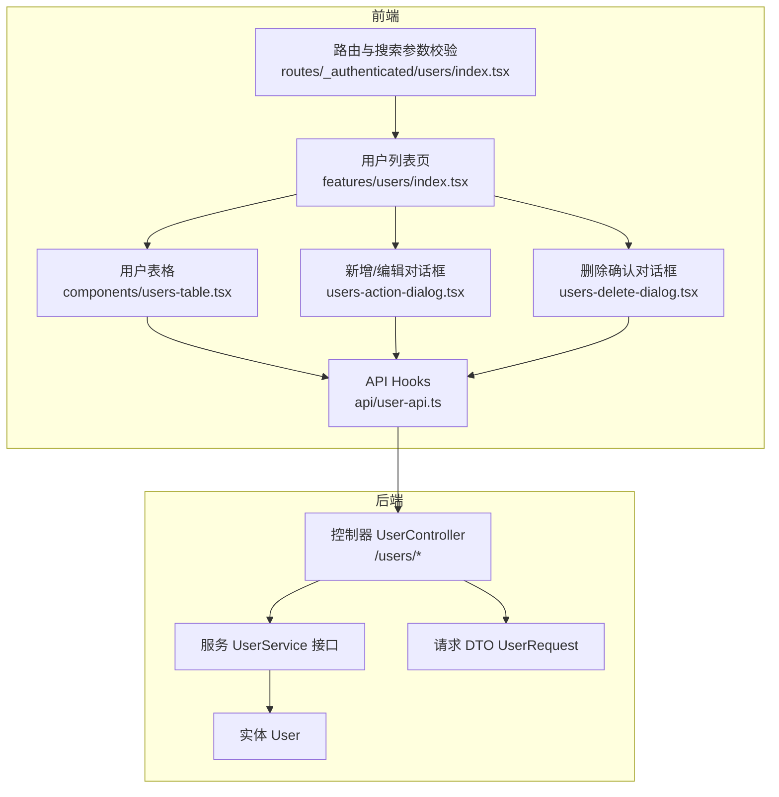
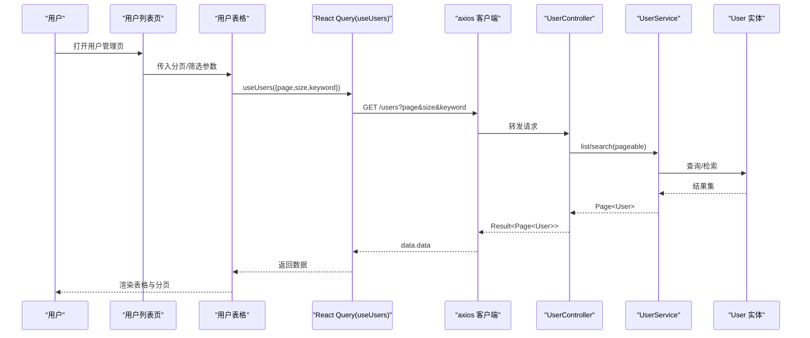
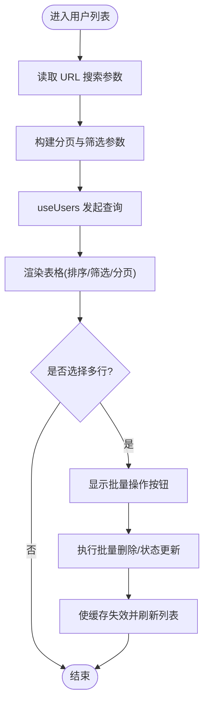
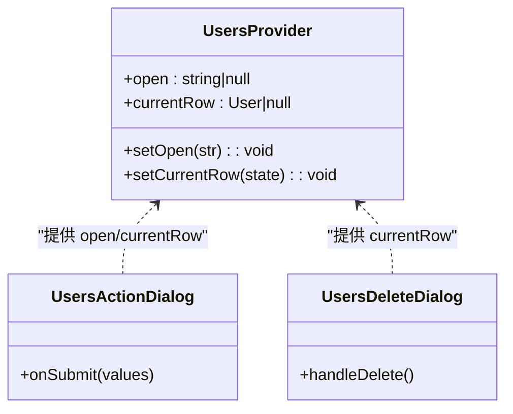
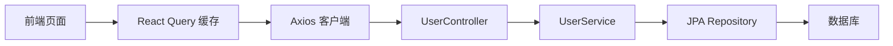

# 用户管理模块

<cite>
**本文引用的文件**
- [web_client/shadcn-admin/src/features/users/index.tsx](file://web_client/shadcn-admin/src/features/users/index.tsx)
- [web_client/shadcn-admin/src/features/users/api/user-api.ts](file://web_client/shadcn-admin/src/features/users/api/user-api.ts)
- [web_client/shadcn-admin/src/features/users/data/schema.ts](file://web_client/shadcn-admin/src/features/users/data/schema.ts)
- [web_client/shadcn-admin/src/features/users/data/data.ts](file://web_client/shadcn-admin/src/features/users/data/data.ts)
- [web_client/shadcn-admin/src/features/users/components/users-table.tsx](file://web_client/shadcn-admin/src/features/users/components/users-table.tsx)
- [web_client/shadcn-admin/src/features/users/components/users-provider.tsx](file://web_client/shadcn-admin/src/features/users/components/users-provider.tsx)
- [web_client/shadcn-admin/src/features/users/components/users-action-dialog.tsx](file://web_client/shadcn-admin/src/features/users/components/users-action-dialog.tsx)
- [web_client/shadcn-admin/src/features/users/components/users-delete-dialog.tsx](file://web_client/shadcn-admin/src/features/users/components/users-delete-dialog.tsx)
- [web_client/shadcn-admin/src/routes/_authenticated/users/index.tsx](file://web_client/shadcn-admin/src/routes/_authenticated/users/index.tsx)
- [java_server/po/src/main/java/com/goodzheng/po/controller/UserController.java](file://java_server/po/src/main/java/com/goodzheng/po/controller/UserController.java)
- [java_server/po/src/main/java/com/goodzheng/po/service/UserService.java](file://java_server/po/src/main/java/com/goodzheng/po/service/UserService.java)
- [java_server/po/src/main/java/com/goodzheng/po/entity/User.java](file://java_server/po/src/main/java/com/goodzheng/po/entity/User.java)
- [java_server/po/src/main/java/com/goodzheng/po/dto/UserRequest.java](file://java_server/po/src/main/java/com/goodzheng/po/dto/UserRequest.java)
</cite>

## 目录
1. [简介](#简介)
2. [项目结构](#项目结构)
3. [核心组件](#核心组件)
4. [架构总览](#架构总览)
5. [详细组件分析](#详细组件分析)
6. [依赖关系分析](#依赖关系分析)
7. [性能与缓存策略](#性能与缓存策略)
8. [故障排查指南](#故障排查指南)
9. [结论](#结论)
10. [附录：扩展示例](#附录扩展示例)

## 简介
本技术文档围绕“用户管理模块”的完整实现进行系统化说明，覆盖前后端职责划分、数据获取与同步机制、表格高级功能（批量操作、筛选、分页）、对话框交互（新增/编辑/删除/邀请）以及权限与角色管理。同时提供数据安全、隐私保护与性能优化的最佳实践，并给出可扩展的开发示例，帮助快速添加新字段或扩展权限体系。

## 项目结构
该模块采用前后端分离架构：
- 前端（React + TanStack Router + React Query + TanStack Table）：负责页面渲染、状态管理、表单校验、API 调用与表格交互。
- 后端（Spring Boot）：提供 RESTful API，处理用户 CRUD、分页查询、批量操作与基于 JWT 的身份解析。

图表来源
- [web_client/shadcn-admin/src/features/users/index.tsx:1-75](file://web_client/shadcn-admin/src/features/users/index.tsx#L1-L75)
- [web_client/shadcn-admin/src/features/users/components/users-table.tsx:1-196](file://web_client/shadcn-admin/src/features/users/components/users-table.tsx#L1-L196)
- [web_client/shadcn-admin/src/features/users/api/user-api.ts:1-148](file://web_client/shadcn-admin/src/features/users/api/user-api.ts#L1-L148)
- [web_client/shadcn-admin/src/features/users/components/users-action-dialog.tsx:1-359](file://web_client/shadcn-admin/src/features/users/components/users-action-dialog.tsx#L1-L359)
- [web_client/shadcn-admin/src/features/users/components/users-delete-dialog.tsx:1-95](file://web_client/shadcn-admin/src/features/users/components/users-delete-dialog.tsx#L1-L95)
- [web_client/shadcn-admin/src/routes/_authenticated/users/index.tsx:1-32](file://web_client/shadcn-admin/src/routes/_authenticated/users/index.tsx#L1-L32)
- [java_server/po/src/main/java/com/goodzheng/po/controller/UserController.java:1-133](file://java_server/po/src/main/java/com/goodzheng/po/controller/UserController.java#L1-L133)
- [java_server/po/src/main/java/com/goodzheng/po/service/UserService.java:1-28](file://java_server/po/src/main/java/com/goodzheng/po/service/UserService.java#L1-L28)
- [java_server/po/src/main/java/com/goodzheng/po/entity/User.java:1-59](file://java_server/po/src/main/java/com/goodzheng/po/entity/User.java#L1-L59)
- [java_server/po/src/main/java/com/goodzheng/po/dto/UserRequest.java:1-30](file://java_server/po/src/main/java/com/goodzheng/po/dto/UserRequest.java#L1-L30)

章节来源
- [web_client/shadcn-admin/src/features/users/index.tsx:1-75](file://web_client/shadcn-admin/src/features/users/index.tsx#L1-L75)
- [web_client/shadcn-admin/src/routes/_authenticated/users/index.tsx:1-32](file://web_client/shadcn-admin/src/routes/_authenticated/users/index.tsx#L1-L32)
- [java_server/po/src/main/java/com/goodzheng/po/controller/UserController.java:1-133](file://java_server/po/src/main/java/com/goodzheng/po/controller/UserController.java#L1-L133)

## 核心组件
- 用户列表页：聚合头部、主按钮区、表格与对话框容器，负责将 URL 搜索参数转换为分页与过滤条件，并驱动数据加载。
- 用户表格：基于 TanStack Table 实现排序、列可见性、多列筛选、分页与批量操作；通过 URL 状态同步保持可分享链接。
- API Hooks：封装查询与变更，使用 React Query 进行缓存与失效刷新；统一错误提示与成功反馈。
- 对话框：新增/编辑共用一个表单对话框，删除使用二次确认对话框；邀请流程由独立对话框承载。
- 上下文与提供者：集中管理弹窗开关与当前行数据，避免 props 穿透。
- 后端控制器与服务：提供分页列表、详情、创建、更新、删除、批量删除与批量状态更新等接口；支持按关键字搜索与按时间倒序排序。

章节来源
- [web_client/shadcn-admin/src/features/users/components/users-table.tsx:1-196](file://web_client/shadcn-admin/src/features/users/components/users-table.tsx#L1-L196)
- [web_client/shadcn-admin/src/features/users/api/user-api.ts:1-148](file://web_client/shadcn-admin/src/features/users/api/user-api.ts#L1-L148)
- [web_client/shadcn-admin/src/features/users/components/users-provider.tsx:1-37](file://web_client/shadcn-admin/src/features/users/components/users-provider.tsx#L1-L37)
- [web_client/shadcn-admin/src/features/users/components/users-action-dialog.tsx:1-359](file://web_client/shadcn-admin/src/features/users/components/users-action-dialog.tsx#L1-L359)
- [web_client/shadcn-admin/src/features/users/components/users-delete-dialog.tsx:1-95](file://web_client/shadcn-admin/src/features/users/components/users-delete-dialog.tsx#L1-L95)
- [java_server/po/src/main/java/com/goodzheng/po/controller/UserController.java:1-133](file://java_server/po/src/main/java/com/goodzheng/po/controller/UserController.java#L1-L133)

## 架构总览
前端以 React Query 作为数据层，TanStack Table 作为表格引擎，URL 状态作为持久化视图状态；后端以 Spring MVC 暴露 REST API，使用 JPA 实体与 DTO 完成数据契约。

图表来源
- [web_client/shadcn-admin/src/features/users/index.tsx:1-75](file://web_client/shadcn-admin/src/features/users/index.tsx#L1-L75)
- [web_client/shadcn-admin/src/features/users/components/users-table.tsx:1-196](file://web_client/shadcn-admin/src/features/users/components/users-table.tsx#L1-L196)
- [web_client/shadcn-admin/src/features/users/api/user-api.ts:1-148](file://web_client/shadcn-admin/src/features/users/api/user-api.ts#L1-L148)
- [java_server/po/src/main/java/com/goodzheng/po/controller/UserController.java:1-133](file://java_server/po/src/main/java/com/goodzheng/po/controller/UserController.java#L1-L133)
- [java_server/po/src/main/java/com/goodzheng/po/service/UserService.java:1-28](file://java_server/po/src/main/java/com/goodzheng/po/service/UserService.java#L1-L28)
- [java_server/po/src/main/java/com/goodzheng/po/entity/User.java:1-59](file://java_server/po/src/main/java/com/goodzheng/po/entity/User.java#L1-L59)

## 详细组件分析

### 用户列表页与路由参数
- 路由参数校验：使用 Zod 对 page、pageSize、status、role、username 等进行搜索参数校验与默认值兜底。
- 分页转换：将前端的 1-based 页码转换为后端的 0-based 页码。
- 数据加载：通过 useUsers 钩子发起分页查询，结合 isLoading/isError 展示加载态与空态。

章节来源
- [web_client/shadcn-admin/src/routes/_authenticated/users/index.tsx:1-32](file://web_client/shadcn-admin/src/routes/_authenticated/users/index.tsx#L1-L32)
- [web_client/shadcn-admin/src/features/users/index.tsx:1-75](file://web_client/shadcn-admin/src/features/users/index.tsx#L1-L75)

### 用户表格与高级功能
- 列筛选：支持用户名文本筛选、状态多选、角色多选，并通过 URL 状态持久化。
- 排序与分页：启用手动分页，页码变化触发重新查询。
- 批量操作：选择多行后可执行批量删除或批量状态更新。
- 工具栏与分页器：统一封装表格工具栏与分页控件。

图表来源
- [web_client/shadcn-admin/src/features/users/components/users-table.tsx:1-196](file://web_client/shadcn-admin/src/features/users/components/users-table.tsx#L1-L196)
- [web_client/shadcn-admin/src/features/users/api/user-api.ts:116-147](file://web_client/shadcn-admin/src/features/users/api/user-api.ts#L116-L147)

章节来源
- [web_client/shadcn-admin/src/features/users/components/users-table.tsx:1-196](file://web_client/shadcn-admin/src/features/users/components/users-table.tsx#L1-L196)

### 用户对话框（新增/编辑/删除/邀请）
- 新增/编辑：共用表单对话框，使用 zod 进行强类型校验；编辑时密码可选，新增必填；提交后自动刷新列表。
- 删除：二次确认，要求输入用户名匹配后方可删除，防止误删。
- 邀请：独立对话框，用于发送邀请流程（具体逻辑由业务决定）。
- 上下文管理：通过 UsersProvider 统一管理弹窗状态与当前行数据。

图表来源
- [web_client/shadcn-admin/src/features/users/components/users-provider.tsx:1-37](file://web_client/shadcn-admin/src/features/users/components/users-provider.tsx#L1-L37)
- [web_client/shadcn-admin/src/features/users/components/users-action-dialog.tsx:1-359](file://web_client/shadcn-admin/src/features/users/components/users-action-dialog.tsx#L1-L359)
- [web_client/shadcn-admin/src/features/users/components/users-delete-dialog.tsx:1-95](file://web_client/shadcn-admin/src/features/users/components/users-delete-dialog.tsx#L1-L95)

章节来源
- [web_client/shadcn-admin/src/features/users/components/users-provider.tsx:1-37](file://web_client/shadcn-admin/src/features/users/components/users-provider.tsx#L1-L37)
- [web_client/shadcn-admin/src/features/users/components/users-action-dialog.tsx:1-359](file://web_client/shadcn-admin/src/features/users/components/users-action-dialog.tsx#L1-L359)
- [web_client/shadcn-admin/src/features/users/components/users-delete-dialog.tsx:1-95](file://web_client/shadcn-admin/src/features/users/components/users-delete-dialog.tsx#L1-L95)

### 数据模型与类型定义
- 前端类型：schema.ts 定义了用户状态、角色枚举与用户对象结构，确保前后端数据结构一致。
- 后端实体：User 实体包含用户名、邮箱、昵称、头像、姓名、电话、角色、状态、时间戳等字段，并对唯一性与非空进行约束。
- 请求 DTO：UserRequest 限定创建/更新时的入参结构与校验规则。

章节来源
- [web_client/shadcn-admin/src/features/users/data/schema.ts:1-34](file://web_client/shadcn-admin/src/features/users/data/schema.ts#L1-L34)
- [java_server/po/src/main/java/com/goodzheng/po/entity/User.java:1-59](file://java_server/po/src/main/java/com/goodzheng/po/entity/User.java#L1-L59)
- [java_server/po/src/main/java/com/goodzheng/po/dto/UserRequest.java:1-30](file://java_server/po/src/main/java/com/goodzheng/po/dto/UserRequest.java#L1-L30)

### 权限控制与角色管理
- 角色枚举：前端 roles 配置了 Superadmin/Admin/Manager/Cashier 四类角色，并在筛选与下拉选择中复用。
- 后端角色：User 实体包含 role 字段，默认 admin；可通过更新接口修改。
- 访问控制：路由层可对受保护资源进行鉴权（示例中未直接体现 RBAC 中间件），建议在后端增加基于角色的接口级鉴权。

章节来源
- [web_client/shadcn-admin/src/features/users/data/data.ts:1-36](file://web_client/shadcn-admin/src/features/users/data/data.ts#L1-L36)
- [java_server/po/src/main/java/com/goodzheng/po/entity/User.java:1-59](file://java_server/po/src/main/java/com/goodzheng/po/entity/User.java#L1-L59)

## 依赖关系分析
- 前端依赖：React Query 负责缓存与失效；TanStack Table 负责表格能力；Zod 负责参数与表单校验；Axios 负责 HTTP 通信。
- 后端依赖：Spring Data JPA 提供分页与排序；Jackson 序列化实体；Lombok 简化代码。
- 耦合点：前后端通过 REST 接口契约（路径、参数、响应体）解耦；类型定义在两端分别维护，需保持一致。

图表来源
- [web_client/shadcn-admin/src/features/users/api/user-api.ts:1-148](file://web_client/shadcn-admin/src/features/users/api/user-api.ts#L1-L148)
- [java_server/po/src/main/java/com/goodzheng/po/controller/UserController.java:1-133](file://java_server/po/src/main/java/com/goodzheng/po/controller/UserController.java#L1-L133)
- [java_server/po/src/main/java/com/goodzheng/po/service/UserService.java:1-28](file://java_server/po/src/main/java/com/goodzheng/po/service/UserService.java#L1-L28)

章节来源
- [web_client/shadcn-admin/src/features/users/api/user-api.ts:1-148](file://web_client/shadcn-admin/src/features/users/api/user-api.ts#L1-L148)
- [java_server/po/src/main/java/com/goodzheng/po/controller/UserController.java:1-133](file://java_server/po/src/main/java/com/goodzheng/po/controller/UserController.java#L1-L133)

## 性能与缓存策略
- 前端缓存：React Query 根据 queryKey(['users', params]) 缓存分页数据；变更成功后通过 invalidateQueries 主动失效，保证列表实时性。
- 手动分页：表格启用 manualPagination，减少不必要的全量渲染与请求。
- URL 状态同步：筛选、分页、排序等状态写入 URL，便于分享与恢复。
- 后端分页：使用 PageRequest 指定页大小与排序方向，降低数据库压力。
- 建议优化：
  - 为高频查询增加合理缓存时间与 staleTime。
  - 对大列表考虑虚拟滚动或增量加载。
  - 后端可增加索引（如 username、status、createTime）提升查询性能。

[本节为通用性能指导，不直接分析具体文件]

## 故障排查指南
- 列表为空或报错：检查 URL 参数是否合法、网络请求是否被拦截、后端是否返回错误码。
- 表单校验失败：核对 zod 规则与提示信息，确认必填项与格式限制。
- 删除失败：确认输入的待删除用户名与当前行一致，且无并发冲突。
- 批量操作异常：检查选中 ids 是否为空、后端是否接收成功、是否触发缓存失效。
- 权限问题：确认当前用户具备相应角色，后端接口是否进行鉴权。

章节来源
- [web_client/shadcn-admin/src/features/users/components/users-action-dialog.tsx:1-359](file://web_client/shadcn-admin/src/features/users/components/users-action-dialog.tsx#L1-L359)
- [web_client/shadcn-admin/src/features/users/components/users-delete-dialog.tsx:1-95](file://web_client/shadcn-admin/src/features/users/components/users-delete-dialog.tsx#L1-L95)
- [web_client/shadcn-admin/src/features/users/api/user-api.ts:1-148](file://web_client/shadcn-admin/src/features/users/api/user-api.ts#L1-L148)
- [java_server/po/src/main/java/com/goodzheng/po/controller/UserController.java:1-133](file://java_server/po/src/main/java/com/goodzheng/po/controller/UserController.java#L1-L133)

## 结论
用户管理模块在前端实现了完整的列表展示、筛选、分页、批量操作与对话框交互；在后端提供了稳定的 REST API，支持分页、搜索、CRUD 与批量更新。通过 React Query 的缓存与失效机制，保证了数据的及时性与一致性。建议在后续迭代中完善后端鉴权、审计日志与更丰富的导出能力。

[本节为总结性内容，不直接分析具体文件]

## 附录：扩展示例

### 添加新的用户字段（以“部门”为例）
- 前端 schema：在 schema.ts 的用户对象中添加 department 字段，并在表单中增加对应输入控件。
- 前端 API：在 user-api.ts 的 UserRequest 类型中添加 department，并在提交时携带。
- 后端实体：在 User.java 中添加 department 字段与注解。
- 后端 DTO：在 UserRequest.java 中添加 department 字段与校验规则。
- 表格列：在 users-columns 中新增“部门”列展示。
- 筛选：如需支持按部门筛选，可在表格工具栏增加部门多选过滤器。

章节来源
- [web_client/shadcn-admin/src/features/users/data/schema.ts:1-34](file://web_client/shadcn-admin/src/features/users/data/schema.ts#L1-L34)
- [web_client/shadcn-admin/src/features/users/api/user-api.ts:1-148](file://web_client/shadcn-admin/src/features/users/api/user-api.ts#L1-L148)
- [java_server/po/src/main/java/com/goodzheng/po/entity/User.java:1-59](file://java_server/po/src/main/java/com/goodzheng/po/entity/User.java#L1-L59)
- [java_server/po/src/main/java/com/goodzheng/po/dto/UserRequest.java:1-30](file://java_server/po/src/main/java/com/goodzheng/po/dto/UserRequest.java#L1-L30)

### 扩展权限系统（RBAC）
- 前端：在 roles 中扩展更多角色，并在筛选与下拉中选择；在路由或页面级别根据角色隐藏/显示功能入口。
- 后端：在接口层增加基于角色的鉴权（如方法级注解），在 Controller 中校验当前用户角色后再执行业务逻辑。
- 安全建议：所有写操作均需鉴权；敏感操作（删除、批量更新）需二次确认与审计记录。

章节来源
- [web_client/shadcn-admin/src/features/users/data/data.ts:1-36](file://web_client/shadcn-admin/src/features/users/data/data.ts#L1-L36)
- [java_server/po/src/main/java/com/goodzheng/po/controller/UserController.java:1-133](file://java_server/po/src/main/java/com/goodzheng/po/controller/UserController.java#L1-L133)

### 导入导出（建议方案）
- 导入：前端提供 Excel/CSV 上传组件，后端解析并批量入库，返回导入结果与错误明细。
- 导出：前端触发导出请求，后端生成文件流返回，前端下载保存。
- 注意：大文件导入需分片或异步任务；导出需考虑分页与字段映射。

[本节为概念性建议，不直接分析具体文件]

### 数据安全与隐私保护最佳实践
- 传输安全：全站 HTTPS，敏感信息（如密码）不在日志中打印。
- 存储安全：密码加密存储（如 BCrypt），JWT 签名与过期策略。
- 输入校验：前后端双重校验，防止注入与越权。
- 最小权限：接口级鉴权，仅暴露必要字段。
- 审计日志：记录关键操作的主体、时间、IP 与结果。

[本节为通用安全指导，不直接分析具体文件]