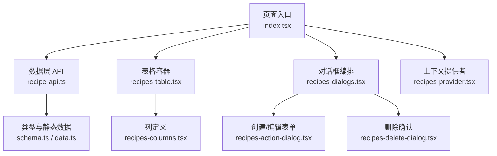
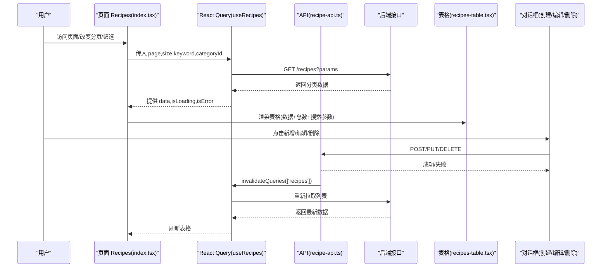
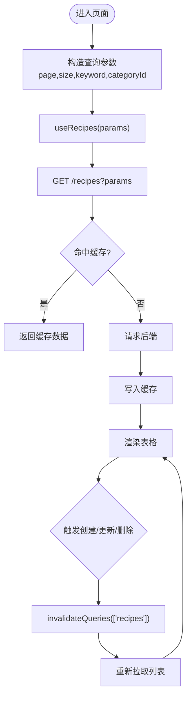
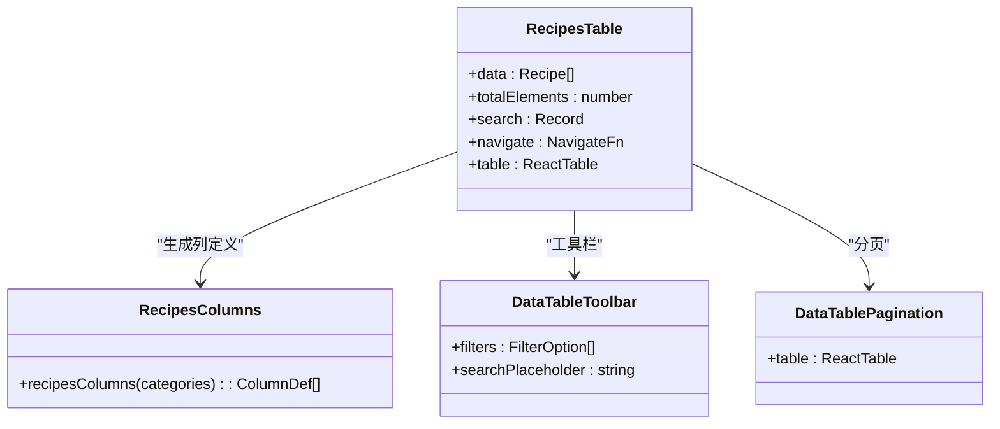
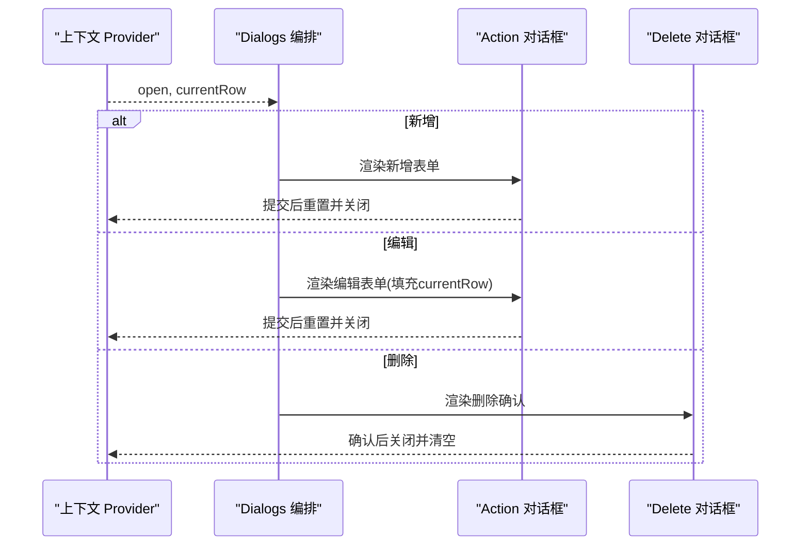
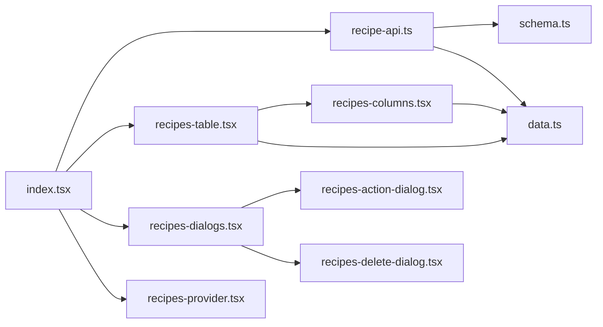

# 菜谱管理模块

<cite>
**本文引用的文件**
- [web_client/shadcn-admin/src/features/recipes/index.tsx](file://web_client/shadcn-admin/src/features/recipes/index.tsx)
- [web_client/shadcn-admin/src/features/recipes/api/recipe-api.ts](file://web_client/shadcn-admin/src/features/recipes/api/recipe-api.ts)
- [web_client/shadcn-admin/src/features/recipes/components/recipes-table.tsx](file://web_client/shadcn-admin/src/features/recipes/components/recipes-table.tsx)
- [web_client/shadcn-admin/src/features/recipes/components/recipes-columns.tsx](file://web_client/shadcn-admin/src/features/recipes/components/recipes-columns.tsx)
- [web_client/shadcn-admin/src/features/recipes/components/recipes-provider.tsx](file://web_client/shadcn-admin/src/features/recipes/components/recipes-provider.tsx)
- [web_client/shadcn-admin/src/features/recipes/components/recipes-dialogs.tsx](file://web_client/shadcn-admin/src/features/recipes/components/recipes-dialogs.tsx)
- [web_client/shadcn-admin/src/features/recipes/components/recipes-action-dialog.tsx](file://web_client/shadcn-admin/src/features/recipes/components/recipes-action-dialog.tsx)
- [web_client/shadcn-admin/src/features/recipes/components/recipes-delete-dialog.tsx](file://web_client/shadcn-admin/src/features/recipes/components/recipes-delete-dialog.tsx)
- [web_client/shadcn-admin/src/features/recipes/data/schema.ts](file://web_client/shadcn-admin/src/features/recipes/data/schema.ts)
- [web_client/shadcn-admin/src/features/recipes/data/data.ts](file://web_client/shadcn-admin/src/features/recipes/data/data.ts)
</cite>

## 目录
1. [简介](#简介)
2. [项目结构](#项目结构)
3. [核心组件](#核心组件)
4. [架构总览](#架构总览)
5. [详细组件分析](#详细组件分析)
6. [依赖关系分析](#依赖关系分析)
7. [性能考量](#性能考量)
8. [故障排查指南](#故障排查指南)
9. [结论](#结论)
10. [附录：扩展指南](#附录：扩展指南)

## 简介
本技术文档围绕“菜谱管理模块”的完整实现展开，覆盖数据获取、状态管理、用户交互与错误处理。重点说明：
- React Query 的集成使用：缓存策略、分页与搜索过滤
- 表格组件：列定义、排序、筛选与批量操作
- 对话框组件：创建、编辑、删除的统一处理模式
- 可扩展性：如何新增字段或添加新操作
- 最佳实践：加载状态、错误提示与用户体验

## 项目结构
该模块位于前端客户端 shadcn-admin 的 features/recipes 目录下，采用“按功能域组织”的结构：
- api：基于 React Query 的数据请求封装（查询与变更）
- components：页面级 UI 组件（表格、列定义、对话框、上下文提供者等）
- data：类型定义与静态数据（Schema、枚举、回退数据）
- index.tsx：路由页面入口，组合各子组件并驱动数据流

图表来源
- [web_client/shadcn-admin/src/features/recipes/index.tsx:1-82](file://web_client/shadcn-admin/src/features/recipes/index.tsx#L1-L82)
- [web_client/shadcn-admin/src/features/recipes/api/recipe-api.ts:1-161](file://web_client/shadcn-admin/src/features/recipes/api/recipe-api.ts#L1-L161)
- [web_client/shadcn-admin/src/features/recipes/components/recipes-table.tsx:1-203](file://web_client/shadcn-admin/src/features/recipes/components/recipes-table.tsx#L1-L203)
- [web_client/shadcn-admin/src/features/recipes/components/recipes-columns.tsx:1-141](file://web_client/shadcn-admin/src/features/recipes/components/recipes-columns.tsx#L1-L141)
- [web_client/shadcn-admin/src/features/recipes/components/recipes-provider.tsx:1-37](file://web_client/shadcn-admin/src/features/recipes/components/recipes-provider.tsx#L1-L37)
- [web_client/shadcn-admin/src/features/recipes/components/recipes-dialogs.tsx:1-45](file://web_client/shadcn-admin/src/features/recipes/components/recipes-dialogs.tsx#L1-L45)
- [web_client/shadcn-admin/src/features/recipes/components/recipes-action-dialog.tsx:1-432](file://web_client/shadcn-admin/src/features/recipes/components/recipes-action-dialog.tsx#L1-L432)
- [web_client/shadcn-admin/src/features/recipes/components/recipes-delete-dialog.tsx:1-94](file://web_client/shadcn-admin/src/features/recipes/components/recipes-delete-dialog.tsx#L1-L94)
- [web_client/shadcn-admin/src/features/recipes/data/schema.ts:1-50](file://web_client/shadcn-admin/src/features/recipes/data/schema.ts#L1-L50)
- [web_client/shadcn-admin/src/features/recipes/data/data.ts:1-55](file://web_client/shadcn-admin/src/features/recipes/data/data.ts#L1-L55)

章节来源
- [web_client/shadcn-admin/src/features/recipes/index.tsx:1-82](file://web_client/shadcn-admin/src/features/recipes/index.tsx#L1-L82)

## 核心组件
- 页面入口 Recipes：负责从路由参数解析分页、关键词、分类筛选，调用 useRecipes 获取数据，渲染表格与对话框。
- 数据层 recipe-api：封装所有与后端交互的请求，包括列表查询、详情查询、创建、更新、删除；统一使用 React Query 进行缓存与失效管理。
- 表格 recipes-table：基于 @tanstack/react-table 构建，支持分页、列筛选、可见性控制、行选择与 URL 状态同步。
- 列定义 recipes-columns：定义表格列、展示逻辑、筛选函数与样式元信息。
- 对话框编排 recipes-dialogs：根据上下文中的 open 状态与 currentRow 动态渲染创建/编辑/删除对话框。
- 表单对话框 recipes-action-dialog：基于 react-hook-form + zod 校验，支持食材与步骤的动态数组增删，提交时触发创建或更新。
- 删除对话框 recipes-delete-dialog：二次确认输入关键字后执行删除。
- 上下文 recipes-provider：集中管理对话框打开状态与当前行数据，供子组件共享。
- 数据类型 schema.ts：定义 Recipe、Ingredient、Step 等数据结构，确保前后端类型一致。
- 静态数据 data.ts：难度等级、分类回退数据、可见性选项等。

章节来源
- [web_client/shadcn-admin/src/features/recipes/index.tsx:1-82](file://web_client/shadcn-admin/src/features/recipes/index.tsx#L1-L82)
- [web_client/shadcn-admin/src/features/recipes/api/recipe-api.ts:1-161](file://web_client/shadcn-admin/src/features/recipes/api/recipe-api.ts#L1-L161)
- [web_client/shadcn-admin/src/features/recipes/components/recipes-table.tsx:1-203](file://web_client/shadcn-admin/src/features/recipes/components/recipes-table.tsx#L1-L203)
- [web_client/shadcn-admin/src/features/recipes/components/recipes-columns.tsx:1-141](file://web_client/shadcn-admin/src/features/recipes/components/recipes-columns.tsx#L1-L141)
- [web_client/shadcn-admin/src/features/recipes/components/recipes-provider.tsx:1-37](file://web_client/shadcn-admin/src/features/recipes/components/recipes-provider.tsx#L1-L37)
- [web_client/shadcn-admin/src/features/recipes/components/recipes-dialogs.tsx:1-45](file://web_client/shadcn-admin/src/features/recipes/components/recipes-dialogs.tsx#L1-L45)
- [web_client/shadcn-admin/src/features/recipes/components/recipes-action-dialog.tsx:1-432](file://web_client/shadcn-admin/src/features/recipes/components/recipes-action-dialog.tsx#L1-L432)
- [web_client/shadcn-admin/src/features/recipes/components/recipes-delete-dialog.tsx:1-94](file://web_client/shadcn-admin/src/features/recipes/components/recipes-delete-dialog.tsx#L1-L94)
- [web_client/shadcn-admin/src/features/recipes/data/schema.ts:1-50](file://web_client/shadcn-admin/src/features/recipes/data/schema.ts#L1-L50)
- [web_client/shadcn-admin/src/features/recipes/data/data.ts:1-55](file://web_client/shadcn-admin/src/features/recipes/data/data.ts#L1-L55)

## 架构总览
下图展示了从页面到数据层的整体流程，包括查询、变更与缓存失效。

图表来源
- [web_client/shadcn-admin/src/features/recipes/index.tsx:1-82](file://web_client/shadcn-admin/src/features/recipes/index.tsx#L1-L82)
- [web_client/shadcn-admin/src/features/recipes/api/recipe-api.ts:82-161](file://web_client/shadcn-admin/src/features/recipes/api/recipe-api.ts#L82-L161)
- [web_client/shadcn-admin/src/features/recipes/components/recipes-table.tsx:1-203](file://web_client/shadcn-admin/src/features/recipes/components/recipes-table.tsx#L1-L203)
- [web_client/shadcn-admin/src/features/recipes/components/recipes-dialogs.tsx:1-45](file://web_client/shadcn-admin/src/features/recipes/components/recipes-dialogs.tsx#L1-L45)
- [web_client/shadcn-admin/src/features/recipes/components/recipes-action-dialog.tsx:1-432](file://web_client/shadcn-admin/src/features/recipes/components/recipes-action-dialog.tsx#L1-L432)
- [web_client/shadcn-admin/src/features/recipes/components/recipes-delete-dialog.tsx:1-94](file://web_client/shadcn-admin/src/features/recipes/components/recipes-delete-dialog.tsx#L1-L94)

## 详细组件分析

### 数据获取与状态管理（React Query）
- 列表查询 useRecipes：
  - queryKey 包含 params，确保不同分页/筛选条件独立缓存
  - 通过 api.get('/recipes', { params }) 获取分页数据
  - 未设置 staleTime，默认遵循全局配置
- 详情查询 useRecipe：
  - enabled: !!id，仅在 id 存在时发起请求
- 分类查询 useRecipeCategories：
  - staleTime: 5 分钟，减少重复请求
- 变更操作（创建/更新/删除）：
  - mutationFn 调用对应 HTTP 方法
  - onSuccess 中 invalidateQueries(['recipes']) 使列表缓存失效并自动刷新
  - onError 统一 toast 提示错误信息

图表来源
- [web_client/shadcn-admin/src/features/recipes/api/recipe-api.ts:67-161](file://web_client/shadcn-admin/src/features/recipes/api/recipe-api.ts#L67-L161)

章节来源
- [web_client/shadcn-admin/src/features/recipes/api/recipe-api.ts:67-161](file://web_client/shadcn-admin/src/features/recipes/api/recipe-api.ts#L67-L161)

### 表格组件（recipes-table）
- 使用 @tanstack/react-table 的 manualPagination，服务端分页由后端控制
- 使用 useTableUrlState 将分页、列筛选、列可见性与 URL 同步，便于分享与刷新保持状态
- DataTableToolbar 提供全局搜索与分类筛选
- 列定义通过 recipesColumns(categories) 生成，支持多选、标题、分类、难度、公开状态、点赞数、创建时间、操作列
- 空数据时使用 Empty 组件展示友好提示

图表来源
- [web_client/shadcn-admin/src/features/recipes/components/recipes-table.tsx:1-203](file://web_client/shadcn-admin/src/features/recipes/components/recipes-table.tsx#L1-L203)
- [web_client/shadcn-admin/src/features/recipes/components/recipes-columns.tsx:1-141](file://web_client/shadcn-admin/src/features/recipes/components/recipes-columns.tsx#L1-L141)

章节来源
- [web_client/shadcn-admin/src/features/recipes/components/recipes-table.tsx:1-203](file://web_client/shadcn-admin/src/features/recipes/components/recipes-table.tsx#L1-L203)
- [web_client/shadcn-admin/src/features/recipes/components/recipes-columns.tsx:1-141](file://web_client/shadcn-admin/src/features/recipes/components/recipes-columns.tsx#L1-L141)

### 列定义与筛选（recipes-columns）
- 选择列：支持全选/单选，禁用排序与隐藏
- 标题列：长文本显示，禁用排序与隐藏
- 分类列：Badge 展示，filterFn 根据选中分类名称匹配
- 难度列：根据 difficulties 映射颜色与标签
- 公开列：根据布尔值显示不同样式
- 点赞与创建时间：数值与日期格式化
- 操作列：行操作入口（编辑/删除）

章节来源
- [web_client/shadcn-admin/src/features/recipes/components/recipes-columns.tsx:1-141](file://web_client/shadcn-admin/src/features/recipes/components/recipes-columns.tsx#L1-L141)
- [web_client/shadcn-admin/src/features/recipes/data/data.ts:13-35](file://web_client/shadcn-admin/src/features/recipes/data/data.ts#L13-L35)

### 对话框组件设计模式（recipes-dialogs / action / delete）
- 统一上下文：recipes-provider 维护 open 状态与 currentRow，子组件通过 useRecipes 读取
- 创建/编辑：recipes-action-dialog 复用同一表单，根据是否传 currentRow 判断模式；使用 react-hook-form + zod 校验；食材与步骤使用 useFieldArray 动态增删
- 删除：recipes-delete-dialog 二次确认输入关键字后调用删除；成功后关闭并清空输入
- 编排：recipes-dialogs 根据 open 与 currentRow 动态渲染对应对话框，并在关闭时清理 currentRow

图表来源
- [web_client/shadcn-admin/src/features/recipes/components/recipes-provider.tsx:1-37](file://web_client/shadcn-admin/src/features/recipes/components/recipes-provider.tsx#L1-L37)
- [web_client/shadcn-admin/src/features/recipes/components/recipes-dialogs.tsx:1-45](file://web_client/shadcn-admin/src/features/recipes/components/recipes-dialogs.tsx#L1-L45)
- [web_client/shadcn-admin/src/features/recipes/components/recipes-action-dialog.tsx:1-432](file://web_client/shadcn-admin/src/features/recipes/components/recipes-action-dialog.tsx#L1-L432)
- [web_client/shadcn-admin/src/features/recipes/components/recipes-delete-dialog.tsx:1-94](file://web_client/shadcn-admin/src/features/recipes/components/recipes-delete-dialog.tsx#L1-L94)

章节来源
- [web_client/shadcn-admin/src/features/recipes/components/recipes-provider.tsx:1-37](file://web_client/shadcn-admin/src/features/recipes/components/recipes-provider.tsx#L1-L37)
- [web_client/shadcn-admin/src/features/recipes/components/recipes-dialogs.tsx:1-45](file://web_client/shadcn-admin/src/features/recipes/components/recipes-dialogs.tsx#L1-L45)
- [web_client/shadcn-admin/src/features/recipes/components/recipes-action-dialog.tsx:1-432](file://web_client/shadcn-admin/src/features/recipes/components/recipes-action-dialog.tsx#L1-L432)
- [web_client/shadcn-admin/src/features/recipes/components/recipes-delete-dialog.tsx:1-94](file://web_client/shadcn-admin/src/features/recipes/components/recipes-delete-dialog.tsx#L1-L94)

### 数据模型与类型（schema.ts）
- Ingredient：食材项，包含名称、用量、单位、是否必需、排序
- Step：步骤项，包含序号、内容、可选图片/视频链接、时长
- Recipe：主实体，包含基础信息、营养信息、可见性、关联的 ingredients 与 steps、时间戳

章节来源
- [web_client/shadcn-admin/src/features/recipes/data/schema.ts:1-50](file://web_client/shadcn-admin/src/features/recipes/data/schema.ts#L1-L50)

## 依赖关系分析
- 页面入口依赖：
  - 数据层：useRecipes、useCreateRecipe、useUpdateRecipe、useDeleteRecipe、useRecipeCategories
  - UI 层：表格、列定义、对话框、Provider
- 表格依赖：
  - @tanstack/react-table 核心能力（分页、筛选、排序、选择）
  - 自定义 Hook：useTableUrlState（URL 状态同步）
  - 工具组件：DataTableToolbar、DataTablePagination、Empty
- 对话框依赖：
  - react-hook-form + zod 校验
  - sonner 提示
  - 上下文 Provider 提供的状态

图表来源
- [web_client/shadcn-admin/src/features/recipes/index.tsx:1-82](file://web_client/shadcn-admin/src/features/recipes/index.tsx#L1-L82)
- [web_client/shadcn-admin/src/features/recipes/api/recipe-api.ts:1-161](file://web_client/shadcn-admin/src/features/recipes/api/recipe-api.ts#L1-L161)
- [web_client/shadcn-admin/src/features/recipes/components/recipes-table.tsx:1-203](file://web_client/shadcn-admin/src/features/recipes/components/recipes-table.tsx#L1-L203)
- [web_client/shadcn-admin/src/features/recipes/components/recipes-columns.tsx:1-141](file://web_client/shadcn-admin/src/features/recipes/components/recipes-columns.tsx#L1-L141)
- [web_client/shadcn-admin/src/features/recipes/components/recipes-provider.tsx:1-37](file://web_client/shadcn-admin/src/features/recipes/components/recipes-provider.tsx#L1-L37)
- [web_client/shadcn-admin/src/features/recipes/components/recipes-dialogs.tsx:1-45](file://web_client/shadcn-admin/src/features/recipes/components/recipes-dialogs.tsx#L1-L45)
- [web_client/shadcn-admin/src/features/recipes/components/recipes-action-dialog.tsx:1-432](file://web_client/shadcn-admin/src/features/recipes/components/recipes-action-dialog.tsx#L1-L432)
- [web_client/shadcn-admin/src/features/recipes/components/recipes-delete-dialog.tsx:1-94](file://web_client/shadcn-admin/src/features/recipes/components/recipes-delete-dialog.tsx#L1-L94)
- [web_client/shadcn-admin/src/features/recipes/data/schema.ts:1-50](file://web_client/shadcn-admin/src/features/recipes/data/schema.ts#L1-L50)
- [web_client/shadcn-admin/src/features/recipes/data/data.ts:1-55](file://web_client/shadcn-admin/src/features/recipes/data/data.ts#L1-L55)

章节来源
- [web_client/shadcn-admin/src/features/recipes/index.tsx:1-82](file://web_client/shadcn-admin/src/features/recipes/index.tsx#L1-L82)
- [web_client/shadcn-admin/src/features/recipes/api/recipe-api.ts:1-161](file://web_client/shadcn-admin/src/features/recipes/api/recipe-api.ts#L1-L161)

## 性能考量
- 列表查询未设置 staleTime，适合频繁变化的数据；如需提升体验可考虑设置合理过期时间
- 分类查询设置 staleTime 为 5 分钟，降低重复请求
- 手动分页：避免一次性加载大量数据，提升首屏性能
- 列筛选与服务端分页结合，减少前端计算压力
- 表单提交后通过 invalidateQueries 精准失效相关缓存，避免全量刷新

[本节为通用指导，不直接分析具体文件]

## 故障排查指南
- 网络错误与提示：
  - 变更操作在 onError 中统一 toast 提示错误信息
- 加载状态：
  - 页面在 isLoading 时显示加载动画；isError 时显示无数据提示
- 表单校验失败：
  - 使用 zod 校验，错误信息通过 FormMessage 展示
- 删除误操作防护：
  - 删除对话框要求输入确认关键字，防止误删
- 分页边界：
  - ensurePageInRange 保证页码在有效范围内，避免越界请求

章节来源
- [web_client/shadcn-admin/src/features/recipes/api/recipe-api.ts:112-161](file://web_client/shadcn-admin/src/features/recipes/api/recipe-api.ts#L112-L161)
- [web_client/shadcn-admin/src/features/recipes/index.tsx:60-75](file://web_client/shadcn-admin/src/features/recipes/index.tsx#L60-L75)
- [web_client/shadcn-admin/src/features/recipes/components/recipes-table.tsx:103-105](file://web_client/shadcn-admin/src/features/recipes/components/recipes-table.tsx#L103-L105)
- [web_client/shadcn-admin/src/features/recipes/components/recipes-delete-dialog.tsx:28-37](file://web_client/shadcn-admin/src/features/recipes/components/recipes-delete-dialog.tsx#L28-L37)

## 结论
本模块以 React Query 为核心进行数据管理与缓存，结合 @tanstack/react-table 实现强大的表格能力，并通过统一的对话框模式完成 CRUD 操作。整体结构清晰、职责分明，具备良好的可扩展性与可维护性。建议在生产环境中根据业务需求调整缓存策略与错误提示策略，进一步提升用户体验。

[本节为总结性内容，不直接分析具体文件]

## 附录：扩展指南

### 新增字段（以“口味特征 flavorProfile”为例）
- 类型定义：
  - 在 schema.ts 中为 Recipe 增加字段（若尚未存在），确保类型安全
- 列表展示：
  - 在 recipes-columns.tsx 中添加新列，定义 header、cell 与 meta
- 表单编辑：
  - 在 recipes-action-dialog.tsx 的 formSchema 中添加字段校验规则
  - 在 defaultValues 中初始化字段
  - 在 onSubmit 中组装 payload，包含新字段
- 数据获取：
  - 若后端返回新字段，无需额外改动；React Query 会自动缓存与失效

章节来源
- [web_client/shadcn-admin/src/features/recipes/data/schema.ts:23-49](file://web_client/shadcn-admin/src/features/recipes/data/schema.ts#L23-L49)
- [web_client/shadcn-admin/src/features/recipes/components/recipes-columns.tsx:41-135](file://web_client/shadcn-admin/src/features/recipes/components/recipes-columns.tsx#L41-L135)
- [web_client/shadcn-admin/src/features/recipes/components/recipes-action-dialog.tsx:31-154](file://web_client/shadcn-admin/src/features/recipes/components/recipes-action-dialog.tsx#L31-L154)

### 新增操作功能（以“批量导出”为例）
- 在 recipes-table.tsx 的工具栏或操作列添加“导出”按钮
- 在 recipe-api.ts 中新增导出接口调用（如 useExportRecipes），或使用原生下载方式
- 在页面入口或表格中绑定事件，触发导出并反馈结果（成功/失败）

章节来源
- [web_client/shadcn-admin/src/features/recipes/components/recipes-table.tsx:114-125](file://web_client/shadcn-admin/src/features/recipes/components/recipes-table.tsx#L114-L125)
- [web_client/shadcn-admin/src/features/recipes/api/recipe-api.ts:1-161](file://web_client/shadcn-admin/src/features/recipes/api/recipe-api.ts#L1-L161)

### 优化搜索与筛选
- 全局搜索：
  - 在 DataTableToolbar 中启用 globalFilter 并配置 searchKey
- 多条件筛选：
  - 在 useTableUrlState 中扩展 columnFilters，支持更多列的筛选
- 服务端筛选：
  - 在 useRecipes 中传递 keyword、categoryId 等参数，由后端处理复杂筛选

章节来源
- [web_client/shadcn-admin/src/features/recipes/components/recipes-table.tsx:54-68](file://web_client/shadcn-admin/src/features/recipes/components/recipes-table.tsx#L54-L68)
- [web_client/shadcn-admin/src/features/recipes/api/recipe-api.ts:82-97](file://web_client/shadcn-admin/src/features/recipes/api/recipe-api.ts#L82-L97)