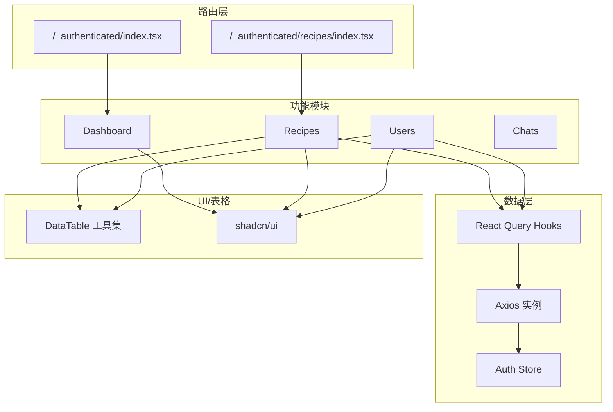
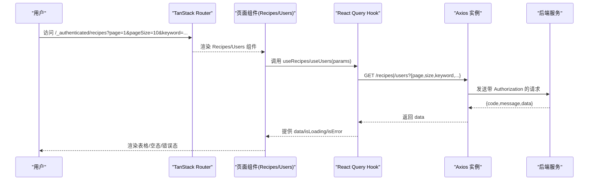
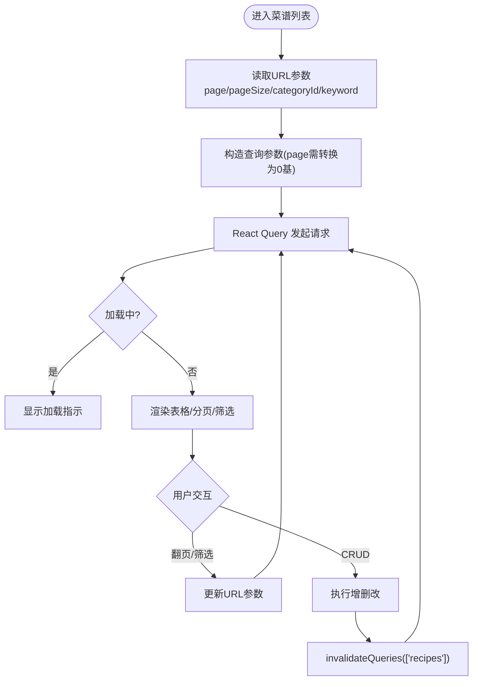
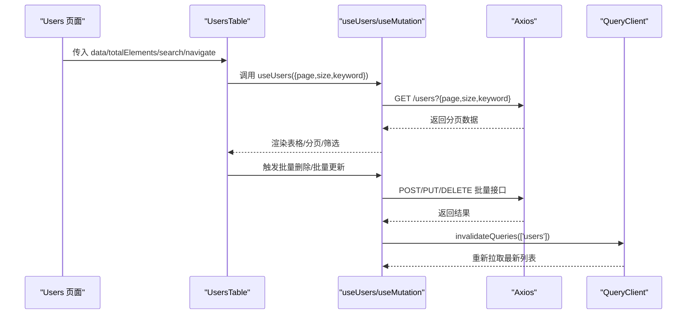
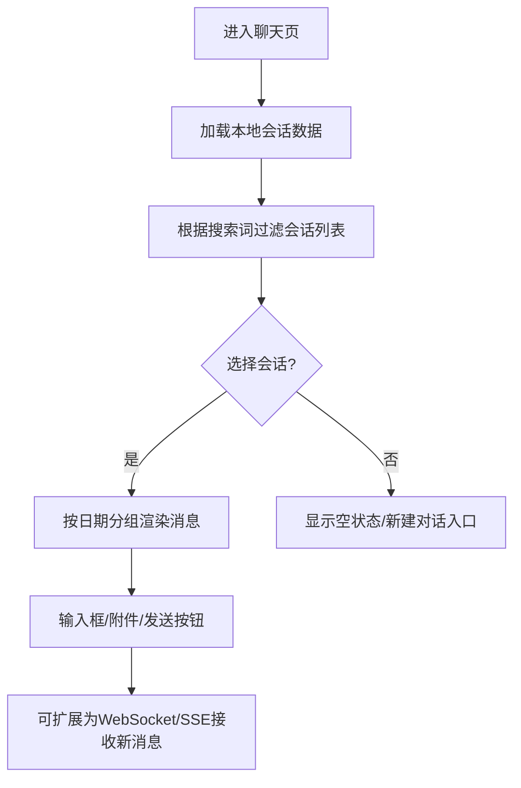
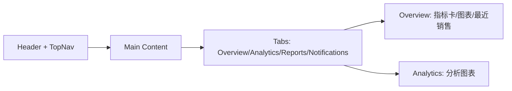
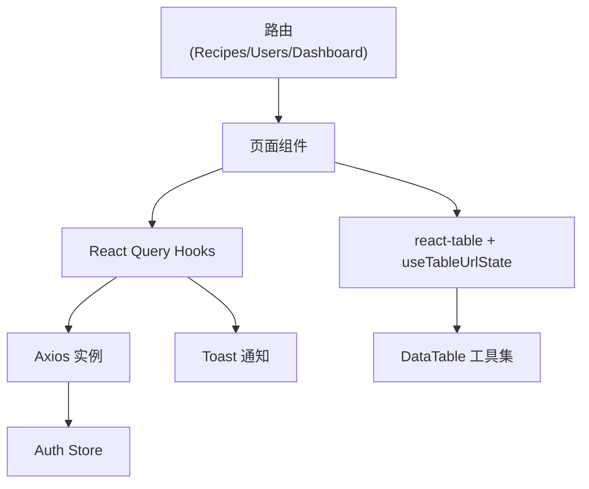

# 页面功能模块

<cite>
**本文引用的文件**
- [recipes/index.tsx](file://web_client/shadcn-admin/src/routes/_authenticated/recipes/index.tsx)
- [features/recipes/index.tsx](file://web_client/shadcn-admin/src/features/recipes/index.tsx)
- [features/recipes/api/recipe-api.ts](file://web_client/shadcn-admin/src/features/recipes/api/recipe-api.ts)
- [features/recipes/components/recipes-table.tsx](file://web_client/shadcn-admin/src/features/recipes/components/recipes-table.tsx)
- [features/users/index.tsx](file://web_client/shadcn-admin/src/features/users/index.tsx)
- [features/users/api/user-api.ts](file://web_client/shadcn-admin/src/features/users/api/user-api.ts)
- [features/users/components/users-table.tsx](file://web_client/shadcn-admin/src/features/users/components/users-table.tsx)
- [features/chats/index.tsx](file://web_client/shadcn-admin/src/features/chats/index.tsx)
- [features/dashboard/index.tsx](file://web_client/shadcn-admin/src/features/dashboard/index.tsx)
- [routes/_authenticated/index.tsx](file://web_client/shadcn-admin/src/routes/_authenticated/index.tsx)
- [lib/axios.ts](file://web_client/shadcn-admin/src/lib/axios.ts)
- [stores/auth-store.ts](file://web_client/shadcn-admin/src/stores/auth-store.ts)
- [hooks/use-table-url-state.ts](file://web_client/shadcn-admin/src/hooks/use-table-url-state.ts)
- [components/data-table/index.ts](file://web_client/shadcn-admin/src/components/data-table/index.ts)
</cite>

## 目录
1. [简介](#简介)
2. [项目结构](#项目结构)
3. [核心组件](#核心组件)
4. [架构总览](#架构总览)
5. [详细组件分析](#详细组件分析)
6. [依赖关系分析](#依赖关系分析)
7. [性能考虑](#性能考虑)
8. [故障排查指南](#故障排查指南)
9. [结论](#结论)
10. [附录](#附录)

## 简介
本技术文档聚焦于 Shadcn Admin 的前端页面功能模块，围绕菜谱管理、用户管理、AI对话与仪表板四大模块展开。文档深入解析各模块的架构设计、数据获取与状态同步机制（基于 React Query）、页面导航与参数传递模式（基于 TanStack Router）、以及 CRUD、搜索过滤、分页处理、批量操作等典型场景的实现方式。同时涵盖错误处理、加载状态与用户反馈机制，并提供页面性能优化与用户体验改进的最佳实践建议。

## 项目结构
前端采用模块化组织：路由层使用 TanStack Router 的文件路由；业务功能按 feature 划分（如 recipes、users、chats、dashboard）；数据访问通过 React Query hooks 封装；通用 UI 与表格能力来自 shadcn/ui 与 @tanstack/react-table；全局请求拦截与鉴权在 axios 实例中统一处理；认证状态由 zustand store 管理；URL 状态与表格状态同步通过自定义 hook 实现。

图表来源
- [routes/_authenticated/index.tsx:1-7](file://web_client/shadcn-admin/src/routes/_authenticated/index.tsx#L1-L7)
- [routes/_authenticated/recipes/index.tsx:1-16](file://web_client/shadcn-admin/src/routes/_authenticated/recipes/index.tsx#L1-L16)
- [features/dashboard/index.tsx:1-221](file://web_client/shadcn-admin/src/features/dashboard/index.tsx#L1-L221)
- [features/recipes/index.tsx:1-82](file://web_client/shadcn-admin/src/features/recipes/index.tsx#L1-L82)
- [features/users/index.tsx:1-75](file://web_client/shadcn-admin/src/features/users/index.tsx#L1-L75)
- [features/chats/index.tsx:1-354](file://web_client/shadcn-admin/src/features/chats/index.tsx#L1-L354)
- [features/recipes/api/recipe-api.ts:1-161](file://web_client/shadcn-admin/src/features/recipes/api/recipe-api.ts#L1-L161)
- [features/users/api/user-api.ts:1-148](file://web_client/shadcn-admin/src/features/users/api/user-api.ts#L1-L148)
- [lib/axios.ts:1-87](file://web_client/shadcn-admin/src/lib/axios.ts#L1-L87)
- [stores/auth-store.ts:1-55](file://web_client/shadcn-admin/src/stores/auth-store.ts#L1-L55)
- [components/data-table/index.ts:1-5](file://web_client/shadcn-admin/src/components/data-table/index.ts#L1-L5)

章节来源
- [routes/_authenticated/index.tsx:1-7](file://web_client/shadcn-admin/src/routes/_authenticated/index.tsx#L1-L7)
- [routes/_authenticated/recipes/index.tsx:1-16](file://web_client/shadcn-admin/src/routes/_authenticated/recipes/index.tsx#L1-L16)

## 核心组件
- 路由与页面容器：每个功能页以 TanStack Router 文件路由定义，负责校验 URL 查询参数并挂载对应 Feature 组件。
- 数据获取与缓存：React Query hooks 封装列表、详情、创建、更新、删除等请求，自动缓存、去重、失效与重试策略。
- 表格与交互：基于 @tanstack/react-table 构建可排序、筛选、分页、列可见性控制的表格；结合 useTableUrlState 将分页与筛选同步到 URL。
- 全局请求与鉴权：Axios 实例统一设置 baseURL、超时、请求头注入 JWT、响应拦截器处理后端统一返回格式与 401 跳转。
- 认证状态：Zustand store 持久化 accessToken，提供重置与读取方法。

章节来源
- [features/recipes/index.tsx:1-82](file://web_client/shadcn-admin/src/features/recipes/index.tsx#L1-L82)
- [features/users/index.tsx:1-75](file://web_client/shadcn-admin/src/features/users/index.tsx#L1-L75)
- [features/recipes/api/recipe-api.ts:1-161](file://web_client/shadcn-admin/src/features/recipes/api/recipe-api.ts#L1-L161)
- [features/users/api/user-api.ts:1-148](file://web_client/shadcn-admin/src/features/users/api/user-api.ts#L1-L148)
- [lib/axios.ts:1-87](file://web_client/shadcn-admin/src/lib/axios.ts#L1-L87)
- [stores/auth-store.ts:1-55](file://web_client/shadcn-admin/src/stores/auth-store.ts#L1-L55)
- [hooks/use-table-url-state.ts:1-220](file://web_client/shadcn-admin/src/hooks/use-table-url-state.ts#L1-L220)

## 架构总览
下图展示了从路由到页面、再到数据层与 UI 的整体调用链，体现“路由参数驱动数据请求”和“服务端分页+客户端表格状态”的模式。

图表来源
- [routes/_authenticated/recipes/index.tsx:1-16](file://web_client/shadcn-admin/src/routes/_authenticated/recipes/index.tsx#L1-L16)
- [features/recipes/index.tsx:1-82](file://web_client/shadcn-admin/src/features/recipes/index.tsx#L1-L82)
- [features/recipes/api/recipe-api.ts:1-161](file://web_client/shadcn-admin/src/features/recipes/api/recipe-api.ts#L1-L161)
- [features/users/api/user-api.ts:1-148](file://web_client/shadcn-admin/src/features/users/api/user-api.ts#L1-L148)
- [lib/axios.ts:1-87](file://web_client/shadcn-admin/src/lib/axios.ts#L1-L87)

## 详细组件分析

### 菜谱管理模块（Recipes）
- 路由参数校验：使用 Zod 校验 page、pageSize、categoryId、keyword，确保类型安全与默认值。
- 数据获取：useRecipes 通过 React Query 发起分页请求，queryKey 包含 params，支持缓存与自动失效。
- 表格状态：recipes-table 使用 react-table 配置手动分页、列筛选、排序、列可见性；通过 useTableUrlState 将分页与筛选同步到 URL。
- 分类联动：useRecipeCategories 拉取分类列表，用于侧边栏或筛选器展示。
- 表单与对话框：通过 Provider 与 Dialogs 组合，完成新增/编辑/删除等操作，并在 mutation 成功后触发 query 失效与提示。

图表来源
- [routes/_authenticated/recipes/index.tsx:1-16](file://web_client/shadcn-admin/src/routes/_authenticated/recipes/index.tsx#L1-L16)
- [features/recipes/index.tsx:1-82](file://web_client/shadcn-admin/src/features/recipes/index.tsx#L1-L82)
- [features/recipes/api/recipe-api.ts:1-161](file://web_client/shadcn-admin/src/features/recipes/api/recipe-api.ts#L1-L161)
- [features/recipes/components/recipes-table.tsx:1-203](file://web_client/shadcn-admin/src/features/recipes/components/recipes-table.tsx#L1-L203)
- [hooks/use-table-url-state.ts:1-220](file://web_client/shadcn-admin/src/hooks/use-table-url-state.ts#L1-L220)

章节来源
- [routes/_authenticated/recipes/index.tsx:1-16](file://web_client/shadcn-admin/src/routes/_authenticated/recipes/index.tsx#L1-L16)
- [features/recipes/index.tsx:1-82](file://web_client/shadcn-admin/src/features/recipes/index.tsx#L1-L82)
- [features/recipes/api/recipe-api.ts:1-161](file://web_client/shadcn-admin/src/features/recipes/api/recipe-api.ts#L1-L161)
- [features/recipes/components/recipes-table.tsx:1-203](file://web_client/shadcn-admin/src/features/recipes/components/recipes-table.tsx#L1-L203)

### 用户管理模块（Users）
- 路由与页面：同 Recipes，使用统一的 Header/Main 布局与国际化文案。
- 数据获取：useUsers 提供分页列表，useUser 提供详情；mutation 支持创建、更新、删除、批量删除、批量更新状态。
- 表格能力：支持多列筛选（用户名、状态、角色），分页与 URL 同步；批量操作通过 DataTableBulkActions 集成。
- 错误与反馈：mutation 成功/失败均通过 toast 提示，并触发 query 失效刷新列表。

图表来源
- [features/users/index.tsx:1-75](file://web_client/shadcn-admin/src/features/users/index.tsx#L1-L75)
- [features/users/api/user-api.ts:1-148](file://web_client/shadcn-admin/src/features/users/api/user-api.ts#L1-L148)
- [features/users/components/users-table.tsx:1-196](file://web_client/shadcn-admin/src/features/users/components/users-table.tsx#L1-L196)

章节来源
- [features/users/index.tsx:1-75](file://web_client/shadcn-admin/src/features/users/index.tsx#L1-L75)
- [features/users/api/user-api.ts:1-148](file://web_client/shadcn-admin/src/features/users/api/user-api.ts#L1-L148)
- [features/users/components/users-table.tsx:1-196](file://web_client/shadcn-admin/src/features/users/components/users-table.tsx#L1-L196)

### AI对话模块（Chats）
- 当前实现为静态演示：使用本地 JSON 数据渲染会话列表与消息时间分组展示。
- 交互流程：左侧会话列表支持搜索过滤；右侧聊天区域按日期分组展示消息；移动端适配通过条件渲染切换视图。
- 扩展点：可替换为 WebSocket 或 SSE 实时通信，结合 React Query 的增量更新或订阅机制进行消息推送与状态同步。

图表来源
- [features/chats/index.tsx:1-354](file://web_client/shadcn-admin/src/features/chats/index.tsx#L1-L354)

章节来源
- [features/chats/index.tsx:1-354](file://web_client/shadcn-admin/src/features/chats/index.tsx#L1-L354)

### 仪表板模块（Dashboard）
- 布局与导航：顶部导航、搜索、语言/主题切换、配置抽屉、用户下拉菜单。
- 内容组织：使用 Tabs 组织 Overview、Analytics、Reports、Notifications 等子页签；Overview 内嵌统计卡片、趋势图与最近销售列表。
- 数据接入：当前为静态占位，可按需接入真实数据源（如 analytics/reports 接口）。

图表来源
- [features/dashboard/index.tsx:1-221](file://web_client/shadcn-admin/src/features/dashboard/index.tsx#L1-L221)

章节来源
- [features/dashboard/index.tsx:1-221](file://web_client/shadcn-admin/src/features/dashboard/index.tsx#L1-L221)

## 依赖关系分析
- 路由依赖：/_authenticated 下各页面通过 createFileRoute 声明，validateSearch 保证 URL 参数类型安全。
- 数据依赖：React Query hooks 依赖 Axios 实例；Axios 依赖 Auth Store 注入 token；响应拦截器统一处理后端返回结构与 401 跳转。
- 表格依赖：react-table 提供核心能力；useTableUrlState 将表格状态与 URL 双向绑定；DataTableToolbar/Pagination/BulkActions 提供通用 UI。
- 状态依赖：Auth Store 集中管理登录态与 token 生命周期；Toast 提供用户反馈。

图表来源
- [routes/_authenticated/recipes/index.tsx:1-16](file://web_client/shadcn-admin/src/routes/_authenticated/recipes/index.tsx#L1-L16)
- [features/recipes/index.tsx:1-82](file://web_client/shadcn-admin/src/features/recipes/index.tsx#L1-L82)
- [features/users/index.tsx:1-75](file://web_client/shadcn-admin/src/features/users/index.tsx#L1-L75)
- [features/recipes/api/recipe-api.ts:1-161](file://web_client/shadcn-admin/src/features/recipes/api/recipe-api.ts#L1-L161)
- [features/users/api/user-api.ts:1-148](file://web_client/shadcn-admin/src/features/users/api/user-api.ts#L1-L148)
- [lib/axios.ts:1-87](file://web_client/shadcn-admin/src/lib/axios.ts#L1-L87)
- [stores/auth-store.ts:1-55](file://web_client/shadcn-admin/src/stores/auth-store.ts#L1-L55)
- [hooks/use-table-url-state.ts:1-220](file://web_client/shadcn-admin/src/hooks/use-table-url-state.ts#L1-L220)
- [components/data-table/index.ts:1-5](file://web_client/shadcn-admin/src/components/data-table/index.ts#L1-L5)

章节来源
- [lib/axios.ts:1-87](file://web_client/shadcn-admin/src/lib/axios.ts#L1-L87)
- [stores/auth-store.ts:1-55](file://web_client/shadcn-admin/src/stores/auth-store.ts#L1-L55)
- [hooks/use-table-url-state.ts:1-220](file://web_client/shadcn-admin/src/hooks/use-table-url-state.ts#L1-L220)

## 性能考虑
- 服务端分页与手动分页：表格启用 manualPagination，避免全量数据加载，减少内存占用与渲染开销。
- URL 状态同步：分页与筛选写入 URL，便于分享与回退，同时避免重复请求。
- React Query 缓存：列表查询使用稳定 queryKey，配合 staleTime 与按需失效，降低网络压力。
- 懒加载与分割：Feature 级路由天然支持代码分割，首屏仅加载必要资源。
- 防抖与节流：搜索输入可结合防抖减少频繁请求；大数据量表格可考虑虚拟滚动（按需引入）。
- 图片与媒体：对封面图等大图进行压缩与懒加载，提升首屏体验。

[本节为通用性能建议，不直接分析具体文件]

## 故障排查指南
- 401 未授权：Axios 响应拦截器检测到 401 时，会清空认证状态并跳转到登录页，携带 redirect 参数以便登录后回跳。检查 Auth Store 中的 accessToken 是否正确设置与过期判断逻辑。
- 后端返回非 200：Axios 响应拦截器会将后端统一返回的 code !== 200 转为错误抛出，上层 mutation/query 捕获后通过 toast 提示。确认后端接口契约与错误码。
- 列表为空或无数据：检查 URL 参数是否被正确序列化与反序列化；确认 useTableUrlState 的 columnFilters 配置与后端字段映射一致；必要时查看 ensurePageInRange 是否将页码重置到有效范围。
- 表单提交失败：确认 mutation 的 onError 分支已捕获错误并提示；检查请求体结构与后端 DTO 是否匹配。
- 实时数据更新：如需实时更新，可在 mutation 成功后主动 invalidateQueries，或在 WebSocket 场景中结合 React Query 的 setQueryData 进行增量更新。

章节来源
- [lib/axios.ts:1-87](file://web_client/shadcn-admin/src/lib/axios.ts#L1-L87)
- [features/recipes/api/recipe-api.ts:1-161](file://web_client/shadcn-admin/src/features/recipes/api/recipe-api.ts#L1-L161)
- [features/users/api/user-api.ts:1-148](file://web_client/shadcn-admin/src/features/users/api/user-api.ts#L1-L148)
- [hooks/use-table-url-state.ts:1-220](file://web_client/shadcn-admin/src/hooks/use-table-url-state.ts#L1-L220)

## 结论
该前端工程以 TanStack Router + React Query + react-table 为核心，构建了清晰的分层架构与可复用的数据交互模式。菜谱与用户模块实现了完整的 CRUD、搜索过滤、分页与批量操作；聊天模块提供了可扩展的实时对话基础；仪表板模块则展示了数据可视化与页面组织的最佳实践。通过 URL 状态同步与 React Query 缓存策略，系统在可用性与性能之间取得了良好平衡。后续可在此基础上增强实时通信、权限控制与更丰富的数据分析能力。

[本节为总结性内容，不直接分析具体文件]

## 附录

### 开发示例与最佳实践清单
- CRUD 操作
  - 列表查询：使用 useXxx(params) 获取分页数据，注意 page 转换与 queryKey 稳定性。
  - 创建/更新/删除：使用 useCreateXxx/useUpdateXxx/useDeleteXxx，成功后 invalidateQueries 刷新列表，并通过 toast 反馈。
- 搜索与过滤
  - 使用 useTableUrlState 配置 columnFilters，将筛选结果写入 URL，支持分享与回退。
  - 对于字符串筛选，注意 trim 与空值处理；数组筛选需确保序列化/反序列化正确。
- 分页处理
  - 启用 manualPagination，结合 pageCount 计算与 ensurePageInRange 防止越界。
  - 分页变更时重置页码到第一页或保持当前页，视业务需求而定。
- 批量操作
  - 使用批量接口（如批量删除/状态更新），成功后统一 invalidateQueries 并提示数量。
- 错误处理与用户反馈
  - 统一在 Axios 拦截器处理 401 与后端错误码；在 mutation 中捕获错误并 toast 提示。
  - 列表加载态使用 Spinner，错误态显示友好提示。
- 性能优化
  - 合理设置 staleTime 与 refetchOnWindowFocus；大列表使用虚拟滚动；图片懒加载与压缩。
- 实时数据更新
  - 短轮询：定时 refetch；长连接：WebSocket/SSE 结合 setQueryData 增量更新；事件驱动：在 mutation 成功后主动失效相关 query。

[本节为通用指导，不直接分析具体文件]