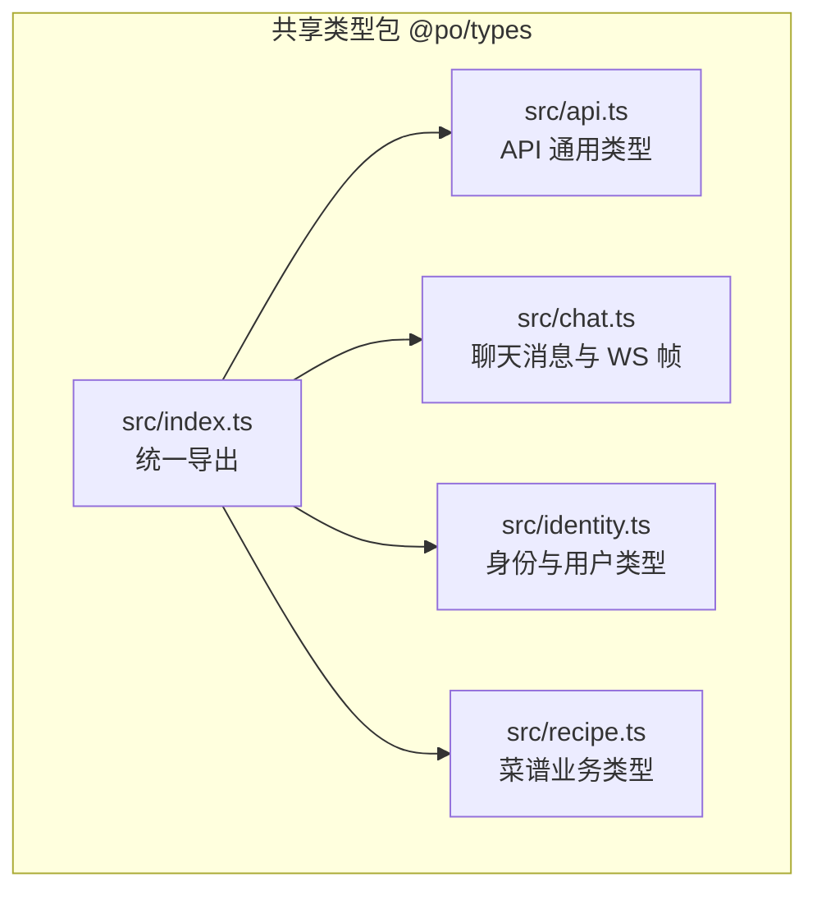
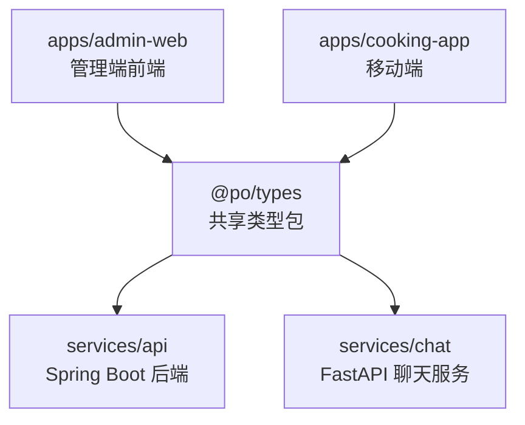
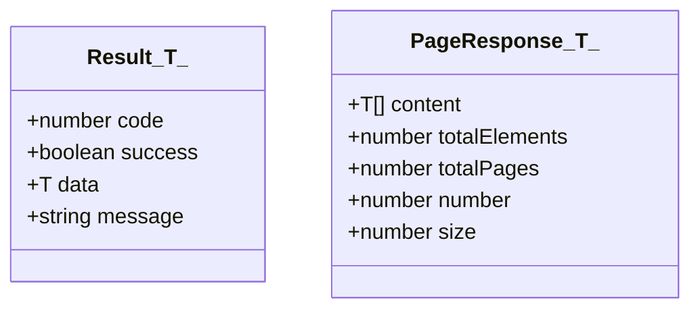
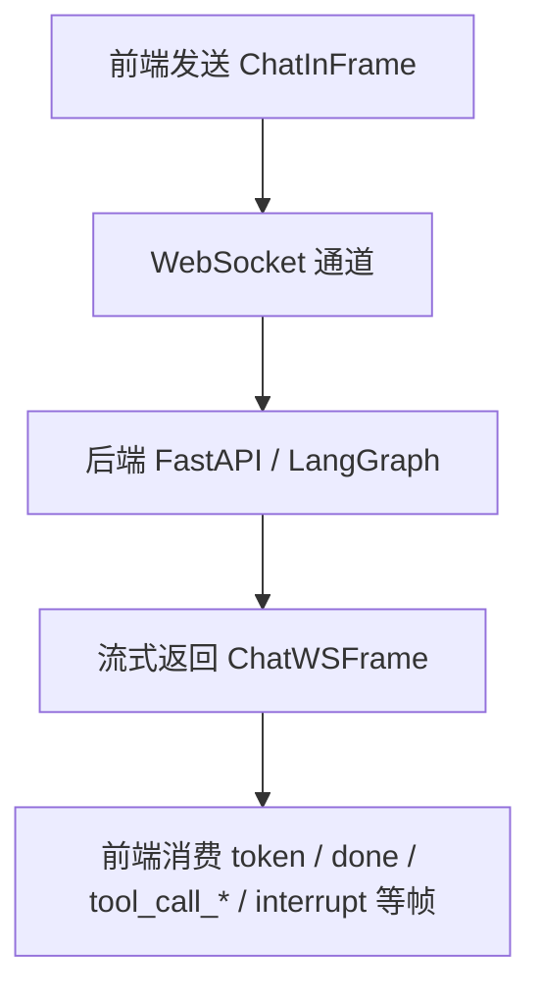
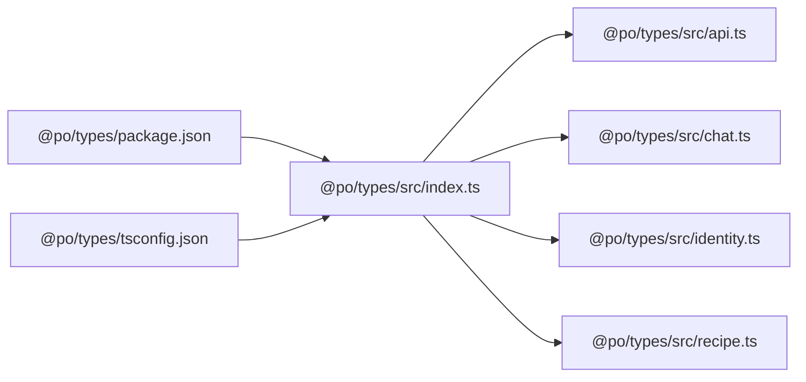

# 共享类型包 (@po/types)

<cite>
**本文引用的文件**   
- [packages/types/src/index.ts](file://packages/types/src/index.ts)
- [packages/types/package.json](file://packages/types/package.json)
- [packages/types/tsconfig.json](file://packages/types/tsconfig.json)
- [packages/types/src/api.ts](file://packages/types/src/api.ts)
- [packages/types/src/chat.ts](file://packages/types/src/chat.ts)
- [packages/types/src/identity.ts](file://packages/types/src/identity.ts)
- [packages/types/src/recipe.ts](file://packages/types/src/recipe.ts)
- [apps/admin-web/src/pages/chatbot/service.ts](file://apps/admin-web/src/pages/chatbot/service.ts)
- [apps/admin-web/src/services/file.ts](file://apps/admin-web/src/services/file.ts)
- [apps/admin-web/src/services/recipe.ts](file://apps/admin-web/src/services/recipe.ts)
- [apps/admin-web/src/services/user.ts](file://apps/admin-web/src/services/user.ts)
- [apps/cooking-app/src/app/(tabs)/ai.tsx](file://apps/cooking-app/src/app/(tabs)/ai.tsx)
- [apps/cooking-app/src/app/(tabs)/index.tsx](file://apps/cooking-app/src/app/(tabs)/index.tsx)
- [apps/cooking-app/src/app/recipe/form.tsx](file://apps/cooking-app/src/app/recipe/form.tsx)
- [apps/cooking-app/src/components/recipe-card.tsx](file://apps/cooking-app/src/components/recipe-card.tsx)
- [apps/cooking-app/src/components/recipe-chat-card.tsx](file://apps/cooking-app/src/components/recipe-chat-card.tsx)
- [apps/cooking-app/src/components/recipe-filter-bar.tsx](file://apps/cooking-app/src/components/recipe-filter-bar.tsx)
- [apps/cooking-app/src/components/recipe-meta.tsx](file://apps/cooking-app/src/components/recipe-meta.tsx)
- [apps/cooking-app/src/components/recipe-status-badge.tsx](file://apps/cooking-app/src/components/recipe-status-badge.tsx)
- [apps/cooking-app/src/lib/ai/assistant.ts](file://apps/cooking-app/src/lib/ai/assistant.ts)
- [apps/cooking-app/src/lib/ai/chat.ts](file://apps/cooking-app/src/lib/ai/chat.ts)
- [services/chat/app/schemas.py](file://services/chat/app/schemas.py)
</cite>

## 目录
1. [简介](#简介)
2. [项目结构](#项目结构)
3. [核心组件](#核心组件)
4. [架构总览](#架构总览)
5. [详细组件分析](#详细组件分析)
6. [依赖关系分析](#依赖关系分析)
7. [性能与构建特性](#性能与构建特性)
8. [版本管理与向后兼容](#版本管理与向后兼容)
9. [在各前端应用中的引用方式](#在各前端应用中的引用方式)
10. [常见问题排查](#常见问题排查)
11. [结论](#结论)

## 简介
`@po/types` 是本项目的前后端共享 TypeScript 类型包，集中定义 API 通用响应、身份认证、菜谱业务实体以及聊天 WebSocket 帧协议等核心类型。它作为 Monorepo 中 `packages/types` 下的独立 npm 包，通过 `exports` 暴露类型声明，供管理端前端 `apps/admin-web` 和移动端 `apps/cooking-app` 引用，从而保证前后端在接口契约、业务字段和聊天协议上保持一致。

该包不携带运行时逻辑，仅输出 `.d.ts` 类型声明，因此对前端打包体积无影响；同时配合严格模式编译，确保类型变更能在开发阶段被尽早发现。

## 项目结构
`@po/types` 采用“按领域拆分 + 统一入口导出”的组织方式：



**图表来源**
- [packages/types/src/index.ts:1-30](file://packages/types/src/index.ts#L1-L30)
- [packages/types/src/api.ts:1-15](file://packages/types/src/api.ts#L1-L15)
- [packages/types/src/chat.ts:1-40](file://packages/types/src/chat.ts#L1-L40)
- [packages/types/src/identity.ts:1-50](file://packages/types/src/identity.ts#L1-L50)
- [packages/types/src/recipe.ts:1-155](file://packages/types/src/recipe.ts#L1-L155)

**章节来源**
- [packages/types/src/index.ts:1-30](file://packages/types/src/index.ts#L1-L30)
- [packages/types/package.json:1-23](file://packages/types/package.json#L1-L23)
- [packages/types/tsconfig.json:1-15](file://packages/types/tsconfig.json#L1-L15)

## 核心组件
本包的核心类型分为四类：

| 分类 | 主要职责 | 关键类型 |
| --- | --- | --- |
| API 通用类型 | 统一后端返回包装与分页模型 | `Result<T>`、`PageResponse<T>` |
| 身份与用户类型 | 登录请求、用户信息、个人资料修改、密码修改 | `LoginClient`、`LoginRequest`、`UserItem`、`UserRequest`、`ProfileRequest`、`ChangePasswordRequest` |
| 菜谱业务类型 | 菜谱、分类、食材、步骤、列表参数、审核、点赞结果 | `Recipe`、`RecipeBrief`、`RecipeCategory`、`Ingredient`、`Step`、`RecipeListParams`、`RecipeAuditRequest`、`RecipeLikeResult`、`RecipeStatus`、`RecipeSort` |
| 聊天消息与 WS 帧 | 聊天消息、请求参数、入站帧、出站帧类型集合 | `ChatMessage`、`ChatRequestParams`、`ChatInFrame`、`ChatWSFrameType`、`ChatWSFrame` |

这些类型由 `src/index.ts` 统一再导出，使调用方只需从 `@po/types` 一个入口引入所需类型。

**章节来源**
- [packages/types/src/api.ts:1-15](file://packages/types/src/api.ts#L1-L15)
- [packages/types/src/identity.ts:1-50](file://packages/types/src/identity.ts#L1-L50)
- [packages/types/src/recipe.ts:1-155](file://packages/types/src/recipe.ts#L1-L155)
- [packages/types/src/chat.ts:1-40](file://packages/types/src/chat.ts#L1-L40)
- [packages/types/src/index.ts:1-30](file://packages/types/src/index.ts#L1-L30)

## 架构总览
`@po/types` 处于 Monorepo 的“契约层”，连接前端应用与后端服务：



- 前端通过 `import type { ... } from '@po/types'` 引用类型，避免重复定义。
- 后端 Java DTO、Python Pydantic schema 与 TS 类型共同构成同一份契约。
- 聊天协议在 Python 侧使用 `Literal` 收口帧类型，TS 侧用联合类型同步，便于新增帧时进行类型检查。

**图表来源**
- [packages/types/src/chat.ts:19-39](file://packages/types/src/chat.ts#L19-L39)
- [services/chat/app/schemas.py:65-101](file://services/chat/app/schemas.py#L65-L101)

## 详细组件分析

### API 通用类型
`api.ts` 定义了跨模块通用的 API 响应和分页结构：

- `Result<T>`：统一封装后端返回码、成功标志、数据体和消息。
- `PageResponse<T>`：对应后端分页查询返回的数据体，包含内容数组、总数、总页数、当前页码和每页大小。

这类类型适合用于所有 REST 接口的返回值泛型约束，例如用户、菜谱、文件上传等接口。



**图表来源**
- [packages/types/src/api.ts:1-15](file://packages/types/src/api.ts#L1-L15)

**章节来源**
- [packages/types/src/api.ts:1-15](file://packages/types/src/api.ts#L1-L15)

### 身份与用户类型
`identity.ts` 聚焦认证与用户信息：

- `LoginClient`：限定登录来源为管理端或移动端，后端据此决定账号可登录客户端。
- `LoginRequest`：用户名、密码和客户端标识。
- `UserItem`：用户基本信息，包含可选头像、邮箱、昵称、角色、状态、审批状态等。
- `UserRequest`：创建或更新用户时的请求体。
- `ProfileRequest`：当前用户资料修改请求。
- `ChangePasswordRequest`：修改密码请求。

这些类型保证了认证流程、用户管理和个人资料编辑在不同前端页面之间保持字段一致。

```mermaid
classDiagram
class LoginClient {
<<union>>
"admin"
"app"
}
class LoginRequest {
+string username
+string password
+LoginClient client
}
class UserItem {
+number id
+string username
+string email
+string nickname
+string avatar
+string firstName
+string lastName
+string phoneNumber
+string role
+string status
+string approvalStatus
+string createTime
+string updateTime
}
class UserRequest {
+string username
+string password
+string email
+string firstName
+string lastName
+string phoneNumber
+string role
+string status
+string nickname
+string avatar
}
class ProfileRequest {
+string nickname
+string email
+string phoneNumber
+string avatar
}
class ChangePasswordRequest {
+string oldPassword
+string newPassword
}
LoginRequest --> LoginClient : "使用"
```

**图表来源**
- [packages/types/src/identity.ts:1-50](file://packages/types/src/identity.ts#L1-L50)

**章节来源**
- [packages/types/src/identity.ts:1-50](file://packages/types/src/identity.ts#L1-L50)

### 菜谱业务类型
`recipe.ts` 是业务实体最集中的文件，涵盖分类、食材、步骤、菜谱主实体、摘要、请求体、列表参数、审核和点赞结果：

- `RecipeStatus`：待审核、已通过、已驳回。
- `RecipeSort`：推荐、点赞数降序、最新发布。
- `RecipeCategory`：分类基础信息。
- `RecipeCategoryRequest`：管理端创建或更新分类的请求。
- `Ingredient`：食材项，支持用量、单位、是否必需、排序和图片。
- `Step`：烹饪步骤，支持图片、视频、时长。
- `Recipe`：完整菜谱实体，包含营养信息、审核状态、收藏/点赞状态、时间戳等。
- `RecipeBrief`：聊天工具返回的轻量卡片摘要。
- `RecipeRequest`：提交新菜谱或编辑菜谱的请求体。
- `RecipeListParams`：列表查询参数，包括分页、关键词、分类、难度、排序。
- `RecipeAuditRequest`：管理端审核动作，支持通过或驳回并填写原因。
- `RecipeLikeResult`：点赞切换后的布尔结果和最新点赞数。

```mermaid
classDiagram
class RecipeStatus {
<<enum>>
"pending"
"approved"
"rejected"
}
class RecipeSort {
<<enum>>
"recommend"
"likes"
"newest"
}
class Ingredient {
+number id
+string name
+string amount
+string unit
+boolean isEssential
+number sortOrder
+string imageUrl
}
class Step {
+number id
+number stepNumber
+string content
+string imageUrl
+string videoUrl
+number duration
}
class Recipe {
+number id
+string title
+string description
+string coverImageUrl
+number prepTime
+number cookTime
+number totalTime
+number difficulty
+number servings
+string category
+string tags
+number authorId
+boolean isPublic
+number likesCount
+number calories
+number protein
+number fat
+number carbs
+string tips
+string flavorProfile
+RecipeStatus status
+string rejectReason
+boolean isFavorited
+boolean isLiked
+string favoritedAt
+string viewedAt
+Ingredient[] ingredients
+Step[] steps
+string createdAt
+string updatedAt
}
class RecipeBrief {
+number id
+string title
+string description
+string coverImageUrl
+number prepTime
+number cookTime
+number totalTime
+number difficulty
+number servings
+string category
+string tags
}
class RecipeRequest {
+string title
+string description
+string coverImageUrl
+number prepTime
+number cookTime
+number totalTime
+number difficulty
+number servings
+string category
+string tags
+boolean isPublic
+number calories
+number protein
+number fat
+number carbs
+string tips
+string flavorProfile
+Ingredient[] ingredients
+Step[] steps
}
class RecipeListParams {
+number current
+number pageSize
+string keyword
+number[] categoryId
+number difficulty
+RecipeSort sort
}
class RecipeAuditRequest {
+string action
+string reason
}
class RecipeLikeResult {
+boolean liked
+number likesCount
}
Recipe --> Ingredient : "包含"
Recipe --> Step : "包含"
RecipeRequest --> Ingredient : "包含"
RecipeRequest --> Step : "包含"
```

**图表来源**
- [packages/types/src/recipe.ts:1-155](file://packages/types/src/recipe.ts#L1-L155)

**章节来源**
- [packages/types/src/recipe.ts:1-155](file://packages/types/src/recipe.ts#L1-L155)

### 聊天消息与 WebSocket 帧类型
`chat.ts` 定义了聊天消息、请求参数和 WebSocket 帧协议：

- `ChatMessage`：角色和内容。
- `ChatRequestParams`：消息数组和会话标识，映射后端 LangGraph 的 `thread_id`。
- `ChatInFrame`：前端发送给后端的入站帧，支持消息、心跳和恢复中断。
- `ChatWSFrameType`：后端出站帧类型的联合字符串字面量。
- `ChatWSFrame`：结构化出站帧，包含帧类型、文本内容和可变载荷。

聊天协议在后端 Python 侧也使用 `Literal` 限制帧类型，TS 侧与之对齐，这样新增帧类型时，两端都能获得类型提示和编译期检查。



**图表来源**
- [packages/types/src/chat.ts:1-40](file://packages/types/src/chat.ts#L1-L40)
- [services/chat/app/schemas.py:65-101](file://services/chat/app/schemas.py#L65-L101)

**章节来源**
- [packages/types/src/chat.ts:1-40](file://packages/types/src/chat.ts#L1-L40)
- [services/chat/app/schemas.py:65-101](file://services/chat/app/schemas.py#L65-L101)

## 依赖关系分析
`@po/types` 本身没有外部运行时依赖，只依赖 TypeScript 编译器生成类型声明。其对外暴露能力由 `package.json` 的 `exports` 控制，并通过 `tsconfig.json` 配置严格模式和声明文件输出。



**图表来源**
- [packages/types/package.json:1-23](file://packages/types/package.json#L1-L23)
- [packages/types/tsconfig.json:1-15](file://packages/types/tsconfig.json#L1-L15)
- [packages/types/src/index.ts:1-30](file://packages/types/src/index.ts#L1-L30)

**章节来源**
- [packages/types/package.json:1-23](file://packages/types/package.json#L1-L23)
- [packages/types/tsconfig.json:1-15](file://packages/types/tsconfig.json#L1-L15)
- [packages/types/src/index.ts:1-30](file://packages/types/src/index.ts#L1-L30)

## 性能与构建特性
- 包类型为纯类型声明，不参与运行时代码，不会增加前端打包体积。
- `tsconfig.json` 启用严格模式，有助于提前发现类型不一致问题。
- 构建脚本使用 `tsc -p tsconfig.json` 输出到 `dist` 目录，并生成 `.d.ts` 和声明映射。
- `exports` 明确区分 `types` 和 `default`，让现代 bundler 优先加载类型声明。

**章节来源**
- [packages/types/tsconfig.json:1-15](file://packages/types/tsconfig.json#L1-L15)
- [packages/types/package.json:1-23](file://packages/types/package.json#L1-L23)

## 版本管理与向后兼容
当前包版本为 `0.1.0`，且标记为 `private`，说明它在 Monorepo 内部使用，尚未作为公共 npm 包发布。结合现有结构，建议遵循以下版本与兼容性策略：

| 场景 | 建议做法 |
| --- | --- |
| 新增可选字段 | 将字段设为可选，保持旧前端仍可编译和运行。 |
| 新增枚举值 | 扩展联合类型或字符串字面量，并在前端做未知值降级处理。 |
| 修改必填字段 | 视为破坏性变更，应升级主版本或提供迁移方案。 |
| 新增 API 响应字段 | 优先放在 `data` 中，避免破坏 `Result<T>` 结构。 |
| 新增聊天帧类型 | 同时更新 TS 联合类型和后端 `Literal`，并确保前端忽略未知帧类型。 |
| 发布前校验 | 使用包的 `typecheck` 脚本执行类型检查，确保无编译错误。 |

由于包目前为私有，版本演进可在 Monorepo 内协调；若未来改为公共包，应引入语义化版本控制和变更日志，并对破坏性变更进行显式说明。

**章节来源**
- [packages/types/package.json:1-23](file://packages/types/package.json#L1-L23)

## 在各前端应用中的引用方式

### 管理端前端 apps/admin-web
管理端通过 `@po/types` 引用 API 通用类型、用户类型、菜谱类型和聊天类型：

- 聊天服务文件引用聊天消息、请求参数和 WS 帧类型。
- 文件服务引用 `Result` 统一响应类型。
- 菜谱服务引用分页、用户、菜谱相关类型。
- 用户服务引用用户资料、用户信息和用户请求类型。

典型引用位置包括：

- [apps/admin-web/src/pages/chatbot/service.ts](file://apps/admin-web/src/pages/chatbot/service.ts)
- [apps/admin-web/src/services/file.ts](file://apps/admin-web/src/services/file.ts)
- [apps/admin-web/src/services/recipe.ts](file://apps/admin-web/src/services/recipe.ts)
- [apps/admin-web/src/services/user.ts](file://apps/admin-web/src/services/user.ts)

**章节来源**
- [apps/admin-web/src/pages/chatbot/service.ts](file://apps/admin-web/src/pages/chatbot/service.ts)
- [apps/admin-web/src/services/file.ts](file://apps/admin-web/src/services/file.ts)
- [apps/admin-web/src/services/recipe.ts](file://apps/admin-web/src/services/recipe.ts)
- [apps/admin-web/src/services/user.ts](file://apps/admin-web/src/services/user.ts)

### 移动端 apps/cooking-app
移动端广泛使用 `@po/types` 中的菜谱、分类、排序、聊天摘要和步骤类型，覆盖页面、组件和业务库：

- 首页和 AI 页面使用 `RecipeSort`、`RecipeBrief`。
- 菜谱表单使用 `Ingredient`、`RecipeRequest`、`Step`。
- 菜谱卡片、详情元数据和状态徽章分别使用 `Recipe`、`RecipeBrief`、`RecipeStatus`。
- 筛选栏使用 `RecipeCategory`、`RecipeSort`。
- AI 助手和聊天逻辑使用 `Recipe`、`RecipeCategory`。

典型引用位置包括：

- [apps/cooking-app/src/app/(tabs)/ai.tsx](file://apps/cooking-app/src/app/(tabs)/ai.tsx)
- [apps/cooking-app/src/app/(tabs)/index.tsx](file://apps/cooking-app/src/app/(tabs)/index.tsx)
- [apps/cooking-app/src/app/recipe/form.tsx](file://apps/cooking-app/src/app/recipe/form.tsx)
- [apps/cooking-app/src/components/recipe-card.tsx](file://apps/cooking-app/src/components/recipe-card.tsx)
- [apps/cooking-app/src/components/recipe-chat-card.tsx](file://apps/cooking-app/src/components/recipe-chat-card.tsx)
- [apps/cooking-app/src/components/recipe-filter-bar.tsx](file://apps/cooking-app/src/components/recipe-filter-bar.tsx)
- [apps/cooking-app/src/components/recipe-meta.tsx](file://apps/cooking-app/src/components/recipe-meta.tsx)
- [apps/cooking-app/src/components/recipe-status-badge.tsx](file://apps/cooking-app/src/components/recipe-status-badge.tsx)
- [apps/cooking-app/src/lib/ai/assistant.ts](file://apps/cooking-app/src/lib/ai/assistant.ts)
- [apps/cooking-app/src/lib/ai/chat.ts](file://apps/cooking-app/src/lib/ai/chat.ts)

**章节来源**
- [apps/cooking-app/src/app/(tabs)/ai.tsx](file://apps/cooking-app/src/app/(tabs)/ai.tsx)
- [apps/cooking-app/src/app/(tabs)/index.tsx](file://apps/cooking-app/src/app/(tabs)/index.tsx)
- [apps/cooking-app/src/app/recipe/form.tsx](file://apps/cooking-app/src/app/recipe/form.tsx)
- [apps/cooking-app/src/components/recipe-card.tsx](file://apps/cooking-app/src/components/recipe-card.tsx)
- [apps/cooking-app/src/components/recipe-chat-card.tsx](file://apps/cooking-app/src/components/recipe-chat-card.tsx)
- [apps/cooking-app/src/components/recipe-filter-bar.tsx](file://apps/cooking-app/src/components/recipe-filter-bar.tsx)
- [apps/cooking-app/src/components/recipe-meta.tsx](file://apps/cooking-app/src/components/recipe-meta.tsx)
- [apps/cooking-app/src/components/recipe-status-badge.tsx](file://apps/cooking-app/src/components/recipe-status-badge.tsx)
- [apps/cooking-app/src/lib/ai/assistant.ts](file://apps/cooking-app/src/lib/ai/assistant.ts)
- [apps/cooking-app/src/lib/ai/chat.ts](file://apps/cooking-app/src/lib/ai/chat.ts)

## 常见问题排查

| 问题 | 可能原因 | 排查建议 |
| --- | --- | --- |
| 前端无法识别 `@po/types` 中的类型 | 未正确安装或引用共享类型包 | 确认前端项目的依赖中包含 `@po/types`，并使用 `import type` 引用。 |
| 类型变更后前端报类型错误 | 共享类型发生破坏性变更 | 查看具体报错类型，判断是否为必填字段变化或枚举值缺失。 |
| 聊天帧类型不匹配 | TS 类型与后端 `Literal` 不同步 | 同时检查 `packages/types/src/chat.ts` 和 `services/chat/app/schemas.py`。 |
| 分页数据结构不一致 | 后端返回结构与 `PageResponse<T>` 不符 | 检查后端分页响应字段是否与 `content`、`totalElements`、`totalPages`、`number`、`size` 一致。 |
| 构建时类型检查失败 | `tsconfig.json` 严格模式触发 | 运行包的 `typecheck` 脚本定位具体类型错误。 |

**章节来源**
- [packages/types/src/chat.ts:19-39](file://packages/types/src/chat.ts#L19-L39)
- [services/chat/app/schemas.py:65-101](file://services/chat/app/schemas.py#L65-L101)
- [packages/types/src/api.ts:8-14](file://packages/types/src/api.ts#L8-L14)

## 结论
`@po/types` 以最小运行时成本提供了前后端共享的类型契约，覆盖 API 通用响应、身份认证、菜谱业务和聊天协议四大领域。通过统一入口导出、严格类型检查和前后端协议对齐，它有效降低了字段漂移风险，提升了多端协作效率。

在实际使用中，开发者应优先从 `@po/types` 引入类型，避免在各应用中重复定义；当需要扩展接口或协议时，应优先考虑向后兼容，并通过类型检查验证变更影响。随着项目演进，该包可作为 Monorepo 的“单一事实来源”，持续保障类型一致性。