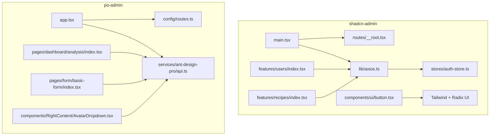
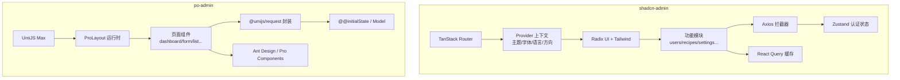
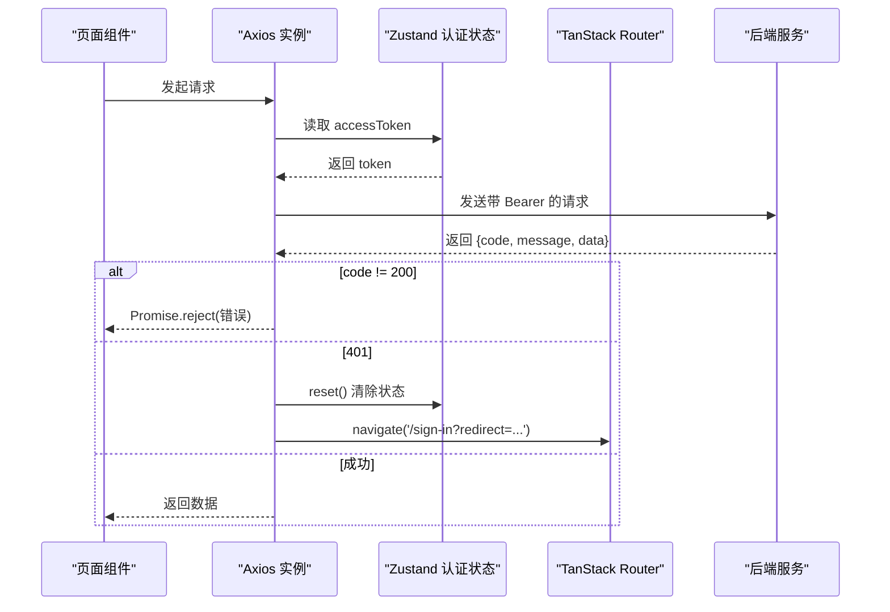
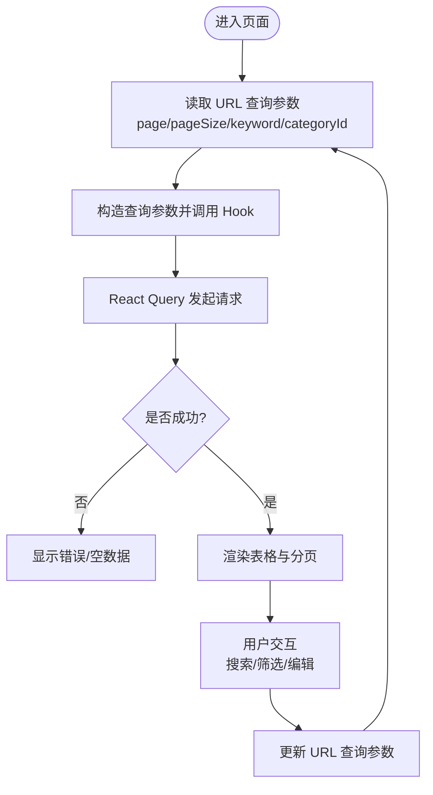
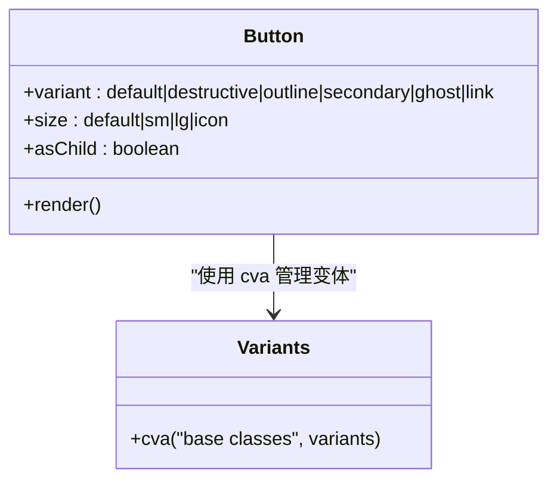
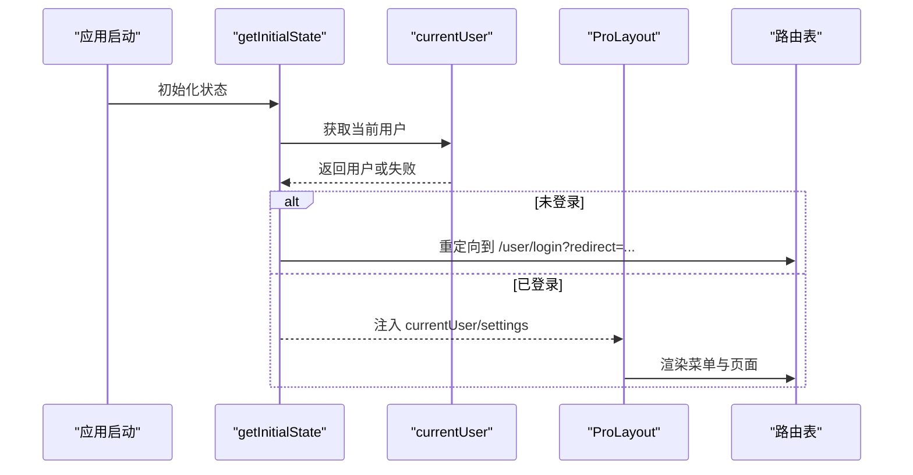
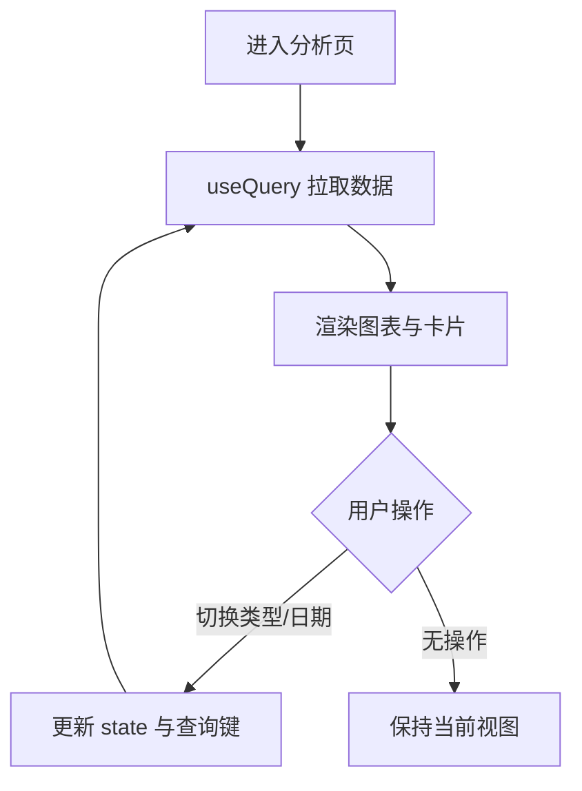
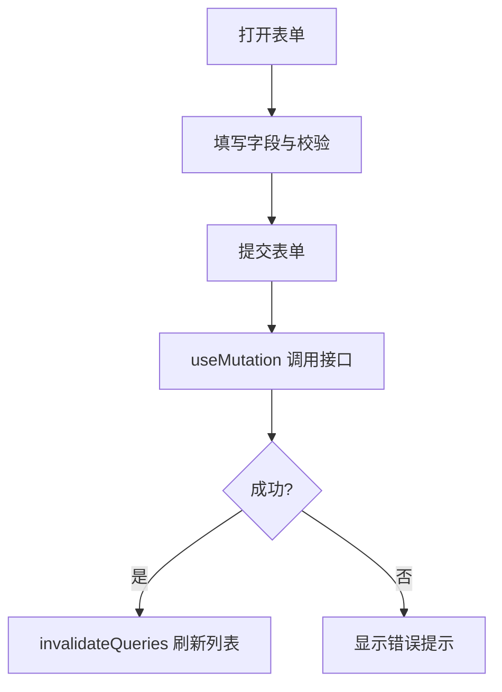
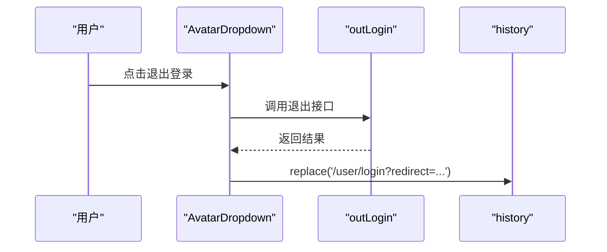
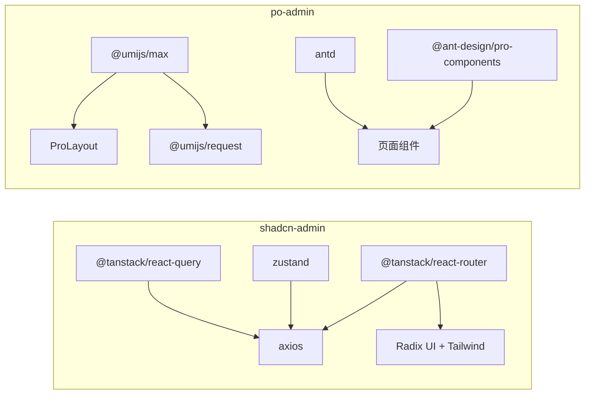

# 前端应用

<cite>
**本文引用的文件**
- [package.json](file://web_client/shadcn-admin/package.json)
- [package.json](file://web_client/po-admin/package.json)
- [main.tsx](file://web_client/shadcn-admin/src/main.tsx)
- [__root.tsx](file://web_client/shadcn-admin/src/routes/__root.tsx)
- [axios.ts](file://web_client/shadcn-admin/src/lib/axios.ts)
- [auth-store.ts](file://web_client/shadcn-admin/src/stores/auth-store.ts)
- [users/index.tsx](file://web_client/shadcn-admin/src/features/users/index.tsx)
- [recipes/index.tsx](file://web_client/shadcn-admin/src/features/recipes/index.tsx)
- [button.tsx](file://web_client/shadcn-admin/src/components/ui/button.tsx)
- [app.tsx](file://web_client/po-admin/src/app.tsx)
- [routes.ts](file://web_client/po-admin/config/routes.ts)
- [api.ts](file://web_client/po-admin/src/services/ant-design-pro/api.ts)
- [analysis/index.tsx](file://web_client/po-admin/src/pages/dashboard/analysis/index.tsx)
- [basic-form/index.tsx](file://web_client/po-admin/src/pages/form/basic-form/index.tsx)
- [AvatarDropdown.tsx](file://web_client/po-admin/src/components/RightContent/AvatarDropdown.tsx)
- [tailwind.config.js](file://web_client/po-admin/tailwind.config.js)
</cite>

## 目录
1. [简介](#简介)
2. [项目结构](#项目结构)
3. [核心组件](#核心组件)
4. [架构总览](#架构总览)
5. [详细组件分析](#详细组件分析)
6. [依赖关系分析](#依赖关系分析)
7. [性能考量](#性能考量)
8. [故障排查指南](#故障排查指南)
9. [结论](#结论)
10. [附录](#附录)

## 简介
本仓库包含两个独立的前端应用，分别面向不同场景：
- shadcn-admin：现代、可高度定制的管理后台界面。基于 TanStack Router 构建路由，使用 Zustand 管理状态，通过 Tailwind CSS + Radix UI 组合实现原子化样式与无障碍基础组件，结合 React Query 进行数据请求与缓存。
- po-admin（Ant Design Pro）：企业级中后台解决方案。基于 UmiJS Max 框架，提供开箱即用的布局、权限、国际化、表单与图表等能力，适合快速搭建复杂业务系统。

本文档将深入解析两者的技术选型、页面组织、API 封装、用户交互流程，并给出差异化定位与选型建议，以及组件开发最佳实践。

## 项目结构
- shadcn-admin
  - 入口与全局上下文：main.tsx 初始化 React Query、主题、字体、方向、语言等 Provider，并挂载 TanStack Router。
  - 路由：采用文件系统路由（由 @tanstack/router 生成），根路由 __root.tsx 提供错误页与开发工具。
  - 状态与网络：Zustand 存储认证信息；Axios 拦截器统一处理鉴权与错误。
  - 功能模块：features 按领域划分（如 users、recipes），每个模块内再分 api、components、data 等子目录。
  - 样式：Tailwind CSS 配合 Radix UI 的无样式基础组件，通过 class-variance-authority 管理变体。

- po-admin
  - 入口与运行时配置：app.tsx 定义 getInitialState、layout、request 等运行时配置，集成 ProLayout、SettingDrawer、错误边界与离线提示。
  - 路由：config/routes.ts 声明式路由表，覆盖登录、仪表盘、表单、列表、个人中心、异常页等。
  - API 层：services/ant-design-pro/api.ts 基于 @umijs/max 的 request 封装各接口。
  - 页面：pages 下按功能域组织，如 dashboard/analysis、form/basic-form 等。
  - 样式：默认 Ant Design 主题，同时保留 tailwind.config.js 以支持局部 Tailwind 使用。

图示来源
- [main.tsx:24-109](file://web_client/shadcn-admin/src/main.tsx#L24-L109)
- [__root.tsx:10-30](file://web_client/shadcn-admin/src/routes/__root.tsx#L10-L30)
- [axios.ts:34-86](file://web_client/shadcn-admin/src/lib/axios.ts#L34-L86)
- [auth-store.ts:25-54](file://web_client/shadcn-admin/src/stores/auth-store.ts#L25-L54)
- [users/index.tsx:19-74](file://web_client/shadcn-admin/src/features/users/index.tsx#L19-L74)
- [recipes/index.tsx:19-81](file://web_client/shadcn-admin/src/features/recipes/index.tsx#L19-L81)
- [button.tsx:6-58](file://web_client/shadcn-admin/src/components/ui/button.tsx#L6-L58)
- [app.tsx:32-195](file://web_client/po-admin/src/app.tsx#L32-L195)
- [routes.ts:13-297](file://web_client/po-admin/config/routes.ts#L13-L297)
- [api.ts:5-94](file://web_client/po-admin/src/services/ant-design-pro/api.ts#L5-L94)
- [analysis/index.tsx:27-159](file://web_client/po-admin/src/pages/dashboard/analysis/index.tsx#L27-L159)
- [basic-form/index.tsx:18-196](file://web_client/po-admin/src/pages/form/basic-form/index.tsx#L18-L196)
- [AvatarDropdown.tsx:17-102](file://web_client/po-admin/src/components/RightContent/AvatarDropdown.tsx#L17-L102)

章节来源
- [main.tsx:24-109](file://web_client/shadcn-admin/src/main.tsx#L24-L109)
- [app.tsx:32-195](file://web_client/po-admin/src/app.tsx#L32-L195)
- [routes.ts:13-297](file://web_client/po-admin/config/routes.ts#L13-L297)

## 核心组件
- shadcn-admin
  - 路由与上下文：React Query 客户端在 main.tsx 创建并注入到 Router 上下文；根路由提供全局通知、错误页与开发工具。
  - 状态管理：Zustand 维护用户与访问令牌，持久化至 Cookie，并提供重置方法。
  - 网络层：Axios 实例统一设置 baseURL、超时与头；请求拦截器自动附加 Bearer Token；响应拦截器处理后端统一返回格式与 401 登出跳转。
  - 组件体系：UI 组件基于 Radix UI + Tailwind，通过 class-variance-authority 管理变体与尺寸；业务组件按 features 组织，复用 Header/Main 布局。

- po-admin
  - 运行时：getInitialState 获取当前用户并控制菜单与重定向；layout 配置 ProLayout、动作区、底部、错误边界与设置抽屉；request 配置统一基地址与错误处理。
  - 路由：声明式 routes.ts 定义多级路由与权限 access，支持重定向与嵌套。
  - 页面与组件：dashboard 分析页使用 React Query 拉取数据，结合 Ant Design 图表与布局；表单页使用 ProForm 系列组件完成校验与提交；头像下拉提供退出登录与主题设置。

章节来源
- [main.tsx:24-109](file://web_client/shadcn-admin/src/main.tsx#L24-L109)
- [__root.tsx:10-30](file://web_client/shadcn-admin/src/routes/__root.tsx#L10-L30)
- [auth-store.ts:25-54](file://web_client/shadcn-admin/src/stores/auth-store.ts#L25-L54)
- [axios.ts:34-86](file://web_client/shadcn-admin/src/lib/axios.ts#L34-L86)
- [app.tsx:32-195](file://web_client/po-admin/src/app.tsx#L32-L195)
- [routes.ts:13-297](file://web_client/po-admin/config/routes.ts#L13-L297)
- [api.ts:5-94](file://web_client/po-admin/src/services/ant-design-pro/api.ts#L5-L94)
- [analysis/index.tsx:27-159](file://web_client/po-admin/src/pages/dashboard/analysis/index.tsx#L27-L159)
- [basic-form/index.tsx:18-196](file://web_client/po-admin/src/pages/form/basic-form/index.tsx#L18-L196)
- [AvatarDropdown.tsx:17-102](file://web_client/po-admin/src/components/RightContent/AvatarDropdown.tsx#L17-L102)

## 架构总览
- shadcn-admin 采用“轻量、可组合”的架构：
  - 路由：TanStack Router 文件系统路由，类型安全且具备导航钩子。
  - 状态：Zustand 单例 store，跨组件共享认证与偏好。
  - 数据：React Query 负责缓存、重试与失效策略；Axios 拦截器统一鉴权与错误。
  - 样式：Tailwind 原子类 + Radix 基础组件，通过 cva 管理变体，便于主题扩展。

- po-admin 采用“一体化、高内聚”的企业方案：
  - 框架：UmiJS Max 提供约定式能力（路由、请求、模型、插件）。
  - 布局：ProLayout 提供菜单、面包屑、设置抽屉、水印等。
  - 数据：@umijs/request 统一封装，结合 React Query 做查询与缓存。
  - 组件：Ant Design 与 Pro Components 提供丰富业务组件，降低重复造轮子成本。

图示来源
- [main.tsx:24-109](file://web_client/shadcn-admin/src/main.tsx#L24-L109)
- [axios.ts:34-86](file://web_client/shadcn-admin/src/lib/axios.ts#L34-L86)
- [auth-store.ts:25-54](file://web_client/shadcn-admin/src/stores/auth-store.ts#L25-L54)
- [app.tsx:32-195](file://web_client/po-admin/src/app.tsx#L32-L195)
- [routes.ts:13-297](file://web_client/po-admin/config/routes.ts#L13-L297)
- [api.ts:5-94](file://web_client/po-admin/src/services/ant-design-pro/api.ts#L5-L94)

## 详细组件分析

### shadcn-admin 认证与网络流程
- 认证状态：Zustand 维护 accessToken 与 user，并在 Cookie 中持久化；提供 set/reset 方法。
- 请求拦截：自动从 store 读取 token 并写入 Authorization 头。
- 响应拦截：若后端返回 401，则清空本地状态并跳转到登录页，携带 redirect 参数以便登录后回跳。
- 全局错误：React Query 的 onError 对 500 等错误进行提示与生产环境跳转。

图示来源
- [axios.ts:42-86](file://web_client/shadcn-admin/src/lib/axios.ts#L42-L86)
- [auth-store.ts:25-54](file://web_client/shadcn-admin/src/stores/auth-store.ts#L25-L54)
- [main.tsx:24-71](file://web_client/shadcn-admin/src/main.tsx#L24-L71)

章节来源
- [axios.ts:42-86](file://web_client/shadcn-admin/src/lib/axios.ts#L42-L86)
- [auth-store.ts:25-54](file://web_client/shadcn-admin/src/stores/auth-store.ts#L25-L54)
- [main.tsx:24-71](file://web_client/shadcn-admin/src/main.tsx#L24-L71)

### shadcn-admin 页面组织与数据流（以 Users/Recipes 为例）
- 路由：通过 getRouteApi 获取当前路由上下文，使用 useSearch/useNavigate 管理分页与搜索参数。
- 数据：useUsers/useRecipes 等自定义 Hook 封装 React Query 查询，自动映射 page/pageSize/keyword 等参数。
- 渲染：Header/Main 布局包裹页面内容，展示标题、操作按钮、表格与对话框；加载与错误态统一处理。

图示来源
- [users/index.tsx:19-74](file://web_client/shadcn-admin/src/features/users/index.tsx#L19-L74)
- [recipes/index.tsx:19-81](file://web_client/shadcn-admin/src/features/recipes/index.tsx#L19-L81)

章节来源
- [users/index.tsx:19-74](file://web_client/shadcn-admin/src/features/users/index.tsx#L19-L74)
- [recipes/index.tsx:19-81](file://web_client/shadcn-admin/src/features/recipes/index.tsx#L19-L81)

### shadcn-admin 组件开发示例（Button）
- 设计模式：使用 class-variance-authority 定义变体（variant）与尺寸（size），并通过 cn 合并类名。
- 可扩展性：asChild 支持透传为任意元素；focus-visible、disabled、aria-invalid 等无障碍与交互状态完善。
- 主题适配：通过 Tailwind 语义色（primary、destructive、background 等）实现明暗主题一致体验。

图示来源
- [button.tsx:6-58](file://web_client/shadcn-admin/src/components/ui/button.tsx#L6-L58)

章节来源
- [button.tsx:6-58](file://web_client/shadcn-admin/src/components/ui/button.tsx#L6-L58)

### po-admin 运行时与路由
- 启动流程：getInitialState 获取当前用户，未登录时重定向到登录页并携带 redirect；layout 配置 ProLayout 行为与 SettingDrawer。
- 路由表：routes.ts 定义多级路由、图标、名称、权限 access 与重定向，集中管理导航结构。
- 请求配置：request 设置 baseURL 与错误处理，统一接入后端接口。

图示来源
- [app.tsx:32-195](file://web_client/po-admin/src/app.tsx#L32-L195)
- [routes.ts:13-297](file://web_client/po-admin/config/routes.ts#L13-L297)
- [api.ts:5-13](file://web_client/po-admin/src/services/ant-design-pro/api.ts#L5-L13)

章节来源
- [app.tsx:32-195](file://web_client/po-admin/src/app.tsx#L32-L195)
- [routes.ts:13-297](file://web_client/po-admin/config/routes.ts#L13-L297)

### po-admin 页面示例：仪表盘与分析
- 数据：使用 React Query 的 useQuery 拉取分析数据，结合 dayjs 时间范围选择与图表组件。
- 交互：切换销售类型、日期范围、Tab 标签，动态更新图表数据与高亮状态。
- 布局：GridContent 与 Row/Col 栅格布局，Suspense 包裹异步组件提升体验。

图示来源
- [analysis/index.tsx:27-159](file://web_client/po-admin/src/pages/dashboard/analysis/index.tsx#L27-L159)

章节来源
- [analysis/index.tsx:27-159](file://web_client/po-admin/src/pages/dashboard/analysis/index.tsx#L27-L159)

### po-admin 页面示例：基础表单
- 组件：使用 ProForm、ProFormText、ProFormDateRangePicker、ProFormSelect 等高级表单组件。
- 校验：内置 rules 与提示信息，支持条件字段显示（ProFormDependency）。
- 提交：useMutation 提交表单，成功后刷新相关查询缓存并提示消息。

图示来源
- [basic-form/index.tsx:18-196](file://web_client/po-admin/src/pages/form/basic-form/index.tsx#L18-L196)

章节来源
- [basic-form/index.tsx:18-196](file://web_client/po-admin/src/pages/form/basic-form/index.tsx#L18-L196)

### po-admin 用户交互：头像下拉与退出登录
- 菜单项：个人设置、主题设置、退出登录。
- 退出流程：调用 outLogin 接口后清理本地状态并重定向到登录页，携带 redirect 参数。
- 主题设置：打开 SettingDrawer 调整主题与布局选项。

图示来源
- [AvatarDropdown.tsx:17-102](file://web_client/po-admin/src/components/RightContent/AvatarDropdown.tsx#L17-L102)
- [api.ts:15-21](file://web_client/po-admin/src/services/ant-design-pro/api.ts#L15-L21)

章节来源
- [AvatarDropdown.tsx:17-102](file://web_client/po-admin/src/components/RightContent/AvatarDropdown.tsx#L17-L102)
- [api.ts:15-21](file://web_client/po-admin/src/services/ant-design-pro/api.ts#L15-L21)

## 依赖关系分析
- shadcn-admin
  - 关键依赖：@tanstack/react-router、@tanstack/react-query、zustand、axios、radix-ui、tailwindcss、class-variance-authority。
  - 耦合点：Axios 与 Zustand 强耦合用于鉴权；Router 与 Axios 通过 registerRouter 解耦导航。
  - 外部集成：i18n、sonner 通知、recharts 图表等按需引入。

- po-admin
  - 关键依赖：@umijs/max、antd、@ant-design/pro-components、@tanstack/react-query、dayjs。
  - 耦合点：app.tsx 集中管理运行时配置；routes.ts 与 services 紧密关联；ProLayout 与 initialState 联动。
  - 外部集成：OpenAPI 文档、Mock、测试与构建工具链。

图示来源
- [package.json:21-66](file://web_client/shadcn-admin/package.json#L21-L66)
- [package.json:37-92](file://web_client/po-admin/package.json#L37-L92)

章节来源
- [package.json:21-66](file://web_client/shadcn-admin/package.json#L21-L66)
- [package.json:37-92](file://web_client/po-admin/package.json#L37-L92)

## 性能考量
- 数据缓存与重试
  - shadcn-admin：React Query 配置了 staleTime、refetchOnWindowFocus 与重试策略，减少重复请求与网络抖动影响。
  - po-admin：通过 @umijs/request 与 React Query 组合，合理设置 queryKey 与 invalidateQueries，避免不必要的全量刷新。
- 路由预加载
  - shadcn-admin：Router 默认 preloading 策略为 intent，提升导航流畅度。
- 组件懒加载
  - po-admin：分析页使用 Suspense 包裹子组件，提升首屏渲染速度。
- 样式体积
  - shadcn-admin：Tailwind 按需生成，Radix 无样式基础组件减小包体。
  - po-admin：Ant Design 按需引入，必要时结合 Tailwind 局部增强。

[本节为通用指导，不直接分析具体文件]

## 故障排查指南
- 401 未授权
  - shadcn-admin：Axios 响应拦截器检测到 401 会清空本地状态并跳转登录页，检查后端 JWT 签发与过期策略。
  - po-admin：getInitialState 未获取到用户时会重定向到登录页，确认 currentUser 接口与路由守卫逻辑。
- 500 服务器错误
  - shadcn-admin：React Query 的 QueryCache.onError 在生产环境会提示并跳转错误页，检查服务端日志与错误码。
- 表单提交失败
  - po-admin：useMutation 的 onSuccess 中刷新相关查询，确保列表与详情一致性；message 提示需与后端返回对齐。
- 路由与权限
  - po-admin：routes.ts 中的 access 控制需与后端权限一致，未通过时检查菜单渲染与页面访问逻辑。

章节来源
- [axios.ts:61-83](file://web_client/shadcn-admin/src/lib/axios.ts#L61-L83)
- [main.tsx:42-71](file://web_client/shadcn-admin/src/main.tsx#L42-L71)
- [app.tsx:32-73](file://web_client/po-admin/src/app.tsx#L32-L73)
- [basic-form/index.tsx:21-30](file://web_client/po-admin/src/pages/form/basic-form/index.tsx#L21-L30)

## 结论
- shadcn-admin 适合追求高度定制、现代化体验与灵活组合的团队，借助 TanStack Router、Zustand、Tailwind 与 Radix UI 快速构建可演进的管理后台。
- po-admin 适合需要企业级开箱即用能力的团队，依托 UmiJS Max 与 Ant Design Pro 生态，快速落地复杂业务系统。
- 选型建议
  - 若强调可定制性与轻量架构，优先 shadcn-admin。
  - 若强调交付速度与成熟生态，优先 po-admin。
  - 也可在同一项目中并存：对外营销或轻量管理用 shadcn-admin，内部复杂业务用 po-admin。

[本节为总结性内容，不直接分析具体文件]

## 附录
- 组件开发最佳实践
  - shadcn-admin
    - 使用 cva 管理组件变体，保持样式一致与可维护性。
    - 通过 features 目录组织业务模块，api/components/data 分离职责。
    - 利用 React Query 的 queryKey 与 invalidateQueries 精确刷新数据。
  - po-admin
    - 使用 ProForm 系列组件简化表单开发与校验。
    - 通过 getInitialState 与 layout 统一管理全局状态与布局行为。
    - 合理使用 Suspense 与按需加载，优化首屏性能。

[本节为通用指导，不直接分析具体文件]