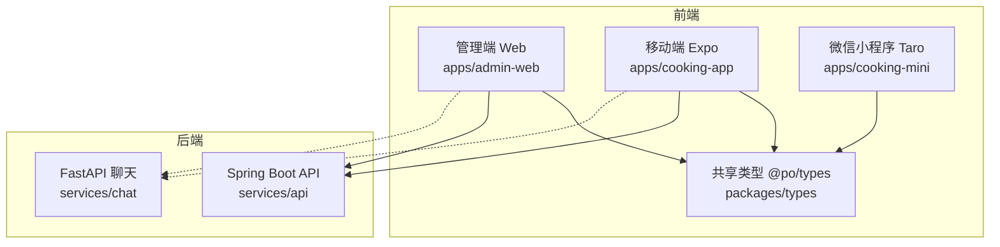
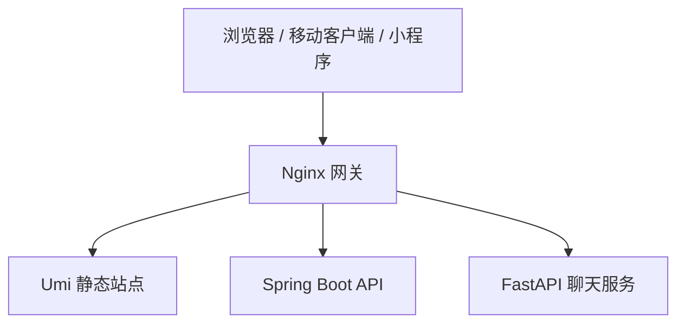
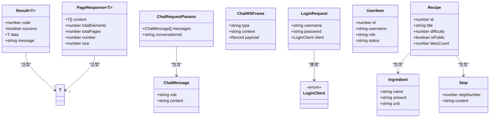
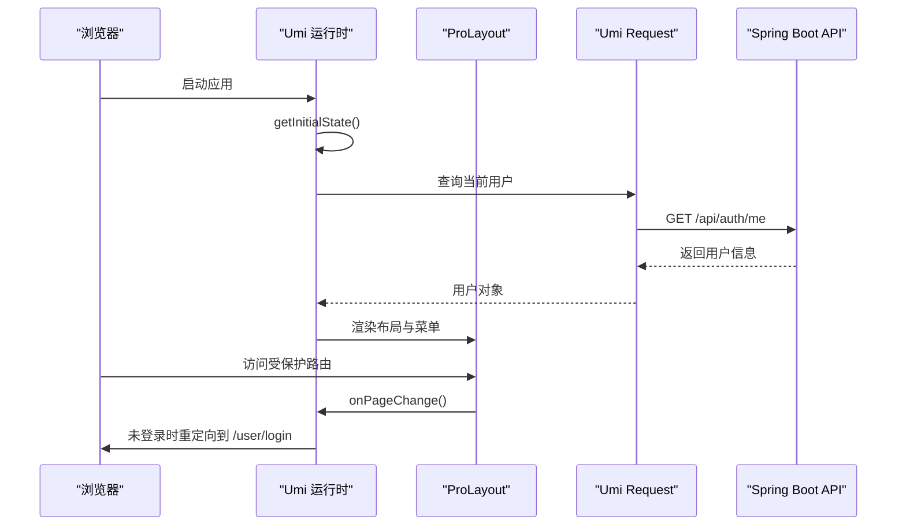
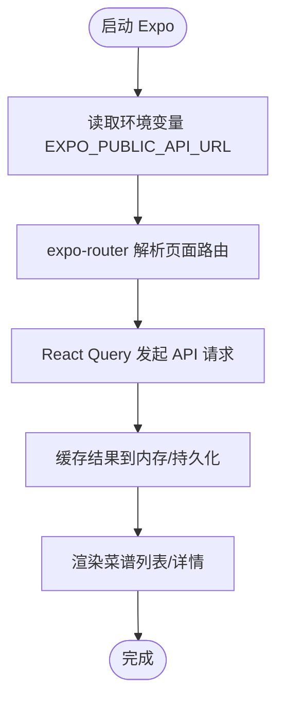
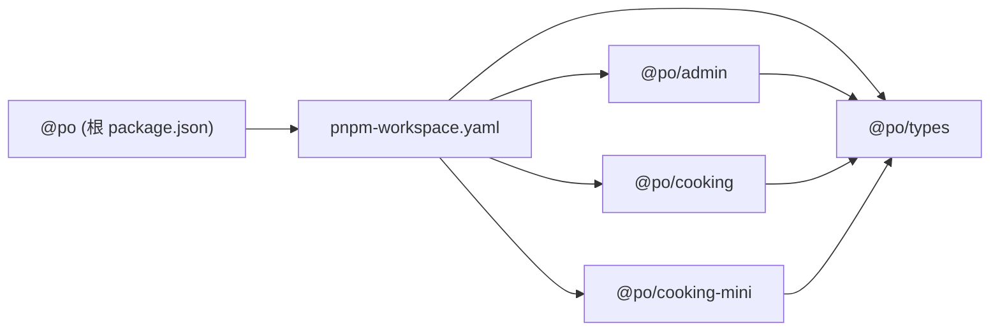

# 前端应用

<cite>
**本文引用的文件**   
- [README.md](file://README.md)
- [package.json](file://package.json)
- [pnpm-workspace.yaml](file://pnpm-workspace.yaml)
- [apps/admin-web/package.json](file://apps/admin-web/package.json)
- [apps/admin-web/config/routes.ts](file://apps/admin-web/config/routes.ts)
- [apps/admin-web/src/app.tsx](file://apps/admin-web/src/app.tsx)
- [apps/admin-web/src/requestErrorConfig.ts](file://apps/admin-web/src/requestErrorConfig.ts)
- [apps/cooking-app/package.json](file://apps/cooking-app/package.json)
- [apps/cooking-mini/package.json](file://apps/cooking-mini/package.json)
- [packages/types/src/index.ts](file://packages/types/src/index.ts)
- [packages/types/src/api.ts](file://packages/types/src/api.ts)
- [packages/types/src/chat.ts](file://packages/types/src/chat.ts)
- [packages/types/src/identity.ts](file://packages/types/src/identity.ts)
- [packages/types/src/recipe.ts](file://packages/types/src/recipe.ts)
</cite>

## 目录
1. [引言](#引言)
2. [项目结构](#项目结构)
3. [核心组件](#核心组件)
4. [架构总览](#架构总览)
5. [详细组件分析](#详细组件分析)
6. [依赖关系分析](#依赖关系分析)
7. [性能与构建部署](#性能与构建部署)
8. [故障排查指南](#故障排查指南)
9. [结论](#结论)

## 引言
本仓库是一个面向“菜谱 + 用户业务”的全栈 Monorepo，统一由 pnpm workspace 管理前端与共享类型，Maven reactor 管理 Spring Boot 后端，Python FastAPI 提供流式聊天，并通过 Docker Compose 与 Nginx 网关统一部署。前端覆盖三个平台：
- 管理端 Web 应用：Umi Max 4 + React 19 + Ant Design 6 + React Query 5 + Vitest + Biome
- 移动端：Expo SDK 57 + React Native + expo-router + NativeWind + React Query + Jest
- 微信小程序：Taro 4 + React 18（Weapp/H5/多端）

共享类型包 `@po/types` 在三个前端应用中复用，保证前后端契约一致。

## 项目结构
仓库采用分层组织方式：
- apps：各前端应用独立工程，彼此通过 workspace 依赖共享类型
- packages：跨应用共享的 TypeScript 类型包
- services：后端服务（Spring Boot、FastAPI、Agent 库）
- infra：Nginx 网关配置与编排
- scripts：通用脚本（服务启动、部署等）

**图示来源**
- [README.md:16-43](file://README.md#L16-L43)
- [pnpm-workspace.yaml:1-5](file://pnpm-workspace.yaml#L1-L5)

**章节来源**
- [README.md:1-34](file://README.md#L1-L34)
- [pnpm-workspace.yaml:1-5](file://pnpm-workspace.yaml#L1-L5)

## 核心组件
- 共享类型包 `@po/types`：集中定义 API 响应、分页、聊天帧、身份认证、菜谱领域模型等类型，供三端共同消费
- 管理端运行时：Umi Max 运行时初始化、布局、路由、请求拦截与错误处理
- 移动端运行时：Expo Router 页面路由、NativeWind 样式、React Query 数据获取
- 小程序运行时：Taro 多端编译、SCSS 样式、页面配置

关键职责划分：
- 类型契约：`@po/types` 作为唯一事实源，避免前后端类型漂移
- 网络层：管理端使用 Umi request；移动端使用 axios + React Query；小程序按 Taro 约定调用
- 状态管理：管理端使用 Umi initialState + ProLayout；移动端使用 React Query 缓存；小程序使用本地状态或轻量 store
- 路由导航：管理端使用 Umi 路由；移动端使用 expo-router；小程序使用 Taro 路由

**章节来源**
- [packages/types/src/index.ts:1-30](file://packages/types/src/index.ts#L1-L30)
- [apps/admin-web/src/app.tsx:43-87](file://apps/admin-web/src/app.tsx#L43-L87)
- [apps/admin-web/src/requestErrorConfig.ts:45-137](file://apps/admin-web/src/requestErrorConfig.ts#L45-L137)
- [apps/cooking-app/package.json:6-44](file://apps/cooking-app/package.json#L6-L44)
- [apps/cooking-mini/package.json:28-44](file://apps/cooking-mini/package.json#L28-L44)

## 架构总览
请求统一从网关进入，按前缀分流到不同上游服务：
- `/ws/chat` → chat:5090（WebSocket 流式聊天）
- `/api/health`、`/api/items/**` → chat:5090（FastAPI 接口）
- `/api/**`（其余）→ api:8080（Spring Boot，含 auth/users/recipes/actuator）
- `/` → Nginx 静态资源（Umi 产物，history 回退 index.html，带 hash 资源长缓存）

**图示来源**
- [README.md:36-43](file://README.md#L36-L43)

**章节来源**
- [README.md:36-43](file://README.md#L36-L43)

## 详细组件分析

### 共享类型包 @po/types
该包是前后端契约的核心，导出以下分类类型：
- API 基础类型：Result、PageResponse
- 聊天协议：ChatMessage、ChatRequestParams、ChatWSFrame、ChatInFrame
- 身份认证：LoginClient、LoginRequest、UserItem、UserRequest、ProfileRequest、ChangePasswordRequest
- 菜谱领域：Recipe、Ingredient、Step、RecipeCategory、RecipeBrief、RecipeListParams、RecipeAuditRequest、RecipeLikeResult 等

类型设计原则：
- 严格枚举值：如 RecipeStatus、RecipeSort、LoginClient，便于前端校验与 UI 展示
- 可选字段明确：允许 null 或 undefined 的字段显式标注，避免空指针
- 请求与响应分离：Request 类型用于入参，实体类型用于出参

**图示来源**
- [packages/types/src/api.ts:1-15](file://packages/types/src/api.ts#L1-L15)
- [packages/types/src/chat.ts:1-40](file://packages/types/src/chat.ts#L1-L40)
- [packages/types/src/identity.ts:1-50](file://packages/types/src/identity.ts#L1-L50)
- [packages/types/src/recipe.ts:1-155](file://packages/types/src/recipe.ts#L1-L155)

**章节来源**
- [packages/types/src/index.ts:1-30](file://packages/types/src/index.ts#L1-L30)
- [packages/types/src/api.ts:1-15](file://packages/types/src/api.ts#L1-L15)
- [packages/types/src/chat.ts:1-40](file://packages/types/src/chat.ts#L1-L40)
- [packages/types/src/identity.ts:1-50](file://packages/types/src/identity.ts#L1-L50)
- [packages/types/src/recipe.ts:1-155](file://packages/types/src/recipe.ts#L1-L155)

### 管理端 Web 应用（Umi Max）
技术选型与职责：
- 路由：Umi 路由配置，集中管理登录、注册、菜谱管理、用户管理等模块
- 运行时：getInitialState 拉取当前用户并校验管理员角色，未授权则重定向登录
- 网络：Umi request 配置，统一注入 Authorization 头、处理 401/403 与业务错误
- 布局：ProLayout 集成国际化、版本信息、设置抽屉、离线提示与错误边界

**图示来源**
- [apps/admin-web/src/app.tsx:43-87](file://apps/admin-web/src/app.tsx#L43-L87)
- [apps/admin-web/src/app.tsx:128-136](file://apps/admin-web/src/app.tsx#L128-L136)
- [apps/admin-web/src/requestErrorConfig.ts:120-132](file://apps/admin-web/src/requestErrorConfig.ts#L120-L132)

**章节来源**
- [apps/admin-web/config/routes.ts:13-193](file://apps/admin-web/config/routes.ts#L13-L193)
- [apps/admin-web/src/app.tsx:43-87](file://apps/admin-web/src/app.tsx#L43-L87)
- [apps/admin-web/src/app.tsx:90-199](file://apps/admin-web/src/app.tsx#L90-L199)
- [apps/admin-web/src/requestErrorConfig.ts:45-137](file://apps/admin-web/src/requestErrorConfig.ts#L45-L137)

### 移动端（Expo + React Native）
技术选型与职责：
- 框架：Expo SDK 57 + expo-router 实现基于文件的路由
- 样式：NativeWind + Tailwind，跨平台样式一致性
- 数据：axios + React Query 进行 API 调用与缓存
- 存储：AsyncStorage、SecureStore 保存会话与敏感信息
- 测试：Jest + jest-expo

典型流程：
- 启动 Expo dev server，根据平台选择 Android/iOS/Web
- 通过环境变量配置 API 地址，浏览器版走同源代理，移动端直连开发机地址
- 使用 React Query 拉取菜谱列表、详情、收藏、历史等数据

**图示来源**
- [apps/cooking-app/package.json:6-44](file://apps/cooking-app/package.json#L6-L44)
- [README.md:171-192](file://README.md#L171-L192)

**章节来源**
- [apps/cooking-app/package.json:59-69](file://apps/cooking-app/package.json#L59-L69)
- [README.md:171-192](file://README.md#L171-L192)

### 微信小程序（Taro）
技术选型与职责：
- 框架：Taro 4 + React 18，支持 Weapp/H5/多端
- 样式：SCSS，按页面拆分样式文件
- 构建：taro build --type weapp/h5 等多端构建命令
- 依赖：引入 @po/types 保持类型一致

构建与开发：
- 开发：npm run dev:weapp 监听模式
- 构建：npm run build:weapp 生成小程序包
- H5：npm run dev:h5 / build:h5 用于预览与调试

**章节来源**
- [apps/cooking-mini/package.json:11-22](file://apps/cooking-mini/package.json#L11-L22)
- [apps/cooking-mini/package.json:28-44](file://apps/cooking-mini/package.json#L28-L44)

## 依赖关系分析
Monorepo 依赖关系如下：
- 根 package.json 定义统一脚本，串联 types:build、admin:*、mobile:*、mini:* 等命令
- pnpm-workspace.yaml 声明 apps/*、apps/*/cloudflare-worker、packages/* 为工作区包
- 三个前端应用均通过 workspace:* 依赖 @po/types，确保类型同步

**图示来源**
- [package.json:10-46](file://package.json#L10-L46)
- [pnpm-workspace.yaml:1-5](file://pnpm-workspace.yaml#L1-L5)
- [apps/admin-web/package.json:35-36](file://apps/admin-web/package.json#L35-L36)
- [apps/cooking-app/package.json:9](file://apps/cooking-app/package.json#L9)
- [apps/cooking-mini/package.json:29](file://apps/cooking-mini/package.json#L29)

**章节来源**
- [package.json:10-46](file://package.json#L10-L46)
- [pnpm-workspace.yaml:1-5](file://pnpm-workspace.yaml#L1-L5)
- [apps/admin-web/package.json:35-36](file://apps/admin-web/package.json#L35-L36)
- [apps/cooking-app/package.json:9](file://apps/cooking-app/package.json#L9)
- [apps/cooking-mini/package.json:29](file://apps/cooking-mini/package.json#L29)

## 性能与构建部署
- 管理端
  - 构建：max build 输出静态资源，生产环境由 Nginx 托管
  - 优化：Umi 默认开启代码分割、资源哈希、按需加载；可结合 tailwindcss 与 antd-style 减少冗余样式
  - 部署：Docker 多阶段构建镜像，Nginx 暴露对外端口，静态资源带长缓存

- 移动端
  - 构建：expo start 开发服务器；EAS 构建 APK/AAB；本地 Gradle 构建 debug APK
  - 优化：NativeWind 按需生成样式；React Query 缓存与重试策略；图片资源使用 expo-image
  - 部署：EAS Preview/Production 构建；生产 API 通过环境变量注入

- 小程序
  - 构建：taro build --type weapp/h5 多端构建；SCSS 预处理器提升样式性能
  - 优化：分包加载、按需引入组件；图片压缩与懒加载

- 共享类型
  - 构建：pnpm types:build 构建 @po/types，所有前端应用依赖其产物
  - 规范：新增类型需同时更新 index.ts 导出，确保三端可见

**章节来源**
- [README.md:88-122](file://README.md#L88-L122)
- [README.md:196-217](file://README.md#L196-L217)
- [apps/admin-web/package.json:7-30](file://apps/admin-web/package.json#L7-L30)
- [apps/cooking-app/package.json:59-69](file://apps/cooking-app/package.json#L59-L69)
- [apps/cooking-mini/package.json:11-22](file://apps/cooking-mini/package.json#L11-L22)

## 故障排查指南
常见问题与定位方法：
- 401 未登录或令牌失效
  - 管理端：requestErrorConfig 中 401 会提示并跳转登录页，检查 localStorage token 是否存在且有效
  - 移动端：确认 EXPO_PUBLIC_API_URL 指向正确后端，检查 SecureStore/AsyncStorage 中的会话
- 403 无权限
  - 管理端：检查用户角色是否为 admin/superadmin，getInitialState 会拒绝普通用户访问
- 网络不可用
  - 管理端：offline 检测会显示国际化提示；检查浏览器网络状态与服务可用性
- WebSocket 聊天连接失败
  - 移动端：EXPO_PUBLIC_CHAT_URL 是否覆盖成功；chat 服务健康检查是否通过
- 构建失败
  - 类型包未构建：先执行 pnpm types:build
  - Node/pnpm 版本不匹配：确保 Node ≥ 22、pnpm ≥ 10

**章节来源**
- [apps/admin-web/src/requestErrorConfig.ts:90-115](file://apps/admin-web/src/requestErrorConfig.ts#L90-L115)
- [apps/admin-web/src/app.tsx:50-66](file://apps/admin-web/src/app.tsx#L50-L66)
- [README.md:171-192](file://README.md#L171-L192)

## 结论
本项目以 Monorepo 形式统一管理多端前端与后端服务，通过 @po/types 建立稳定的前后端契约，借助 Umi、Expo、Taro 分别满足管理端、移动端与小程序的开发需求。统一的脚本与 CI 流程提升了协作效率，Nginx 网关与 Docker Compose 简化了部署复杂度。建议在后续迭代中持续完善类型定义、增强错误处理与监控能力，并针对移动端与小程序进行更细粒度的性能优化。