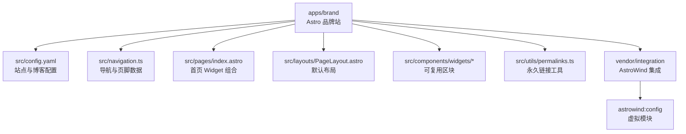
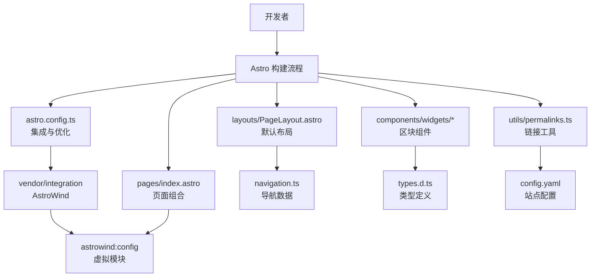
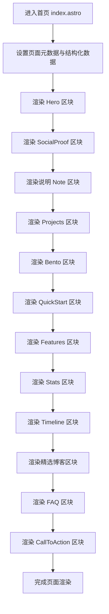
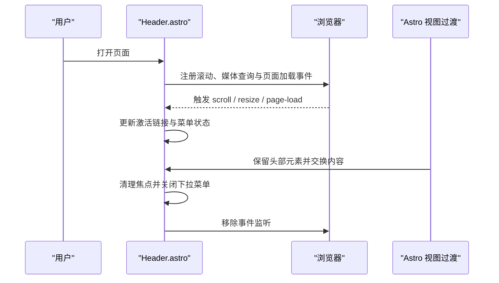
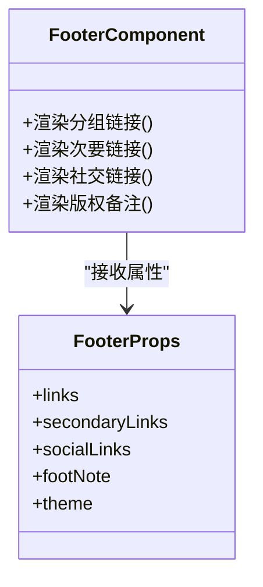
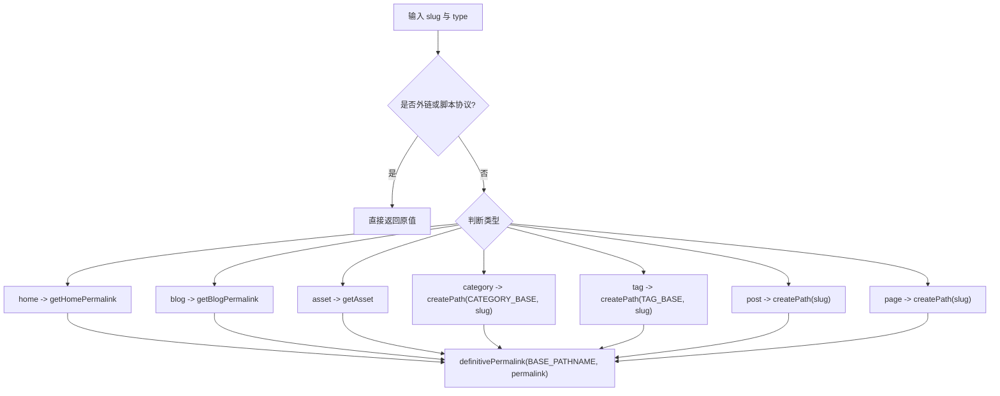
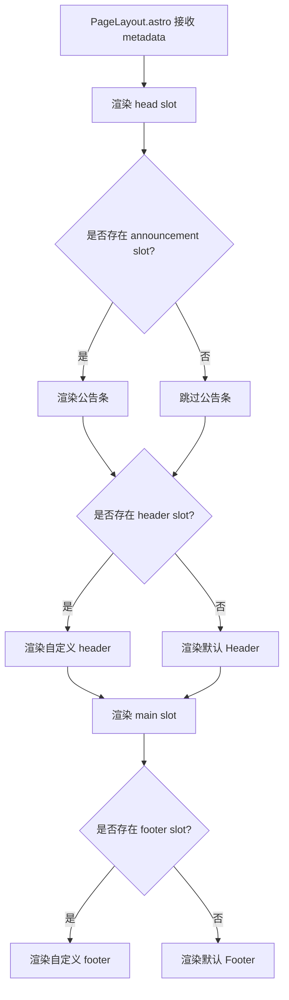
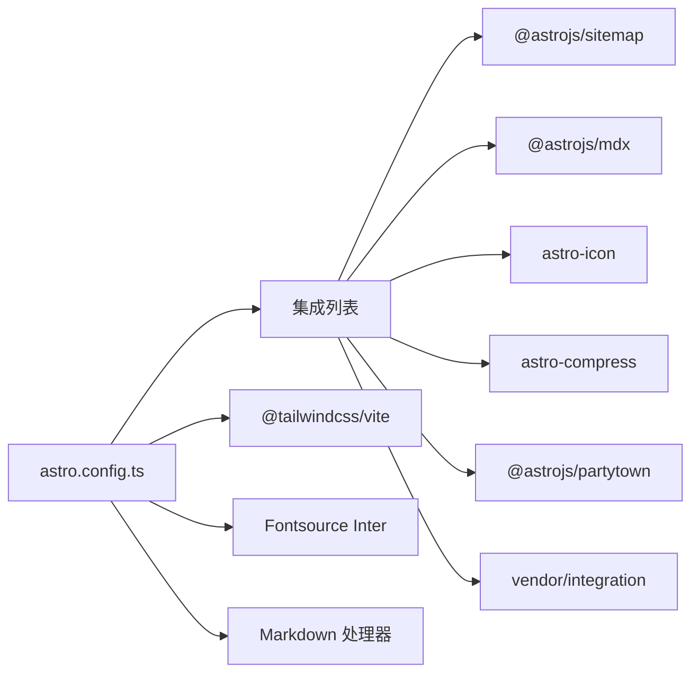

# 品牌网站（Astro）

<cite>
**本文引用的文件**   
- [apps/brand/README.md](file://apps/brand/README.md)
- [apps/brand/package.json](file://apps/brand/package.json)
- [apps/brand/astro.config.ts](file://apps/brand/astro.config.ts)
- [apps/brand/src/config.yaml](file://apps/brand/src/config.yaml)
- [apps/brand/src/navigation.ts](file://apps/brand/src/navigation.ts)
- [apps/brand/src/content.config.ts](file://apps/brand/src/content.config.ts)
- [apps/brand/src/types.d.ts](file://apps/brand/src/types.d.ts)
- [apps/brand/src/pages/index.astro](file://apps/brand/src/pages/index.astro)
- [apps/brand/src/layouts/PageLayout.astro](file://apps/brand/src/layouts/PageLayout.astro)
- [apps/brand/src/components/widgets/Header.astro](file://apps/brand/src/components/widgets/Header.astro)
- [apps/brand/src/components/widgets/Footer.astro](file://apps/brand/src/components/widgets/Footer.astro)
- [apps/brand/src/utils/permalinks.ts](file://apps/brand/src/utils/permalinks.ts)
</cite>

## 目录
1. [简介](#简介)
2. [项目结构](#项目结构)
3. [核心组件](#核心组件)
4. [架构总览](#架构总览)
5. [详细组件分析](#详细组件分析)
6. [依赖关系分析](#依赖关系分析)
7. [性能与构建特性](#性能与构建特性)
8. [排障指南](#排障指南)
9. [结论](#结论)

## 简介
本仓库中的 `apps/brand` 是一个基于 Astro 的品牌介绍站，用于展示“叮叮厨”这一菜谱平台与 AI 做菜助手项目的整体构成、关键决策与开发历程。站点采用静态输出，结合 Tailwind CSS、MDX、Sitemap、图标压缩等集成，通过自定义 AstroWind 集成把 `src/config.yaml` 编译为虚拟模块供页面使用。首页由多个可复用 Widget 组合而成，导航与页脚数据集中在配置文件中，便于统一维护。

该站点不是线上产品官网，而是个人与项目的介绍站；页面中的图片多为示意插画，真实截图与公开访问地址会在部署完成后补充。

**章节来源**
- [apps/brand/README.md:1-58](file://apps/brand/README.md#L1-L58)

## 项目结构
`apps/brand` 是 monorepo 中的一个独立应用，遵循 Astro 的约定式目录：

- `src/config.yaml`：站点名称、域名、SEO 元信息、博客路由与主题等全局配置。
- `src/navigation.ts`：页头与页脚的链接、社交入口与备注文案。
- `src/pages/*`：页面入口，其中 `index.astro` 由多个 Widget 拼装出完整落地页。
- `src/data/post/*.md`：博客文章，front matter 支持分类与标签。
- `src/components/widgets/*`：可复用的页面区块组件，如 Hero、Projects、Bento、FAQs 等。
- `src/layouts/*`：布局组件，`PageLayout.astro` 负责注入默认 Header/Footer 与 slot。
- `src/utils/*`：工具函数，包括永久链接生成、前处理插件等。
- `vendor/integration`：上游模板提供的 Astro 集成，将 `config.yaml` 编译为 `astrowind:config` 虚拟模块。

**图表来源**
- [apps/brand/astro.config.ts:16-18](file://apps/brand/astro.config.ts#L16-L18)
- [apps/brand/src/pages/index.astro:17-18](file://apps/brand/src/pages/index.astro#L17-L18)
- [apps/brand/src/layouts/PageLayout.astro:2-6](file://apps/brand/src/layouts/PageLayout.astro#L2-L6)
- [apps/brand/src/utils/permalinks.ts:1-5](file://apps/brand/src/utils/permalinks.ts#L1-L5)

**章节来源**
- [apps/brand/README.md:28-47](file://apps/brand/README.md#L28-L47)
- [apps/brand/astro.config.ts:26-99](file://apps/brand/astro.config.ts#L26-L99)

## 核心组件
本节聚焦站点中最关键的代码位置及其职责。

- 站点配置 `src/config.yaml`
  - 定义站点名、基础 URL、SEO 标题模板、Open Graph 封面、i18n 语言、博客开关与路由、分析器 ID、UI 主题等。
  - 部署前必须替换占位域名，因为 Sitemap、OG 与 RSS 的绝对链接都基于此值生成。

- 导航数据 `src/navigation.ts`
  - 导出 `headerData` 与 `footerData`，包含主导航链接、动作按钮、页脚分组链接、社交链接与版权备注。
  - 链接通过 `getPermalink` 与 `getBlogPermalink` 生成，保证与 `SITE.base`、`trailingSlash` 一致。

- 内容集合 `src/content.config.ts`
  - 使用 Zod 校验博客文章的 front matter，包括标题、摘要、封面、分类、标签、作者、元数据等字段。
  - 加载 `src/data/post` 下的 `.md` 与 `.mdx` 文件，作为 Astro Content Collections 的数据源。

- 类型定义 `src/types.d.ts`
  - 集中声明 Post、Taxonomy、MetaData、Widget、Hero、Features、Pricing、Timeline、Projects 等大量组件与 Widget 的数据结构。
  - 为 Astro 组件提供 TypeScript 类型提示，降低跨组件传参出错概率。

- 首页 `src/pages/index.astro`
  - 引入 `PageLayout` 与多个 Widget，组装 Hero、SocialProof、Note、Projects、Bento、QuickStart、Features、Stats、Timeline、HighlightedPosts、FAQs、CallToAction 等区块。
  - 注入结构化数据（WebSite、Organization），并设置页面级 metadata。

- 布局 `src/layouts/PageLayout.astro`
  - 包裹基础 Layout，注入 head slot，并根据是否存在自定义 slot 决定是否渲染默认 Header/Footer。
  - 明确处理 Astro slot fallback 的行为，避免 astro-icon 的 SVG sprite 被重复计算导致缺失。

**章节来源**
- [apps/brand/src/config.yaml:1-75](file://apps/brand/src/config.yaml#L1-L75)
- [apps/brand/src/navigation.ts:1-56](file://apps/brand/src/navigation.ts#L1-L56)
- [apps/brand/src/content.config.ts:1-74](file://apps/brand/src/content.config.ts#L1-L74)
- [apps/brand/src/types.d.ts:5-502](file://apps/brand/src/types.d.ts#L5-L502)
- [apps/brand/src/pages/index.astro:1-443](file://apps/brand/src/pages/index.astro#L1-L443)
- [apps/brand/src/layouts/PageLayout.astro:1-35](file://apps/brand/src/layouts/PageLayout.astro#L1-L35)

## 架构总览
品牌站的整体运行方式如下：

- 构建阶段：Astro 读取 `astro.config.ts`，启用 Sitemap、MDX、图标、压缩、AstroWind 集成等；Tailwind 通过 Vite 插件接入；字体通过 Fontsource 自托管。
- 运行时：页面由 Astro 在构建期渲染为静态 HTML；客户端仅承担交互逻辑，例如头部菜单展开、滚动高亮、主题切换等。
- 内容层：博客文章来自 Markdown/MDX，经 content config 校验后由页面组件消费。
- 配置层：`config.yaml` 通过 AstroWind 集成暴露为 `astrowind:config`，供页面与组件读取站点元信息。

**图表来源**
- [apps/brand/astro.config.ts:51-99](file://apps/brand/astro.config.ts#L51-L99)
- [apps/brand/src/pages/index.astro:1-47](file://apps/brand/src/pages/index.astro#L1-L47)
- [apps/brand/src/layouts/PageLayout.astro:1-15](file://apps/brand/src/layouts/PageLayout.astro#L1-L15)
- [apps/brand/src/navigation.ts:1-24](file://apps/brand/src/navigation.ts#L1-L24)
- [apps/brand/src/types.d.ts:5-502](file://apps/brand/src/types.d.ts#L5-L502)
- [apps/brand/src/config.yaml:1-75](file://apps/brand/src/config.yaml#L1-L75)

## 详细组件分析

### 首页与 Widget 组合
首页 `index.astro` 是品牌站的门面，它不直接实现业务逻辑，而是通过传入 props 的方式驱动多个 Widget：

- Hero：展示项目定位、行动按钮与插画。
- SocialProof：用数字强调三端、测试用例、AI 降级路径与密钥管理。
- Projects：以卡片形式列出小程序、App、后端 API、AI 聊天服务、管理后台与契约工程化。
- Bento：解释一次请求经过的关键设计点。
- QuickStart：给出本地启动命令与工程说明。
- Features：记录关键取舍与工程经验。
- Stats：汇总关键指标。
- Timeline：按时间线回顾项目演进。
- BlogHighlightedPosts：展示精选开发手记。
- FAQs：回答常见疑问。
- CallToAction：引导联系或查看关于页。

**图表来源**
- [apps/brand/src/pages/index.astro:20-443](file://apps/brand/src/pages/index.astro#L20-L443)

**章节来源**
- [apps/brand/src/pages/index.astro:1-443](file://apps/brand/src/pages/index.astro#L1-L443)

### 头部组件与交互
`Header.astro` 是页面的顶部导航组件，具备以下能力：

- 根据当前 URL 判断激活链接，兼容 `trailingSlash` 配置差异。
- 支持响应式菜单、下拉菜单、固定头部、主题切换与 RSS 入口。
- 使用自定义元素 `aw-header` 与 `transition:persist` 保持跨页面导航时的状态稳定。
- 在移动端点击菜单项后自动收起菜单，并在断点变化时关闭菜单。
- 滚动超过阈值时添加样式类，实现视觉上的粘性效果。

**图表来源**
- [apps/brand/src/components/widgets/Header.astro:47-63](file://apps/brand/src/components/widgets/Header.astro#L47-L63)
- [apps/brand/src/components/widgets/Header.astro:196-309](file://apps/brand/src/components/widgets/Header.astro#L196-L309)

**章节来源**
- [apps/brand/src/components/widgets/Header.astro:1-310](file://apps/brand/src/components/widgets/Header.astro#L1-L310)

### 页脚组件
`Footer.astro` 负责渲染页脚分组链接、次要链接、社交链接与版权备注：

- 使用网格布局组织多列链接。
- 通过 `set:html` 渲染富文本 footNote。
- 社交链接支持图标与 ariaLabel，提升可访问性。
- 与 `navigation.ts` 配合，统一维护站点底部信息。

**图表来源**
- [apps/brand/src/components/widgets/Footer.astro:18-27](file://apps/brand/src/components/widgets/Footer.astro#L18-L27)
- [apps/brand/src/components/widgets/Footer.astro:29-104](file://apps/brand/src/components/widgets/Footer.astro#L29-L104)

**章节来源**
- [apps/brand/src/components/widgets/Footer.astro:1-105](file://apps/brand/src/components/widgets/Footer.astro#L1-L105)

### 永久链接工具
`permalinks.ts` 提供站点内链接生成的核心逻辑：

- 统一裁剪斜杠、拼接路径、处理 `SITE.base` 与 `trailingSlash`。
- 区分 home、blog、asset、category、tag、post、page 等类型。
- 提供 canonical URL 规范化，避免多余尾斜杠或缺少尾斜杠。
- 为博客分类与标签页生成基础路径。

**图表来源**
- [apps/brand/src/utils/permalinks.ts:8-14](file://apps/brand/src/utils/permalinks.ts#L8-L14)
- [apps/brand/src/utils/permalinks.ts:31-87](file://apps/brand/src/utils/permalinks.ts#L31-L87)
- [apps/brand/src/utils/permalinks.ts:96-105](file://apps/brand/src/utils/permalinks.ts#L96-L105)

**章节来源**
- [apps/brand/src/utils/permalinks.ts:1-105](file://apps/brand/src/utils/permalinks.ts#L1-L105)

### 布局与插槽机制
`PageLayout.astro` 的职责是统一注入 head 内容、公告条、默认 Header/Footer，并处理 Astro slot fallback 的特殊行为：

- 显式渲染 slot fallback，避免 astro-icon 的 SVG sprite 被重复评估导致缺失。
- 仅在存在自定义 slot 时才覆盖默认 Header/Footer。
- 通过 `metadata` 属性向基础 Layout 传递页面级 SEO 信息。

**图表来源**
- [apps/brand/src/layouts/PageLayout.astro:17-34](file://apps/brand/src/layouts/PageLayout.astro#L17-L34)

**章节来源**
- [apps/brand/src/layouts/PageLayout.astro:1-35](file://apps/brand/src/layouts/PageLayout.astro#L1-L35)

## 依赖关系分析
品牌站的技术栈与依赖关系如下：

- 框架与集成：Astro、AstroWind 集成、MDX、Sitemap、Partytown、astro-icon、astro-compress。
- 样式与主题：Tailwind CSS v4、@tailwindcss/typography、lightningcss 压缩。
- 内容与工具：js-yaml、limax、unpic、sharp、reading-time。
- 开发与质量：ESLint、TypeScript、Prettier、astro-check。

**图表来源**
- [apps/brand/astro.config.ts:51-99](file://apps/brand/astro.config.ts#L51-L99)
- [apps/brand/package.json:25-67](file://apps/brand/package.json#L25-L67)

**章节来源**
- [apps/brand/package.json:1-82](file://apps/brand/package.json#L1-L82)
- [apps/brand/astro.config.ts:1-141](file://apps/brand/astro.config.ts#L1-L141)

## 性能与构建特性
品牌站在构建与运行时做了多项优化：

- 静态输出：`output: 'static'`，适合托管到云托管或静态站点服务。
- 预取策略：开启 `prefetch`，默认策略为 viewport，提升导航体验。
- 字体优化：使用 Fontsource 自托管 Inter，限定权重与子集，并通过 CSS 变量注入。
- 图片策略：本地图片由 Sharp 处理，远程 CDN 图片通过 unpic 改写 URL，减少 Astro 下载成本。
- 压缩策略：CSS 使用 lightningcss 压缩，HTML 使用 html-minifier-terser，JS 压缩，SVG 与 Image 压缩关闭以避免破坏样式或资源。
- Markdown 处理：注入 readingTime 与 responsiveTables 插件，Shiki 主题跟随站点明暗模式。
- 图标优化：astro-icon 只引入需要的 Tabler 与 Flat Color Icons 图标，减少打包体积。

**章节来源**
- [apps/brand/astro.config.ts:26-130](file://apps/brand/astro.config.ts#L26-L130)
- [apps/brand/README.md:35-38](file://apps/brand/README.md#L35-L38)

## 排障指南
常见问题与处理方式：

- Astro 配置加载失败
  - 现象：`astro dev` 报无法加载 Astro 配置，提示找不到 `vendor/integration/index.ts`。
  - 原因：Vite 依赖缓存过期，常见于 `git checkout` 或 `git restore` 之后。
  - 处理：删除 `apps/brand/.astro` 与 `apps/brand/node_modules/.vite`，再重新安装依赖并启动；`pnpm brand:build` 不受影响。

- 域名与社交账号未替换
  - 现象：Sitemap、Open Graph、RSS 链接指向占位域名。
  - 处理：部署前修改 `src/config.yaml` 中的站点域名；也可通过环境变量在容器内改写。

- 社交媒体账号为空
  - 现象：Twitter meta 未输出。
  - 处理：在 `src/config.yaml` 中填写 Twitter handle 与 site，留空则不会输出对应 meta。

- 图片格式问题
  - 现象：SVG 源被栅格化时报错，或 OG 图无法正确生成。
  - 处理：页面直接引用的 SVG 需设置 `format: 'svg'`；博客封面与 OG 图需先运行 `scripts/gen-rasters.mjs` 转成位图。

**章节来源**
- [apps/brand/README.md:26-47](file://apps/brand/README.md#L26-L47)
- [apps/brand/src/config.yaml:1-30](file://apps/brand/src/config.yaml#L1-L30)

## 结论
品牌站以 Astro 为核心，结合 AstroWind 集成、Tailwind CSS、MDX 与丰富的组件库，形成了一套结构清晰、易于扩展的介绍站方案。其优势在于：

- 配置集中：站点元信息、博客路由、主题与导航集中在少数文件中。
- 组件化强：首页由多个 Widget 组合，便于复用与替换。
- 类型安全：大量 TypeScript 类型定义降低组件间传参错误。
- 构建优化：静态输出、字体自托管、图片与代码压缩、预取策略共同提升性能。
- 可维护性高：通过 README、配置注释与工具函数统一规范，降低长期维护成本。

对于后续迭代，建议优先关注：

- 替换真实域名与社交账号，确保 SEO 与分享链接正确。
- 补充真实产品截图，提升介绍站的可信度。
- 继续完善博客内容，沉淀开发经验与踩坑记录。
- 在需要时启用第三方分析器，但注意隐私与合规。
- 保持脚本与文档同步，避免部署凭据与地址靠记忆维护。