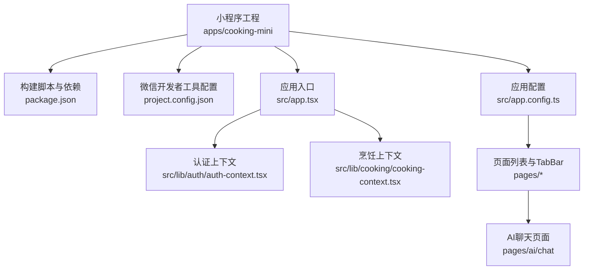
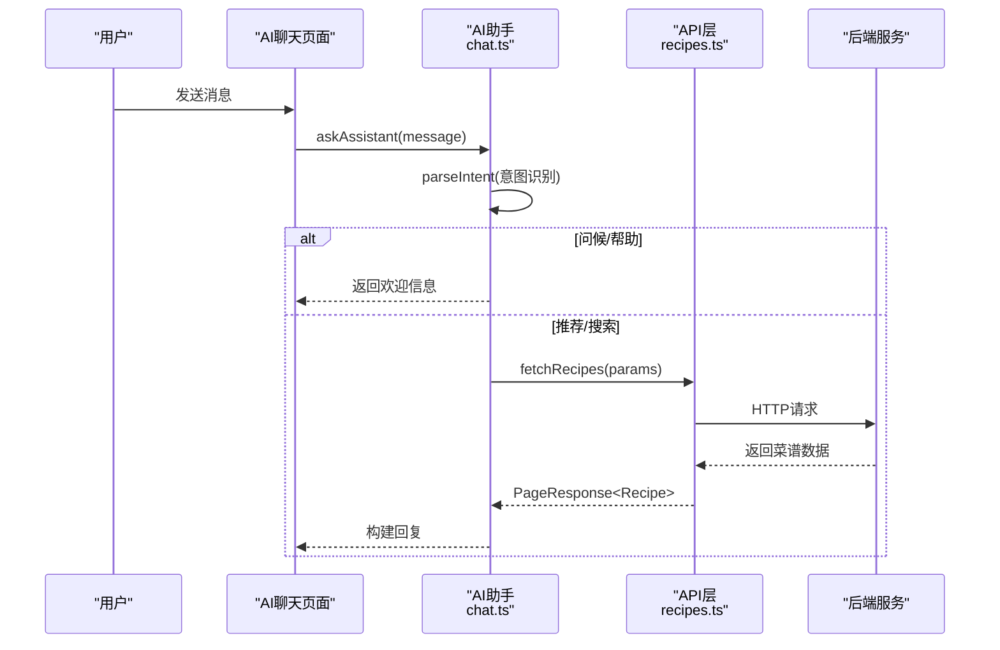
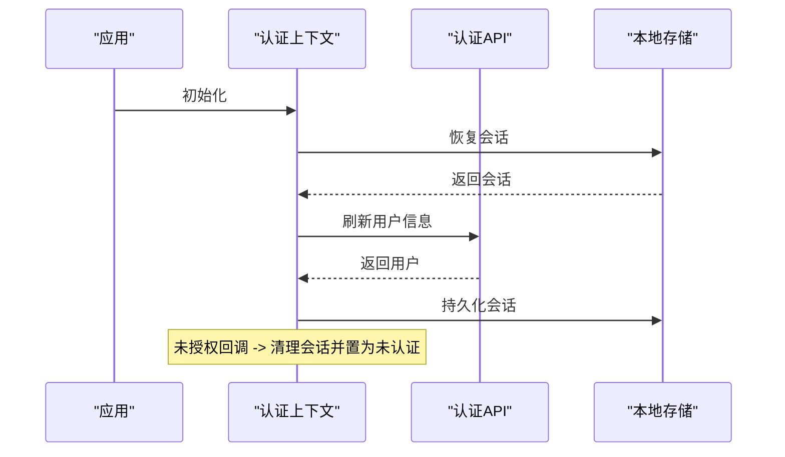
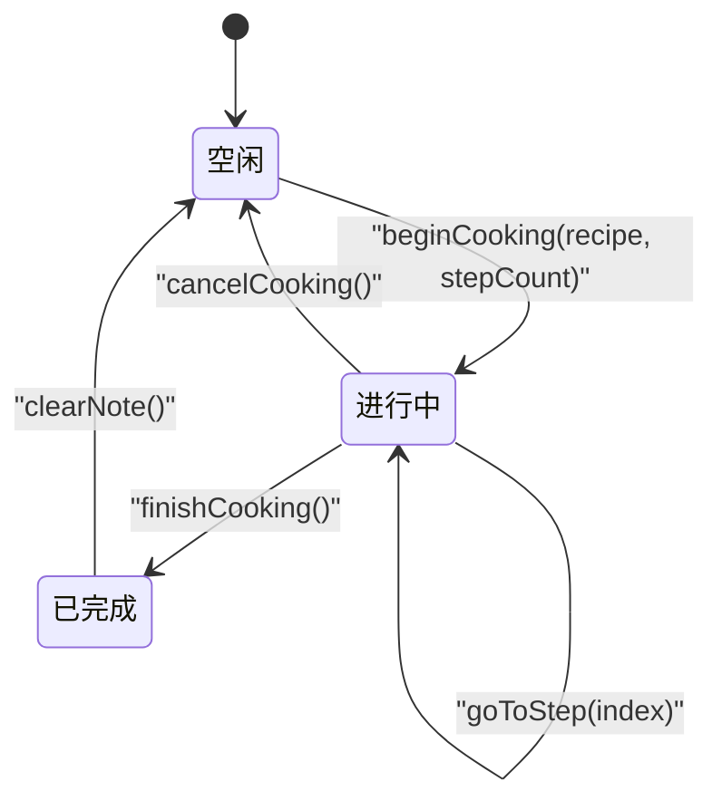
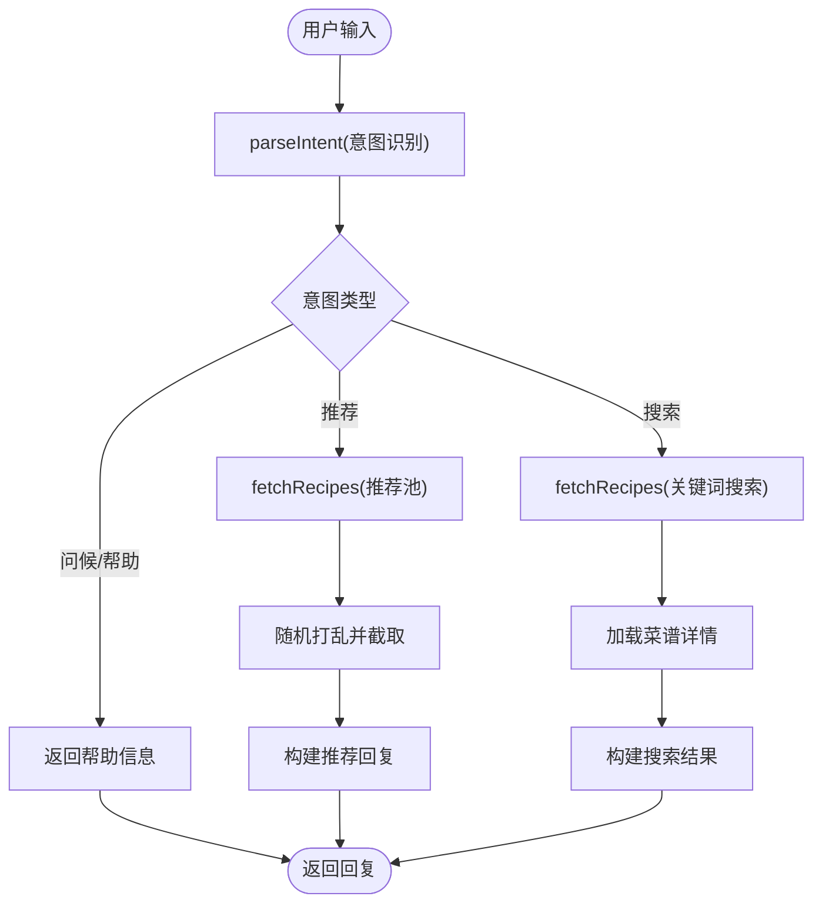
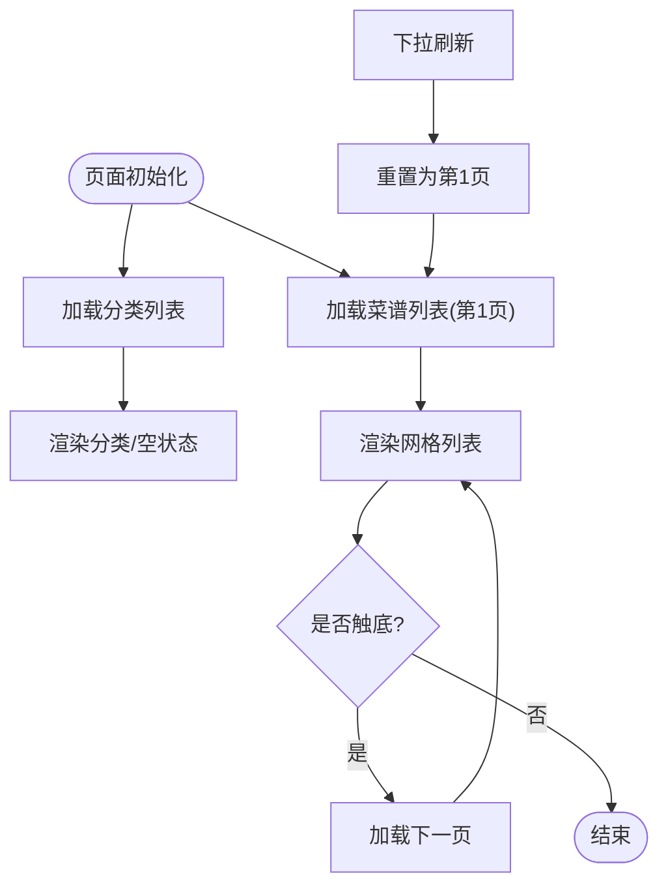

# 微信小程序

<cite>
**本文引用的文件**   
- [package.json](file://apps/cooking-mini/package.json)
- [project.config.json](file://apps/cooking-mini/project.config.json)
- [app.tsx](file://apps/cooking-mini/src/app.tsx)
- [app.config.ts](file://apps/cooking-mini/src/app.config.ts)
- [index.tsx](file://apps/cooking-mini/src/pages/index/index.tsx)
- [auth-context.tsx](file://apps/cooking-mini/src/lib/auth/auth-context.tsx)
- [cooking-context.tsx](file://apps/cooking-mini/src/lib/cooking/cooking-context.tsx)
- [chat.ts](file://apps/cooking-mini/src/lib/ai/chat.ts)
</cite>

## 更新摘要
**变更内容**   
- 新增 AI 聊天功能文档，包括意图识别、本地推荐与搜索兜底机制
- 完善认证系统说明，涵盖 OpenID 登录、密码登录、注册与会话管理
- 扩展烹饪模式实现细节，包括会话持久化、步骤导航与完成记录
- 补充页面路由配置与 TabBar 结构说明

## 目录
1. [简介](#简介)
2. [项目结构](#项目结构)
3. [核心组件](#核心组件)
4. [架构总览](#架构总览)
5. [详细组件分析](#详细组件分析)
6. [依赖关系分析](#依赖关系分析)
7. [性能与体验优化](#性能与体验优化)
8. [调试、测试与发布](#调试测试与发布)
9. [常见问题排查](#常见问题排查)
10. [结论](#结论)

## 简介
本项目是一个基于 Taro + React 的微信小程序"做菜助手"，提供菜谱浏览、分类筛选、收藏历史、烹饪步骤引导以及 AI 聊天等能力。小程序通过统一的 API 客户端访问后端服务，使用本地存储保存搜索历史与烹饪进度，并通过上下文（Context）管理认证状态与烹饪会话。最新版本已完整实现认证系统、烹饪模式和 AI 聊天功能。

## 项目结构
小程序采用 Taro 多端框架，目标平台包含微信小程序。根配置定义了页面路由、窗口样式与底部 TabBar；应用入口包裹全局 Provider，统一注入认证与烹饪上下文。

图表来源
- [package.json:1-60](file://apps/cooking-mini/package.json#L1-L60)
- [project.config.json:1-19](file://apps/cooking-mini/project.config.json#L1-L19)
- [app.tsx:1-15](file://apps/cooking-mini/src/app.tsx#L1-L15)
- [app.config.ts:1-57](file://apps/cooking-mini/src/app.config.ts#L1-L57)

章节来源
- [package.json:1-60](file://apps/cooking-mini/package.json#L1-L60)
- [project.config.json:1-19](file://apps/cooking-mini/project.config.json#L1-L19)
- [app.tsx:1-15](file://apps/cooking-mini/src/app.tsx#L1-L15)
- [app.config.ts:1-57](file://apps/cooking-mini/src/app.config.ts#L1-L57)

## 核心组件
- 应用入口与全局上下文：在应用启动时挂载认证与烹饪上下文，确保全应用可访问用户状态与烹饪进度。
- 首页与分类页：负责菜谱列表展示、筛选、分页加载、下拉刷新与上拉加载更多。
- 认证上下文：统一管理登录态、用户信息与未授权处理，支持 OpenID 与密码登录、注册、退出与用户信息刷新。
- 烹饪上下文：维护一次烹饪会话，持久化到本地存储，支持开始、跳转步骤、完成与取消。
- AI 聊天助手：基于意图识别的智能对话系统，支持问候、帮助、菜谱推荐与搜索功能。

章节来源
- [app.tsx:1-15](file://apps/cooking-mini/src/app.tsx#L1-L15)
- [index.tsx:1-267](file://apps/cooking-mini/src/pages/index/index.tsx#L1-L267)
- [auth-context.tsx:1-130](file://apps/cooking-mini/src/lib/auth/auth-context.tsx#L1-L130)
- [cooking-context.tsx:1-176](file://apps/cooking-mini/src/lib/cooking/cooking-context.tsx#L1-L176)
- [chat.ts:1-78](file://apps/cooking-mini/src/lib/ai/chat.ts#L1-L78)

## 架构总览
小程序前端通过 Taro 渲染 React 组件，调用封装后的 API 客户端访问后端 REST 接口。认证与会话由认证上下文管理，烹饪进度由烹饪上下文管理并落盘至本地存储。AI 聊天功能通过意图识别引擎处理用户输入，结合本地数据提供智能回复。

图表来源
- [chat.ts:14-57](file://apps/cooking-mini/src/lib/ai/chat.ts#L14-L57)
- [index.tsx:75-114](file://apps/cooking-mini/src/pages/index/index.tsx#L75-L114)

## 详细组件分析

### 认证系统
- 职责：管理登录态、用户信息、未授权处理、会话持久化与恢复。
- 关键流程：
  - 启动时恢复本地会话，校验角色后设置已认证状态。
  - 登录/注册成功后持久化会话并刷新用户信息。
  - 未授权回调自动登出。
  - 提供 signInWithOpenId、signInWithPassword、register、signOut、refreshUser 等方法。

图表来源
- [auth-context.tsx:33-105](file://apps/cooking-mini/src/lib/auth/auth-context.tsx#L33-L105)

章节来源
- [auth-context.tsx:1-130](file://apps/cooking-mini/src/lib/auth/auth-context.tsx#L1-L130)

### 烹饪模式
- 职责：维护一次烹饪会话（菜谱 ID、标题、步骤总数、当前步骤、开始时间），并在本地存储中持久化。
- 关键流程：
  - 启动时读取上次未完成会话。
  - beginCooking：根据是否重启决定是否复用已有进度。
  - goToStep：限制步数范围并更新进度。
  - finishCooking：生成一条"已完成"的记录供聊天页消费，同时清空会话。
  - cancelCooking/clearNote：取消或清除记录。

图表来源
- [cooking-context.tsx:54-176](file://apps/cooking-mini/src/lib/cooking/cooking-context.tsx#L54-L176)

章节来源
- [cooking-context.tsx:1-176](file://apps/cooking-mini/src/lib/cooking/cooking-context.tsx#L1-L176)

### AI 聊天助手
- 职责：基于意图识别的智能对话系统，支持问候、帮助、菜谱推荐与搜索功能。
- 核心功能：
  - 意图解析：识别用户输入的意图类型（问候、帮助、推荐、搜索）。
  - 本地推荐：从本地菜谱库中随机选择推荐菜品。
  - 智能搜索：根据关键词查找匹配的菜谱详情。
  - 错误处理：网络异常时的友好降级提示。

图表来源
- [chat.ts:14-57](file://apps/cooking-mini/src/lib/ai/chat.ts#L14-L57)

章节来源
- [chat.ts:1-78](file://apps/cooking-mini/src/lib/ai/chat.ts#L1-L78)

### 首页与分类页
- 首页
  - 功能要点：搜索关键词、难度与排序筛选、分类筛选、分页加载、下拉刷新、上拉加载更多、搜索历史本地缓存。
  - 数据流：筛选条件变化触发重新请求；触底时追加下一页；下拉刷新重置为第一页。
  - 交互：点击卡片跳转到菜谱详情页。
- 分类页
  - 功能要点：按做法、菜系、需求分组展示分类卡片；支持下拉刷新。
  - 导航：点击分类进入对应详情页并携带 id 与名称参数。

图表来源
- [index.tsx:56-114](file://apps/cooking-mini/src/pages/index/index.tsx#L56-L114)

章节来源
- [index.tsx:1-267](file://apps/cooking-mini/src/pages/index/index.tsx#L1-L267)

## 依赖关系分析
- 构建与运行
  - 使用 Taro CLI 构建微信小程序，依赖 @tarojs/* 系列包与 React 生态。
  - 开发命令支持 watch 模式，便于热重载。
- 运行时依赖
  - 小程序配置定义 miniprogramRoot 指向 dist 输出目录。
  - 应用入口与配置分别管理全局 Provider 与页面路由/TabBar。

图表来源
- [package.json:11-21](file://apps/cooking-mini/package.json#L11-L21)
- [project.config.json:1-19](file://apps/cooking-mini/project.config.json#L1-L19)

章节来源
- [package.json:1-60](file://apps/cooking-mini/package.json#L1-L60)
- [project.config.json:1-19](file://apps/cooking-mini/project.config.json#L1-L19)

## 性能与体验优化
- 列表性能
  - 分页加载：避免一次性加载大量数据，提升首屏速度。
  - 网格布局：按行切分两列，规避微信不支持 flex-wrap 的限制。
- 交互体验
  - 下拉刷新：重置数据并停止刷新动画。
  - 上拉触底：在 hasMore 且非加载中时继续加载下一页。
  - 本地缓存：搜索历史、烹饪进度使用本地存储，减少重复请求与中断成本。
- 资源优化
  - 图片地址统一解析：通过 resolveAssetUrl 处理静态资源路径。
  - 骨架与空状态：在加载与无数据时提供友好提示。
- AI 聊天优化
  - 意图识别快速响应：本地处理简单意图，减少网络延迟。
  - 推荐算法优化：随机打乱推荐结果，提升用户体验多样性。

[本节为通用指导，不直接分析具体文件]

## 调试、测试与发布
- 开发与预览
  - 使用 npm run dev:weapp 启动监听构建，配合微信开发者工具进行实时预览与调试。
  - 在微信开发者工具中检查控制台日志、网络请求与性能面板。
- 构建与发布
  - 使用 npm run build:weapp 构建生产版本，产物位于 dist 目录。
  - 在微信开发者工具中上传代码并提交审核。
- 环境变量与配置
  - project.config.json 中配置小程序 AppID、编译选项与输出目录。
  - package.json 中定义多端构建脚本与依赖版本。

章节来源
- [package.json:11-21](file://apps/cooking-mini/package.json#L11-L21)
- [project.config.json:1-19](file://apps/cooking-mini/project.config.json#L1-L19)

## 常见问题排查
- 列表不刷新
  - 检查筛选条件是否正确触发 loadRecipes；确认 useMemo 依赖数组完整。
  - 确认 useReachBottom 与 usePullDownRefresh 的回调逻辑正确。
- 未授权导致白屏
  - 检查认证上下文是否在应用入口被包裹；确认未授权回调会清理会话并跳转登录。
- AI 聊天无响应
  - 检查意图识别逻辑是否正常；确认网络请求失败时的降级处理。
- 烹饪进度丢失
  - 检查本地存储权限；确认会话持久化逻辑是否正确执行。
- 图片不显示
  - 确认封面 URL 通过 resolveAssetUrl 处理；检查后端返回的图片地址是否有效。
- 本地存储异常
  - 对 getStorageSync/setStorageSync 增加 try/catch，避免阻塞主流程。
- 分页状态错乱
  - 确保 reset 场景下覆盖旧数据；追加场景下拼接新数据；hasMore 与 page 同步更新。

章节来源
- [index.tsx:75-114](file://apps/cooking-mini/src/pages/index/index.tsx#L75-L114)
- [auth-context.tsx:77-105](file://apps/cooking-mini/src/lib/auth/auth-context.tsx#L77-L105)
- [cooking-context.tsx:92-106](file://apps/cooking-mini/src/lib/cooking/cooking-context.tsx#L92-L106)
- [chat.ts:52-56](file://apps/cooking-mini/src/lib/ai/chat.ts#L52-L56)

## 结论
该小程序以 Taro + React 为基础，结合上下文管理与 API 封装，实现了完整的认证系统、烹饪模式、AI 聊天助手以及菜谱浏览等功能。通过分页、下拉刷新、本地缓存与统一资源处理等手段，兼顾了性能与用户体验。最新版本已完整实现所有核心功能，建议在后续迭代中进一步完善错误边界、埋点统计与自动化测试，以提升稳定性与可观测性。