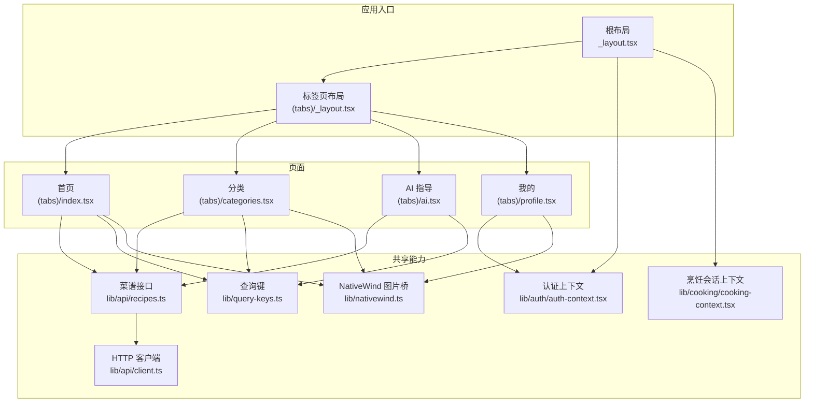
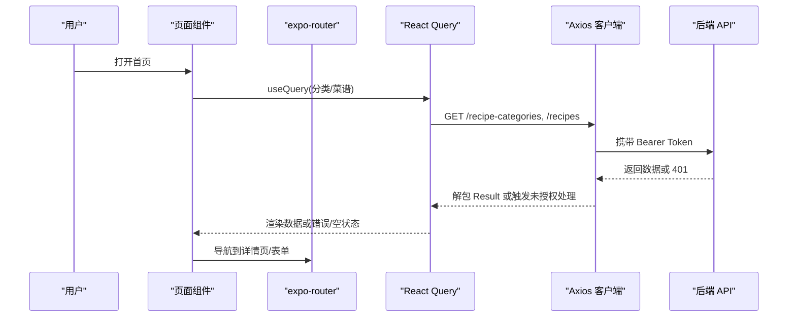
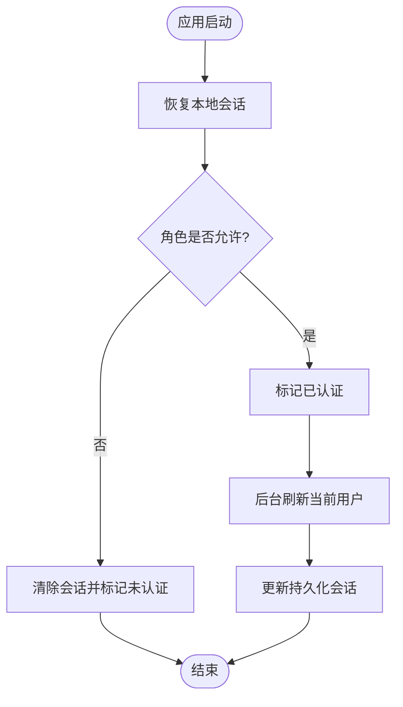
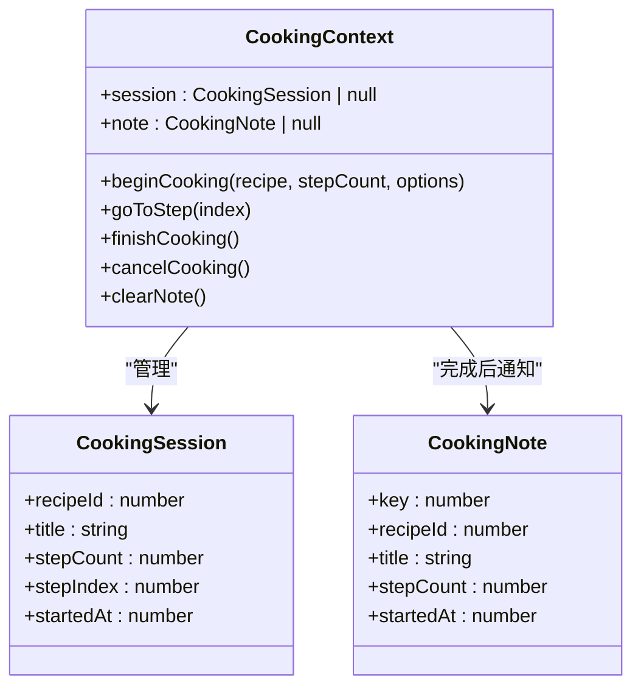
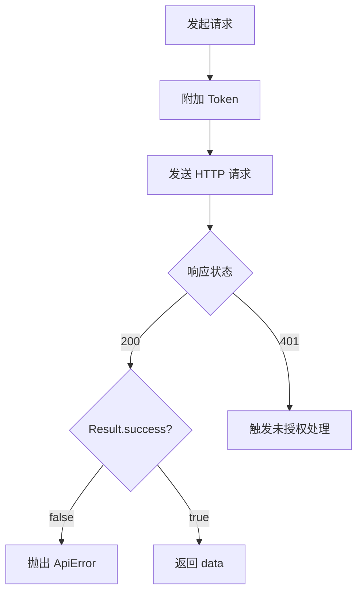
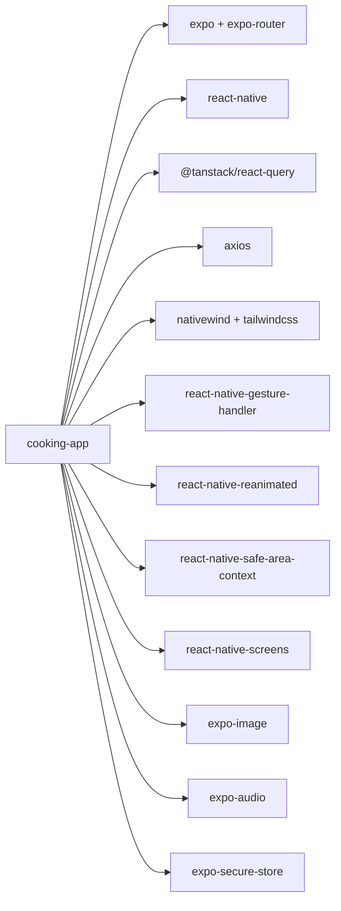

# 移动应用 (Expo)

<cite>
**本文引用的文件**   
- [apps/cooking-app/package.json](file://apps/cooking-app/package.json)
- [apps/cooking-app/app.json](file://apps/cooking-app/app.json)
- [apps/cooking-app/src/app/_layout.tsx](file://apps/cooking-app/src/app/_layout.tsx)
- [apps/cooking-app/src/app/(tabs)/_layout.tsx](file://apps/cooking-app/src/app/(tabs)/_layout.tsx)
- [apps/cooking-app/src/app/(tabs)/index.tsx](file://apps/cooking-app/src/app/(tabs)/index.tsx)
- [apps/cooking-app/src/app/(tabs)/categories.tsx](file://apps/cooking-app/src/app/(tabs)/categories.tsx)
- [apps/cooking-app/src/app/(tabs)/ai.tsx](file://apps/cooking-app/src/app/(tabs)/ai.tsx)
- [apps/cooking-app/src/app/(tabs)/profile.tsx](file://apps/cooking-app/src/app/(tabs)/profile.tsx)
- [apps/cooking-app/src/components/recipe-card.tsx](file://apps/cooking-app/src/components/recipe-card.tsx)
- [apps/cooking-app/src/components/screen-header.tsx](file://apps/cooking-app/src/components/screen-header.tsx)
- [apps/cooking-app/src/lib/auth/auth-context.tsx](file://apps/cooking-app/src/lib/auth/auth-context.tsx)
- [apps/cooking-app/src/lib/cooking/cooking-context.tsx](file://apps/cooking-app/src/lib/cooking/cooking-context.tsx)
- [apps/cooking-app/src/lib/api/client.ts](file://apps/cooking-app/src/lib/api/client.ts)
- [apps/cooking-app/src/lib/api/recipes.ts](file://apps/cooking-app/src/lib/api/recipes.ts)
- [apps/cooking-app/src/lib/query-keys.ts](file://apps/cooking-app/src/lib/query-keys.ts)
- [apps/cooking-app/src/lib/nativewind.ts](file://apps/cooking-app/src/lib/nativewind.ts)
</cite>

## 目录
1. [简介](#简介)
2. [项目结构](#项目结构)
3. [核心组件](#核心组件)
4. [架构总览](#架构总览)
5. [详细组件分析](#详细组件分析)
6. [依赖关系分析](#依赖关系分析)
7. [性能与体验优化](#性能与体验优化)
8. [故障排查指南](#故障排查指南)
9. [结论](#结论)
10. [附录：实践示例索引](#附录实践示例索引)

## 简介
本项目是一个基于 Expo SDK 57 与 React Native 的移动应用，面向“做菜助手”场景，提供菜谱浏览、分类筛选、AI 对话指导、在线烹饪流程跟踪、用户认证与资料管理等功能。项目采用文件系统路由（expo-router）、React Query 数据缓存、Tailwind + NativeWind 样式体系、Axios HTTP 客户端统一封装，以及 Context 状态管理，兼顾移动端导航、手势、主题与跨平台兼容性。

## 项目结构
- 入口与全局布局
  - 根布局负责注入查询客户端、手势容器、认证与烹饪上下文，并定义受保护路由与登录态切换。
- 标签页与页面
  - 使用 expo-router 的 (tabs) 分组实现底部 Tab 导航；各业务页面按功能拆分到独立文件。
- 组件库
  - 通用 UI 组件如菜谱卡片、屏幕头部等位于 components 目录，便于复用。
- 领域逻辑与状态
  - 认证状态在 lib/auth 中通过 Context 管理；烹饪会话进度通过 AsyncStorage 持久化。
- API 层
  - 统一的 axios 客户端封装了鉴权、未授权处理、资源路径解析与图片上传；业务接口集中在 lib/api。
- 数据缓存键
  - query-keys.ts 集中维护 React Query 的 key 生成策略，保证缓存一致性。
- 样式与主题
  - 使用 Tailwind + NativeWind，并通过自定义 Image 桥接支持 className。

**图表来源**
- [apps/cooking-app/src/app/_layout.tsx:23-73](file://apps/cooking-app/src/app/_layout.tsx#L23-L73)
- [apps/cooking-app/src/app/(tabs)/_layout.tsx:5-83](file://apps/cooking-app/src/app/(tabs)/_layout.tsx#L5-L83)
- [apps/cooking-app/src/app/(tabs)/index.tsx:12-77](file://apps/cooking-app/src/app/(tabs)/index.tsx#L12-L77)
- [apps/cooking-app/src/app/(tabs)/categories.tsx:21-110](file://apps/cooking-app/src/app/(tabs)/categories.tsx#L21-L110)
- [apps/cooking-app/src/app/(tabs)/ai.tsx:52-266](file://apps/cooking-app/src/app/(tabs)/ai.tsx#L52-L266)
- [apps/cooking-app/src/app/(tabs)/profile.tsx:22-166](file://apps/cooking-app/src/app/(tabs)/profile.tsx#L22-L166)
- [apps/cooking-app/src/lib/auth/auth-context.tsx:49-152](file://apps/cooking-app/src/lib/auth/auth-context.tsx#L49-L152)
- [apps/cooking-app/src/lib/cooking/cooking-context.tsx:54-192](file://apps/cooking-app/src/lib/cooking/cooking-context.tsx#L54-L192)
- [apps/cooking-app/src/lib/api/client.ts:31-93](file://apps/cooking-app/src/lib/api/client.ts#L31-L93)
- [apps/cooking-app/src/lib/api/recipes.ts:21-137](file://apps/cooking-app/src/lib/api/recipes.ts#L21-L137)
- [apps/cooking-app/src/lib/query-keys.ts:10-30](file://apps/cooking-app/src/lib/query-keys.ts#L10-L30)
- [apps/cooking-app/src/lib/nativewind.ts:1-10](file://apps/cooking-app/src/lib/nativewind.ts#L1-L10)

**章节来源**
- [apps/cooking-app/src/app/_layout.tsx:23-73](file://apps/cooking-app/src/app/_layout.tsx#L23-L73)
- [apps/cooking-app/src/app/(tabs)/_layout.tsx:5-83](file://apps/cooking-app/src/app/(tabs)/_layout.tsx#L5-L83)

## 核心组件
- 根布局与导航守卫
  - 初始化 QueryClient、GestureHandlerRootView、StatusBar，包裹认证与烹饪上下文。
  - 根据认证状态动态渲染受保护的标签页或登录/注册页。
- 标签页导航
  - 使用 Tabs 配置四个主入口：首页、分类、AI 指导、我的。
  - 支持深色模式、图标与标题定制。
- 首页
  - 组合筛选栏与菜谱列表，使用 React Query 拉取分类与分页菜谱。
  - 搜索历史通过本地 Hook 管理。
- 分类页
  - 将分类按做法、菜系、需求分区块展示，点击跳转至分类详情。
- AI 指导页
  - 聊天式交互，流式回复优先走 Agent 服务，失败回退到本地规则推荐。
  - 集成烹饪会话横幅，引导进入正在进行的菜谱步骤。
- 我的页
  - 展示用户信息、角色标签，提供编辑资料、我的菜谱、收藏、历史等入口。
- 通用组件
  - 菜谱卡片：标准卡片与网格卡片两种展示形态。
  - 屏幕头部：返回按钮、标题与副标题。

**章节来源**
- [apps/cooking-app/src/app/_layout.tsx:23-73](file://apps/cooking-app/src/app/_layout.tsx#L23-L73)
- [apps/cooking-app/src/app/(tabs)/_layout.tsx:5-83](file://apps/cooking-app/src/app/(tabs)/_layout.tsx#L5-L83)
- [apps/cooking-app/src/app/(tabs)/index.tsx:12-77](file://apps/cooking-app/src/app/(tabs)/index.tsx#L12-L77)
- [apps/cooking-app/src/app/(tabs)/categories.tsx:21-110](file://apps/cooking-app/src/app/(tabs)/categories.tsx#L21-L110)
- [apps/cooking-app/src/app/(tabs)/ai.tsx:52-266](file://apps/cooking-app/src/app/(tabs)/ai.tsx#L52-L266)
- [apps/cooking-app/src/app/(tabs)/profile.tsx:22-166](file://apps/cooking-app/src/app/(tabs)/profile.tsx#L22-L166)
- [apps/cooking-app/src/components/recipe-card.tsx:14-152](file://apps/cooking-app/src/components/recipe-card.tsx#L14-L152)
- [apps/cooking-app/src/components/screen-header.tsx:10-47](file://apps/cooking-app/src/components/screen-header.tsx#L10-L47)

## 架构总览
系统由前端页面、导航、状态、API 与后端服务组成。移动端通过 expo-router 进行页面路由，通过 React Query 管理数据缓存，通过 Axios 客户端统一处理鉴权与错误，通过 Context 管理认证与烹饪会话状态。

**图表来源**
- [apps/cooking-app/src/app/(tabs)/index.tsx:20-72](file://apps/cooking-app/src/app/(tabs)/index.tsx#L20-L72)
- [apps/cooking-app/src/lib/api/client.ts:31-93](file://apps/cooking-app/src/lib/api/client.ts#L31-L93)
- [apps/cooking-app/src/lib/api/recipes.ts:21-54](file://apps/cooking-app/src/lib/api/recipes.ts#L21-L54)

## 详细组件分析

### 认证与会话管理
- 启动恢复
  - 应用启动时从本地恢复会话，校验角色限制（仅普通用户），后台刷新当前用户并同步 token。
- 登录/注册/登出
  - 登录成功后持久化会话并设置已认证状态；注册后自动登录；登出清除本地会话与查询缓存。
- 未授权处理
  - 全局拦截器检测 401 或后端 Result.code=401，调用未授权回调以退出登录。

**图表来源**
- [apps/cooking-app/src/lib/auth/auth-context.tsx:88-130](file://apps/cooking-app/src/lib/auth/auth-context.tsx#L88-L130)

**章节来源**
- [apps/cooking-app/src/lib/auth/auth-context.tsx:49-152](file://apps/cooking-app/src/lib/auth/auth-context.tsx#L49-L152)
- [apps/cooking-app/src/lib/api/client.ts:47-82](file://apps/cooking-app/src/lib/api/client.ts#L47-L82)

### 烹饪会话与进度持久化
- 会话模型
  - 包含菜谱 ID、标题、总步数、当前步号与开始时间。
- 持久化策略
  - 启动时从 AsyncStorage 恢复会话；会话变化即落盘；完成或取消后清理。
- 操作接口
  - beginCooking/goToStep/finishCooking/cancelCooking/clearNote。

**图表来源**
- [apps/cooking-app/src/lib/cooking/cooking-context.tsx:14-48](file://apps/cooking-app/src/lib/cooking/cooking-context.tsx#L14-L48)
- [apps/cooking-app/src/lib/cooking/cooking-context.tsx:54-192](file://apps/cooking-app/src/lib/cooking/cooking-context.tsx#L54-L192)

**章节来源**
- [apps/cooking-app/src/lib/cooking/cooking-context.tsx:54-192](file://apps/cooking-app/src/lib/cooking/cooking-context.tsx#L54-L192)

### API 客户端与数据访问
- 基础配置
  - Web 端使用相对路径 /api，原生端使用环境变量配置的绝对地址。
- 请求拦截
  - 自动附加 Authorization 头；超时与 Accept 头统一设置。
- 响应拦截
  - 识别后端 Result.code=401 或 HTTP 401，触发未授权处理。
- 工具函数
  - unwrap 解包 Result；resolveAssetUrl 拼接资源 URL；uploadImage 上传图片到 COS。

**图表来源**
- [apps/cooking-app/src/lib/api/client.ts:31-107](file://apps/cooking-app/src/lib/api/client.ts#L31-L107)

**章节来源**
- [apps/cooking-app/src/lib/api/client.ts:31-146](file://apps/cooking-app/src/lib/api/client.ts#L31-L146)
- [apps/cooking-app/src/lib/api/recipes.ts:21-137](file://apps/cooking-app/src/lib/api/recipes.ts#L21-L137)

### 数据缓存键与查询策略
- 菜谱列表过滤条件作为 key 的一部分，确保不同筛选条件下缓存隔离。
- 分类、我的、收藏、历史等列表分别维护独立 key 命名空间。
- 默认 staleTime 与重试次数在根布局中配置。

**章节来源**
- [apps/cooking-app/src/lib/query-keys.ts:10-30](file://apps/cooking-app/src/lib/query-keys.ts#L10-L30)
- [apps/cooking-app/src/app/_layout.tsx:14-21](file://apps/cooking-app/src/app/_layout.tsx#L14-L21)

### 样式系统与图片加载
- 使用 NativeWind 将 Tailwind 类名映射到 RN 样式。
- 自定义 Image 组件桥接 expo-image，支持 className 与过渡动画。
- 资源 URL 通过 resolveAssetUrl 统一处理，避免跨域与路径问题。

**章节来源**
- [apps/cooking-app/src/lib/nativewind.ts:1-10](file://apps/cooking-app/src/lib/nativewind.ts#L1-L10)
- [apps/cooking-app/src/lib/api/client.ts:84-93](file://apps/cooking-app/src/lib/api/client.ts#L84-L93)

## 依赖关系分析
- 运行时依赖
  - expo、expo-router、react-native、nativewail、@tanstack/react-query、axios、react-native-gesture-handler、react-native-reanimated、react-native-safe-area-context、react-native-screens、expo-image、expo-audio、expo-secure-store 等。
- 构建与开发
  - TypeScript、Biome、Jest、tailwindcss、babel-preset-expo。

**图表来源**
- [apps/cooking-app/package.json:6-43](file://apps/cooking-app/package.json#L6-L43)

**章节来源**
- [apps/cooking-app/package.json:6-43](file://apps/cooking-app/package.json#L6-L43)

## 性能与体验优化
- 首屏与骨架
  - 根布局在认证恢复期间显示 LoadingState，避免白屏。
- 列表与图片
  - 使用 FlatList/ScrollView 与 expo-image 的 transition 提升滚动与图片加载体验。
- 网络与缓存
  - React Query 默认 staleTime 与重试次数降低重复请求；分类与列表缓存键隔离。
- 手势与动画
  - 使用 react-native-gesture-handler 与 reanimated 保障流畅手势与转场。
- 主题与深色模式
  - 通过 useColorScheme 与 Tailwind dark 变体统一主题。
- 安全存储
  - 使用 expo-secure-store 与 AsyncStorage 分别管理敏感信息与会话进度。

[本节为通用建议，不直接分析具体文件]

## 故障排查指南
- 未授权与登出
  - 若出现频繁退出登录，检查后端是否返回 Result.code=401 或 HTTP 401；确认本地会话是否存在。
- 图片无法加载
  - 检查 resolveAssetUrl 生成的 URL 是否正确；Web 端需同源或通过网关转发。
- 上传失败
  - 确认上传目录白名单与 MIME 类型猜测逻辑；增大超时时间或检查网络环境。
- 会话丢失
  - 检查 AsyncStorage 读写权限与数据结构完整性；损坏数据会被丢弃但不影响正常使用。

**章节来源**
- [apps/cooking-app/src/lib/api/client.ts:47-107](file://apps/cooking-app/src/lib/api/client.ts#L47-L107)
- [apps/cooking-app/src/lib/cooking/cooking-context.tsx:59-103](file://apps/cooking-app/src/lib/cooking/cooking-context.tsx#L59-L103)

## 结论
该项目以 Expo SDK 57 为基础，结合 expo-router、React Query、NativeWind 与 Axios 构建了清晰的移动端架构。认证与会话管理、烹饪会话持久化、统一的 API 客户端与缓存键策略，共同保证了应用的稳定性与可维护性。通过标签页导航、手势与动画、主题与跨平台兼容处理，提供了良好的用户体验。后续可在测试覆盖、自动化发布与性能监控方面继续完善。

[本节为总结性内容，不直接分析具体文件]

## 附录：实践示例索引
- 页面开发
  - 首页筛选与列表：[apps/cooking-app/src/app/(tabs)/index.tsx:12-77](file://apps/cooking-app/src/app/(tabs)/index.tsx#L12-L77)
  - 分类展示与跳转：[apps/cooking-app/src/app/(tabs)/categories.tsx:21-110](file://apps/cooking-app/src/app/(tabs)/categories.tsx#L21-L110)
  - AI 聊天与回退逻辑：[apps/cooking-app/src/app/(tabs)/ai.tsx:52-266](file://apps/cooking-app/src/app/(tabs)/ai.tsx#L52-L266)
  - 用户资料与菜单：[apps/cooking-app/src/app/(tabs)/profile.tsx:22-166](file://apps/cooking-app/src/app/(tabs)/profile.tsx#L22-L166)
- 组件复用
  - 菜谱卡片与网格卡片：[apps/cooking-app/src/components/recipe-card.tsx:14-152](file://apps/cooking-app/src/components/recipe-card.tsx#L14-L152)
  - 屏幕头部组件：[apps/cooking-app/src/components/screen-header.tsx:10-47](file://apps/cooking-app/src/components/screen-header.tsx#L10-L47)
- 主题定制
  - NativeWind 图片桥接：[apps/cooking-app/src/lib/nativewind.ts:1-10](file://apps/cooking-app/src/lib/nativewind.ts#L1-L10)
  - 标签页主题与图标：[apps/cooking-app/src/app/(tabs)/_layout.tsx:5-83](file://apps/cooking-app/src/app/(tabs)/_layout.tsx#L5-L83)