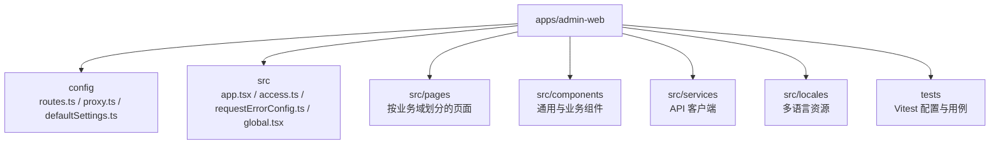
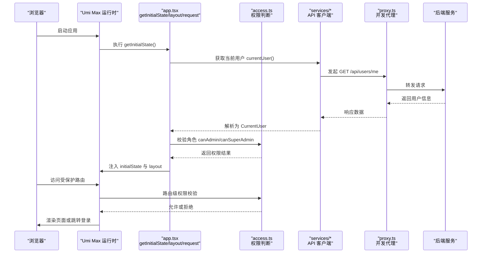
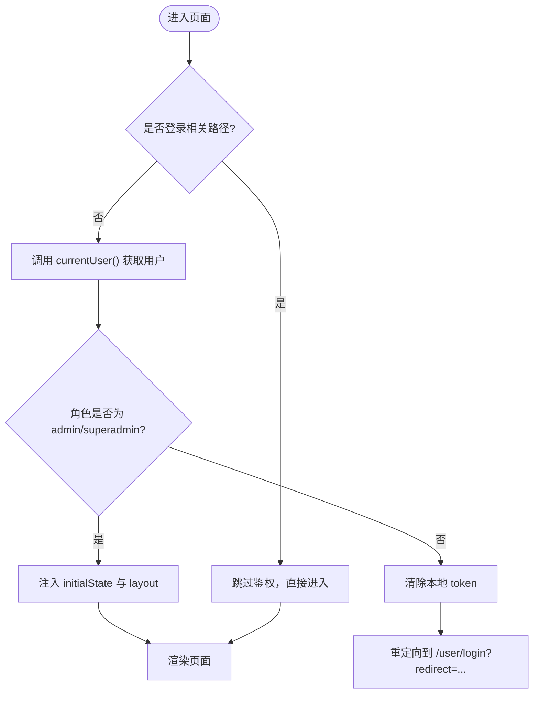
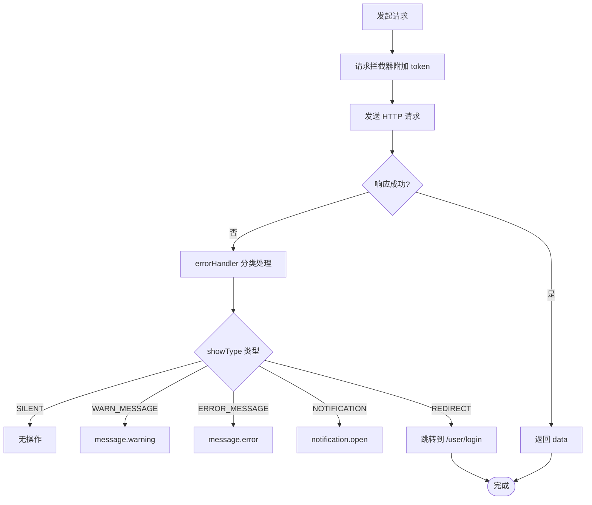
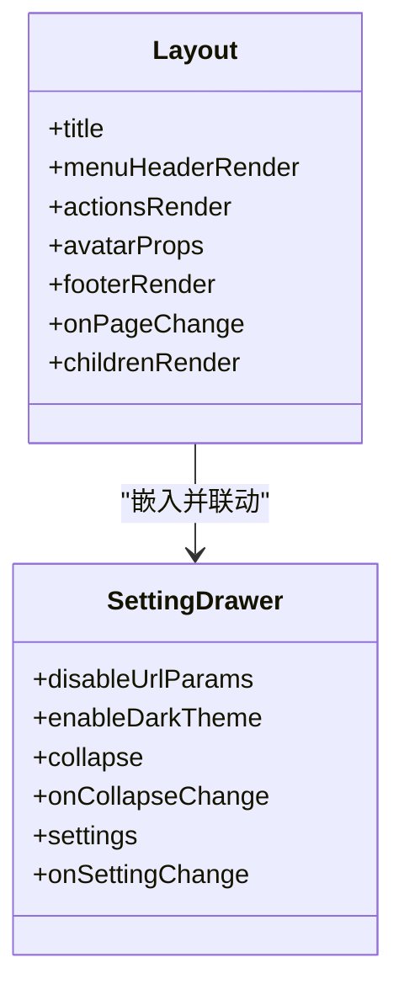
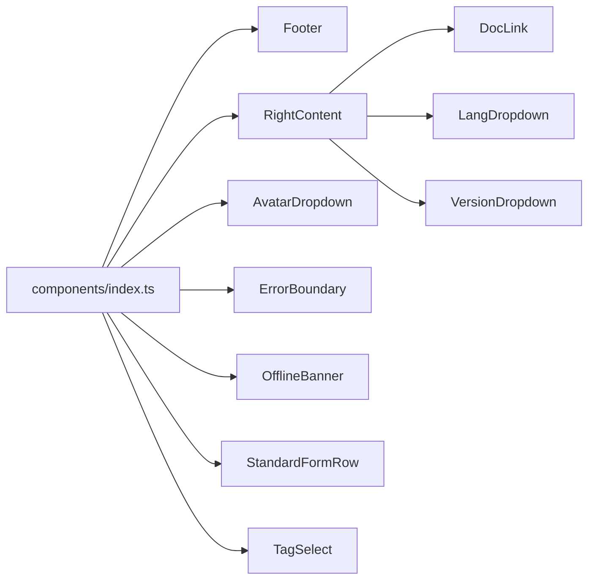
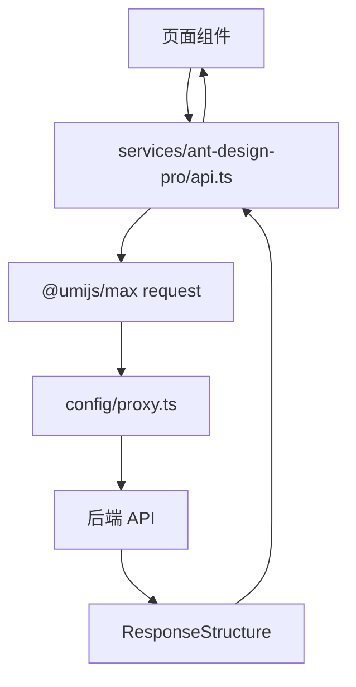
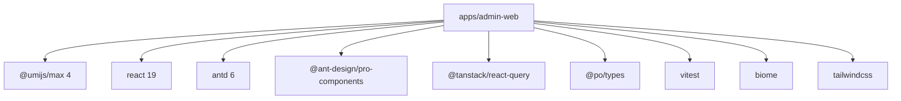

# 管理端 Web 应用

<cite>
**本文引用的文件**   
- [apps/admin-web/package.json](file://apps/admin-web/package.json)
- [apps/admin-web/config/routes.ts](file://apps/admin-web/config/routes.ts)
- [apps/admin-web/src/app.tsx](file://apps/admin-web/src/app.tsx)
- [apps/admin-web/src/access.ts](file://apps/admin-web/src/access.ts)
- [apps/admin-web/src/global.tsx](file://apps/admin-web/src/global.tsx)
- [apps/admin-web/src/requestErrorConfig.ts](file://apps/admin-web/src/requestErrorConfig.ts)
- [apps/admin-web/config/defaultSettings.ts](file://apps/admin-web/config/defaultSettings.ts)
- [apps/admin-web/src/services/ant-design-pro/api.ts](file://apps/admin-web/src/services/ant-design-pro/api.ts)
- [apps/admin-web/src/components/index.ts](file://apps/admin-web/src/components/index.ts)
- [apps/admin-web/src/locales/zh-CN.ts](file://apps/admin-web/src/locales/zh-CN.ts)
- [apps/admin-web/config/proxy.ts](file://apps/admin-web/config/proxy.ts)
- [apps/admin-web/vitest.config.ts](file://apps/admin-web/vitest.config.ts)
</cite>

## 目录
1. [简介](#简介)
2. [项目结构](#项目结构)
3. [核心组件与能力](#核心组件与能力)
4. [架构总览](#架构总览)
5. [详细组件分析](#详细组件分析)
6. [依赖关系分析](#依赖关系分析)
7. [性能与构建优化](#性能与构建优化)
8. [故障排查指南](#故障排查指南)
9. [结论](#结论)
10. [附录：最佳实践清单](#附录最佳实践清单)

## 简介
本仓库中的管理端 Web 应用位于 apps/admin-web，基于 Umi Max 4、React 19 与 Ant Design 6 构建，提供后台管理所需的路由、权限、国际化、请求封装、错误处理、布局与设置抽屉等能力。该文档面向开发者与维护者，系统梳理项目架构、关键流程、配置项与扩展点，并给出可落地的最佳实践建议。

## 项目结构
管理端采用 Umi Max 约定式目录组织，核心目录说明如下：
- config：Umi 运行时配置，包括路由、代理、默认主题等
- src/pages：页面级模块，按业务域划分目录
- src/components：通用与业务组件聚合导出
- src/services：API 客户端封装，按领域拆分
- src/locales：多语言资源
- src/utils：工具函数
- public：静态资源
- tests：测试配置与用例
- .umi：Umi 生成的运行时代码（不直接编辑）

**图表来源**
- [apps/admin-web/config/routes.ts:1-194](file://apps/admin-web/config/routes.ts#L1-L194)
- [apps/admin-web/src/app.tsx:1-220](file://apps/admin-web/src/app.tsx#L1-L220)

**章节来源**
- [apps/admin-web/config/routes.ts:1-194](file://apps/admin-web/config/routes.ts#L1-L194)
- [apps/admin-web/src/app.tsx:1-220](file://apps/admin-web/src/app.tsx#L1-L220)

## 核心组件与能力
- 路由与导航：通过 config/routes.ts 声明式配置，支持嵌套路由、重定向、菜单图标与访问控制
- 权限体系：基于 Umi Access，结合后端角色进行三级权限控制（superadmin、admin、user）
- 国际化：通过 src/locales 下多语言文件聚合，配合 ProLayout 的语言切换
- 请求与错误处理：基于 Umi Request，统一拦截器、错误分类提示、会话失效跳转
- 布局与设置：ProLayout + SettingDrawer，支持主题色、布局模式、内容宽度等
- 组件库规范：Ant Design 6 + Ant Design Pro Components，统一导出入口在 src/components/index.ts
- 状态管理：以 getInitialState 初始化用户信息，结合 React Query 与组件内状态
- 开发体验：代理配置、Mock、OpenAPI 生成、Vitest 测试、Tailwind CSS 集成

**章节来源**
- [apps/admin-web/config/routes.ts:1-194](file://apps/admin-web/config/routes.ts#L1-L194)
- [apps/admin-web/src/access.ts:1-22](file://apps/admin-web/src/access.ts#L1-L22)
- [apps/admin-web/src/locales/zh-CN.ts:1-23](file://apps/admin-web/src/locales/zh-CN.ts#L1-L23)
- [apps/admin-web/src/requestErrorConfig.ts:1-138](file://apps/admin-web/src/requestErrorConfig.ts#L1-L138)
- [apps/admin-web/config/defaultSettings.ts:1-26](file://apps/admin-web/config/defaultSettings.ts#L1-L26)
- [apps/admin-web/src/components/index.ts:1-23](file://apps/admin-web/src/components/index.ts#L1-L23)
- [apps/admin-web/src/app.tsx:1-220](file://apps/admin-web/src/app.tsx#L1-L220)

## 架构总览
下图展示从浏览器到后端 API 的完整调用链，以及权限校验、错误处理与布局渲染的关键节点。

**图表来源**
- [apps/admin-web/src/app.tsx:43-87](file://apps/admin-web/src/app.tsx#L43-L87)
- [apps/admin-web/src/access.ts:8-21](file://apps/admin-web/src/access.ts#L8-L21)
- [apps/admin-web/src/services/ant-design-pro/api.ts:5-13](file://apps/admin-web/src/services/ant-design-pro/api.ts#L5-L13)
- [apps/admin-web/config/proxy.ts:12-29](file://apps/admin-web/config/proxy.ts#L12-L29)

## 详细组件分析

### 路由与权限
- 路由定义：config/routes.ts 中集中声明所有页面路由，支持嵌套、重定向、菜单图标与 hideInMenu
- 权限控制：src/access.ts 暴露 canSuperAdmin、canAdmin、canUser 三个布尔权限，供路由 access 字段与组件内 useAccess 使用
- 登录态校验：app.tsx 的 getInitialState 在非登录页拉取当前用户，若角色非管理员则清理本地令牌并重定向至登录页；layout 的 onPageChange 再次兜底校验

**图表来源**
- [apps/admin-web/src/app.tsx:43-87](file://apps/admin-web/src/app.tsx#L43-L87)
- [apps/admin-web/src/access.ts:8-21](file://apps/admin-web/src/access.ts#L8-L21)
- [apps/admin-web/config/routes.ts:13-194](file://apps/admin-web/config/routes.ts#L13-L194)

**章节来源**
- [apps/admin-web/config/routes.ts:13-194](file://apps/admin-web/config/routes.ts#L13-L194)
- [apps/admin-web/src/access.ts:1-22](file://apps/admin-web/src/access.ts#L1-L22)
- [apps/admin-web/src/app.tsx:43-87](file://apps/admin-web/src/app.tsx#L43-L87)

### 请求与错误处理
- 基础配置：app.tsx 中 request 配置 baseURL，并合并 errorConfig
- 错误分类：requestErrorConfig.ts 定义 BizError 与 showType，支持静默、警告、错误消息、通知、重定向等策略
- 拦截器：自动注入 Authorization 头；401 时清理本地 token 并跳转登录；网络离线时显示国际化提示
- 服务端错误：根据后端 ResponseStructure.success/code/message/showType 决定交互行为

**图表来源**
- [apps/admin-web/src/requestErrorConfig.ts:45-117](file://apps/admin-web/src/requestErrorConfig.ts#L45-L117)
- [apps/admin-web/src/requestErrorConfig.ts:119-133](file://apps/admin-web/src/requestErrorConfig.ts#L119-L133)
- [apps/admin-web/src/app.tsx:207-210](file://apps/admin-web/src/app.tsx#L207-L210)

**章节来源**
- [apps/admin-web/src/requestErrorConfig.ts:1-138](file://apps/admin-web/src/requestErrorConfig.ts#L1-L138)
- [apps/admin-web/src/app.tsx:207-210](file://apps/admin-web/src/app.tsx#L207-L210)

### 布局与设置
- ProLayout：app.tsx 中 layout 配置标题、菜单渲染、动作区、头像下拉、页脚、背景图、链接等
- SettingDrawer：通过 initialState 控制展开状态与主题设置，支持暗色主题、主色、布局模式、内容宽度等
- 全局样式：global.tsx 引入 tailwind.css，tailwind.config.js 与 tailwind.css 在项目根目录

**图表来源**
- [apps/admin-web/src/app.tsx:90-199](file://apps/admin-web/src/app.tsx#L90-L199)
- [apps/admin-web/config/defaultSettings.ts:1-26](file://apps/admin-web/config/defaultSettings.ts#L1-L26)

**章节来源**
- [apps/admin-web/src/app.tsx:90-199](file://apps/admin-web/src/app.tsx#L90-L199)
- [apps/admin-web/config/defaultSettings.ts:1-26](file://apps/admin-web/config/defaultSettings.ts#L1-L26)
- [apps/admin-web/src/global.tsx:1-2](file://apps/admin-web/src/global.tsx#L1-L2)

### 组件库与复用
- 组件导出：src/components/index.ts 统一管理对外导出的组件，便于按需引用与版本升级
- 常用组件：包含 Footer、RightContent 子组件（DocLink/LangDropdown/VersionDropdown）、AvatarDropdown、ErrorBoundary、OfflineBanner、StandardFormRow、TagSelect 等
- 样式方案：Ant Design 6 + antd-style，同时启用 Tailwind CSS 用于原子化样式

**图表来源**
- [apps/admin-web/src/components/index.ts:1-23](file://apps/admin-web/src/components/index.ts#L1-L23)

**章节来源**
- [apps/admin-web/src/components/index.ts:1-23](file://apps/admin-web/src/components/index.ts#L1-L23)

### 国际化
- 语言包聚合：src/locales/zh-CN.ts 聚合 pages/globalHeader/menu/settingDrawer/settings/network/component 等模块
- 语言切换：ProLayout actionsRender 中根据 initialState.settings.locale 决定是否显示语言切换按钮
- 网络错误国际化：offline 提示使用 getIntl().formatMessage 读取对应 key

**章节来源**
- [apps/admin-web/src/locales/zh-CN.ts:1-23](file://apps/admin-web/src/locales/zh-CN.ts#L1-L23)
- [apps/admin-web/src/app.tsx:106-116](file://apps/admin-web/src/app.tsx#L106-L116)
- [apps/admin-web/src/requestErrorConfig.ts:103-110](file://apps/admin-web/src/requestErrorConfig.ts#L103-L110)

### API 客户端封装
- 统一入口：services/ant-design-pro/api.ts 基于 @umijs/max 的 request 封装业务接口
- 典型接口：currentUser/outLogin/login/getNotices/rule/updateRule/addRule/removeRule
- 类型约束：返回值使用 API.* 命名空间类型，便于 TS 类型推导

**图表来源**
- [apps/admin-web/src/services/ant-design-pro/api.ts:5-95](file://apps/admin-web/src/services/ant-design-pro/api.ts#L5-L95)
- [apps/admin-web/config/proxy.ts:12-29](file://apps/admin-web/config/proxy.ts#L12-L29)

**章节来源**
- [apps/admin-web/src/services/ant-design-pro/api.ts:1-95](file://apps/admin-web/src/services/ant-design-pro/api.ts#L1-L95)

## 依赖关系分析
- 运行时依赖：react/react-dom 19，antd 6，@ant-design/pro-components，@tanstack/react-query，dayjs，highlight.js，d3 等
- 开发与构建：@umijs/max 4，vitest，biome，tailwindcss，gh-pages，mockjs 等
- 工作区依赖：@po/types 通过 workspace:* 引用共享类型

**图表来源**
- [apps/admin-web/package.json:35-88](file://apps/admin-web/package.json#L35-L88)

**章节来源**
- [apps/admin-web/package.json:1-128](file://apps/admin-web/package.json#L1-L128)

## 性能与构建优化
- 构建命令：pnpm run build 使用 max build；analyze 开启依赖分析；preview 预览生产产物
- 代理与跨域：config/proxy.ts 在 dev/test/pre 环境分别配置 /api 与 /ws 代理，支持 WebSocket
- 主题与样式：defaultSettings.ts 通过 token 与主题变量定制 ProLayout 外观；Tailwind 提供原子化样式
- 代码质量：biome lint/check 与 tsc --noEmit 保证类型与风格一致
- 测试覆盖：vitest 配置 exclude 排除 Umi 集成测试，coverage 使用 v8 provider，输出 text/json/html

**章节来源**
- [apps/admin-web/package.json:7-30](file://apps/admin-web/package.json#L7-L30)
- [apps/admin-web/config/proxy.ts:12-47](file://apps/admin-web/config/proxy.ts#L12-L47)
- [apps/admin-web/config/defaultSettings.ts:1-26](file://apps/admin-web/config/defaultSettings.ts#L1-L26)
- [apps/admin-web/vitest.config.ts:1-40](file://apps/admin-web/vitest.config.ts#L1-L40)

## 故障排查指南
- 登录态异常：检查 localStorage 中 token 是否存在；确认后端 401 响应；查看 redirectToLogin 逻辑
- 权限不足：确认 currentUser.role 是否为 admin/superadmin；检查路由 access 字段与 useAccess 使用
- 网络不可用：检查 navigator.onLine 分支与国际化文案；确认代理配置是否正确
- 组件报错：使用 ErrorBoundary 捕获渲染错误；检查组件导入与依赖版本
- 构建失败：运行 doctor 诊断；检查 Node 版本要求与 pnpm workspace 配置

**章节来源**
- [apps/admin-web/src/requestErrorConfig.ts:23-38](file://apps/admin-web/src/requestErrorConfig.ts#L23-L38)
- [apps/admin-web/src/requestErrorConfig.ts:90-115](file://apps/admin-web/src/requestErrorConfig.ts#L90-L115)
- [apps/admin-web/src/app.tsx:26-38](file://apps/admin-web/src/app.tsx#L26-L38)
- [apps/admin-web/src/access.ts:8-21](file://apps/admin-web/src/access.ts#L8-L21)

## 结论
该项目以 Umi Max 4 为核心，结合 React 19 与 Ant Design 6，构建了清晰的管理端架构。通过集中式路由、统一的权限模型、完善的请求与错误处理、丰富的布局与设置能力，以及规范的组件与国际化组织方式，提供了良好的可维护性与可扩展性。建议在后续迭代中持续完善单元测试覆盖率、细化 API 类型定义，并逐步将更多业务组件沉淀为可复用的设计系统资产。

## 附录：最佳实践清单
- 页面开发
  - 使用约定式路由，保持 config/routes.ts 与 src/pages 目录结构一致
  - 对受保护路由添加 access 字段，并在组件内通过 useAccess 做二次校验
  - 列表页优先使用 ProTable，表单页使用 ProForm 与 Rule RuleSet
- 组件复用
  - 新增通用组件后在 src/components/index.ts 统一导出
  - 样式优先使用 antd-style 与 Tailwind，避免全局样式污染
- 状态管理
  - 全局用户信息通过 getInitialState 注入，组件内使用 React Query 管理异步状态
  - 复杂表单状态尽量下沉到 hooks 或自定义组合函数
- API 客户端
  - 所有接口集中在 services 目录，按领域拆分文件
  - 统一使用 requestErrorConfig 的错误处理策略，避免分散 try/catch
- 国际化
  - 新增文案统一放入 locales 对应语言文件，并通过 key 访问
  - 动态文案使用 getIntl().formatMessage
- 构建与部署
  - 开发环境使用 proxy.ts 代理后端接口与 WebSocket
  - 生产构建使用 max build，必要时开启 ANALYZE 分析依赖体积
  - 发布 gh-pages 可通过 deploy 脚本一键完成