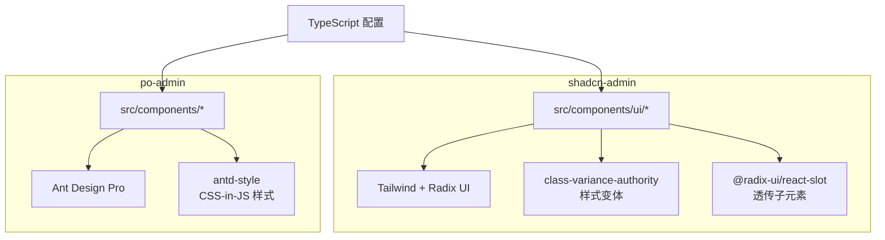
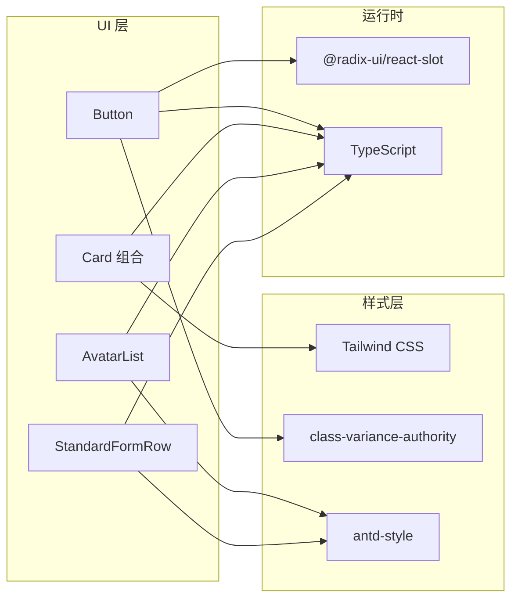
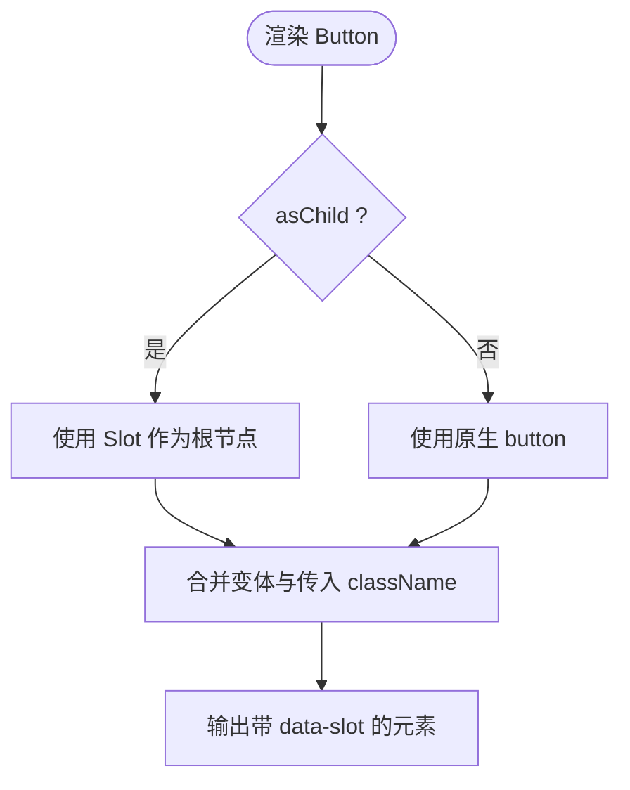
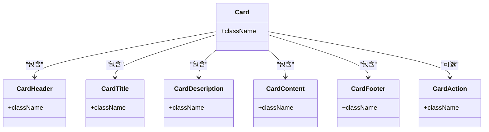
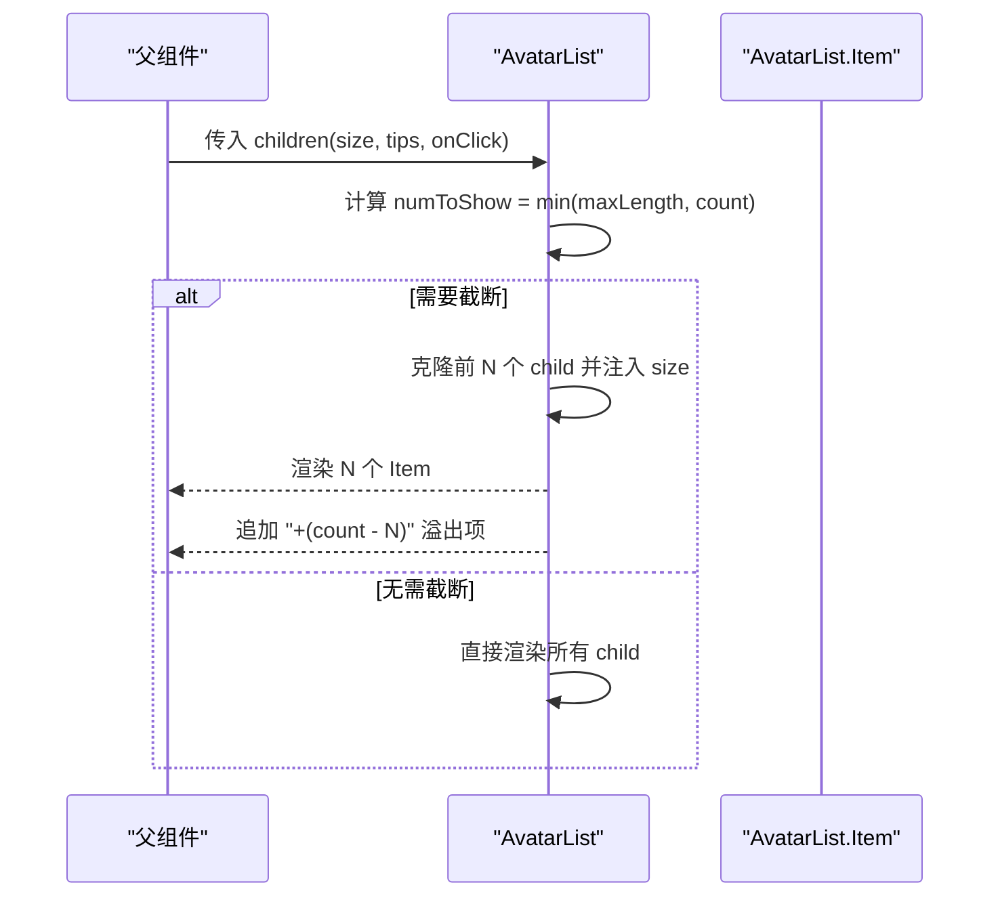
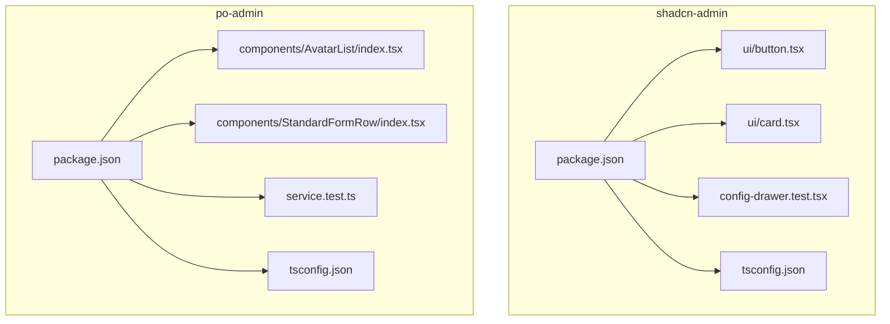

# 组件开发指南

<cite>
**本文引用的文件**
- [web_client/shadcn-admin/package.json](file://web_client/shadcn-admin/package.json)
- [web_client/po-admin/package.json](file://web_client/po-admin/package.json)
- [web_client/shadcn-admin/src/components/ui/button.tsx](file://web_client/shadcn-admin/src/components/ui/button.tsx)
- [web_client/shadcn-admin/src/components/ui/card.tsx](file://web_client/shadcn-admin/src/components/ui/card.tsx)
- [web_client/po-admin/src/components/AvatarList/index.tsx](file://web_client/po-admin/src/components/AvatarList/index.tsx)
- [web_client/po-admin/src/components/StandardFormRow/index.tsx](file://web_client/po-admin/src/components/StandardFormRow/index.tsx)
- [web_client/po-admin/src/components/AvatarList/index.style.ts](file://web_client/po-admin/src/components/AvatarList/index.style.ts)
- [web_client/shadcn-admin/src/components/config-drawer.test.tsx](file://web_client/shadcn-admin/src/components/config-drawer.test.tsx)
- [web_client/po-admin/src/pages/account/settings/service.test.ts](file://web_client/po-admin/src/pages/account/settings/service.test.ts)
- [web_client/shadcn-admin/tsconfig.json](file://web_client/shadcn-admin/tsconfig.json)
- [web_client/po-admin/tsconfig.json](file://web_client/po-admin/tsconfig.json)
</cite>

## 目录
1. [简介](#简介)
2. [项目结构](#项目结构)
3. [核心组件](#核心组件)
4. [架构总览](#架构总览)
5. [详细组件分析](#详细组件分析)
6. [依赖关系分析](#依赖关系分析)
7. [性能考虑](#性能考虑)
8. [故障排查指南](#故障排查指南)
9. [结论](#结论)
10. [附录](#附录)

## 简介
本指南面向前端组件开发者，围绕仓库中的两个前端工程（基于 Shadcn UI 的 shadcn-admin 与基于 Ant Design Pro 的 po-admin），系统阐述：
- Shadcn UI 的设计思想与自定义方法：组合模式、Props 接口设计、样式定制方案
- React 函数组件最佳实践：Hooks 使用、渲染优化、可访问性
- TypeScript 在组件中的应用：类型定义、泛型、接口设计
- 组件测试策略：单元测试、Mock 数据、用例设计与断言
- 可复用 UI 组件与业务组件的开发流程，以及文档化与维护建议

## 项目结构
仓库包含两个独立的前端工程：
- web_client/shadcn-admin：基于 Vite + React + Tailwind + Radix UI 的轻量级管理后台，提供原子化 UI 组件与布局能力
- web_client/po-admin：基于 Umi Max + Ant Design Pro 的企业级中后台解决方案，强调开箱即用与丰富生态

图表来源
- [web_client/shadcn-admin/package.json:21-66](file://web_client/shadcn-admin/package.json#L21-L66)
- [web_client/po-admin/package.json:37-55](file://web_client/po-admin/package.json#L37-L55)
- [web_client/shadcn-admin/tsconfig.json:11-18](file://web_client/shadcn-admin/tsconfig.json#L11-L18)
- [web_client/po-admin/tsconfig.json:2-20](file://web_client/po-admin/tsconfig.json#L2-L20)

章节来源
- [web_client/shadcn-admin/package.json:1-98](file://web_client/shadcn-admin/package.json#L1-L98)
- [web_client/po-admin/package.json:1-132](file://web_client/po-admin/package.json#L1-L132)
- [web_client/shadcn-admin/tsconfig.json:1-19](file://web_client/shadcn-admin/tsconfig.json#L1-L19)
- [web_client/po-admin/tsconfig.json:1-24](file://web_client/po-admin/tsconfig.json#L1-L24)

## 核心组件
- Shadcn UI Button：通过 class-variance-authority 定义变体与尺寸，结合 @radix-ui/react-slot 实现 asChild 透传，统一 className 合并与可访问性焦点环
- Shadcn UI Card：以组合式子组件（Header/Title/Description/Content/Footer/Action）拆分职责，利用 Tailwind 容器查询与网格布局组织内容
- Po-admin AvatarList：封装头像列表与溢出显示逻辑，支持尺寸、提示、点击行为，并通过 antd-style 生成主题感知的样式
- Po-admin StandardFormRow：表单行容器，支持标题、块级/栅格布局切换，便于构建标准表单结构

章节来源
- [web_client/shadcn-admin/src/components/ui/button.tsx:1-59](file://web_client/shadcn-admin/src/components/ui/button.tsx#L1-L59)
- [web_client/shadcn-admin/src/components/ui/card.tsx:1-92](file://web_client/shadcn-admin/src/components/ui/card.tsx#L1-L92)
- [web_client/po-admin/src/components/AvatarList/index.tsx:1-99](file://web_client/po-admin/src/components/AvatarList/index.tsx#L1-L99)
- [web_client/po-admin/src/components/StandardFormRow/index.tsx:1-39](file://web_client/po-admin/src/components/StandardFormRow/index.tsx#L1-L39)

## 架构总览
Shadcn 风格组件采用“原子化 + 组合”的架构：基础原语（Button、Card 等）通过变体系统与样式工具链组合出更高层的复合组件；Po-admin 则基于成熟 UI 库进行二次封装，聚焦业务场景。

图表来源
- [web_client/shadcn-admin/src/components/ui/button.tsx:1-59](file://web_client/shadcn-admin/src/components/ui/button.tsx#L1-L59)
- [web_client/shadcn-admin/src/components/ui/card.tsx:1-92](file://web_client/shadcn-admin/src/components/ui/card.tsx#L1-L92)
- [web_client/po-admin/src/components/AvatarList/index.tsx:1-99](file://web_client/po-admin/src/components/AvatarList/index.tsx#L1-L99)
- [web_client/po-admin/src/components/StandardFormRow/index.tsx:1-39](file://web_client/po-admin/src/components/StandardFormRow/index.tsx#L1-L39)

## 详细组件分析

### Shadcn UI Button：变体系统与 asChild 透传
- 设计理念：用 cva 声明变体（variant/size）与默认值，集中管理样式；通过 Slot 将按钮渲染为任意子组件，提升组合灵活性
- Props 接口：继承原生 button 属性，扩展 variant、size、asChild；className 通过合并工具统一处理
- 样式定制：Tailwind 类名集中定义，暗色模式与焦点环、禁用态、图标尺寸等细节完善
- 可访问性：保留原生语义与焦点行为，配合 focus-visible 与 aria-invalid 增强状态反馈

图表来源
- [web_client/shadcn-admin/src/components/ui/button.tsx:6-58](file://web_client/shadcn-admin/src/components/ui/button.tsx#L6-L58)

章节来源
- [web_client/shadcn-admin/src/components/ui/button.tsx:1-59](file://web_client/shadcn-admin/src/components/ui/button.tsx#L1-L59)

### Shadcn UI Card：组合式卡片
- 设计理念：将卡片拆分为 Header/Title/Description/Content/Footer/Action，通过组合表达不同信息密度与布局
- 样式策略：使用 Tailwind 容器查询与网格布局，适配不同屏幕与信息层级
- 可扩展性：每个子组件均接受 className，便于覆盖与定制

图表来源
- [web_client/shadcn-admin/src/components/ui/card.tsx:4-91](file://web_client/shadcn-admin/src/components/ui/card.tsx#L4-L91)

章节来源
- [web_client/shadcn-admin/src/components/ui/card.tsx:1-92](file://web_client/shadcn-admin/src/components/ui/card.tsx#L1-L92)

### Po-admin AvatarList：头像列表与溢出控制
- 功能要点：限制展示数量、溢出时显示计数；支持尺寸、提示、点击事件；内部 Item 可复用
- 样式方案：基于 antd-style 的主题 token，保证与 Ant Design 一致
- 组合模式：主组件负责渲染与裁剪，Item 负责单个头像的交互与提示

图表来源
- [web_client/po-admin/src/components/AvatarList/index.tsx:64-96](file://web_client/po-admin/src/components/AvatarList/index.tsx#L64-L96)

章节来源
- [web_client/po-admin/src/components/AvatarList/index.tsx:1-99](file://web_client/po-admin/src/components/AvatarList/index.tsx#L1-L99)
- [web_client/po-admin/src/components/AvatarList/index.style.ts:1-48](file://web_client/po-admin/src/components/AvatarList/index.style.ts#L1-L48)

### Po-admin StandardFormRow：表单行容器
- 职责：统一标签与内容的排版，支持 block/grid/last 等布局开关
- 适用场景：复杂表单中保持行列对齐与间距一致性

章节来源
- [web_client/po-admin/src/components/StandardFormRow/index.tsx:1-39](file://web_client/po-admin/src/components/StandardFormRow/index.tsx#L1-L39)

## 依赖关系分析
- shadcn-admin 依赖 Radix UI 无样式基础组件、Tailwind 原子样式、cva 变体系统、Vitest/Vitest Browser Playwright 进行测试
- po-admin 依赖 Ant Design Pro、Umi Max、antd-style、Vitest 进行测试
- 两者均启用 TypeScript 路径别名与严格模式，保障类型安全与可维护性

图表来源
- [web_client/shadcn-admin/package.json:21-95](file://web_client/shadcn-admin/package.json#L21-L95)
- [web_client/po-admin/package.json:37-92](file://web_client/po-admin/package.json#L37-L92)
- [web_client/shadcn-admin/tsconfig.json:11-18](file://web_client/shadcn-admin/tsconfig.json#L11-L18)
- [web_client/po-admin/tsconfig.json:2-20](file://web_client/po-admin/tsconfig.json#L2-L20)

章节来源
- [web_client/shadcn-admin/package.json:1-98](file://web_client/shadcn-admin/package.json#L1-L98)
- [web_client/po-admin/package.json:1-132](file://web_client/po-admin/package.json#L1-L132)
- [web_client/shadcn-admin/tsconfig.json:1-19](file://web_client/shadcn-admin/tsconfig.json#L1-L19)
- [web_client/po-admin/tsconfig.json:1-24](file://web_client/po-admin/tsconfig.json#L1-L24)

## 性能考虑
- 避免不必要的重渲染：对纯展示组件尽量使用函数组件与 memo；对复杂列表使用虚拟滚动或分页
- 合理拆分组件：将大组件按职责拆分为小颗粒度组合，减少渲染范围
- 样式与主题：优先使用原子样式与主题 token，减少内联样式与动态计算
- 资源加载：按需引入图标与第三方库，避免打包体积膨胀
- 测试环境：使用浏览器端测试时注意并发与等待策略，避免误判导致的重试开销

[本节为通用指导，不直接引用具体文件]

## 故障排查指南
- 组件未渲染或样式异常：检查 className 合并顺序与优先级；确认 Tailwind 与主题变量是否生效
- 变体不生效：核对 cva 的 variants/defaultVariants 是否与传入 prop 匹配
- asChild 透传失败：确保目标组件支持 slot 透传且不会破坏语义
- 表单布局错乱：确认 StandardFormRow 的 block/grid/last 开关是否符合预期
- 测试断言失败：检查 Mock 是否正确设置；确保 DOM 就绪后再断言；必要时使用 waitFor

章节来源
- [web_client/shadcn-admin/src/components/config-drawer.test.tsx:1-320](file://web_client/shadcn-admin/src/components/config-drawer.test.tsx#L1-L320)
- [web_client/po-admin/src/pages/account/settings/service.test.ts:1-23](file://web_client/po-admin/src/pages/account/settings/service.test.ts#L1-L23)

## 结论
- Shadcn 风格组件通过原子化与组合模式，提供了高可定制、强类型的 UI 基座；配合 Tailwind 与 Radix 生态，能快速构建一致的可访问界面
- Po-admin 基于 Ant Design Pro，适合快速搭建企业级中后台；通过二次封装与样式系统，满足复杂业务需求
- 建议在团队内统一组件规范：Props 接口设计、命名约定、样式策略、测试覆盖率与文档化流程

[本节为总结性内容，不直接引用具体文件]

## 附录

### Shadcn UI 组件开发最佳实践
- 组合模式：将复杂 UI 拆分为多个小组件，通过 props 与插槽组合
- Props 接口：明确必填/选填、联合类型、默认值；对外暴露最小必要 API
- 样式定制：使用 cva 管理变体，Tailwind 原子类组合；提供覆盖点（如 className）
- 可访问性：保留原生语义，合理使用 aria-* 与键盘导航
- 类型安全：开启严格模式，使用路径别名与类型推断

章节来源
- [web_client/shadcn-admin/src/components/ui/button.tsx:1-59](file://web_client/shadcn-admin/src/components/ui/button.tsx#L1-L59)
- [web_client/shadcn-admin/src/components/ui/card.tsx:1-92](file://web_client/shadcn-admin/src/components/ui/card.tsx#L1-L92)
- [web_client/shadcn-admin/tsconfig.json:11-18](file://web_client/shadcn-admin/tsconfig.json#L11-L18)

### React 函数组件与 Hooks 最佳实践
- 函数组件优先：简洁直观，易于推理与测试
- Hooks 使用：遵循规则，避免条件调用；拆分复杂逻辑到自定义 Hook
- 性能优化：useMemo/useCallback 谨慎使用，仅在必要时缓存；避免过度优化
- 副作用管理：useEffect 清理副作用，避免内存泄漏

[本节为通用指导，不直接引用具体文件]

### TypeScript 在组件中的应用
- 类型定义：为组件 Props 与返回值定义精确类型；导出类型供外部使用
- 泛型使用：在表格、选择器等通用组件中使用泛型约束数据结构
- 接口设计：对外暴露稳定接口，内部实现可替换；使用类型守卫提升健壮性

章节来源
- [web_client/shadcn-admin/tsconfig.json:11-18](file://web_client/shadcn-admin/tsconfig.json#L11-L18)
- [web_client/po-admin/tsconfig.json:2-20](file://web_client/po-admin/tsconfig.json#L2-L20)

### 组件测试策略
- 单元与集成测试：针对组件交互与状态流转编写用例；使用浏览器端测试模拟真实环境
- Mock 数据：对网络请求与第三方依赖进行隔离；保证测试稳定性
- 断言策略：关注用户可见行为与可访问性；避免实现细节耦合

章节来源
- [web_client/shadcn-admin/src/components/config-drawer.test.tsx:1-320](file://web_client/shadcn-admin/src/components/config-drawer.test.tsx#L1-L320)
- [web_client/po-admin/src/pages/account/settings/service.test.ts:1-23](file://web_client/po-admin/src/pages/account/settings/service.test.ts#L1-L23)

### 可复用 UI 组件与业务组件开发流程
- 需求分析：明确组件职责、输入输出与边界条件
- 设计阶段：确定 Props 接口、样式策略与可访问性要求
- 实现阶段：先写类型与测试骨架，再实现核心逻辑与样式
- 验证阶段：编写单测与集成测试，覆盖关键分支与异常路径
- 文档化：补充使用示例、API 说明与注意事项；纳入版本发布流程

[本节为通用指导，不直接引用具体文件]