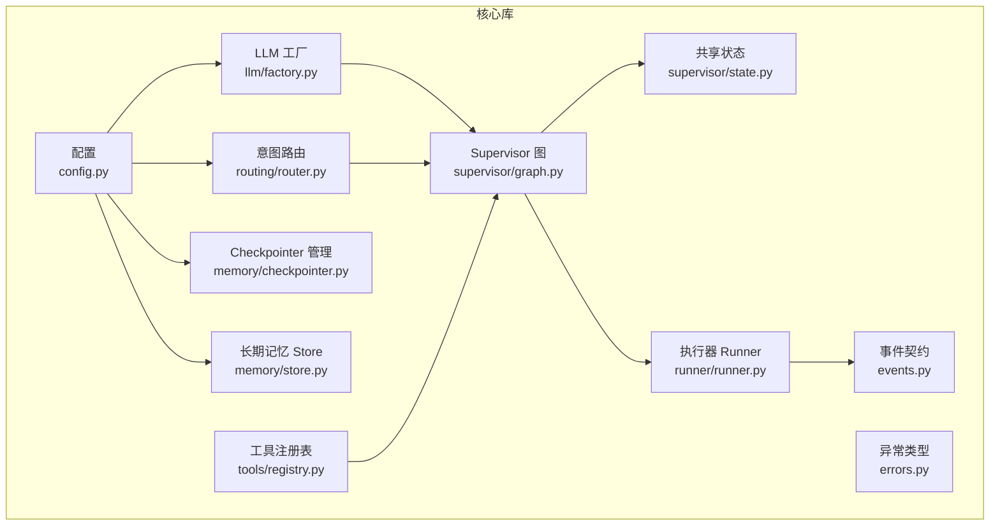
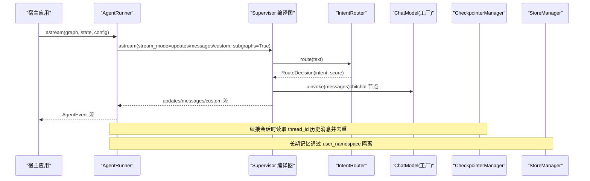
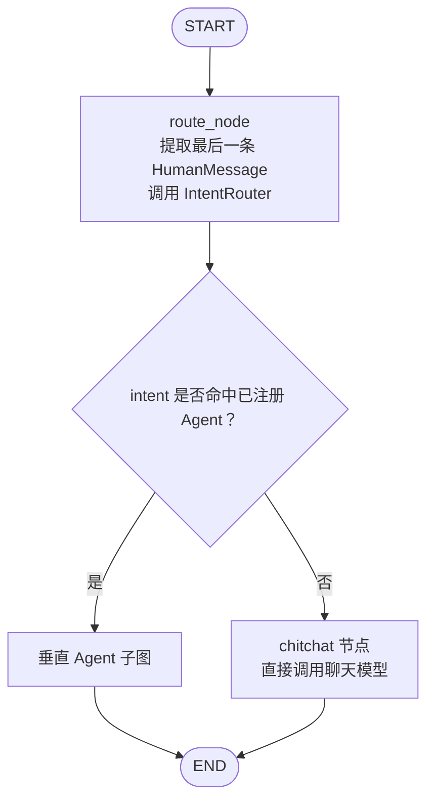
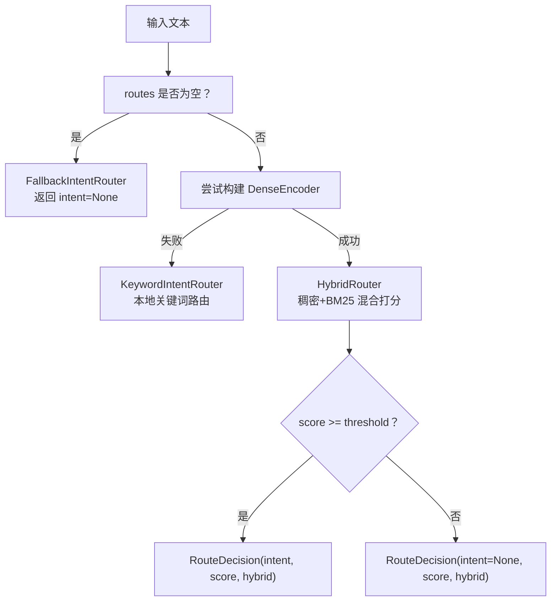
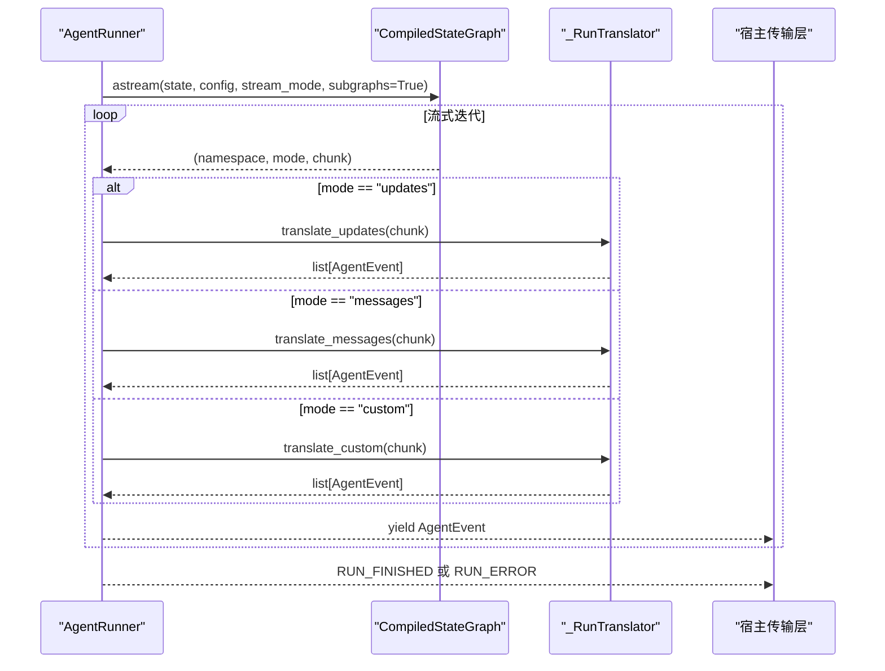
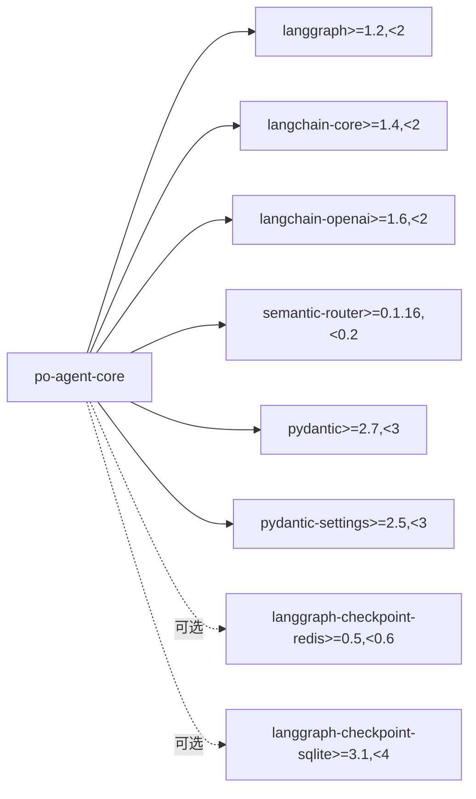

# Agent 核心库

<cite>
**本文引用的文件**   
- [pyproject.toml](file://services/agent-core/pyproject.toml)
- [README.md](file://services/agent-core/README.md)
- [config.py](file://services/agent-core/src/po_agent_core/config.py)
- [errors.py](file://services/agent-core/src/po_agent_core/errors.py)
- [events.py](file://services/agent-core/src/po_agent_core/events.py)
- [factory.py](file://services/agent-core/src/po_agent_core/llm/factory.py)
- [__init__.py](file://services/agent-core/src/po_agent_core/llm/__init__.py)
- [router.py](file://services/agent-core/src/po_agent_core/routing/router.py)
- [graph.py](file://services/agent-core/src/po_agent_core/supervisor/graph.py)
- [state.py](file://services/agent-core/src/po_agent_core/supervisor/state.py)
- [runner.py](file://services/agent-core/src/po_agent_core/runner/runner.py)
- [registry.py](file://services/agent-core/src/po_agent_core/tools/registry.py)
- [checkpointer.py](file://services/agent-core/src/po_agent_core/memory/checkpointer.py)
- [store.py](file://services/agent-core/src/po_agent_core/memory/store.py)
- [ws.py](file://services/chat/app/routers/ws.py)
</cite>

## 目录
1. [引言](#引言)
2. [项目结构](#项目结构)
3. [核心组件](#核心组件)
4. [架构总览](#架构总览)
5. [详细组件分析](#详细组件分析)
6. [依赖关系分析](#依赖关系分析)
7. [性能与并发](#性能与并发)
8. [故障排查指南](#故障排查指南)
9. [结论](#结论)
10. [附录：配置与扩展点](#附录配置与扩展点)

## 引言
本技术文档面向 Agent 核心库（po-agent-core），聚焦 LangGraph 编排、Supervisor 图设计、状态管理、意图识别与路由、工具注册、记忆持久化、执行器 Runner、事件驱动与异步模型、LLM 工厂与多提供商支持、插件化扩展点、测试策略与性能优化。该库是纯 Python 库，不依赖 Web 框架，为 chat 宿主、未来 agentgateway 与独立垂直 Agent 服务提供统一编排能力。

## 项目结构
Agent 核心库采用按职责分层的包结构：
- 配置与错误：config.py、errors.py
- LLM 工厂：llm/factory.py、llm/__init__.py
- 意图路由：routing/router.py
- Supervisor 编排：supervisor/graph.py、supervisor/state.py
- 运行器与事件：runner/runner.py、events.py
- 工具注册：tools/registry.py
- 记忆系统：memory/checkpointer.py、memory/store.py

图表来源
- [config.py:58-111](file://services/agent-core/src/po_agent_core/config.py#L58-L111)
- [factory.py:1-29](file://services/agent-core/src/po_agent_core/llm/factory.py#L1-L29)
- [router.py:1-225](file://services/agent-core/src/po_agent_core/routing/router.py#L1-L225)
- [graph.py:1-142](file://services/agent-core/src/po_agent_core/supervisor/graph.py#L1-L142)
- [state.py:1-39](file://services/agent-core/src/po_agent_core/supervisor/state.py#L1-L39)
- [runner.py:1-399](file://services/agent-core/src/po_agent_core/runner/runner.py#L1-L399)
- [events.py:1-77](file://services/agent-core/src/po_agent_core/events.py#L1-L77)
- [registry.py:1-77](file://services/agent-core/src/po_agent_core/tools/registry.py#L1-L77)
- [checkpointer.py:1-116](file://services/agent-core/src/po_agent_core/memory/checkpointer.py#L1-L116)
- [store.py:1-85](file://services/agent-core/src/po_agent_core/memory/store.py#L1-L85)

章节来源
- [README.md:1-93](file://services/agent-core/README.md#L1-L93)
- [pyproject.toml:1-30](file://services/agent-core/pyproject.toml#L1-L30)

## 核心组件
- 配置中心：AgentCoreSettings 集中管理 LLM、Embedding、记忆、路由阈值与运行时超时；支持角色槽位覆盖多模型。
- LLM 工厂：统一 OpenAI 兼容协议接入，provider 预设 + 环境变量解析，构建 ChatModel 与 Embeddings。
- 意图路由：HybridRouter（稠密+BM25）为主，降级到本地关键词路由或兜底，阈值统一在路由器层判定。
- Supervisor 图：START → route_node → (垂直 Agent 子图 | chitchat) → END；chitchat 兜底，单轮委托语义。
- 共享状态 CoreState：最小字段集合，messages、intent、route_score、agent_name、artifacts。
- 执行器 Runner：astream 驱动，LangGraph 流 → AgentEvent 统一翻译，含超时、异常、interrupt 处理与消息去重。
- 事件契约：EventType 枚举 + AgentEvent 数据类，作为唯一真相供 WS/A2A/MCP 等传输层消费。
- 工具注册表：全局 + 垂直 Agent 命名空间两级注册，运行期只读，零锁开销。
- 记忆系统：CheckpointerManager（redis/sqlite/memory）与 StoreManager（用户级命名空间隔离）。

章节来源
- [config.py:58-111](file://services/agent-core/src/po_agent_core/config.py#L58-L111)
- [factory.py:1-29](file://services/agent-core/src/po_agent_core/llm/factory.py#L1-L29)
- [router.py:1-225](file://services/agent-core/src/po_agent_core/routing/router.py#L1-L225)
- [graph.py:1-142](file://services/agent-core/src/po_agent_core/supervisor/graph.py#L1-L142)
- [state.py:1-39](file://services/agent-core/src/po_agent_core/supervisor/state.py#L1-L39)
- [runner.py:1-399](file://services/agent-core/src/po_agent_core/runner/runner.py#L1-L399)
- [events.py:1-77](file://services/agent-core/src/po_agent_core/events.py#L1-L77)
- [registry.py:1-77](file://services/agent-core/src/po_agent_core/tools/registry.py#L1-L77)
- [checkpointer.py:1-116](file://services/agent-core/src/po_agent_core/memory/checkpointer.py#L1-L116)
- [store.py:1-85](file://services/agent-core/src/po_agent_core/memory/store.py#L1-L85)

## 架构总览
Agent 核心库以 LangGraph 为编排引擎，Supervisor 负责 Layer1 意图路由与垂直 Agent 分发，Runner 将执行流标准化为 AgentEvent，记忆系统提供短期与长期存储，LLM 工厂屏蔽多提供商差异。

图表来源
- [runner.py:249-324](file://services/agent-core/src/po_agent_core/runner/runner.py#L249-L324)
- [graph.py:56-142](file://services/agent-core/src/po_agent_core/supervisor/graph.py#L56-L142)
- [router.py:38-80](file://services/agent-core/src/po_agent_core/routing/router.py#L38-L80)
- [factory.py:1-29](file://services/agent-core/src/po_agent_core/llm/factory.py#L1-L29)
- [checkpointer.py:49-116](file://services/agent-core/src/po_agent_core/memory/checkpointer.py#L49-L116)
- [store.py:25-85](file://services/agent-core/src/po_agent_core/memory/store.py#L25-L85)

## 详细组件分析

### Supervisor 图与状态管理
- 图结构：START → route_node → (垂直 Agent 子图 | chitchat) → END。
- route_node：取最后一条 HumanMessage，同步调用 IntentRouter（asyncio.to_thread 包裹避免阻塞事件循环）。
- 条件边：intent 命中已注册 Agent 名则委托对应子图，否则进入 chitchat。
- chitchat：直接用 chat model 应答，保证任何配置下都有可用出口。
- CoreState：最小字段集合，messages 使用 add_messages 归并，artifacts 浅合并，禁止向 CoreState 添加领域字段。

图表来源
- [graph.py:56-142](file://services/agent-core/src/po_agent_core/supervisor/graph.py#L56-L142)
- [state.py:22-39](file://services/agent-core/src/po_agent_core/supervisor/state.py#L22-L39)

章节来源
- [graph.py:1-142](file://services/agent-core/src/po_agent_core/supervisor/graph.py#L1-L142)
- [state.py:1-39](file://services/agent-core/src/po_agent_core/supervisor/state.py#L1-L39)

### 意图识别与路由算法
- 正常态：IntentRouter 基于 HybridRouter（稠密 embedding + BM25 稀疏），alpha 偏向 BM25，auto_sync="local"。
- 降级链：
  - 无 routes：FallbackIntentRouter，恒判未命中。
  - embedding 缺失或构建失败：KeywordIntentRouter（本地 bigram 覆盖率）。
  - HybridRouter 装配失败：回退 KeywordIntentRouter。
- 阈值策略：统一在路由器层用 router_threshold 一刀切，score 不足视为未命中。

图表来源
- [router.py:38-80](file://services/agent-core/src/po_agent_core/routing/router.py#L38-L80)
- [router.py:181-225](file://services/agent-core/src/po_agent_core/routing/router.py#L181-L225)

章节来源
- [router.py:1-225](file://services/agent-core/src/po_agent_core/routing/router.py#L1-L225)

### 执行器（Runner）工作流程与事件驱动
- Runner 以 astream(graph, state, config) 驱动，启用 stream_mode=["updates", "messages", "custom"] 与 subgraphs=True。
- 事件翻译规则：
  - updates: 节点 delta → STEP；AIMessage → TOOL_CALL_START（未流式时）；ToolMessage → TOOL_CALL_END + TOOL_CALL_RESULT；__interrupt__ → INTERRUPT。
  - messages: token 增量 → TEXT_MESSAGE_CONTENT；tool_call_chunks → TOOL_CALL_START / TOOL_CALL_ARGS。
  - custom: 领域事件透传（type 合法则原样，否则包成 STEP）。
- 去重策略：OpenAI 兼容 provider 的流式 chunk 带 message id，按 id 去重；id 缺失按内容哈希去重。
- 子图透传：subgraphs=True 使垂直 Agent 子图内部节点更新/token/custom 全部上浮；同一消息在两级 updates 各出现一次，需拦截去重。
- 续接线程：开跑前读取线程既有状态（thread_id），登记历史消息，本轮只下发新增内容。
- 超时治理：整次运行受 timeout_seconds 约束，超时取消执行并发布 RUN_ERROR；CancelledError 原样向上抛。

图表来源
- [runner.py:60-247](file://services/agent-core/src/po_agent_core/runner/runner.py#L60-L247)
- [runner.py:249-324](file://services/agent-core/src/po_agent_core/runner/runner.py#L249-L324)
- [events.py:17-77](file://services/agent-core/src/po_agent_core/events.py#L17-L77)

章节来源
- [runner.py:1-399](file://services/agent-core/src/po_agent_core/runner/runner.py#L1-L399)
- [events.py:1-77](file://services/agent-core/src/po_agent_core/events.py#L1-L77)

### LLM 工厂模式与多提供商支持
- 工厂入口：create_chat_model / create_embeddings，只做参数解析与客户端构造，不发起网络请求。
- Provider 预设：qwen/deepseek/openai/custom，base_url/默认模型/embedding 预设集中声明。
- 解析优先级：显式参数 > 角色槽位（llm_roles） > 环境配置（AGENT_CORE_*） > provider 预设。
- 多模型按「角色」而非调用点解析：plan/write/judge…，未配置的角色回落默认槽位。
- API Key 缺失立即抛错并指明环境变量名，绝不静默降级、绝不记录密钥。

章节来源
- [factory.py:1-29](file://services/agent-core/src/po_agent_core/llm/factory.py#L1-L29)
- [__init__.py:1-8](file://services/agent-core/src/po_agent_core/llm/__init__.py#L1-L8)
- [config.py:23-89](file://services/agent-core/src/po_agent_core/config.py#L23-L89)

### 工具注册机制与插件化扩展点
- 两级注册表：全局 + 垂直 Agent 命名空间；运行期只读，零锁开销。
- 注册接口：register(tool, agent?, replace?)；get(name, agent?)；tools_for(agent?)；list_names(agent?)。
- 冲突处理：同名工具未指定 replace 时报 ToolRegistrationError；删除不存在工具亦报错。
- 插件化扩展点：
  - VerticalAgent 插槽协议（agents.slots）用于垂直 Agent 注入。
  - RouterLike 协议（supervisor.graph.RouterLike）允许宿主替换意图路由实现。
  - MCP/A2A 协议适配规划中（README 标注 P3/P4）。

章节来源
- [registry.py:1-77](file://services/agent-core/src/po_agent_core/tools/registry.py#L1-L77)
- [graph.py:38-42](file://services/agent-core/src/po_agent_core/supervisor/graph.py#L38-L42)
- [README.md:12-25](file://services/agent-core/README.md#L12-L25)

### 记忆持久化策略
- CheckpointerManager：延迟初始化 + 显式关闭，支持 redis/sqlite/memory 三策略；首次 get_saver() 建立连接并执行 schema 初始化；aclose() 幂等释放资源。
- StoreManager：长期记忆 store，user_namespace(user_id) 隔离；redis 跨重启持久，其余策略落 InMemoryStore；生命周期同 CheckpointerManager。
- 短期记忆 vs 长期记忆：短期 = checkpointer 内随 thread 恢复的消息；长期 = store 内跨会话的用户偏好/人设/领域事实。

章节来源
- [checkpointer.py:1-116](file://services/agent-core/src/po_agent_core/memory/checkpointer.py#L1-L116)
- [store.py:1-85](file://services/agent-core/src/po_agent_core/memory/store.py#L1-L85)

### 事件驱动架构与传输层对接
- 事件契约：EventType 枚举值即对外契约，AgentEvent 为唯一真相；WS/A2A/MCP 均从该事件流翻译。
- 宿主侧 WS 模块是唯一的协议翻译层，将 AgentEvent 映射为帧字段；interrupt/resume 时序由宿主与前端约定。

章节来源
- [events.py:1-77](file://services/agent-core/src/po_agent_core/events.py#L1-L77)
- [ws.py:30-55](file://services/chat/app/routers/ws.py#L30-L55)

## 依赖关系分析
核心库依赖 LangGraph、langchain-core、langchain-openai、semantic-router、pydantic、pydantic-settings；可选依赖 redis/sqlite 驱动；开发依赖 pytest/pytest-asyncio。

图表来源
- [pyproject.toml:1-30](file://services/agent-core/pyproject.toml#L1-L30)

章节来源
- [pyproject.toml:1-30](file://services/agent-core/pyproject.toml#L1-L30)

## 性能与并发
- 意图路由同步调用：IntentRouter.route 同步执行，supervisor 使用 asyncio.to_thread 包裹以避免阻塞事件循环。
- Runner 流式处理：astream 驱动，subgraphs=True 透传子图事件；消息去重避免重复下发。
- 记忆系统延迟初始化：CheckpointerManager/StoreManager 仅在首次使用时建立连接，减少启动开销。
- 工具注册表运行期只读：无锁设计，零并发开销。
- 超时控制：Runner 整次运行受 timeout_seconds 约束，超时发布 RUN_ERROR，避免前端无限等待。

章节来源
- [graph.py:65-77](file://services/agent-core/src/po_agent_core/supervisor/graph.py#L65-L77)
- [runner.py:249-324](file://services/agent-core/src/po_agent_core/runner/runner.py#L249-L324)
- [checkpointer.py:49-116](file://services/agent-core/src/po_agent_core/memory/checkpointer.py#L49-L116)
- [store.py:36-85](file://services/agent-core/src/po_agent_core/memory/store.py#L36-L85)
- [registry.py:1-77](file://services/agent-core/src/po_agent_core/tools/registry.py#L1-L77)

## 故障排查指南
- 配置缺失：AgentCoreConfigError 指示缺少 API Key 或 provider 无 embedding 预设；宿主装配层捕获后决定降级策略。
- 路由降级：embedding 不可用时自动降级为 KeywordIntentRouter；HybridRouter 装配失败同样降级。
- 记忆连接失败：CheckpointerManager.get_saver() 抛出异常，宿主应降级到 memory 策略；StoreManager 同理。
- 工具注册冲突：ToolRegistrationError 提示工具名重复或未注册；检查 replace 参数与命名空间。
- 事件重复：Runner 对 AIMessage 按 id 或内容哈希去重；若仍出现重复，检查 subgraphs=True 与历史消息登记逻辑。

章节来源
- [errors.py:1-19](file://services/agent-core/src/po_agent_core/errors.py#L1-L19)
- [router.py:181-225](file://services/agent-core/src/po_agent_core/routing/router.py#L181-L225)
- [checkpointer.py:67-99](file://services/agent-core/src/po_agent_core/memory/checkpointer.py#L67-L99)
- [registry.py:26-62](file://services/agent-core/src/po_agent_core/tools/registry.py#L26-L62)
- [runner.py:154-180](file://services/agent-core/src/po_agent_core/runner/runner.py#L154-L180)

## 结论
Agent 核心库以 LangGraph 为编排引擎，通过 Supervisor 图实现意图路由与垂直 Agent 分发，Runner 将执行流标准化为 AgentEvent，记忆系统提供短期与长期存储，LLM 工厂屏蔽多提供商差异。库设计强调纯库原则、延迟初始化、依赖注入与降级策略，确保在生产环境中具备高可用性与可扩展性。

## 附录：配置与扩展点
- 环境变量前缀 AGENT_CORE_，支持 LLM、Embedding、记忆、路由阈值与运行时超时配置。
- 多模型角色槽位：AGENT_CORE_LLM_ROLES__<角色>__<字段>，按用途切换模型与温度。
- 扩展点：
  - VerticalAgent 插槽协议用于注入垂直 Agent。
  - RouterLike 协议允许替换意图路由实现。
  - MCP/A2A 协议适配规划中。

章节来源
- [README.md:48-93](file://services/agent-core/README.md#L48-L93)
- [config.py:58-111](file://services/agent-core/src/po_agent_core/config.py#L58-L111)
- [graph.py:38-42](file://services/agent-core/src/po_agent_core/supervisor/graph.py#L38-L42)