# Supervisor 编排架构

<cite>
**本文引用的文件**   
- [supervisor/graph.py](file://services/agent-core/src/po_agent_core/supervisor/graph.py)
- [supervisor/state.py](file://services/agent-core/src/po_agent_core/supervisor/state.py)
- [routing/router.py](file://services/agent-core/src/po_agent_core/routing/router.py)
- [routing/decisions.py](file://services/agent-core/src/po_agent_core/routing/decisions.py)
- [routing/keyword.py](file://services/agent-core/src/po_agent_core/routing/keyword.py)
- [agents/slots.py](file://services/agent-core/src/po_agent_core/agents/slots.py)
- [memory/checkpointer.py](file://services/agent-core/src/po_agent_core/memory/checkpointer.py)
- [memory/store.py](file://services/agent-core/src/po_agent_core/memory/store.py)
- [agent-cooking/graph.py](file://services/agent-cooking/src/po_agent_cooking/graph.py)
- [tests/test_supervisor.py](file://services/agent-core/tests/test_supervisor.py)
</cite>

## 目录
1. [引言](#引言)
2. [项目结构定位](#项目结构定位)
3. [核心组件](#核心组件)
4. [架构总览](#架构总览)
5. [详细组件分析](#详细组件分析)
6. [依赖关系分析](#依赖关系分析)
7. [性能与执行特性](#性能与执行特性)
8. [检查点与持久化策略](#检查点与持久化策略)
9. [扩展指南：新增垂直 Agent](#扩展指南新增垂直-agent)
10. [故障排查](#故障排查)
11. [结论](#结论)

## 引言
本文面向 Supervisor 编排架构，重点解释 LangGraph `StateGraph` 在意图路由、垂直 Agent 子图委托、以及 chitchat 降级兜底中的设计模式。Supervisor 的核心职责是“单轮意图决策 + 多领域子图调度”，而每个垂直 Agent 内部再负责自己的多轮工具循环、记忆和领域状态。文档同时覆盖状态契约、条件边选择逻辑、节点间状态传递、编译配置、检查点持久化策略，并给出扩展新垂直 Agent 的具体路径说明。

## 项目结构定位
Supervisor 相关代码集中在 Python 服务 `services/agent-core` 中，属于 Agent 核心库；垂直 Agent 示例位于 `services/agent-cooking`；测试用例位于 `services/agent-core/tests`。

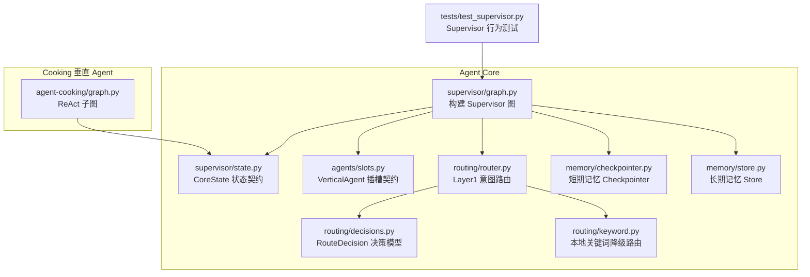

**图表来源**
- [supervisor/graph.py:1-141](file://services/agent-core/src/po_agent_core/supervisor/graph.py#L1-L141)
- [supervisor/state.py:1-39](file://services/agent-core/src/po_agent_core/supervisor/state.py#L1-L39)
- [routing/router.py:1-225](file://services/agent-core/src/po_agent_core/routing/router.py#L1-L225)
- [routing/keyword.py:1-74](file://services/agent-core/src/po_agent_core/routing/keyword.py#L1-L74)
- [routing/decisions.py:1-25](file://services/agent-core/src/po_agent_core/routing/decisions.py#L1-L25)
- [agents/slots.py:1-59](file://services/agent-core/src/po_agent_core/agents/slots.py#L1-L59)
- [memory/checkpointer.py:1-94](file://services/agent-core/src/po_agent_core/memory/checkpointer.py#L1-L94)
- [memory/store.py:1-39](file://services/agent-core/src/po_agent_core/memory/store.py#L1-L39)
- [agent-cooking/graph.py:1-92](file://services/agent-cooking/src/po_agent_cooking/graph.py#L1-L92)
- [tests/test_supervisor.py:1-135](file://services/agent-core/tests/test_supervisor.py#L1-L135)

**章节来源**
- [supervisor/graph.py:1-141](file://services/agent-core/src/po_agent_core/supervisor/graph.py#L1-L141)
- [supervisor/state.py:1-39](file://services/agent-core/src/po_agent_core/supervisor/state.py#L1-L39)
- [routing/router.py:1-225](file://services/agent-core/src/po_agent_core/routing/router.py#L1-L225)
- [agents/slots.py:1-59](file://services/agent-core/src/po_agent_core/agents/slots.py#L1-L59)
- [memory/checkpointer.py:1-94](file://services/agent-core/src/po_agent_core/memory/checkpointer.py#L1-L94)
- [memory/store.py:1-39](file://services/agent-core/src/po_agent_core/memory/store.py#L1-L39)
- [agent-cooking/graph.py:1-92](file://services/agent-cooking/src/po_agent_cooking/graph.py#L1-L92)
- [tests/test_supervisor.py:1-135](file://services/agent-core/tests/test_supervisor.py#L1-L135)

## 核心组件
- **Supervisor 图工厂**：负责构建 `START → route_node → (垂直 Agent 子图 | chitchat) → END` 的编排图，并把垂直 Agent 子图作为节点挂载。
- **CoreState 状态契约**：定义消息、意图、路由分数、实际委托节点名、以及各 Agent 私有数据命名空间。
- **Layer1 意图路由**：混合语义路由（稠密 embedding + BM25）+ 本地关键词降级 + 无语料 fallback。
- **VerticalAgent 插槽**：声明垂直 Agent 的名称、描述、已编译子图、意图语料和元数据。
- **Checkpointer / Store**：短期记忆与长期记忆的延迟初始化与显式关闭管理。
- **Cooking 垂直 Agent 示例**：展示 ReAct 子图如何复用 `CoreState`，并通过工具循环完成多轮任务。

**章节来源**
- [supervisor/graph.py:1-141](file://services/agent-core/src/po_agent_core/supervisor/graph.py#L1-L141)
- [supervisor/state.py:1-39](file://services/agent-core/src/po_agent_core/supervisor/state.py#L1-L39)
- [routing/router.py:1-225](file://services/agent-core/src/po_agent_core/routing/router.py#L1-L225)
- [agents/slots.py:1-59](file://services/agent-core/src/po_agent_core/agents/slots.py#L1-L59)
- [memory/checkpointer.py:1-94](file://services/agent-core/src/po_agent_core/memory/checkpointer.py#L1-L94)
- [memory/store.py:1-39](file://services/agent-core/src/po_agent_core/memory/store.py#L1-L39)
- [agent-cooking/graph.py:1-92](file://services/agent-cooking/src/po_agent_cooking/graph.py#L1-L92)

## 架构总览
Supervisor 采用 LangGraph `StateGraph` 构建宿主编排图，将意图路由与垂直 Agent 子图解耦。意图路由只决定“本轮用户输入该交给哪个垂直 Agent”，不关心具体业务实现；chitchat 节点则承担所有未命中或降级场景的统一回复出口。

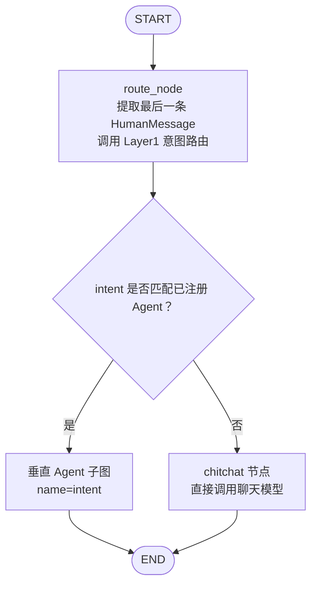

**图表来源**
- [supervisor/graph.py:56-113](file://services/agent-core/src/po_agent_core/supervisor/graph.py#L56-L113)
- [routing/router.py:38-100](file://services/agent-core/src/po_agent_core/routing/router.py#L38-L100)

### 关键流程说明
- **START → route_node**：每次请求进入 Supervisor 后，先取最后一条用户消息，避免 AI 历史消息干扰意图判断。
- **route_node → 条件边**：根据 `RouterLike.route` 返回的 `intent` 与已注册 Agent 名称集合做匹配；若匹配成功，走对应垂直 Agent 子图；否则走 chitchat。
- **垂直 Agent 子图 → END**：Supervisor 对每个垂直 Agent 采用“单轮委托”语义，Agent 内部的多轮工具循环由子图自行处理。
- **chitchat → END**：当没有可路由目标、embedding 不可用、或阈值不足时，统一走 chitchat 节点，保证系统始终有可用出口。

**章节来源**
- [supervisor/graph.py:44-113](file://services/agent-core/src/po_agent_core/supervisor/graph.py#L44-L113)
- [routing/router.py:1-16](file://services/agent-core/src/po_agent_core/routing/router.py#L1-L16)
- [routing/router.py:75-100](file://services/agent-core/src/po_agent_core/routing/router.py#L75-L100)

## 详细组件分析

### Supervisor 图构建与条件边选择
Supervisor 图通过 `_build_supervisor_graph` 构造，核心步骤包括：
1. 使用 `StateGraph(CoreState)` 创建宿主图。
2. 注册 `route_node` 与 `chitchat_node`。
3. 遍历传入的 `VerticalAgent`，将其已编译子图以 `agent.name` 为节点名挂载。
4. 添加 `START → route_node` 边。
5. 添加从 `route_node` 出发的条件边，目标集合包含所有垂直 Agent 名称与 `chitchat`。
6. 每个垂直 Agent 子图与 `chitchat` 都指向 `END`。

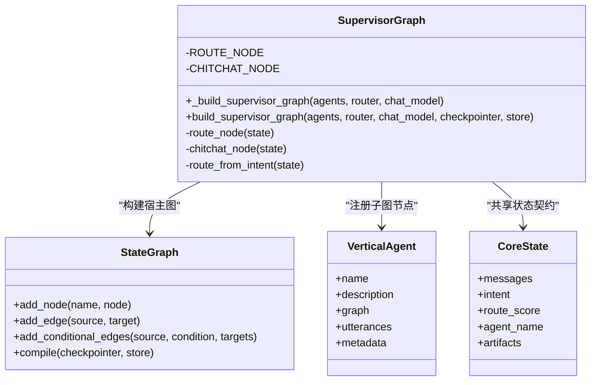

**图表来源**
- [supervisor/graph.py:56-141](file://services/agent-core/src/po_agent_core/supervisor/graph.py#L56-L141)
- [agents/slots.py:31-59](file://services/agent-core/src/po_agent_core/agents/slots.py#L31-L59)
- [supervisor/state.py:27-39](file://services/agent-core/src/po_agent_core/supervisor/state.py#L27-L39)

#### 条件边选择逻辑
`route_from_intent` 是 Supervisor 的关键分支函数：
- 如果 `state.intent` 非空且等于某个已注册 Agent 名称，则返回该 Agent 名称。
- 否则返回 `chitchat`。
这保证了即使路由层返回了未知 intent，也不会把请求路由到未注册的节点，而是安全地回落到 chitchat。

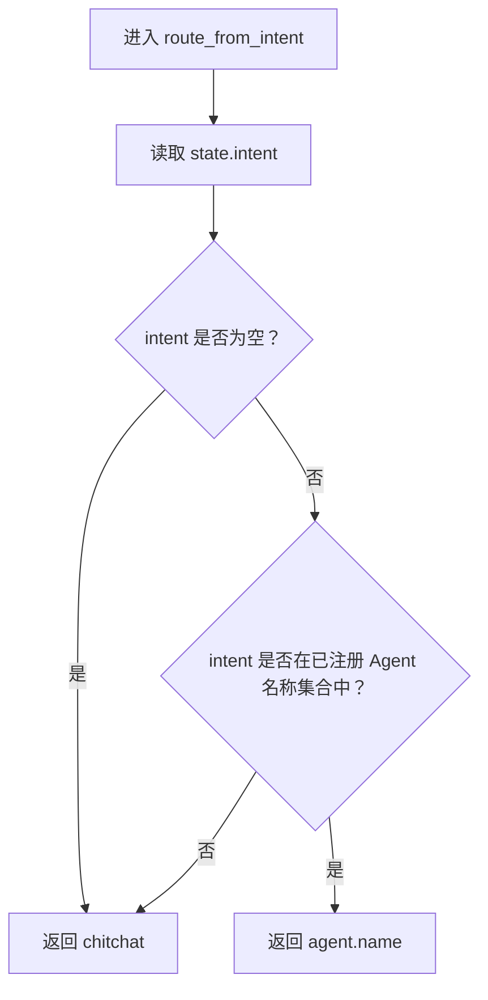

**图表来源**
- [supervisor/graph.py:90-95](file://services/agent-core/src/po_agent_core/supervisor/graph.py#L90-L95)

**章节来源**
- [supervisor/graph.py:56-113](file://services/agent-core/src/po_agent_core/supervisor/graph.py#L56-L113)
- [tests/test_supervisor.py:77-83](file://services/agent-core/tests/test_supervisor.py#L77-L83)

### 意图路由机制与降级链
Layer1 意图路由的目标是把用户文本映射到垂直 Agent 名称或“未命中”。其降级链如下：

1. **正常态**：`IntentRouter` 使用 `HybridRouter`，结合稠密 embedding 与 BM25 稀疏检索打分；超过阈值则返回带 `intent` 的 `RouteDecision`。
2. **降级态一**：embedding 配置缺失或构建失败时，退化为 `KeywordIntentRouter`，基于字符 bigram 覆盖率打分。
3. **降级态二**：没有任何路由语料（即没有垂直 Agent）时，使用 `FallbackIntentRouter`，恒返回 `intent=None`，交由 Supervisor 走 chitchat。

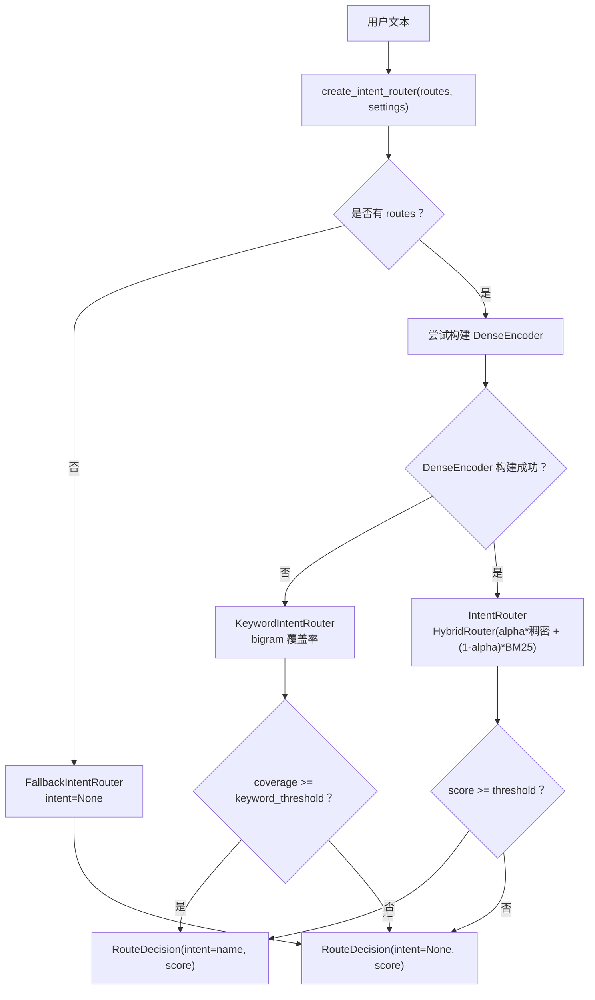

**图表来源**
- [routing/router.py:38-100](file://services/agent-core/src/po_agent_core/routing/router.py#L38-L100)
- [routing/router.py:181-225](file://services/agent-core/src/po_agent_core/routing/router.py#L181-L225)
- [routing/keyword.py:30-74](file://services/agent-core/src/po_agent_core/routing/keyword.py#L30-L74)
- [routing/decisions.py:12-25](file://services/agent-core/src/po_agent_core/routing/decisions.py#L12-L25)

#### 路由决策数据结构
`RouteDecision` 是一个不可变数据类，包含：
- `intent`：命中的 Agent 名称或 `None`。
- `score`：路由分数，用于日志与调试。
- `source`：路由来源，如 `"hybrid"`、`"keyword"`、`"fallback"`。

**章节来源**
- [routing/router.py:38-100](file://services/agent-core/src/po_agent_core/routing/router.py#L38-L100)
- [routing/router.py:181-225](file://services/agent-core/src/po_agent_core/routing/router.py#L181-L225)
- [routing/keyword.py:30-74](file://services/agent-core/src/po_agent_core/routing/keyword.py#L30-L74)
- [routing/decisions.py:12-25](file://services/agent-core/src/po_agent_core/routing/decisions.py#L12-L25)

### 节点间状态传递与 CoreState
Supervisor 使用 `CoreState` 作为父子图共享的状态契约。字段设计刻意保持最小化：
- `messages`：对话消息，使用 `add_messages` reducer 追加合并。
- `intent`：Layer1 路由命中的意图名称，未命中为空串。
- `route_score`：路由分数，便于排查“差一点命中”的场景。
- `agent_name`：本次实际被委托的节点名，观测用途，兜底时为 `chitchat`。
- `artifacts`：各垂直 Agent 的私有数据，按 Agent 名分命名空间，Supervisor 不解释内容。

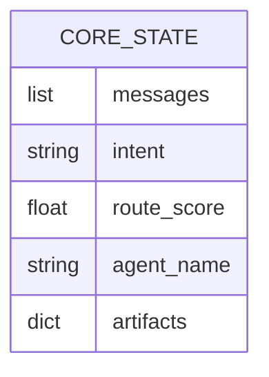

**图表来源**
- [supervisor/state.py:27-39](file://services/agent-core/src/po_agent_core/supervisor/state.py#L27-L39)

#### artifacts 归并策略
`merge_artifacts` 对 `artifacts` 进行浅合并，同名命名空间整体替换，后写胜出。这样每个垂直 Agent 可以独立维护自己的领域状态，而 Supervisor 不会侵入领域数据。

**章节来源**
- [supervisor/state.py:1-39](file://services/agent-core/src/po_agent_core/supervisor/state.py#L1-L39)

### chitchat 降级路由
chitchat 节点是 Supervisor 的统一兜底出口。它直接调用注入的 `chat_model`，并将结果包装为 `AIMessage` 写入 `messages`。这意味着：
- 闲聊消息走 chitchat。
- 路由未命中走 chitchat。
- 降级路由（无 embedding、无 routes）也走 chitchat。
- 即使路由层返回了未知 Agent 名称，也会被 `route_from_intent` 拦截并转至 chitchat。

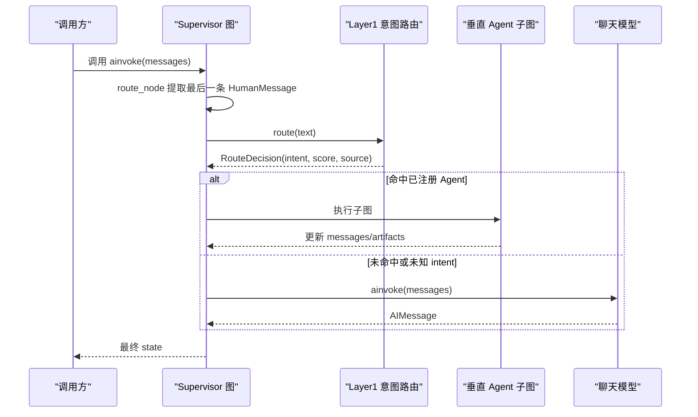

**图表来源**
- [supervisor/graph.py:65-88](file://services/agent-core/src/po_agent_core/supervisor/graph.py#L65-L88)
- [supervisor/graph.py:90-113](file://services/agent-core/src/po_agent_core/supervisor/graph.py#L90-L113)
- [routing/router.py:75-100](file://services/agent-core/src/po_agent_core/routing/router.py#L75-L100)

**章节来源**
- [supervisor/graph.py:65-113](file://services/agent-core/src/po_agent_core/supervisor/graph.py#L65-L113)
- [tests/test_supervisor.py:65-83](file://services/agent-core/tests/test_supervisor.py#L65-L83)

### 垂直 Agent 生命周期管理
Supervisor 对垂直 Agent 的生命周期管理主要体现在注册与校验阶段：
- 名称不能重复。
- 名称不能占用保留节点名 `route` 与 `chitchat`。
- 名称不能以 `__` 开头。
- 必须提供 description。
- graph 必须是已编译的 `CompiledStateGraph`。
- utterances 若存在，必须是非空字符串。

这些约束确保 Supervisor 能安全地把 Agent 名称当作 LangGraph 节点名，并让 Layer1 意图路由稳定工作。

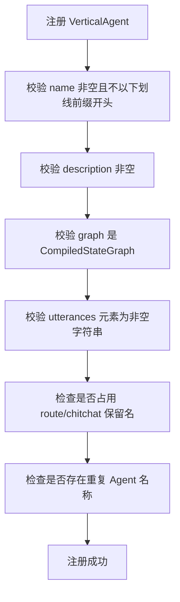

**图表来源**
- [agents/slots.py:41-59](file://services/agent-core/src/po_agent_core/agents/slots.py#L41-L59)
- [supervisor/graph.py:132-141](file://services/agent-core/src/po_agent_core/supervisor/graph.py#L132-L141)

**章节来源**
- [agents/slots.py:31-59](file://services/agent-core/src/po_agent_core/agents/slots.py#L31-L59)
- [supervisor/graph.py:132-141](file://services/agent-core/src/po_agent_core/supervisor/graph.py#L132-L141)
- [tests/test_supervisor.py:98-135](file://services/agent-core/tests/test_supervisor.py#L98-L135)

### Cooking 垂直 Agent 示例
Cooking 垂直 Agent 展示了如何在子图中复用 `CoreState`，并通过 ReAct 模式完成多轮工具调用。其子图结构为：
- `START → agent → tools_condition → tools → agent → … → END`。
- 系统提示词每轮拼在窗口最前面，但不写入 state，避免 checkpointer 累积。
- 消息窗口按 HumanMessage 边界裁剪，防止出现孤儿 ToolMessage。

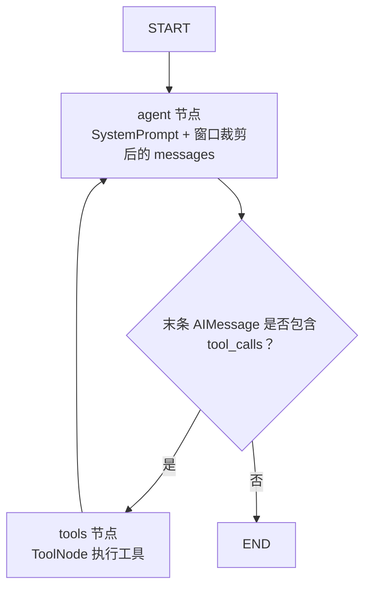

**图表来源**
- [agent-cooking/graph.py:56-92](file://services/agent-cooking/src/po_agent_cooking/graph.py#L56-L92)

**章节来源**
- [agent-cooking/graph.py:1-92](file://services/agent-cooking/src/po_agent_cooking/graph.py#L1-L92)

## 依赖关系分析
Supervisor 的依赖关系呈现清晰的层次：
- Supervisor 图依赖 `CoreState`、`VerticalAgent`、`BaseCheckpointSaver`、`BaseStore`。
- 意图路由依赖 `semantic-router`、`OpenAIEncoder`、`BM25Encoder`、`CharTokenizer`。
- 垂直 Agent 插槽依赖 LangGraph 的 `CompiledStateGraph`。
- 记忆子系统依赖 LangGraph 的 checkpointer 与 store 抽象。

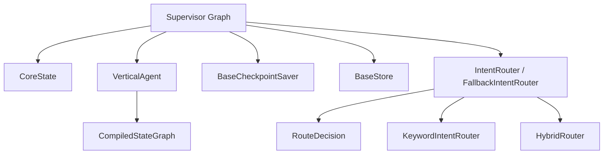

**图表来源**
- [supervisor/graph.py:22-30](file://services/agent-core/src/po_agent_core/supervisor/graph.py#L22-L30)
- [routing/router.py:23-34](file://services/agent-core/src/po_agent_core/routing/router.py#L23-L34)
- [agents/slots.py:22-25](file://services/agent-core/src/po_agent_core/agents/slots.py#L22-L25)

**章节来源**
- [supervisor/graph.py:22-30](file://services/agent-core/src/po_agent_core/supervisor/graph.py#L22-L30)
- [routing/router.py:23-34](file://services/agent-core/src/po_agent_core/routing/router.py#L23-L34)
- [agents/slots.py:22-25](file://services/agent-core/src/po_agent_core/agents/slots.py#L22-L25)

## 性能与执行特性
- **同步路由调用**：`router.route` 是同步方法，Supervisor 使用 `asyncio.to_thread` 包裹，避免阻塞事件循环。
- **轻量状态**：`CoreState` 字段刻意保持最小集合，减少跨节点状态复制与合并成本。
- **单轮委托语义**：Supervisor 只负责一次意图决策，复杂多轮交互下沉到垂直 Agent 子图，降低 Supervisor 复杂度。
- **条件边开销低**：`route_from_intent` 仅做字符串匹配与集合查找，时间复杂度接近 O(1)。
- **chitchat 直接调用模型**：未命中时直接调用聊天模型，避免额外中间节点。

[本节为通用性能讨论，不直接分析具体代码片段]

## 检查点与持久化策略
Supervisor 图的编译支持传入 `checkpointer` 与 `store`，分别对应短期记忆与长期记忆。

### 短期记忆：CheckpointerManager
- 支持三种策略：`redis`、`sqlite`、`memory`。
- 延迟初始化：首次 `get_saver()` 才建立连接。
- 幂等获取：重复调用返回同一实例。
- 显式关闭：宿主在进程退出时调用 `aclose()`。
- Redis 是生产默认策略，SQLite 适合单机演示，Memory 用于测试与 CI。

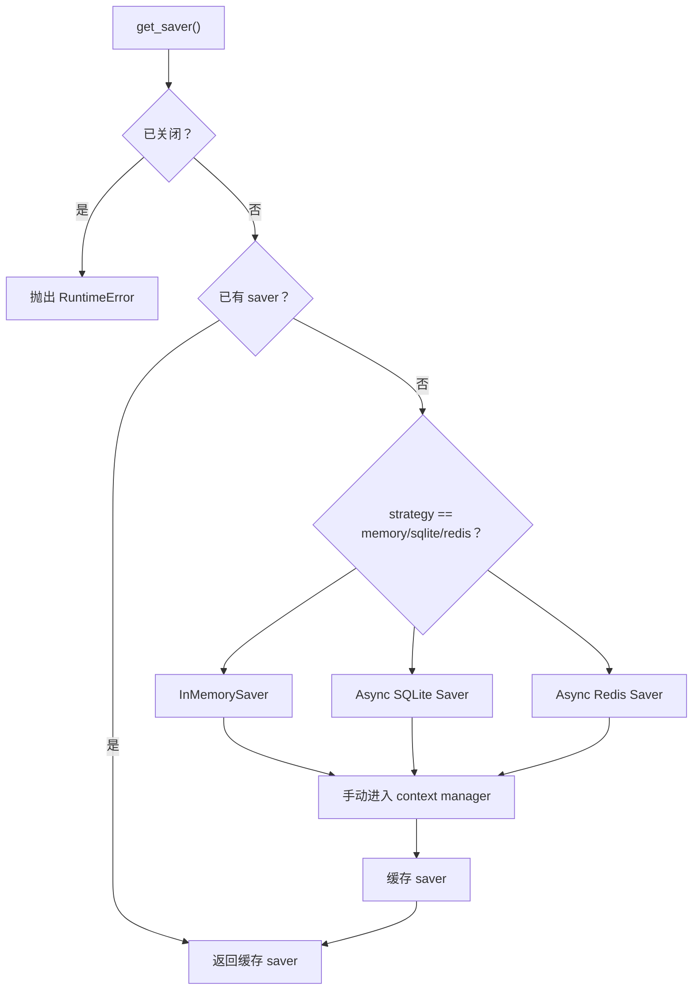

**图表来源**
- [memory/checkpointer.py:67-94](file://services/agent-core/src/po_agent_core/memory/checkpointer.py#L67-L94)

### 长期记忆：StoreManager 与 user_namespace
- 长期记忆按 `("users", user_id)` 命名空间隔离。
- Redis 后端提供跨重启持久化，其余后端使用进程内存储。
- 同样采用延迟初始化与显式关闭。

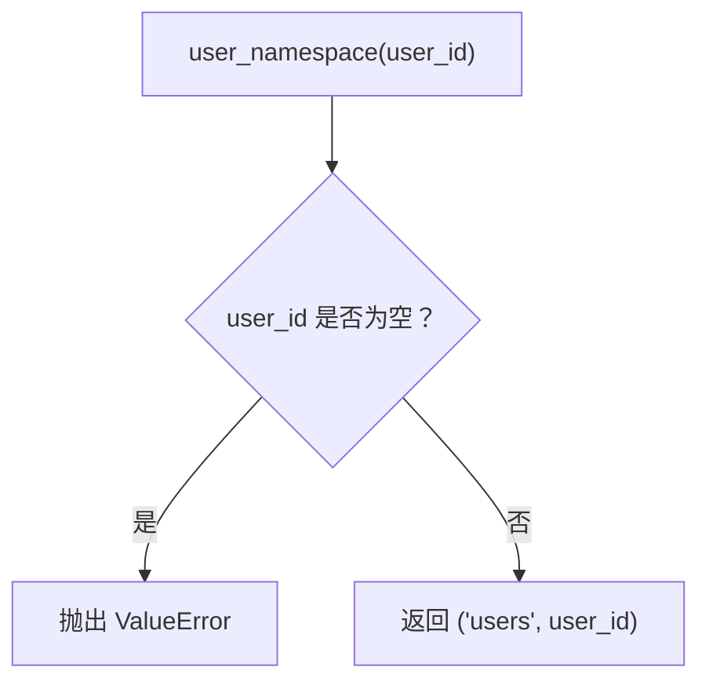

**图表来源**
- [memory/store.py:25-33](file://services/agent-core/src/po_agent_core/memory/store.py#L25-L33)

**章节来源**
- [memory/checkpointer.py:1-94](file://services/agent-core/src/po_agent_core/memory/checkpointer.py#L1-L94)
- [memory/store.py:1-39](file://services/agent-core/src/po_agent_core/memory/store.py#L1-L39)
- [supervisor/graph.py:116-141](file://services/agent-core/src/po_agent_core/supervisor/graph.py#L116-L141)

## 扩展指南：新增垂直 Agent
要扩展一个新的垂直 Agent，建议遵循以下步骤：

1. **定义垂直 Agent 插槽**
   - 提供唯一 `name`。
   - 提供 `description`。
   - 提供已编译的 `graph`。
   - 可选提供 `utterances`，用于 Layer1 意图路由。
   - 可选提供 `metadata`，存放静态资源。

2. **实现子图**
   - 使用 `CoreState` 作为状态类型。
   - 领域私有数据写入 `artifacts[name]`。
   - 如需多轮工具循环，参考 cooking 子图的 ReAct 结构。

3. **注册到 Supervisor**
   - 将 `VerticalAgent` 列表传给 `build_supervisor_graph`。
   - 确保 `name` 与 Layer1 路由的 `Route.name` 一致。
   - 确保不占用 `route` 与 `chitchat` 保留名。

4. **配置意图路由**
   - 使用 `routes_from_agents` 从垂直 Agent 派生路由语料。
   - 使用 `create_intent_router` 构建 IntentRouter 或降级路由器。

5. **配置记忆**
   - 根据需要配置 `checkpointer` 与 `store`。
   - 在宿主生命周期中管理其初始化与关闭。

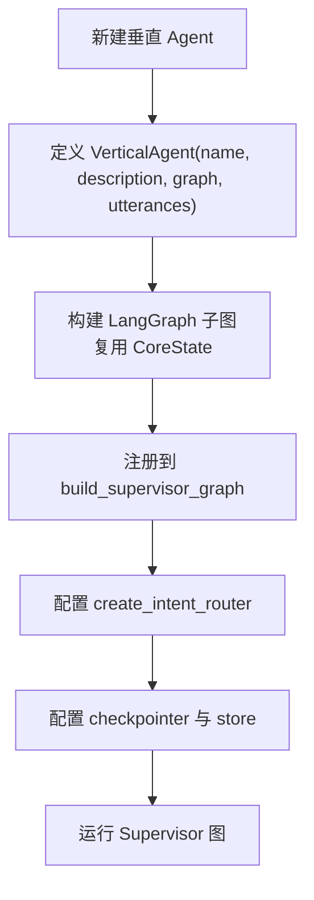

**图表来源**
- [agents/slots.py:31-59](file://services/agent-core/src/po_agent_core/agents/slots.py#L31-L59)
- [routing/router.py:169-225](file://services/agent-core/src/po_agent_core/routing/router.py#L169-L225)
- [supervisor/graph.py:116-141](file://services/agent-core/src/po_agent_core/supervisor/graph.py#L116-L141)

**章节来源**
- [agents/slots.py:31-59](file://services/agent-core/src/po_agent_core/agents/slots.py#L31-L59)
- [routing/router.py:169-225](file://services/agent-core/src/po_agent_core/routing/router.py#L169-L225)
- [supervisor/graph.py:116-141](file://services/agent-core/src/po_agent_core/supervisor/graph.py#L116-L141)
- [agent-cooking/graph.py:56-92](file://services/agent-cooking/src/po_agent_cooking/graph.py#L56-L92)

## 故障排查
常见故障与排查方向：

- **垂直 Agent 名称重复**
  - 现象：编译 Supervisor 图时报错。
  - 原因：多个 `VerticalAgent` 使用相同 `name`。
  - 解决：确保每个 Agent 名称唯一。

- **占用保留节点名**
  - 现象：编译 Supervisor 图时报错。
  - 原因：Agent 名称使用了 `route` 或 `chitchat`。
  - 解决：修改 Agent 名称，避免与 Supervisor 内部节点冲突。

- **路由未命中导致全部走 chitchat**
  - 现象：业务请求被当作闲聊处理。
  - 可能原因：
    - embedding 配置缺失，降级为关键词路由。
    - 关键词覆盖率低于阈值。
    - 没有 routes，直接 fallback。
  - 排查：查看 `route_score` 与 `source`，确认路由来源与分数。

- **未知 intent 被拦截**
  - 现象：路由层返回了未注册 Agent 名称，但仍走 chitchat。
  - 原因：`route_from_intent` 会校验 intent 是否在已注册集合中。
  - 解决：确保路由返回的 intent 与某个 `VerticalAgent.name` 一致。

- **Checkpointer 连接失败**
  - 现象：启动或首次调用时抛异常。
  - 原因：Redis 未启动或配置错误。
  - 解决：检查环境变量与连接配置，必要时降级到 sqlite 或 memory。

**章节来源**
- [supervisor/graph.py:132-141](file://services/agent-core/src/po_agent_core/supervisor/graph.py#L132-L141)
- [tests/test_supervisor.py:98-135](file://services/agent-core/tests/test_supervisor.py#L98-L135)
- [routing/router.py:181-225](file://services/agent-core/src/po_agent_core/routing/router.py#L181-L225)
- [memory/checkpointer.py:67-94](file://services/agent-core/src/po_agent_core/memory/checkpointer.py#L67-L94)

## 结论
Supervisor 编排架构通过 LangGraph `StateGraph` 实现了清晰的分层：Supervisor 负责意图路由与垂直 Agent 调度，垂直 Agent 负责领域多轮交互与工具调用，chitchat 提供统一降级出口。`CoreState` 作为最小状态契约，避免了上帝对象问题；`RouteDecision` 与三层路由降级链确保了系统在多种配置下仍具备确定性去向；Checkpointer 与 Store 提供了可扩展的记忆持久化能力。整体设计强调解耦、可观测性与健壮性，便于横向扩展新的垂直 Agent，并在不同部署环境中保持稳定运行。