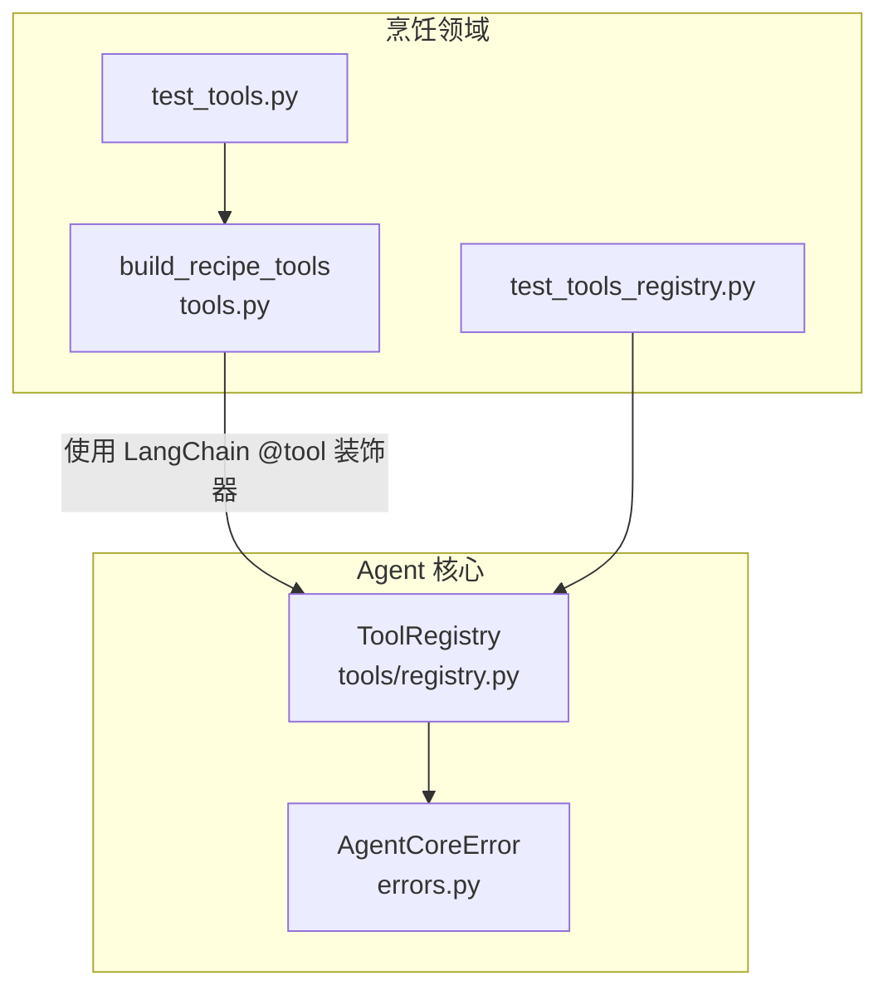
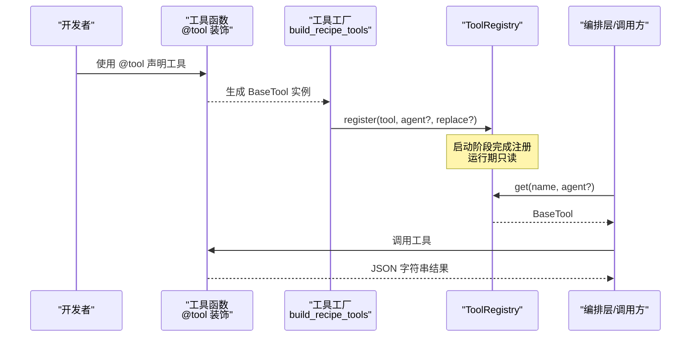
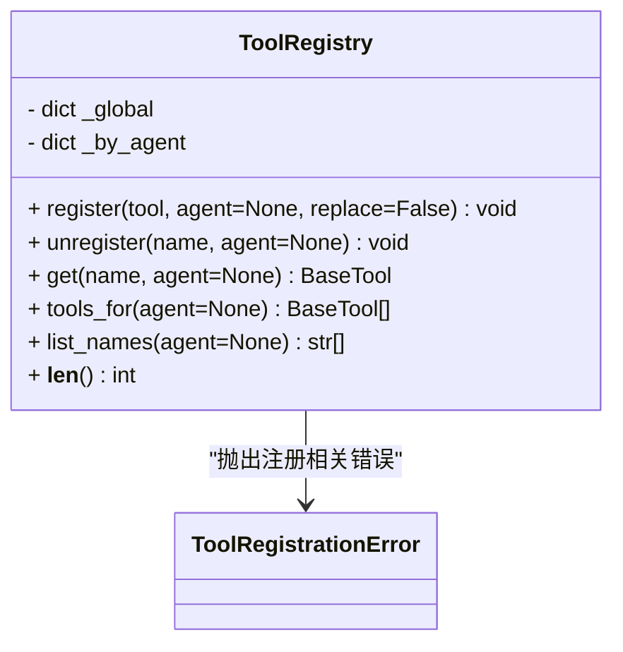
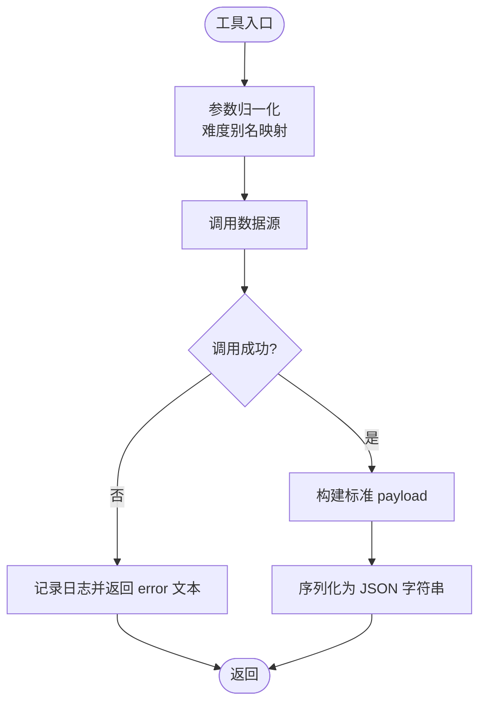
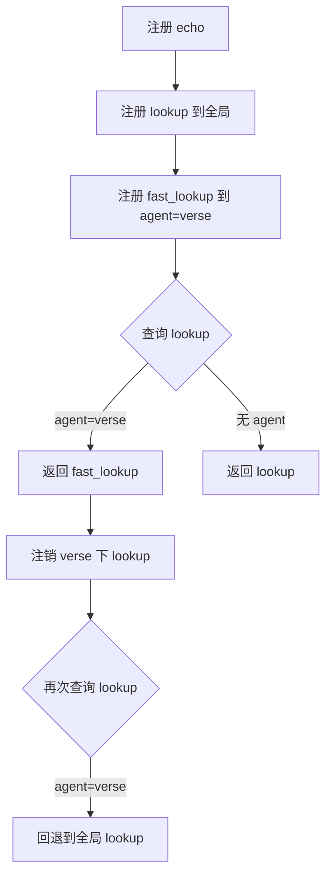
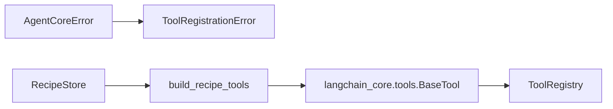
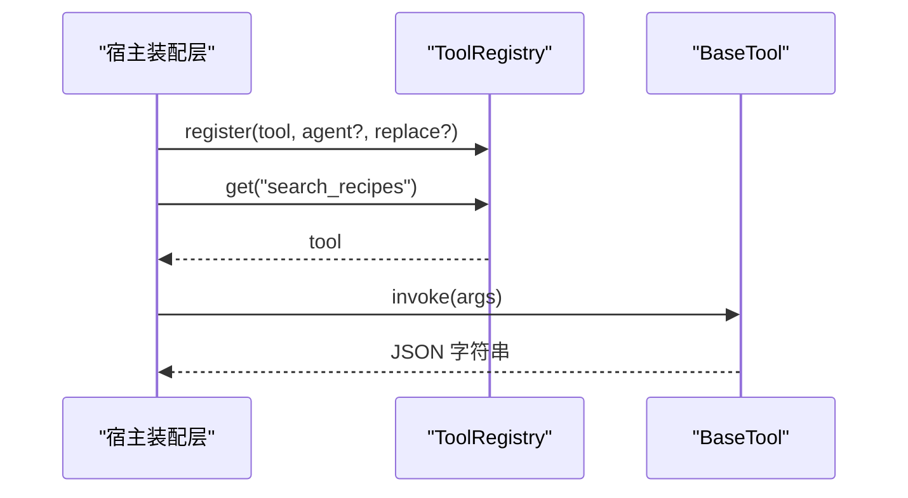

# 工具注册机制

<cite>
**本文引用的文件**   
- [services/agent-core/src/po_agent_core/tools/registry.py](file://services/agent-core/src/po_agent_core/tools/registry.py)
- [services/agent-core/src/po_agent_core/errors.py](file://services/agent-core/src/po_agent_core/errors.py)
- [services/agent-core/tests/test_tools_registry.py](file://services/agent-core/tests/test_tools_registry.py)
- [services/agent-cooking/src/po_agent_cooking/tools.py](file://services/agent-cooking/src/po_agent_cooking/tools.py)
- [services/agent-cooking/tests/test_tools.py](file://services/agent-cooking/tests/test_tools.py)
</cite>

## 目录
1. [引言](#引言)
2. [项目结构定位](#项目结构定位)
3. [核心组件](#核心组件)
4. [架构总览](#架构总览)
5. [详细组件分析](#详细组件分析)
6. [依赖关系分析](#依赖关系分析)
7. [性能与并发特性](#性能与并发特性)
8. [错误传播与健壮性](#错误传播与健壮性)
9. [自定义工具开发指南](#自定义工具开发指南)
10. [版本管理与兼容性建议](#版本管理与兼容性建议)
11. [故障排查](#故障排查)
12. [结论](#结论)

## 引言
本文围绕仓库中的“工具注册机制”展开，重点说明：
- 插件化工具的架构设计：全局命名空间 + 垂直 Agent 命名空间。
- 动态加载与发现：通过 LangChain 的 `tool` 装饰器声明工具，由宿主在装配期注入注册表。
- 工具接口定义、参数验证、返回值处理契约。
- 工具生命周期管理、依赖注入方式、错误传播策略。
- 自定义工具实现示例、注册流程、调用路径。
- 版本管理、兼容性检查与热更新支持的建议。

该机制位于 Python 侧 Agent 服务中，核心代码集中在 `po_agent_core.tools.registry`，典型工具实现位于 `po_agent_cooking.tools`。

## 项目结构定位
与工具注册机制直接相关的代码主要分布在两个包：
- `services/agent-core`：提供通用工具注册表、异常类型和基础能力。
- `services/agent-cooking`：提供烹饪领域工具的具体实现，展示如何声明工具、组装工具集并对外暴露。



**图表来源**
- [services/agent-core/src/po_agent_core/tools/registry.py:19-77](file://services/agent-core/src/po_agent_core/tools/registry.py#L19-L77)
- [services/agent-core/src/po_agent_core/errors.py:8-18](file://services/agent-core/src/po_agent_core/errors.py#L8-L18)
- [services/agent-cooking/src/po_agent_cooking/tools.py:95-206](file://services/agent-cooking/src/po_agent_cooking/tools.py#L95-L206)
- [services/agent-core/tests/test_tools_registry.py:26-73](file://services/agent-core/tests/test_tools_registry.py#L26-L73)
- [services/agent-cooking/tests/test_tools.py:18-35](file://services/agent-cooking/tests/test_tools.py#L18-L35)

**章节来源**
- [services/agent-core/src/po_agent_core/tools/registry.py:1-77](file://services/agent-core/src/po_agent_core/tools/registry.py#L1-L77)
- [services/agent-cooking/src/po_agent_cooking/tools.py:1-206](file://services/agent-cooking/src/po_agent_cooking/tools.py#L1-L206)

## 核心组件
- **ToolRegistry**：维护两级工具映射，支持全局注册和按 Agent 命名空间覆盖；提供注册、注销、查询、列举等能力。
- **ToolRegistrationError**：注册阶段出现的冲突、重复、未注册等错误的专用异常。
- **AgentCoreError**：更上层的统一异常基类，便于宿主统一捕获和处理。
- **cook 工具集**：以 `build_recipe_tools` 工厂函数返回一组 LangChain `BaseTool`，内部用 `@tool` 装饰器声明具体工具。

关键职责划分：
- `ToolRegistry` 不关心工具业务逻辑，只负责“名称到工具对象”的查找与隔离。
- 工具实现关注业务数据访问、参数归一化、结果序列化与错误转文本。
- 测试用例同时覆盖注册表行为与工具输出契约。

**章节来源**
- [services/agent-core/src/po_agent_core/tools/registry.py:15-77](file://services/agent-core/src/po_agent_core/tools/registry.py#L15-L77)
- [services/agent-core/src/po_agent_core/errors.py:8-18](file://services/agent-core/src/po_agent_core/errors.py#L8-L18)
- [services/agent-cooking/src/po_agent_cooking/tools.py:95-206](file://services/agent-cooking/src/po_agent_cooking/tools.py#L95-L206)

## 架构总览
工具注册机制采用“声明式工具 + 装配期注册 + 运行期只读”的设计：



**图表来源**
- [services/agent-cooking/src/po_agent_cooking/tools.py:95-206](file://services/agent-cooking/src/po_agent_cooking/tools.py#L95-L206)
- [services/agent-core/src/po_agent_core/tools/registry.py:26-70](file://services/agent-core/src/po_agent_core/tools/registry.py#L26-L70)

## 详细组件分析

### ToolRegistry：两级命名空间注册表
`ToolRegistry` 维护两个存储：
- 全局工具映射：`_global`
- 按 Agent 划分的工具映射：`_by_agent`

核心方法语义：
- `register`：注册工具；若同名且未允许替换则抛错。
- `unregister`：注销工具；不存在则抛错。
- `get`：优先从 Agent 命名空间取，否则回退全局；找不到抛错。
- `tools_for`：合并全局与指定 Agent 的工具，Agent 同名覆盖全局。
- `list_names`：列出当前视角下的工具名。
- `__len__`：统计全局与所有 Agent 命名空间的工具总数。



**图表来源**
- [services/agent-core/src/po_agent_core/tools/registry.py:19-77](file://services/agent-core/src/po_agent_core/tools/registry.py#L19-L77)

**章节来源**
- [services/agent-core/src/po_agent_core/tools/registry.py:19-77](file://services/agent-core/src/po_agent_core/tools/registry.py#L19-L77)

### 工具声明与返回契约：Cooking 工具集
Cooking 工具集通过 `build_recipe_tools` 返回三个工具：
- `search_recipes`：搜索菜谱摘要列表。
- `get_recipe_detail`：根据 ID 获取完整用料与步骤。
- `list_categories`：列出可用分类。

设计约束：
- 工具永不向上抛异常；数据源失败转为 `{"error": "..."}` 文本。
- 返回值是 JSON 字符串，字段需与移动端渲染契约一致。
- 难度参数做别名归一化，避免模型传口语导致失败。



**图表来源**
- [services/agent-cooking/src/po_agent_cooking/tools.py:56-92](file://services/agent-cooking/src/po_agent_cooking/tools.py#L56-L92)
- [services/agent-cooking/src/po_agent_cooking/tools.py:103-206](file://services/agent-cooking/src/po_agent_cooking/tools.py#L103-L206)

**章节来源**
- [services/agent-cooking/src/po_agent_cooking/tools.py:1-206](file://services/agent-cooking/src/po_agent_cooking/tools.py#L1-L206)

### 注册与覆盖行为：测试用例验证
测试覆盖了以下关键行为：
- 全局注册与查询。
- Agent 命名空间同名覆盖全局。
- 重复注册拒绝，除非显式允许替换。
- 未注册工具查询或注销抛错。
- 注销作用域限定于指定 Agent。



**图表来源**
- [services/agent-core/tests/test_tools_registry.py:26-73](file://services/agent-core/tests/test_tools_registry.py#L26-L73)

**章节来源**
- [services/agent-core/tests/test_tools_registry.py:1-73](file://services/agent-core/tests/test_tools_registry.py#L1-L73)

## 依赖关系分析
- `ToolRegistry` 依赖 LangChain 的 `BaseTool` 作为工具抽象。
- `ToolRegistrationError` 继承自 `AgentCoreError`，形成统一的异常层次。
- Cooking 工具依赖 LangChain 的 `tool` 装饰器，以及领域内的 `RecipeStore` 与配置。



**图表来源**
- [services/agent-core/src/po_agent_core/tools/registry.py:10-12](file://services/agent-core/src/po_agent_core/tools/registry.py#L10-L12)
- [services/agent-core/src/po_agent_core/errors.py:8-18](file://services/agent-core/src/po_agent_core/errors.py#L8-L18)
- [services/agent-cooking/src/po_agent_cooking/tools.py:25-29](file://services/agent-cooking/src/po_agent_cooking/tools.py#L25-L29)

**章节来源**
- [services/agent-core/src/po_agent_core/tools/registry.py:1-12](file://services/agent-core/src/po_agent_core/tools/registry.py#L1-L12)
- [services/agent-core/src/po_agent_core/errors.py:1-19](file://services/agent-core/src/po_agent_core/errors.py#L1-L19)
- [services/agent-cooking/src/po_agent_cooking/tools.py:25-29](file://services/agent-cooking/src/po_agent_cooking/tools.py#L25-L29)

## 性能与并发特性
- 注册表注释明确：注册发生在宿主装配期（启动阶段），运行期只读，因此不做并发控制，换取零锁开销。
- 工具函数本身保持无状态，依赖通过闭包注入 `store` 与 `settings`，减少运行时共享状态带来的竞争条件。
- 工具返回 JSON 字符串，避免模型与前端解析歧义，也利于移动端卡片渲染。

优化建议：
- 对高频工具可考虑结果缓存（注意缓存键包含参数）。
- 对批量工具（如分类列表）可考虑懒加载或分页。
- 对大结果集（如步骤列表）确保排序稳定，避免模型理解抖动。

[本节为通用性能讨论，不直接分析具体文件]

## 错误传播与健壮性
- 工具层约定：不向上抛异常，而是将错误转为结构化文本返回给模型。这样模型可以重试或解释给用户。
- 注册层错误：使用 `ToolRegistrationError` 表达注册冲突、重复、未注册等问题，便于宿主区分处理。
- 上层异常：`AgentCoreError` 作为统一基类，宿主可统一兜底，也可细分配置类错误进行降级。

```mermaid
flowchart TD
ToolCall["工具调用"] --> DataErr{"数据源异常?"}
DataErr --> |是| ReturnText["返回 {\"error\": \"...\"}"]
DataErr --> |否| ReturnData["返回标准 payload"]
Register["注册工具"] --> Dup{"是否重复?"}
Dup --> |是| RaiseRegErr["抛出 ToolRegistrationError"]
Dup --> |否| Done["注册成功"]
```

**图表来源**
- [services/agent-cooking/src/po_agent_cooking/tools.py:120-137](file://services/agent-cooking/src/po_agent_cooking/tools.py#L120-L137)
- [services/agent-cooking/src/po_agent_cooking/tools.py:149-185](file://services/agent-cooking/src/po_agent_cooking/tools.py#L149-L185)
- [services/agent-cooking/src/po_agent_cooking/tools.py:193-203](file://services/agent-cooking/src/po_agent_cooking/tools.py#L193-L203)
- [services/agent-core/src/po_agent_core/tools/registry.py:34-51](file://services/agent-core/src/po_agent_core/tools/registry.py#L34-L51)

**章节来源**
- [services/agent-cooking/src/po_agent_cooking/tools.py:103-206](file://services/agent-cooking/src/po_agent_cooking/tools.py#L103-L206)
- [services/agent-core/src/po_agent_core/tools/registry.py:15-51](file://services/agent-core/src/po_agent_core/tools/registry.py#L15-L51)
- [services/agent-core/src/po_agent_core/errors.py:8-18](file://services/agent-core/src/po_agent_core/errors.py#L8-L18)

## 自定义工具开发指南

### 工具接口定义
- 使用 LangChain 的 `@tool` 装饰器声明工具函数。
- 工具函数签名应清晰描述参数含义，并在 docstring 中说明用途与参数。
- 返回值应为 JSON 字符串，字段名与前端契约保持一致。

推荐实践：
- 对输入做宽松校验与归一化（例如难度别名映射）。
- 对数据源异常捕获并转为 `{"error": "..."}`。
- 对空结果给出提示（hint），引导模型下一步动作。

**章节来源**
- [services/agent-cooking/src/po_agent_cooking/tools.py:103-206](file://services/agent-cooking/src/po_agent_cooking/tools.py#L103-L206)

### 参数验证与返回值处理
- 参数验证：尽量在工具内做容错处理，避免中断对话。
- 返回值处理：统一序列化为 JSON 字符串，保证模型与前端一致性。
- 数据结构：摘要列表包含必要字段（id、title、coverImageUrl、difficulty、totalTime 等），详情包含 ingredients 与 steps。

**章节来源**
- [services/agent-cooking/src/po_agent_cooking/tools.py:56-92](file://services/agent-cooking/src/po_agent_cooking/tools.py#L56-L92)
- [services/agent-cooking/tests/test_tools.py:28-35](file://services/agent-cooking/tests/test_tools.py#L28-L35)

### 依赖注入与生命周期
- 依赖注入：通过工厂函数 `build_recipe_tools` 注入 `RecipeStore` 与 `CookingSettings`，工具函数保持无状态。
- 生命周期：工具在装配期创建并注册，运行期仅被调用；注册表运行期只读。

**章节来源**
- [services/agent-cooking/src/po_agent_cooking/tools.py:95-101](file://services/agent-cooking/src/po_agent_cooking/tools.py#L95-L101)
- [services/agent-core/src/po_agent_core/tools/registry.py:1-6](file://services/agent-core/src/po_agent_core/tools/registry.py#L1-L6)

### 注册流程与调用方式
- 注册流程：
  1. 使用 `@tool` 声明工具。
  2. 工厂函数返回工具列表。
  3. 宿主在启动阶段调用 `registry.register(tool, agent?, replace?)`。
- 调用方式：
  1. 通过 `registry.get(name, agent?)` 获取工具。
  2. 调用工具并接收 JSON 字符串结果。



**图表来源**
- [services/agent-core/src/po_agent_core/tools/registry.py:26-62](file://services/agent-core/src/po_agent_core/tools/registry.py#L26-L62)
- [services/agent-cooking/src/po_agent_cooking/tools.py:95-206](file://services/agent-cooking/src/po_agent_cooking/tools.py#L95-L206)

**章节来源**
- [services/agent-core/src/po_agent_core/tools/registry.py:26-62](file://services/agent-core/src/po_agent_core/tools/registry.py#L26-L62)
- [services/agent-cooking/src/po_agent_cooking/tools.py:95-206](file://services/agent-cooking/src/po_agent_cooking/tools.py#L95-L206)

## 版本管理与兼容性建议
- 工具名稳定性：工具名是移动端与提示词的公共契约，改名会静默破坏前端解析。建议在测试中断言工具名集合稳定。
- 返回字段契约：移动端卡片渲染依赖固定字段，新增或修改字段需同步更新前端与测试。
- 兼容性与降级：
  - 对缺失配置或外部依赖失败，工具层应返回结构化错误文本，而不是抛出异常。
  - 注册层对重复注册提供 `replace` 开关，便于灰度发布时覆盖旧工具。
- 热更新支持：
  - 当前注册表运行期只读，适合启动后静态装配。
  - 如需热更新，可在宿主层增加“重新注册”流程，先卸载再注册新版本，并确保原子切换。

**章节来源**
- [services/agent-cooking/tests/test_tools.py:23-25](file://services/agent-cooking/tests/test_tools.py#L23-L25)
- [services/agent-core/src/po_agent_core/tools/registry.py:34-43](file://services/agent-core/src/po_agent_core/tools/registry.py#L34-L43)

## 故障排查
常见问题与定位建议：
- 工具名冲突：注册时报 `ToolRegistrationError`，检查是否重复注册或未设置 `replace=True`。
- 工具未找到：查询时报 `ToolRegistrationError`，确认是否已注册到对应 Agent 命名空间。
- 工具返回结构不一致：检查 `_brief_payload` 与前端契约是否一致，参考测试断言字段。
- 数据源异常：检查工具内是否捕获异常并返回 `{"error": "..."}`，避免中断对话。

**章节来源**
- [services/agent-core/tests/test_tools_registry.py:48-73](file://services/agent-core/tests/test_tools_registry.py#L48-L73)
- [services/agent-cooking/tests/test_tools.py:28-35](file://services/agent-cooking/tests/test_tools.py#L28-L35)

## 结论
本项目的工具注册机制以“声明式工具 + 装配期注册 + 运行期只读”为核心，结合两级命名空间实现灵活的工具隔离与覆盖。Cooking 工具集展示了参数归一化、错误转文本、JSON 字符串返回等最佳实践。通过测试保障工具名与返回结构的稳定性，配合注册表的替换与注销能力，为版本管理与灰度发布提供了基础支撑。未来可在缓存、懒加载与热更新方面进一步增强，以满足更高吞吐与动态扩展需求。