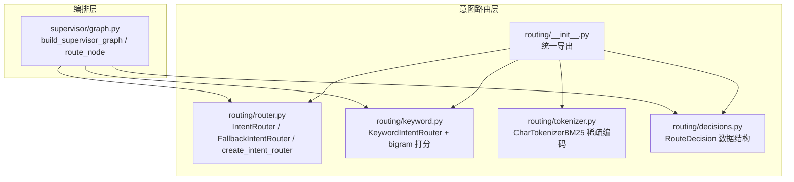
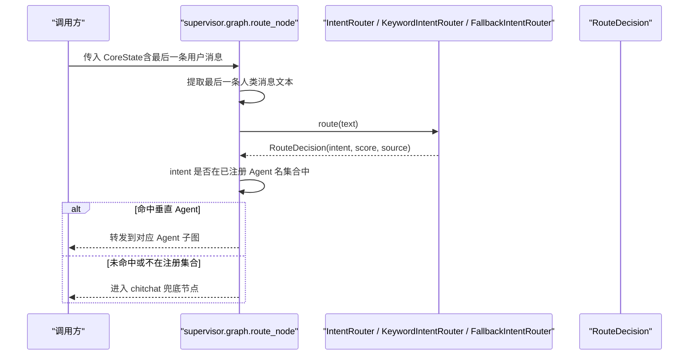
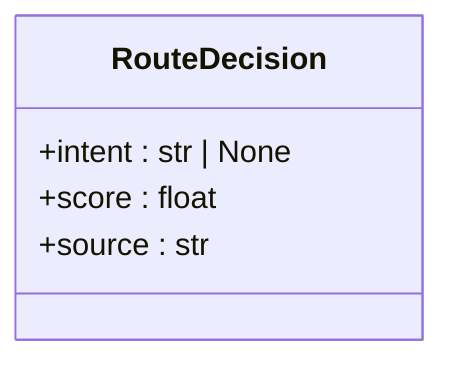
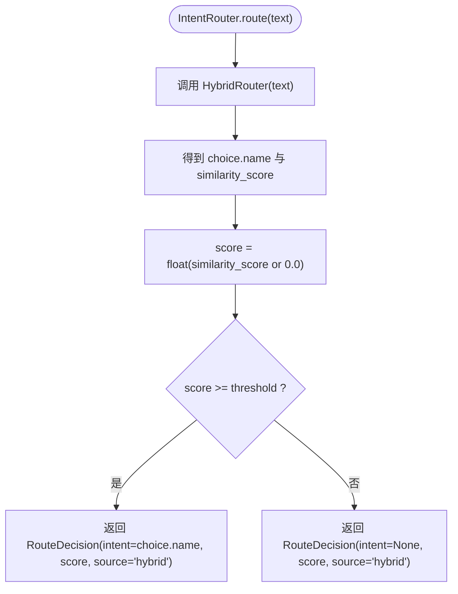
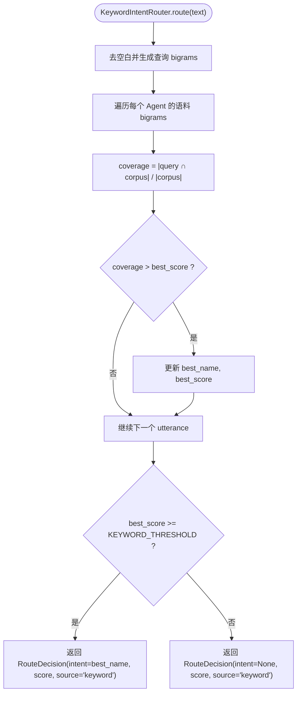
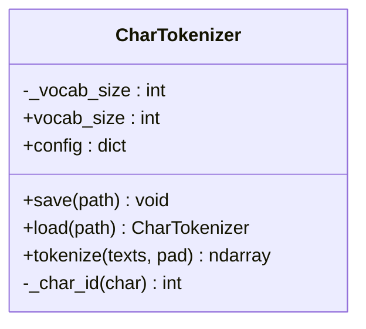
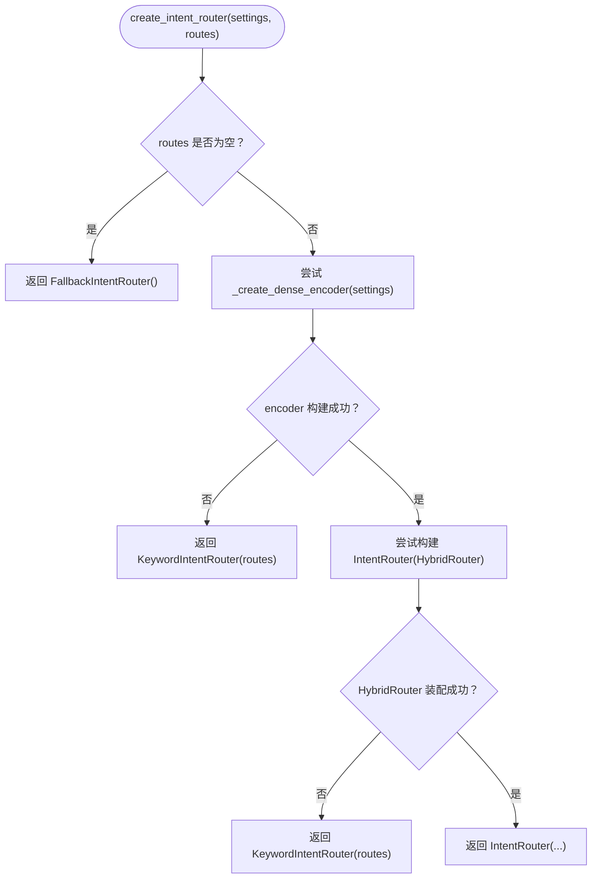
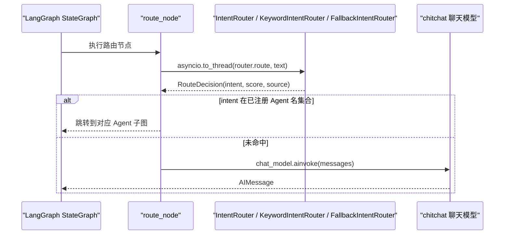
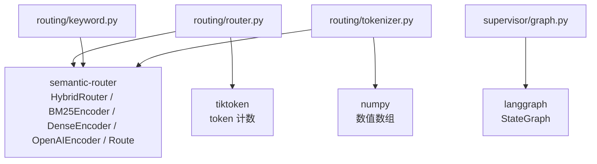

# 意图路由系统

<cite>
**本文引用的文件**   
- [routing/__init__.py](file://services/agent-core/src/po_agent_core/routing/__init__.py)
- [routing/router.py](file://services/agent-core/src/po_agent_core/routing/router.py)
- [routing/decisions.py](file://services/agent-core/src/po_agent_core/routing/decisions.py)
- [routing/keyword.py](file://services/agent-core/src/po_agent_core/routing/keyword.py)
- [routing/tokenizer.py](file://services/agent-core/src/po_agent_core/routing/tokenizer.py)
- [supervisor/graph.py](file://services/agent-core/src/po_agent_core/supervisor/graph.py)
- [tests/test_routing.py](file://services/agent-core/tests/test_routing.py)
- [tests/test_tokenizer.py](file://services/agent-core/tests/test_tokenizer.py)
</cite>

## 目录
1. [引言](#引言)
2. [项目结构](#项目结构)
3. [核心组件](#核心组件)
4. [架构总览](#架构总览)
5. [详细组件分析](#详细组件分析)
6. [依赖关系分析](#依赖关系分析)
7. [性能与可扩展性](#性能与可扩展性)
8. [配置与规则定义](#配置与规则定义)
9. [调试与排错](#调试与排错)
10. [结论](#结论)

## 引言
本技术文档聚焦 Layer1 意图路由子系统，说明其实现原理、评分与置信度机制、降级策略、文本分词与匹配算法，以及与上层编排器（supervisor）的协作方式。该子系统位于 agent-core 包中，负责将用户输入映射到垂直 Agent 或闲聊兜底路径，并在 embedding 不可用时自动降级为本地关键词路由，保证系统在任意配置下都有确定去向。

## 项目结构
意图路由相关代码集中在 `services/agent-core/src/po_agent_core/routing` 目录下，并与 supervisor 编排层通过统一协议交互：

**图表来源**
- [routing/__init__.py:1-30](file://services/agent-core/src/po_agent_core/routing/__init__.py#L1-L30)
- [routing/router.py:38-100](file://services/agent-core/src/po_agent_core/routing/router.py#L38-L100)
- [routing/keyword.py:30-74](file://services/agent-core/src/po_agent_core/routing/keyword.py#L30-L74)
- [routing/tokenizer.py:27-87](file://services/agent-core/src/po_agent_core/routing/tokenizer.py#L27-L87)
- [routing/decisions.py:12-25](file://services/agent-core/src/po_agent_core/routing/decisions.py#L12-L25)
- [supervisor/graph.py:56-113](file://services/agent-core/src/po_agent_core/supervisor/graph.py#L56-L113)

**章节来源**
- [routing/__init__.py:1-30](file://services/agent-core/src/po_agent_core/routing/__init__.py#L1-L30)
- [supervisor/graph.py:56-113](file://services/agent-core/src/po_agent_core/supervisor/graph.py#L56-L113)

## 核心组件
- RouteDecision：无依赖的数据结构，表示单次路由决策结果，包含目标意图、分数和来源。
- IntentRouter：基于 semantic-router 的 HybridRouter（稠密 embedding + BM25 稀疏）混合打分路由器。
- KeywordIntentRouter：本地关键词路由器，使用字符 bigram 覆盖率打分，作为 embedding 不可用时的降级方案。
- FallbackIntentRouter：末端兜底路由器，恒返回未命中，用于“无路由语料”场景。
- CharTokenizer：纯本地字符级 tokenizer，为 BM25Encoder 提供稳定、可复现的词表 id。
- create_intent_router：按配置与可用性选择具体路由器实现，并处理降级逻辑。

**章节来源**
- [routing/decisions.py:12-25](file://services/agent-core/src/po_agent_core/routing/decisions.py#L12-L25)
- [routing/router.py:38-100](file://services/agent-core/src/po_agent_core/routing/router.py#L38-L100)
- [routing/keyword.py:30-74](file://services/agent-core/src/po_agent_core/routing/keyword.py#L30-L74)
- [routing/tokenizer.py:27-87](file://services/agent-core/src/po_agent_core/routing/tokenizer.py#L27-L87)
- [routing/router.py:181-225](file://services/agent-core/src/po_agent_core/routing/router.py#L181-L225)

## 架构总览
Layer1 意图路由在三层决策架构中处于入口位置：用户消息进入 supervisor 的 route 节点后，调用路由器的 `route(text)`，根据返回的 `RouteDecision.intent` 决定走垂直 Agent 子图还是 chitchat 兜底。

**图表来源**
- [supervisor/graph.py:65-95](file://services/agent-core/src/po_agent_core/supervisor/graph.py#L65-L95)
- [routing/router.py:75-80](file://services/agent-core/src/po_agent_core/routing/router.py#L75-L80)
- [routing/keyword.py:60-73](file://services/agent-core/src/po_agent_core/routing/keyword.py#L60-L73)
- [routing/decisions.py:15-25](file://services/agent-core/src/po_agent_core/routing/decisions.py#L15-L25)

## 详细组件分析

### RouteDecision 数据结构与语义
RouteDecision 是路由层的统一输出契约，供 supervisor 和各降级路由器共享：
- intent：目标意图名称；None 表示未命中，由 supervisor 决定是否走 chitchat。
- score：路由分数，用于日志、定位“差一点命中”的查询以及阈值调优。
- source：来源标识，如 hybrid、keyword、fallback，便于排查降级原因。

**图表来源**
- [routing/decisions.py:15-25](file://services/agent-core/src/po_agent_core/routing/decisions.py#L15-L25)

**章节来源**
- [routing/decisions.py:12-25](file://services/agent-core/src/po_agent_core/routing/decisions.py#L12-L25)

### IntentRouter：混合语义路由器
IntentRouter 封装 semantic-router 的 HybridRouter，组合稠密 encoder（OpenAI 兼容接口）与稀疏 encoder（BM25 + CharTokenizer）。关键设计点：
- 同步调用：HybridRouter 内部会发起 embedding 网络请求，因此 IntentRouter 保持同步，宿主在 async 环境通过线程池调用，避免阻塞事件循环。
- 混合权重 alpha：默认偏向 BM25，使领域术语精确命中更稳定。
- 阈值策略：不在 HybridRouter 内部做 pass/fail，而是统一用 router_threshold 一刀切，低于阈值的视为未命中。
- 构建流程：从 settings 解析 embedding model、api_key、base_url，必要时回退 tiktoken 编码器以兼容非 OpenAI 模型名。

**图表来源**
- [routing/router.py:75-80](file://services/agent-core/src/po_agent_core/routing/router.py#L75-L80)

**章节来源**
- [routing/router.py:38-80](file://services/agent-core/src/po_agent_core/routing/router.py#L38-L80)
- [routing/router.py:102-167](file://services/agent-core/src/po_agent_core/routing/router.py#L102-L167)

### KeywordIntentRouter：本地关键词路由与 bigram 匹配
当 embedding 不可用或配置缺失时，系统降级到 KeywordIntentRouter：
- 分词策略：对文本去空白后滑窗生成相邻两字符 bigram 集合；单字文本返回空集，不会命中任何语料。
- 打分公式：覆盖率 = |查询 bigrams ∩ 语料 bigrams| / |语料 bigrams|，分母为语料而非查询，避免长查询稀释相似度。
- 阈值：KEYWORD_THRESHOLD 默认 0.2，经验值适合较短 utterance；高于阈值才认为命中。
- 构造期优化：一次性预计算每个 Route 的 utterances 的 bigram 列表，避免每次请求重复切分。

**图表来源**
- [routing/keyword.py:20-28](file://services/agent-core/src/po_agent_core/routing/keyword.py#L20-L28)
- [routing/keyword.py:60-73](file://services/agent-core/src/po_agent_core/routing/keyword.py#L60-L73)

**章节来源**
- [routing/keyword.py:1-74](file://services/agent-core/src/po_agent_core/routing/keyword.py#L1-L74)

### FallbackIntentRouter：末端兜底
当没有任何路由语料（无垂直 Agent）时，直接返回未命中，确保编排图在任何配置下都有确定去向：
- 行为：恒返回 intent=None、score=0.0、source="fallback"。
- 意义：不是识别能力，而是让 supervisor 始终能走到 chitchat 节点。

**章节来源**
- [routing/router.py:83-100](file://services/agent-core/src/po_agent_core/routing/router.py#L83-L100)

### CharTokenizer：字符级 BM25 稀疏编码
为 BM25Encoder 提供纯本地、确定性、稳定的字符 id 映射：
- 固定词表大小 vocab_size，id 范围 [1, vocab_size)，0 保留给 padding/unknown。
- 字符哈希：sha256 前 4 字节取模，保证跨进程、批次一致。
- tokenize 输出：(n_docs, max_len) 的 int64 矩阵，短文档右填充 0，空串至少占一列 0。
- save/load：仅保存 config（vocab_size），不存储词表，避免磁盘和网络依赖。

**图表来源**
- [routing/tokenizer.py:27-87](file://services/agent-core/src/po_agent_core/routing/tokenizer.py#L27-L87)

**章节来源**
- [routing/tokenizer.py:1-87](file://services/agent-core/src/po_agent_core/routing/tokenizer.py#L1-L87)

### create_intent_router：多策略路由组合与优先级排序
create_intent_router 负责按配置与可用性选择路由器实现，形成明确的降级链：
- 优先级顺序：
  1. 若 routes 为空：直接返回 FallbackIntentRouter。
  2. 否则尝试构建 DenseEncoder；失败则返回 KeywordIntentRouter。
  3. 成功构建 DenseEncoder 后尝试装配 HybridRouter；失败则返回 KeywordIntentRouter。
  4. 最终返回 IntentRouter（混合语义路由）。
- 权重与阈值：
  - alpha：混合权重，默认 0.3，偏向 BM25。
  - threshold：来自 settings.router_threshold，用于 HybridRouter 的统一阈值判断。
  - KEYWORD_THRESHOLD：独立于 router_threshold，适用于 bigram 覆盖率。
- 异步执行模型：
  - IntentRouter 同步调用，宿主通过 asyncio.to_thread 包裹，避免阻塞事件循环。
  - supervisor 的 route_node 使用线程池调用 router.route。

**图表来源**
- [routing/router.py:181-225](file://services/agent-core/src/po_agent_core/routing/router.py#L181-L225)

**章节来源**
- [routing/router.py:181-225](file://services/agent-core/src/po_agent_core/routing/router.py#L181-L225)

### supervisor 集成与异步执行
supervisor 的 build_supervisor_graph 将意图路由纳入 LangGraph 状态图：
- route_node：提取最后一条人类消息文本，调用 router.route，记录 intent、score、agent_name。
- chitchat_node：兜底聊天模型应答，确保所有未命中都走此节点。
- 条件边：若 intent 在已注册 Agent 名集合中，则委托到对应子图；否则进入 chitchat。
- 异步模型：route_node 使用 asyncio.to_thread 调用同步 router.route，避免阻塞事件循环。

**图表来源**
- [supervisor/graph.py:65-113](file://services/agent-core/src/po_agent_core/supervisor/graph.py#L65-L113)

**章节来源**
- [supervisor/graph.py:56-113](file://services/agent-core/src/po_agent_core/supervisor/graph.py#L56-L113)

## 依赖关系分析
意图路由层与外部依赖的关系如下：
- semantic-router：提供 HybridRouter、BM25Encoder、DenseEncoder、OpenAIEncoder、Route。
- tiktoken：用于 OpenAIEncoder 的 token 计数，存在非 OpenAI 模型名兼容问题，代码做了 fallback。
- numpy：CharTokenizer 输出矩阵类型。
- langgraph：supervisor 使用 StateGraph 构建编排图。

**图表来源**
- [routing/router.py:23-33](file://services/agent-core/src/po_agent_core/routing/router.py#L23-L33)
- [routing/tokenizer.py:20-23](file://services/agent-core/src/po_agent_core/routing/tokenizer.py#L20-L23)
- [supervisor/graph.py:1-10](file://services/agent-core/src/po_agent_core/supervisor/graph.py#L1-L10)

**章节来源**
- [routing/router.py:23-33](file://services/agent-core/src/po_agent_core/routing/router.py#L23-L33)
- [routing/tokenizer.py:20-23](file://services/agent-core/src/po_agent_core/routing/tokenizer.py#L20-L23)
- [supervisor/graph.py:1-10](file://services/agent-core/src/po_agent_core/supervisor/graph.py#L1-L10)

## 性能与可扩展性
- 混合权重 alpha：默认 0.3 偏向 BM25，提升领域术语稳定性；可根据业务调整以平衡语义泛化与精确匹配。
- 阈值策略：router_threshold 控制 HybridRouter 的 pass/fail；KEYWORD_THRESHOLD 控制 bigram 覆盖率阈值；两者量纲不同，不应混用。
- 本地缓存：KeywordIntentRouter 在构造期预计算 bigram 列表，避免每次请求重复切分；CharTokenizer 仅保存 config，无需持久化词表。
- 异步模型：IntentRouter 同步调用，宿主通过 asyncio.to_thread 承载，避免阻塞事件循环；supervisor 的 route_node 同样采用线程池调用。
- 批量处理：当前路由为逐条文本处理；如需批量，可在宿主侧并行调用多个 router.route，但需注意 embedding 并发限制与资源占用。
- 可扩展点：
  - 自定义 DenseEncoder：测试中使用 BagOfCharsEncoder 验证离线行为；生产可替换为其他 OpenAI 兼容 embedding。
  - 自定义 Tokenizer：CharTokenizer 可调整 vocab_size 以平衡冲突概率与内存占用。
  - 多策略组合：可在 create_intent_router 基础上扩展更多降级策略（如正则匹配、模糊匹配），但仍需返回 RouteDecision。

[本节为通用性能讨论，不直接分析具体文件]

## 配置与规则定义
- 路由规则来源：
  - 从 VerticalAgent 插槽派生：routes_from_agents 将 agent.name 与 agent.utterances 转为 Route。
  - utterances 为空的 Agent 不参与意图路由。
- 阈值配置：
  - router_threshold：来自 settings，用于 HybridRouter 的统一阈值判断。
  - KEYWORD_THRESHOLD：bigram 覆盖率阈值，默认 0.2。
- 嵌入配置：
  - embedding_model、embedding_api_key、embedding_base_url：优先使用；若缺失则回退 llm_* 配置。
  - llm_provider：用于 PROVIDER_PRESETS 获取默认 embedding_model 与 base_url。
- 正则表达式与模糊匹配：
  - 当前实现未提供正则表达式匹配或显式模糊匹配算法；主要依赖 BM25 与 bigram 覆盖率。
  - 若需引入正则或编辑距离等模糊匹配，可在 create_intent_router 扩展新的降级策略，并返回 RouteDecision。

**章节来源**
- [routing/router.py:169-178](file://services/agent-core/src/po_agent_core/routing/router.py#L169-L178)
- [routing/keyword.py:15-17](file://services/agent-core/src/po_agent_core/routing/keyword.py#L15-L17)
- [routing/router.py:102-167](file://services/agent-core/src/po_agent_core/routing/router.py#L102-L167)

## 调试与排错
- 日志与来源字段：
  - RouteDecision.source 标识 hybrid、keyword、fallback，便于排查降级原因。
  - supervisor 的 route_node 记录 text、intent、score，便于定位“差一点命中”的查询。
- 常见错误：
  - embedding 配置缺失：_create_dense_encoder 抛出 AgentCoreConfigError，create_intent_router 捕获并降级为 KeywordIntentRouter。
  - 非 OpenAI 模型名导致 KeyError：_openai_encoder_with_tokenizer_fallback 回退到通用编码 cl100k_base。
  - HybridRouter 装配失败：create_intent_router 捕获异常并降级为 KeywordIntentRouter。
- 测试用例参考：
  - test_routing.py 覆盖混合路由、降级、阈值、routes_from_agents 等行为。
  - test_tokenizer.py 覆盖 CharTokenizer 的分片形状、填充、确定性、保存加载等。

**章节来源**
- [routing/router.py:102-167](file://services/agent-core/src/po_agent_core/routing/router.py#L102-L167)
- [routing/router.py:181-225](file://services/agent-core/src/po_agent_core/routing/router.py#L181-L225)
- [tests/test_routing.py:1-210](file://services/agent-core/tests/test_routing.py#L1-L210)
- [tests/test_tokenizer.py:1-64](file://services/agent-core/tests/test_tokenizer.py#L1-L64)

## 结论
意图路由系统通过 Layer1 的混合语义路由与本地关键词降级，保证了在不同配置与网络环境下都能稳定地将用户输入路由到垂直 Agent 或 chitchat 兜底。RouteDecision 提供了统一的决策契约，supervisor 通过异步线程池调用路由，避免阻塞事件循环。CharTokenizer 与 BM25 稀疏编码确保了中文场景下的稳定与可复现。未来可在 create_intent_router 中扩展更多策略（正则、模糊匹配），并持续调优 alpha 与阈值以提升准确率与召回率。