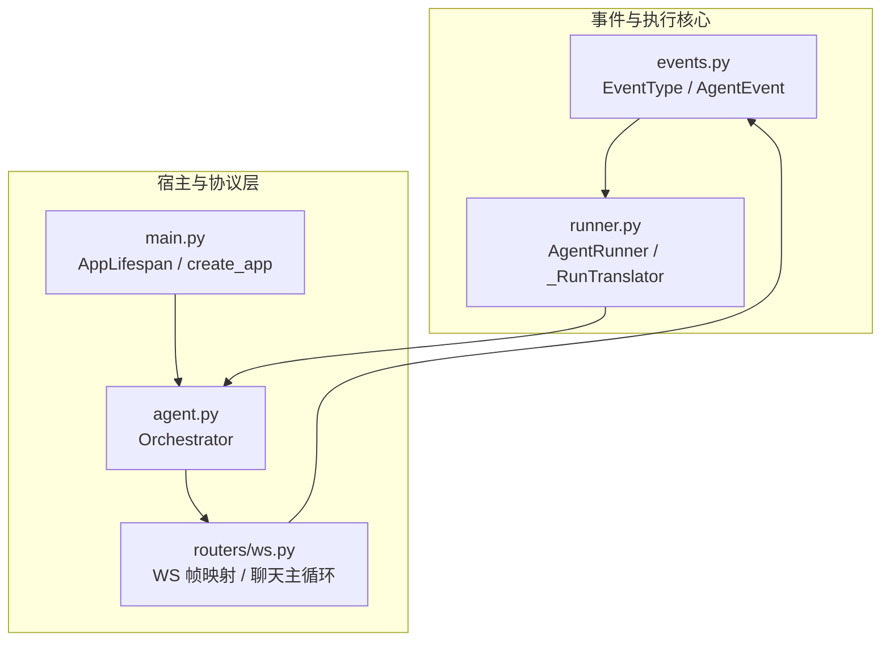
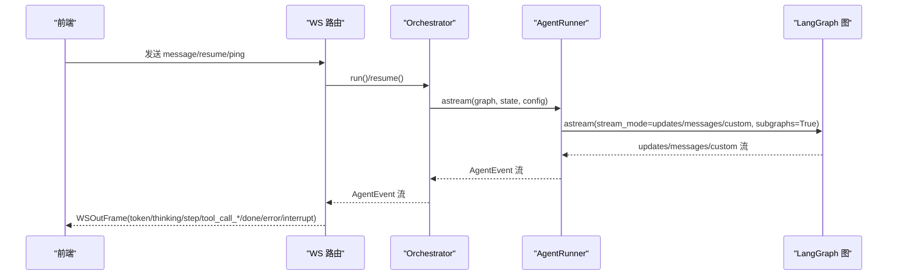
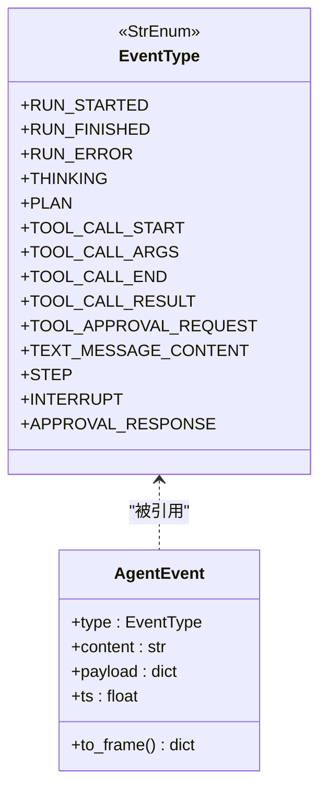
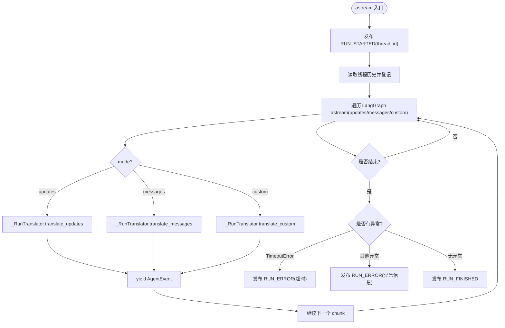
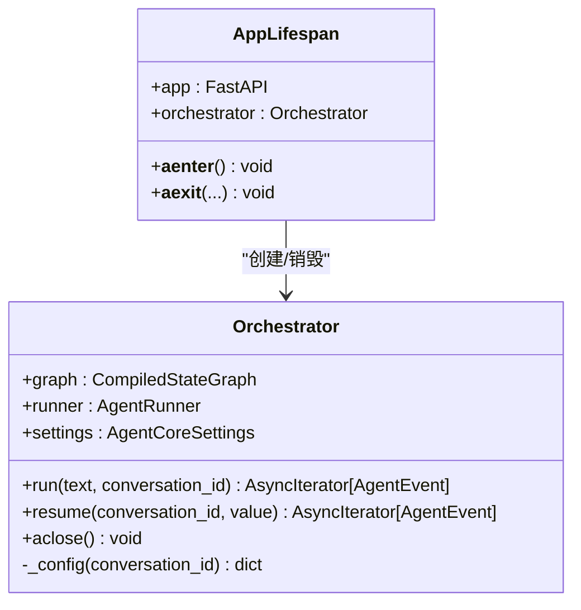
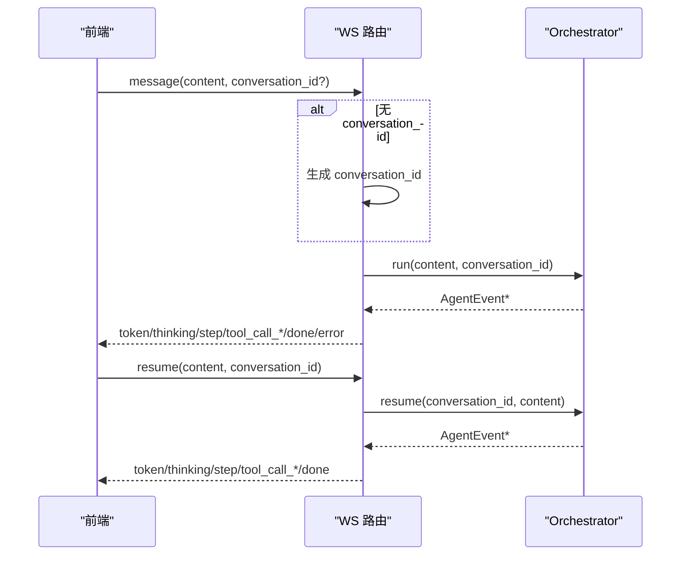
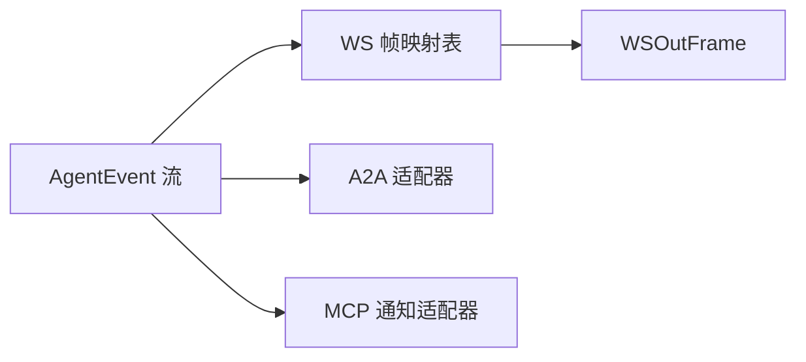
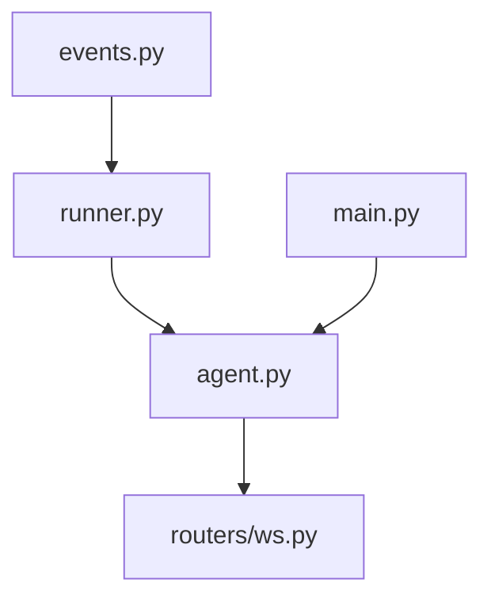

# 执行器与事件系统

<cite>
**本文引用的文件**   
- [services/agent-core/src/po_agent_core/events.py](file://services/agent-core/src/po_agent_core/events.py)
- [services/agent-core/src/po_agent_core/runner/runner.py](file://services/agent-core/src/po_agent_core/runner/runner.py)
- [services/chat/app/agent.py](file://services/chat/app/agent.py)
- [services/chat/app/main.py](file://services/chat/app/main.py)
- [services/chat/app/routers/ws.py](file://services/chat/app/routers/ws.py)
- [services/agent-core/tests/test_runner.py](file://services/agent-core/tests/test_runner.py)
- [services/chat/tests/test_ws.py](file://services/chat/tests/test_ws.py)
</cite>

## 目录
1. [引言](#引言)
2. [项目结构](#项目结构)
3. [核心组件](#核心组件)
4. [架构总览](#架构总览)
5. [详细组件分析](#详细组件分析)
6. [依赖关系分析](#依赖关系分析)
7. [性能与并发特性](#性能与并发特性)
8. [故障排查指南](#故障排查指南)
9. [结论](#结论)
10. [附录：配置、日志与调试](#附录配置日志与调试)

## 引言
本文件系统化梳理“执行器与事件系统”的设计与实现，覆盖异步执行模型、任务调度机制、并发控制策略；事件驱动架构、事件类型定义、监听器模式；执行上下文管理、资源分配、超时处理；事件流处理、错误恢复、重试机制；并提供事件订阅示例、自定义事件处理、性能监控建议、执行器配置选项、日志记录与调试工具说明。

该系统的核心思想是：以统一的 AgentEvent 事件流作为“唯一真相”，由执行器将 LangGraph 的底层运行流翻译为统一事件，再由宿主（WebSocket/A2A/MCP）按需转发或转换，从而屏蔽传输协议差异，保证编排层与传输层解耦。

## 项目结构
围绕执行器与事件系统的关键代码分布在以下模块：
- 事件契约与数据模型：po_agent_core.events
- 执行器与流式翻译：po_agent_core.runner.runner
- 宿主装配与生命周期：chat.app.agent.Orchestrator、chat.app.main.AppLifespan
- WebSocket 协议桥接：chat.app.routers.ws
- 行为验证与用例：agent-core 测试、chat WS 测试

**图表来源**
- [services/agent-core/src/po_agent_core/events.py:17-76](file://services/agent-core/src/po_agent_core/events.py#L17-L76)
- [services/agent-core/src/po_agent_core/runner/runner.py:60-324](file://services/agent-core/src/po_agent_core/runner/runner.py#L60-L324)
- [services/chat/app/agent.py:112-176](file://services/chat/app/agent.py#L112-L176)
- [services/chat/app/main.py:24-71](file://services/chat/app/main.py#L24-L71)
- [services/chat/app/routers/ws.py:67-188](file://services/chat/app/routers/ws.py#L67-L188)

**章节来源**
- [services/agent-core/src/po_agent_core/events.py:1-76](file://services/agent-core/src/po_agent_core/events.py#L1-L76)
- [services/agent-core/src/po_agent_core/runner/runner.py:1-43](file://services/agent-core/src/po_agent_core/runner/runner.py#L1-L43)
- [services/chat/app/agent.py:1-32](file://services/chat/app/agent.py#L1-L32)
- [services/chat/app/main.py:1-14](file://services/chat/app/main.py#L1-L14)
- [services/chat/app/routers/ws.py:1-49](file://services/chat/app/routers/ws.py#L1-L49)

## 核心组件
- EventType：统一事件类型枚举，值即对外协议字符串，涵盖生命周期、思考、工具调用、输出、阶段进度与控制类事件。
- AgentEvent：单条事件的不可变数据结构，包含 type/content/payload/ts，并支持 to_frame() 直接序列化。
- _RunTranslator：单次运行的流翻译状态机，负责去重、中断、工具调用、消息增量、自定义事件等。
- AgentRunner：编排运行器，封装 LangGraph astream，提供超时治理、异常转事件、续接线程历史登记。
- Orchestrator：宿主持有的编排入口，持有 graph、runner、checkpointer 生命周期，暴露 run/resume/aclose。
- AppLifespan：FastAPI 生命周期，启动时装配 Orchestrator，关闭时释放外部连接。
- WS 路由：WebSocket 端点，维护入站帧校验、心跳、interrupt/resume 流程，并将 AgentEvent 映射为 WSOutFrame。

**章节来源**
- [services/agent-core/src/po_agent_core/events.py:17-76](file://services/agent-core/src/po_agent_core/events.py#L17-L76)
- [services/agent-core/src/po_agent_core/runner/runner.py:60-324](file://services/agent-core/src/po_agent_core/runner/runner.py#L60-L324)
- [services/chat/app/agent.py:112-176](file://services/chat/app/agent.py#L112-L176)
- [services/chat/app/main.py:24-71](file://services/chat/app/main.py#L24-L71)
- [services/chat/app/routers/ws.py:67-188](file://services/chat/app/routers/ws.py#L67-L188)

## 架构总览
下图展示从前端到后端的事件流与执行路径：前端通过 WebSocket 发送 message/resume/ping，服务端 Orchestrator 调用 AgentRunner 驱动 LangGraph，Runner 产出统一 AgentEvent，WS 路由将其转换为 WSOutFrame 回传。

**图表来源**
- [services/chat/app/routers/ws.py:131-188](file://services/chat/app/routers/ws.py#L131-L188)
- [services/chat/app/agent.py:139-165](file://services/chat/app/agent.py#L139-L165)
- [services/agent-core/src/po_agent_core/runner/runner.py:261-324](file://services/agent-core/src/po_agent_core/runner/runner.py#L261-L324)

## 详细组件分析

### 事件类型与数据模型
- EventType 定义了五组事件：lifecycle（run_started/run_finished/run_error）、thinking（thinking/plan）、tool（tool_call_start/args/end/result/approval_request）、output（text_message_content）、control（interrupt/approval_response），以及 STEP 节点级进度。
- AgentEvent 是统一事件载体，to_frame() 可直接用于 JSON 序列化，供下游协议复用。

**图表来源**
- [services/agent-core/src/po_agent_core/events.py:17-76](file://services/agent-core/src/po_agent_core/events.py#L17-L76)

**章节来源**
- [services/agent-core/src/po_agent_core/events.py:1-76](file://services/agent-core/src/po_agent_core/events.py#L1-L76)

### 执行器与流式翻译
- AgentRunner.astream 负责：
  - 发布 RUN_STARTED，携带 thread_id（conversation_id）。
  - 使用 asyncio.timeout 进行整次运行超时控制，超时后发布 RUN_ERROR 并终止。
  - 读取线程既有消息（_thread_messages），登记历史以避免重复下发。
  - 以 stream_mode=["updates","messages","custom"] 和 subgraphs=True 驱动 LangGraph，按 mode 分发到 _RunTranslator 的不同翻译方法。
  - 捕获 TimeoutError/CancelledError/Exception，分别转为 RUN_ERROR 或原样上抛。
  - 正常结束时发布 RUN_FINISHED。
- _RunTranslator 负责：
  - updates：对每个有更新的节点发 STEP；对 ToolMessage 发 TOOL_CALL_END/RESULT；对 AIMessage 补发未流式的文本与工具调用；对 __interrupt__ 发 INTERRUPT。
  - messages：AIMessageChunk 增量文本 TEXT_MESSAGE_CONTENT；tool_call_chunks 触发 TOOL_CALL_START/ARGS。
  - custom：领域侧 get_stream_writer 发布的自定义事件，若 type 合法则透传，否则包成 STEP。
  - 去重策略：按 message.id 优先，其次内容哈希，最后对象身份；工具调用按 call_id 去重；中断按 interrupt.id 去重。

**图表来源**
- [services/agent-core/src/po_agent_core/runner/runner.py:261-324](file://services/agent-core/src/po_agent_core/runner/runner.py#L261-L324)
- [services/agent-core/src/po_agent_core/runner/runner.py:83-246](file://services/agent-core/src/po_agent_core/runner/runner.py#L83-L246)

**章节来源**
- [services/agent-core/src/po_agent_core/runner/runner.py:60-324](file://services/agent-core/src/po_agent_core/runner/runner.py#L60-L324)

### 宿主编排与生命周期
- Orchestrator：
  - run(text, conversation_id)：构造 state={"messages":[HumanMessage]}，调用 runner.astream(graph, state, config)，configurable.thread_id=conversation_id。
  - resume(conversation_id, value)：使用 Command(resume=value) 续跑挂起线程。
  - aclose()：释放 checkpointer 外部连接。
- AppLifespan：
  - 启动时 build_orchestrator() 写入 app.state.orchestrator。
  - 关闭时 orchestrator.aclose()。
- build_orchestrator：
  - LLM 缺失 → EchoChatModel 降级。
  - checkpointer 失败 → memory 降级。
  - 垂直 Agent 装配失败 → 跳过插槽。
  - 意图路由 embedding 失败 → 本地关键词路由。
  - 组装 supervisor graph、runner(settings.run_timeout_seconds)。

**图表来源**
- [services/chat/app/agent.py:112-176](file://services/chat/app/agent.py#L112-L176)
- [services/chat/app/main.py:24-71](file://services/chat/app/main.py#L24-L71)

**章节来源**
- [services/chat/app/agent.py:112-280](file://services/chat/app/agent.py#L112-L280)
- [services/chat/app/main.py:24-71](file://services/chat/app/main.py#L24-L71)

### WebSocket 协议桥接
- WS 路由维护 _EVENT_TO_FRAME 映射表，将 EventType 映射为 WSOutFrame.type。
- chat() 主循环：
  - 接收 WSInFrame，校验失败返回 error 帧。
  - ping → pong。
  - resume：必须带 conversation_id，否则返回 error。
  - message：若无 conversation_id 则服务端生成，随 run_started.payload.thread_id 返回给前端保存。
  - 串行 await 发送事件，确保同一 socket 不并发写。

**图表来源**
- [services/chat/app/routers/ws.py:67-188](file://services/chat/app/routers/ws.py#L67-L188)
- [services/chat/app/agent.py:139-165](file://services/chat/app/agent.py#L139-L165)

**章节来源**
- [services/chat/app/routers/ws.py:1-188](file://services/chat/app/routers/ws.py#L1-L188)

### 事件驱动架构与监听器模式
- 事件驱动：所有下游消费方（WS/A2A/MCP）都基于统一的 AgentEvent 流进行适配，无需感知具体传输协议。
- 监听器模式：宿主在 WS 路由中注册事件→帧映射表，新增事件只需扩展映射表，而不改动 Runner 内部逻辑。

**图表来源**
- [services/chat/app/routers/ws.py:67-83](file://services/chat/app/routers/ws.py#L67-L83)

**章节来源**
- [services/chat/app/routers/ws.py:67-83](file://services/chat/app/routers/ws.py#L67-L83)

## 依赖关系分析
- events.py 被 runner.py 引用，定义统一事件契约。
- runner.py 被 agent.py 的 Orchestrator 使用，作为执行器。
- agent.py 被 main.py 的 lifespan 装配，并在 WS 路由中被消费。
- ws.py 消费 Orchestrator 产出的 AgentEvent 流，并映射为 WSOutFrame。

**图表来源**
- [services/agent-core/src/po_agent_core/events.py:17-76](file://services/agent-core/src/po_agent_core/events.py#L17-L76)
- [services/agent-core/src/po_agent_core/runner/runner.py:57-58](file://services/agent-core/src/po_agent_core/runner/runner.py#L57-L58)
- [services/chat/app/agent.py:48-60](file://services/chat/app/agent.py#L48-L60)
- [services/chat/app/routers/ws.py:59-61](file://services/chat/app/routers/ws.py#L59-L61)
- [services/chat/app/main.py:19-21](file://services/chat/app/main.py#L19-L21)

**章节来源**
- [services/agent-core/src/po_agent_core/events.py:17-76](file://services/agent-core/src/po_agent_core/events.py#L17-L76)
- [services/agent-core/src/po_agent_core/runner/runner.py:57-58](file://services/agent-core/src/po_agent_core/runner/runner.py#L57-L58)
- [services/chat/app/agent.py:48-60](file://services/chat/app/agent.py#L48-L60)
- [services/chat/app/routers/ws.py:59-61](file://services/chat/app/routers/ws.py#L59-L61)
- [services/chat/app/main.py:19-21](file://services/chat/app/main.py#L19-L21)

## 性能与并发特性
- 异步执行模型：
  - AgentRunner.astream 全程 async，使用 asyncio.timeout 控制整次运行超时。
  - LangGraph astream 以 updates/messages/custom 三种模式并行产出，Runner 顺序 yield 事件。
- 任务调度机制：
  - 通过 LangGraph 的 CompiledStateGraph 驱动，支持子图（subgraphs=True）上浮事件，便于垂直 Agent 内部节点可见。
- 并发控制策略：
  - WS 路由在同一 socket 上串行发送事件，避免并发写冲突。
  - 去重策略减少重复事件：message id、内容哈希、工具调用 id、中断 id。
- 资源分配：
  - Orchestrator.aclose 释放 checkpointer 外部连接，避免资源泄漏。
- 超时与取消：
  - TimeoutError 转为 RUN_ERROR；CancelledError 原样上抛，允许 WS 断连场景真正终止任务。

**章节来源**
- [services/agent-core/src/po_agent_core/runner/runner.py:261-324](file://services/agent-core/src/po_agent_core/runner/runner.py#L261-L324)
- [services/chat/app/routers/ws.py:177-188](file://services/chat/app/routers/ws.py#L177-L188)
- [services/chat/app/agent.py:167-176](file://services/chat/app/agent.py#L167-L176)

## 故障排查指南
- 常见事件序列问题：
  - 若出现重复文本或工具调用，检查 _RunTranslator 的去重键是否正确（message.id 是否存在）。
  - 若中断后 resume 结果混入上一轮，确认前端是否在收到 done 后再发送 resume。
- 超时与异常：
  - 超时：RUN_ERROR 的 payload.error_type 为 TimeoutError，payload.timeout_seconds 为设置值。
  - 节点异常：RUN_ERROR 的 payload.error_type 为异常类名，content 为异常消息。
- WS 协议问题：
  - invalid frame：WSInFrame 校验失败，需检查入站帧结构。
  - resume 需要 conversation_id：resume 帧缺少会话标识，无法定位挂起线程。
- 记忆与续接：
  - 若多轮对话丢失上下文，确认 conversation_id 是否一致，且 checkpointer 可用。

**章节来源**
- [services/agent-core/tests/test_runner.py:352-375](file://services/agent-core/tests/test_runner.py#L352-L375)
- [services/chat/tests/test_ws.py:181-205](file://services/chat/tests/test_ws.py#L181-L205)
- [services/chat/app/routers/ws.py:145-168](file://services/chat/app/routers/ws.py#L145-L168)

## 结论
该系统通过统一事件契约与执行器抽象，实现了可插拔的编排能力与多协议适配。AgentRunner 提供稳定的超时治理与异常转事件语义，WS 路由提供清晰的帧映射与中断/恢复流程。整体设计强调解耦、降级与可观测性，适合在生产环境中稳定运行。

## 附录：配置、日志与调试
- 执行器配置选项：
  - timeout_seconds：AgentRunner 构造函数参数，默认 300.0，单位秒。
  - settings.run_timeout_seconds：Orchestrator 构建时传入，决定每次 run 的超时。
- 日志记录：
  - Orchestrator 构建完成后记录 checkpointer/model/agents 信息。
  - checkpointer 初始化失败时记录降级为 memory 的警告。
  - WS 路由对异常进行 logger.exception 记录。
- 调试工具：
  - 使用 test_runner.py 中的 collect/types_of 辅助函数收集事件并检查类型序列。
  - 使用 test_ws.py 中的 TestClient 模拟 WS 客户端，验证中断/恢复流程。
- 自定义事件处理：
  - 在 LangGraph 节点中使用 langgraph.config.get_stream_writer 发布自定义事件，若 type 合法则透传，否则包装为 STEP。
- 事件订阅示例：
  - WS 路由通过 _EVENT_TO_FRAME 映射订阅 EventType，新增事件只需扩展映射表。
- 性能监控建议：
  - 基于 AgentEvent.ts 时间戳统计端到端延迟。
  - 统计各 EventType 频次，识别热点节点与工具调用瓶颈。
  - 监控 RUN_ERROR 比例与原因分布，定位不稳定环节。

**章节来源**
- [services/agent-core/src/po_agent_core/runner/runner.py:256-259](file://services/agent-core/src/po_agent_core/runner/runner.py#L256-L259)
- [services/chat/app/agent.py:272-279](file://services/chat/app/agent.py#L272-L279)
- [services/chat/app/agent.py:198-207](file://services/chat/app/agent.py#L198-L207)
- [services/chat/app/routers/ws.py:184-188](file://services/chat/app/routers/ws.py#L184-L188)
- [services/agent-core/tests/test_runner.py:34-39](file://services/agent-core/tests/test_runner.py#L34-L39)
- [services/chat/tests/test_ws.py:181-205](file://services/chat/tests/test_ws.py#L181-L205)
- [services/agent-core/src/po_agent_core/runner/runner.py:228-246](file://services/agent-core/src/po_agent_core/runner/runner.py#L228-L246)
- [services/chat/app/routers/ws.py:67-83](file://services/chat/app/routers/ws.py#L67-L83)