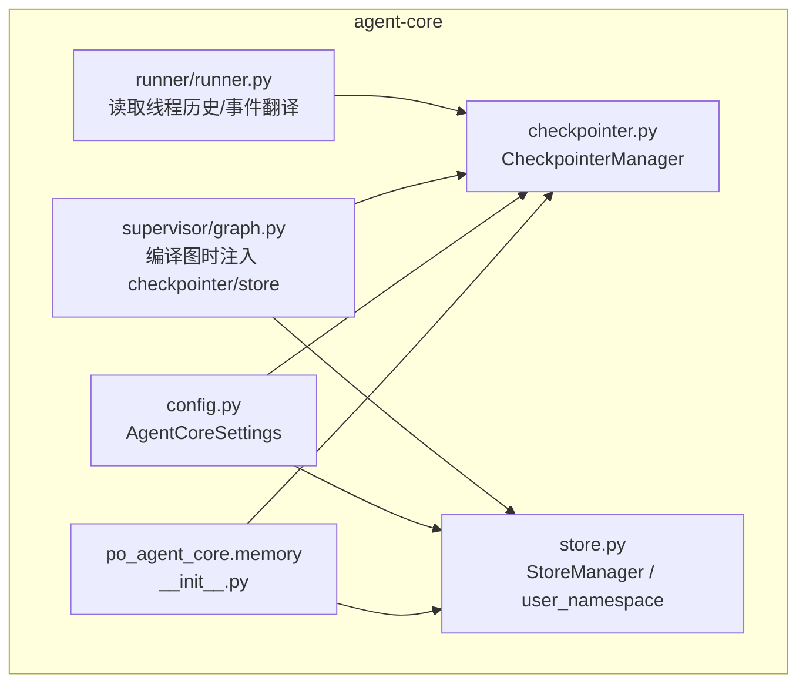
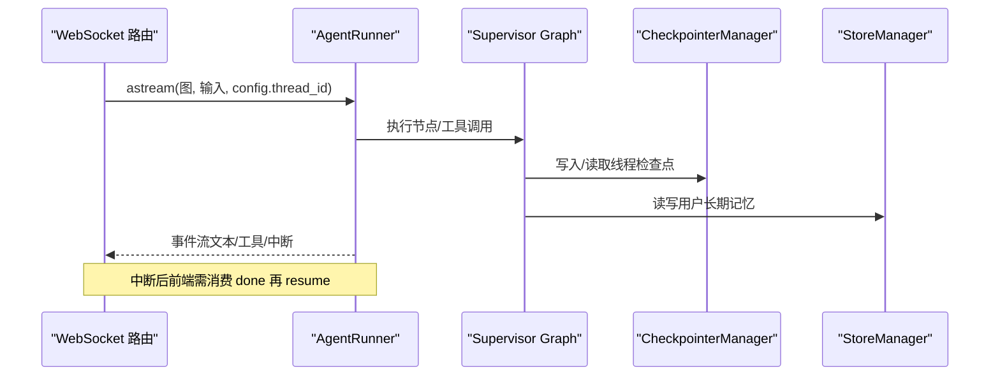
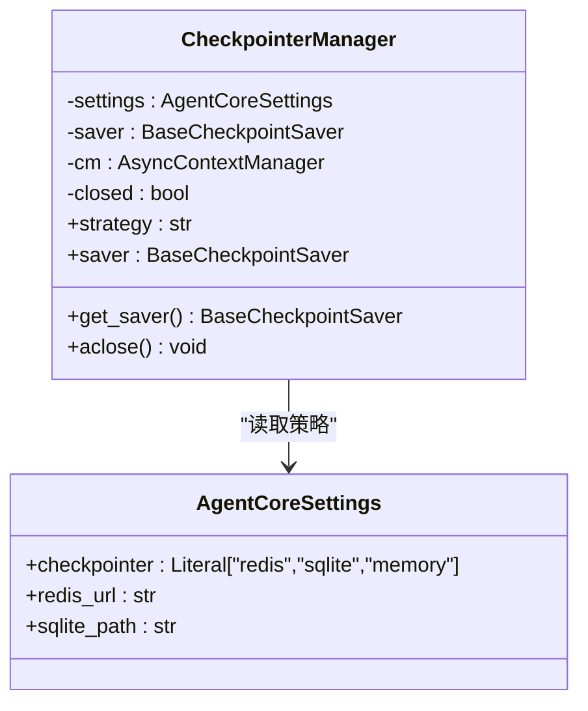
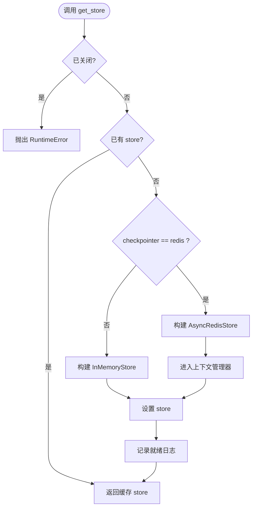
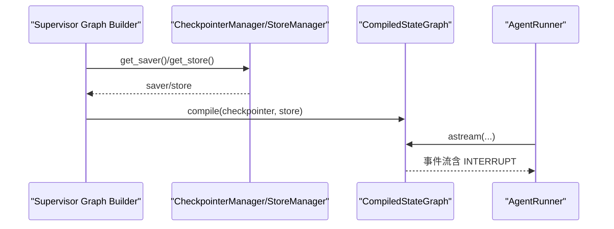
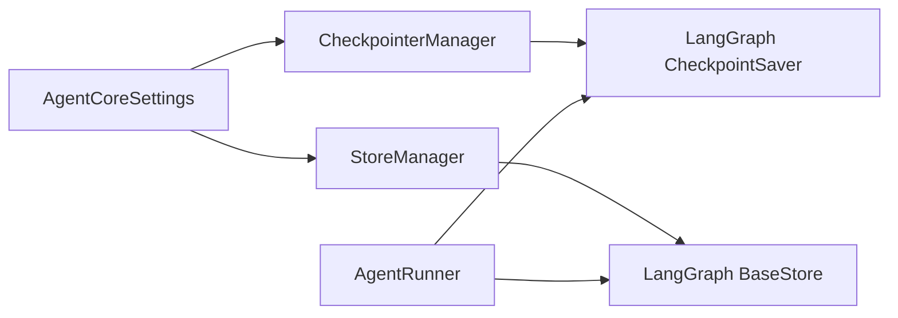
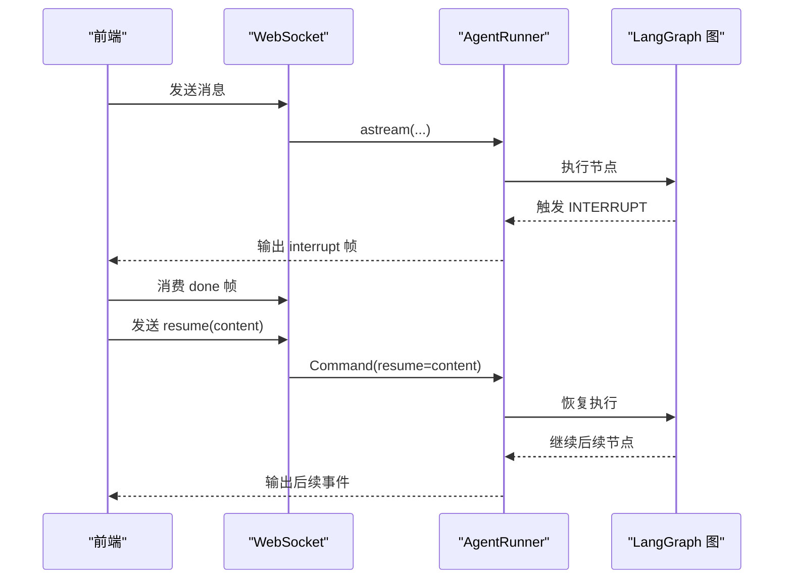

# 记忆系统

<cite>
**本文引用的文件**   
- [memory/__init__.py](file://services/agent-core/src/po_agent_core/memory/__init__.py)
- [checkpointer.py](file://services/agent-core/src/po_agent_core/memory/checkpointer.py)
- [store.py](file://services/agent-core/src/po_agent_core/memory/store.py)
- [config.py](file://services/agent-core/src/po_agent_core/config.py)
- [supervisor/graph.py](file://services/agent-core/src/po_agent_core/supervisor/graph.py)
- [runner/runner.py](file://services/agent-core/src/po_agent_core/runner/runner.py)
- [ws.py](file://services/chat/app/routers/ws.py)
- [test_checkpointer.py](file://services/agent-core/tests/test_checkpointer.py)
- [test_store.py](file://services/agent-core/tests/test_store.py)
</cite>

## 目录
1. [引言](#引言)
2. [项目结构](#项目结构)
3. [核心组件](#核心组件)
4. [架构总览](#架构总览)
5. [详细组件分析](#详细组件分析)
6. [依赖关系分析](#依赖关系分析)
7. [性能与内存管理](#性能与内存管理)
8. [CRUD 操作示例](#crud-操作示例)
9. [错误处理与中断恢复](#错误处理与中断恢复)
10. [数据迁移方案](#数据迁移方案)
11. [结论](#结论)

## 引言
本技术文档聚焦 agent-core 中的记忆子系统，目标是帮助开发者理解短期记忆与长期记忆的边界、使用场景、线程安全设计、中断恢复机制，以及与 LangGraph CheckpointSaver 和 Store 的集成方式。短期记忆由 checkpointer 提供，用于保存线程内的消息状态，支撑多轮对话与 interrupt 恢复；长期记忆由 store 提供，按用户命名空间隔离跨会话的用户偏好、人设等数据。两者均采用延迟初始化 + 显式关闭的生命周期管理，避免连接泄漏，并支持 redis/sqlite/memory 多种后端策略。

## 项目结构
记忆子系统位于 `services/agent-core/src/po_agent_core/memory`，对外暴露三个关键符号：`CheckpointerManager`、`StoreManager`、`user_namespace`。配置集中在 `AgentCoreSettings`，通过环境变量前缀 `AGENT_CORE_` 注入。

**图表来源**
- [memory/__init__.py:1-12](file://services/agent-core/src/po_agent_core/memory/__init__.py#L1-L12)
- [checkpointer.py:49-115](file://services/agent-core/src/po_agent_core/memory/checkpointer.py#L49-L115)
- [store.py:25-84](file://services/agent-core/src/po_agent_core/memory/store.py#L25-L84)
- [config.py:97-100](file://services/agent-core/src/po_agent_core/config.py#L97-L100)
- [supervisor/graph.py:128-141](file://services/agent-core/src/po_agent_core/supervisor/graph.py#L128-L141)
- [runner/runner.py:327-344](file://services/agent-core/src/po_agent_core/runner/runner.py#L327-L344)

**章节来源**
- [memory/__init__.py:1-12](file://services/agent-core/src/po_agent_core/memory/__init__.py#L1-L12)
- [config.py:97-100](file://services/agent-core/src/po_agent_core/config.py#L97-L100)

## 核心组件
- **CheckpointerManager**：短期记忆管理器，封装 LangGraph CheckpointSaver 生命周期，支持 memory/sqlite/redis 三种策略，延迟初始化、幂等获取、显式关闭。
- **StoreManager**：长期记忆管理器，封装 LangGraph BaseStore，默认复用 checkpointer 的策略选择（redis 走持久化，其余走进程内），同样延迟初始化 + 显式关闭。
- **user_namespace**：统一构造长期记忆命名空间 `("users", user_id)`，保证不同入口对同一用户的记忆视图一致。

**章节来源**
- [checkpointer.py:49-115](file://services/agent-core/src/po_agent_core/memory/checkpointer.py#L49-L115)
- [store.py:25-84](file://services/agent-core/src/po_agent_core/memory/store.py#L25-L84)

## 架构总览
记忆子系统在 LangGraph 编排层被注入到 supervisor graph 中：checkpointer 作为线程状态检查点，store 作为用户级长期记忆。Runner 负责将图事件翻译为统一事件流，并在续接线程时读取既有消息以避免重复下发。

**图表来源**
- [ws.py:30-48](file://services/chat/app/routers/ws.py#L30-L48)
- [runner/runner.py:327-344](file://services/agent-core/src/po_agent_core/runner/runner.py#L327-L344)
- [supervisor/graph.py:128-141](file://services/agent-core/src/po_agent_core/supervisor/graph.py#L128-L141)

## 详细组件分析

### CheckpointerManager（短期记忆）
- 职责：根据 `AgentCoreSettings.checkpointer` 选择后端，首次调用 `get_saver()` 建立连接并执行 schema 初始化；重复调用返回同一实例；`aclose()` 释放连接且幂等。
- 策略：
  - memory：进程内存储，无需连接，适合测试与降级。
  - sqlite：单机演示，文件句柄由上下文管理器管理。
  - redis：生产默认，异步 Redis Saver。
- 线程安全：LangGraph 内部基于 thread_id 隔离检查点；管理器本身不持有并发锁，但通过延迟初始化与单例缓存避免重复创建。
- 与 LangGraph 集成：通过 `builder.compile(checkpointer=...)` 注入；若 saver 暴露 `setup`，则自动调用以完成 schema 初始化。

**图表来源**
- [checkpointer.py:49-115](file://services/agent-core/src/po_agent_core/memory/checkpointer.py#L49-L115)
- [config.py:97-100](file://services/agent-core/src/po_agent_core/config.py#L97-L100)

**章节来源**
- [checkpointer.py:29-115](file://services/agent-core/src/po_agent_core/memory/checkpointer.py#L29-L115)
- [test_checkpointer.py:52-132](file://services/agent-core/tests/test_checkpointer.py#L52-L132)

### StoreManager 与 user_namespace（长期记忆）
- 职责：按用户命名空间隔离跨会话数据；策略复用 checkpointer 的选择（redis 持久，其余进程内）。
- user_namespace：强制使用 `("users", user_id)` 命名空间，禁止散落硬编码，确保多入口一致性。
- 生命周期：同 CheckpointerManager，延迟初始化 + 显式关闭。

**图表来源**
- [store.py:49-75](file://services/agent-core/src/po_agent_core/memory/store.py#L49-L75)

**章节来源**
- [store.py:1-84](file://services/agent-core/src/po_agent_core/memory/store.py#L1-L84)
- [test_store.py:12-65](file://services/agent-core/tests/test_store.py#L12-L65)

### 与 LangGraph 的集成点
- Supervisor Graph 编译时注入 checkpointer 与 store：`builder.compile(checkpointer=checkpointer, store=store)`。
- Runner 在运行期间读取线程既有消息，避免历史重放；中断事件转换为统一事件类型，前端需先消费 done 再 resume。

**图表来源**
- [supervisor/graph.py:128-141](file://services/agent-core/src/po_agent_core/supervisor/graph.py#L128-L141)
- [runner/runner.py:327-344](file://services/agent-core/src/po_agent_core/runner/runner.py#L327-L344)

**章节来源**
- [supervisor/graph.py:128-141](file://services/agent-core/src/po_agent_core/supervisor/graph.py#L128-L141)
- [runner/runner.py:327-344](file://services/agent-core/src/po_agent_core/runner/runner.py#L327-L344)

## 依赖关系分析
- 外部依赖：LangGraph 的 checkpoint 与 store 抽象（BaseCheckpointSaver、BaseStore），以及可选后端驱动（AsyncRedisSaver、AsyncSqliteSaver、AsyncRedisStore、InMemorySaver、InMemoryStore）。
- 耦合性：记忆模块仅依赖配置与 LangGraph 抽象，不直接感知上层协议（WS/A2A/MCP），由 Runner 与路由层做事件翻译。
- 潜在循环依赖：无；manager 与 runner 单向依赖 LangGraph，不反向引用。

**图表来源**
- [config.py:97-100](file://services/agent-core/src/po_agent_core/config.py#L97-L100)
- [checkpointer.py:21-24](file://services/agent-core/src/po_agent_core/memory/checkpointer.py#L21-L24)
- [store.py:17-20](file://services/agent-core/src/po_agent_core/memory/store.py#L17-L20)
- [runner/runner.py:327-344](file://services/agent-core/src/po_agent_core/runner/runner.py#L327-L344)

**章节来源**
- [config.py:97-100](file://services/agent-core/src/po_agent_core/config.py#L97-L100)
- [checkpointer.py:21-24](file://services/agent-core/src/po_agent_core/memory/checkpointer.py#L21-L24)
- [store.py:17-20](file://services/agent-core/src/po_agent_core/memory/store.py#L17-L20)

## 性能与内存管理
- 延迟初始化：构造 manager 零副作用，首次 get_saver/get_store 才建立连接，避免未用资源占用。
- 幂等获取：重复调用返回同一实例，减少连接抖动。
- 显式关闭：宿主在 shutdown 钩子中调用 aclose()，释放 Redis 连接与 SQLite 文件句柄。
- 策略选择：
  - redis：生产环境推荐，跨重启持久，适合多进程/分布式。
  - sqlite：单机演示，文件 I/O 开销较低，适合本地开发。
  - memory：测试与 CI，零网络开销，进程退出即丢失。
- 内存管理建议：
  - 控制 thread_id 数量，避免过多活跃线程导致检查点膨胀。
  - 定期清理长期记忆中过期键值（如用户注销后清理 namespace）。
  - 在大消息场景下，优先使用增量更新与去重（Runner 已实现消息 id 去重）。

[本节为通用指导，不直接分析具体文件]

## CRUD 操作示例
以下示例展示长期记忆的增删改查思路（实际 API 由 LangGraph Store 提供，此处描述调用模式）：

- 创建/更新（put）：
  - 使用 `user_namespace(user_id)` 构造命名空间。
  - 调用 `store.aput(namespace, key, value)` 写入用户偏好或事实。
- 读取（get）：
  - 调用 `store.aget(namespace, key)` 获取对应键值。
- 删除（delete）：
  - 通常通过覆盖空值或使用 LangGraph Store 提供的删除接口（视后端实现而定）。
- 查询（list/search）：
  - 根据命名空间列出用户所有键，或结合后端索引能力进行检索。

注意：
- 命名空间必须经 `user_namespace` 构造，禁止散落硬编码。
- 在 redis 模式下数据跨重启持久；memory 模式下进程退出丢失。

**章节来源**
- [store.py:25-33](file://services/agent-core/src/po_agent_core/memory/store.py#L25-L33)
- [test_store.py:29-35](file://services/agent-core/tests/test_store.py#L29-L35)

## 错误处理与中断恢复
- 错误处理：
  - CheckpointerManager/StoreManager 在已关闭状态下再次获取会抛出 `RuntimeError`，防止误用。
  - 连接失败（如 Redis 未启动）向上抛异常，由宿主装配层决定降级策略；管理器不做静默降级。
  - Runner 在读取线程历史时吞掉异常，避免因读 state 失败而中断运行。
- 中断恢复：
  - 垂直 Agent 触发人机确认时会上抛 INTERRUPT 事件；该次 run 仍以 done 收尾（线程挂起而非错误）。
  - 前端必须先消费完本次 run 的帧至 done，再发送 resume 帧；resume 内容原样透传给 LangGraph 的 Command(resume=...)。
  - 恢复执行后，interrupt 不再触发，流程继续。

**图表来源**
- [ws.py:30-48](file://services/chat/app/routers/ws.py#L30-L48)
- [runner/runner.py:327-344](file://services/agent-core/src/po_agent_core/runner/runner.py#L327-L344)

**章节来源**
- [ws.py:30-48](file://services/chat/app/routers/ws.py#L30-L48)
- [runner/runner.py:327-344](file://services/agent-core/src/po_agent_core/runner/runner.py#L327-L344)
- [test_checkpointer.py:65-73](file://services/agent-core/tests/test_checkpointer.py#L65-L73)

## 数据迁移方案
- 从 memory 迁移到 sqlite/redis：
  - 切换 `AgentCoreSettings.checkpointer` 为 sqlite 或 redis。
  - 确保新后端可用（Redis 可达、SQLite 路径可写）。
  - 重启服务后，旧 memory 数据不可见；如需保留，需在应用层导出/导入（当前代码未提供自动迁移脚本）。
- 从 sqlite 迁移到 redis：
  - 切换策略为 redis，并确保 `redis_url` 正确。
  - 建议在低峰期执行，避免新旧后端不一致期间的读写冲突。
- 长期记忆命名空间迁移：
  - 若未来调整 `user_namespace` 规则，应批量遍历现有 namespace 并重建键值映射。
  - 建议在迁移前后进行一致性校验（计数、抽样比对）。

[本节为通用指导，不直接分析具体文件]

## 结论
记忆子系统通过 CheckpointerManager 与 StoreManager 实现了短期与长期记忆的清晰分离：前者保障线程内状态与中断恢复，后者提供用户级跨会话记忆。两者均遵循延迟初始化、幂等获取、显式关闭的生命周期规范，并与 LangGraph 的 CheckpointSaver/BaseStore 无缝集成。在生产环境中推荐使用 redis 作为后端以实现跨重启持久；开发/测试可使用 sqlite 或 memory。配合 Runner 的事件翻译与 WS 路由的中断/恢复协议，系统具备良好的可扩展性与健壮性。

[本节为总结性内容，不直接分析具体文件]