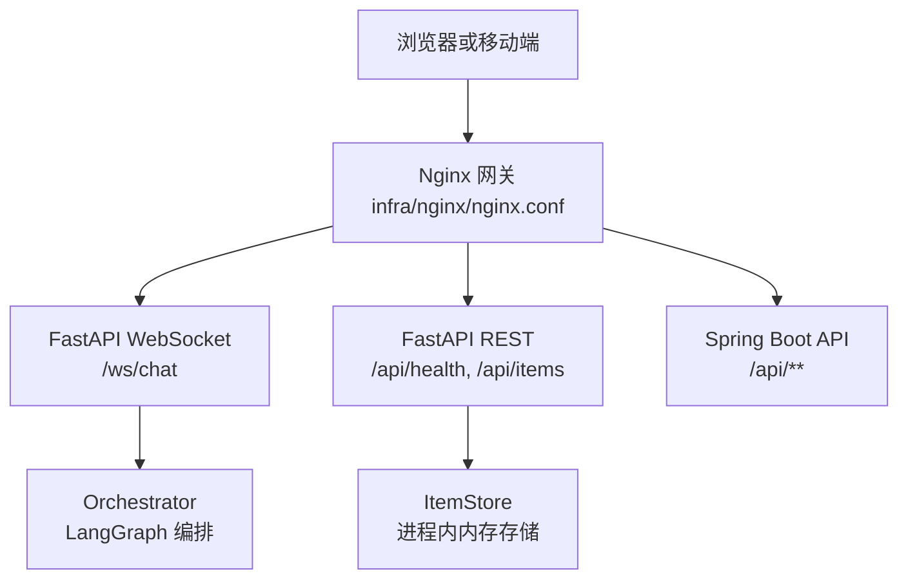
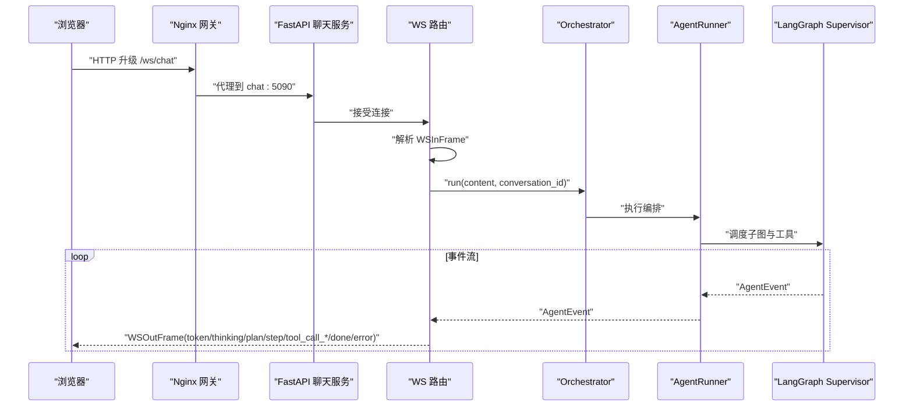
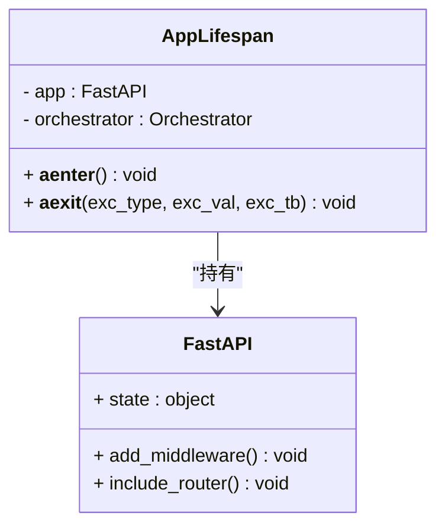
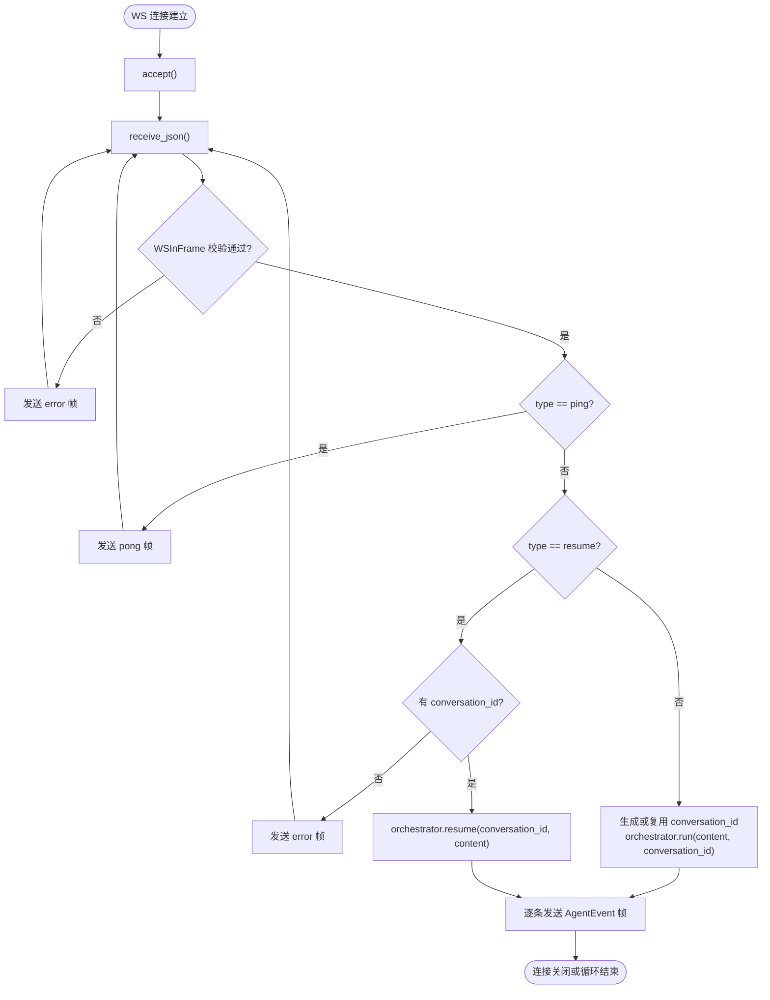
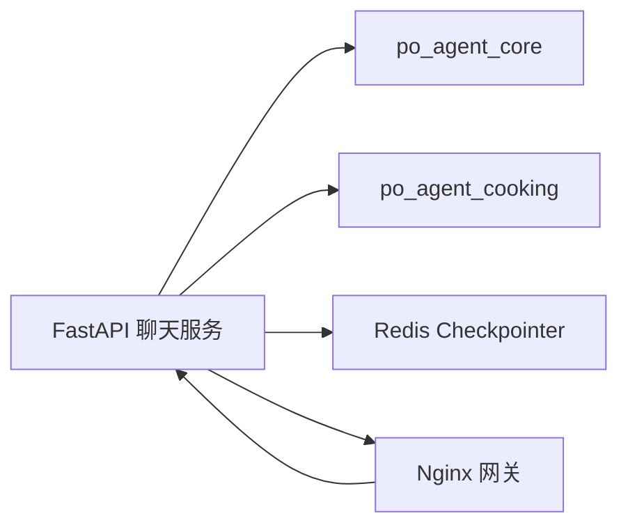
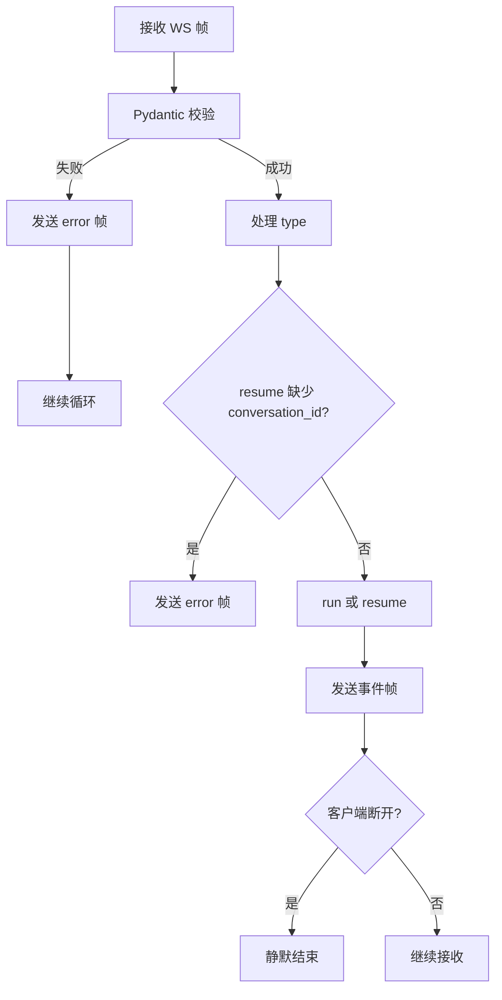
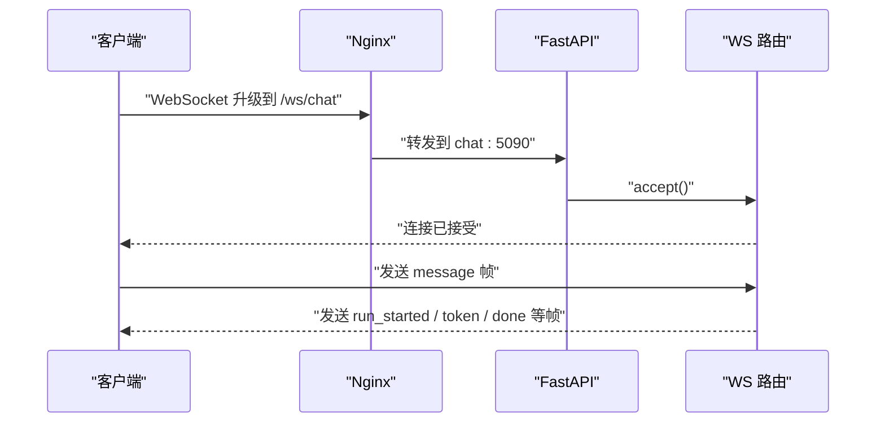

# FastAPI 聊天服务

<cite>
**本文引用的文件**   
- [services/chat/app/main.py](file://services/chat/app/main.py)
- [services/chat/app/routers/ws.py](file://services/chat/app/routers/ws.py)
- [services/chat/app/schemas.py](file://services/chat/app/schemas.py)
- [services/chat/app/store.py](file://services/chat/app/store.py)
- [services/chat/app/config.py](file://services/chat/app/config.py)
- [services/chat/app/routers/health.py](file://services/chat/app/routers/health.py)
- [services/chat/app/routers/items.py](file://services/chat/app/routers/items.py)
- [services/chat/Dockerfile](file://services/chat/Dockerfile)
- [docker-compose.yml](file://docker-compose.yml)
- [infra/nginx/nginx.conf](file://infra/nginx/nginx.conf)
- [scripts/deploy-chat.sh](file://scripts/deploy-chat.sh)
- [README.md](file://README.md)
</cite>

## 目录
1. [简介](#简介)
2. [项目结构](#项目结构)
3. [核心组件](#核心组件)
4. [架构总览](#架构总览)
5. [详细组件分析](#详细组件分析)
6. [依赖关系分析](#依赖关系分析)
7. [性能与资源管理](#性能与资源管理)
8. [错误处理与异常恢复](#错误处理与异常恢复)
9. [WebSocket 客户端集成指南](#websocket-客户端集成指南)
10. [与 AI Agent 系统集成](#与-ai-agent-系统集成)
11. [部署与环境配置](#部署与环境配置)
12. [故障排查](#故障排查)
13. [结论](#结论)

## 简介
FastAPI 聊天服务位于 `services/chat`，承担以下职责：
- 暴露 REST 健康检查与示例 CRUD 接口。
- 通过 WebSocket `/ws/chat` 提供流式聊天能力。
- 将前端消息转换为 LangGraph 事件流，并回推给前端。
- 在启动时装配 Orchestrator，关闭时释放外部连接。
- 通过环境变量支持 CORS、LLM Provider、Redis Checkpointer 等配置。
- 以 Docker 镜像和 Compose 方式参与全栈编排。

该服务是聊天宿主的程序入口，由 Uvicorn 直接运行；WS 路由作为协议翻译层，不承载业务判断，只负责把 `AgentEvent` 映射为 WS 帧。

**章节来源**
- [README.md:1-14](file://README.md#L1-L14)
- [services/chat/app/main.py:1-14](file://services/chat/app/main.py#L1-L14)

## 项目结构
聊天服务的代码组织采用“宿主 + 路由 + 存储 + 模型 + 配置”的分层方式：
- `app/main.py`：应用工厂、生命周期、中间件、路由挂载。
- `app/routers/`：REST 路由与健康检查、WS 路由。
- `app/schemas.py`：Pydantic V2 数据模型，同时定义 REST 领域模型与 WS 帧协议。
- `app/store.py`：进程内线程安全内存存储，演示 REST 校验 → 存储 → 序列化链路。
- `app/config.py`：宿主级运行配置，使用 `PY_SERVER_` 前缀。
- `Dockerfile`：Python 3.11 基础镜像，安装本地 agent-core / agent-cooking 包，暴露 5090。
- `docker-compose.yml`：与 MySQL、Redis、Spring Boot API、Nginx 网关一起编排。
- `infra/nginx/nginx.conf`：按路径分流 `/ws/chat`、`/api/health`、`/api/items`、其余 `/api/**`。



**图表来源**
- [infra/nginx/nginx.conf:55-96](file://infra/nginx/nginx.conf#L55-L96)
- [services/chat/app/main.py:60-70](file://services/chat/app/main.py#L60-L70)
- [services/chat/app/routers/ws.py:131-138](file://services/chat/app/routers/ws.py#L131-L138)
- [services/chat/app/routers/items.py:28-86](file://services/chat/app/routers/items.py#L28-L86)

**章节来源**
- [services/chat/app/main.py:16-75](file://services/chat/app/main.py#L16-L75)
- [services/chat/app/routers/ws.py:1-49](file://services/chat/app/routers/ws.py#L1-L49)
- [services/chat/app/schemas.py:1-14](file://services/chat/app/schemas.py#L1-L14)
- [services/chat/app/store.py:1-11](file://services/chat/app/store.py#L1-L11)
- [services/chat/app/config.py:1-11](file://services/chat/app/config.py#L1-L11)
- [services/chat/Dockerfile:1-42](file://services/chat/Dockerfile#L1-L42)
- [docker-compose.yml:84-113](file://docker-compose.yml#L84-L113)
- [infra/nginx/nginx.conf:1-114](file://infra/nginx/nginx.conf#L1-L114)

## 核心组件
- **应用工厂与生命周期**：`create_app` 构建 FastAPI 实例，注册 CORS 中间件，挂载 health、items、ws 路由；`AppLifespan` 在启动时装配 Orchestrator，关闭时调用 `aclose`。
- **WebSocket 路由**：`/ws/chat` 接收入站帧，解析 conversation_id，调用 Orchestrator 的 `run` 或 `resume`，逐条发送出站帧。
- **数据模型**：`ItemBase`、`ItemCreate`、`ItemUpdate`、`Item` 描述示例资源；`WSInFrame`、`WSOutFrame` 描述 WS 帧协议。
- **内存存储**：`ItemStore` 提供线程安全的 list/create/get/update/delete，适合演示 REST 链路，不适合多 worker 持久化。
- **宿主配置**：`Settings` 读取 `PY_SERVER_*` 环境变量，默认 host 0.0.0.0、port 5090，CORS 白名单逗号分隔。
- **健康检查**：`/api/health` 返回状态与 agent-core 版本，不依赖 Orchestrator。
- **示例 REST 路由**：`/api/items` 实现分页查询、创建、替换、局部更新、删除，统一 404 语义。

**章节来源**
- [services/chat/app/main.py:24-75](file://services/chat/app/main.py#L24-L75)
- [services/chat/app/routers/ws.py:67-189](file://services/chat/app/routers/ws.py#L67-L189)
- [services/chat/app/schemas.py:22-101](file://services/chat/app/schemas.py#L22-L101)
- [services/chat/app/store.py:20-91](file://services/chat/app/store.py#L20-L91)
- [services/chat/app/config.py:18-59](file://services/chat/app/config.py#L18-L59)
- [services/chat/app/routers/health.py:9-21](file://services/chat/app/routers/health.py#L9-L21)
- [services/chat/app/routers/items.py:14-86](file://services/chat/app/routers/items.py#L14-L86)

## 架构总览
聊天服务处于网关下游，承担实时对话转发与事件流输出。整体请求路径如下：



**图表来源**
- [infra/nginx/nginx.conf:55-69](file://infra/nginx/nginx.conf#L55-L69)
- [services/chat/app/routers/ws.py:131-189](file://services/chat/app/routers/ws.py#L131-L189)
- [services/chat/app/main.py:67-70](file://services/chat/app/main.py#L67-L70)

## 详细组件分析

### 应用工厂与生命周期
`create_app` 负责：
- 读取宿主配置。
- 创建 FastAPI 应用并注入 lifespan。
- 添加 CORS 中间件。
- 挂载 `/api/health`、`/api/items`、`/ws/chat`。
- 测试时可注入替身 Orchestrator。

`AppLifespan` 负责：
- 启动时调用 `build_orchestrator`，结果写入 `app.state.orchestrator`。
- 关闭时调用 `orchestrator.aclose`，释放 checkpointer 等外部连接。
- 即使 LLM Key 缺失或 checkpointer 不可达，也会拿到可用 Orchestrator，保证服务能监听端口。



**图表来源**
- [services/chat/app/main.py:24-50](file://services/chat/app/main.py#L24-L50)
- [services/chat/app/main.py:52-75](file://services/chat/app/main.py#L52-L75)

**章节来源**
- [services/chat/app/main.py:24-75](file://services/chat/app/main.py#L24-L75)

### WebSocket 路由与事件流
WS 路由是唯一的协议翻译层：
- 入站帧类型：`message`、`ping`、`resume`。
- 出站帧类型：`token`、`done`、`pong`、`error`、`run_started`、`step`、`thinking`、`plan`、`tool_call_start`、`tool_call_args`、`tool_call_end`、`tool_call_result`、`interrupt`。
- 未登记事件直接丢弃，避免内部控制事件泄露给前端。
- 客户端断开时抛出专用异常 `_ClientGone`，外层静默结束。
- 非法帧返回 `error` 帧后继续复用连接。
- `resume` 必须携带 `conversation_id`，否则返回错误帧。



**图表来源**
- [services/chat/app/routers/ws.py:67-189](file://services/chat/app/routers/ws.py#L67-L189)
- [services/chat/app/schemas.py:59-101](file://services/chat/app/schemas.py#L59-L101)

**章节来源**
- [services/chat/app/routers/ws.py:1-49](file://services/chat/app/routers/ws.py#L1-L49)
- [services/chat/app/routers/ws.py:67-189](file://services/chat/app/routers/ws.py#L67-L189)
- [services/chat/app/schemas.py:59-101](file://services/chat/app/schemas.py#L59-L101)

### 数据模型与消息格式
REST 模型：
- `ItemBase`：name、description、price、in_stock。
- `ItemCreate`：继承 Base，用于创建请求体。
- `ItemUpdate`：所有字段可选，用于 PATCH 局部更新。
- `Item`：包含 id、created_at、updated_at 的完整资源形态。

WS 帧模型：
- `WSInFrame`：type 为 message/ping/resume，content 与 conversation_id 默认空字符串。
- `WSOutFrame`：type 用 Literal 收口，payload 承载结构化附加信息。

```mermaid
erDiagram
ITEM_BASE {
string name
string description
float price
boolean in_stock
}
ITEM_CREATE {
string name
string description
float price
boolean in_stock
}
ITEM_UPDATE {
string name
string description
float price
boolean in_stock
}
ITEM {
int id
datetime created_at
datetime updated_at
}
WS_IN_FRAME {
string type
string content
string conversation_id
}
WS_OUT_FRAME {
string type
string content
dict payload
}
ITEM_CREATE --|> ITEM_BASE
ITEM_UPDATE --|> ITEM_BASE
ITEM --|> ITEM_BASE
```

**图表来源**
- [services/chat/app/schemas.py:22-101](file://services/chat/app/schemas.py#L22-L101)

**章节来源**
- [services/chat/app/schemas.py:1-101](file://services/chat/app/schemas.py#L1-L101)

### 内存存储与会话状态
`ItemStore` 是进程内线程安全存储：
- 使用 `threading.Lock` 保护字典读写。
- 单调递增 ID 源，避免旧 ID 被复用导致缓存命中错误。
- `list` 先排序快照再过滤切片，减少锁竞争。
- `update` 使用 `model_copy(update=...)` 产生新实例，避免并发修改。
- `get_store` 返回进程级单例，供 FastAPI 依赖注入。

注意：该存储不是生产持久层，多 worker 部署时各 worker 各自维护一份数据；真实业务应替换 `get_store` 的实现。

**章节来源**
- [services/chat/app/store.py:1-91](file://services/chat/app/store.py#L1-L91)

### 健康检查与示例 REST 路由
健康检查端点：
- 返回 `status` 与 `agent_core_version`。
- 不依赖 Orchestrator，便于部署探针快速判断进程存活。

示例 REST 路由：
- GET `/api/items`：分页查询，支持 q 模糊过滤。
- POST `/api/items`：创建资源，返回 201。
- GET `/api/items/{item_id}`：读取单条，不存在返回 404。
- PUT `/api/items/{item_id}`：整体替换，不存在返回 404。
- PATCH `/api/items/{item_id}`：局部更新，不存在返回 404。
- DELETE `/api/items/{item_id}`：删除成功返回 204，不存在返回 404。

**章节来源**
- [services/chat/app/routers/health.py:1-21](file://services/chat/app/routers/health.py#L1-L21)
- [services/chat/app/routers/items.py:1-86](file://services/chat/app/routers/items.py#L1-L86)

## 依赖关系分析
聊天服务对外依赖包括：
- FastAPI、Uvicorn、Pydantic Settings。
- `po_agent_core`（LangGraph 编排核心）。
- `po_agent_cooking`（烹饪助手垂直 Agent）。
- Redis（当 checkpointer 配置为 redis 时）。
- Nginx 网关（反向代理与 WebSocket 升级）。



**图表来源**
- [services/chat/Dockerfile:20-35](file://services/chat/Dockerfile#L20-L35)
- [docker-compose.yml:24-42](file://docker-compose.yml#L24-L42)
- [docker-compose.yml:84-113](file://docker-compose.yml#L84-L113)
- [infra/nginx/nginx.conf:39-45](file://infra/nginx/nginx.conf#L39-L45)

**章节来源**
- [services/chat/Dockerfile:20-35](file://services/chat/Dockerfile#L20-L35)
- [docker-compose.yml:24-42](file://docker-compose.yml#L24-L42)
- [docker-compose.yml:84-113](file://docker-compose.yml#L84-L113)
- [infra/nginx/nginx.conf:39-45](file://infra/nginx/nginx.conf#L39-L45)

## 性能与资源管理
- **事件循环串行发送**：WS 路由对同一 socket 串行发送帧，避免并发写冲突；这也要求前端在收到 `interrupt` 后等待 `done` 再发 `resume`。
- **CORS 中间件**：允许跨域请求，origin 列表从配置拆分，忽略空项。
- **Nginx 长连接超时**：WS 路径设置 `proxy_read_timeout` 与 `proxy_send_timeout` 为 3600s，避免流式回复期间断连。
- **内存存储锁粒度**：`ItemStore` 只在快照生成阶段加锁，后续过滤与切片在锁外执行。
- **配置缓存**：`get_settings` 使用 `lru_cache`，避免每次请求重复解析 `.env`。
- **容器健康检查**：chat 服务通过 Python 访问 `/api/health` 判断就绪。

优化建议：
- 若需水平扩展，应将 `ItemStore` 替换为数据库或分布式缓存。
- 若 WS 流量大，可考虑多 worker 部署并结合 Redis 会话共享。
- 监控 Orchestrator 的 `aclose` 耗时，防止外部连接释放缓慢。

**章节来源**
- [services/chat/app/routers/ws.py:177-189](file://services/chat/app/routers/ws.py#L177-L189)
- [services/chat/app/config.py:42-59](file://services/chat/app/config.py#L42-L59)
- [infra/nginx/nginx.conf:66-68](file://infra/nginx/nginx.conf#L66-L68)
- [services/chat/app/store.py:34-42](file://services/chat/app/store.py#L34-L42)
- [docker-compose.yml:107-112](file://docker-compose.yml#L107-L112)

## 错误处理与异常恢复
- **WS 非法帧**：捕获 `ValidationError`，返回 `error` 帧，不中断连接。
- **客户端断开**：捕获 `WebSocketDisconnect` 与 `_ClientGone`，静默结束协程。
- **其他异常**：记录日志并上抛，交由框架关闭连接，避免故障被静默掩盖。
- **resume 缺少 conversation_id**：返回错误帧，不自动新建会话。
- **REST 404**：路由层显式抛出 `HTTPException`，统一错误语义。
- **健康检查不依赖编排**：即使 Orchestrator 未就绪，进程仍可响应。



**图表来源**
- [services/chat/app/routers/ws.py:143-189](file://services/chat/app/routers/ws.py#L143-L189)
- [services/chat/app/routers/items.py:45-86](file://services/chat/app/routers/items.py#L45-L86)

**章节来源**
- [services/chat/app/routers/ws.py:86-189](file://services/chat/app/routers/ws.py#L86-L189)
- [services/chat/app/routers/items.py:45-86](file://services/chat/app/routers/items.py#L45-L86)

## WebSocket 客户端集成指南
客户端需要完成以下步骤：
1. 通过网关连接到 `/ws/chat`。
2. 首次发送 `message` 帧，服务端可能返回 `run_started`，其中 `payload.thread_id` 即为 `conversation_id`。
3. 保存 `conversation_id`，后续消息携带该字段以实现多轮记忆。
4. 订阅出站帧：
   - `token`：打字机增量文本。
   - `thinking` / `plan`：思考过程或计划。
   - `step`：步骤信息。
   - `tool_call_start` / `tool_call_args` / `tool_call_end` / `tool_call_result`：工具调用过程。
   - `interrupt`：需要用户确认，之后等待 `done`。
   - `done`：本轮结束。
   - `error`：错误信息。
   - `pong`：心跳响应。
5. 收到 `interrupt` 后，等待 `done`，再发送 `resume` 帧，携带原 `conversation_id` 与用户回答。

连接建立流程：



**图表来源**
- [infra/nginx/nginx.conf:55-69](file://infra/nginx/nginx.conf#L55-L69)
- [services/chat/app/routers/ws.py:131-189](file://services/chat/app/routers/ws.py#L131-L189)

消息订阅模式：
- 客户端应维护一个帧处理器，根据 `type` 分发 UI 渲染。
- 对未知 `type` 应忽略而非报错，以支持未来灰度新增帧。
- 心跳机制：客户端定期发送 `ping`，服务端回 `pong`。

**章节来源**
- [services/chat/app/routers/ws.py:1-49](file://services/chat/app/routers/ws.py#L1-L49)
- [services/chat/app/routers/ws.py:131-189](file://services/chat/app/routers/ws.py#L131-L189)
- [services/chat/app/schemas.py:59-101](file://services/chat/app/schemas.py#L59-L101)

## 与 AI Agent 系统集成
聊天服务通过 Orchestrator 与 LangGraph 编排系统对接：
- 启动时由 lifespan 装配 Orchestrator。
- WS 路由调用 `orchestrator.run` 或 `orchestrator.resume`。
- Orchestrator 内部使用 AgentRunner 与 LangGraph supervisor graph。
- 事件流中的 `AgentEvent` 被映射为 WS 帧。
- 垂直 Agent（如烹饪助手）通过插槽接入，具备降级能力。

请求转发机制：
- 前端消息进入 WS 路由后，转为 Orchestrator 调用。
- Orchestrator 调度 LLM、工具、子图。
- 工具调用结果通过 `tool_call_*` 帧回推前端。
- 人机确认通过 `interrupt` 帧暂停，前端确认后通过 `resume` 继续。

负载均衡配置：
- Nginx 上游 `chat_api` 指向 `chat:5090`。
- 若部署多个 chat 实例，可在 upstream 中配置多个 server，Nginx 默认轮询。
- 若需会话亲和，可结合 Redis 共享 conversation_id 状态。

**章节来源**
- [services/chat/app/main.py:24-50](file://services/chat/app/main.py#L24-L50)
- [services/chat/app/routers/ws.py:25-49](file://services/chat/app/routers/ws.py#L25-L49)
- [services/chat/app/routers/ws.py:119-189](file://services/chat/app/routers/ws.py#L119-L189)
- [infra/nginx/nginx.conf:39-45](file://infra/nginx/nginx.conf#L39-L45)

## 部署与环境配置
### Docker 镜像
- 基础镜像默认使用国内加速地址，可通过 `RUNTIME_IMAGE` 覆盖。
- 安装 `po_agent_core[redis]` 与 `po_agent_cooking`。
- 工作目录 `/app`，复制 `services/chat/app`。
- 构建期冒烟检查导入 `app.main` 与 `langgraph.checkpoint.redis`。
- 运行命令：`python -m uvicorn app.main:app --host 0.0.0.0 --port 5090`。

### Compose 编排
- chat 服务依赖 redis 与 api 健康状态。
- 环境变量透传 LLM Provider、Model、API Key、Embedding、Checkpointer、Redis URL。
- 健康检查调用 `/api/health`。
- web 服务延迟到 api 与 chat 都 healthy 后再启动。

### 环境变量
- `PY_SERVER_CORS_ORIGINS`：聊天服务 CORS 白名单。
- `AGENT_CORE_LLM_PROVIDER` / `AGENT_CORE_LLM_MODEL` / `AGENT_CORE_LLM_API_KEY`：LLM 配置。
- `AGENT_CORE_EMBEDDING_MODEL` / `AGENT_CORE_EMBEDDING_API_KEY`：意图路由 embedding。
- `AGENT_CORE_CHECKPOINTER`：checkpointer 类型，redis 时需 Redis Stack。
- `AGENT_CORE_REDIS_URL`：Redis 连接串。

### 部署脚本
- `scripts/deploy-chat.sh` 构建并推送镜像到腾讯云 TCR。
- 支持 `USE_OFFICIAL_IMAGES=1` 切换官方镜像。
- 输出云托管部署所需镜像地址、端口、健康检查路径、环境变量说明。

**章节来源**
- [services/chat/Dockerfile:1-42](file://services/chat/Dockerfile#L1-L42)
- [docker-compose.yml:84-113](file://docker-compose.yml#L84-L113)
- [README.md:59-79](file://README.md#L59-L79)
- [scripts/deploy-chat.sh:1-60](file://scripts/deploy-chat.sh#L1-L60)

## 故障排查
常见问题与定位方法：
- **WS 连接失败**：检查 Nginx 是否正确代理 `/ws/chat`，确认 `Upgrade` 与 `Connection` 头。
- **聊天无响应**：检查 Orchestrator 是否初始化，查看 lifespan 是否运行。
- **resume 无效**：确认 `conversation_id` 是否正确传递，且在前一轮 `done` 之后再发送。
- **Redis Checkpointer 降级**：确认使用的是 Redis Stack，普通 Redis 会静默降级为 memory。
- **CORS 报错**：检查 `PY_SERVER_CORS_ORIGINS` 是否包含前端地址。
- **健康检查失败**：确认 `/api/health` 可达，agent-core 版本是否符合预期。
- **镜像构建失败**：确认构建上下文为仓库根，本地包 `agent-core` / `agent-cooking` 可被安装。

**章节来源**
- [infra/nginx/nginx.conf:55-69](file://infra/nginx/nginx.conf#L55-L69)
- [services/chat/app/main.py:24-50](file://services/chat/app/main.py#L24-L50)
- [services/chat/app/routers/ws.py:158-175](file://services/chat/app/routers/ws.py#L158-L175)
- [docker-compose.yml:24-42](file://docker-compose.yml#L24-L42)
- [services/chat/app/config.py:36-49](file://services/chat/app/config.py#L36-L49)
- [services/chat/app/routers/health.py:15-21](file://services/chat/app/routers/health.py#L15-L21)
- [services/chat/Dockerfile:20-35](file://services/chat/Dockerfile#L20-L35)

## 结论
FastAPI 聊天服务以简洁的宿主架构承载 WebSocket 流式聊天能力，通过 Orchestrator 与 LangGraph 编排系统对接 AI Agent。其设计强调：
- 协议稳定：WS 帧类型集中定义，前端对未知帧忽略。
- 生命周期清晰：启动装配、关闭释放。
- 配置分离：宿主配置与编排配置分前缀。
- 可观测性：健康检查、日志、Compose 健康探针。
- 可扩展性：垂直 Agent 插槽、未来帧灰度、Nginx 负载均衡。

在生产环境中，建议：
- 将内存存储替换为数据库或分布式缓存。
- 启用 Redis Session 共享以支持多 worker。
- 增加指标采集与告警，监控 WS 连接数、事件延迟、错误率。
- 严格管理环境变量，避免凭据泄露。