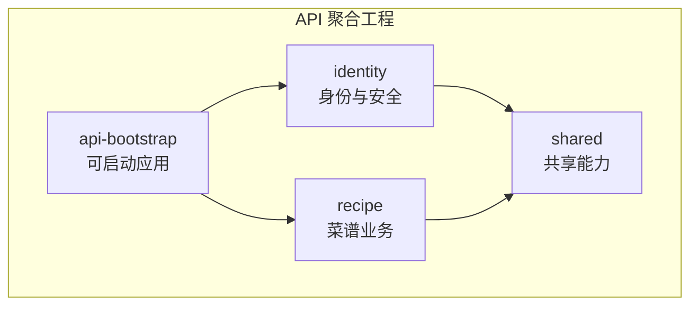
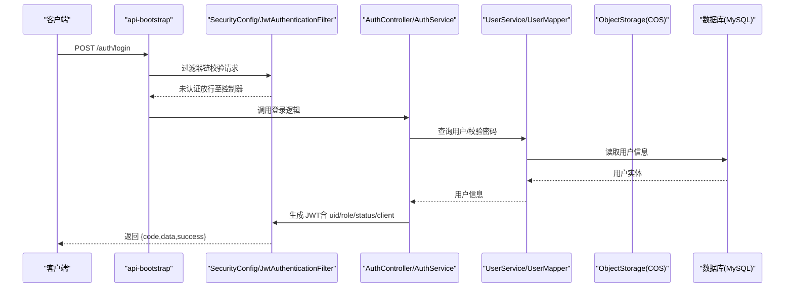
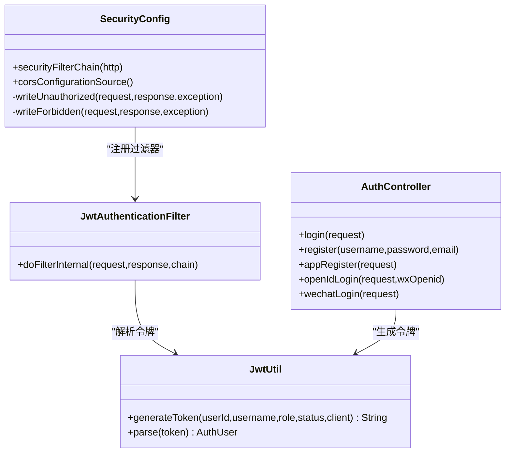
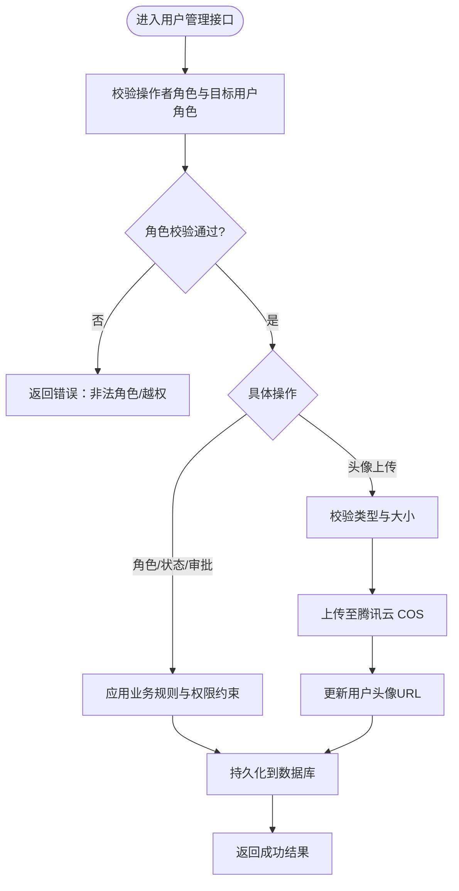
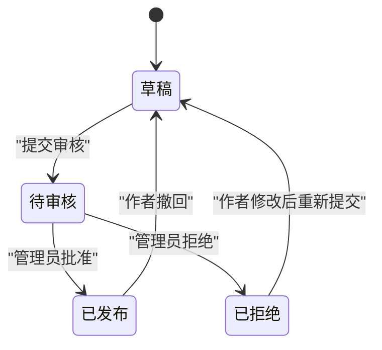
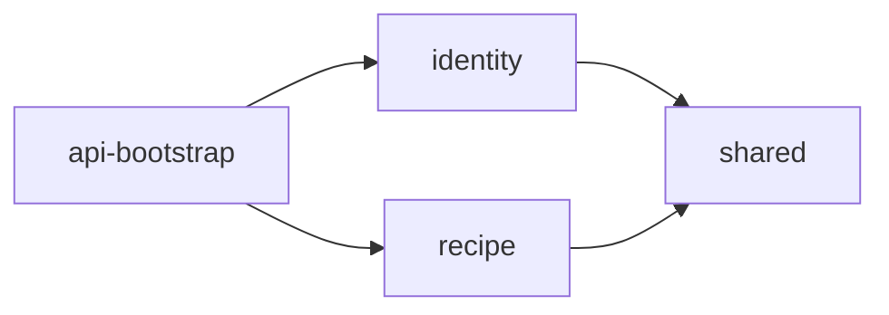

# Spring Boot 业务 API

<cite>
**本文引用的文件**   
- [pom.xml](file://services\api\pom.xml)
- [api-bootstrap/pom.xml](file://services\api\api-bootstrap\pom.xml)
- [identity/pom.xml](file://services\api\identity\pom.xml)
- [recipe/pom.xml](file://services\api\recipe\pom.xml)
- [shared/pom.xml](file://services\api\shared\pom.xml)
- [PoApplication.java](file://services\api\api-bootstrap\src\main\java\com\goodzheng\po\PoApplication.java)
- [AuthController.java](file://services\api\identity\src\main\java\com\goodzheng\po\identity\controller\AuthController.java)
- [UserController.java](file://services\api\identity\src\main\java\com\goodzheng\po\identity\controller\UserController.java)
- [AuthService.java](file://services\api\identity\src\main\java\com\goodzheng\po\identity\service\AuthService.java)
- [UserService.java](file://services\api\identity\src\main\java\com\goodzheng\po\identity\service\UserService.java)
- [SecurityConfig.java](file://services\api\identity\src\main\java\com\goodzheng\po\identity\security\SecurityConfig.java)
- [JwtAuthenticationFilter.java](file://services\api\identity\src\main\java\com\goodzheng\po\identity\security\JwtAuthenticationFilter.java)
- [JwtUtil.java](file://services\api\identity\src\main\java\com\goodzheng\po\identity\security\JwtUtil.java)
</cite>

## 目录
1. [引言](#引言)
2. [项目结构](#项目结构)
3. [核心组件](#核心组件)
4. [架构总览](#架构总览)
5. [详细组件分析](#详细组件分析)
6. [依赖关系分析](#依赖关系分析)
7. [性能与扩展能力](#性能与扩展能力)
8. [故障排查指南](#故障排查指南)
9. [结论](#结论)

## 引言
本文件面向 Spring Boot 后端服务，聚焦身份认证、权限控制、用户管理、菜谱管理与扩展能力的实现说明。文档基于 Maven 多模块聚合工程，围绕 identity（身份与安全）、recipe（菜谱业务）、shared（共享能力）、api-bootstrap（可启动应用）四个模块展开，覆盖 JWT 鉴权、微信登录、RBAC 角色访问控制、MyBatis-Plus 数据访问、腾讯云 COS 对象存储、TTS 语音合成、Redis 缓存与 Actuator/Prometheus 监控等关键能力。

## 项目结构
后端采用 Maven Reactor 聚合工程，顶层 POM 统一管理版本与插件，子模块按领域拆分：
- shared：跨模块共享能力，包括统一返回体、MyBatis-Plus 分页工具、腾讯云 COS 配置与上传接口。
- identity：身份认证与用户管理，包含 JWT 过滤器、安全配置、用户控制器与服务接口。
- recipe：菜谱业务域，提供菜谱分类、CRUD、审核流程、收藏/点赞、TTS 音频生成等能力。
- api-bootstrap：可执行应用入口，装配 Web、Redis、Actuator、Prometheus、MySQL 等运行时依赖，并引入 identity 与 recipe 模块。

图表来源
- [pom.xml:29-34](file://services\api\pom.xml#L29-L34)
- [api-bootstrap/pom.xml:22-36](file://services\api\api-bootstrap\pom.xml#L22-L36)
- [identity/pom.xml:17-22](file://services\api\identity\pom.xml#L17-L22)
- [recipe/pom.xml:17-27](file://services\api\recipe\pom.xml#L17-L27)
- [shared/pom.xml:17-37](file://services\api\shared\pom.xml#L17-L37)

章节来源
- [pom.xml:22-34](file://services\api\pom.xml#L22-L34)
- [api-bootstrap/pom.xml:17-36](file://services\api\api-bootstrap\pom.xml#L17-L36)

## 核心组件
- 应用入口：Spring Boot 主类排除默认 UserDetailsServiceAutoConfiguration，避免与自定义 JWT 鉴权冲突。
- 安全配置：无状态会话、CORS 开放、路径级授权规则、异常处理统一返回 Result。
- JWT 过滤器：从 Authorization 头解析令牌，注入 SecurityContext，携带角色与客户端来源。
- 认证控制器：提供账号密码登录、App 注册、OpenID 登录、微信登录等入口。
- 用户控制器：用户资料维护、头像上传（COS）、批量操作、审批流、角色权限校验。
- 服务接口：AuthService 与 UserService 定义认证与用户管理的业务能力边界。

章节来源
- [PoApplication.java:7-12](file://services\api\api-bootstrap\src\main\java\com\goodzheng\po\PoApplication.java#L7-L12)
- [SecurityConfig.java:54-99](file://services\api\identity\src\main\java\com\goodzheng\po\identity\security\SecurityConfig.java#L54-L99)
- [JwtAuthenticationFilter.java:32-55](file://services\api\identity\src\main\java\com\goodzheng\po\identity\security\JwtAuthenticationFilter.java#L32-L55)
- [AuthController.java:26-78](file://services\api\identity\src\main\java\com\goodzheng\po\identity\controller\AuthController.java#L26-L78)
- [UserController.java:58-323](file://services\api\identity\src\main\java\com\goodzheng\po\identity\controller\UserController.java#L58-L323)
- [AuthService.java:9-20](file://services\api\identity\src\main\java\com\goodzheng\po\identity\service\AuthService.java#L9-L20)
- [UserService.java:10-34](file://services\api\identity\src\main\java\com\goodzheng\po\identity\service\UserService.java#L10-L34)

## 架构总览
系统以 REST API 暴露能力，前端通过网关或同源部署调用。鉴权由 Spring Security 过滤器链完成，JWT 作为无状态令牌承载用户标识、角色、状态与客户端来源。业务层使用 MyBatis-Plus 进行数据访问，对象存储走腾讯云 COS，TTS 音频生成在 recipe 模块内实现，Redis 用于缓存与会话相关能力，Actuator 与 Prometheus 提供健康检查与指标采集。

图表来源
- [SecurityConfig.java:54-99](file://services\api\identity\src\main\java\com\goodzheng\po\identity\security\SecurityConfig.java#L54-L99)
- [JwtAuthenticationFilter.java:32-55](file://services\api\identity\src\main\java\com\goodzheng\po\identity\security\JwtAuthenticationFilter.java#L32-L55)
- [AuthController.java:26-34](file://services\api\identity\src\main\java\com\goodzheng\po\identity\controller\AuthController.java#L26-L34)
- [AuthService.java:15-15](file://services\api\identity\src\main\java\com\goodzheng\po\identity\service\AuthService.java#L15-L15)
- [JwtUtil.java:25-38](file://services\api\identity\src\main\java\com\goodzheng\po\identity\security\JwtUtil.java#L25-L38)

## 详细组件分析

### 身份认证与权限控制
- 安全策略
  - 无状态会话，禁用 CSRF，启用 CORS。
  - 公开接口：登录、注册、微信登录、OpenID 登录、App 注册、静态资源与 TTS。
  - 需登录：个人中心、我的菜谱/收藏/历史、菜谱互动与创建、通用文件上传。
  - 管理员通道：用户管理、内容写操作、审核队列与审核操作，要求客户端为管理端且具备管理员或超级管理员角色。
- JWT 机制
  - 令牌载荷包含用户 ID、用户名、角色、状态、客户端来源；签名使用 HMAC-SHA。
  - 过滤器解析令牌后注入 SecurityContext，并设置 ROLE_ 与 CLIENT_ 权限供授权管理器判断。
- 认证入口
  - 账号密码登录、App 注册、OpenID 登录、微信登录均返回统一 Result 包装的 LoginResponse。

图表来源
- [SecurityConfig.java:54-99](file://services\api\identity\src\main\java\com\goodzheng\po\identity\security\SecurityConfig.java#L54-L99)
- [JwtAuthenticationFilter.java:32-55](file://services\api\identity\src\main\java\com\goodzheng\po\identity\security\JwtAuthenticationFilter.java#L32-L55)
- [JwtUtil.java:25-49](file://services\api\identity\src\main\java\com\goodzheng\po\identity\security\JwtUtil.java#L25-L49)
- [AuthController.java:26-78](file://services\api\identity\src\main\java\com\goodzheng\po\identity\controller\AuthController.java#L26-L78)

章节来源
- [SecurityConfig.java:35-133](file://services\api\identity\src\main\java\com\goodzheng\po\identity\security\SecurityConfig.java#L35-L133)
- [JwtAuthenticationFilter.java:20-55](file://services\api\identity\src\main\java\com\goodzheng\po\identity\security\JwtAuthenticationFilter.java#L20-L55)
- [JwtUtil.java:13-59](file://services\api\identity\src\main\java\com\goodzheng\po\identity\security\JwtUtil.java#L13-L59)
- [AuthController.java:19-78](file://services\api\identity\src\main\java\com\goodzheng\po\identity\controller\AuthController.java#L19-L78)

### 用户管理
- 功能范围
  - 分页列表与搜索、待审批列表、详情获取、个人资料更新、修改密码、头像上传（COS）。
  - 用户创建/更新/删除、批量删除、批量状态变更、角色调整、审批操作。
- 权限校验
  - 仅管理端管理员或超级管理员可访问用户管理接口。
  - 禁止普通用户修改自身敏感字段；禁止管理员修改/删除超级管理员；禁止超级管理员修改自己的角色。
- 头像上传
  - 支持 jpg/png/gif/webp，大小限制 2MB，落桶 COS 并直接回写用户 avatar 字段。

图表来源
- [UserController.java:131-165](file://services\api\identity\src\main\java\com\goodzheng\po\identity\controller\UserController.java#L131-L165)
- [UserController.java:167-323](file://services\api\identity\src\main\java\com\goodzheng\po\identity\controller\UserController.java#L167-L323)

章节来源
- [UserController.java:34-353](file://services\api\identity\src\main\java\com\goodzheng\po\identity\controller\UserController.java#L34-L353)
- [UserService.java:10-34](file://services\api\identity\src\main\java\com\goodzheng\po\identity\service\UserService.java#L10-L34)

### 菜谱管理系统（CRUD、分类、审核流程）
- 能力概述
  - 菜谱 CRUD、分类管理、收藏/点赞、浏览历史、审核队列与审核操作。
  - 公开浏览接口：GET /recipes、/recipes/*、/recipe-categories、/recipe-categories/*。
  - 需登录写操作：POST /recipes、PUT /recipes/*、DELETE /recipes/*、/recipes/*/favorite、/recipes/*/like。
  - 审核相关：GET /recipes/review、PUT /recipes/*/audit，仅管理端管理员。
- 数据模型与关系（概念性）
  - 菜谱实体关联作者、分类、封面图、食材、步骤等；审核状态贯穿发布流程。
  - 收藏/点赞为用户与菜谱的多对多关系；浏览历史记录用户行为。
- 审核流程（概念性）
  - 草稿 → 待审核 → 已发布/已拒绝；管理员在审核队列中执行批准或拒绝。

[本图为概念流程图，不直接映射具体源码文件]

章节来源
- [SecurityConfig.java:68-93](file://services\api\identity\src\main\java\com\goodzheng\po\identity\security\SecurityConfig.java#L68-L93)

### 数据访问与 MyBatis-Plus
- 依赖与版本
  - 顶层 POM 统一声明 mybatis-plus-spring-boot4-starter 与 mybatis-plus-jsqlparser 版本。
  - 各业务模块按需引入，确保分页插件可用。
- 分页模型
  - 使用 Spring Data Commons 的 Page/Pageable，并在 shared 模块提供与 MyBatis-Plus 互转工具。
- 事务管理
  - 典型写操作（如用户批量状态更新、角色调整、审批）应在 Service 层加事务注解以保证一致性。
  - 建议将跨表更新、审核状态变更、收藏/点赞原子性操作纳入同一事务。

章节来源
- [pom.xml:36-50](file://services\api\pom.xml#L36-L50)
- [shared/pom.xml:17-26](file://services\api\shared\pom.xml#L17-L26)
- [identity/pom.xml:23-31](file://services\api\identity\pom.xml#L23-L31)
- [recipe/pom.xml:28-36](file://services\api\recipe\pom.xml#L28-L36)

### 文件存储集成（腾讯云 COS）
- 能力定位
  - 用户头像、菜谱封面、TTS 音频等产物统一落桶，避免云托管本地磁盘不可靠问题。
- 配置与接口
  - shared 模块提供 CosProperties 与 ObjectStorage 抽象，封装上传与 URL 返回。
- 使用场景
  - 用户头像上传：校验类型与大小 → 上传 COS → 回写用户 avatar。
  - TTS 音频：合成后落桶，公开可读，便于播放器直连。

章节来源
- [shared/pom.xml:32-37](file://services\api\shared\pom.xml#L32-L37)
- [UserController.java:131-165](file://services\api\identity\src\main\java\com\goodzheng\po\identity\controller\UserController.java#L131-L165)

### TTS 音频生成
- 依赖
  - recipe 模块引入 jackson-databind 以解析讯飞 TTS JSON 分帧响应。
- 流程（概念性）
  - 文本输入 → 调用 TTS 服务 → 解析音频片段 → 合并/落桶 → 返回音频 URL。
- 访问控制
  - /tts 与 /tts/** 公开，便于播放器无需携带 Authorization 头播放。

章节来源
- [recipe/pom.xml:41-45](file://services\api\recipe\pom.xml#L41-L45)
- [SecurityConfig.java:76-77](file://services\api\identity\src\main\java\com\goodzheng\po\identity\security\SecurityConfig.java#L76-L77)

### 缓存策略（Redis）
- 依赖
  - api-bootstrap 引入 spring-boot-starter-data-redis 与 jedis 客户端。
- 用途建议
  - 用户会话令牌黑名单、验证码、热点菜谱/分类缓存、限流计数等。
- 注意事项
  - 结合 Actuator 与 Prometheus 监控 Redis 连接池与命中率。

章节来源
- [api-bootstrap/pom.xml:46-59](file://services\api\api-bootstrap\pom.xml#L46-L59)

## 依赖关系分析
- 模块依赖
  - api-bootstrap 依赖 identity 与 recipe，并引入 Web、Redis、Actuator、Prometheus、MySQL 驱动。
  - identity 依赖 shared、Web、Validation、Security、JWT 库。
  - recipe 依赖 shared、identity、Web、Validation、Jackson Databind。
  - shared 依赖 Spring Data Commons、MyBatis-Plus、Spring Boot、腾讯云 COS SDK。

图表来源
- [api-bootstrap/pom.xml:22-36](file://services\api\api-bootstrap\pom.xml#L22-L36)
- [identity/pom.xml:17-67](file://services\api\identity\pom.xml#L17-L67)
- [recipe/pom.xml:17-55](file://services\api\recipe\pom.xml#L17-L55)
- [shared/pom.xml:17-43](file://services\api\shared\pom.xml#L17-L43)

章节来源
- [api-bootstrap/pom.xml:22-89](file://services\api\api-bootstrap\pom.xml#L22-L89)
- [identity/pom.xml:17-67](file://services\api\identity\pom.xml#L17-L67)
- [recipe/pom.xml:17-55](file://services\api\recipe\pom.xml#L17-L55)
- [shared/pom.xml:17-43](file://services\api\shared\pom.xml#L17-L43)

## 性能与扩展能力
- 无状态鉴权：JWT 减少服务端会话存储压力，适合水平扩展。
- 对象存储：COS 解耦计算与存储，提升并发与可用性。
- 分页与索引：合理使用 MyBatis-Plus 分页与数据库索引，避免全表扫描。
- 监控与可观测性：Actuator 暴露健康与指标，Prometheus 抓取 metrics。
- 缓存与异步：建议对热点数据（菜谱列表、分类、TTS 音频 URL）做缓存；TTS 合成可异步化。
- 安全加固：JWT 密钥与过期时间通过配置中心管理；严格校验客户端来源与角色。

[本节为通用指导，不直接分析具体文件]

## 故障排查指南
- 401 未登录或令牌失效
  - 检查 Authorization 头是否携带 Bearer 令牌；确认 jwt.secret 与 jwt.expiration 配置正确。
  - 过滤器捕获 JwtException 会清空上下文，导致后续鉴权失败。
- 403 没有访问权限
  - 检查客户端来源（CLIENT_ADMIN）与角色（ROLE_ADMIN/SUPER_ADMIN）是否符合路径规则。
  - 管理端接口必须同时满足客户端与角色双重条件。
- 用户操作失败
  - 头像上传：校验类型与大小；COS 配置是否正确；网络 IO 异常会被包装为 RuntimeException。
  - 角色/状态/审批：注意超级管理员保护规则与操作者权限边界。
- 登录流程异常
  - 统一返回 Result.error(code,message)，前端根据 code 提示；服务端日志需记录异常堆栈。

章节来源
- [SecurityConfig.java:115-132](file://services\api\identity\src\main\java\com\goodzheng\po\identity\security\SecurityConfig.java#L115-L132)
- [JwtAuthenticationFilter.java:49-52](file://services\api\identity\src\main\java\com\goodzheng\po\identity\security\JwtAuthenticationFilter.java#L49-L52)
- [UserController.java:131-165](file://services\api\identity\src\main\java\com\goodzheng\po\identity\controller\UserController.java#L131-L165)
- [AuthController.java:26-78](file://services\api\identity\src\main\java\com\goodzheng\po\identity\controller\AuthController.java#L26-L78)

## 结论
本项目以清晰的模块划分与统一的鉴权体系为基础，提供了完整的身份认证、用户管理、菜谱业务与扩展能力。通过 JWT 无状态鉴权、RBAC 权限控制、MyBatis-Plus 数据访问、腾讯云 COS 对象存储与 Redis 缓存，系统在可扩展性与可维护性方面具备良好的基础。建议在后续迭代中完善审计日志、统一异常处理、参数校验与性能监控，进一步提升系统的稳定性与可观测性。