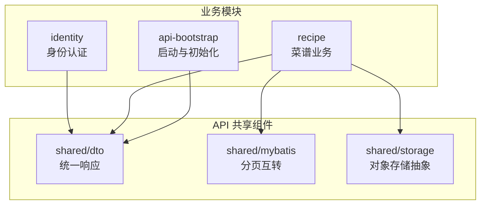
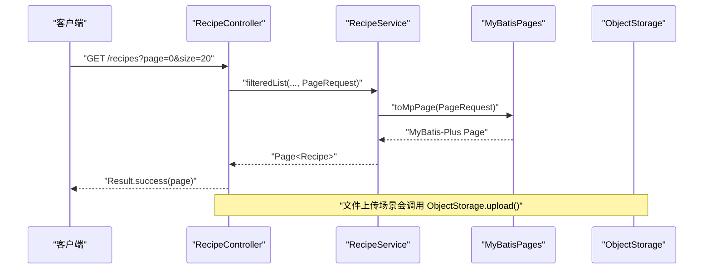
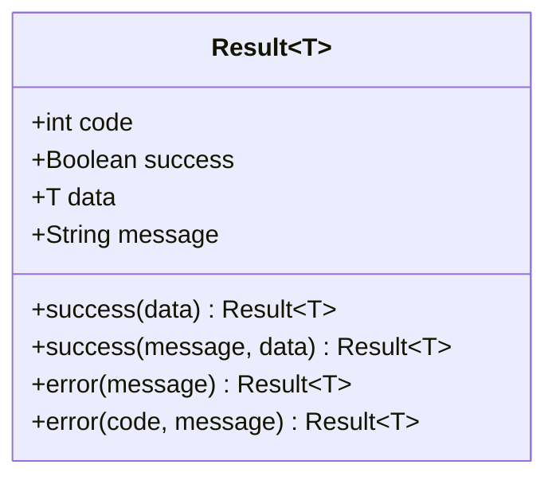
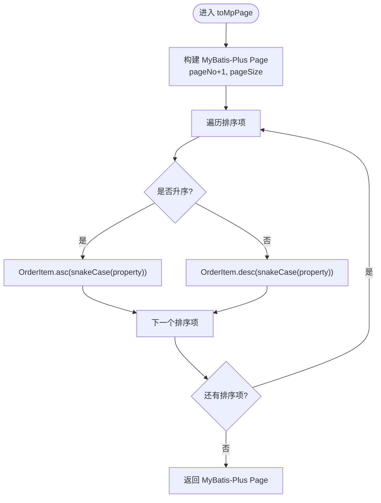
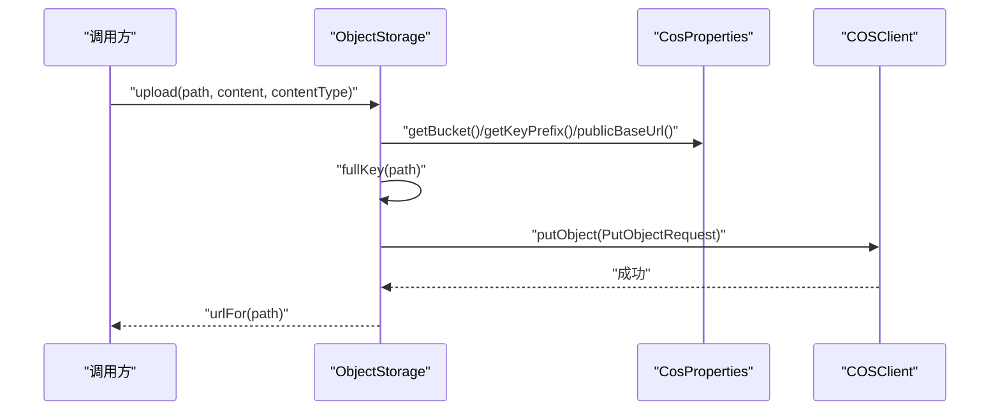
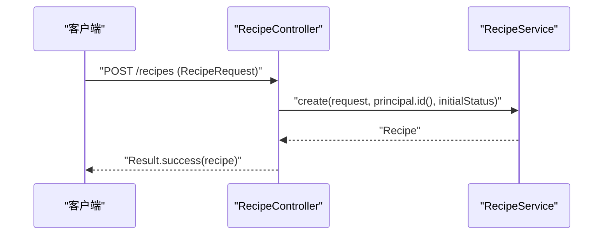
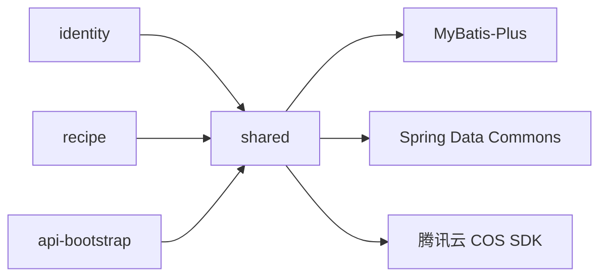
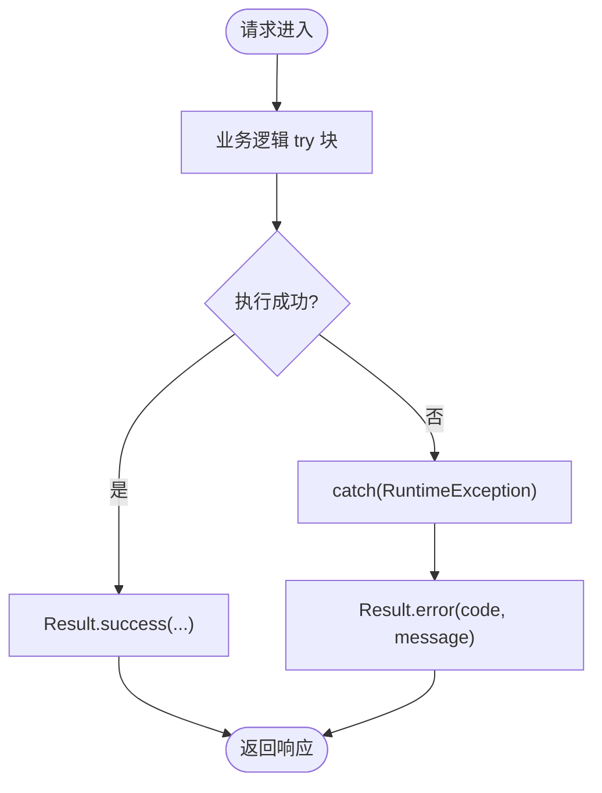

# 共享组件库

<cite>
**本文引用的文件**   
- [Result.java](file://services/api/shared/src/main/java/com/goodzheng/po/shared/dto/Result.java)
- [MyBatisPages.java](file://services/api/shared/src/main/java/com/goodzheng/po/shared/mybatis/MyBatisPages.java)
- [ObjectStorage.java](file://services/api/shared/src/main/java/com/goodzheng/po/shared/storage/ObjectStorage.java)
- [CosProperties.java](file://services/api/shared/src/main/java/com/goodzheng/po/shared/storage/CosProperties.java)
- [RecipeController.java](file://services/api/recipe/src/main/java/com/goodzheng/po/recipe/controller/RecipeController.java)
- [LoginRequest.java](file://services/api/identity/src/main/java/com/goodzheng/po/identity/dto/LoginRequest.java)
- [DataInitializer.java](file://services/api/api-bootstrap/src/main/java/com/goodzheng/po/config/DataInitializer.java)
- [WeChatService.java](file://services/api/identity/src/main/java/com/goodzheng/po/identity/wechat/WeChatService.java)
</cite>

## 目录
1. [引言](#引言)
2. [项目结构](#项目结构)
3. [核心组件](#核心组件)
4. [架构总览](#架构总览)
5. [详细组件分析](#详细组件分析)
6. [依赖关系分析](#依赖关系分析)
7. [性能与扩展性](#性能与扩展性)
8. [异常处理与日志规范](#异常处理与日志规范)
9. [配置管理策略](#配置管理策略)
10. [使用示例与扩展指南](#使用示例与扩展指南)
11. [故障排查](#故障排查)
12. [结论](#结论)

## 引言
本共享组件库面向后端 API 模块，提供跨业务域复用的通用能力：统一响应封装、分页查询工具、对象存储抽象及腾讯云 COS 集成。文档重点说明 DTO 设计模式、统一响应格式、分页互转实现、对象存储抽象与 COS 客户端初始化、上传下载流程、异常处理机制、日志记录规范以及配置注入策略，并给出跨模块复用示例和扩展建议。

## 项目结构
共享组件位于 `services/api/shared` 下，按职责划分为三层：
- `dto`：统一响应数据模型
- `mybatis`：Spring Data Commons 分页与 MyBatis-Plus 分页的转换工具
- `storage`：对象存储抽象与腾讯云 COS 实现

**图示来源**
- [Result.java:1-33](file://services/api/shared/src/main/java/com/goodzheng/po/shared/dto/Result.java#L1-L33)
- [MyBatisPages.java:1-46](file://services/api/shared/src/main/java/com/goodzheng/po/shared/mybatis/MyBatisPages.java#L1-L46)
- [ObjectStorage.java:1-95](file://services/api/shared/src/main/java/com/goodzheng/po/shared/storage/ObjectStorage.java#L1-L95)

**章节来源**
- [Result.java:1-33](file://services/api/shared/src/main/java/com/goodzheng/po/shared/dto/Result.java#L1-L33)
- [MyBatisPages.java:1-46](file://services/api/shared/src/main/java/com/goodzheng/po/shared/mybatis/MyBatisPages.java#L1-L46)
- [ObjectStorage.java:1-95](file://services/api/shared/src/main/java/com/goodzheng/po/shared/storage/ObjectStorage.java#L1-L95)

## 核心组件
- 统一响应封装 Result：为所有接口返回统一的结构，包含状态码、成功标志、数据体与消息。
- 分页工具 MyBatisPages：在 Controller/Service 对外暴露 Spring Page/Pageable 的同时，内部转换为 MyBatis-Plus Page，并自动将驼峰属性映射为数据库下划线列名。
- 对象存储 ObjectStorage：封装腾讯云 COS 的上传、存在性检查与 URL 生成；懒加载客户端，避免未配置密钥时影响启动。
- COS 配置 CosProperties：从环境变量或配置文件注入密钥、地域、桶名、key 前缀与自定义域名。

**章节来源**
- [Result.java:1-33](file://services/api/shared/src/main/java/com/goodzheng/po/shared/dto/Result.java#L1-L33)
- [MyBatisPages.java:1-46](file://services/api/shared/src/main/java/com/goodzheng/po/shared/mybatis/MyBatisPages.java#L1-L46)
- [ObjectStorage.java:1-95](file://services/api/shared/src/main/java/com/goodzheng/po/shared/storage/ObjectStorage.java#L1-L95)
- [CosProperties.java:1-45](file://services/api/shared/src/main/java/com/goodzheng/po/shared/storage/CosProperties.java#L1-L45)

## 架构总览
共享组件被各业务模块以依赖方式引入，典型调用链如下：
- Controller 层通过 Result 统一封装响应
- Service 层使用 MyBatisPages 进行分页转换
- 文件类操作通过 ObjectStorage 写入 COS 并返回公网 URL

**图示来源**
- [RecipeController.java:72-90](file://services/api/recipe/src/main/java/com/goodzheng/po/recipe/controller/RecipeController.java#L72-L90)
- [MyBatisPages.java:22-39](file://services/api/shared/src/main/java/com/goodzheng/po/shared/mybatis/MyBatisPages.java#L22-L39)
- [ObjectStorage.java:29-49](file://services/api/shared/src/main/java/com/goodzheng/po/shared/storage/ObjectStorage.java#L29-L49)

## 详细组件分析

### 统一响应封装 Result
- 设计要点
  - 泛型 T 承载任意业务数据
  - code/success/message/data 四字段构成稳定契约
  - 提供 success/error 静态工厂方法，便于快速构造
- 使用约定
  - 成功路径：Result.success(data) 或 Result.success(message, data)
  - 失败路径：Result.error(message) 或 Result.error(code, message)
- 复杂度
  - 构造与访问均为 O(1)
- 扩展建议
  - 可新增枚举化状态码，增强可读性与校验
  - 可在全局拦截器中统一填充 traceId、时间戳等元信息

**图示来源**
- [Result.java:7-31](file://services/api/shared/src/main/java/com/goodzheng/po/shared/dto/Result.java#L7-L31)

**章节来源**
- [Result.java:1-33](file://services/api/shared/src/main/java/com/goodzheng/po/shared/dto/Result.java#L1-L33)

### 分页查询工具 MyBatisPages
- 设计要点
  - 对外保持 Spring Data Commons 的 Page/Pageable 类型，降低 Controller/Service 耦合
  - 内部将 Pageable 转为 MyBatis-Plus Page，并支持排序字段 camelCase → snake_case 转换
  - 结果再转回 Spring Page，保证接口契约不变
- 关键流程
  - toMpPage：页码偏移（0-based→1-based）、页大小、排序项转换
  - toPage：记录集合、原始 Pageable、总数回填
  - toSnakeCase：正则替换大写字母前加下划线并小写
- 复杂度
  - 排序转换 O(n)，n 为排序字段数
  - 分页转换 O(1)
- 适用场景
  - 列表查询、筛选排序、后台审核队列等

**图示来源**
- [MyBatisPages.java:22-44](file://services/api/shared/src/main/java/com/goodzheng/po/shared/mybatis/MyBatisPages.java#L22-L44)

**章节来源**
- [MyBatisPages.java:1-46](file://services/api/shared/src/main/java/com/goodzheng/po/shared/mybatis/MyBatisPages.java#L1-L46)

### 对象存储服务抽象与腾讯云 COS 集成
- 设计要点
  - ObjectStorage 作为组件，提供 upload/exists/urlFor 三个核心方法
  - 懒加载 COSClient，首次使用时才创建，避免未配置密钥导致启动失败
  - 通过 CosProperties 注入 secretId/secretKey/region/bucket/keyPrefix/baseUrl
  - 返回绝对公网 URL，小程序端可直接使用
- 上传流程
  - 拼接完整 key（含前缀）
  - 设置元数据（Content-Length、ContentType）
  - 调用 COS 客户端 putObject
  - 返回 urlFor(path)
- 存在性检查
  - 用于缓存命中判断，如 TTS 音频已合成则直接返回 URL
- URL 生成
  - 优先使用自定义 baseUrl，否则拼接默认域名
- 生命周期
  - 实现 DisposableBean，容器销毁时关闭 COSClient

**图示来源**
- [ObjectStorage.java:29-49](file://services/api/shared/src/main/java/com/goodzheng/po/shared/storage/ObjectStorage.java#L29-L49)
- [CosProperties.java:37-43](file://services/api/shared/src/main/java/com/goodzheng/po/shared/storage/CosProperties.java#L37-L43)

**章节来源**
- [ObjectStorage.java:1-95](file://services/api/shared/src/main/java/com/goodzheng/po/shared/storage/ObjectStorage.java#L1-L95)
- [CosProperties.java:1-45](file://services/api/shared/src/main/java/com/goodzheng/po/shared/storage/CosProperties.java#L1-L45)

### 跨模块复用：Controller 中的统一响应与分页
- 统一响应
  - 所有接口返回 Result<T>，错误分支捕获 RuntimeException 并包装为 Result.error(...)
- 分页参数
  - 接收 page/size 等参数，构造 PageRequest 后交给 Service
- 示例参考
  - 列表、收藏、历史、审核队列等接口均遵循该模式

**图示来源**
- [RecipeController.java:38-51](file://services/api/recipe/src/main/java/com/goodzheng/po/recipe/controller/RecipeController.java#L38-L51)

**章节来源**
- [RecipeController.java:1-230](file://services/api/recipe/src/main/java/com/goodzheng/po/recipe/controller/RecipeController.java#L1-L230)

## 依赖关系分析
- 组件内聚
  - shared 包内 dto/mybatis/storage 职责清晰，低耦合
- 外部依赖
  - MyBatisPages 依赖 Spring Data Commons 与 MyBatis-Plus
  - ObjectStorage 依赖腾讯云 COS SDK
- 模块间依赖
  - identity/recipe 等业务模块依赖 shared 提供的通用能力

**图示来源**
- [MyBatisPages.java:3-5](file://services/api/shared/src/main/java/com/goodzheng/po/shared/mybatis/MyBatisPages.java#L3-L5)
- [ObjectStorage.java:3-9](file://services/api/shared/src/main/java/com/goodzheng/po/shared/storage/ObjectStorage.java#L3-L9)

**章节来源**
- [MyBatisPages.java:1-46](file://services/api/shared/src/main/java/com/goodzheng/po/shared/mybatis/MyBatisPages.java#L1-L46)
- [ObjectStorage.java:1-95](file://services/api/shared/src/main/java/com/goodzheng/po/shared/storage/ObjectStorage.java#L1-L95)

## 性能与扩展性
- 懒加载 COSClient
  - 仅在首次上传时创建客户端，减少未配置密钥时的启动开销
- 连接池与资源释放
  - 实现 DisposableBean，容器销毁时关闭客户端，避免资源泄漏
- 分页转换
  - 仅对排序字段做字符串转换，时间复杂度低
- 扩展建议
  - 为 ObjectStorage 增加断点续传、分片上传、并发限速等能力
  - 为 Result 增加全局拦截器填充 traceId、耗时等元信息
  - 为分页工具增加多表关联排序与动态 SQL 安全校验

[本节为通用指导，不直接分析具体文件]

## 异常处理与日志规范
- 控制器层
  - 捕获业务异常并包装为 Result.error(...)，确保前端一致的错误结构
- 服务层
  - 第三方调用失败时抛出 RuntimeException，由上层统一处理
- 日志级别
  - warn：可恢复或预期外的警告（如微信接口异常、预热失败）
  - error：不可恢复的错误（如 JSON 解析失败、TTS 合成失败）
  - debug：调试信息（如第三方接口原始响应）
- 示例参考
  - 微信登录与手机号获取失败时记录 warn/error 并抛出异常
  - 系统初始化时输出敏感账号创建的告警日志

**图示来源**
- [RecipeController.java:38-51](file://services/api/recipe/src/main/java/com/goodzheng/po/recipe/controller/RecipeController.java#L38-L51)
- [WeChatService.java:53-62](file://services/api/identity/src/main/java/com/goodzheng/po/identity/wechat/WeChatService.java#L53-L62)

**章节来源**
- [RecipeController.java:38-51](file://services/api/recipe/src/main/java/com/goodzheng/po/recipe/controller/RecipeController.java#L38-L51)
- [WeChatService.java:45-62](file://services/api/identity/src/main/java/com/goodzheng/po/identity/wechat/WeChatService.java#L45-L62)
- [DataInitializer.java:28-44](file://services/api/api-bootstrap/src/main/java/com/goodzheng/po/config/DataInitializer.java#L28-L44)

## 配置管理策略
- COS 配置
  - 通过 @ConfigurationProperties(prefix = "cos") 注入
  - 支持自定义 baseUrl 覆盖默认域名
  - 密钥仅从环境变量注入，不落库、不打入镜像
- 应用种子数据
  - 通过 app.seed.default.admin 控制是否创建默认超级管理员
  - 默认密码在日志中以 warn 级别提示修改
- 最佳实践
  - 生产环境务必通过环境变量注入敏感配置
  - 使用独立子账号与最小权限原则

**章节来源**
- [CosProperties.java:1-45](file://services/api/shared/src/main/java/com/goodzheng/po/shared/storage/CosProperties.java#L1-L45)
- [DataInitializer.java:13-44](file://services/api/api-bootstrap/src/main/java/com/goodzheng/po/config/DataInitializer.java#L13-L44)

## 使用示例与扩展指南

### 统一响应封装使用
- 成功返回
  - 直接返回 Result.success(data) 或带消息的 Result.success(message, data)
- 失败返回
  - 捕获业务异常并返回 Result.error(message) 或 Result.error(code, message)
- 参考位置
  - 菜谱创建、详情、列表、收藏、点赞、更新、删除等接口

**章节来源**
- [RecipeController.java:38-51](file://services/api/recipe/src/main/java/com/goodzheng/po/recipe/controller/RecipeController.java#L38-L51)
- [RecipeController.java:53-70](file://services/api/recipe/src/main/java/com/goodzheng/po/recipe/controller/RecipeController.java#L53-L70)
- [RecipeController.java:72-90](file://services/api/recipe/src/main/java/com/goodzheng/po/recipe/controller/RecipeController.java#L72-L90)

### 分页查询工具使用
- Controller 层
  - 接收 page/size，构造 PageRequest
- Service 层
  - 使用 MyBatisPages.toMpPage 转换为 MyBatis-Plus Page
  - 查询完成后用 MyBatisPages.toPage 转回 Spring Page
- 参考位置
  - 列表、收藏、历史、审核队列等接口

**章节来源**
- [MyBatisPages.java:22-39](file://services/api/shared/src/main/java/com/goodzheng/po/shared/mybatis/MyBatisPages.java#L22-L39)
- [RecipeController.java:72-90](file://services/api/recipe/src/main/java/com/goodzheng/po/recipe/controller/RecipeController.java#L72-L90)

### 对象存储上传下载
- 上传
  - 调用 ObjectStorage.upload(path, bytes, contentType)
  - 返回公网 URL，供小程序或前端直接使用
- 存在性检查
  - 使用 exists(path) 判断是否已存在，避免重复上传
- 参考位置
  - ObjectStorage 组件

**章节来源**
- [ObjectStorage.java:29-49](file://services/api/shared/src/main/java/com/goodzheng/po/shared/storage/ObjectStorage.java#L29-L49)

### DTO 设计模式
- 请求 DTO
  - 使用注解进行参数校验，如 @NotBlank
  - 明确字段语义与约束
- 参考位置
  - 登录请求 DTO

**章节来源**
- [LoginRequest.java:1-19](file://services/api/identity/src/main/java/com/goodzheng/po/identity/dto/LoginRequest.java#L1-L19)

## 故障排查
- COS 未配置
  - 现象：上传时抛出未配置异常
  - 排查：确认 secretId/secretKey/region/bucket 已正确注入
  - 参考：ObjectStorage.cos() 初始化校验
- 微信接口异常
  - 现象：登录或获取手机号失败，日志出现 warn/error
  - 排查：检查 appId/appSecret、网络连通性与接口返回格式
  - 参考：WeChatService 中的异常与日志
- 默认管理员账号
  - 现象：启动后出现默认管理员告警日志
  - 处理：立即登录修改密码，生产环境建议关闭种子数据开关
  - 参考：DataInitializer

**章节来源**
- [ObjectStorage.java:62-70](file://services/api/shared/src/main/java/com/goodzheng/po/shared/storage/ObjectStorage.java#L62-L70)
- [WeChatService.java:53-62](file://services/api/identity/src/main/java/com/goodzheng/po/identity/wechat/WeChatService.java#L53-L62)
- [DataInitializer.java:28-44](file://services/api/api-bootstrap/src/main/java/com/goodzheng/po/config/DataInitializer.java#L28-L44)

## 结论
共享组件库通过统一响应、分页互转与对象存储抽象，显著降低了业务模块的重复代码与耦合度。配合规范的异常处理与日志记录、严格的配置管理策略，提升了系统的可维护性与可扩展性。建议在后续迭代中继续完善全局拦截器、链路追踪、限流熔断与更丰富的存储后端适配，以支撑更大规模的业务场景。