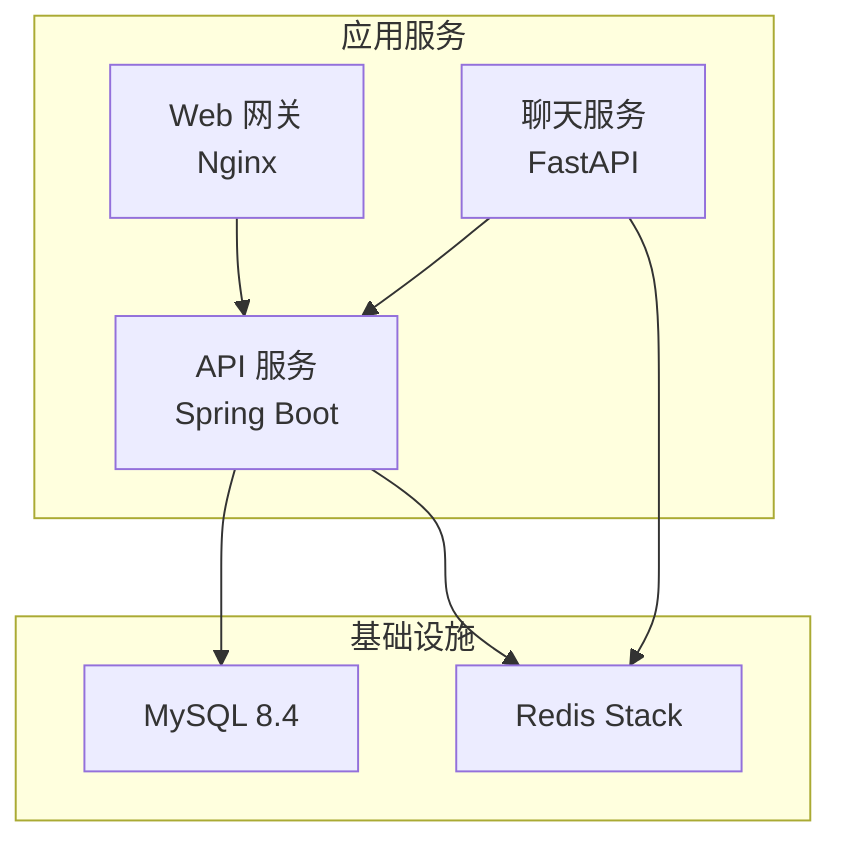
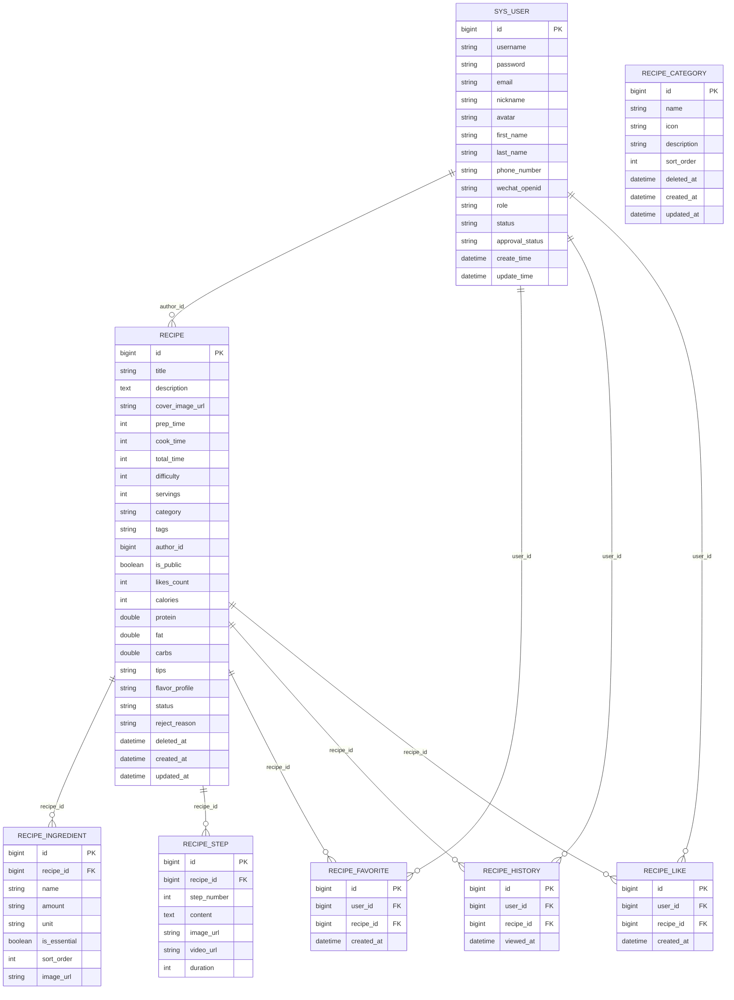
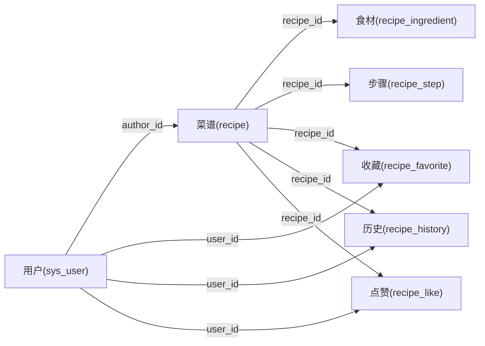

# 数据库设计

<cite>
**本文引用的文件**   
- [docker-compose.yml](file://docker-compose.yml)
- [User.java](file://services/api/identity/src/main/java/com/goodzheng/po/identity/entity/User.java)
- [Recipe.java](file://services/api/recipe/src/main/java/com/goodzheng/po/recipe/entity/Recipe.java)
- [RecipeCategory.java](file://services/api/recipe/src/main/java/com/goodzheng/po/recipe/entity/RecipeCategory.java)
- [Ingredient.java](file://services/api/recipe/src/main/java/com/goodzheng/po/recipe/entity/Ingredient.java)
- [Step.java](file://services/api/recipe/src/main/java/com/goodzheng/po/recipe/entity/Step.java)
- [RecipeFavorite.java](file://services/api/recipe/src/main/java/com/goodzheng/po/recipe/entity/RecipeFavorite.java)
- [RecipeHistory.java](file://services/api/recipe/src/main/java/com/goodzheng/po/recipe/entity/RecipeHistory.java)
- [RecipeLike.java](file://services/api/recipe/src/main/java/com/goodzheng/po/recipe/entity/RecipeLike.java)
- [data-category.sql](file://services/api/recipe/src/main/resources/data-category.sql)
- [data-chuan.sql](file://services/api/recipe/src/main/resources/data-chuan.sql)
- [data-gan.sql](file://services/api/recipe/src/main/resources/data-gan.sql)
- [data-hunan.sql](file://services/api/recipe/src/main/resources/data-hunan.sql)
- [data-xiang-a.sql](file://services/api/recipe/src/main/resources/data-xiang-a.sql)
- [data-xiang-b.sql](file://services/api/recipe/src/main/resources/data-xiang-b.sql)
- [data-cover-backfill.sql](file://services/api/recipe/src/main/resources/data-cover-backfill.sql)
- [data-ingredient-backfill.sql](file://services/api/recipe/src/main/resources/data-ingredient-backfill.sql)
- [RecipeMapper.xml](file://services/api/recipe/src/main/resources/mapper/RecipeMapper.xml)
- [RecipeFavoriteMapper.xml](file://services/api/recipe/src/main/resources/mapper/RecipeFavoriteMapper.xml)
- [RecipeHistoryMapper.xml](file://services/api/recipe/src/main/resources/mapper/RecipeHistoryMapper.xml)
</cite>

## 目录
1. [引言](#引言)
2. [项目结构](#项目结构)
3. [核心实体与表结构](#核心实体与表结构)
4. [架构总览](#架构总览)
5. [详细组件分析](#详细组件分析)
6. [依赖关系分析](#依赖关系分析)
7. [MyBatis-Plus 配置与 SQL 映射](#mybatis-plus-配置与-sql-映射)
8. [数据初始化脚本与迁移策略](#数据初始化脚本与迁移策略)
9. [性能优化建议](#性能优化建议)
10. [数据完整性、事务与并发控制](#数据完整性事务与并发控制)
11. [备份恢复方案](#备份恢复方案)
12. [故障排查指南](#故障排查指南)
13. [结论](#结论)

## 引言
本技术文档聚焦于 MySQL 数据库设计，覆盖用户、菜谱、分类、食材等核心实体的 ER 关系、字段定义、索引策略、MyBatis-Plus 映射、SQL 初始化脚本、数据迁移策略、备份恢复方案、性能优化建议，以及数据完整性约束、事务管理与并发控制机制。读者无需深入代码即可理解整体数据模型与运维要点。

## 项目结构
本项目采用多服务架构：API 服务（Spring Boot）负责业务逻辑与数据访问，MySQL 作为持久化存储，Redis 用于缓存与会话等场景，前端通过 Nginx 网关暴露。数据库相关代码集中在 API 服务的 identity 与 recipe 模块中，实体类使用 MyBatis-Plus 注解映射到 MySQL 表；SQL 初始化脚本位于 recipe 模块的 resources 目录下。

图表来源
- [docker-compose.yml:8-134](file://docker-compose.yml#L8-L134)

章节来源
- [docker-compose.yml:1-134](file://docker-compose.yml#L1-L134)

## 核心实体与表结构
本节梳理核心实体与其对应的 MySQL 表结构，包括主键、关键字段、软删除与时间戳策略。

- 用户表 sys_user
  - 主键：id（自增）
  - 关键字段：username、password、email、nickname、avatar、firstName、lastName、phoneNumber、wechatOpenid
  - 角色与状态：role（superadmin/admin/user）、status（active/inactive/invited/suspended）、approvalStatus（pending/approved/rejected）
  - 审计字段：createTime（创建时填充，不可更新）、updateTime（自动更新）

- 菜谱表 recipe
  - 主键：id（自增）
  - 基本信息：title、description、coverImageUrl
  - 时间与难度：prepTime、cookTime、totalTime、difficulty（1-简单/2-中等/3-困难）、servings
  - 分类与标签：category、tags（逗号分隔字符串）
  - 作者与可见性：authorId、isPublic
  - 统计与营养：likesCount、calories、protein、fat、carbs
  - 扩展信息：tips、flavorProfile
  - 审核流：status（pending/approved/rejected）、rejectReason
  - 软删除：deletedAt
  - 审计字段：createdAt（不可更新）、updatedAt（自动更新）
  - 非表字段（由 Service 层填充）：ingredients、steps、isFavorited、isLiked、favoritedAt、viewedAt

- 分类表 recipe_category
  - 主键：id（自增）
  - 字段：name、icon、description、sortOrder
  - 软删除：deletedAt
  - 审计字段：createdAt（不可更新）、updatedAt（自动更新）

- 食材表 recipe_ingredient
  - 主键：id（自增）
  - 关联：recipeId（外键）
  - 字段：name、amount、unit、isEssential（必需/可选）、sortOrder、imageUrl

- 步骤表 recipe_step
  - 主键：id（自增）
  - 关联：recipeId（外键）
  - 字段：stepNumber、content、imageUrl、videoUrl、duration

- 收藏表 recipe_favorite
  - 主键：id（自增）
  - 关联：userId、recipeId
  - 字段：createdAt

- 浏览历史表 recipe_history
  - 主键：id（自增）
  - 关联：userId、recipeId
  - 字段：viewedAt（重复浏览同一路径时覆盖更新）

- 点赞表 recipe_like
  - 主键：id（自增）
  - 关联：userId、recipeId
  - 字段：createdAt

章节来源
- [User.java:13-55](file://services/api/identity/src/main/java/com/goodzheng/po/identity/entity/User.java#L13-L55)
- [Recipe.java:15-102](file://services/api/recipe/src/main/java/com/goodzheng/po/recipe/entity/Recipe.java#L15-L102)
- [RecipeCategory.java:13-42](file://services/api/recipe/src/main/java/com/goodzheng/po/recipe/entity/RecipeCategory.java#L13-L42)
- [Ingredient.java:9-34](file://services/api/recipe/src/main/java/com/goodzheng/po/recipe/entity/Ingredient.java#L9-L34)
- [Step.java:9-30](file://services/api/recipe/src/main/java/com/goodzheng/po/recipe/entity/Step.java#L9-L30)
- [RecipeFavorite.java:10-22](file://services/api/recipe/src/main/java/com/goodzheng/po/recipe/entity/RecipeFavorite.java#L10-L22)
- [RecipeHistory.java:10-23](file://services/api/recipe/src/main/java/com/goodzheng/po/recipe/entity/RecipeHistory.java#L10-L23)
- [RecipeLike.java:10-22](file://services/api/recipe/src/main/java/com/goodzheng/po/recipe/entity/RecipeLike.java#L10-L22)

## 架构总览
下图展示核心实体之间的 ER 关系，体现一对多、多对一及用户与菜谱的交互关系。

图表来源
- [User.java:13-55](file://services/api/identity/src/main/java/com/goodzheng/po/identity/entity/User.java#L13-L55)
- [Recipe.java:15-102](file://services/api/recipe/src/main/java/com/goodzheng/po/recipe/entity/Recipe.java#L15-L102)
- [RecipeCategory.java:13-42](file://services/api/recipe/src/main/java/com/goodzheng/po/recipe/entity/RecipeCategory.java#L13-L42)
- [Ingredient.java:9-34](file://services/api/recipe/src/main/java/com/goodzheng/po/recipe/entity/Ingredient.java#L9-L34)
- [Step.java:9-30](file://services/api/recipe/src/main/java/com/goodzheng/po/recipe/entity/Step.java#L9-L30)
- [RecipeFavorite.java:10-22](file://services/api/recipe/src/main/java/com/goodzheng/po/recipe/entity/RecipeFavorite.java#L10-L22)
- [RecipeHistory.java:10-23](file://services/api/recipe/src/main/java/com/goodzheng/po/recipe/entity/RecipeHistory.java#L10-L23)
- [RecipeLike.java:10-22](file://services/api/recipe/src/main/java/com/goodzheng/po/recipe/entity/RecipeLike.java#L10-L22)

## 详细组件分析

### 用户实体与权限维度
- 用户实体包含基础身份信息、微信 OpenID、角色与状态机、审批流程状态。
- 时间戳字段 createTime 不允许更新，updateTime 由框架自动填充。
- 密码字段在序列化时被忽略，避免敏感信息泄露。

章节来源
- [User.java:13-55](file://services/api/identity/src/main/java/com/goodzheng/po/identity/entity/User.java#L13-L55)

### 菜谱实体与扩展属性
- 菜谱实体涵盖标题、描述、封面图、准备/烹饪/总时长、难度、份数、分类、标签、作者、公开性、点赞数、营养信息、提示、风味画像。
- 审核状态支持待审、通过、驳回，并记录驳回原因。
- 软删除字段 deletedAt 配合 Service 层过滤已删除数据。
- 非表字段 ingredients、steps、isFavorited、isLiked、favoritedAt、viewedAt 由 Service 层批量查询或聚合填充，避免复杂 JOIN。

章节来源
- [Recipe.java:15-102](file://services/api/recipe/src/main/java/com/goodzheng/po/recipe/entity/Recipe.java#L15-L102)

### 分类实体
- 分类实体提供名称、图标、描述与排序权重，便于前端按 sortOrder 展示。
- 支持软删除与审计字段。

章节来源
- [RecipeCategory.java:13-42](file://services/api/recipe/src/main/java/com/goodzheng/po/recipe/entity/RecipeCategory.java#L13-L42)

### 食材与步骤实体
- 食材实体通过 recipeId 与菜谱建立一对多关系，支持是否必需、排序与图片路径。
- 步骤实体通过 recipeId 与菜谱建立一对多关系，包含步骤序号、内容、图片、视频与耗时。

章节来源
- [Ingredient.java:9-34](file://services/api/recipe/src/main/java/com/goodzheng/po/recipe/entity/Ingredient.java#L9-L34)
- [Step.java:9-30](file://services/api/recipe/src/main/java/com/goodzheng/po/recipe/entity/Step.java#L9-L30)

### 收藏、历史与点赞实体
- 收藏表记录用户与菜谱的收藏关系，附带创建时间。
- 历史表记录用户浏览菜谱的时间，重复浏览同一路径时覆盖更新时间。
- 点赞表记录用户对菜谱的点赞关系，附带创建时间。

章节来源
- [RecipeFavorite.java:10-22](file://services/api/recipe/src/main/java/com/goodzheng/po/recipe/entity/RecipeFavorite.java#L10-L22)
- [RecipeHistory.java:10-23](file://services/api/recipe/src/main/java/com/goodzheng/po/recipe/entity/RecipeHistory.java#L10-L23)
- [RecipeLike.java:10-22](file://services/api/recipe/src/main/java/com/goodzheng/po/recipe/entity/RecipeLike.java#L10-L22)

## 依赖关系分析
- 用户与菜谱：通过 authorId 建立一对多关系，表示一个用户可以发布多个菜谱。
- 菜谱与食材/步骤：通过 recipeId 建立一对多关系，一个菜谱可包含多个食材与步骤。
- 用户与菜谱互动：收藏、历史、点赞均通过 userId 与 recipeId 建立多对多关系的中间表。

图表来源
- [User.java:13-55](file://services/api/identity/src/main/java/com/goodzheng/po/identity/entity/User.java#L13-L55)
- [Recipe.java:15-102](file://services/api/recipe/src/main/java/com/goodzheng/po/recipe/entity/Recipe.java#L15-L102)
- [Ingredient.java:9-34](file://services/api/recipe/src/main/java/com/goodzheng/po/recipe/entity/Ingredient.java#L9-L34)
- [Step.java:9-30](file://services/api/recipe/src/main/java/com/goodzheng/po/recipe/entity/Step.java#L9-L30)
- [RecipeFavorite.java:10-22](file://services/api/recipe/src/main/java/com/goodzheng/po/recipe/entity/RecipeFavorite.java#L10-L22)
- [RecipeHistory.java:10-23](file://services/api/recipe/src/main/java/com/goodzheng/po/recipe/entity/RecipeHistory.java#L10-L23)
- [RecipeLike.java:10-22](file://services/api/recipe/src/main/java/com/goodzheng/po/recipe/entity/RecipeLike.java#L10-L22)

## MyBatis-Plus 配置与 SQL 映射
- 实体类通过 @TableName、@TableId、@TableField 等注解完成表与字段的映射。
- 时间戳字段 createTime 使用 updateStrategy=NEVER 防止被意外更新；updateTime 使用 fill=UPDATE 由框架自动填充。
- 非表字段使用 exist=false 标记，避免参与 SQL 生成。
- 自定义 SQL 映射文件位于 mapper 目录，用于复杂查询与聚合操作。

章节来源
- [User.java:13-55](file://services/api/identity/src/main/java/com/goodzheng/po/identity/entity/User.java#L13-L55)
- [Recipe.java:15-102](file://services/api/recipe/src/main/java/com/goodzheng/po/recipe/entity/Recipe.java#L15-L102)
- [RecipeCategory.java:13-42](file://services/api/recipe/src/main/java/com/goodzheng/po/recipe/entity/RecipeCategory.java#L13-L42)
- [Ingredient.java:9-34](file://services/api/recipe/src/main/java/com/goodzheng/po/recipe/entity/Ingredient.java#L9-L34)
- [Step.java:9-30](file://services/api/recipe/src/main/java/com/goodzheng/po/recipe/entity/Step.java#L9-L30)
- [RecipeFavorite.java:10-22](file://services/api/recipe/src/main/java/com/goodzheng/po/recipe/entity/RecipeFavorite.java#L10-L22)
- [RecipeHistory.java:10-23](file://services/api/recipe/src/main/java/com/goodzheng/po/recipe/entity/RecipeHistory.java#L10-L23)
- [RecipeLike.java:10-22](file://services/api/recipe/src/main/java/com/goodzheng/po/recipe/entity/RecipeLike.java#L10-L22)
- [RecipeMapper.xml](file://services/api/recipe/src/main/resources/mapper/RecipeMapper.xml)
- [RecipeFavoriteMapper.xml](file://services/api/recipe/src/main/resources/mapper/RecipeFavoriteMapper.xml)
- [RecipeHistoryMapper.xml](file://services/api/recipe/src/main/resources/mapper/RecipeHistoryMapper.xml)

## 数据初始化脚本与迁移策略
- 分类与菜谱数据初始化脚本位于 recipe 模块 resources 目录，包含不同菜系的数据集（川、湘、赣、湖等），以及分类、封面回补、食材回补等脚本。
- 推荐迁移策略：
  - 将 DDL 与 DML 分离：DDL 变更走版本化迁移工具（如 Flyway/Liquibase），DML 初始化脚本按环境分目录管理。
  - 增量更新：新增字段或表时，先写迁移脚本，再在 CI 中执行，确保多环境一致。
  - 回滚策略：为每个迁移脚本编写反向脚本，保证可回滚。
  - 数据校验：迁移后运行一致性检查（如计数、空值、外键约束）。

章节来源
- [data-category.sql](file://services/api/recipe/src/main/resources/data-category.sql)
- [data-chuan.sql](file://services/api/recipe/src/main/resources/data-chuan.sql)
- [data-gan.sql](file://services/api/recipe/src/main/resources/data-gan.sql)
- [data-hunan.sql](file://services/api/recipe/src/main/resources/data-hunan.sql)
- [data-xiang-a.sql](file://services/api/recipe/src/main/resources/data-xiang-a.sql)
- [data-xiang-b.sql](file://services/api/recipe/src/main/resources/data-xiang-b.sql)
- [data-cover-backfill.sql](file://services/api/recipe/src/main/resources/data-cover-backfill.sql)
- [data-ingredient-backfill.sql](file://services/api/recipe/src/main/resources/data-ingredient-backfill.sql)

## 性能优化建议
- 索引策略
  - 主键：所有表的主键 id 默认聚簇索引。
  - 外键索引：recipe_ingredient.recipe_id、recipe_step.recipe_id、recipe_favorite.user_id/recipe_id、recipe_history.user_id/recipe_id、recipe_like.user_id/recipe_id 应建普通索引以加速关联查询。
  - 查询热点：recipe.title、recipe.category、recipe.tags、recipe.status、recipe.is_public、recipe.created_at、recipe.updated_at 建议根据查询模式建立复合索引。
  - 用户表：sys_user.username、sys_user.email、sys_user.wechat_openid 建议唯一索引以保证身份唯一性。
- 查询优化
  - 分页查询：使用合理分页参数，避免深分页；必要时使用延迟关联或覆盖索引。
  - 批量操作：批量插入食材与步骤，减少往返次数。
  - 非表字段填充：Service 层批量加载 ingredients/steps/isFavorited/isLiked/favoritedAt/viewedAt，避免多次 JOIN。
- 存储优化
  - 大文本字段：description、tips、flavorProfile 若较长，考虑单独表或对象存储链接。
  - 图片与视频：imageUrl/videoUrl 指向对象存储，不在数据库中存二进制。
- 连接池与超时
  - 调整 HikariCP 连接池大小、最大生命周期与空闲超时，匹配数据库容量与请求峰值。

[本节为通用性能建议，不直接分析具体文件]

## 数据完整性、事务与并发控制
- 数据完整性
  - 外键约束：建议在数据库层为 recipe_ingredient.recipe_id、recipe_step.recipe_id、recipe_favorite.user_id/recipe_id、recipe_history.user_id/recipe_id、recipe_like.user_id/recipe_id 建立外键约束，确保引用完整性。
  - 唯一约束：sys_user.username、sys_user.email、sys_user.wechat_openid 应唯一；recipe_favorite(user_id, recipe_id)、recipe_like(user_id, recipe_id) 应唯一，防止重复收藏与点赞。
  - 检查约束：recipe.difficulty 应在 1-3 范围内；recipe.status 应为枚举值之一。
- 事务管理
  - 写操作（创建/更新/删除）应包裹在事务中，确保原子性与一致性。
  - 批量写入（如导入菜谱及其食材、步骤）建议使用事务边界与分批提交，避免长事务锁表。
- 并发控制
  - 乐观锁：对高频更新字段（如 likes_count）可使用版本号或 CAS 更新，减少锁竞争。
  - 悲观锁：在关键业务点（如审核状态变更）使用行级锁，避免竞态条件。
  - 去重幂等：收藏、点赞接口需实现幂等性，基于唯一索引或分布式锁保证。

[本节为通用规范说明，不直接分析具体文件]

## 备份恢复方案
- 全量备份
  - 使用 mysqldump 定期导出全量数据，保留最近若干份快照。
  - 结合 docker-compose 卷挂载，将备份文件落盘至宿主机或对象存储。
- 增量备份
  - 开启 MySQL binlog，按时间点进行增量恢复。
- 恢复演练
  - 定期在测试环境执行恢复演练，验证备份可用性与恢复时长。
- 容灾策略
  - 跨机房复制或多实例主从，提升可用性。
  - 备份文件加密与访问控制，保障数据安全。

[本节为通用运维建议，不直接分析具体文件]

## 故障排查指南
- 常见问题
  - 连接失败：检查环境变量 SPRING_DATASOURCE_URL/USERNAME/PASSWORD 是否正确注入。
  - 健康检查失败：确认 MySQL 与 Redis 服务健康探针正常。
  - 数据不一致：核对实体注解与表结构是否一致，检查 Mapper XML 中的 SQL 是否与业务语义匹配。
- 定位方法
  - 查看容器日志与数据库慢查询日志。
  - 使用 EXPLAIN 分析慢查询，补充缺失索引。
  - 校验外键与唯一约束冲突，定位脏数据。

章节来源
- [docker-compose.yml:44-82](file://docker-compose.yml#L44-L82)

## 结论
本数据库设计围绕用户、菜谱、分类、食材、步骤、收藏、历史、点赞等核心实体展开，采用 MyBatis-Plus 注解映射与自定义 SQL 映射文件相结合的方式，兼顾简洁性与灵活性。通过合理的索引策略、事务与并发控制、数据完整性约束，以及完善的初始化脚本与迁移策略，系统可在高并发与大数据量场景下保持稳定与高效。后续建议引入版本化迁移工具与自动化备份恢复流程，进一步提升可维护性与可靠性。