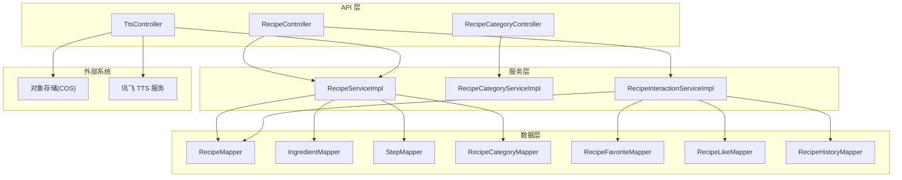
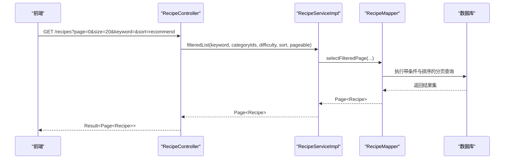
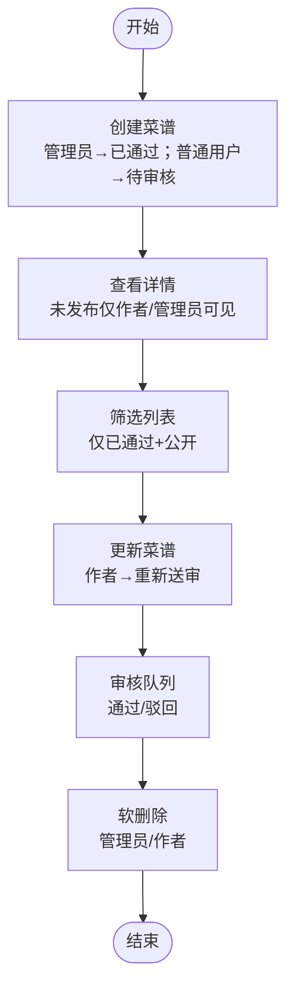
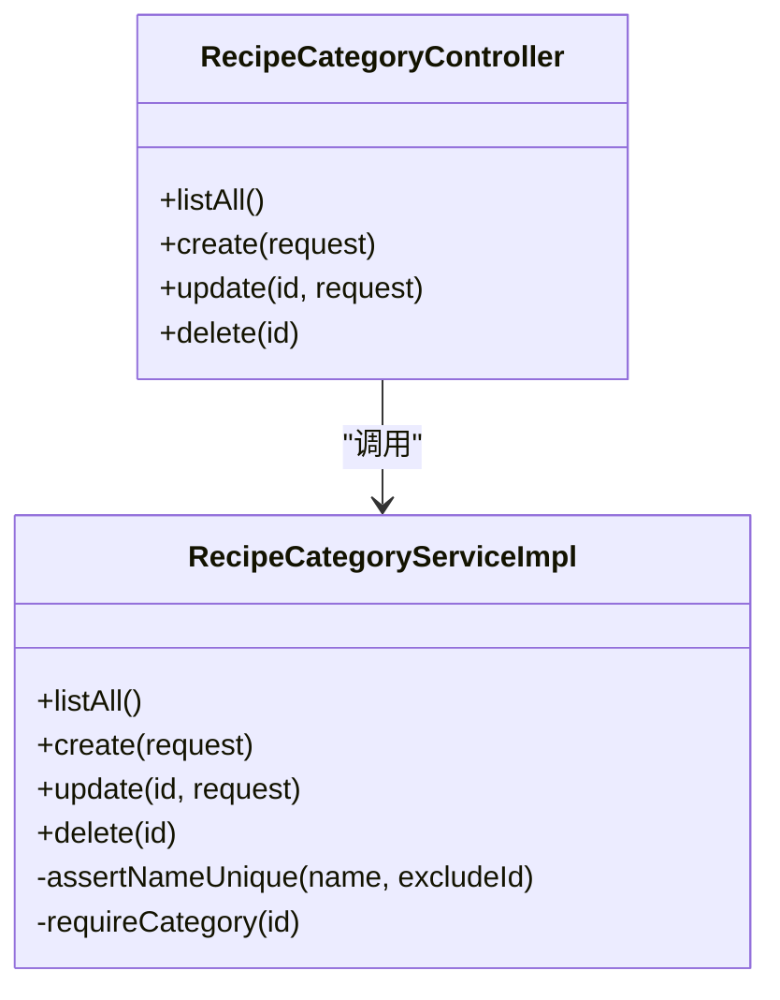
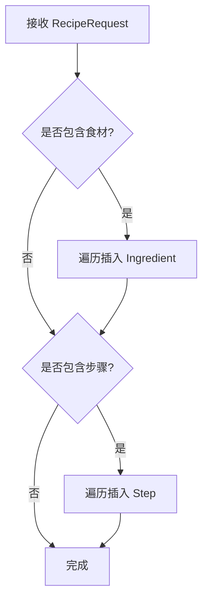
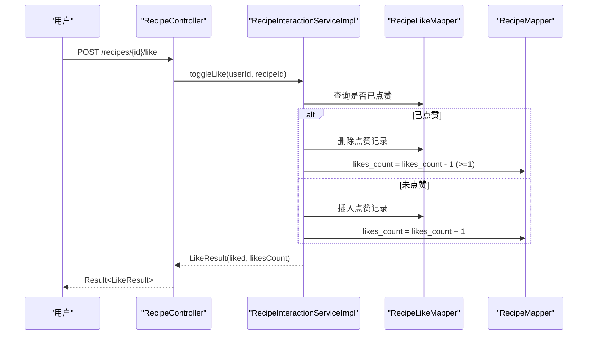
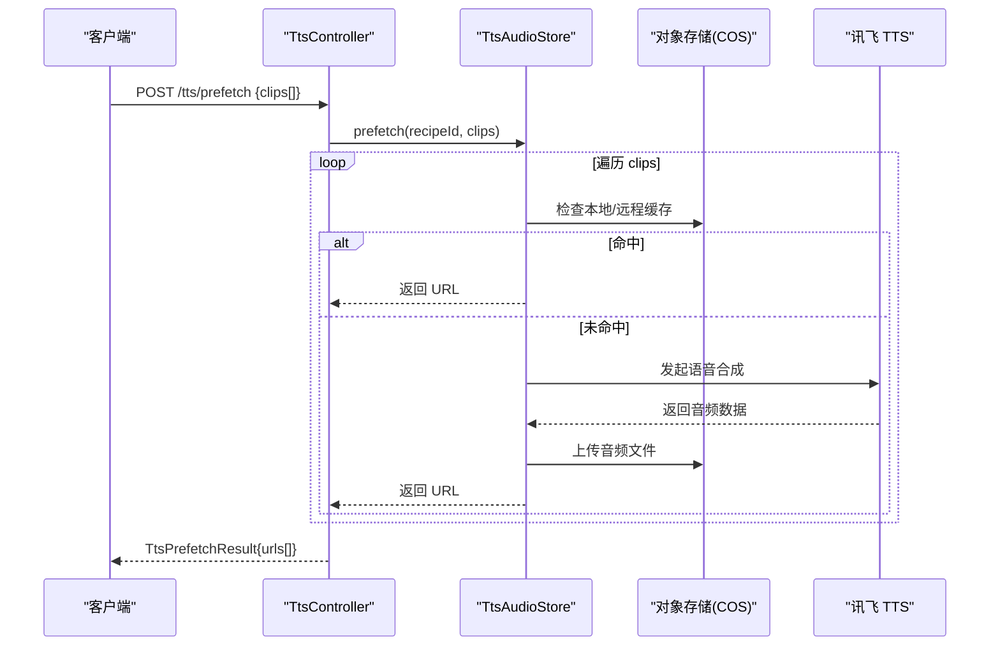
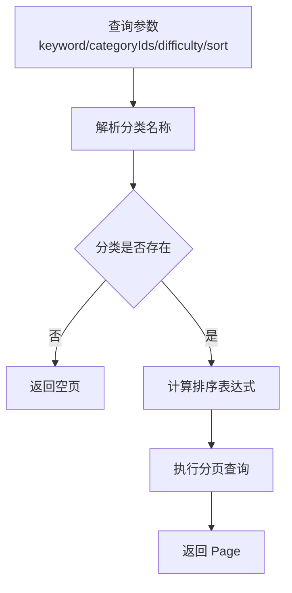
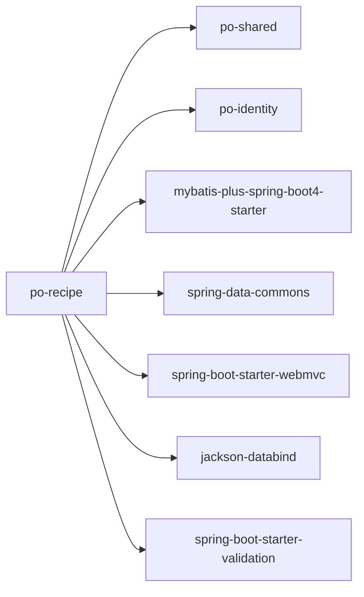

# 菜谱管理模块

<cite>
**本文引用的文件**   
- [pom.xml](file://services/api/recipe/pom.xml)
- [recipe.ts](file://packages/types/src/recipe.ts)
- [RecipeController.java](file://services/api/recipe/src/main/java/com/goodzheng/po/recipe/controller/RecipeController.java)
- [RecipeCategoryController.java](file://services/api/recipe/src/main/java/com/goodzheng/po/recipe/controller/RecipeCategoryController.java)
- [TtsController.java](file://services/api/recipe/src/main/java/com/goodzheng/po/recipe/controller/TtsController.java)
- [RecipeServiceImpl.java](file://services/api/recipe/src/main/java/com/goodzheng/po/recipe/service/impl/RecipeServiceImpl.java)
- [RecipeCategoryServiceImpl.java](file://services/api/recipe/src/main/java/com/goodzheng/po/recipe/service/impl/RecipeCategoryServiceImpl.java)
- [RecipeInteractionServiceImpl.java](file://services/api/recipe/src/main/java/com/goodzheng/po/recipe/service/impl/RecipeInteractionServiceImpl.java)
</cite>

## 目录
1. [简介](#简介)
2. [项目结构](#项目结构)
3. [核心组件](#核心组件)
4. [架构总览](#架构总览)
5. [详细组件分析](#详细组件分析)
6. [依赖关系分析](#依赖关系分析)
7. [性能与优化](#性能与优化)
8. [故障排查](#故障排查)
9. [结论](#结论)

## 简介
本技术文档聚焦“菜谱管理模块”，覆盖以下能力：
- 菜谱 CRUD、分类管理、审核工作流（待审核/已通过/已驳回）
- 食材与步骤的关联管理
- 收藏、点赞、浏览历史等用户交互
- TTS 音频生成服务集成与预热策略
- 文件上传与图片资源管理的接入点说明
- 搜索与排序、分页查询优化、数据缓存策略建议
- 审核流程、版本管理与数据迁移方案

该模块基于 Spring Boot + MyBatis-Plus，前端类型定义位于 packages/types，API 层在 services/api/recipe。

## 项目结构
- 后端 API 模块：services/api/recipe
  - controller：REST 接口（菜谱、分类、TTS）
  - service/impl：业务实现（菜谱、分类、互动）
  - entity/repository/dto/tts：领域模型、持久化映射、数据传输对象、TTS 客户端
- 前端类型定义：packages/types/src/recipe.ts
- 构建与依赖：services/api/recipe/pom.xml

图表来源
- [RecipeController.java:30-229](file://services/api/recipe/src/main/java/com/goodzheng/po/recipe/controller/RecipeController.java#L30-L229)
- [RecipeCategoryController.java:24-73](file://services/api/recipe/src/main/java/com/goodzheng/po/recipe/controller/RecipeCategoryController.java#L24-L73)
- [TtsController.java:24-77](file://services/api/recipe/src/main/java/com/goodzheng/po/recipe/controller/TtsController.java#L24-L77)
- [RecipeServiceImpl.java:26-249](file://services/api/recipe/src/main/java/com/goodzheng/po/recipe/service/impl/RecipeServiceImpl.java#L26-L249)
- [RecipeCategoryServiceImpl.java:17-91](file://services/api/recipe/src/main/java/com/goodzheng/po/recipe/service/impl/RecipeCategoryServiceImpl.java#L17-L91)
- [RecipeInteractionServiceImpl.java:27-155](file://services/api/recipe/src/main/java/com/goodzheng/po/recipe/service/impl/RecipeInteractionServiceImpl.java#L27-L155)

章节来源
- [pom.xml:17-55](file://services/api/recipe/pom.xml#L17-L55)
- [recipe.ts:1-155](file://packages/types/src/recipe.ts#L1-L155)

## 核心组件
- 菜谱控制器：提供创建、详情、筛选列表、我的菜谱、收藏、历史、审核队列、审核操作、更新、删除、点赞等接口
- 分类控制器：公开查询分类；管理员增删改分类
- TTS 控制器：单条合成与批量预热，返回可公网访问的音频 URL
- 菜谱服务：CRUD、审核状态流转、可见性判断、排序与过滤、子实体（食材/步骤）保存
- 分类服务：分类 CRUD、名称唯一性校验、软删除保护
- 互动服务：收藏/取消收藏、点赞切换、浏览历史、批量填充收藏/点赞标记

章节来源
- [RecipeController.java:30-229](file://services/api/recipe/src/main/java/com/goodzheng/po/recipe/controller/RecipeController.java#L30-L229)
- [RecipeCategoryController.java:24-73](file://services/api/recipe/src/main/java/com/goodzheng/po/recipe/controller/RecipeCategoryController.java#L24-L73)
- [TtsController.java:24-77](file://services/api/recipe/src/main/java/com/goodzheng/po/recipe/controller/TtsController.java#L24-L77)
- [RecipeServiceImpl.java:26-249](file://services/api/recipe/src/main/java/com/goodzheng/po/recipe/service/impl/RecipeServiceImpl.java#L26-L249)
- [RecipeCategoryServiceImpl.java:17-91](file://services/api/recipe/src/main/java/com/goodzheng/po/recipe/service/impl/RecipeCategoryServiceImpl.java#L17-L91)
- [RecipeInteractionServiceImpl.java:27-155](file://services/api/recipe/src/main/java/com/goodzheng/po/recipe/service/impl/RecipeInteractionServiceImpl.java#L27-L155)

## 架构总览
- 控制层接收请求，进行参数校验与权限判断
- 服务层封装业务规则：审核状态、可见性、排序算法、子实体一致性
- 数据层通过 MyBatis-Plus Mapper 执行 SQL，支持分页与复杂查询
- TTS 服务通过独立控制器暴露，结合对象存储返回公网 URL
- 前端类型定义统一了前后端数据结构契约

图表来源
- [RecipeController.java:72-90](file://services/api/recipe/src/main/java/com/goodzheng/po/recipe/controller/RecipeController.java#L72-L90)
- [RecipeServiceImpl.java:61-74](file://services/api/recipe/src/main/java/com/goodzheng/po/recipe/service/impl/RecipeServiceImpl.java#L61-L74)

## 详细组件分析

### 菜谱 CRUD 与审核流程
- 创建：管理员直接通过；普通用户创建进入待审核
- 详情：未发布仅作者或管理员可见；登录浏览计入历史
- 列表：公开列表仅展示已通过且公开的菜谱；支持关键词、分类、难度、排序
- 更新：管理员任意；作者修改后重新送审
- 删除：软删除；管理员任意，作者只能删自己的
- 审核：管理员通过/驳回（需原因），并更新状态与驳回原因

图表来源
- [RecipeController.java:38-209](file://services/api/recipe/src/main/java/com/goodzheng/po/recipe/controller/RecipeController.java#L38-L209)
- [RecipeServiceImpl.java:35-159](file://services/api/recipe/src/main/java/com/goodzheng/po/recipe/service/impl/RecipeServiceImpl.java#L35-L159)

章节来源
- [RecipeController.java:38-209](file://services/api/recipe/src/main/java/com/goodzheng/po/recipe/controller/RecipeController.java#L38-L209)
- [RecipeServiceImpl.java:35-159](file://services/api/recipe/src/main/java/com/goodzheng/po/recipe/service/impl/RecipeServiceImpl.java#L35-L159)

### 分类管理
- 公开查询所有分类（无需登录）
- 管理员新增/更新/删除分类
- 删除保护：若仍有菜谱引用该分类名，则拒绝删除
- 名称唯一性校验

图表来源
- [RecipeCategoryController.java:24-73](file://services/api/recipe/src/main/java/com/goodzheng/po/recipe/controller/RecipeCategoryController.java#L24-L73)
- [RecipeCategoryServiceImpl.java:17-91](file://services/api/recipe/src/main/java/com/goodzheng/po/recipe/service/impl/RecipeCategoryServiceImpl.java#L17-L91)

章节来源
- [RecipeCategoryController.java:24-73](file://services/api/recipe/src/main/java/com/goodzheng/po/recipe/controller/RecipeCategoryController.java#L24-L73)
- [RecipeCategoryServiceImpl.java:17-91](file://services/api/recipe/src/main/java/com/goodzheng/po/recipe/service/impl/RecipeCategoryServiceImpl.java#L17-L91)

### 食材与步骤管理
- 创建/更新时，将食材与步骤作为子实体写入对应表
- 更新时采用“先删后插”策略，保证与前端提交一致
- 字段包含数量、单位、是否必需、排序、图片/视频链接、时长等

图表来源
- [RecipeServiceImpl.java:200-228](file://services/api/recipe/src/main/java/com/goodzheng/po/recipe/service/impl/RecipeServiceImpl.java#L200-L228)

章节来源
- [RecipeServiceImpl.java:200-228](file://services/api/recipe/src/main/java/com/goodzheng/po/recipe/service/impl/RecipeServiceImpl.java#L200-L228)

### 收藏、点赞与历史
- 收藏：幂等插入，并发重复使用唯一键兜底
- 点赞：切换逻辑，原子增减 likes_count，防止负数
- 历史：浏览记录 upsert，仅对可见菜谱生效
- 批量填充：根据当前用户 ID 批量查询收藏/点赞集合，填充 isFavorited/isLiked

图表来源
- [RecipeController.java:176-185](file://services/api/recipe/src/main/java/com/goodzheng/po/recipe/controller/RecipeController.java#L176-L185)
- [RecipeInteractionServiceImpl.java:74-106](file://services/api/recipe/src/main/java/com/goodzheng/po/recipe/service/impl/RecipeInteractionServiceImpl.java#L74-L106)

章节来源
- [RecipeInteractionServiceImpl.java:37-147](file://services/api/recipe/src/main/java/com/goodzheng/po/recipe/service/impl/RecipeInteractionServiceImpl.java#L37-L147)

### TTS 音频生成与预热
- 单条合成：根据文本生成 MP3，返回腾讯云 COS 公网 URL
- 批量预热：进入做菜模式时预合成多条播报，已有条目立即返回 URL，缺失项后台异步合成
- 限制单次预热条数上限，避免异常请求

图表来源
- [TtsController.java:39-76](file://services/api/recipe/src/main/java/com/goodzheng/po/recipe/controller/TtsController.java#L39-L76)

章节来源
- [TtsController.java:39-76](file://services/api/recipe/src/main/java/com/goodzheng/po/recipe/controller/TtsController.java#L39-L76)

### 文件上传与图片资源管理
- 菜谱封面、食材图片、步骤图片/视频等资源由前端上传至对象存储（如腾讯云 COS），并将 URL 回填到菜谱/食材/步骤字段
- 后端不直接处理上传逻辑，但会在创建/更新时持久化这些 URL
- 建议在上传侧增加：
  - 文件大小与类型校验
  - 安全命名与路径隔离（按用户/菜谱维度）
  - 防盗链与 CDN 加速
  - 失败重试与断点续传

章节来源
- [RecipeServiceImpl.java:200-228](file://services/api/recipe/src/main/java/com/goodzheng/po/recipe/service/impl/RecipeServiceImpl.java#L200-L228)

### 搜索与排序、分页优化
- 搜索：支持关键词、分类、难度筛选；分类通过名称匹配
- 排序：推荐（点赞加权-时间衰减）、点赞数降序、最新发布
- 分页：基于 MyBatis-Plus 分页对象转换，减少内存占用

图表来源
- [RecipeServiceImpl.java:61-74](file://services/api/recipe/src/main/java/com/goodzheng/po/recipe/service/impl/RecipeServiceImpl.java#L61-L74)
- [RecipeServiceImpl.java:163-173](file://services/api/recipe/src/main/java/com/goodzheng/po/recipe/service/impl/RecipeServiceImpl.java#L163-L173)

章节来源
- [RecipeServiceImpl.java:61-74](file://services/api/recipe/src/main/java/com/goodzheng/po/recipe/service/impl/RecipeServiceImpl.java#L61-L74)
- [RecipeServiceImpl.java:163-173](file://services/api/recipe/src/main/java/com/goodzheng/po/recipe/service/impl/RecipeServiceImpl.java#L163-L173)

## 依赖关系分析
- 模块依赖：po-recipe 依赖 po-shared（通用 DTO、MyBatisPages、对象存储配置）与 po-identity（认证与安全）
- 运行时依赖：Spring Web MVC、MyBatis-Plus、Jackson Databind（TTS JSON 分帧）、Validation、Lombok
- 前端契约：packages/types 定义了 Recipe、Ingredient、Step、分类、审核请求、点赞结果等类型

图表来源
- [pom.xml:17-55](file://services/api/recipe/pom.xml#L17-L55)

章节来源
- [pom.xml:17-55](file://services/api/recipe/pom.xml#L17-L55)
- [recipe.ts:1-155](file://packages/types/src/recipe.ts#L1-L155)

## 性能与优化
- 分页查询
  - 使用 MyBatis-Plus 分页对象转换，避免全量加载
  - 分类名称解析仅在必要时执行，不存在分类直接返回空页
- 排序优化
  - 推荐排序使用 SQL 函数计算点赞加权与时间衰减，减少应用层计算
- 并发安全
  - 收藏/点赞使用唯一键约束与原子计数更新，避免重复与负数
- 缓存策略建议
  - 分类列表：短 TTL 缓存（分类变更频率低）
  - 公开菜谱列表：按查询条件缓存热点页（关键词+分类+难度+排序）
  - TTS 音频：以文案哈希为键，结合对象存储做全局缓存
  - 用户互动标记：可在网关或前端做短期缓存，服务端按需刷新
- I/O 优化
  - 批量填充收藏/点赞标记，减少 N+1 查询
  - 食材/步骤更新采用“先删后插”，保证一致性

[本节为通用指导，不直接分析具体文件]

## 故障排查
- 创建/更新失败
  - 常见原因：参数校验失败、分类不存在、权限不足
  - 定位：查看控制器异常捕获与服务层抛出的运行时异常
- 审核失败
  - 驳回必须填写原因；非法审核动作会抛出异常
- 点赞/收藏异常
  - 并发重复操作会被唯一键约束拦截；计数更新使用原子 SQL 防止负数
- TTS 合成失败
  - 文本为空、上游服务异常、对象存储上传失败
  - 日志中记录 text 与错误堆栈，便于定位

章节来源
- [RecipeController.java:42-50](file://services/api/recipe/src/main/java/com/goodzheng/po/recipe/controller/RecipeController.java#L42-L50)
- [RecipeController.java:142-151](file://services/api/recipe/src/main/java/com/goodzheng/po/recipe/controller/RecipeController.java#L142-L151)
- [RecipeInteractionServiceImpl.java:74-106](file://services/api/recipe/src/main/java/com/goodzheng/po/recipe/service/impl/RecipeInteractionServiceImpl.java#L74-L106)
- [TtsController.java:44-54](file://services/api/recipe/src/main/java/com/goodzheng/po/recipe/controller/TtsController.java#L44-L54)

## 结论
菜谱管理模块围绕“内容生产—审核—分发—互动—辅助体验（TTS）”形成闭环。通过清晰的控制器/服务分层、严格的审核与可见性控制、安全的并发处理与分页优化，以及可扩展的对象存储与 TTS 集成，满足多端（Web/App/小程序）一致的菜谱管理能力。后续可进一步引入缓存、索引优化与审计日志，提升性能与可观测性。