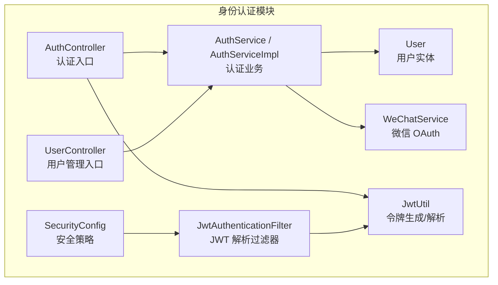
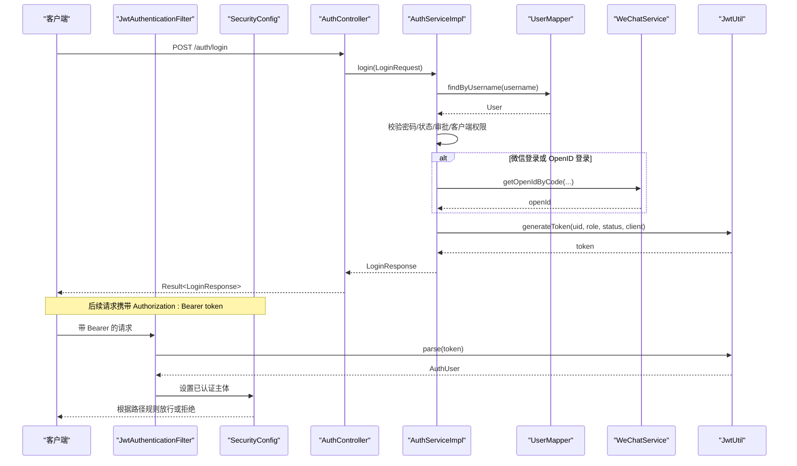
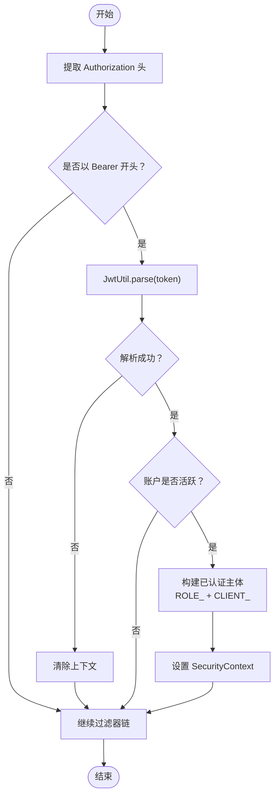
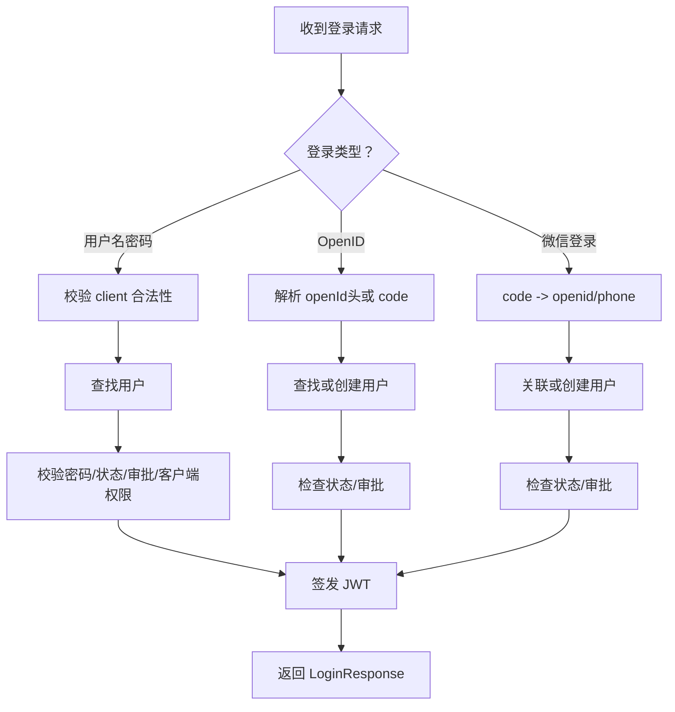
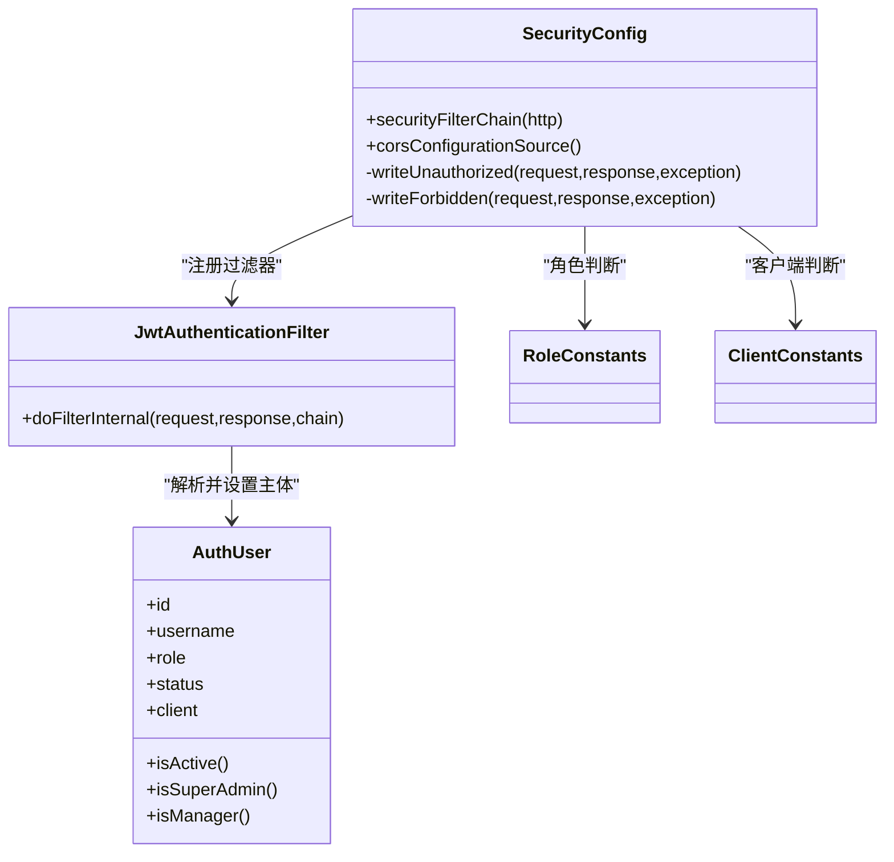
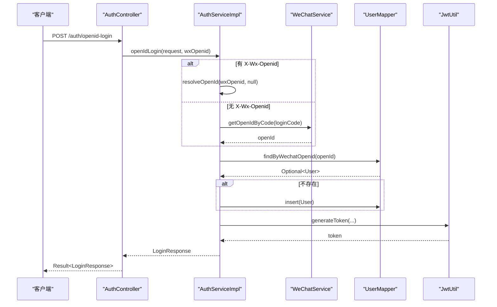
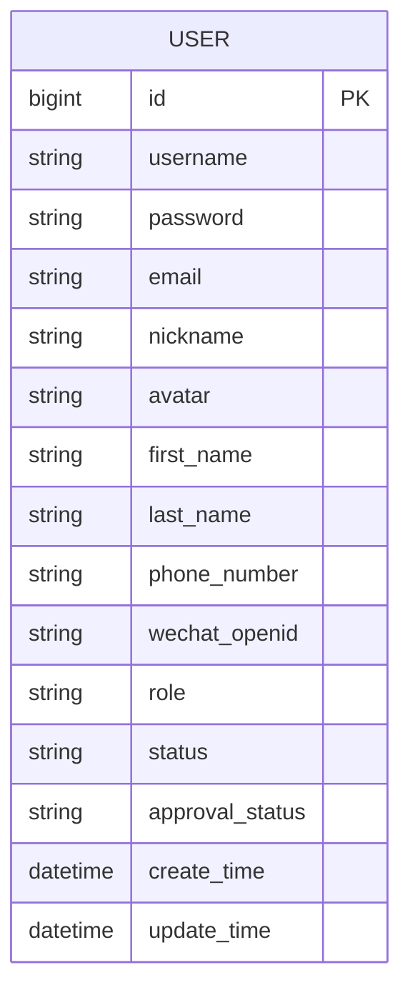
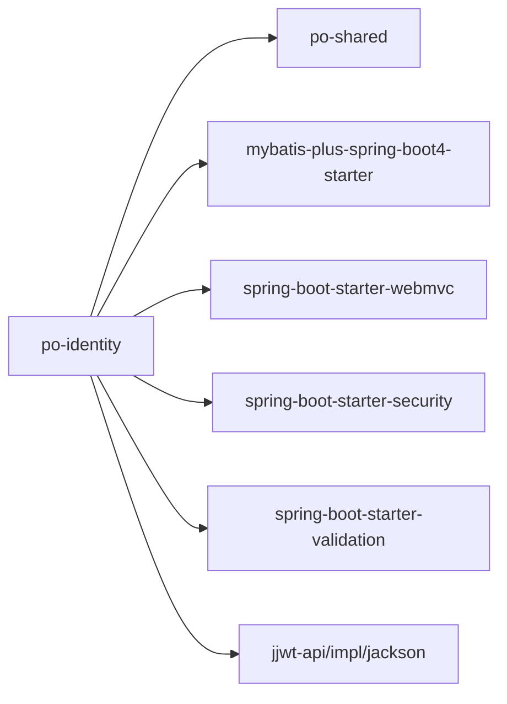

# 身份认证模块

<cite>
**本文引用的文件**   
- [pom.xml](file://services/api/identity/pom.xml)
- [AuthController.java](file://services/api/identity/src/main/java/com/goodzheng/po/identity/controller/AuthController.java)
- [UserController.java](file://services/api/identity/src/main/java/com/goodzheng/po/identity/controller/UserController.java)
- [AuthService.java](file://services/api/identity/src/main/java/com/goodzheng/po/identity/service/AuthService.java)
- [AuthServiceImpl.java](file://services/api/identity/src/main/java/com/goodzheng/po/identity/service/impl/AuthServiceImpl.java)
- [JwtUtil.java](file://services/api/identity/src/main/java/com/goodzheng/po/identity/security/JwtUtil.java)
- [JwtAuthenticationFilter.java](file://services/api/identity/src/main/java/com/goodzheng/po/identity/security/JwtAuthenticationFilter.java)
- [SecurityConfig.java](file://services/api/identity/src/main/java/com/goodzheng/po/identity/security/SecurityConfig.java)
- [AuthUser.java](file://services/api/identity/src/main/java/com/goodzheng/po/identity/security/AuthUser.java)
- [User.java](file://services/api/identity/src/main/java/com/goodzheng/po/identity/entity/User.java)
- [WeChatService.java](file://services/api/identity/src/main/java/com/goodzheng/po/identity/wechat/WeChatService.java)
- [LoginRequest.java](file://services/api/identity/src/main/java/com/goodzheng/po/identity/dto/LoginRequest.java)
- [LoginResponse.java](file://services/api/identity/src/main/java/com/goodzheng/po/identity/dto/LoginResponse.java)
</cite>

## 目录
1. [简介](#简介)
2. [项目结构](#项目结构)
3. [核心组件](#核心组件)
4. [架构总览](#架构总览)
5. [详细组件分析](#详细组件分析)
6. [依赖关系分析](#依赖关系分析)
7. [性能与可扩展性](#性能与可扩展性)
8. [故障排查指南](#故障排查指南)
9. [结论](#结论)
10. [附录：API 访问控制示例](#附录api-访问控制示例)

## 简介
本模块提供基于 JWT 的无状态身份认证、用户注册登录、微信 OAuth 登录（OpenID）、密码加密存储、角色权限模型、会话与令牌管理，以及统一的安全过滤器链与 API 访问控制。系统通过 Spring Security 过滤器链进行路径级鉴权，结合客户端来源（admin/app）与角色实现细粒度访问控制；业务层负责用户状态、审批流、账号锁定等规则。

## 项目结构
身份认证模块位于 services/api/identity 子模块中，采用分层架构：
- controller：对外暴露认证与用户管理接口
- service/impl：认证与用户业务逻辑
- security：JWT 工具、过滤器、安全配置
- entity/repository：用户实体与数据访问
- wechat：微信开放平台集成
- dto：请求与响应数据结构

图表来源
- [AuthController.java:19-79](file://services/api/identity/src/main/java/com/goodzheng/po/identity/controller/AuthController.java#L19-L79)
- [UserController.java:39-353](file://services/api/identity/src/main/java/com/goodzheng/po/identity/controller/UserController.java#L39-L353)
- [AuthService.java:9-20](file://services/api/identity/src/main/java/com/goodzheng/po/identity/service/AuthService.java#L9-L20)
- [AuthServiceImpl.java:23-199](file://services/api/identity/src/main/java/com/goodzheng/po/identity/service/impl/AuthServiceImpl.java#L23-L199)
- [SecurityConfig.java:39-134](file://services/api/identity/src/main/java/com/goodzheng/po/identity/security/SecurityConfig.java#L39-L134)
- [JwtAuthenticationFilter.java:24-57](file://services/api/identity/src/main/java/com/goodzheng/po/identity/security/JwtAuthenticationFilter.java#L24-L57)
- [JwtUtil.java:13-59](file://services/api/identity/src/main/java/com/goodzheng/po/identity/security/JwtUtil.java#L13-L59)
- [WeChatService.java:17-144](file://services/api/identity/src/main/java/com/goodzheng/po/identity/wechat/WeChatService.java#L17-L144)
- [User.java:13-56](file://services/api/identity/src/main/java/com/goodzheng/po/identity/entity/User.java#L13-L56)

章节来源
- [pom.xml:17-67](file://services/api/identity/pom.xml#L17-L67)

## 核心组件
- 认证控制器 AuthController：提供用户名密码登录、App 注册、OpenID 登录、微信登录等入口，统一返回 Result 包装体。
- 用户控制器 UserController：提供当前用户资料更新、头像上传、密码修改、管理员用户管理等能力，并在方法内做业务权限校验。
- 认证服务 AuthServiceImpl：封装注册、登录、微信/OpenID 登录、审批状态处理、JWT 签发；使用 BCryptPasswordEncoder 对密码进行哈希存储。
- 安全配置 SecurityConfig：定义无状态会话、CORS、路径授权规则、异常处理器，并注入 JwtAuthenticationFilter。
- JWT 工具 JwtUtil：基于 HMAC-SHA 签名生成和解析令牌，携带 uid、role、status、client 等声明。
- 认证过滤器 JwtAuthenticationFilter：从 Authorization Bearer 头解析令牌，构建已认证主体并设置角色与客户端来源。
- 微信服务 WeChatService：封装 jscode2session、access_token 缓存、手机号解密等能力。
- 用户实体 User：包含用户名、密码、邮箱、昵称、头像、OpenID、角色、状态、审批状态等字段。

章节来源
- [AuthController.java:19-79](file://services/api/identity/src/main/java/com/goodzheng/po/identity/controller/AuthController.java#L19-L79)
- [UserController.java:39-353](file://services/api/identity/src/main/java/com/goodzheng/po/identity/controller/UserController.java#L39-L353)
- [AuthServiceImpl.java:23-199](file://services/api/identity/src/main/java/com/goodzheng/po/identity/service/impl/AuthServiceImpl.java#L23-L199)
- [SecurityConfig.java:39-134](file://services/api/identity/src/main/java/com/goodzheng/po/identity/security/SecurityConfig.java#L39-L134)
- [JwtUtil.java:13-59](file://services/api/identity/src/main/java/com/goodzheng/po/identity/security/JwtUtil.java#L13-L59)
- [JwtAuthenticationFilter.java:24-57](file://services/api/identity/src/main/java/com/goodzheng/po/identity/security/JwtAuthenticationFilter.java#L24-L57)
- [WeChatService.java:17-144](file://services/api/identity/src/main/java/com/goodzheng/po/identity/wechat/WeChatService.java#L17-L144)
- [User.java:13-56](file://services/api/identity/src/main/java/com/goodzheng/po/identity/entity/User.java#L13-L56)

## 架构总览
系统采用“控制器 → 服务 → 数据访问”的分层模式，并通过 Spring Security 过滤器链在请求进入控制器前完成认证与授权。JWT 令牌作为唯一身份凭证，承载用户标识、角色、状态与客户端来源，避免每次鉴权都查询数据库。

图表来源
- [AuthController.java:26-79](file://services/api/identity/src/main/java/com/goodzheng/po/identity/controller/AuthController.java#L26-L79)
- [AuthServiceImpl.java:71-199](file://services/api/identity/src/main/java/com/goodzheng/po/identity/service/impl/AuthServiceImpl.java#L71-L199)
- [JwtAuthenticationFilter.java:32-57](file://services/api/identity/src/main/java/com/goodzheng/po/identity/security/JwtAuthenticationFilter.java#L32-L57)
- [JwtUtil.java:25-57](file://services/api/identity/src/main/java/com/goodzheng/po/identity/security/JwtUtil.java#L25-L57)
- [SecurityConfig.java:54-99](file://services/api/identity/src/main/java/com/goodzheng/po/identity/security/SecurityConfig.java#L54-L99)
- [WeChatService.java:45-93](file://services/api/identity/src/main/java/com/goodzheng/po/identity/wechat/WeChatService.java#L45-L93)

## 详细组件分析

### JWT 令牌生成与验证机制
- 生成：JwtUtil.generateToken 将用户 id、用户名、角色、状态、客户端来源写入 Claims，并使用 HMAC-SHA 密钥签名，设置过期时间。
- 验证：JwtAuthenticationFilter 从 Authorization 头提取 Bearer token，调用 JwtUtil.parse 解析为 AuthUser，若有效且账户活跃，则构造已认证主体并注入 SecurityContext。
- 安全要点：密钥来自配置项 jwt.secret，过期时间由 jwt.expiration 控制；无效或过期令牌会被忽略，交由授权规则决定结果。

图表来源
- [JwtAuthenticationFilter.java:32-57](file://services/api/identity/src/main/java/com/goodzheng/po/identity/security/JwtAuthenticationFilter.java#L32-L57)
- [JwtUtil.java:25-57](file://services/api/identity/src/main/java/com/goodzheng/po/identity/security/JwtUtil.java#L25-L57)

章节来源
- [JwtUtil.java:13-59](file://services/api/identity/src/main/java/com/goodzheng/po/identity/security/JwtUtil.java#L13-L59)
- [JwtAuthenticationFilter.java:24-57](file://services/api/identity/src/main/java/com/goodzheng/po/identity/security/JwtAuthenticationFilter.java#L24-L57)

### 用户认证流程
- 用户名密码登录：校验客户端来源合法性、用户名密码、账户状态、审批状态、客户端与角色匹配，成功后签发 JWT。
- App 注册：创建用户，默认角色 user，状态 active，审批 pending，返回待审批响应。
- OpenID 登录：优先使用请求头 X-Wx-Openid，否则用 code 换取 openid；若未绑定用户则自动创建，状态 active，审批 pending。
- 微信登录：通过 code 获取 openid 与手机号，自动关联或创建用户，同步手机号，状态 active，审批 pending。

图表来源
- [AuthServiceImpl.java:40-199](file://services/api/identity/src/main/java/com/goodzheng/po/identity/service/impl/AuthServiceImpl.java#L40-L199)
- [AuthController.java:26-79](file://services/api/identity/src/main/java/com/goodzheng/po/identity/controller/AuthController.java#L26-L79)

章节来源
- [AuthServiceImpl.java:40-199](file://services/api/identity/src/main/java/com/goodzheng/po/identity/service/impl/AuthServiceImpl.java#L40-L199)
- [AuthController.java:26-79](file://services/api/identity/src/main/java/com/goodzheng/po/identity/controller/AuthController.java#L26-L79)

### 权限控制实现
- 路径级授权：SecurityConfig 定义公开、需登录、仅管理端管理员的路径规则；管理端要求同时具备 ROLE_ADMIN/SUPER_ADMIN 与 CLIENT_ADMIN。
- 客户端来源：JWT 携带 client，过滤器将其转换为 CLIENT_xxx 权限，用于区分管理端与移动端。
- 业务级校验：UserController 中对角色分配、删除、批量操作等进行二次校验，防止越权。

图表来源
- [SecurityConfig.java:39-134](file://services/api/identity/src/main/java/com/goodzheng/po/identity/security/SecurityConfig.java#L39-L134)
- [JwtAuthenticationFilter.java:24-57](file://services/api/identity/src/main/java/com/goodzheng/po/identity/security/JwtAuthenticationFilter.java#L24-L57)
- [AuthUser.java:6-25](file://services/api/identity/src/main/java/com/goodzheng/po/identity/security/AuthUser.java#L6-L25)

章节来源
- [SecurityConfig.java:39-134](file://services/api/identity/src/main/java/com/goodzheng/po/identity/security/SecurityConfig.java#L39-L134)
- [UserController.java:167-353](file://services/api/identity/src/main/java/com/goodzheng/po/identity/controller/UserController.java#L167-L353)

### 微信 OAuth 登录集成与 OpenID 支持
- WeChatService 封装了 jscode2session、access_token 获取与缓存、手机号解密接口。
- AuthServiceImpl.openIdLogin 支持两种来源：请求头 X-Wx-Openid（云托管环境）或前端传入 loginCode 换取 openid。
- 首次登录自动创建用户，绑定 openid，默认角色 user，状态 active，审批 pending。

图表来源
- [AuthController.java:58-68](file://services/api/identity/src/main/java/com/goodzheng/po/identity/controller/AuthController.java#L58-L68)
- [AuthServiceImpl.java:108-145](file://services/api/identity/src/main/java/com/goodzheng/po/identity/service/impl/AuthServiceImpl.java#L108-L145)
- [WeChatService.java:45-63](file://services/api/identity/src/main/java/com/goodzheng/po/identity/wechat/WeChatService.java#L45-L63)

章节来源
- [WeChatService.java:17-144](file://services/api/identity/src/main/java/com/goodzheng/po/identity/wechat/WeChatService.java#L17-L144)
- [AuthServiceImpl.java:108-145](file://services/api/identity/src/main/java/com/goodzheng/po/identity/service/impl/AuthServiceImpl.java#L108-L145)

### 密码加密存储
- 使用 BCryptPasswordEncoder 对用户密码进行哈希存储，注册与微信登录时均对敏感值进行编码。
- 登录时通过 matches 比对明文与密文，确保密码不落地明文。

章节来源
- [AuthServiceImpl.java:30-31](file://services/api/identity/src/main/java/com/goodzheng/po/identity/service/impl/AuthServiceImpl.java#L30-L31)
- [AuthServiceImpl.java:40-69](file://services/api/identity/src/main/java/com/goodzheng/po/identity/service/impl/AuthServiceImpl.java#L40-L69)
- [AuthServiceImpl.java:108-145](file://services/api/identity/src/main/java/com/goodzheng/po/identity/service/impl/AuthServiceImpl.java#L108-L145)

### 用户实体设计与角色权限模型
- 用户实体包含 username、password、email、nickname、avatar、wechatOpenid、role、status、approvalStatus 等字段。
- 角色常量 superadmin/admin/user，状态常量 active/inactive/invited/suspended，审批状态 pending/approved/rejected。
- 权限模型：路径级由 SecurityConfig 控制，业务级由 UserController 校验角色分配与变更边界。

图表来源
- [User.java:13-56](file://services/api/identity/src/main/java/com/goodzheng/po/identity/entity/User.java#L13-L56)

章节来源
- [User.java:13-56](file://services/api/identity/src/main/java/com/goodzheng/po/identity/entity/User.java#L13-L56)
- [UserController.java:325-353](file://services/api/identity/src/main/java/com/goodzheng/po/identity/controller/UserController.java#L325-L353)

### 会话管理机制
- 无状态会话：SecurityConfig 启用 SessionCreationPolicy.STATELESS，所有鉴权依赖 JWT。
- 令牌内容：uid、username、role、status、client，便于快速鉴权与审计。
- 失效处理：JwtException 或非法参数会清空上下文，交由授权规则返回 401/403。

章节来源
- [SecurityConfig.java:54-99](file://services/api/identity/src/main/java/com/goodzheng/po/identity/security/SecurityConfig.java#L54-L99)
- [JwtUtil.java:25-57](file://services/api/identity/src/main/java/com/goodzheng/po/identity/security/JwtUtil.java#L25-L57)

### 认证过滤器配置与安全拦截器实现
- 过滤器链：JwtAuthenticationFilter 在 UsernamePasswordAuthenticationFilter 之前执行，解析 Bearer 令牌并设置认证主体。
- 异常处理：未认证返回 401，无权限返回 403，统一 JSON 格式。
- CORS：允许跨域，便于前后端分离开发。

章节来源
- [JwtAuthenticationFilter.java:24-57](file://services/api/identity/src/main/java/com/goodzheng/po/identity/security/JwtAuthenticationFilter.java#L24-L57)
- [SecurityConfig.java:54-134](file://services/api/identity/src/main/java/com/goodzheng/po/identity/security/SecurityConfig.java#L54-L134)

### API 访问控制示例
- 公开接口：/auth/login、/auth/register、/auth/wechat-login、/auth/openid-login、/auth/app-register、/tts/**、/files/**（GET）、/recipes/**（GET）。
- 需登录接口：/users/me、/recipes/mine、/recipes/favorites、/recipes/history、POST /recipes、收藏/点赞相关接口。
- 仅管理端管理员：/users/**、/recipes/**（写操作）、/recipes/review、PUT /recipes/*/audit。

章节来源
- [SecurityConfig.java:60-94](file://services/api/identity/src/main/java/com/goodzheng/po/identity/security/SecurityConfig.java#L60-L94)

### 用户状态管理与密码重置
- 用户状态：active/inactive/invited/suspended，登录时校验 active，非 active 直接拒绝。
- 审批状态：pending/approved/rejected，影响登录响应（pending/rejected 不发放 token）。
- 密码修改：当前用户可通过 PUT /users/me/password 修改密码，服务端校验旧密码并更新。

章节来源
- [AuthServiceImpl.java:71-106](file://services/api/identity/src/main/java/com/goodzheng/po/identity/service/impl/AuthServiceImpl.java#L71-L106)
- [UserController.java:117-129](file://services/api/identity/src/main/java/com/goodzheng/po/identity/controller/UserController.java#L117-L129)

### 账户锁定与业务逻辑
- 账户禁用：status != active 时登录失败。
- 审批拒绝：approvalStatus=rejected 时返回 rejected 响应，不发放 token。
- 管理员保护：禁止普通管理员修改或删除超级管理员，超级管理员不能修改自己的角色。

章节来源
- [AuthServiceImpl.java:85-100](file://services/api/identity/src/main/java/com/goodzheng/po/identity/service/impl/AuthServiceImpl.java#L85-L100)
- [AuthServiceImpl.java:129-145](file://services/api/identity/src/main/java/com/goodzheng/po/identity/service/impl/AuthServiceImpl.java#L129-L145)
- [UserController.java:180-236](file://services/api/identity/src/main/java/com/goodzheng/po/identity/controller/UserController.java#L180-L236)

## 依赖关系分析
- 外部依赖：Spring Boot WebMVC、Validation、Security、MyBatis-Plus、JWT（jjwt-api/impl/jackson）、Lombok。
- 内部依赖：po-shared（Result、ObjectStorage）、identity 模块内部各包之间的耦合。

图表来源
- [pom.xml:17-67](file://services/api/identity/pom.xml#L17-L67)

章节来源
- [pom.xml:17-67](file://services/api/identity/pom.xml#L17-L67)

## 性能与可扩展性
- 无状态鉴权：JWT 减少数据库查询，提升吞吐。
- 微信 access_token 缓存：降低第三方接口调用频率。
- 建议：
  - 引入 Redis 缓存用户状态与审批状态，避免频繁读库。
  - 对大文件头像上传增加异步处理与限流。
  - 对登录接口增加验证码或速率限制，防暴力破解。

[本节为通用指导，不涉及具体文件分析]

## 故障排查指南
- 401 未登录或令牌失效：检查 Authorization 头是否正确、jwt.secret 配置是否一致、令牌是否过期。
- 403 没有访问权限：确认客户端来源与角色是否符合路径规则，管理端需同时满足 ROLE_ADMIN/SUPER_ADMIN 与 CLIENT_ADMIN。
- 微信登录失败：检查 appId/secret 配置、js_code 有效性、网络连通性；查看 WeChatService 日志输出。
- 头像上传失败：检查图片类型与大小限制、COS 配置与网络连通性。

章节来源
- [SecurityConfig.java:115-132](file://services/api/identity/src/main/java/com/goodzheng/po/identity/security/SecurityConfig.java#L115-L132)
- [WeChatService.java:45-93](file://services/api/identity/src/main/java/com/goodzheng/po/identity/wechat/WeChatService.java#L45-L93)
- [UserController.java:131-165](file://services/api/identity/src/main/java/com/goodzheng/po/identity/controller/UserController.java#L131-L165)

## 结论
该身份认证模块以 JWT 为核心，结合 Spring Security 过滤器链实现了无状态、可审计、可扩展的认证与授权体系。通过客户端来源与角色组合控制访问权限，配合业务层的状态与审批逻辑，形成完整的安全闭环。微信 OAuth 与 OpenID 的集成提升了用户体验，BCrypt 密码加密保障了数据安全。建议在后续迭代中引入缓存与限流机制，进一步提升性能与安全性。

[本节为总结，不涉及具体文件分析]

## 附录：API 访问控制示例
- 公开：/auth/login、/auth/register、/auth/wechat-login、/auth/openid-login、/auth/app-register、/tts/**、/files/**（GET）、/recipes/**（GET）。
- 需登录：/users/me、/users/me/**、/recipes/mine、/recipes/favorites、/recipes/history、POST /recipes、/recipes/*/favorite、/recipes/*/like、DELETE /recipes/*/favorite、POST /files/upload。
- 仅管理端管理员：/users/**、/recipes/**（写操作）、/recipes/review、PUT /recipes/*/audit。

章节来源
- [SecurityConfig.java:60-94](file://services/api/identity/src/main/java/com/goodzheng/po/identity/security/SecurityConfig.java#L60-L94)