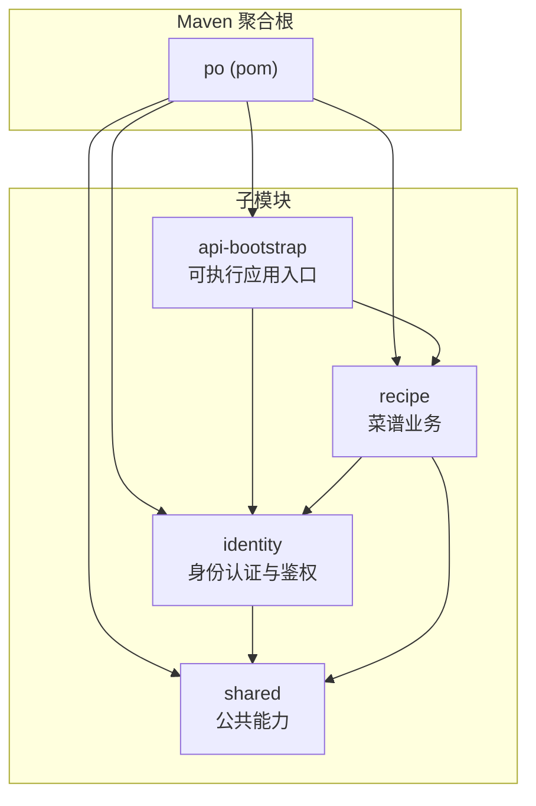
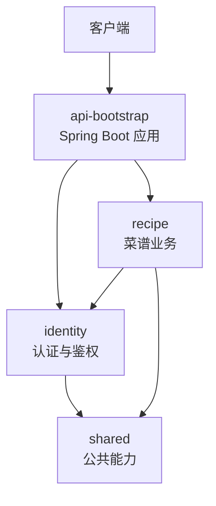
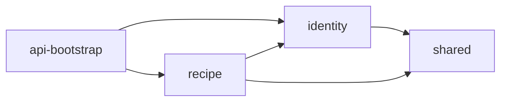
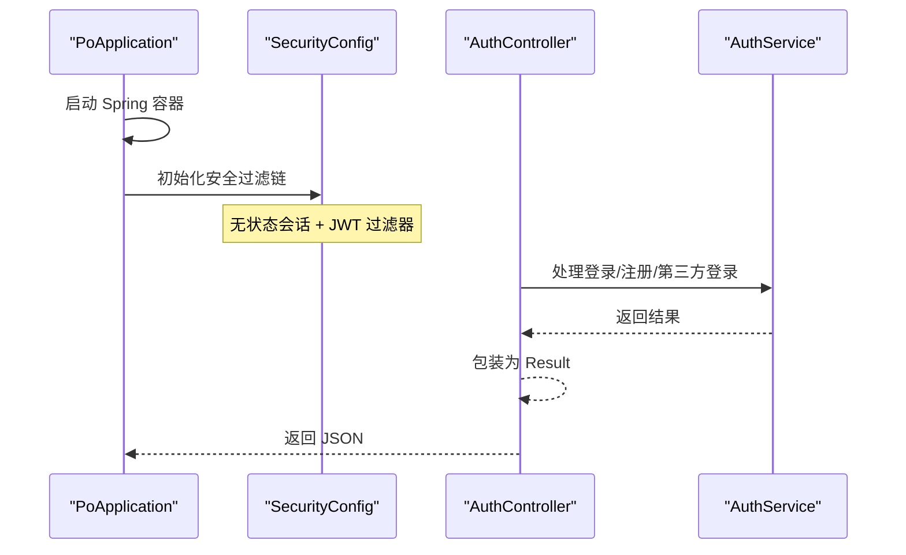
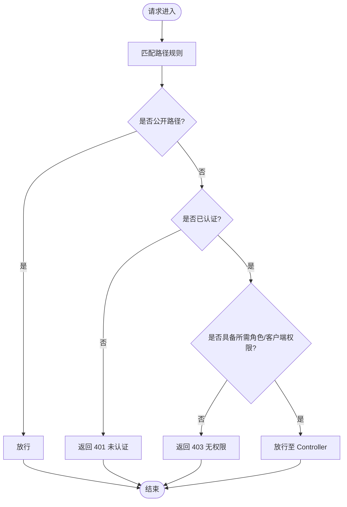
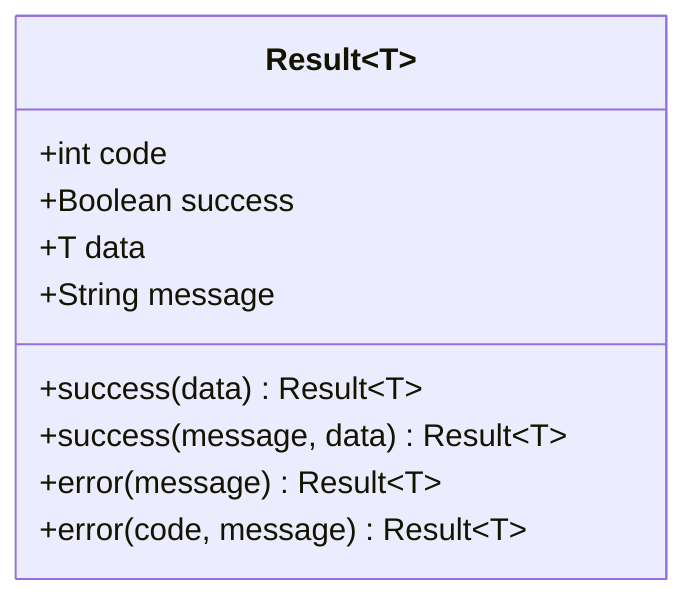
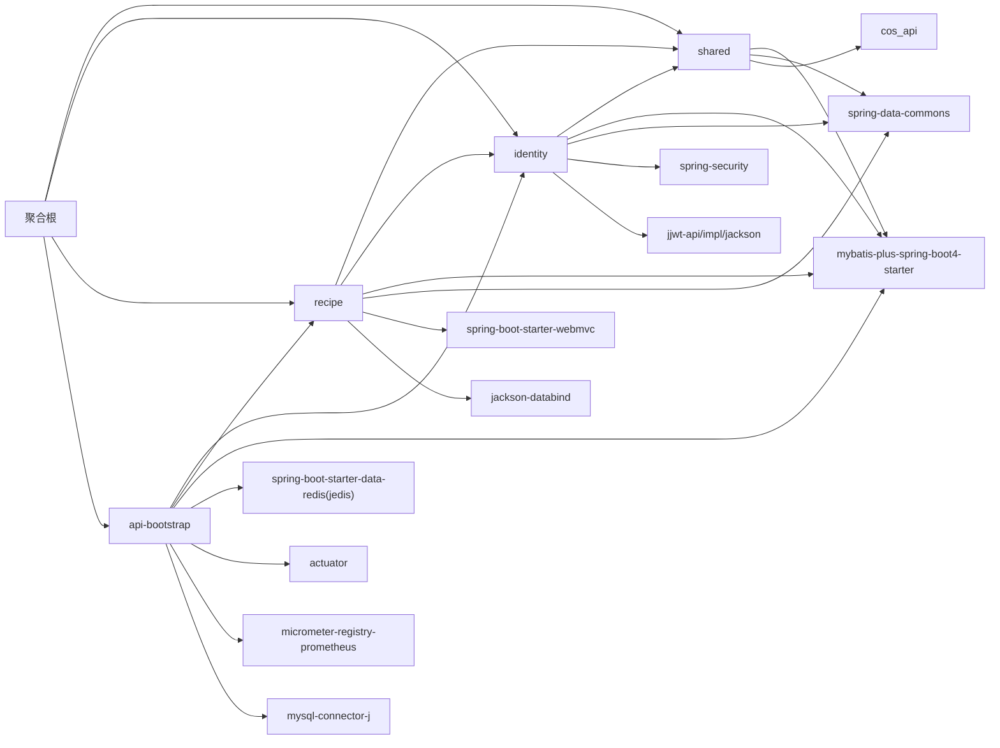

# 项目结构与模块划分

<cite>
**本文引用的文件**   
- [services/api/pom.xml](file://services/api/pom.xml)
- [services/api/shared/pom.xml](file://services/api/shared/pom.xml)
- [services/api/identity/pom.xml](file://services/api/identity/pom.xml)
- [services/api/recipe/pom.xml](file://services/api/recipe/pom.xml)
- [services/api/api-bootstrap/pom.xml](file://services/api/api-bootstrap/pom.xml)
- [services/api/api-bootstrap/src/main/java/com/goodzheng/po/PoApplication.java](file://services/api/api-bootstrap/src/main/java/com/goodzheng/po/PoApplication.java)
- [services/api/identity/src/main/java/com/goodzheng/po/identity/security/SecurityConfig.java](file://services/api/identity/src/main/java/com/goodzheng/po/identity/security/SecurityConfig.java)
- [services/api/identity/src/main/java/com/goodzheng/po/identity/controller/AuthController.java](file://services/api/identity/src/main/java/com/goodzheng/po/identity/controller/AuthController.java)
- [services/api/shared/src/main/java/com/goodzheng/po/shared/dto/Result.java](file://services/api/shared/src/main/java/com/goodzheng/po/shared/dto/Result.java)
</cite>

## 目录
1. [简介](#简介)
2. [项目结构](#项目结构)
3. [核心组件](#核心组件)
4. [架构总览](#架构总览)
5. [详细组件分析](#详细组件分析)
6. [依赖关系分析](#依赖关系分析)
7. [性能与构建特性](#性能与构建特性)
8. [故障排查指南](#故障排查指南)
9. [结论](#结论)
10. [附录：扩展与最佳实践](#附录扩展与最佳实践)

## 简介
本仓库的 Spring Boot API 采用 Maven 聚合工程组织，将通用能力、身份认证、菜谱业务与可执行应用入口拆分为独立子模块。通过统一的父 POM 管理版本与插件，配合清晰的模块职责边界，实现高内聚、低耦合的后端服务结构。文档面向开发者与维护者，帮助快速理解模块划分、依赖策略、启动流程与配置组织方式，并提供扩展建议与常见问题排查思路。

## 项目结构
API 后端位于 services/api 目录下，包含四个 Maven 子模块：
- shared：公共能力与跨模块共享类型（统一响应体、MyBatis 分页工具、对象存储配置等）
- identity：用户身份认证与鉴权（登录注册、JWT、安全过滤器链、权限控制）
- recipe：菜谱领域业务（菜谱、分类、TTS 语音合成等）
- api-bootstrap：Spring Boot 可执行应用入口，装配并暴露所有对外接口

图表来源
- [services/api/pom.xml:29-34](file://services/api/pom.xml#L29-L34)
- [services/api/api-bootstrap/pom.xml:22-36](file://services/api/api-bootstrap/pom.xml#L22-L36)
- [services/api/identity/pom.xml:17-22](file://services/api/identity/pom.xml#L17-L22)
- [services/api/recipe/pom.xml:17-27](file://services/api/recipe/pom.xml#L17-L27)

章节来源
- [services/api/pom.xml:1-96](file://services/api/pom.xml#L1-L96)

## 核心组件
- 聚合根 pom：声明 Java 版本、模块列表、依赖版本管理与编译器插件；默认跳过 spring-boot:run，仅由 api-bootstrap 启用。
- shared：提供 Result 统一响应体、MyBatis 分页辅助、COS 存储配置等基础能力。
- identity：封装认证与鉴权逻辑，包括 JWT 过滤器、安全过滤链、角色与客户端权限控制、微信登录等。
- recipe：实现菜谱相关控制器、服务、仓储与 TTS 集成。
- api-bootstrap：引入 identity 与 recipe 模块，装配 Web、Redis、Actuator、Prometheus、MySQL 等运行时依赖，作为唯一可执行应用。

章节来源
- [services/api/pom.xml:22-51](file://services/api/pom.xml#L22-L51)
- [services/api/shared/pom.xml:17-43](file://services/api/shared/pom.xml#L17-L43)
- [services/api/identity/pom.xml:17-67](file://services/api/identity/pom.xml#L17-L67)
- [services/api/recipe/pom.xml:17-55](file://services/api/recipe/pom.xml#L17-L55)
- [services/api/api-bootstrap/pom.xml:17-89](file://services/api/api-bootstrap/pom.xml#L17-L89)

## 架构总览
整体架构遵循“分层 + 模块化”设计：
- 表现层：各模块 controller 暴露 REST 接口
- 安全层：identity 模块提供统一鉴权与安全配置
- 业务层：recipe 模块承载菜谱领域逻辑
- 基础设施层：shared 模块提供跨模块复用能力
- 应用装配层：api-bootstrap 负责组合依赖、加载配置、启动容器

图表来源
- [services/api/api-bootstrap/pom.xml:22-36](file://services/api/api-bootstrap/pom.xml#L22-L36)
- [services/api/identity/pom.xml:17-22](file://services/api/identity/pom.xml#L17-L22)
- [services/api/recipe/pom.xml:17-27](file://services/api/recipe/pom.xml#L17-L27)
- [services/api/shared/pom.xml:17-43](file://services/api/shared/pom.xml#L17-L43)

## 详细组件分析

### 模块职责与包结构规范
- shared
  - 职责：统一响应体、MyBatis 分页工具、对象存储配置等
  - 包结构：dto、mybatis、storage
- identity
  - 职责：用户认证、授权、JWT、安全过滤器链、微信登录
  - 包结构：constant、controller、dto、entity、repository、security、wechat
- recipe
  - 职责：菜谱、分类、TTS 语音合成等业务
  - 包结构：constant、controller、dto、entity、repository、service、tts
- api-bootstrap
  - 职责：应用启动、依赖装配、运行期配置
  - 包结构：com.goodzheng.po（仅包含应用主类）

章节来源
- [services/api/shared/pom.xml:17-43](file://services/api/shared/pom.xml#L17-L43)
- [services/api/identity/pom.xml:17-67](file://services/api/identity/pom.xml#L17-L67)
- [services/api/recipe/pom.xml:17-55](file://services/api/recipe/pom.xml#L17-L55)
- [services/api/api-bootstrap/pom.xml:17-89](file://services/api/api-bootstrap/pom.xml#L17-L89)

### 模块间调用关系
- api-bootstrap 依赖 identity 与 recipe，作为唯一可执行应用
- identity 依赖 shared
- recipe 依赖 shared 与 identity
- 依赖方向单向，避免循环依赖

图表来源
- [services/api/api-bootstrap/pom.xml:22-36](file://services/api/api-bootstrap/pom.xml#L22-L36)
- [services/api/identity/pom.xml:17-22](file://services/api/identity/pom.xml#L17-L22)
- [services/api/recipe/pom.xml:17-27](file://services/api/recipe/pom.xml#L17-L27)

### 启动流程
- 入口类 PoApplication 使用 @SpringBootApplication 排除 UserDetailsServiceAutoConfiguration，避免默认用户详情自动装配干扰自定义安全配置
- 容器启动后加载 security 配置，建立无状态会话与 JWT 过滤器链
- 请求进入 Controller，经 SecurityFilterChain 校验权限后路由到具体业务方法

图表来源
- [services/api/api-bootstrap/src/main/java/com/goodzheng/po/PoApplication.java:7-12](file://services/api/api-bootstrap/src/main/java/com/goodzheng/po/PoApplication.java#L7-L12)
- [services/api/identity/src/main/java/com/goodzheng/po/identity/security/SecurityConfig.java:54-99](file://services/api/identity/src/main/java/com/goodzheng/po/identity/security/SecurityConfig.java#L54-L99)
- [services/api/identity/src/main/java/com/goodzheng/po/identity/controller/AuthController.java:26-78](file://services/api/identity/src/main/java/com/goodzheng/po/identity/controller/AuthController.java#L26-L78)

### 安全与鉴权模型
- 无状态会话：SessionCreationPolicy.STATELESS
- 公开路径：登录、注册、微信登录、OpenID 登录、App 注册、错误页、TTS、静态资源、Actuator
- 已登录路径：个人中心、我的菜谱/收藏/历史、创建/点赞/收藏、编辑/删除（归属权在 Service 层校验）
- 管理员路径：审核队列、审核操作、用户管理、内容写操作（需具备管理员角色与管理端客户端标识）
- 异常处理：未认证返回 401，无权限返回 403，统一以 Result 格式输出

图表来源
- [services/api/identity/src/main/java/com/goodzheng/po/identity/security/SecurityConfig.java:54-99](file://services/api/identity/src/main/java/com/goodzheng/po/identity/security/SecurityConfig.java#L54-L99)
- [services/api/identity/src/main/java/com/goodzheng/po/identity/security/SecurityConfig.java:115-132](file://services/api/identity/src/main/java/com/goodzheng/po/identity/security/SecurityConfig.java#L115-L132)

### 统一响应体
- Result<T> 提供 success/error 静态工厂方法，统一 code、success、data、message 字段
- 控制器与异常处理器均使用该类型进行响应封装，保证前后端交互一致性

图表来源
- [services/api/shared/src/main/java/com/goodzheng/po/shared/dto/Result.java:7-31](file://services/api/shared/src/main/java/com/goodzheng/po/shared/dto/Result.java#L7-L31)

章节来源
- [services/api/identity/src/main/java/com/goodzheng/po/identity/security/SecurityConfig.java:35-133](file://services/api/identity/src/main/java/com/goodzheng/po/identity/security/SecurityConfig.java#L35-L133)
- [services/api/identity/src/main/java/com/goodzheng/po/identity/controller/AuthController.java:19-79](file://services/api/identity/src/main/java/com/goodzheng/po/identity/controller/AuthController.java#L19-L79)
- [services/api/shared/src/main/java/com/goodzheng/po/shared/dto/Result.java:1-33](file://services/api/shared/src/main/java/com/goodzheng/po/shared/dto/Result.java#L1-L33)

## 依赖关系分析
- 聚合根依赖管理
  - 统一声明 MyBatis-Plus Starter 与 jsqlparser 版本，便于升级与一致性
  - 设置 spring-boot.run.skip=true，仅在 api-bootstrap 中覆盖为 false
- 子模块依赖
  - shared：spring-data-commons、mybatis-plus-spring-boot4-starter、spring-boot、腾讯云 COS SDK、lombok
  - identity：shared、mybatis-plus、spring-data-commons、webmvc、validation、JWT 三件套、spring-security、lombok
  - recipe：shared、identity、mybatis-plus、spring-data-commons、webmvc、jackson-databind、validation、lombok
  - api-bootstrap：identity、recipe、mybatis-plus、jsqlparser、redis（替换 lettuce 为 jedis）、actuator、prometheus、devtools、mysql-connector-j、lombok、spring-boot-test

图表来源
- [services/api/pom.xml:36-51](file://services/api/pom.xml#L36-L51)
- [services/api/shared/pom.xml:17-43](file://services/api/shared/pom.xml#L17-L43)
- [services/api/identity/pom.xml:17-67](file://services/api/identity/pom.xml#L17-L67)
- [services/api/recipe/pom.xml:17-55](file://services/api/recipe/pom.xml#L17-L55)
- [services/api/api-bootstrap/pom.xml:22-89](file://services/api/api-bootstrap/pom.xml#L22-L89)

章节来源
- [services/api/pom.xml:36-94](file://services/api/pom.xml#L36-L94)
- [services/api/shared/pom.xml:17-43](file://services/api/shared/pom.xml#L17-L43)
- [services/api/identity/pom.xml:17-67](file://services/api/identity/pom.xml#L17-L67)
- [services/api/recipe/pom.xml:17-55](file://services/api/recipe/pom.xml#L17-L55)
- [services/api/api-bootstrap/pom.xml:22-98](file://services/api/api-bootstrap/pom.xml#L22-L98)

## 性能与构建特性
- 编译期注解处理：聚合根通过 maven-compiler-plugin 配置 Lombok 注解处理器，确保编译与测试阶段均可生成代码
- 运行期优化：
  - 无状态会话减少服务器内存占用
  - Redis 替代 Lettuce 使用 Jedis，便于连接池与性能调优
  - Actuator + Prometheus 暴露指标，便于监控与告警
- 构建效率：
  - 聚合根默认跳过 spring-boot:run，避免非目标模块重复启动
  - 仅 api-bootstrap 启用 devtools，加速开发体验

章节来源
- [services/api/pom.xml:53-94](file://services/api/pom.xml#L53-L94)
- [services/api/api-bootstrap/pom.xml:17-20](file://services/api/api-bootstrap/pom.xml#L17-L20)
- [services/api/api-bootstrap/pom.xml:46-73](file://services/api/api-bootstrap/pom.xml#L46-L73)

## 故障排查指南
- 401 未认证
  - 可能原因：缺少 Authorization 头、令牌过期或无效
  - 定位：SecurityConfig 的 authenticationEntryPoint 写入 401 与统一消息
- 403 无权限
  - 可能原因：已认证但角色或客户端权限不足
  - 定位：SecurityConfig 的 accessDeniedHandler 写入 403 与统一消息
- 登录失败
  - 可能原因：用户名/密码错误、第三方登录参数异常
  - 定位：AuthController 捕获 RuntimeException 并返回 401/400
- 依赖冲突或版本不一致
  - 可能原因：子模块直接声明依赖版本与聚合根不一致
  - 解决：优先使用聚合根的 dependencyManagement 统一管理版本

章节来源
- [services/api/identity/src/main/java/com/goodzheng/po/identity/security/SecurityConfig.java:115-132](file://services/api/identity/src/main/java/com/goodzheng/po/identity/security/SecurityConfig.java#L115-L132)
- [services/api/identity/src/main/java/com/goodzheng/po/identity/controller/AuthController.java:26-78](file://services/api/identity/src/main/java/com/goodzheng/po/identity/controller/AuthController.java#L26-L78)

## 结论
该 Spring Boot API 项目通过 Maven 聚合工程清晰划分了公共能力、身份认证、业务领域与应用装配四层职责，借助统一的依赖管理与插件配置，实现了良好的可维护性与可扩展性。安全策略以无状态 JWT 为核心，结合细粒度路径与角色/客户端权限控制，满足多端接入场景。建议在后续扩展中继续遵循现有包结构与依赖方向，保持模块边界清晰。

## 附录：扩展与最佳实践
- 新增模块
  - 在聚合根 pom.xml 中添加 module 声明
  - 新建子模块 pom.xml，继承聚合根，并在 dependencies 中按需引入 shared、identity 或 recipe
  - 若为新应用入口，复制 api-bootstrap 的结构并调整依赖
- 包结构规范
  - 每个业务模块遵循 constant、controller、dto、entity、repository、service 的标准分层
  - 公共能力下沉至 shared，避免重复实现
- 依赖管理策略
  - 所有第三方库版本在聚合根 dependencyManagement 中集中声明
  - 子模块不显式声明版本，避免版本漂移
- 安全与鉴权
  - 新增接口需在 SecurityConfig 中明确开放范围与权限要求
  - 敏感写操作在 Service 层进行归属权校验，防止越权
- 配置组织
  - 应用级配置集中在 api-bootstrap 的 resources 下
  - 模块级配置通过 @ConfigurationProperties 绑定到独立配置类
- 启动命令
  - 在聚合根目录执行：mvn -pl api-bootstrap -am spring-boot:run
  - 仅构建并启动 api-bootstrap，同时自动构建其依赖模块

章节来源
- [services/api/pom.xml:22-34](file://services/api/pom.xml#L22-L34)
- [services/api/api-bootstrap/pom.xml:17-20](file://services/api/api-bootstrap/pom.xml#L17-L20)
- [services/api/identity/src/main/java/com/goodzheng/po/identity/security/SecurityConfig.java:54-99](file://services/api/identity/src/main/java/com/goodzheng/po/identity/security/SecurityConfig.java#L54-L99)