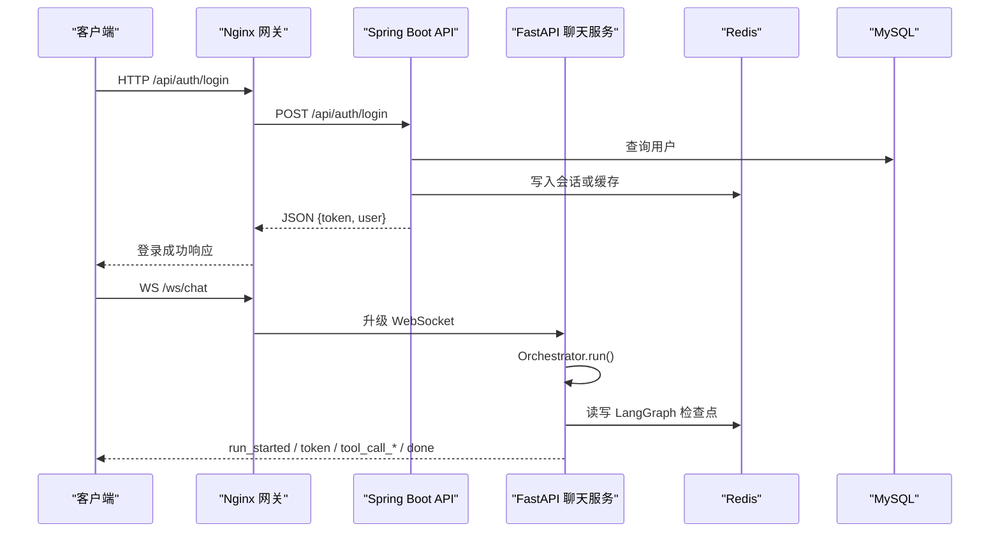
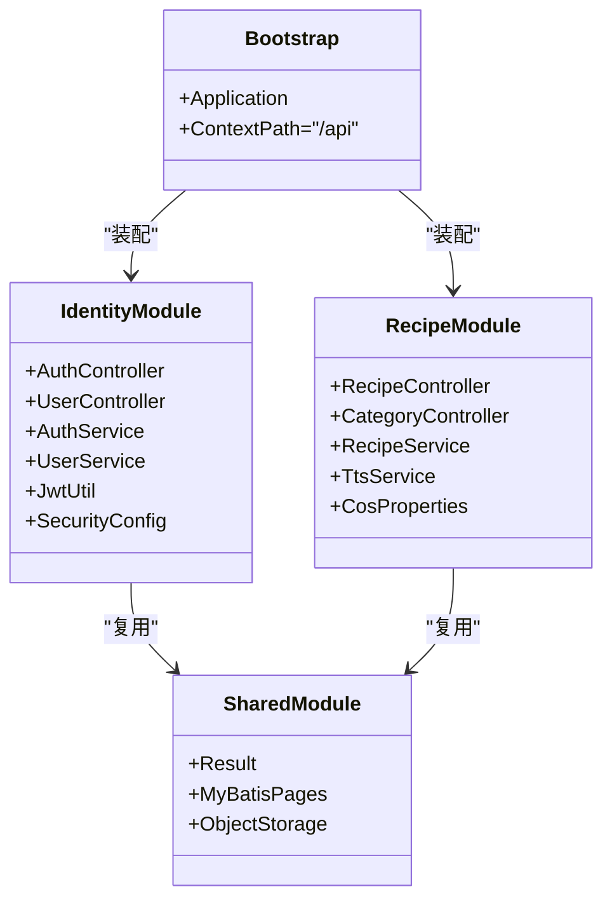
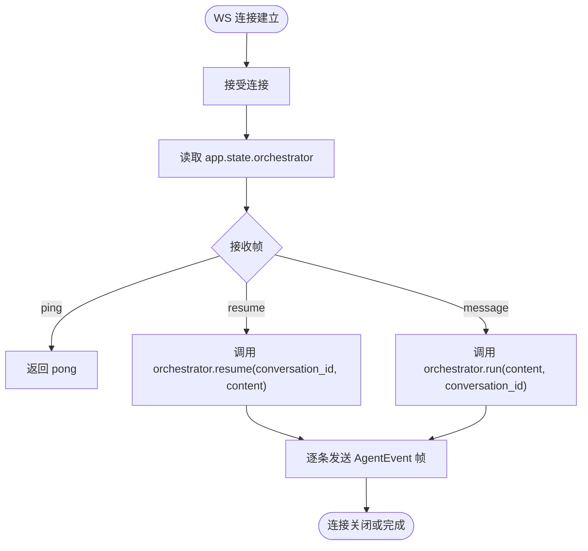
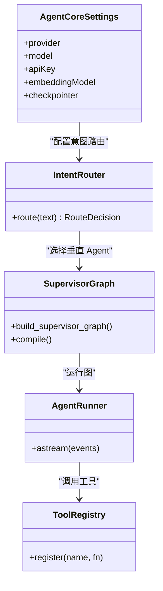
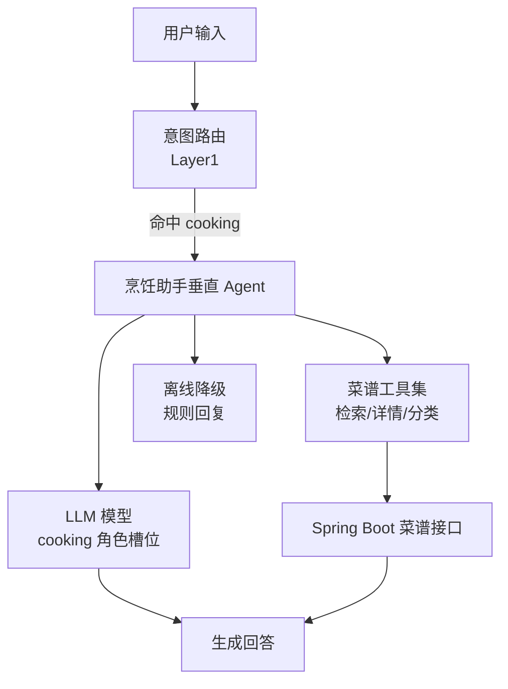
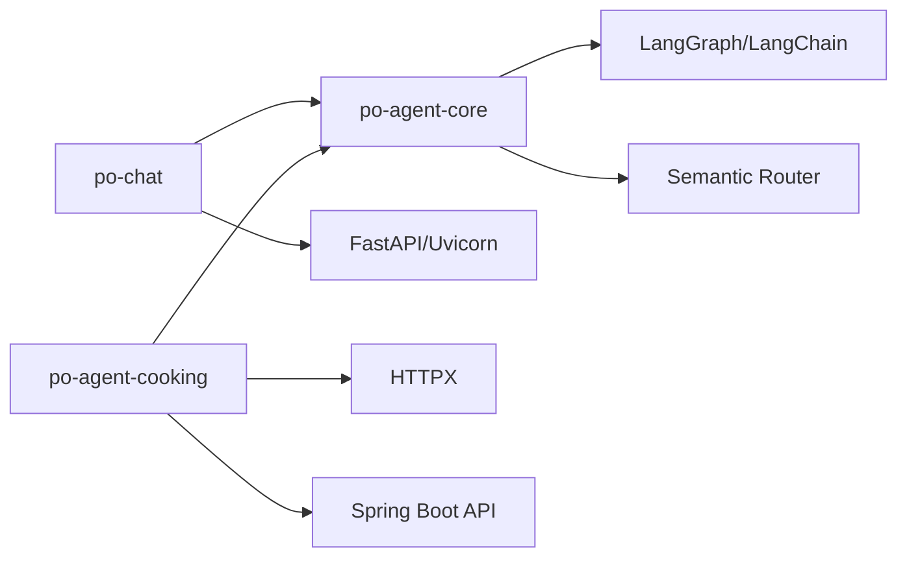
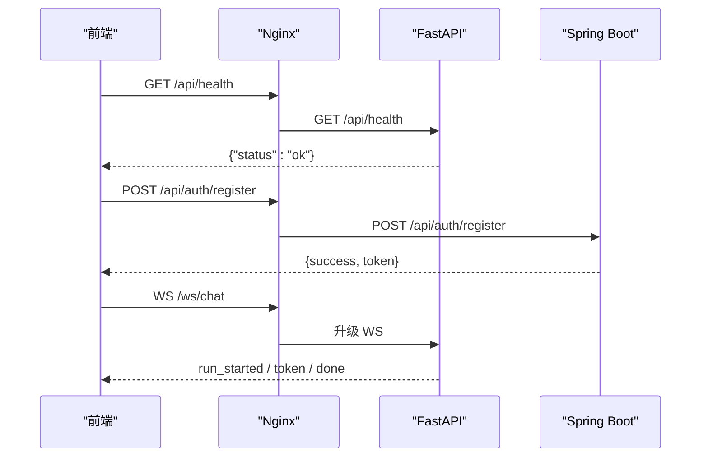
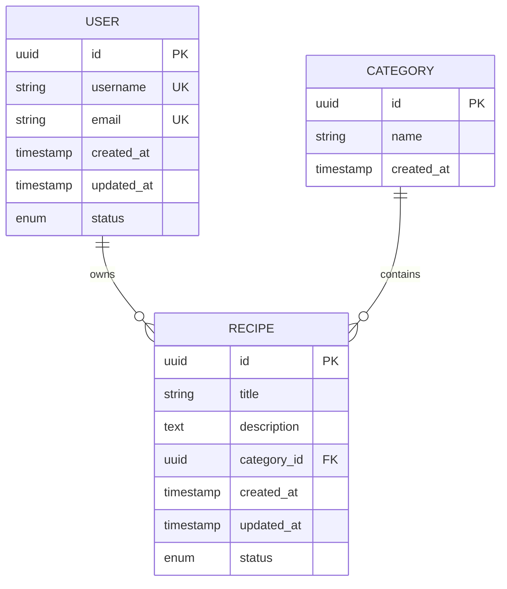

# 后端服务

<cite>
**本文引用的文件**   
- [README.md](file://README.md)
- [docker-compose.yml](file://docker-compose.yml)
- [services/api/pom.xml](file://services/api/pom.xml)
- [services/chat/pyproject.toml](file://services/chat/pyproject.toml)
- [services/agent-core/pyproject.toml](file://services/agent-core/pyproject.toml)
- [services/agent-cooking/pyproject.toml](file://services/agent-cooking/pyproject.toml)
- [services/chat/app/main.py](file://services/chat/app/main.py)
- [services/chat/app/routers/ws.py](file://services/chat/app/routers/ws.py)
- [services/agent-core/src/po_agent_core/__init__.py](file://services/agent-core/src/po_agent_core/__init__.py)
- [services/agent-cooking/src/po_agent_cooking/__init__.py](file://services/agent-cooking/src/po_agent_cooking/__init__.py)
</cite>

## 目录
1. [引言](#引言)
2. [项目结构](#项目结构)
3. [核心组件](#核心组件)
4. [架构总览](#架构总览)
5. [详细组件分析](#详细组件分析)
6. [依赖关系分析](#依赖关系分析)
7. [性能与可靠性](#性能与可靠性)
8. [API 接口说明](#api-接口说明)
9. [错误处理机制](#错误处理机制)
10. [安全与防护](#安全与防护)
11. [数据库与基础设施](#数据库与基础设施)
12. [测试策略](#测试策略)
13. [监控、告警与运维部署](#监控告警与运维部署)
14. [结论](#结论)

## 引言
本仓库是“菜谱 / 用户业务”的全栈 Monorepo，包含管理前端、移动端、共享类型、Spring Boot 业务 API、FastAPI 聊天服务、Agent 编排核心库以及烹饪助手垂直 Agent。整体通过 Docker Compose + Nginx 网关统一编排，对外暴露静态页面、REST 接口和 WebSocket 流式聊天能力；内部以 MySQL 持久化、Redis 缓存与 LangGraph 会话记忆为支撑，并通过环境变量实现 12 因子配置。

## 项目结构
仓库按“应用层 + 服务层 + 基础设施”组织：
- 应用层：`apps/admin-web`（管理端）、`apps/cooking-app`（移动端）、`packages/types`（共享 TS 类型）。
- 服务层：`services/api`（Spring Boot 多模块单体）、`services/chat`（FastAPI 聊天宿主）、`services/agent-core`（纯库编排核心）、`services/agent-cooking`（纯库垂直 Agent）。
- 基础设施：`infra/nginx`（Nginx 网关）、`docker-compose.yml`（服务编排与环境变量注入）。

```mermaid
graph TB
Client["客户端<br/>浏览器 / 移动端"] --> Gateway["Nginx 网关<br/>对外端口 WEB_PORT"]
Gateway --> |"/ws/chat"| Chat["FastAPI 聊天服务<br/>:5090"]
Gateway --> |"/api/items/**"|"FastAPI 健康与示例接口"| Chat
Gateway --> |"/api/**"| Api["Spring Boot 业务 API<br/>:8080"]
Api --> DB["MySQL 8.4"]
Api --> Cache["Redis Stack"]
Chat --> Core["Agent 核心库<br/>po-agent-core"]
Chat --> Cooking["烹饪助手 Agent<br/>po-agent-cooking"]
Cooking --> Api
```

**图示来源**  
- [README.md:16-43](file://README.md#L16-L43)  
- [docker-compose.yml:44-113](file://docker-compose.yml#L44-L113)

**章节来源**  
- [README.md:1-44](file://README.md#L1-L44)  
- [docker-compose.yml:1-134](file://docker-compose.yml#L1-L134)

## 核心组件
- Spring Boot 业务 API：Java 17 + Spring Boot 4 + MyBatis-Plus + MySQL + Redis + JWT，按 `shared`、`identity`、`recipe`、`api-bootstrap` 四个 Maven 模块划分职责。
- FastAPI 聊天服务：Python 3.11 + FastAPI + Uvicorn + WebSocket，提供 `/api/health`、`/api/items/**` REST 接口与 `/ws/chat` 流式聊天。
- Agent 核心库：纯 Python 库，提供意图路由、Supervisor 编排、事件流翻译、LLM 工厂、检查点与存储管理、工具注册等能力，禁止直接依赖 Web 框架。
- 烹饪助手垂直 Agent：基于 agent-core 的 ReAct 子图，封装菜谱检索、详情、分类三个工具，并支持离线降级。

**章节来源**  
- [README.md:5-14](file://README.md#L5-L14)  
- [services/api/pom.xml:1-34](file://services/api/pom.xml#L1-L34)  
- [services/chat/pyproject.toml:1-18](file://services/chat/pyproject.toml#L1-L18)  
- [services/agent-core/pyproject.toml:1-18](file://services/agent-core/pyproject.toml#L1-L18)  
- [services/agent-cooking/pyproject.toml:1-13](file://services/agent-cooking/pyproject.toml#L1-L13)

## 架构总览
请求从 Nginx 进入后按路径分流：
- `/ws/chat` → chat:5090（WebSocket 流式聊天）
- `/api/health`、`/api/items/**` → chat:5090（FastAPI REST）
- `/api/**`（其余）→ api:8080（Spring Boot，含认证、菜谱、TTS、actuator）
- `/` → Nginx 托管静态资源（Umi 产物），history 路由回退到 `index.html`

生产环境由 docker-compose 启动 mysql、redis、api、chat、web 五个服务，仅 web 暴露宿主机端口；api 与 chat 均带健康检查，web 延迟到二者 healthy 后再启动。



**图示来源**  
- [README.md:36-43](file://README.md#L36-L43)  
- [docker-compose.yml:44-113](file://docker-compose.yml#L44-L113)  
- [services/chat/app/main.py:52-71](file://services/chat/app/main.py#L52-L71)  
- [services/chat/app/routers/ws.py:131-189](file://services/chat/app/routers/ws.py#L131-L189)

**章节来源**  
- [README.md:36-57](file://README.md#L36-L57)  
- [docker-compose.yml:44-113](file://docker-compose.yml#L44-L113)

## 详细组件分析

### Spring Boot 业务 API
- 模块划分：
  - `shared`：公共 DTO、Result、异常、MyBatis 分页适配、对象存储配置。
  - `identity`：用户、认证、JWT、微信登录、权限常量与控制器。
  - `recipe`：菜谱与分类实体、Repository、Service、Controller、TTS 集成。
  - `api-bootstrap`：启动模块，承载 application.yaml、context-path=/api、容器入口。
- 技术要点：
  - Java 17 + Spring Boot 4 + MyBatis-Plus + JSqlParser 分页插件。
  - 父 POM 设置 `spring-boot.run.skip=true`，仅 `api-bootstrap` 可执行。
  - 通过环境变量注入数据源、Redis、JWT、讯飞 TTS、腾讯云 COS 等配置。



**图示来源**  
- [services/api/pom.xml:29-34](file://services/api/pom.xml#L29-L34)  
- [README.md:22-26](file://README.md#L22-L26)

**章节来源**  
- [services/api/pom.xml:1-96](file://services/api/pom.xml#L1-L96)  
- [README.md:22-26](file://README.md#L22-L26)

### FastAPI 聊天服务
- 入口与生命周期：
  - `app.main.create_app()` 构建 FastAPI 实例，挂载 CORS、REST 路由与 WebSocket 路由。
  - `AppLifespan` 在启动时构建 `Orchestrator` 并写入 `app.state.orchestrator`，关闭时释放外部连接。
- 路由约定：
  - REST 前缀 `/api`：`/api/health`、`/api/items/**`。
  - WebSocket 路径 `/ws/chat`：不走 `/api` 前缀，前端开发态使用独立 `/ws` 代理。
- 协议翻译：
  - WS 路由将 `AgentEvent` 映射为出站帧：`run_started`、`thinking`、`plan`、`step`、`token`、`tool_call_start/args/end/result`、`interrupt`、`done`、`error`。
  - 入站帧包括 `message`、`resume`、`ping`，`conversation_id` 贯穿多轮会话。



**图示来源**  
- [services/chat/app/main.py:24-71](file://services/chat/app/main.py#L24-L71)  
- [services/chat/app/routers/ws.py:67-83](file://services/chat/app/routers/ws.py#L67-L83)  
- [services/chat/app/routers/ws.py:131-189](file://services/chat/app/routers/ws.py#L131-L189)

**章节来源**  
- [services/chat/app/main.py:1-76](file://services/chat/app/main.py#L1-L76)  
- [services/chat/app/routers/ws.py:1-189](file://services/chat/app/routers/ws.py#L1-L189)

### Agent 核心库（po-agent-core）
- 设计原则：
  - 纯库，禁止 import Web 框架；重资源延迟创建；领域逻辑经垂直 Agent 插槽注入。
  - 一次请求流转：宿主用 `AgentCoreSettings` 读配置 → 创建意图路由 → 构建 Supervisor 图 → `AgentRunner.astream` 运行图 → 事件流翻译为 `AgentEvent` → 宿主再转为 WS 帧/A2A/MCP。
- 公开能力：
  - 配置与错误：`AgentCoreSettings`、`ModelRole`、`ModelSlot`、`AgentCoreError`、`AgentCoreConfigError`。
  - 事件协议：`AgentEvent`、`EventType`。
  - LLM 工厂：`create_chat_model`、`create_embeddings`。
  - 记忆：`CheckpointerManager`、`StoreManager`、`user_namespace`。
  - 决策层：`IntentRouter`、`KeywordIntentRouter`、`FallbackIntentRouter`、`CharTokenizer`、`create_intent_router`、`routes_from_agents`。
  - 编排：`VerticalAgent`、`CoreState`、`build_supervisor_graph`、`AgentRunner`。
  - 工具：`ToolRegistry`、`ToolRegistrationError`。



**图示来源**  
- [services/agent-core/src/po_agent_core/__init__.py:1-72](file://services/agent-core/src/po_agent_core/__init__.py#L1-L72)

**章节来源**  
- [services/agent-core/src/po_agent_core/__init__.py:1-72](file://services/agent-core/src/po_agent_core/__init__.py#L1-L72)  
- [services/agent-core/pyproject.toml:1-30](file://services/agent-core/pyproject.toml#L1-L30)

### 烹饪助手垂直 Agent（po-agent-cooking）
- 角色与装配：
  - 对外入口 `build_cooking_agent`，宿主在 `_builtin_agents` 中登记该垂直 Agent，之后由 supervisor 按 Layer1 意图路由决定是否委托。
  - 菜谱数据来自 Java 菜谱接口（GET /recipes 系列为 permitAll 公开读），模型走 agent-core 的 `cooking` 角色槽位。
- 能力与降级：
  - 封装菜谱检索、详情、分类三个工具，并提供 ReAct 子图。
  - 当 LLM 或菜谱后端不可用时，可降级为离线模式，保证接口可用。



**图示来源**  
- [services/agent-cooking/src/po_agent_cooking/__init__.py:1-65](file://services/agent-cooking/src/po_agent_cooking/__init__.py#L1-L65)  
- [README.md:27-32](file://README.md#L27-L32)

**章节来源**  
- [services/agent-cooking/src/po_agent_cooking/__init__.py:1-65](file://services/agent-cooking/src/po_agent_cooking/__init__.py#L1-L65)  
- [services/agent-cooking/pyproject.toml:1-31](file://services/agent-cooking/pyproject.toml#L1-L31)  
- [README.md:27-32](file://README.md#L27-L32)

## 依赖关系分析
- Maven 聚合模块：`shared`、`identity`、`recipe`、`api-bootstrap`，父 POM 统一管理 MyBatis-Plus 版本与 Lombok 编译期注解处理器。
- Python 包依赖：
  - `po-chat` 依赖 `fastapi`、`uvicorn`、`pydantic-settings`、`po-agent-core`。
  - `po-agent-core` 依赖 `langgraph`、`langchain-core`、`langchain-openai`、`semantic-router`、`pydantic`、`pydantic-settings`，可选扩展 `redis`、`sqlite` checkpointer。
  - `po-agent-cooking` 依赖 `po-agent-core`、`langgraph`、`langchain-core`、`httpx`，用于调用 Spring Boot 菜谱接口。



**图示来源**  
- [services/chat/pyproject.toml:1-18](file://services/chat/pyproject.toml#L1-L18)  
- [services/agent-core/pyproject.toml:1-18](file://services/agent-core/pyproject.toml#L1-L18)  
- [services/agent-cooking/pyproject.toml:1-13](file://services/agent-cooking/pyproject.toml#L1-L13)  
- [services/api/pom.xml:36-50](file://services/api/pom.xml#L36-L50)

**章节来源**  
- [services/chat/pyproject.toml:1-29](file://services/chat/pyproject.toml#L1-L29)  
- [services/agent-core/pyproject.toml:1-30](file://services/agent-core/pyproject.toml#L1-L30)  
- [services/agent-cooking/pyproject.toml:1-31](file://services/agent-cooking/pyproject.toml#L1-L31)  
- [services/api/pom.xml:1-96](file://services/api/pom.xml#L1-L96)

## 性能与可靠性
- 连接与状态：
  - WS 单连接串行处理入站帧，避免并发写冲突；中断恢复需先消费到 `done` 再发 `resume`。
  - Orchestrator 在 lifespan 中一次性构建，所有 WS 连接共享，减少重复初始化成本。
- 降级策略：
  - LLM 缺配置或密钥无效时，聊天服务降级为离线模型；嵌入向量不可用时降级为本地关键词路由。
  - 菜谱后端不可用时，垂直 Agent 工具返回可读错误，不影响服务启动与基本对话。
- 健康检查：
  - api 通过 `/api/actuator/health` 探测；chat 通过 `/api/health` 探测；web 延迟到二者 healthy 后再启动。

**章节来源**  
- [services/chat/app/routers/ws.py:37-49](file://services/chat/app/routers/ws.py#L37-L49)  
- [services/chat/app/main.py:24-49](file://services/chat/app/main.py#L24-L49)  
- [docker-compose.yml:75-113](file://docker-compose.yml#L75-L113)  
- [README.md:76-77](file://README.md#L76-L77)

## API 接口说明
- 网关路由：
  - `/ws/chat`：WebSocket 流式聊天，帧协议见 WS 路由文档。
  - `/api/health`：FastAPI 健康检查，返回 `{"status":"ok"}`。
  - `/api/items/**`：FastAPI 示例 REST 接口。
  - `/api/**`：Spring Boot 业务接口，包含认证、用户、菜谱、TTS、actuator。
- 典型流程：
  - 登录：POST `/api/auth/register` 或 `/api/auth/login`，返回 JWT。
  - 聊天：WS 连接 `/ws/chat`，发送 `message` 帧，接收 `run_started`、`token`、`tool_call_*`、`done` 等帧。



**图示来源**  
- [README.md:36-43](file://README.md#L36-L43)  
- [services/chat/app/main.py:67-70](file://services/chat/app/main.py#L67-L70)  
- [services/chat/app/routers/ws.py:131-189](file://services/chat/app/routers/ws.py#L131-L189)

**章节来源**  
- [README.md:36-43](file://README.md#L36-L43)  
- [services/chat/app/main.py:52-71](file://services/chat/app/main.py#L52-L71)

## 错误处理机制
- WS 帧校验失败：返回 `error` 帧，不中断连接，允许客户端修正协议后继续。
- 客户端断开：捕获 `WebSocketDisconnect` 与 `_ClientGone`，静默结束协程。
- 其他异常：记录日志并上抛，交由框架关闭连接，避免故障被静默掩盖。
- REST 校验失败：由 FastAPI 统一转 422。

**章节来源**  
- [services/chat/app/routers/ws.py:144-151](file://services/chat/app/routers/ws.py#L144-L151)  
- [services/chat/app/routers/ws.py:181-188](file://services/chat/app/routers/ws.py#L181-L188)

## 安全与防护
- 认证与授权：
  - Spring Boot 使用 JWT 鉴权，`JWT_SECRET` 必须为 Base64 编码且解码后至少 32 字节；生产环境必须替换占位值。
  - 默认不创建超管账号，可通过 `APP_SEED_DEFAULT_ADMIN=true` 或在页面注册。
- 跨域控制：
  - FastAPI 启用 CORS，白名单由 `PY_SERVER_CORS_ORIGINS` 控制。
- 配置安全：
  - 容器内不含 `application-local.yaml`，配置全部通过环境变量注入（12 因子）。
  - `.env` 已被 `.gitignore` 排除，不入库。

**章节来源**  
- [README.md:67-86](file://README.md#L67-L86)  
- [docker-compose.yml:46-67](file://docker-compose.yml#L46-L67)  
- [services/chat/app/main.py:60-66](file://services/chat/app/main.py#L60-L66)

## 数据库与基础设施
- MySQL：
  - 镜像 `mysql:8.4`，仅内网 3306，命名卷 `mysql_data` 持久化。
  - schema.sql 在 api 启动时幂等建表（`CREATE TABLE IF NOT EXISTS`）。
- Redis：
  - 使用 Redis Stack（langgraph 的 redis checkpointer 需要 JSON.SET + FT.SEARCH）。
  - 普通 redis:7-alpine 会报 unknown command，chat 静默降级成 memory checkpointer。
- 对象存储与 TTS：
  - 腾讯云 COS：头像/上传/TTS 音频落桶，密钥从 .env 注入。
  - 讯飞 TTS：未配置时 `/api/tts` 返回可读错误，不影响服务启动。



**图示来源**  
- [docker-compose.yml:8-42](file://docker-compose.yml#L8-L42)  
- [README.md:109-110](file://README.md#L109-L110)

**章节来源**  
- [docker-compose.yml:8-42](file://docker-compose.yml#L8-L42)  
- [README.md:109-110](file://README.md#L109-L110)

## 测试策略
- 前端与管理端：Biome lint、Vitest 单元测试、TypeScript 类型检查。
- 移动端：Biome、TypeScript、jest-expo 检查。
- Spring Boot API：Maven verify，依赖 MySQL 8.4 与 Redis 7 服务容器。
- FastAPI 聊天服务：pytest，依次运行 agent-core、agent-cooking、chat 三套测试。
- CI：GitHub Actions 在 push main / PR / 手动触发时运行 frontend、mobile、api、chat 四个 job。

**章节来源**  
- [README.md:219-227](file://README.md#L219-L227)  
- [services/chat/pyproject.toml:27-29](file://services/chat/pyproject.toml#L27-L29)  
- [services/agent-core/pyproject.toml:27-30](file://services/agent-core/pyproject.toml#L27-L30)  
- [services/agent-cooking/pyproject.toml:25-31](file://services/agent-cooking/pyproject.toml#L25-L31)

## 监控、告警与运维部署
- 健康检查：
  - api：`/api/actuator/health` 返回 `{"status":"UP",...}`。
  - chat：`/api/health` 返回 `{"status":"ok"}`。
- 日常运维：
  - `docker compose ps/logs/restart/up/down` 管理服务生命周期。
  - nginx.conf 只读挂载，修改后 reload 即时生效。
- 部署启动：
  - 首次部署：复制 `.env.example` 为 `.env`，设置 MYSQL_*、JWT_SECRET，执行 `docker compose up -d --build`。
  - 冒烟验证：访问 `/api/actuator/health`、`/api/health`，注册演示账号。

**章节来源**  
- [README.md:88-123](file://README.md#L88-L123)  
- [docker-compose.yml:75-113](file://docker-compose.yml#L75-L113)

## 结论
本后端体系以 Spring Boot 承载用户与菜谱业务，FastAPI 提供流式聊天与 Agent 编排，Agent 核心库解耦 Web 框架与领域知识，烹饪助手垂直 Agent 通过插槽接入并支持离线降级。基础设施采用 MySQL + Redis Stack + COS/TTS，配合 Nginx 网关与 docker-compose 实现统一编排。通过完善的测试、健康检查与 12 因子配置，系统在可维护性、可扩展性与可靠性方面具备良好基础。