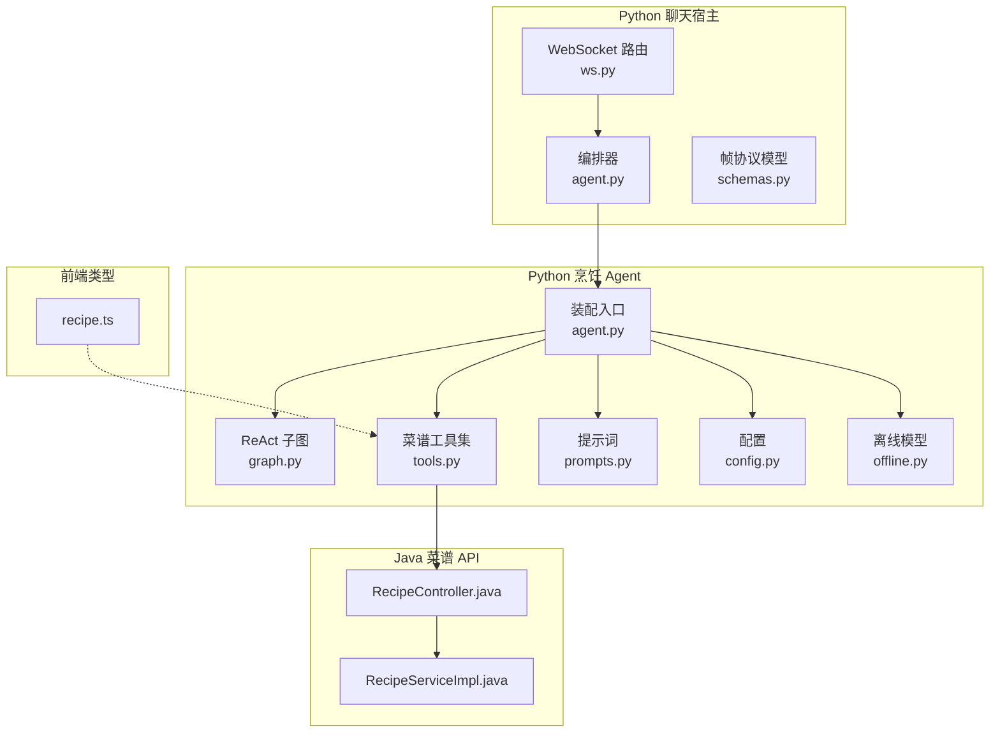
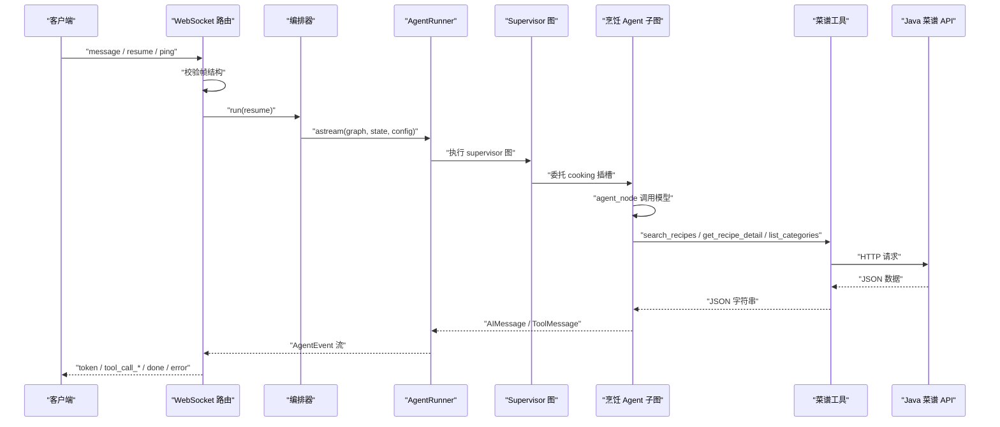
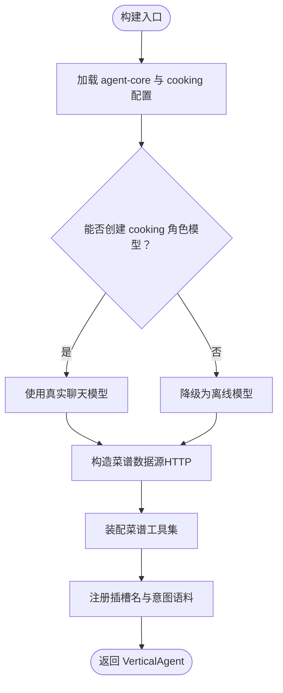
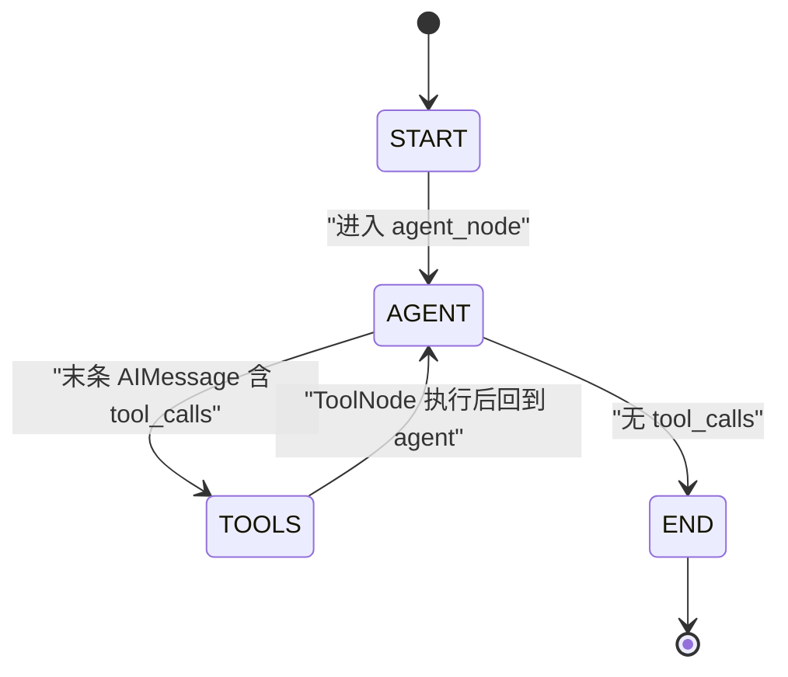
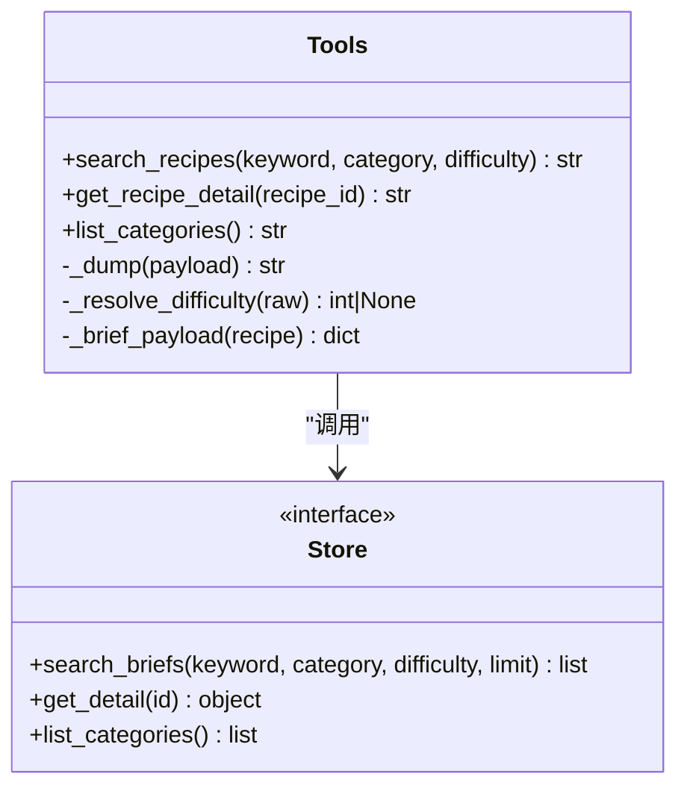
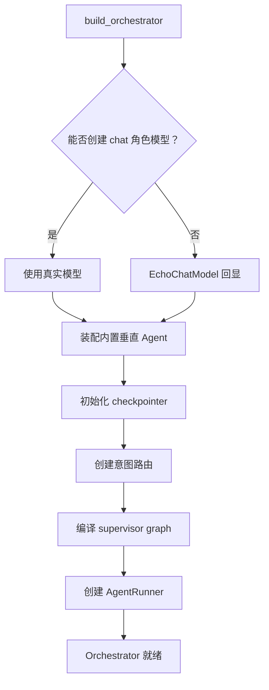
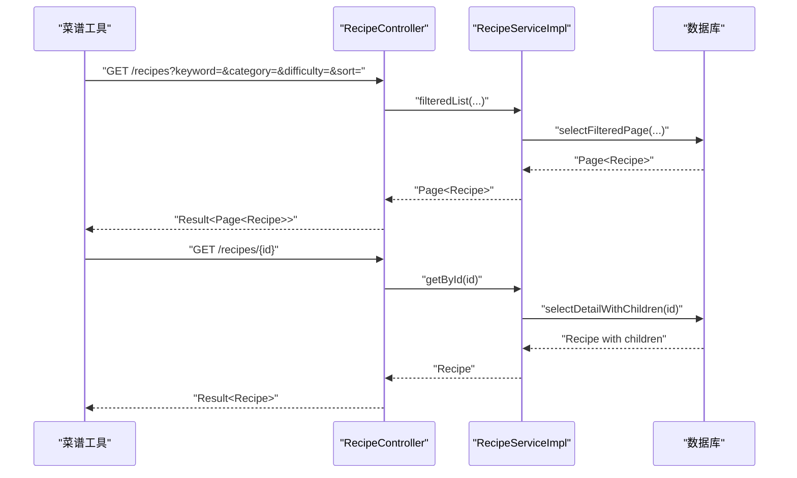
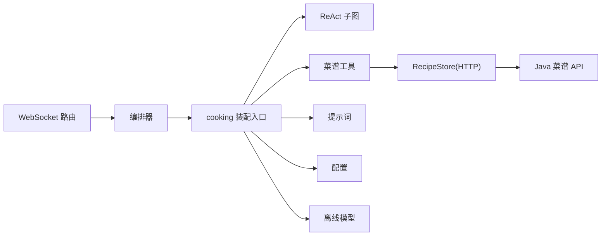

# 烹饪助手垂直 Agent

<cite>
**本文引用的文件**   
- [agent.py](file://services/agent-cooking/src/po_agent_cooking/agent.py)
- [graph.py](file://services/agent-cooking/src/po_agent_cooking/graph.py)
- [tools.py](file://services/agent-cooking/src/po_agent_cooking/tools.py)
- [prompts.py](file://services/agent-cooking/src/po_agent_cooking/prompts.py)
- [config.py](file://services/agent-cooking/src/po_agent_cooking/config.py)
- [offline.py](file://services/agent-cooking/src/po_agent_cooking/offline.py)
- [ws.py](file://services/chat/app/routers/ws.py)
- [agent.py](file://services/chat/app/agent.py)
- [schemas.py](file://services/chat/app/schemas.py)
- [RecipeController.java](file://services/api/recipe/src/main/java/com/goodzheng/po/recipe/controller/RecipeController.java)
- [RecipeServiceImpl.java](file://services/api/recipe/src/main/java/com/goodzheng/po/recipe/service/impl/RecipeServiceImpl.java)
- [recipe.ts](file://packages/types/src/recipe.ts)
</cite>

## 目录
1. [引言](#引言)
2. [项目结构](#项目结构)
3. [核心组件](#核心组件)
4. [架构总览](#架构总览)
5. [详细组件分析](#详细组件分析)
6. [依赖关系分析](#依赖关系分析)
7. [性能与并发](#性能与并发)
8. [故障排查指南](#故障排查指南)
9. [结论](#结论)
10. [附录：扩展与自定义指南](#附录扩展与自定义指南)

## 引言
本文件面向“Po 做菜”App 中的烹饪助手垂直 Agent，系统性说明其基于 LangGraph 的领域设计、ReAct 子图实现、工具链集成、提示词工程、上下文管理、与业务 API 的集成方式、数据获取策略、降级与错误处理、用户体验优化，以及自定义工具开发与领域知识扩展方法。文档同时覆盖性能调优、并发处理与资源管理等技术细节，帮助开发者在现有多服务仓库中快速定位、理解并扩展该能力。

## 项目结构
本项目采用多应用 + 多服务的 monorepo 组织方式。与烹饪助手直接相关的代码分布在以下位置：
- Python 侧垂直 Agent：`services/agent-cooking`
- Python 侧聊天宿主（WS 编排）：`services/chat`
- Java 侧菜谱业务 API：`services/api/recipe`
- 前端类型契约：`packages/types`

**图表来源**
- [ws.py:1-49](file://services/chat/app/routers/ws.py#L1-L49)
- [agent.py:1-32](file://services/chat/app/agent.py#L1-L32)
- [agent.py:210-228](file://services/chat/app/agent.py#L210-L228)
- [agent.py:231-279](file://services/chat/app/agent.py#L231-L279)
- [agent.py:1-14](file://services/agent-cooking/src/po_agent_cooking/agent.py#L1-L14)
- [graph.py:1-20](file://services/agent-cooking/src/po_agent_cooking/graph.py#L1-L20)
- [tools.py:1-17](file://services/agent-cooking/src/po_agent_cooking/tools.py#L1-L17)
- [prompts.py:1-12](file://services/agent-cooking/src/po_agent_cooking/prompts.py#L1-L12)
- [config.py:1-9](file://services/agent-cooking/src/po_agent_cooking/config.py#L1-L9)
- [offline.py:1-11](file://services/agent-cooking/src/po_agent_cooking/offline.py#L1-L11)
- [RecipeController.java:25-33](file://services/api/recipe/src/main/java/com/goodzheng/po/recipe/controller/RecipeController.java#L25-L33)
- [RecipeServiceImpl.java:26-33](file://services/api/recipe/src/main/java/com/goodzheng/po/recipe/service/impl/RecipeServiceImpl.java#L26-L33)
- [recipe.ts:83-96](file://packages/types/src/recipe.ts#L83-L96)

**章节来源**
- [ws.py:1-49](file://services/chat/app/routers/ws.py#L1-L49)
- [agent.py:1-32](file://services/chat/app/agent.py#L1-L32)
- [agent.py:210-228](file://services/chat/app/agent.py#L210-L228)
- [agent.py:231-279](file://services/chat/app/agent.py#L231-L279)
- [agent.py:1-14](file://services/agent-cooking/src/po_agent_cooking/agent.py#L1-L14)
- [graph.py:1-20](file://services/agent-cooking/src/po_agent_cooking/graph.py#L1-L20)
- [tools.py:1-17](file://services/agent-cooking/src/po_agent_cooking/tools.py#L1-L17)
- [prompts.py:1-12](file://services/agent-cooking/src/po_agent_cooking/prompts.py#L1-L12)
- [config.py:1-9](file://services/agent-cooking/src/po_agent_cooking/config.py#L1-L9)
- [offline.py:1-11](file://services/agent-cooking/src/po_agent_cooking/offline.py#L1-L11)
- [RecipeController.java:25-33](file://services/api/recipe/src/main/java/com/goodzheng/po/recipe/controller/RecipeController.java#L25-L33)
- [RecipeServiceImpl.java:26-33](file://services/api/recipe/src/main/java/com/goodzheng/po/recipe/service/impl/RecipeServiceImpl.java#L26-L33)
- [recipe.ts:83-96](file://packages/types/src/recipe.ts#L83-L96)

## 核心组件
- 垂直 Agent 装配入口：负责按角色解析 LLM、装配数据源与工具、注册插槽名与意图语料，并提供失败降级路径。
- ReAct 子图：基于 LangGraph 的状态机，实现“模型 → 工具 → 模型”循环，控制系统提示注入与消息窗口裁剪。
- 菜谱工具集：提供搜索、详情、分类三类工具，统一返回 JSON 字符串，保证模型可读且前端可渲染。
- 提示词模块：定义对话行为约束、输出格式与工具使用规范。
- 配置模块：定义菜谱数据源地址、超时、检索条数等运行参数。
- 离线模型：当 LLM 或网络不可用时提供确定性回退回复，不触发工具调用。
- 聊天宿主编排层：将垂直 Agent 接入 supervisor graph，并通过 WebSocket 流式事件转发给前端。
- Java 菜谱 API：提供公开筛选接口与详情接口，供工具通过 HTTP 访问。
- 前端类型契约：定义 RecipeBrief 等数据结构，确保工具结果与前端卡片渲染一致。

**章节来源**
- [agent.py:1-14](file://services/agent-cooking/src/po_agent_cooking/agent.py#L1-L14)
- [graph.py:1-20](file://services/agent-cooking/src/po_agent_cooking/graph.py#L1-L20)
- [tools.py:1-17](file://services/agent-cooking/src/po_agent_cooking/tools.py#L1-L17)
- [prompts.py:1-12](file://services/agent-cooking/src/po_agent_cooking/prompts.py#L1-L12)
- [config.py:1-9](file://services/agent-cooking/src/po_agent_cooking/config.py#L1-L9)
- [offline.py:1-11](file://services/agent-cooking/src/po_agent_cooking/offline.py#L1-L11)
- [agent.py:1-32](file://services/chat/app/agent.py#L1-L32)
- [RecipeController.java:25-33](file://services/api/recipe/src/main/java/com/goodzheng/po/recipe/controller/RecipeController.java#L25-L33)
- [recipe.ts:83-96](file://packages/types/src/recipe.ts#L83-L96)

## 架构总览
整体链路从用户输入到最终回复分为四层：
- 接入层：WebSocket 接收消息，校验帧结构，串行发送出站帧。
- 编排层：Orchestrator 持有已编译的 supervisor graph 与 runner，负责会话线程、检查点与事件流。
- 领域层：cooking 垂直 Agent 的 ReAct 子图驱动模型与工具交互。
- 数据层：Java 菜谱 API 提供筛选与详情查询。

**图表来源**
- [ws.py:131-189](file://services/chat/app/routers/ws.py#L131-L189)
- [agent.py:139-165](file://services/chat/app/agent.py#L139-L165)
- [agent.py:231-279](file://services/chat/app/agent.py#L231-L279)
- [graph.py:56-91](file://services/agent-cooking/src/po_agent_cooking/graph.py#L56-L91)
- [tools.py:95-205](file://services/agent-cooking/src/po_agent_cooking/tools.py#L95-L205)
- [RecipeController.java:72-90](file://services/api/recipe/src/main/java/com/goodzheng/po/recipe/controller/RecipeController.java#L72-L90)

**章节来源**
- [ws.py:131-189](file://services/chat/app/routers/ws.py#L131-L189)
- [agent.py:139-165](file://services/chat/app/agent.py#L139-L165)
- [agent.py:231-279](file://services/chat/app/agent.py#L231-L279)
- [graph.py:56-91](file://services/agent-cooking/src/po_agent_cooking/graph.py#L56-L91)
- [tools.py:95-205](file://services/agent-cooking/src/po_agent_cooking/tools.py#L95-L205)
- [RecipeController.java:72-90](file://services/api/recipe/src/main/java/com/goodzheng/po/recipe/controller/RecipeController.java#L72-L90)

## 详细组件分析

### 垂直 Agent 装配入口
职责与行为：
- 暴露工厂函数，供宿主在 `_builtin_agents` 中调用完成插槽登记。
- 按 `cooking` 角色解析聊天模型；失败时降级为离线模型。
- 默认数据源走 Java 菜谱接口；装配期不做探活，工具失败返回可读错误。
- 注册插槽名与意图语料，使 Layer1 语义路由能命中该 Agent。

关键设计点：
- 模型角色独立于 chat/plan/write/judge，可通过环境变量单独指定更便宜的模型。
- 插槽名必须与 Layer1 路由的 Route.name 一致，否则无法被委派。
- metadata 携带 role 与 api_base_url，便于监控与诊断。

**图表来源**
- [agent.py:70-109](file://services/agent-cooking/src/po_agent_cooking/agent.py#L70-L109)

**章节来源**
- [agent.py:1-14](file://services/agent-cooking/src/po_agent_cooking/agent.py#L1-L14)
- [agent.py:70-109](file://services/agent-cooking/src/po_agent_cooking/agent.py#L70-L109)

### ReAct 子图实现
结构与目标：
- 节点：`agent`（调用模型）、`tools`（执行工具）。
- 边：START→agent；agent→tools（有 tool_calls）；tools→agent；agent→END（无 tool_calls）。
- 状态复用 CoreState，仅维护 messages；领域数据通过工具结果文本回传，不走 artifacts。

关键实现：
- 系统提示每轮拼在窗口最前面但不落库，避免长会话重复累积。
- 窗口裁剪对齐 HumanMessage 边界，防止孤儿 ToolMessage 导致 tool_call_id 未找到。
- 使用 LangGraph 的 ToolNode 与 tools_condition，内部捕获工具异常形成双层兜底。

**图表来源**
- [graph.py:56-91](file://services/agent-cooking/src/po_agent_cooking/graph.py#L56-L91)

**章节来源**
- [graph.py:1-20](file://services/agent-cooking/src/po_agent_cooking/graph.py#L1-L20)
- [graph.py:40-53](file://services/agent-cooking/src/po_agent_cooking/graph.py#L40-L53)
- [graph.py:56-91](file://services/agent-cooking/src/po_agent_cooking/graph.py#L56-L91)

### 菜谱工具链
工具清单：
- search_recipes：关键词/分类/难度搜索，返回摘要列表。
- get_recipe_detail：按 id 取用料与步骤，返回结构化详情。
- list_categories：列出可用分类名。

设计约束：
- 工具永不抛异常；数据源失败转为 `{error: ...}` 文本，让模型自行重试或告知用户。
- 返回值是 JSON 字符串，既是模型上下文也是移动端渲染唯一数据源，字段需与 RecipeBrief 契约一致。
- 难度值映射支持中文、英文、数字别名，提升鲁棒性。

**图表来源**
- [tools.py:56-92](file://services/agent-cooking/src/po_agent_cooking/tools.py#L56-L92)
- [tools.py:95-205](file://services/agent-cooking/src/po_agent_cooking/tools.py#L95-L205)

**章节来源**
- [tools.py:1-17](file://services/agent-cooking/src/po_agent_cooking/tools.py#L1-L17)
- [tools.py:56-92](file://services/agent-cooking/src/po_agent_cooking/tools.py#L56-L92)
- [tools.py:95-205](file://services/agent-cooking/src/po_agent_cooking/tools.py#L95-L205)

### 提示词工程
要点：
- 明确工作模式：搜索→详情→分类确认→失败放宽条件→错误诚实反馈。
- 回答风格：口语化中文、简短、适合手机阅读；推荐 2-3 道即可。
- 输出格式：不使用 Markdown 标题、表格或加粗；结构化用短横线+换行。
- 事实约束：用量与步骤以工具返回为准，禁止编造。

上下文管理：
- HISTORY_LIMIT=20，限制历史注入条数，避免上下文膨胀。
- 系统提示在 agent_node 中动态注入，不落 checkpointer，避免重复累积。

**章节来源**
- [prompts.py:1-36](file://services/agent-cooking/src/po_agent_cooking/prompts.py#L1-L36)
- [graph.py:70-75](file://services/agent-cooking/src/po_agent_cooking/graph.py#L70-L75)

### 配置与环境
- COOKING_API_BASE_URL：指向 Java 服务 `/api` 根路径，Agent 无需令牌即可查询公开菜谱。
- COOKING_REQUEST_TIMEOUT_SECONDS：单次请求超时，工具失败转可读文本。
- COOKING_SEARCH_LIMIT：单次检索返回条数上限，越大上下文越长、越慢。

部署建议：
- 本地开发默认 localhost:8080；容器部署由环境变量覆盖为内部服务名。
- 与 agent-core 的配置分离，避免两套模型配置并存。

**章节来源**
- [config.py:1-36](file://services/agent-cooking/src/po_agent_cooking/config.py#L1-L36)

### 离线降级模型
行为：
- 不提供工具调用能力（bind_tools 返回自身），ReAct 循环一步结束。
- 根据最后一条消息内容哈希选择预置话术，确定性输出。
- 明确告知用户处于离线模式，引导恢复配置或改用其他功能。

适用场景：
- LLM Key 缺失、provider 非法、网络不可达等环境异常。
- 保证宿主启动与服务可用性优先，而非抛出 500。

**章节来源**
- [offline.py:1-93](file://services/agent-cooking/src/po_agent_cooking/offline.py#L1-L93)
- [agent.py:70-77](file://services/agent-cooking/src/po_agent_cooking/agent.py#L70-L77)

### 聊天宿主编排层
职责：
- 将垂直 Agent 作为插槽注册到 supervisor graph。
- 初始化 checkpointer（redis/sqlite/memory 降级）。
- 通过 AgentRunner 把 LangGraph 底层流失翻译为统一 AgentEvent。
- WebSocket 路由将事件映射为帧协议下发前端。

降级链：
- LLM 缺 Key → EchoChatModel 回显模式。
- checkpointer 连接失败 → memory 进程内记忆。
- 垂直 Agent 包缺失或装配失败 → 跳过该插槽，不影响 chitchat。

**图表来源**
- [agent.py:231-279](file://services/chat/app/agent.py#L231-L279)

**章节来源**
- [agent.py:1-32](file://services/chat/app/agent.py#L1-L32)
- [agent.py:65-109](file://services/chat/app/agent.py#L65-L109)
- [agent.py:112-176](file://services/chat/app/agent.py#L112-L176)
- [agent.py:178-207](file://services/chat/app/agent.py#L178-L207)
- [agent.py:210-228](file://services/chat/app/agent.py#L210-L228)
- [agent.py:231-279](file://services/chat/app/agent.py#L231-L279)

### WebSocket 帧协议
入站帧：
- message：新消息，conversation_id 可选（服务端生成）。
- resume：中断后继续，必须带 conversation_id。
- ping：心跳，回 pong。

出站帧：
- run_started、thinking、plan、step、token、tool_call_start/args/end/result、interrupt、done、error。

关键规则：
- 串行发送，保证 interrupt 之后必须等 done 再发 resume。
- 未登记的 event.type 直接丢弃，未来扩展不泄露内部事件。
- 校验失败不回致命错误，回 error 帧并继续复用连接。

**章节来源**
- [ws.py:1-49](file://services/chat/app/routers/ws.py#L1-L49)
- [ws.py:67-83](file://services/chat/app/routers/ws.py#L67-L83)
- [ws.py:94-116](file://services/chat/app/routers/ws.py#L94-L116)
- [ws.py:131-189](file://services/chat/app/routers/ws.py#L131-L189)
- [schemas.py:59-101](file://services/chat/app/schemas.py#L59-L101)

### 与业务 API 的集成
- 工具通过 HTTP 访问 Java 菜谱 API 的公开筛选与详情接口。
- Java 控制器提供分页筛选、详情查询、收藏/点赞、审核队列等能力。
- 排序白名单防止 SQL 注入；可见性判断确保仅展示已通过审核且公开的菜谱。
- 前端类型契约 recipe.ts 定义 RecipeBrief，确保工具结果与 UI 渲染一致。

**图表来源**
- [RecipeController.java:72-90](file://services/api/recipe/src/main/java/com/goodzheng/po/recipe/controller/RecipeController.java#L72-L90)
- [RecipeController.java:53-70](file://services/api/recipe/src/main/java/com/goodzheng/po/recipe/controller/RecipeController.java#L53-L70)
- [RecipeServiceImpl.java:62-74](file://services/api/recipe/src/main/java/com/goodzheng/po/recipe/service/impl/RecipeServiceImpl.java#L62-L74)
- [RecipeServiceImpl.java:48-59](file://services/api/recipe/src/main/java/com/goodzheng/po/recipe/service/impl/RecipeServiceImpl.java#L48-L59)

**章节来源**
- [RecipeController.java:72-90](file://services/api/recipe/src/main/java/com/goodzheng/po/recipe/controller/RecipeController.java#L72-L90)
- [RecipeController.java:53-70](file://services/api/recipe/src/main/java/com/goodzheng/po/recipe/controller/RecipeController.java#L53-L70)
- [RecipeServiceImpl.java:62-74](file://services/api/recipe/src/main/java/com/goodzheng/po/recipe/service/impl/RecipeServiceImpl.java#L62-L74)
- [RecipeServiceImpl.java:48-59](file://services/api/recipe/src/main/java/com/goodzheng/po/recipe/service/impl/RecipeServiceImpl.java#L48-L59)
- [recipe.ts:83-96](file://packages/types/src/recipe.ts#L83-L96)

## 依赖关系分析
- 耦合与内聚：
  - 垂直 Agent 装配入口高内聚：模型、数据源、工具、提示词、配置集中装配。
  - ReAct 子图低耦合：仅依赖消息与工具，不感知业务细节。
  - 工具层封装数据源差异，对外暴露稳定 JSON 契约。
- 外部依赖：
  - LangChain/LangGraph：模型绑定工具、状态图、ToolNode。
  - FastAPI/Starlette：WebSocket 接入与事件发送。
  - Java Spring Boot：菜谱业务 API。
- 潜在循环依赖：
  - 当前分层清晰，未见循环导入；垂直 Agent 不反向依赖宿主。

**图表来源**
- [agent.py:70-109](file://services/agent-cooking/src/po_agent_cooking/agent.py#L70-L109)
- [graph.py:56-91](file://services/agent-cooking/src/po_agent_cooking/graph.py#L56-L91)
- [tools.py:95-205](file://services/agent-cooking/src/po_agent_cooking/tools.py#L95-L205)
- [ws.py:131-189](file://services/chat/app/routers/ws.py#L131-L189)
- [agent.py:231-279](file://services/chat/app/agent.py#L231-L279)

**章节来源**
- [agent.py:70-109](file://services/agent-cooking/src/po_agent_cooking/agent.py#L70-L109)
- [graph.py:56-91](file://services/agent-cooking/src/po_agent_cooking/graph.py#L56-L91)
- [tools.py:95-205](file://services/agent-cooking/src/po_agent_cooking/tools.py#L95-L205)
- [ws.py:131-189](file://services/chat/app/routers/ws.py#L131-L189)
- [agent.py:231-279](file://services/chat/app/agent.py#L231-L279)

## 性能与并发
- 上下文窗口：HISTORY_LIMIT=20，避免长会话上下文膨胀；窗口对齐 HumanMessage 减少无效消息。
- 检索条数：COOKING_SEARCH_LIMIT 控制返回摘要数量，影响模型上下文长度与响应时间。
- 工具异常：工具内部 try/except 与 ToolNode 双层兜底，避免 RUN_ERROR 终止整轮对话。
- 超时控制：AgentRunner 设置 run_timeout_seconds，超时转 RUN_ERROR 事件，WS 层始终收到完整事件序列。
- 并发处理：WS 路由串行发送事件，保证 interrupt/done/resume 顺序正确；多连接共享 Orchestrator，但每个连接独立会话线程。
- 资源管理：checkpointer manager 在 aclose 时释放外部连接；失败时降级 memory，避免泄漏。

优化建议：
- 调整 HISTORY_LIMIT 与 search_limit 平衡体验与成本。
- 对高频查询增加缓存层（如 Redis），降低 Java API 压力。
- 对大模型调用启用流式输出，提升首字延迟。
- 对工具调用增加重试与熔断策略，提高稳定性。

**章节来源**
- [prompts.py:16-18](file://services/agent-cooking/src/po_agent_cooking/prompts.py#L16-L18)
- [graph.py:40-53](file://services/agent-cooking/src/po_agent_cooking/graph.py#L40-L53)
- [tools.py:120-137](file://services/agent-cooking/src/po_agent_cooking/tools.py#L120-L137)
- [agent.py:270-279](file://services/chat/app/agent.py#L270-L279)
- [ws.py:177-189](file://services/chat/app/routers/ws.py#L177-L189)
- [agent.py:167-176](file://services/chat/app/agent.py#L167-L176)
- [agent.py:178-207](file://services/chat/app/agent.py#L178-L207)

## 故障排查指南
常见问题与定位：
- 模型不可用：检查 AGENT_CORE_LLM_API_KEY 与 provider 配置；日志会记录降级为离线模型的原因。
- 菜谱接口不可达：检查 COOKING_API_BASE_URL 与 Java 服务是否启动；工具返回 error 文本，前端显示“暂时查不到”。
- 会话失忆：检查 checkpointer 配置（redis/sqlite）；若降级为 memory，重启后失忆属预期。
- 工具调用失败：查看工具日志与后端 API 响应；确认 keyword/category/difficulty 参数是否正确。
- WebSocket 断连：客户端关闭或网络异常属于正常结束；框架不会记录错误。

排查步骤：
- 查看 WS 出站帧：run_started/thread_id、tool_call_result/error、done/error。
- 查看 Orchestrator 日志：checkpointer 初始化、agents 装配、runner 超时。
- 查看 cooking 工具日志：search/get/list 失败原因。
- 查看 Java API 日志：筛选/详情查询异常。

**章节来源**
- [agent.py:70-77](file://services/agent-cooking/src/po_agent_cooking/agent.py#L70-L77)
- [tools.py:120-137](file://services/agent-cooking/src/po_agent_cooking/tools.py#L120-L137)
- [tools.py:149-155](file://services/agent-cooking/src/po_agent_cooking/tools.py#L149-L155)
- [tools.py:193-197](file://services/agent-cooking/src/po_agent_cooking/tools.py#L193-L197)
- [agent.py:198-207](file://services/chat/app/agent.py#L198-L207)
- [ws.py:147-151](file://services/chat/app/routers/ws.py#L147-L151)
- [ws.py:181-189](file://services/chat/app/routers/ws.py#L181-L189)

## 结论
烹饪助手垂直 Agent 通过清晰的层次划分与严格的降级策略，实现了高可用的领域智能能力。ReAct 子图与工具链解耦了模型与数据源，提示词工程与上下文管理保障了用户体验。与 Java 菜谱 API 的集成提供了稳定的数据支撑，WebSocket 帧协议确保了流式交互的可观测性与可控性。在此基础上，开发者可便捷扩展工具、优化性能、增强容错，持续迭代领域能力。

## 附录：扩展与自定义指南
- 自定义工具开发：
  - 在 tools.py 中新增 @tool 异步函数，保持“永不抛异常”，返回 JSON 字符串。
  - 与 RecipeStore 接口对接，或新增 store 实现（HTTP/缓存/本地）。
  - 更新 _brief_payload 或新增 payload 结构，确保前端类型同步更新。
- 领域知识扩展：
  - 在 prompts.py 中补充领域规则与输出格式约束。
  - 在 agent.py 的 utterances 中添加更多意图语料，提升语义路由命中率。
  - 在 config.py 中新增运行时参数（如缓存 TTL、重试次数）。
- 提示词工程最佳实践：
  - 明确工具调用时机与失败处理策略。
  - 约束输出格式，适配移动端纯文本渲染。
  - 强调事实来源，禁止模型编造数据。
- 上下文管理：
  - 合理设置 HISTORY_LIMIT，避免上下文爆炸。
  - 使用 SystemMessage 注入系统提示，不落 checkpointer。
- 性能调优：
  - 调整 search_limit 与 HISTORY_LIMIT。
  - 引入缓存层（Redis/Memcached）减少重复查询。
  - 对大模型调用启用流式输出与超时控制。
- 并发与资源管理：
  - WS 路由串行发送事件，保证顺序一致性。
  - checkpointer manager 在关闭时释放连接，避免泄漏。
  - 多 worker 部署下注意会话持久化与跨进程可见性。

**章节来源**
- [tools.py:95-205](file://services/agent-cooking/src/po_agent_cooking/tools.py#L95-L205)
- [prompts.py:1-36](file://services/agent-cooking/src/po_agent_cooking/prompts.py#L1-L36)
- [agent.py:45-67](file://services/agent-cooking/src/po_agent_cooking/agent.py#L45-L67)
- [config.py:16-36](file://services/agent-cooking/src/po_agent_cooking/config.py#L16-L36)
- [graph.py:40-53](file://services/agent-cooking/src/po_agent_cooking/graph.py#L40-L53)
- [agent.py:167-176](file://services/chat/app/agent.py#L167-L176)
- [ws.py:177-189](file://services/chat/app/routers/ws.py#L177-L189)