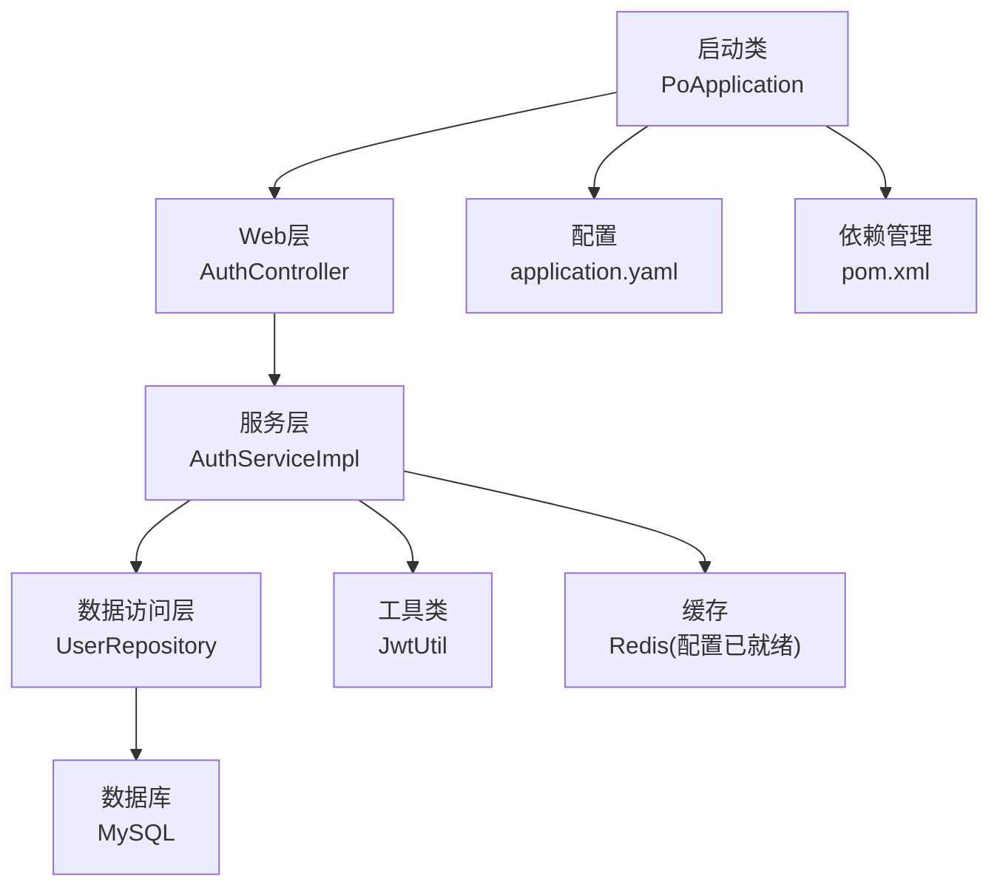
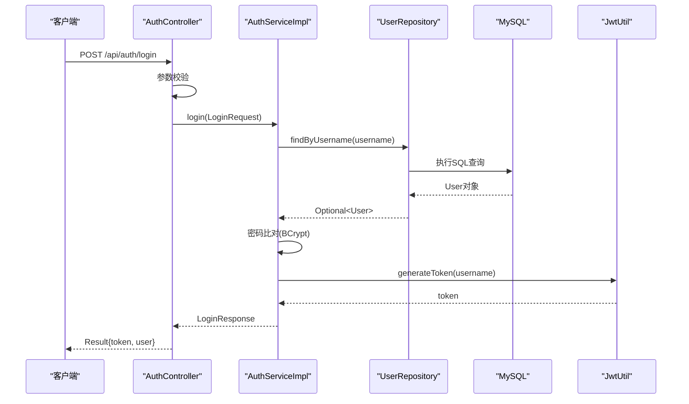
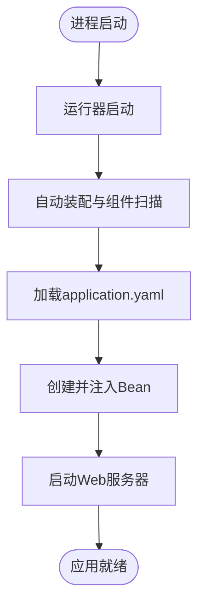
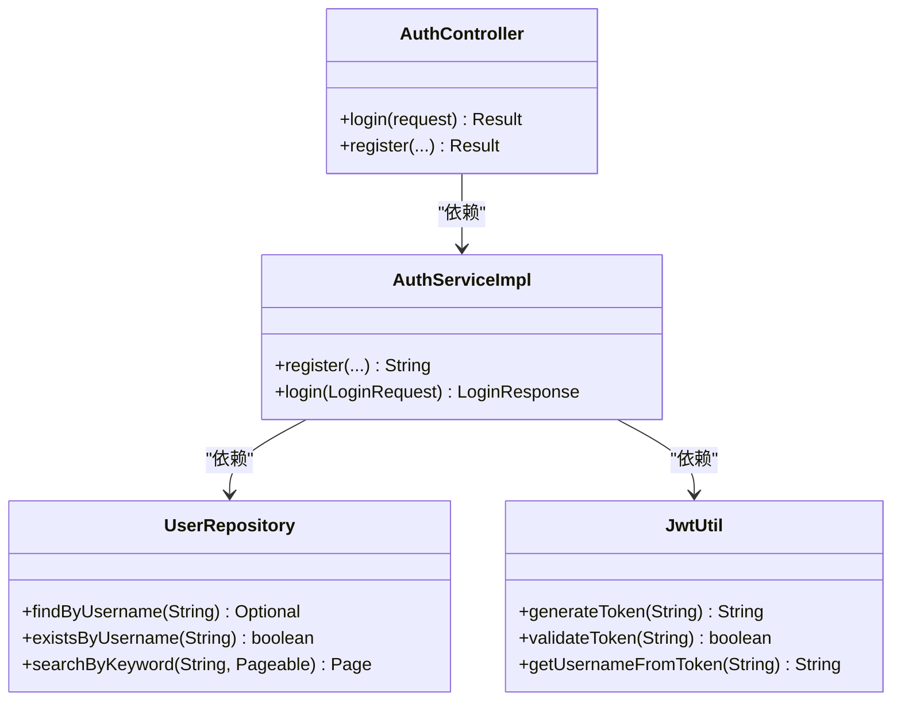
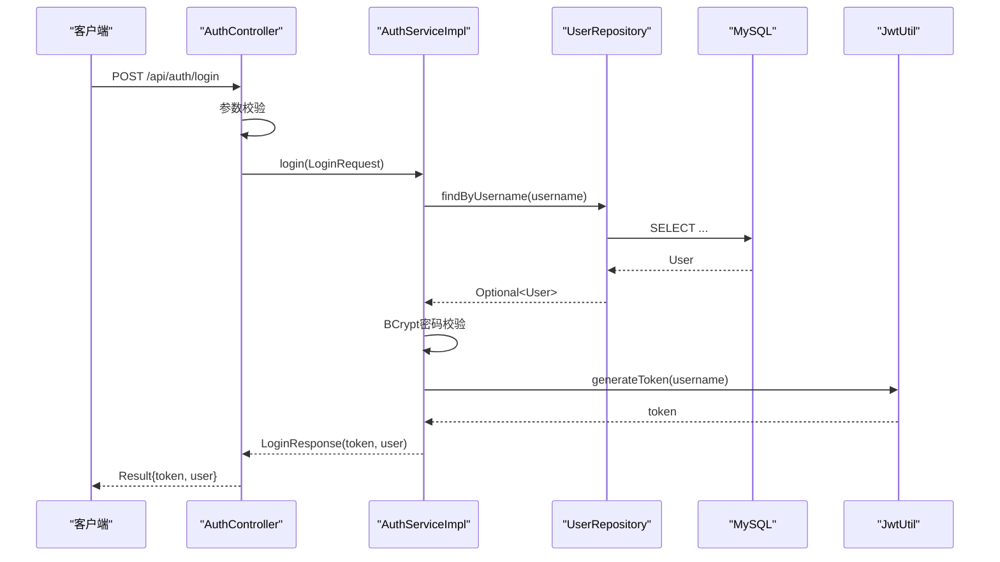
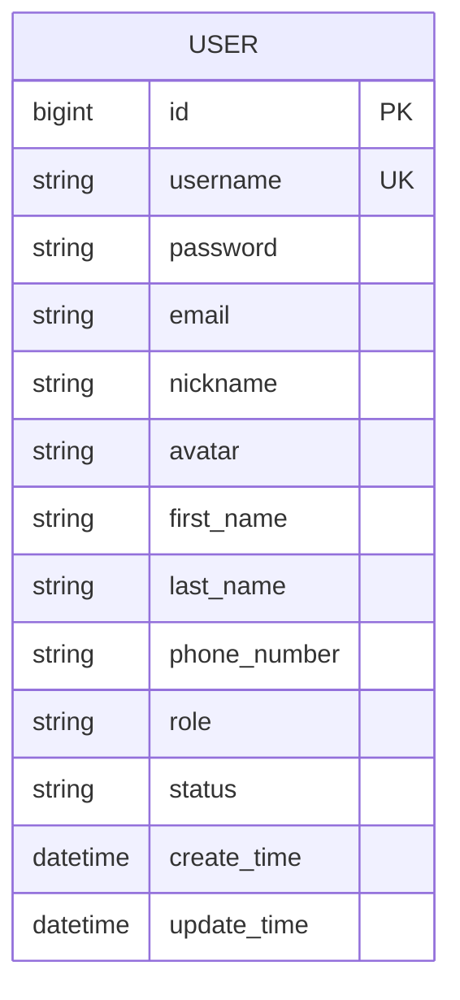
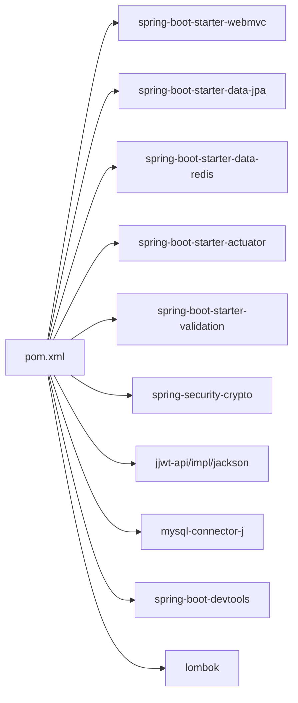

# Spring Boot核心

<cite>
**本文引用的文件**
- [PoApplication.java](file://java_server/po/src/main/java/com/goodzheng/po/PoApplication.java)
- [application.yaml](file://java_server/po/src/main/resources/application.yaml)
- [pom.xml](file://java_server/po/pom.xml)
- [AuthController.java](file://java_server/po/src/main/java/com/ goodzheng/po/controller/AuthController.java)
- [AuthService.java](file://java_server/po/src/main/java/com/ goodzheng/po/service/AuthService.java)
- [AuthServiceImpl.java](file://java_server/po/src/main/java/com/ goodzheng/po/service/impl/AuthServiceImpl.java)
- [JwtUtil.java](file://java_server/po/src/main/java/com/ goodzheng/po/util/JwtUtil.java)
- [User.java](file://java_server/po/src/main/java/com/ goodzheng/po/entity/User.java)
- [UserRepository.java](file://java_server/po/src/main/java/com/ goodzheng/po/repository/UserRepository.java)
</cite>

## 目录
1. [简介](#简介)
2. [项目结构](#项目结构)
3. [核心组件](#核心组件)
4. [架构总览](#架构总览)
5. [详细组件分析](#详细组件分析)
6. [依赖关系分析](#依赖关系分析)
7. [性能考虑](#性能考虑)
8. [故障排查指南](#故障排查指南)
9. [结论](#结论)
10. [附录](#附录)

## 简介
本技术文档聚焦于Spring Boot核心模块，围绕应用启动流程、依赖注入机制与配置管理策略展开。结合本项目实际代码，系统说明application.yaml中数据库连接、Redis缓存、JWT认证等关键配置的用途与最佳实践；梳理Maven项目结构与依赖管理策略；并通过登录鉴权链路示例，帮助开发者理解Spring Boot应用的初始化过程与核心运行机制。

## 项目结构
- 入口类：使用注解驱动自动装配，启动Spring容器并加载Web MVC、数据访问、缓存、监控等能力。
- 配置中心：application.yaml集中管理服务器、数据源、JPA/Hibernate、Redis、日志、Actuator及自定义业务配置（含JWT）。
- 分层架构：controller -> service(impl) -> repository -> entity，配合JPA进行数据持久化；util提供JWT工具。
- 构建与依赖：通过spring-boot-starter-parent统一管理版本，引入webmvc、data-jpa、data-redis、actuator、validation、security-crypto、JWT库等。

**图示来源**
- [PoApplication.java:6-11](file://java_server/po/src/main/java/com/ goodzheng/po/PoApplication.java#L6-L11)
- [application.yaml:1-109](file://java_server/po/src/main/resources/application.yaml#L1-L109)
- [pom.xml:32-115](file://java_server/po/pom.xml#L32-L115)

**章节来源**
- [PoApplication.java:6-11](file://java_server/po/src/main/java/com/ goodzheng/po/PoApplication.java#L6-L11)
- [application.yaml:1-109](file://java_server/po/src/main/resources/application.yaml#L1-L109)
- [pom.xml:1-163](file://java_server/po/pom.xml#L1-L163)

## 核心组件
- 应用启动器：通过注解启用自动装配与组件扫描，调用运行器启动内嵌Web容器。
- Web控制器：暴露REST接口，接收请求参数并进行校验，委托服务层处理。
- 服务实现：封装业务逻辑，包括用户注册、登录、密码加密、令牌签发。
- 数据访问：基于JPA的Repository接口，提供按用户名查询、存在性检查与分页搜索。
- 实体模型：映射数据库表结构，包含用户基本信息、角色、状态与时间戳。
- JWT工具：从配置读取密钥与过期时间，负责生成与校验令牌。

**章节来源**
- [PoApplication.java:6-11](file://java_server/po/src/main/java/com/ goodzheng/po/PoApplication.java#L6-L11)
- [AuthController.java:11-40](file://java_server/po/src/main/java/com/ goodzheng/po/controller/AuthController.java#L11-L40)
- [AuthService.java:6-11](file://java_server/po/src/main/java/com/ goodzheng/po/service/AuthService.java#L6-L11)
- [AuthServiceImpl.java:13-46](file://java_server/po/src/main/java/com/ goodzheng/po/service/impl/AuthServiceImpl.java#L13-L46)
- [UserRepository.java:13-26](file://java_server/po/src/main/java/com/ goodzheng/po/repository/UserRepository.java#L13-L26)
- [User.java:8-58](file://java_server/po/src/main/java/com/ goodzheng/po/entity/User.java#L8-L58)
- [JwtUtil.java:13-54](file://java_server/po/src/main/java/com/ goodzheng/po/util/JwtUtil.java#L13-L54)

## 架构总览
下图展示了从HTTP请求到数据存取与令牌签发的完整调用链，体现Spring Boot的自动装配与依赖注入如何串联各层组件。

**图示来源**
- [AuthController.java:19-27](file://java_server/po/src/main/java/com/ goodzheng/po/controller/AuthController.java#L19-L27)
- [AuthServiceImpl.java:35-46](file://java_server/po/src/main/java/com/ goodzheng/po/service/impl/AuthServiceImpl.java#L35-L46)
- [UserRepository.java:16-18](file://java_server/po/src/main/java/com/ goodzheng/po/repository/UserRepository.java#L16-L18)
- [JwtUtil.java:25-33](file://java_server/po/src/main/java/com/ goodzheng/po/util/JwtUtil.java#L25-L33)

## 详细组件分析

### 应用启动流程
- 入口方法调用运行器，触发自动装配与组件扫描。
- 根据starter与配置，依次初始化Web容器、数据源、JPA、Redis、Actuator等。
- 完成Bean创建与依赖注入后，监听端口并对外提供服务。

**图示来源**
- [PoApplication.java:6-11](file://java_server/po/src/main/java/com/ goodzheng/po/PoApplication.java#L6-L11)
- [application.yaml:1-109](file://java_server/po/src/main/resources/application.yaml#L1-L109)

**章节来源**
- [PoApplication.java:6-11](file://java_server/po/src/main/java/com/ goodzheng/po/PoApplication.java#L6-L11)

### 依赖注入机制
- 控制器通过构造注入获取服务实例。
- 服务实现通过构造注入获取Repository与工具类。
- 工具类通过构造注入读取配置项，形成“配置即依赖”的模式。
- JPA Repository由Spring Data自动实现，无需手写DAO。

**图示来源**
- [AuthController.java:11-18](file://java_server/po/src/main/java/com/ goodzheng/po/controller/AuthController.java#L11-L18)
- [AuthServiceImpl.java:13-19](file://java_server/po/src/main/java/com/ goodzheng/po/service/impl/AuthServiceImpl.java#L13-L19)
- [UserRepository.java:13-26](file://java_server/po/src/main/java/com/ goodzheng/po/repository/UserRepository.java#L13-L26)
- [JwtUtil.java:13-23](file://java_server/po/src/main/java/com/ goodzheng/po/util/JwtUtil.java#L13-L23)

**章节来源**
- [AuthController.java:11-18](file://java_server/po/src/main/java/com/ goodzheng/po/controller/AuthController.java#L11-L18)
- [AuthServiceImpl.java:13-19](file://java_server/po/src/main/java/com/ goodzheng/po/service/impl/AuthServiceImpl.java#L13-L19)
- [JwtUtil.java:13-23](file://java_server/po/src/main/java/com/ goodzheng/po/util/JwtUtil.java#L13-L23)

### 配置管理策略（application.yaml）
- 服务器基础配置：端口、上下文路径、Tomcat线程与连接池参数。
- Spring核心：应用名、激活环境、数据源（HikariCP）、JPA/Hibernate、Redis（Jedis连接池）、文件上传限制、静态资源缓存。
- 日志：根日志级别、包级别调试、输出格式与日志文件路径。
- Actuator：暴露健康、信息、指标与Prometheus端点。
- 自定义业务：应用元信息。
- JWT：签名密钥与令牌过期时间。

建议与实践
- 将敏感信息（如数据库密码、Redis密码、JWT密钥）迁移至环境变量或外部配置中心，避免硬编码。
- 使用多环境配置文件（dev/test/prod）与环境变量覆盖，统一基线配置。
- 合理设置连接池大小与超时，结合压测结果调优。
- 开启JPA show-sql仅用于开发环境，生产关闭以提升性能。
- 对Redis连接池与超时进行容量规划，避免热点键与长事务导致阻塞。

**章节来源**
- [application.yaml:1-109](file://java_server/po/src/main/resources/application.yaml#L1-L109)

### 登录与鉴权流程（序列图）

**图示来源**
- [AuthController.java:19-27](file://java_server/po/src/main/java/com/ goodzheng/po/controller/AuthController.java#L19-L27)
- [AuthServiceImpl.java:35-46](file://java_server/po/src/main/java/com/ goodzheng/po/service/impl/AuthServiceImpl.java#L35-L46)
- [UserRepository.java:16-18](file://java_server/po/src/main/java/com/ goodzheng/po/repository/UserRepository.java#L16-L18)
- [JwtUtil.java:25-33](file://java_server/po/src/main/java/com/ goodzheng/po/util/JwtUtil.java#L25-L33)

**章节来源**
- [AuthController.java:19-27](file://java_server/po/src/main/java/com/ goodzheng/po/controller/AuthController.java#L19-L27)
- [AuthServiceImpl.java:35-46](file://java_server/po/src/main/java/com/ goodzheng/po/service/impl/AuthServiceImpl.java#L35-L46)
- [JwtUtil.java:25-33](file://java_server/po/src/main/java/com/ goodzheng/po/util/JwtUtil.java#L25-L33)

### 数据模型（ER图）

**图示来源**
- [User.java:8-58](file://java_server/po/src/main/java/com/ goodzheng/po/entity/User.java#L8-L58)

**章节来源**
- [User.java:8-58](file://java_server/po/src/main/java/com/ goodzheng/po/entity/User.java#L8-L58)

## 依赖关系分析
- 构建与版本：以spring-boot-starter-parent为父POM，统一依赖版本管理。
- Web与MVC：spring-boot-starter-webmvc提供Web容器与MVC能力。
- 数据访问：spring-boot-starter-data-jpa提供JPA抽象与自动配置；mysql-connector-j为MySQL驱动。
- 缓存：spring-boot-starter-data-redis引入Redis支持，并排除默认Lettuce，改用Jedis。
- 监控：spring-boot-starter-actuator与micrometer-registry-prometheus暴露监控指标。
- 安全与校验：spring-security-crypto提供密码加密；spring-boot-starter-validation提供参数校验。
- JWT：jjwt-api/impl/jackson三件套实现令牌生成与解析。
- 开发辅助：spring-boot-devtools提升开发体验；lombok简化样板代码。

**图示来源**
- [pom.xml:32-115](file://java_server/po/pom.xml#L32-L115)

**章节来源**
- [pom.xml:32-115](file://java_server/po/pom.xml#L32-L115)

## 性能考虑
- 连接池：根据并发与数据库资源调整Hikari最大连接数与空闲连接数，避免连接耗尽或内存浪费。
- JPA：生产环境关闭show-sql；合理使用open-in-view与懒加载，减少N+1查询。
- Redis：合理设置连接池大小与超时；对热点Key设计过期策略与防穿透方案。
- 文件上传：根据业务需求调整max-file-size与max-request-size，防止恶意大文件攻击。
- 监控：开启Actuator与Prometheus指标，结合APM进行瓶颈定位。

[本节为通用性能指导，不直接分析具体文件]

## 故障排查指南
常见问题与定位思路
- 数据库连接失败：检查URL、账号密码、时区与字符集；确认Hikari连接池是否耗尽；查看日志中的异常堆栈。
- Redis连接失败：核对host/port/password与网络连通性；检查连接池配置与超时；关注连接泄漏。
- JWT校验失败：确认jwt.secret与jwt.expiration配置正确；检查客户端传递的token是否过期或被篡改。
- 启动失败：检查端口占用、上下文路径冲突；查看Actuator health/info端点获取运行时状态。
- 性能问题：结合Prometheus指标与日志，定位慢SQL、锁竞争与GC停顿。

**章节来源**
- [application.yaml:23-58](file://java_server/po/src/main/resources/application.yaml#L23-L58)
- [application.yaml:84-94](file://java_server/po/src/main/resources/application.yaml#L84-L94)
- [application.yaml:107-109](file://java_server/po/src/main/resources/application.yaml#L107-L109)

## 结论
本项目采用标准Spring Boot分层架构与自动装配机制，通过application.yaml集中管理配置，借助JPA与Redis实现高效数据访问与缓存，结合JWT完成轻量级认证。依赖管理遵循starter范式，便于扩展与维护。建议在后续迭代中完善多环境配置、敏感信息管理与监控告警体系，持续提升系统的可观测性与稳定性。

[本节为总结性内容，不直接分析具体文件]

## 附录
- 配置要点速查
  - 服务器：端口、上下文路径、Tomcat线程与连接上限。
  - 数据源：JDBC URL、账号密码、驱动类、Hikari连接池参数。
  - JPA：方言、DDL策略、SQL打印、视图会话控制。
  - Redis：主机、端口、密码、超时、Jedis连接池。
  - 日志：根级别、包级别、输出格式与文件路径。
  - Actuator：暴露的健康、信息与指标端点。
  - JWT：签名密钥与过期时间。

- 最佳实践清单
  - 使用环境变量或配置中心管理敏感配置。
  - 分环境配置与灰度发布策略。
  - 接口参数校验与统一响应封装。
  - 幂等与重试策略（针对外部依赖）。
  - 全链路日志与追踪ID。
  - 定期依赖升级与安全漏洞扫描。

[本节为补充材料，不直接分析具体文件]