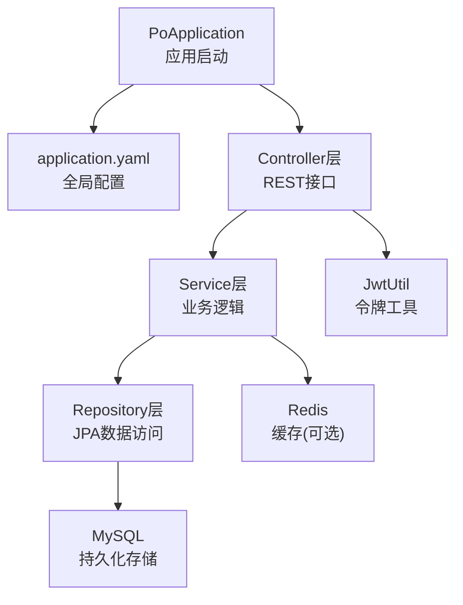
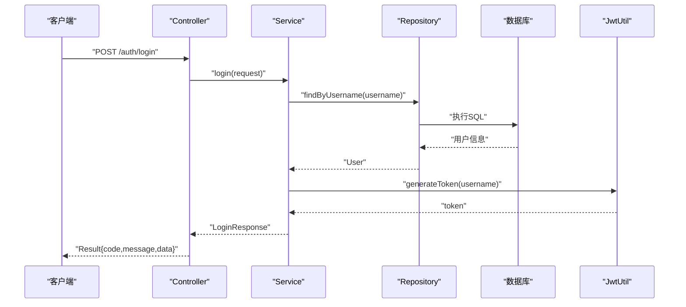
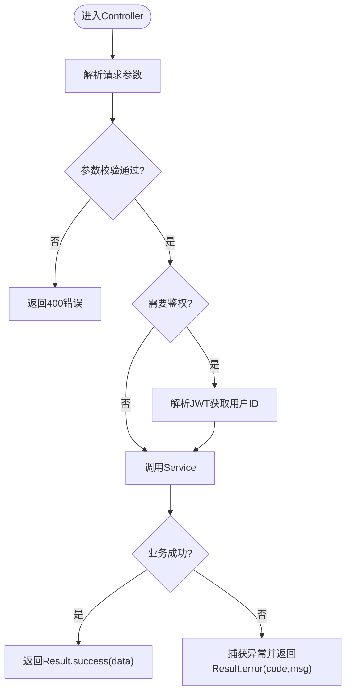
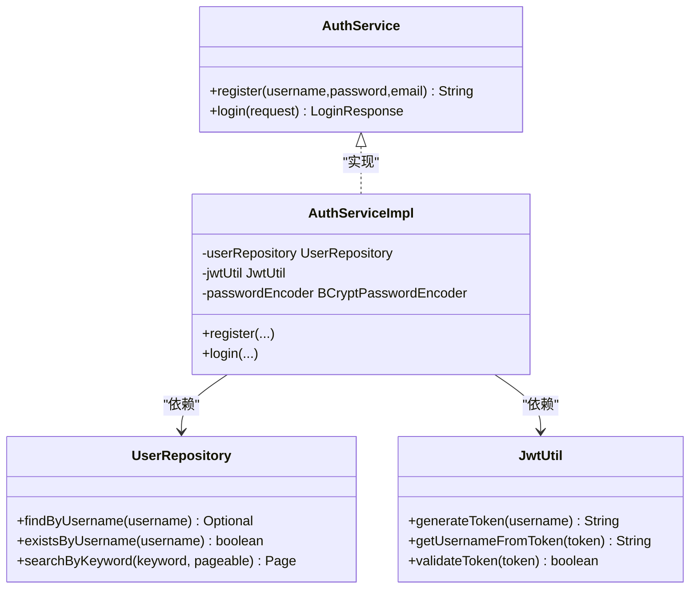
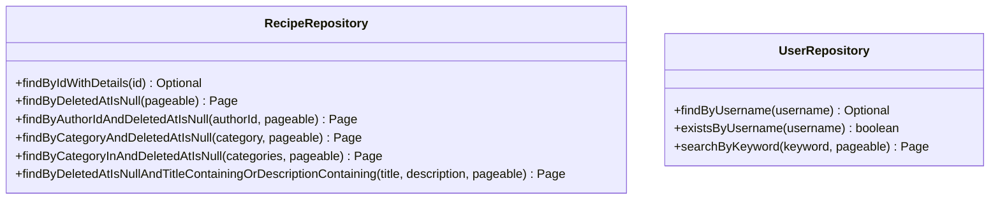
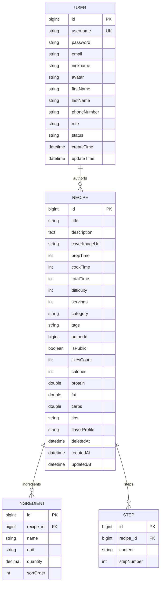
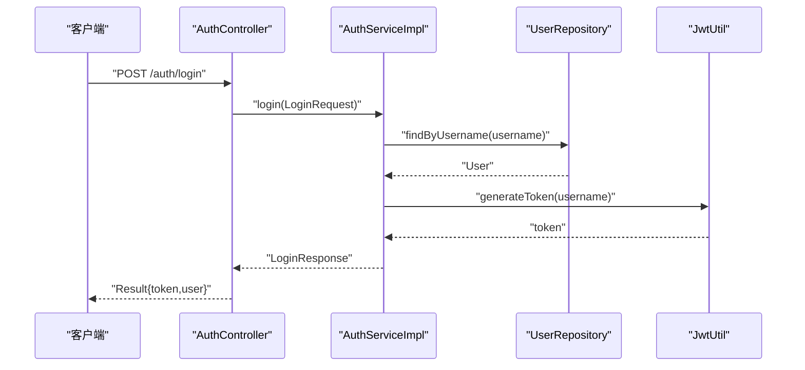
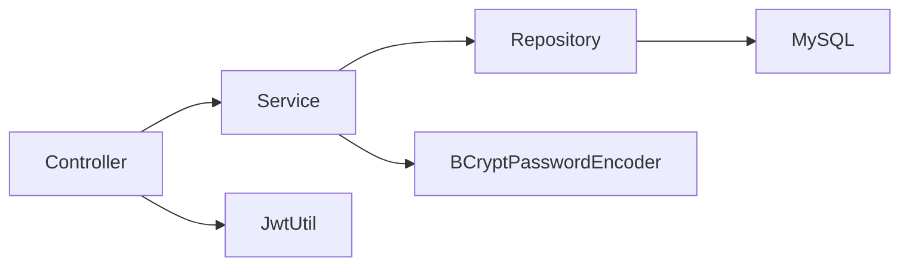

# 后端架构

<cite>
**本文引用的文件**
- [PoApplication.java](file://java_server/po/src/main/java/com/goodzheng/po/PoApplication.java)
- [pom.xml](file://java_server/po/pom.xml)
- [application.yaml](file://java_server/po/src/main/resources/application.yaml)
- [AuthController.java](file://java_server/po/src/main/java/com/goodzheng/po/controller/AuthController.java)
- [RecipeController.java](file://java_server/po/src/main/java/com/goodzheng/po/controller/RecipeController.java)
- [UserController.java](file://java_server/po/src/main/java/com/goodzheng/po/controller/UserController.java)
- [Result.java](file://java_server/po/src/main/java/com/goodzheng/po/dto/Result.java)
- [AuthService.java](file://java_server/po/src/main/java/com/goodzheng/po/service/AuthService.java)
- [AuthServiceImpl.java](file://java_server/po/src/main/java/com/goodzheng/po/service/impl/AuthServiceImpl.java)
- [UserRepository.java](file://java_server/po/src/main/java/com/goodzheng/po/repository/UserRepository.java)
- [RecipeRepository.java](file://java_server/po/src/main/java/com/goodzheng/po/repository/RecipeRepository.java)
- [JwtUtil.java](file://java_server/po/src/main/java/com/goodzheng/po/util/JwtUtil.java)
- [User.java](file://java_server/po/src/main/java/com/goodzheng/po/entity/User.java)
- [Recipe.java](file://java_server/po/src/main/java/com/goodzheng/po/entity/Recipe.java)
</cite>

## 目录
1. [简介](#简介)
2. [项目结构](#项目结构)
3. [核心组件](#核心组件)
4. [架构总览](#架构总览)
5. [详细组件分析](#详细组件分析)
6. [依赖关系分析](#依赖关系分析)
7. [性能考量](#性能考量)
8. [故障排查指南](#故障排查指南)
9. [结论](#结论)
10. [附录](#附录)

## 简介
本文件面向Java Spring Boot后端服务，系统性阐述MVC分层架构（Controller、Service、Repository、Entity）的职责划分与数据流转；总结RESTful API设计规范、请求处理流程与统一响应格式；说明数据访问层的设计模式（JPA实体映射、Repository接口设计、查询优化策略）；解释业务逻辑层的实现模式（事务管理、异常处理、性能优化），并提供各层最佳实践指引。

## 项目结构
后端采用标准Spring Boot工程组织：
- 启动入口：应用主类负责装配并启动Spring容器
- 配置：集中式配置文件定义服务器、数据源、JPA、Redis、日志、监控等
- 控制器：对外暴露REST接口，负责参数校验、鉴权解析、调用服务层
- 服务：封装业务规则、编排跨层调用、处理异常与事务边界
- 仓储：基于JPA的Repository接口，声明式查询与自定义JPQL
- 实体：JPA实体映射数据库表，定义字段约束、关联关系与生命周期回调
- 工具：JWT令牌生成与校验等通用能力

图表来源
- [PoApplication.java:6-11](file://java_server/po/src/main/java/com/goodzheng/po/PoApplication.java#L6-L11)
- [application.yaml:4-67](file://java_server/po/src/main/resources/application.yaml#L4-L67)

章节来源
- [PoApplication.java:6-11](file://java_server/po/src/main/java/com/goodzheng/po/PoApplication.java#L6-L11)
- [application.yaml:4-67](file://java_server/po/src/main/resources/application.yaml#L4-L67)

## 核心组件
- 统一响应体：所有接口返回统一的Result包装，包含code、message、data，便于前端一致化处理
- 认证与授权：通过JWT进行无状态鉴权，Controller中从Authorization头解析用户身份
- 分页与排序：使用Spring Data分页对象PageRequest与Sort，配合Repository分页查询
- 软删除：实体包含deletedAt字段，查询时过滤已删除记录
- 预加载：复杂实体查询使用JOIN FETCH避免懒加载异常

章节来源
- [Result.java:7-31](file://java_server/po/src/main/java/com/goodzheng/po/dto/Result.java#L7-L31)
- [RecipeController.java:51-68](file://java_server/po/src/main/java/com/goodzheng/po/controller/RecipeController.java#L51-L68)
- [RecipeRepository.java:16-34](file://java_server/po/src/main/java/com/goodzheng/po/repository/RecipeRepository.java#L16-L34)
- [Recipe.java:70-82](file://java_server/po/src/main/java/com/goodzheng/po/entity/Recipe.java#L70-L82)

## 架构总览
系统遵循典型三层架构：
- Controller层：接收HTTP请求，参数校验，调用Service，统一封装Result返回
- Service层：业务编排、异常转换、事务边界控制
- Repository层：基于JPA的数据访问，提供分页、条件查询、预加载等能力
- Entity层：JPA实体映射，定义字段、约束、关联与生命周期钩子

图表来源
- [AuthController.java:19-27](file://java_server/po/src/main/java/com/goodzheng/po/controller/AuthController.java#L19-L27)
- [AuthServiceImpl.java:35-46](file://java_server/po/src/main/java/com/goodzheng/po/service/impl/AuthServiceImpl.java#L35-L46)
- [UserRepository.java:13-18](file://java_server/po/src/main/java/com/goodzheng/po/repository/UserRepository.java#L13-L18)
- [JwtUtil.java:25-33](file://java_server/po/src/main/java/com/goodzheng/po/util/JwtUtil.java#L25-L33)

## 详细组件分析

### Controller层：REST接口与请求处理
- 职责
  - 接收并校验请求参数（@Valid、@RequestBody、@RequestParam）
  - 解析鉴权信息（从Authorization头提取JWT并解析用户ID）
  - 调用Service完成业务操作
  - 统一封装Result返回，捕获运行时异常并转换为错误码与消息
- 设计要点
  - REST风格路径与HTTP动词对应资源操作
  - 分页参数标准化（page、size、sort）
  - 跨域注解用于开发调试环境
  - 对敏感操作进行鉴权校验（如创建、更新、删除）

图表来源
- [RecipeController.java:28-118](file://java_server/po/src/main/java/com/goodzheng/po/controller/RecipeController.java#L28-L118)
- [UserController.java:29-131](file://java_server/po/src/main/java/com/goodzheng/po/controller/UserController.java#L29-L131)
- [AuthController.java:19-39](file://java_server/po/src/main/java/com/goodzheng/po/controller/AuthController.java#L19-L39)

章节来源
- [RecipeController.java:28-118](file://java_server/po/src/main/java/com/goodzheng/po/controller/RecipeController.java#L28-L118)
- [UserController.java:29-131](file://java_server/po/src/main/java/com/goodzheng/po/controller/UserController.java#L29-L131)
- [AuthController.java:19-39](file://java_server/po/src/main/java/com/goodzheng/po/controller/AuthController.java#L19-L39)

### Service层：业务逻辑与事务管理
- 职责
  - 封装领域规则（注册、登录、菜谱CRUD、搜索、分页）
  - 协调Repository与外部工具（如JWT、密码加密）
  - 抛出业务异常，由Controller统一捕获并转为Result
- 设计要点
  - 单一职责：每个Service聚焦一个业务域
  - 可测试性：接口与实现分离，便于Mock与单元测试
  - 可扩展性：新增业务方法不侵入既有逻辑
  - 事务边界：在写操作方法上开启事务（建议以@Transactional标注）

图表来源
- [AuthService.java:6-11](file://java_server/po/src/main/java/com/goodzheng/po/service/AuthService.java#L6-L11)
- [AuthServiceImpl.java:13-46](file://java_server/po/src/main/java/com/goodzheng/po/service/impl/AuthServiceImpl.java#L13-L46)
- [UserRepository.java:13-26](file://java_server/po/src/main/java/com/goodzheng/po/repository/UserRepository.java#L13-L26)
- [JwtUtil.java:13-55](file://java_server/po/src/main/java/com/goodzheng/po/util/JwtUtil.java#L13-L55)

章节来源
- [AuthServiceImpl.java:13-46](file://java_server/po/src/main/java/com/goodzheng/po/service/impl/AuthServiceImpl.java#L13-L46)

### Repository层：数据访问与查询优化
- 职责
  - 基于JpaRepository提供基础CRUD
  - 声明式查询方法（按作者、分类、关键字等）
  - 自定义JPQL进行复杂查询与预加载
- 设计要点
  - 分页查询：使用Pageable提升大数据量下的性能
  - 预加载：使用LEFT JOIN FETCH一次性加载关联集合，避免N+1问题
  - 软删除：查询时过滤deletedAt为空的记录
  - 索引建议：对高频查询字段（如username、category、authorId）建立索引

图表来源
- [RecipeRepository.java:13-35](file://java_server/po/src/main/java/com/goodzheng/po/repository/RecipeRepository.java#L13-L35)
- [UserRepository.java:13-26](file://java_server/po/src/main/java/com/goodzheng/po/repository/UserRepository.java#L13-L26)

章节来源
- [RecipeRepository.java:13-35](file://java_server/po/src/main/java/com/goodzheng/po/repository/RecipeRepository.java#L13-L35)
- [UserRepository.java:13-26](file://java_server/po/src/main/java/com/goodzheng/po/repository/UserRepository.java#L13-L26)

### Entity层：JPA实体映射与关联
- 职责
  - 映射数据库表结构与字段约束
  - 定义实体间关联关系（一对多、有序集合）
  - 生命周期回调（更新时间戳）
- 设计要点
  - 唯一约束：用户名唯一，避免重复
  - 软删除：deletedAt字段标记删除时间
  - 关联集合：ingredients与steps使用LinkedHashSet保持顺序
  - 预加载：通过JOIN FETCH在Repository层按需加载

图表来源
- [User.java:8-58](file://java_server/po/src/main/java/com/goodzheng/po/entity/User.java#L8-L58)
- [Recipe.java:10-92](file://java_server/po/src/main/java/com/goodzheng/po/entity/Recipe.java#L10-L92)

章节来源
- [User.java:8-58](file://java_server/po/src/main/java/com/goodzheng/po/entity/User.java#L8-L58)
- [Recipe.java:10-92](file://java_server/po/src/main/java/com/goodzheng/po/entity/Recipe.java#L10-L92)

### 认证与鉴权流程
- 登录流程
  - 客户端提交用户名与密码
  - Service层校验用户存在性与密码匹配
  - 生成JWT令牌并返回给客户端
- 受保护接口
  - 客户端在Authorization头携带Bearer Token
  - Controller解析Token获取用户名，再查库得到用户ID
  - 根据用户ID执行权限校验与数据隔离

图表来源
- [AuthController.java:19-27](file://java_server/po/src/main/java/com/goodzheng/po/controller/AuthController.java#L19-L27)
- [AuthServiceImpl.java:35-46](file://java_server/po/src/main/java/com/goodzheng/po/service/impl/AuthServiceImpl.java#L35-L46)
- [JwtUtil.java:25-33](file://java_server/po/src/main/java/com/goodzheng/po/util/JwtUtil.java#L25-L33)

章节来源
- [AuthController.java:19-27](file://java_server/po/src/main/java/com/goodzheng/po/controller/AuthController.java#L19-L27)
- [AuthServiceImpl.java:35-46](file://java_server/po/src/main/java/com/goodzheng/po/service/impl/AuthServiceImpl.java#L35-L46)
- [JwtUtil.java:25-33](file://java_server/po/src/main/java/com/goodzheng/po/util/JwtUtil.java#L25-L33)

## 依赖关系分析
- 技术栈
  - Web框架：Spring Boot Web MVC
  - 数据访问：Spring Data JPA + MySQL
  - 缓存：Spring Data Redis（Jedis）
  - 监控：Actuator + Prometheus
  - 安全：BCrypt密码加密、JWT令牌
- 模块耦合
  - Controller依赖Service与工具类（JwtUtil）
  - Service依赖Repository与工具类
  - Repository依赖JPA与数据库
  - 实体与Repository强耦合（JPA注解）

图表来源
- [pom.xml:32-115](file://java_server/po/pom.xml#L32-L115)
- [AuthController.java:11-17](file://java_server/po/src/main/java/com/goodzheng/po/controller/AuthController.java#L11-L17)
- [AuthServiceImpl.java:13-19](file://java_server/po/src/main/java/com/goodzheng/po/service/impl/AuthServiceImpl.java#L13-L19)

章节来源
- [pom.xml:32-115](file://java_server/po/pom.xml#L32-L115)

## 性能考量
- 连接池与线程
  - HikariCP最大连接数与超时时间合理配置，避免连接耗尽
  - Tomcat线程池与连接数上限保障并发处理能力
- 查询优化
  - 使用分页查询减少单次结果集大小
  - 使用JOIN FETCH预加载关联集合，避免N+1查询
  - 对高频查询字段添加数据库索引（username、category、authorId）
- 缓存策略
  - 热点数据（如分类列表、热门菜谱）可引入Redis缓存
  - 设置合理的过期时间与缓存更新策略
- 序列化与传输
  - 使用Jackson注解控制输出字段（如忽略密码）
  - 限制文件大小与请求体大小，防止恶意请求

章节来源
- [application.yaml:24-67](file://java_server/po/src/main/resources/application.yaml#L24-L67)
- [RecipeRepository.java:16-34](file://java_server/po/src/main/java/com/goodzheng/po/repository/RecipeRepository.java#L16-L34)
- [User.java:20-22](file://java_server/po/src/main/java/com/goodzheng/po/entity/User.java#L20-L22)

## 故障排查指南
- 常见问题
  - 懒加载异常：未预加载关联集合导致LazyInitializationException
    - 解决：使用JOIN FETCH或初始化集合后再访问
  - 认证失败：Token无效或过期
    - 解决：检查JWT密钥与过期时间配置，确认客户端传递Authorization头
  - 分页越界：page或size参数非法
    - 解决：增加参数校验与默认值处理
- 日志与监控
  - 启用SQL日志打印，定位慢查询
  - 使用Actuator健康检查与指标采集，观察系统状态
- 异常处理
  - 统一捕获RuntimeException并转换为Result错误响应
  - 区分业务异常与系统异常，给出明确错误码与消息

章节来源
- [RecipeRepository.java:16-18](file://java_server/po/src/main/java/com/goodzheng/po/repository/RecipeRepository.java#L16-L18)
- [JwtUtil.java:39-46](file://java_server/po/src/main/java/com/goodzheng/po/util/JwtUtil.java#L39-L46)
- [application.yaml:71-94](file://java_server/po/src/main/resources/application.yaml#L71-L94)

## 结论
本项目采用清晰的MVC分层架构，结合Spring Data JPA与JWT实现了稳定的用户与菜谱管理能力。通过统一响应体、分页查询、预加载与软删除等机制，提升了系统的可维护性与扩展性。建议在后续迭代中完善事务边界、引入缓存与更完善的异常体系，进一步提升性能与健壮性。

## 附录
- RESTful API规范示例
  - 认证
    - POST /api/auth/login：登录，返回用户信息与令牌
    - POST /api/auth/register：注册，返回成功消息
  - 用户
    - GET /api/users：分页查询用户列表
    - GET /api/users/{id}：获取用户详情
    - GET /api/users/me：当前登录用户信息
    - POST /api/users：创建用户
    - PUT /api/users/{id}：更新用户
    - DELETE /api/users/{id}：删除用户
    - DELETE /api/users/batch：批量删除
    - PUT /api/users/batch/status：批量修改状态
  - 菜谱
    - POST /api/recipes：创建菜谱（需鉴权）
    - GET /api/recipes/{id}：获取菜谱详情
    - GET /api/recipes：分页查询菜谱列表
    - GET /api/recipes/mine：我的菜谱（需鉴权）
    - PUT /api/recipes/{id}：更新菜谱（需鉴权）
    - DELETE /api/recipes/{id}：删除菜谱（需鉴权）

章节来源
- [AuthController.java:19-39](file://java_server/po/src/main/java/com/goodzheng/po/controller/AuthController.java#L19-L39)
- [UserController.java:29-131](file://java_server/po/src/main/java/com/goodzheng/po/controller/UserController.java#L29-L131)
- [RecipeController.java:28-118](file://java_server/po/src/main/java/com/goodzheng/po/controller/RecipeController.java#L28-L118)
- [application.yaml:4-7](file://java_server/po/src/main/resources/application.yaml#L4-L7)