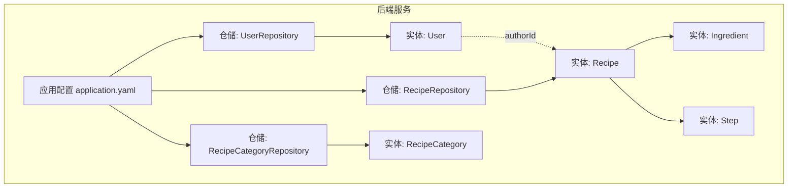
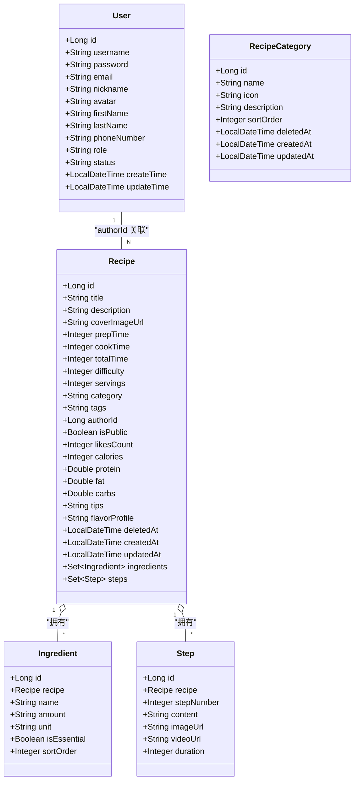
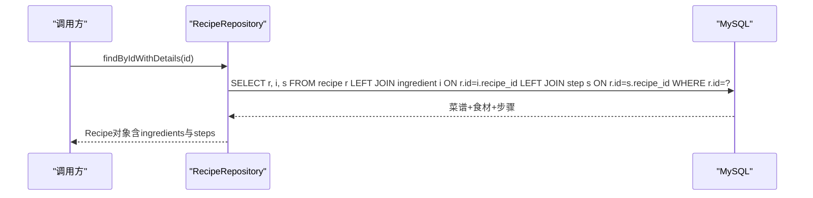
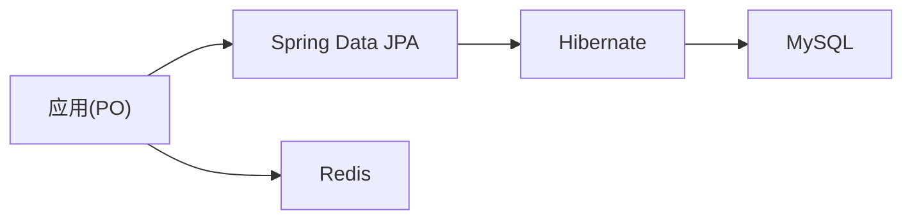

# 数据模型设计

<cite>
**本文引用的文件**
- [User.java](file://java_server/po/src/main/java/com/goodzheng/po/entity/User.java)
- [Recipe.java](file://java_server/po/src/main/java/com/goodzheng/po/entity/Recipe.java)
- [Ingredient.java](file://java_server/po/src/main/java/com/goodzheng/po/entity/Ingredient.java)
- [Step.java](file://java_server/po/src/main/java/com/goodzheng/po/entity/Step.java)
- [RecipeCategory.java](file://java_server/po/src/main/java/com/goodzheng/po/entity/RecipeCategory.java)
- [UserRepository.java](file://java_server/po/src/main/java/com/goodzheng/po/repository/UserRepository.java)
- [RecipeRepository.java](file://java_server/po/src/main/java/com/goodzheng/po/repository/RecipeRepository.java)
- [RecipeCategoryRepository.java](file://java_server/po/src/main/java/com/goodzheng/po/repository/RecipeCategoryRepository.java)
- [application.yaml](file://java_server/po/src/main/resources/application.yaml)
- [data-category.sql](file://java_server/po/src/main/resources/data-category.sql)
- [data-hunan.sql](file://java_server/po/src/main/resources/data-hunan.sql)
- [pom.xml](file://java_server/po/pom.xml)
</cite>

## 目录
1. [简介](#简介)
2. [项目结构](#项目结构)
3. [核心实体与关系](#核心实体与关系)
4. [架构总览](#架构总览)
5. [详细组件分析](#详细组件分析)
6. [依赖关系分析](#依赖关系分析)
7. [性能考量](#性能考量)
8. [故障排查指南](#故障排查指南)
9. [结论](#结论)
10. [附录：表结构与索引建议](#附录表结构与索引建议)

## 简介
本文件面向数据模型设计与扩展，聚焦于JPA实体类、字段定义、约束条件、关联映射以及数据库表结构的对应关系。文档基于Java后端模块中的实体与仓库接口进行分析，结合应用配置与种子数据脚本，帮助开发者理解并正确扩展数据模型。

## 项目结构
本项目采用分层架构：
- 实体层（entity）：使用JPA注解定义领域模型与持久化映射
- 仓储层（repository）：基于Spring Data JPA提供查询能力
- 配置层（resources/application.yaml）：数据源、JPA/Hibernate、Redis等运行时配置
- 数据初始化（resources/*.sql）：分类与菜谱种子数据，体现表结构与字段约定

图表来源
- [User.java:1-59](file://java_server/po/src/main/java/com/goodzheng/po/entity/User.java#L1-L59)
- [Recipe.java:1-93](file://java_server/po/src/main/java/com/goodzheng/po/entity/Recipe.java#L1-L93)
- [Ingredient.java:1-42](file://java_server/po/src/main/java/com/goodzheng/po/entity/Ingredient.java#L1-L42)
- [Step.java:1-40](file://java_server/po/src/main/java/com/goodzheng/po/entity/Step.java#L1-L40)
- [RecipeCategory.java:1-46](file://java_server/po/src/main/java/com/goodzheng/po/entity/RecipeCategory.java#L1-L46)
- [UserRepository.java:1-27](file://java_server/po/src/main/java/com/goodzheng/po/repository/UserRepository.java#L1-L27)
- [RecipeRepository.java:1-36](file://java_server/po/src/main/java/com/goodzheng/po/repository/RecipeRepository.java#L1-L36)
- [RecipeCategoryRepository.java:1-18](file://java_server/po/src/main/java/com/goodzheng/po/repository/RecipeCategoryRepository.java#L1-L18)
- [application.yaml:23-41](file://java_server/po/src/main/resources/application.yaml#L23-L41)

章节来源
- [application.yaml:23-41](file://java_server/po/src/main/resources/application.yaml#L23-L41)

## 核心实体与关系
- 用户（User）
  - 主键：自增Long id
  - 唯一约束：username（表级uniqueConstraints）
  - 必填与长度限制：username、password为必填；email、nickname、avatar、firstName、lastName、phoneNumber、role、status等带长度限制
  - 时间戳：createTime不可更新；updateTime在更新时自动刷新
  - 安全：password字段被忽略序列化
- 菜谱（Recipe）
  - 主键：自增Long id
  - 业务字段：标题、描述、封面图、准备/烹饪/总时长、难度、份数、分类、标签（逗号分隔）、作者ID、公开性、点赞数、营养信息、提示、风味画像
  - 软删除：deletedAt
  - 时间戳：createdAt不可更新；updatedAt在更新时自动刷新
  - 一对多关系：ingredients、steps（有序集合，按排序字段排序）
- 食材（Ingredient）
  - 主键：自增Long id
  - 多对一：recipe（懒加载，外键recipe_id）
  - 字段：名称、数量、单位、是否必需、排序
- 步骤（Step）
  - 主键：自增Long id
  - 多对一：recipe（懒加载，外键recipe_id）
  - 字段：步骤序号、内容（TEXT）、图片URL、视频URL、耗时
- 分类（RecipeCategory）
  - 主键：自增Long id
  - 唯一约束：name
  - 字段：图标、描述、排序权重、软删除、时间戳

章节来源
- [User.java:1-59](file://java_server/po/src/main/java/com/goodzheng/po/entity/User.java#L1-L59)
- [Recipe.java:1-93](file://java_server/po/src/main/java/com/goodzheng/po/entity/Recipe.java#L1-L93)
- [Ingredient.java:1-42](file://java_server/po/src/main/java/com/goodzheng/po/entity/Ingredient.java#L1-L42)
- [Step.java:1-40](file://java_server/po/src/main/java/com/goodzheng/po/entity/Step.java#L1-L40)
- [RecipeCategory.java:1-46](file://java_server/po/src/main/java/com/goodzheng/po/entity/RecipeCategory.java#L1-L46)

## 架构总览
下图展示实体间关系及仓储访问路径，便于理解数据流与查询策略。

图表来源
- [User.java:1-59](file://java_server/po/src/main/java/com/goodzheng/po/entity/User.java#L1-L59)
- [Recipe.java:1-93](file://java_server/po/src/main/java/com/goodzheng/po/entity/Recipe.java#L1-L93)
- [Ingredient.java:1-42](file://java_server/po/src/main/java/com/goodzheng/po/entity/Ingredient.java#L1-L42)
- [Step.java:1-40](file://java_server/po/src/main/java/com/goodzheng/po/entity/Step.java#L1-L40)
- [RecipeCategory.java:1-46](file://java_server/po/src/main/java/com/goodzheng/po/entity/RecipeCategory.java#L1-L46)

## 详细组件分析

### 实体：User
- 设计要点
  - @Entity/@Table：映射到sys_user表，设置用户名唯一约束
  - @Id/@GeneratedValue：自增主键
  - @Column：字段非空、唯一、长度限制；createTime不可更新；updateTime通过@PreUpdate自动刷新
  - @JsonIgnore：避免密码泄露
- 使用示例
  - 通过用户名查找用户、分页搜索用户（支持用户名/邮箱/姓名模糊匹配）
- 最佳实践
  - 对外暴露DTO时排除敏感字段
  - 统一状态枚举化管理（active/inactive/invited/suspended）

章节来源
- [User.java:1-59](file://java_server/po/src/main/java/com/goodzheng/po/entity/User.java#L1-L59)
- [UserRepository.java:1-27](file://java_server/po/src/main/java/com/goodzheng/po/repository/UserRepository.java#L1-L27)

### 实体：Recipe
- 设计要点
  - 基础信息与元数据：标题、描述、封面、时长、难度、份数、分类、标签、作者ID、公开性、点赞数
  - 营养与风味：卡路里、蛋白质、脂肪、碳水、提示、风味画像
  - 软删除：deletedAt用于逻辑删除
  - 时间戳：createdAt不可更新；updatedAt通过@PreUpdate自动刷新
  - 一对多关系：ingredients、steps，均使用有序集合并按指定字段排序
- 使用示例
  - 通过ID获取详情（预加载ingredients与steps，避免懒加载异常）
  - 分页查询未删除的菜谱、按作者/分类/关键字检索
- 最佳实践
  - 标签以逗号分隔字符串存储，适合简单场景；如需复杂查询可考虑规范化为独立标签表
  - 软删除查询需始终带上deletedAt为空的条件

章节来源
- [Recipe.java:1-93](file://java_server/po/src/main/java/com/goodzheng/po/entity/Recipe.java#L1-L93)
- [RecipeRepository.java:1-36](file://java_server/po/src/main/java/com/goodzheng/po/repository/RecipeRepository.java#L1-L36)

### 实体：Ingredient
- 设计要点
  - 多对一：指向所属菜谱，懒加载，外键recipe_id
  - 字段：名称、数量、单位、是否必需、排序
- 使用示例
  - 随Recipe一起加载，或单独按菜谱查询食材列表
- 最佳实践
  - 使用sortOrder保证前端渲染顺序稳定

章节来源
- [Ingredient.java:1-42](file://java_server/po/src/main/java/com/goodzheng/po/entity/Ingredient.java#L1-L42)

### 实体：Step
- 设计要点
  - 多对一：指向所属菜谱，懒加载，外键recipe_id
  - 字段：步骤序号、内容（TEXT）、图片/视频URL、耗时
- 使用示例
  - 随Recipe一起加载，或单独按菜谱查询步骤列表
- 最佳实践
  - 步骤内容可能较长，使用TEXT类型；必要时可对content建立全文索引以提升搜索性能

章节来源
- [Step.java:1-40](file://java_server/po/src/main/java/com/goodzheng/po/entity/Step.java#L1-L40)

### 实体：RecipeCategory
- 设计要点
  - 分类名称唯一，包含图标、描述、排序权重
  - 软删除与时间戳管理
- 使用示例
  - 按排序权重获取分类列表；根据ID列表批量获取名称
- 最佳实践
  - 分类作为字典型数据，建议配合缓存提升读取性能

章节来源
- [RecipeCategory.java:1-46](file://java_server/po/src/main/java/com/goodzheng/po/entity/RecipeCategory.java#L1-L46)
- [RecipeCategoryRepository.java:1-18](file://java_server/po/src/main/java/com/goodzheng/po/repository/RecipeCategoryRepository.java#L1-L18)

### 关系映射与JPA注解说明
- 一对一：当前模型未显式实现一对一关系；若未来需要用户与资料一对一，可使用@OneToOne
- 一对多：Recipe与Ingredient、Step之间使用@OneToMany(mappedBy=...)，并配合@OrderBy确保顺序
- 多对一：Ingredient与Step通过@ManyToOne(fetch=FetchType.LAZY)与@JoinColumn(name="recipe_id")指向Recipe
- 表与列映射：@Table、@Column、@Id、@GeneratedValue、@UniqueConstraint等明确表名、列属性与约束
- 生命周期回调：@PreUpdate用于自动更新时间戳

章节来源
- [Recipe.java:84-91](file://java_server/po/src/main/java/com/goodzheng/po/entity/Recipe.java#L84-L91)
- [Ingredient.java:18-23](file://java_server/po/src/main/java/com/goodzheng/po/entity/Ingredient.java#L18-L23)
- [Step.java:18-23](file://java_server/po/src/main/java/com/goodzheng/po/entity/Step.java#L18-L23)
- [User.java:9-10](file://java_server/po/src/main/java/com/goodzheng/po/entity/User.java#L9-L10)

### 数据操作序列示例（按ID获取菜谱详情）

图表来源
- [RecipeRepository.java:16-18](file://java_server/po/src/main/java/com/goodzheng/po/repository/RecipeRepository.java#L16-L18)

## 依赖关系分析
- 技术栈
  - Spring Boot + Spring Data JPA + Hibernate
  - MySQL驱动
  - Redis（缓存）
  - Lombok简化样板代码
- 配置要点
  - 数据源：MySQL连接、HikariCP连接池
  - JPA：方言、DDL自动更新、SQL输出、OpenInView
  - 日志、Actuator监控
- 外部依赖
  - JWT库用于鉴权（与数据模型间接相关）

图表来源
- [pom.xml:32-115](file://java_server/po/pom.xml#L32-L115)
- [application.yaml:23-41](file://java_server/po/src/main/resources/application.yaml#L23-L41)

章节来源
- [pom.xml:32-115](file://java_server/po/pom.xml#L32-L115)
- [application.yaml:23-41](file://java_server/po/src/main/resources/application.yaml#L23-L41)

## 性能考量
- 懒加载与预加载
  - 关联实体默认懒加载，避免不必要的JOIN；在需要完整详情时使用LEFT JOIN FETCH预加载，减少N+1问题
- 分页与查询优化
  - 所有列表查询使用Pageable分页；关键字搜索使用LIKE但注意前缀通配符影响索引命中
- 软删除
  - 查询需过滤deletedAt为空，避免脏数据干扰
- 大字段
  - Step.content使用TEXT，必要时可建立全文索引或使用搜索引擎
- 连接池与并发
  - HikariCP参数已配置，可根据负载调整最大连接数与超时

[本节为通用指导，不直接分析具体文件]

## 故障排查指南
- LazyInitializationException
  - 现象：在事务外访问懒加载集合抛出异常
  - 解决：在服务层完成数据加载后再返回；或使用LEFT JOIN FETCH预加载
- N+1查询
  - 现象：获取一个Recipe后循环查询其ingredients/steps导致多次SQL
  - 解决：使用JOIN FETCH一次性加载；或在Repository中定义合适的查询方法
- 软删除遗漏
  - 现象：查询结果包含已删除记录
  - 解决：在所有查询中增加deletedAt IS NULL条件
- 唯一约束冲突
  - 现象：插入重复username/name时报错
  - 解决：在写入前进行存在性检查或捕获异常并友好提示

章节来源
- [RecipeRepository.java:16-18](file://java_server/po/src/main/java/com/goodzheng/po/repository/RecipeRepository.java#L16-L18)
- [UserRepository.java:13-26](file://java_server/po/src/main/java/com/goodzheng/po/repository/UserRepository.java#L13-L26)

## 结论
该数据模型围绕“菜谱”为核心，构建了用户、菜谱、食材、步骤、分类的清晰关系。通过JPA注解实现了严格的字段约束与关联映射，结合Repository提供了高效的数据访问能力。建议在后续扩展中：
- 将标签规范化为独立表以支持更复杂的筛选与统计
- 为高频查询字段添加合适索引（如category、authorId、title/description的全文索引）
- 引入缓存策略加速分类与热门菜谱的读取
- 完善审计字段与版本控制，提升可维护性与可追溯性

[本节为总结性内容，不直接分析具体文件]

## 附录：表结构与索引建议
- 表映射
  - sys_user：用户表，包含基本信息、角色、状态、时间戳
  - recipe：菜谱主表，包含元数据、营养信息、软删除、时间戳
  - recipe_ingredient：食材明细表，关联recipe_id
  - recipe_step：步骤明细表，关联recipe_id
  - recipe_category：分类表，包含名称、图标、描述、排序、软删除、时间戳
- 种子数据
  - data-category.sql：初始化功能分类、菜系分类、饮食方式
  - data-hunan.sql：初始化湖南经典菜谱及其食材与步骤
- 索引建议（基于查询模式推导）
  - recipe: (author_id), (category), (deleted_at), (title/description全文索引)
  - recipe_ingredient: (recipe_id)
  - recipe_step: (recipe_id)
  - sys_user: (username) 唯一索引
  - recipe_category: (name) 唯一索引

章节来源
- [data-category.sql:1-39](file://java_server/po/src/main/resources/data-category.sql#L1-L39)
- [data-hunan.sql:1-204](file://java_server/po/src/main/resources/data-hunan.sql#L1-L204)