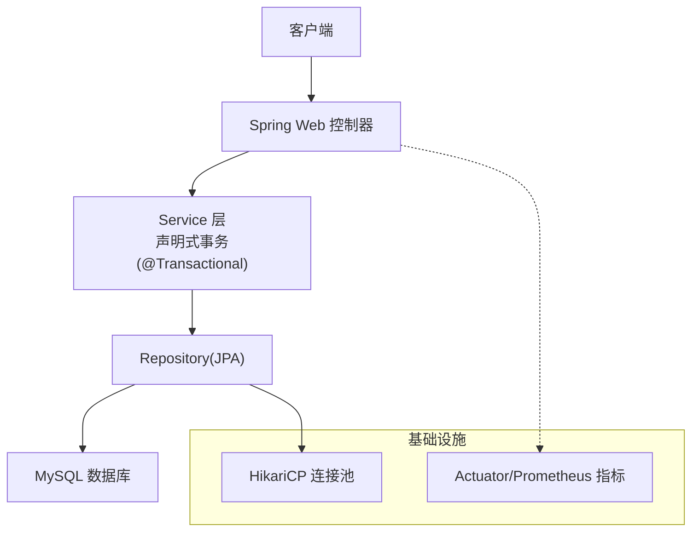
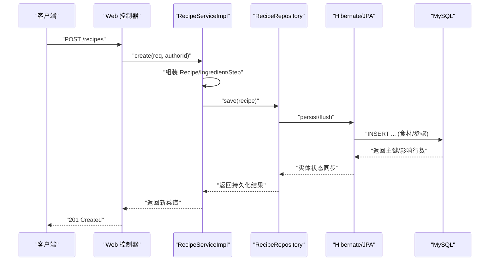
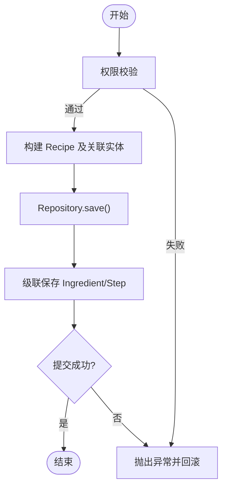
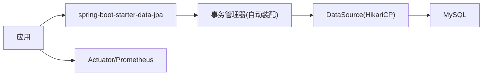

# 事务管理

<cite>
**本文引用的文件**
- [application.yaml](file://java_server/po/src/main/resources/application.yaml)
- [pom.xml](file://java_server/po/pom.xml)
- [RecipeServiceImpl.java](file://java_server/po/src/main/java/com/goodzheng/po/service/impl/RecipeServiceImpl.java)
- [UserServiceImpl.java](file://java_server/po/src/main/java/com/goodzheng/po/service/impl/UserServiceImpl.java)
- [RecipeCategoryServiceImpl.java](file://java_server/po/src/main/java/com/goodzheng/po/service/impl/RecipeCategoryServiceImpl.java)
- [RecipeRepository.java](file://java_server/po/src/main/java/com/goodzheng/po/repository/RecipeRepository.java)
- [Recipe.java](file://java_server/po/src/main/java/com/goodzheng/po/entity/Recipe.java)
</cite>

## 目录
1. [简介](#简介)
2. [项目结构](#项目结构)
3. [核心组件](#核心组件)
4. [架构总览](#架构总览)
5. [详细组件分析](#详细组件分析)
6. [依赖分析](#依赖分析)
7. [性能考虑](#性能考虑)
8. [故障排查指南](#故障排查指南)
9. [结论](#结论)
10. [附录](#附录)

## 简介
本技术文档围绕 Spring 声明式事务在本项目中的配置与使用展开，重点说明 @Transactional 注解的属性（传播行为、隔离级别、超时、只读等）在项目中的实践方式；同时给出编程式事务的使用场景与实现思路；阐述事务边界设计原则（何时开启事务、如何避免长事务、异常回滚策略）；并提供复杂业务场景下的事务处理示例（嵌套事务、只读优化、批量更新等）。最后给出事务性能优化与监控调优建议。

## 项目结构
本项目采用典型的分层架构：Controller -> Service(含事务) -> Repository(JPA) -> Database。事务主要位于 Service 层，通过 @Transactional 声明式管理数据一致性。JPA/Hibernate 作为持久化框架，配合 MySQL 数据库与 HikariCP 连接池。Actuator + Prometheus 暴露指标用于监控。

图表来源
- [application.yaml:23-41](file://java_server/po/src/main/resources/application.yaml#L23-L41)
- [pom.xml:32-80](file://java_server/po/pom.xml#L32-L80)

章节来源
- [application.yaml:23-41](file://java_server/po/src/main/resources/application.yaml#L23-L41)
- [pom.xml:32-80](file://java_server/po/pom.xml#L32-L80)

## 核心组件
- 声明式事务入口：Service 方法上的 @Transactional 注解，覆盖创建、更新、删除及只读查询。
- 数据访问：JPA Repository，包含分页、条件查询、JOIN FETCH 预加载等。
- 实体关系：Recipe 与 Ingredient、Step 的一对多级联保存与删除。
- 运行期支撑：Spring Boot Data JPA、Hibernate、MySQL 驱动、HikariCP 连接池、Actuator/Prometheus 监控。

章节来源
- [RecipeServiceImpl.java:26-60](file://java_server/po/src/main/java/com/goodzheng/po/service/impl/RecipeServiceImpl.java#L26-L60)
- [RecipeServiceImpl.java:99-151](file://java_server/po/src/main/java/com/goodzheng/po/service/impl/RecipeServiceImpl.java#L99-L151)
- [UserServiceImpl.java:42-104](file://java_server/po/src/main/java/com/goodzheng/po/service/impl/UserServiceImpl.java#L42-L104)
- [RecipeRepository.java:13-35](file://java_server/po/src/main/java/com/goodzheng/po/repository/RecipeRepository.java#L13-L35)
- [Recipe.java:84-91](file://java_server/po/src/main/java/com/goodzheng/po/entity/Recipe.java#L84-L91)

## 架构总览
下图展示一次“创建菜谱”请求的事务调用链：Web 层进入 Service，Service 在事务中构建 Recipe 及其关联的 Ingredient/Step，并通过 JPA 保存，最终由 Hibernate 提交到数据库。

图表来源
- [RecipeServiceImpl.java:26-60](file://java_server/po/src/main/java/com/goodzheng/po/service/impl/RecipeServiceImpl.java#L26-L60)
- [RecipeRepository.java:13-18](file://java_server/po/src/main/java/com/goodzheng/po/repository/RecipeRepository.java#L13-L18)
- [application.yaml:23-41](file://java_server/po/src/main/resources/application.yaml#L23-L41)

## 详细组件分析

### 声明式事务：@Transactional 属性与用法
- 传播行为
  - 默认 REQUIRED：若当前存在事务则加入，否则新建事务。适用于大多数写操作。
  - REQUIRES_NEW：挂起当前事务并开启新事务，常用于独立审计或补偿逻辑。
  - NOT_SUPPORTED/MANDARY/SUPPORTS/NEVER：按业务语义选择。
- 隔离级别
  - READ_COMMITTED（默认）：多数 OLTP 场景足够。
  - REPEATABLE_READ/READ_UNCOMMITTED：仅在特定一致性需求时启用。
- 超时设置
  - timeout：防止长事务占用连接，结合慢查询治理。
- 只读事务
  - readOnly=true：对纯查询方法标注，可优化执行计划与锁行为。
- 异常回滚
  - 运行时异常默认回滚；受检异常默认不回滚，需显式配置 rollbackFor。
- 项目中的实践
  - 写操作：create/update/delete 使用默认传播与隔离。
  - 读操作：list/search/getById 等方法使用 readOnly=true。

章节来源
- [RecipeServiceImpl.java:26-60](file://java_server/po/src/main/java/com/goodzheng/po/service/impl/RecipeServiceImpl.java#L26-L60)
- [RecipeServiceImpl.java:62-97](file://java_server/po/src/main/java/com/goodzheng/po/service/impl/RecipeServiceImpl.java#L62-L97)
- [RecipeServiceImpl.java:99-151](file://java_server/po/src/main/java/com/goodzheng/po/service/impl/RecipeServiceImpl.java#L99-L151)
- [UserServiceImpl.java:23-40](file://java_server/po/src/main/java/com/goodzheng/po/service/impl/UserServiceImpl.java#L23-L40)
- [UserServiceImpl.java:42-104](file://java_server/po/src/main/java/com/goodzheng/po/service/impl/UserServiceImpl.java#L42-L104)
- [RecipeCategoryServiceImpl.java:18-22](file://java_server/po/src/main/java/com/goodzheng/po/service/impl/RecipeCategoryServiceImpl.java#L18-L22)

### 编程式事务：适用场景与实现思路
- 适用场景
  - 动态事务边界：根据运行时条件决定是否需要事务。
  - 细粒度控制：在同一方法内分阶段提交/回滚。
  - 跨资源协调：与外部系统交互时的补偿/重试。
- 实现思路（概念性）
  - 使用 PlatformTransactionTemplate 或 TransactionTemplate 包裹代码块。
  - 在回调中执行多个 Repository 操作，必要时捕获异常进行局部回滚或补偿。
  - 注意与声明式事务混用时传播行为的叠加效果。

[本节为概念性说明，不直接分析具体文件]

### 事务边界设计与最佳实践
- 何时开启事务
  - 以业务用例为单位：一个用例对应一个事务，尽量保持短小精悍。
  - 将 I/O、远程调用移出事务边界，避免长事务。
- 避免长事务
  - 拆分大事务为多个小事务。
  - 分批处理大数据集（如 batchUpdateStatus）。
  - 合理设置 timeout，配合慢查询日志定位瓶颈。
- 异常与回滚
  - 统一抛出运行时异常触发回滚。
  - 对需要回滚的受检异常配置 rollbackFor。
  - 对外部调用失败进行补偿或幂等设计。
- 只读优化
  - 所有纯查询方法标注 readOnly=true，减少锁竞争与缓冲压力。

章节来源
- [UserServiceImpl.java:92-104](file://java_server/po/src/main/java/com/goodzheng/po/service/impl/UserServiceImpl.java#L92-L104)
- [RecipeServiceImpl.java:62-97](file://java_server/po/src/main/java/com/goodzheng/po/service/impl/RecipeServiceImpl.java#L62-L97)

### 复杂业务场景示例
- 嵌套事务
  - 外层方法开启事务，内部调用其他 @Transactional 方法时，默认加入同一事务（REQUIRED）。
  - 若内部方法使用 REQUIRES_NEW，则形成独立子事务，失败不影响外层。
- 异常回滚
  - 业务校验失败抛出运行时异常，确保整笔写入回滚。
- 只读事务
  - 列表、搜索、详情等查询方法使用 readOnly=true。
- 级联保存与删除
  - Recipe 与 Ingredient/Step 通过 CascadeType.ALL 与 orphanRemoval=true 实现级联一致。

图表来源
- [RecipeServiceImpl.java:26-60](file://java_server/po/src/main/java/com/goodzheng/po/service/impl/RecipeServiceImpl.java#L26-L60)
- [Recipe.java:84-91](file://java_server/po/src/main/java/com/goodzheng/po/entity/Recipe.java#L84-L91)

章节来源
- [RecipeServiceImpl.java:26-60](file://java_server/po/src/main/java/com/goodzheng/po/service/impl/RecipeServiceImpl.java#L26-L60)
- [Recipe.java:84-91](file://java_server/po/src/main/java/com/goodzheng/po/entity/Recipe.java#L84-L91)

## 依赖分析
- 事务相关依赖
  - spring-boot-starter-data-jpa：提供 JPA 与事务管理器自动装配。
  - mysql-connector-j：数据库驱动。
  - HikariCP：连接池（由 Spring Boot 自动配置）。
- 监控依赖
  - spring-boot-starter-actuator + micrometer-registry-prometheus：暴露健康、指标与 Prometheus 抓取点。

图表来源
- [pom.xml:32-80](file://java_server/po/pom.xml#L32-L80)
- [application.yaml:23-41](file://java_server/po/src/main/resources/application.yaml#L23-L41)
- [application.yaml:84-94](file://java_server/po/src/main/resources/application.yaml#L84-L94)

章节来源
- [pom.xml:32-80](file://java_server/po/pom.xml#L32-L80)
- [application.yaml:23-41](file://java_server/po/src/main/resources/application.yaml#L23-L41)
- [application.yaml:84-94](file://java_server/po/src/main/resources/application.yaml#L84-L94)

## 性能考虑
- 连接池与线程
  - HikariCP maximum-pool-size、connection-timeout 需与并发和慢查询匹配。
  - Tomcat max-threads/max-connections 需评估峰值 QPS。
- 查询优化
  - 使用 JOIN FETCH 预加载关联，避免 N+1 与懒加载开销。
  - 合理使用索引与分页参数。
- 事务优化
  - 只读查询使用 readOnly=true。
  - 拆分大事务，避免长事务持有连接。
  - 合理设置 timeout，结合慢查询日志定位热点 SQL。
- 监控
  - 启用 Actuator endpoints 暴露 health/info/metrics/prometheus。
  - 关注数据库连接数、慢查询、事务耗时等指标。

章节来源
- [application.yaml:4-11](file://java_server/po/src/main/resources/application.yaml#L4-L11)
- [application.yaml:23-41](file://java_server/po/src/main/resources/application.yaml#L23-L41)
- [application.yaml:84-94](file://java_server/po/src/main/resources/application.yaml#L84-L94)
- [RecipeRepository.java:16-18](file://java_server/po/src/main/java/com/goodzheng/po/repository/RecipeRepository.java#L16-L18)

## 故障排查指南
- 常见问题
  - 事务未生效：确认方法被 Spring AOP 代理调用（非同类自调用），且类被扫描注册。
  - 只读事务写失败：检查是否误标 readOnly=true。
  - 长事务导致连接耗尽：拆分事务、移除 I/O、设置 timeout。
  - 死锁/锁等待：缩小事务范围、调整隔离级别、优化 SQL。
- 定位手段
  - 查看慢查询日志与 SQL 输出（show-sql）。
  - 通过 Actuator 指标观察连接池与事务耗时。
  - 结合日志追踪关键事务边界。

章节来源
- [application.yaml:36-41](file://java_server/po/src/main/resources/application.yaml#L36-L41)
- [application.yaml:84-94](file://java_server/po/src/main/resources/application.yaml#L84-L94)

## 结论
本项目基于 Spring Boot Data JPA 实现了以 Service 层为核心的声明式事务管理，广泛使用 @Transactional(readOnly=true) 优化读路径，并在写操作中保证数据一致性。通过合理的边界划分、异常回滚策略与连接池/监控配置，可在保证正确性的同时获得良好性能。对于更复杂的场景，可引入编程式事务进行细粒度控制。

## 附录
- 推荐实践清单
  - 写方法默认事务，读方法加 readOnly=true。
  - 避免在事务中进行远程调用与大量 I/O。
  - 对批量操作使用分批提交与合适的批大小。
  - 为高频查询建立合适索引，避免全表扫描。
  - 通过 Actuator/Prometheus 持续观测事务与数据库指标。

[本节为通用建议，不直接分析具体文件]