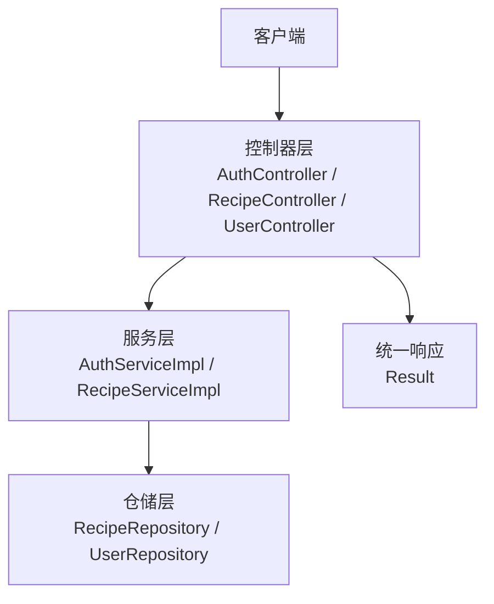
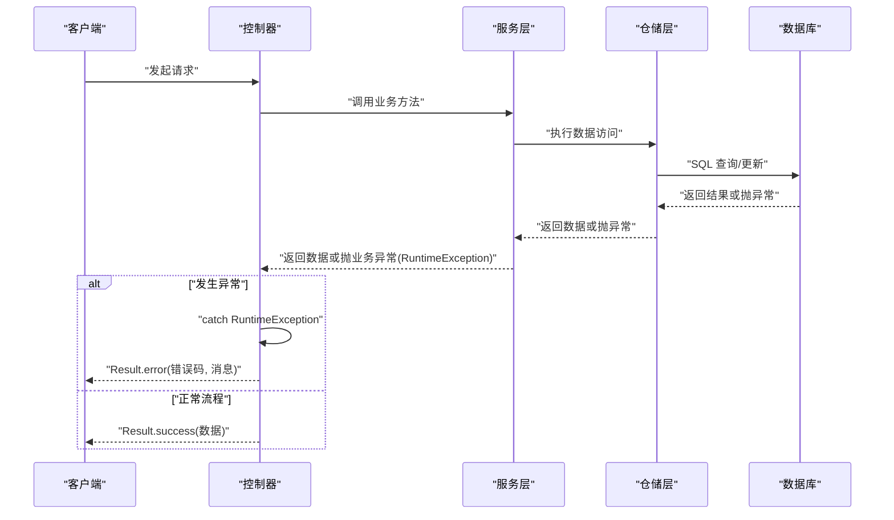
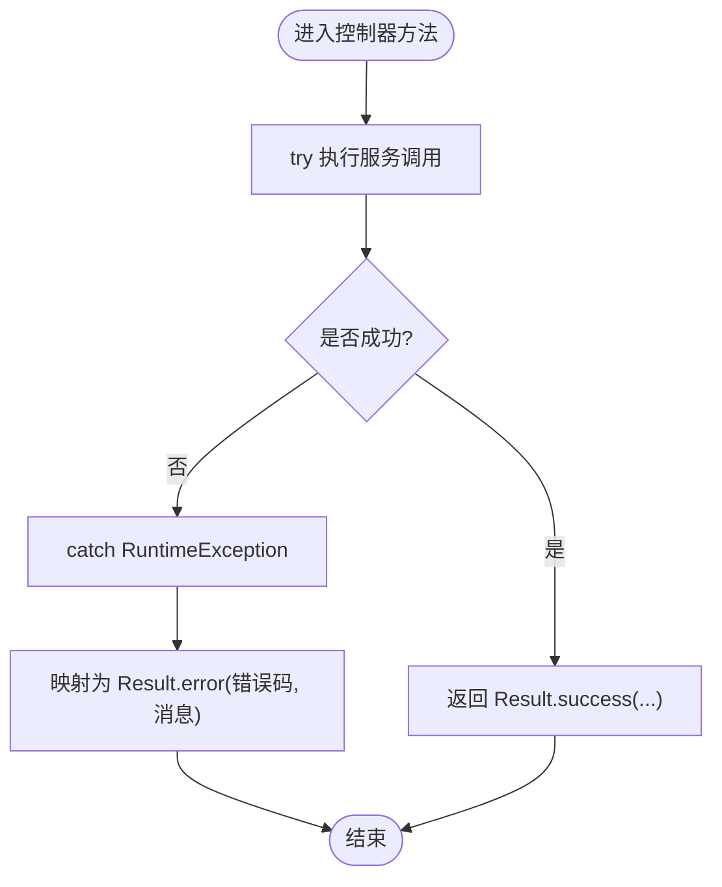
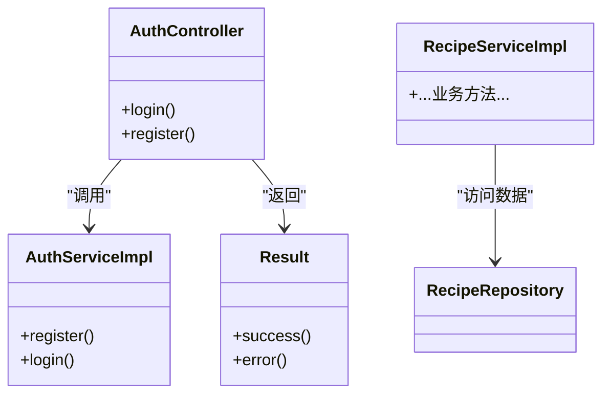

# 异常处理

<cite>
**本文引用的文件**
- [Result.java](file://java_server/po/src/main/java/com/goodzheng/po/dto/Result.java)
- [AuthController.java](file://java_server/po/src/main/java/com/goodzheng/po/controller/AuthController.java)
- [RecipeCategoryController.java](file://java_server/po/src/main/java/com/goodzheng/po/controller/RecipeCategoryController.java)
- [RecipeController.java](file://java_server/po/src/main/java/com/goodzheng/po/controller/RecipeController.java)
- [UserController.java](file://java_server/po/src/main/java/com/goodzheng/po/controller/UserController.java)
- [AuthServiceImpl.java](file://java_server/po/src/main/java/com/goodzheng/po/service/impl/AuthServiceImpl.java)
- [RecipeServiceImpl.java](file://java_server/po/src/main/java/com/goodzheng/po/service/impl/RecipeServiceImpl.java)
- [RecipeRepository.java](file://java_server/po/src/main/java/com/goodzheng/po/repository/RecipeRepository.java)
</cite>

## 目录
1. [简介](#简介)
2. [项目结构](#项目结构)
3. [核心组件](#核心组件)
4. [架构总览](#架构总览)
5. [详细组件分析](#详细组件分析)
6. [依赖关系分析](#依赖关系分析)
7. [性能考虑](#性能考虑)
8. [故障排查指南](#故障排查指南)
9. [结论](#结论)
10. [附录](#附录)

## 简介
本技术文档聚焦于后端（Java Spring Boot）的异常处理机制，围绕“自定义业务异常、全局异常处理器、分层异常策略、统一响应格式、日志与追踪”展开。当前代码库中尚未实现统一的异常类体系与全局异常处理器，控制器层采用 try-catch 捕获 RuntimeException 并返回统一结果对象 Result。本文将基于现有实现进行现状总结，并提供改进建议与最佳实践路径。

## 项目结构
- 控制器层：各 Controller 方法通过 try-catch 捕获运行时异常，调用 Result.error(...) 返回错误码与消息。
- 服务层：业务逻辑抛出 RuntimeException 表达业务规则失败或数据校验失败。
- 统一响应：Result<T> 提供 success/error 静态工厂方法，用于封装成功与失败响应。
- 仓储层：JPA Repository 负责数据访问；部分查询使用 JOIN FETCH 避免懒加载异常。

图表来源
- [AuthController.java:19-39](file://java_server/po/src/main/java/com/goodzheng/po/controller/AuthController.java#L19-L39)
- [RecipeController.java:1-120](file://java_server/po/src/main/java/com/goodzheng/po/controller/RecipeController.java#L1-L120)
- [UserController.java:1-130](file://java_server/po/src/main/java/com/goodzheng/po/controller/UserController.java#L1-L130)
- [AuthServiceImpl.java:21-46](file://java_server/po/src/main/java/com/goodzheng/po/service/impl/AuthServiceImpl.java#L21-L46)
- [RecipeServiceImpl.java:1-150](file://java_server/po/src/main/java/com/goodzheng/po/service/impl/RecipeServiceImpl.java#L1-L150)
- [Result.java:1-32](file://java_server/po/src/main/java/com/goodzheng/po/dto/Result.java#L1-L32)

章节来源
- [AuthController.java:19-39](file://java_server/po/src/main/java/com/goodzheng/po/controller/AuthController.java#L19-L39)
- [Result.java:1-32](file://java_server/po/src/main/java/com/goodzheng/po/dto/Result.java#L1-L32)

## 核心组件
- 统一响应体 Result<T>
  - 字段：code、message、data
  - 方法：success(data)、success(message, data)、error(code, message)、error(message)
  - 作用：为所有接口提供一致的成功/失败响应结构，便于前端统一处理。
- 控制器异常捕获
  - 在 Controller 方法内 try-catch RuntimeException，将异常信息映射到 Result.error(...)。
  - 不同方法根据业务语义返回不同的错误码（如 400、401）。
- 服务层异常抛出
  - 业务规则不满足时抛出 RuntimeException，例如用户名已存在、密码错误、无权操作等。
- 仓储层注意事项
  - 使用 JOIN FETCH 预加载关联数据，避免 LazyInitializationException。

章节来源
- [Result.java:1-32](file://java_server/po/src/main/java/com/goodzheng/po/dto/Result.java#L1-L32)
- [AuthController.java:19-39](file://java_server/po/src/main/java/com/goodzheng/po/controller/AuthController.java#L19-L39)
- [AuthServiceImpl.java:21-46](file://java_server/po/src/main/java/com/goodzheng/po/service/impl/AuthServiceImpl.java#L21-L46)
- [RecipeRepository.java:1-20](file://java_server/po/src/main/java/com/goodzheng/po/repository/RecipeRepository.java#L1-L20)

## 架构总览
下图展示请求从控制器到服务再到仓储的异常流转路径，以及控制器如何将异常转换为统一响应。

图表来源
- [AuthController.java:19-39](file://java_server/po/src/main/java/com/goodzheng/po/controller/AuthController.java#L19-L39)
- [AuthServiceImpl.java:21-46](file://java_server/po/src/main/java/com/goodzheng/po/service/impl/AuthServiceImpl.java#L21-L46)
- [RecipeRepository.java:1-20](file://java_server/po/src/main/java/com/goodzheng/po/repository/RecipeRepository.java#L1-L20)

## 详细组件分析

### 统一响应体 Result<T>
- 设计要点
  - 通过 code/message/data 三字段描述状态、提示与数据。
  - 提供便捷静态方法构造成功/失败响应，减少样板代码。
- 使用场景
  - 控制器在成功路径返回 Result.success(...)。
  - 捕获异常后返回 Result.error(...)，携带错误码与消息。

章节来源
- [Result.java:1-32](file://java_server/po/src/main/java/com/goodzheng/po/dto/Result.java#L1-L32)

### 控制器层异常处理现状
- 登录注册（AuthController）
  - login/register 方法通过 try-catch 捕获 RuntimeException，分别返回 401/400 的错误响应。
- 菜谱与用户管理（RecipeController、UserController）
  - 多处方法对业务异常进行捕获并返回统一错误结构。
- 问题与建议
  - 当前未使用 @ExceptionHandler 全局处理，导致每个控制器重复编写 try-catch。
  - 建议引入全局异常处理器，集中处理参数校验、业务异常、系统异常，并输出结构化日志。

章节来源
- [AuthController.java:19-39](file://java_server/po/src/main/java/com/goodzheng/po/controller/AuthController.java#L19-L39)
- [RecipeController.java:1-120](file://java_server/po/src/main/java/com/goodzheng/po/controller/RecipeController.java#L1-L120)
- [UserController.java:1-130](file://java_server/po/src/main/java/com/goodzheng/po/controller/UserController.java#L1-L130)

### 服务层异常抛出模式
- 认证服务（AuthServiceImpl）
  - 用户名已存在、用户名或密码错误时抛出 RuntimeException。
- 菜谱服务（RecipeServiceImpl）
  - 菜谱不存在、已删除、无权修改/删除他人菜谱时抛出 RuntimeException。
- 建议
  - 定义自定义业务异常类层次结构（如 BaseBizException -> AuthBizException / RecipeBizException），便于分类处理与统一日志记录。
  - 在服务层抛出带错误码的业务异常，由全局异常处理器统一转换为 Result。

章节来源
- [AuthServiceImpl.java:21-46](file://java_server/po/src/main/java/com/goodzheng/po/service/impl/AuthServiceImpl.java#L21-L46)
- [RecipeServiceImpl.java:1-150](file://java_server/po/src/main/java/com/goodzheng/po/service/impl/RecipeServiceImpl.java#L1-L150)

### 仓储层与数据库异常
- 懒加载异常规避
  - 通过 JOIN FETCH 预加载关联实体，避免 LazyInitializationException。
- 建议
  - 对于数据库约束冲突（唯一键、外键）、连接超时等底层异常，可在仓储层捕获并转换为业务异常，再由上层统一处理。

章节来源
- [RecipeRepository.java:1-20](file://java_server/po/src/main/java/com/goodzheng/po/repository/RecipeRepository.java#L1-L20)

### 常见异常场景示例（基于现有代码）
- 参数验证异常
  - 使用 @Valid 注解进行入参校验，若校验失败，建议在全局异常处理器中捕获并返回统一错误结构。
- 业务规则异常
  - 用户名已存在、密码错误、无权操作等，当前以 RuntimeException 表达，建议升级为自定义业务异常。
- 数据库异常
  - 唯一键冲突、空指针、懒加载异常等，建议在仓储或服务层捕获并转换为业务异常。

图表来源
- [AuthController.java:19-39](file://java_server/po/src/main/java/com/goodzheng/po/controller/AuthController.java#L19-L39)
- [Result.java:1-32](file://java_server/po/src/main/java/com/goodzheng/po/dto/Result.java#L1-L32)

## 依赖关系分析
- 控制器依赖服务接口，服务实现依赖仓储与工具类（如 JwtUtil）。
- 控制器与服务之间通过异常进行控制流传递（当前为 RuntimeException）。
- 仓储与数据库交互可能产生底层异常，需在上层转换为业务异常。

图表来源
- [AuthController.java:1-41](file://java_server/po/src/main/java/com/goodzheng/po/controller/AuthController.java#L1-L41)
- [AuthServiceImpl.java:1-48](file://java_server/po/src/main/java/com/goodzheng/po/service/impl/AuthServiceImpl.java#L1-L48)
- [RecipeServiceImpl.java:1-150](file://java_server/po/src/main/java/com/goodzheng/po/service/impl/RecipeServiceImpl.java#L1-L150)
- [Result.java:1-32](file://java_server/po/src/main/java/com/goodzheng/po/dto/Result.java#L1-L32)
- [RecipeRepository.java:1-20](file://java_server/po/src/main/java/com/goodzheng/po/repository/RecipeRepository.java#L1-L20)

章节来源
- [AuthController.java:1-41](file://java_server/po/src/main/java/com/goodzheng/po/controller/AuthController.java#L1-L41)
- [AuthServiceImpl.java:1-48](file://java_server/po/src/main/java/com/goodzheng/po/service/impl/AuthServiceImpl.java#L1-L48)
- [RecipeServiceImpl.java:1-150](file://java_server/po/src/main/java/com/goodzheng/po/service/impl/RecipeServiceImpl.java#L1-L150)
- [Result.java:1-32](file://java_server/po/src/main/java/com/goodzheng/po/dto/Result.java#L1-L32)
- [RecipeRepository.java:1-20](file://java_server/po/src/main/java/com/goodzheng/po/repository/RecipeRepository.java#L1-L20)

## 性能考虑
- 避免在高频路径中进行昂贵的异常堆栈生成；尽量前置校验以减少异常分支。
- 合理使用 JOIN FETCH 减少 N+1 查询导致的性能问题。
- 全局异常处理器应轻量，避免在异常路径中执行复杂逻辑。

## 故障排查指南
- 常见问题定位
  - 登录失败：检查服务层用户名/密码校验逻辑及异常抛出位置。
  - 权限错误：检查服务层对资源归属的判断与异常抛出。
  - 懒加载异常：确认查询是否使用 JOIN FETCH 预加载关联数据。
- 日志与追踪建议
  - 在服务层抛出业务异常前记录关键上下文（用户ID、资源ID、操作类型）。
  - 在全局异常处理器中统一记录异常堆栈与请求信息，便于问题复现与追踪。
  - 区分业务异常与系统异常，仅对系统异常记录完整堆栈。

章节来源
- [AuthServiceImpl.java:21-46](file://java_server/po/src/main/java/com/goodzheng/po/service/impl/AuthServiceImpl.java#L21-L46)
- [RecipeServiceImpl.java:1-150](file://java_server/po/src/main/java/com/goodzheng/po/service/impl/RecipeServiceImpl.java#L1-L150)
- [RecipeRepository.java:1-20](file://java_server/po/src/main/java/com/goodzheng/po/repository/RecipeRepository.java#L1-L20)

## 结论
当前项目采用“服务层抛出 RuntimeException + 控制器 try-catch + 统一 Result”的模式，实现了基础的异常处理与统一响应。为提升可维护性与可观测性，建议：
- 建立自定义业务异常类层次结构，承载错误码与领域语义。
- 引入全局异常处理器（@RestControllerAdvice + @ExceptionHandler），集中处理参数校验、业务异常与系统异常。
- 完善日志记录与错误追踪，确保异常上下文完整、可检索。
- 在仓储层对底层数据库异常进行转换，保持上层异常语义清晰。

## 附录
- 统一响应体字段说明
  - code：业务状态码（如 200 成功、400 参数错误、401 认证失败、500 服务器错误）
  - message：人类可读的错误提示
  - data：业务数据或 null
- 建议的错误码规范
  - 2xx：成功
  - 4xx：客户端错误（参数校验、权限不足、资源不存在）
  - 5xx：服务端错误（系统异常、未知错误）