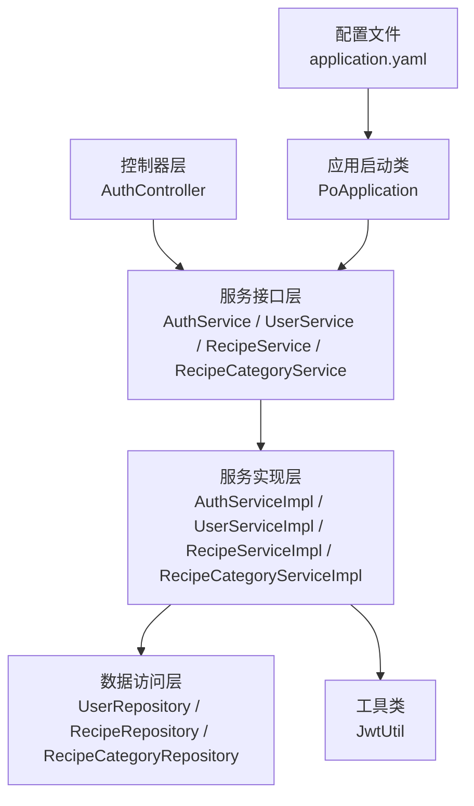
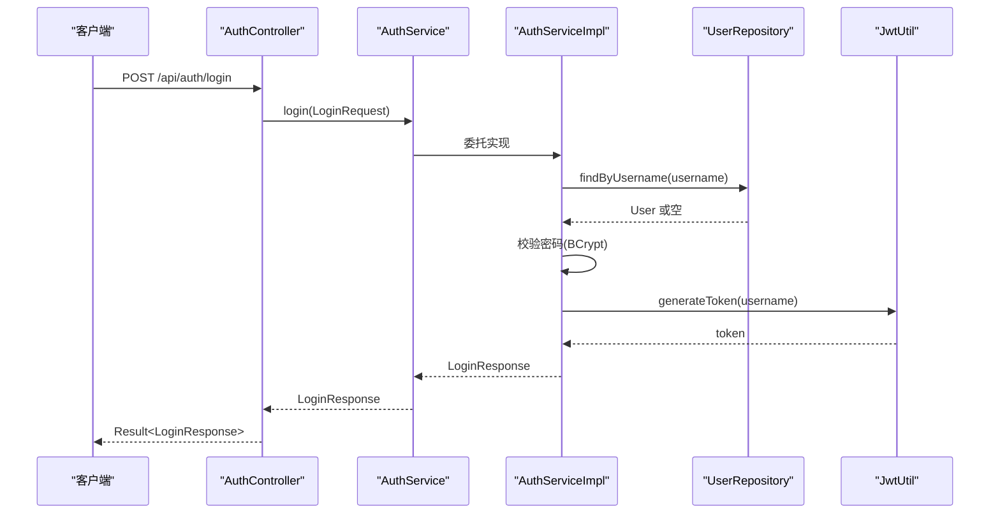
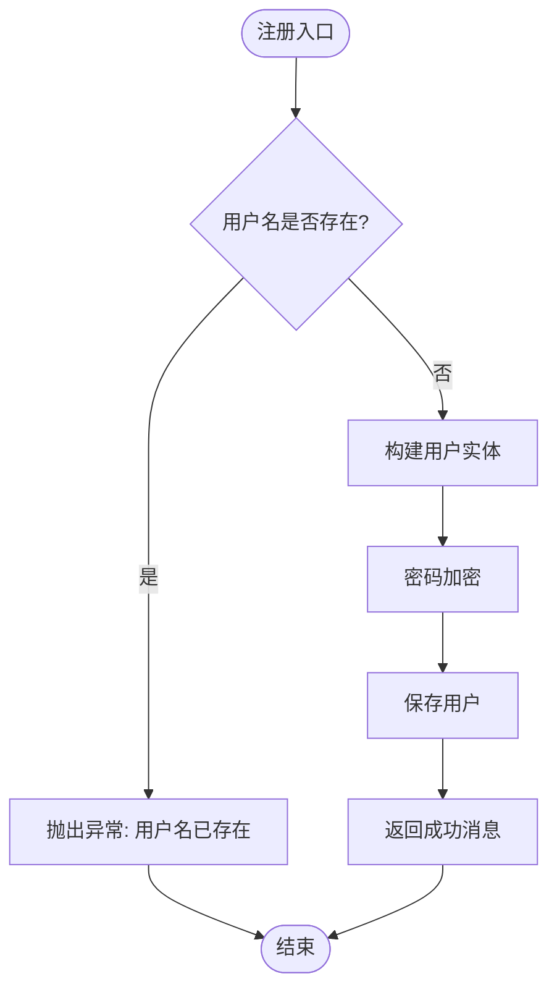
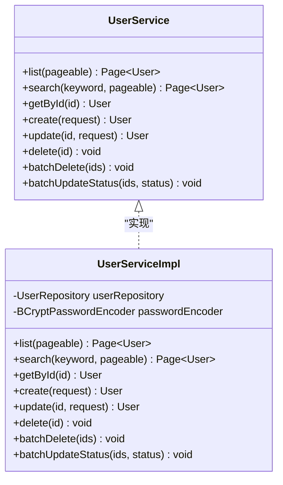
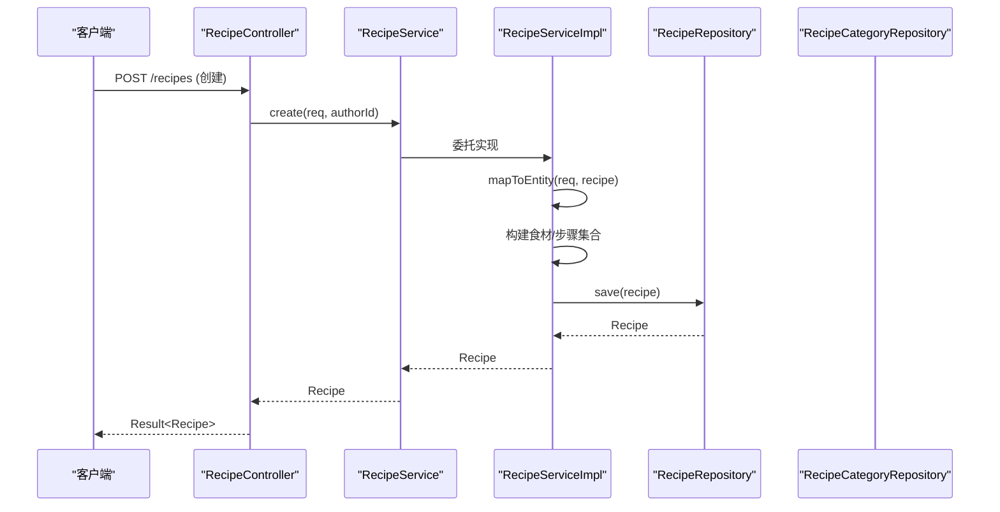
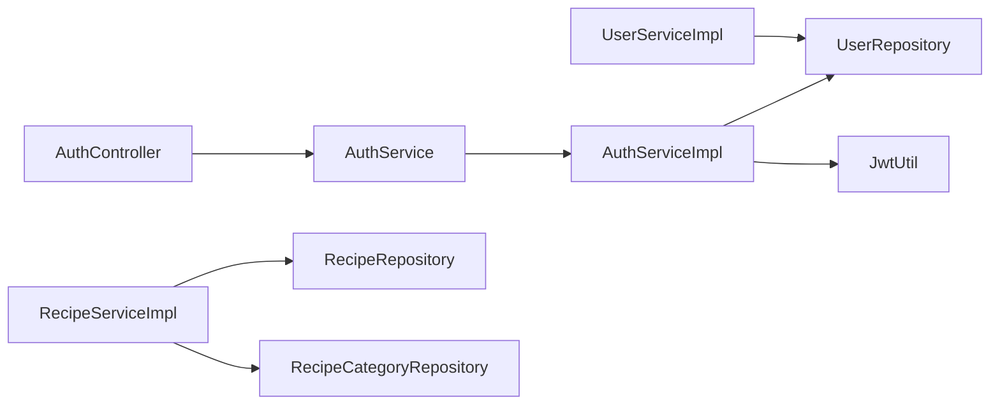

# 服务实现模式

<cite>
**本文引用的文件**
- [PoApplication.java](file://java_server/po/src/main/java/com/goodzheng/po/PoApplication.java)
- [application.yaml](file://java_server/po/src/main/resources/application.yaml)
- [AuthService.java](file://java_server/po/src/main/java/com/goodzheng/po/service/AuthService.java)
- [UserService.java](file://java_server/po/src/main/java/com/goodzheng/po/service/UserService.java)
- [RecipeService.java](file://java_server/po/src/main/java/com/goodzheng/po/service/RecipeService.java)
- [RecipeCategoryService.java](file://java_server/po/src/main/java/com/goodzheng/po/service/RecipeCategoryService.java)
- [AuthServiceImpl.java](file://java_server/po/src/main/java/com/goodzheng/po/service/impl/AuthServiceImpl.java)
- [UserServiceImpl.java](file://java_server/po/src/main/java/com/goodzheng/po/service/impl/UserServiceImpl.java)
- [RecipeServiceImpl.java](file://java_server/po/src/main/java/com/goodzheng/po/service/impl/RecipeServiceImpl.java)
- [RecipeCategoryServiceImpl.java](file://java_server/po/src/main/java/com/goodzheng/po/service/impl/RecipeCategoryServiceImpl.java)
- [AuthController.java](file://java_server/po/src/main/java/com/goodzheng/po/controller/AuthController.java)
- [JwtUtil.java](file://java_server/po/src/main/java/com/goodzheng/po/util/JwtUtil.java)
- [UserRepository.java](file://java_server/po/src/main/java/com/goodzheng/po/repository/UserRepository.java)
</cite>

## 目录
1. [简介](#简介)
2. [项目结构](#项目结构)
3. [核心组件](#核心组件)
4. [架构总览](#架构总览)
5. [详细组件分析](#详细组件分析)
6. [依赖关系分析](#依赖关系分析)
7. [性能考虑](#性能考虑)
8. [故障排查指南](#故障排查指南)
9. [结论](#结论)
10. [附录](#附录)

## 简介
本技术文档围绕 Spring Boot 项目的“服务实现模式”展开，聚焦以下目标：
- 解释 @Service 注解与组件扫描机制如何使业务服务被自动发现并纳入容器管理。
- 说明如何通过接口定义契约，并以实现类承载具体业务逻辑。
- 阐述业务逻辑的组织方式：方法拆分、代码复用与逻辑解耦。
- 讲解依赖注入在服务实现中的应用：Repository 注入、工具类调用等。
- 提供复杂业务流程的具体实现示例：数据转换、参数校验、业务规则检查。
- 给出可测试的服务实现方案与单元测试最佳实践建议。

## 项目结构
本项目采用分层架构：
- 控制器层（controller）：接收请求、参数校验、调用服务层。
- 服务层（service + service.impl）：定义业务接口与实现，编排领域逻辑，协调持久化与工具。
- 数据访问层（repository）：基于 JPA 的 Repository 抽象，封装数据访问。
- 实体与 DTO（entity/dto）：领域模型与传输对象。
- 工具与配置（util/config）：通用工具与运行期配置。

图表来源
- [PoApplication.java:6-10](file://java_server/po/src/main/java/com/goodzheng/po/PoApplication.java#L6-L10)
- [application.yaml:16-21](file://java_server/po/src/main/resources/application.yaml#L16-L21)
- [AuthController.java:11-17](file://java_server/po/src/main/java/com/goodzheng/po/controller/AuthController.java#L11-L17)
- [AuthService.java:6-10](file://java_server/po/src/main/java/com/goodzheng/po/service/AuthService.java#L6-L10)
- [AuthServiceImpl.java:13-18](file://java_server/po/src/main/java/com/goodzheng/po/service/impl/AuthServiceImpl.java#L13-L18)
- [UserRepository.java:13-25](file://java_server/po/src/main/java/com/goodzheng/po/repository/UserRepository.java#L13-L25)

章节来源
- [PoApplication.java:6-10](file://java_server/po/src/main/java/com/goodzheng/po/PoApplication.java#L6-L10)
- [application.yaml:16-21](file://java_server/po/src/main/resources/application.yaml#L16-L21)

## 核心组件
- 服务接口与实现
  - AuthService / AuthServiceImpl：注册与登录流程，包含密码加密与令牌生成。
  - UserService / UserServiceImpl：用户 CRUD、分页查询、批量操作与状态更新。
  - RecipeService / RecipeServiceImpl：菜谱创建、查询、更新、删除，含食材与步骤的关联处理。
  - RecipeCategoryService / RecipeCategoryServiceImpl：分类列表查询。
- 数据访问
  - UserRepository：用户查找、存在性检查、关键词搜索。
- 工具与配置
  - JwtUtil：JWT 令牌生成与解析。
  - application.yaml：服务器、数据源、JPA、Redis、日志、Actuator 等配置。

章节来源
- [AuthService.java:6-10](file://java_server/po/src/main/java/com/goodzheng/po/service/AuthService.java#L6-L10)
- [AuthServiceImpl.java:13-46](file://java_server/po/src/main/java/com/goodzheng/po/service/impl/AuthServiceImpl.java#L13-L46)
- [UserService.java:10-27](file://java_server/po/src/main/java/com/goodzheng/po/service/UserService.java#L10-L27)
- [UserServiceImpl.java:16-104](file://java_server/po/src/main/java/com/goodzheng/po/service/impl/UserServiceImpl.java#L16-L104)
- [RecipeService.java:10-27](file://java_server/po/src/main/java/com/goodzheng/po/service/RecipeService.java#L10-L27)
- [RecipeServiceImpl.java:19-172](file://java_server/po/src/main/java/com/goodzheng/po/service/impl/RecipeServiceImpl.java#L19-L172)
- [RecipeCategoryService.java:7-10](file://java_server/po/src/main/java/com/goodzheng/po/service/RecipeCategoryService.java#L7-L10)
- [RecipeCategoryServiceImpl.java:12-22](file://java_server/po/src/main/java/com/goodzheng/po/service/impl/RecipeCategoryServiceImpl.java#L12-L22)
- [UserRepository.java:13-25](file://java_server/po/src/main/java/com/goodzheng/po/repository/UserRepository.java#L13-L25)
- [JwtUtil.java:13-54](file://java_server/po/src/main/java/com/goodzheng/po/util/JwtUtil.java#L13-L54)
- [application.yaml:23-41](file://java_server/po/src/main/resources/application.yaml#L23-L41)

## 架构总览
下图展示了从控制器到服务再到数据层的调用链，以及工具类的参与点。

图表来源
- [AuthController.java:19-27](file://java_server/po/src/main/java/com/goodzheng/po/controller/AuthController.java#L19-L27)
- [AuthService.java:6-10](file://java_server/po/src/main/java/com/goodzheng/po/service/AuthService.java#L6-L10)
- [AuthServiceImpl.java:35-46](file://java_server/po/src/main/java/com/goodzheng/po/service/impl/AuthServiceImpl.java#L35-L46)
- [UserRepository.java:16-18](file://java_server/po/src/main/java/com/goodzheng/po/repository/UserRepository.java#L16-L18)
- [JwtUtil.java:25-33](file://java_server/po/src/main/java/com/goodzheng/po/util/JwtUtil.java#L25-L33)

## 详细组件分析

### 认证服务（AuthService / AuthServiceImpl）
- 职责
  - 注册：检查用户名唯一性、密码加密、保存用户。
  - 登录：按用户名查找用户、校验密码、生成 JWT 令牌并返回响应。
- 关键设计
  - 使用 @Service 标注实现类，配合构造器注入（@RequiredArgsConstructor）注入 UserRepository 与 JwtUtil。
  - 密码加密通过 BCryptPasswordEncoder 完成。
  - 异常以 RuntimeException 抛出，由控制器统一捕获并转换为错误响应。
- 数据流
  - 注册：DTO -> 实体映射 -> 加密 -> 持久化。
  - 登录：DTO -> 查库 -> 校验 -> 生成令牌 -> 组装响应。

图表来源
- [AuthServiceImpl.java:21-33](file://java_server/po/src/main/java/com/goodzheng/po/service/impl/AuthServiceImpl.java#L21-L33)

章节来源
- [AuthService.java:6-10](file://java_server/po/src/main/java/com/goodzheng/po/service/AuthService.java#L6-L10)
- [AuthServiceImpl.java:13-46](file://java_server/po/src/main/java/com/goodzheng/po/service/impl/AuthServiceImpl.java#L13-L46)
- [AuthController.java:19-39](file://java_server/po/src/main/java/com/goodzheng/po/controller/AuthController.java#L19-L39)
- [JwtUtil.java:25-33](file://java_server/po/src/main/java/com/goodzheng/po/util/JwtUtil.java#L25-L33)

### 用户服务（UserService / UserServiceImpl）
- 职责
  - 分页列表、关键词搜索、按 ID 获取、创建、更新、删除、批量删除、批量更新状态。
- 关键设计
  - 读方法加只读事务注解，写方法加事务注解，保证一致性。
  - 创建时进行用户名唯一性校验与默认值填充；更新时支持可选字段覆盖与可选密码更新。
  - 批量操作优先使用批量 API 提升性能。
- 数据流
  - 创建：DTO -> 实体映射 -> 加密 -> 持久化。
  - 更新：按 ID 获取实体 -> 选择性覆盖字段 -> 可选密码加密 -> 持久化。
  - 删除/批量：存在性检查 -> 删除或批量删除。

图表来源
- [UserService.java:10-27](file://java_server/po/src/main/java/com/goodzheng/po/service/UserService.java#L10-L27)
- [UserServiceImpl.java:16-104](file://java_server/po/src/main/java/com/goodzheng/po/service/impl/UserServiceImpl.java#L16-L104)

章节来源
- [UserService.java:10-27](file://java_server/po/src/main/java/com/goodzheng/po/service/UserService.java#L10-L27)
- [UserServiceImpl.java:16-104](file://java_server/po/src/main/java/com/goodzheng/po/service/impl/UserServiceImpl.java#L16-L104)
- [UserRepository.java:13-25](file://java_server/po/src/main/java/com/goodzheng/po/repository/UserRepository.java#L13-L25)

### 菜谱服务（RecipeService / RecipeServiceImpl）
- 职责
  - 创建、查询（全部、作者、分类）、搜索、更新、删除（软删除）。
- 关键设计
  - 创建/更新时，将 DTO 中的嵌套集合（食材、步骤）映射为实体集合，建立双向关联。
  - 更新前进行权限校验（仅作者可修改/删除）。
  - 查询过滤已删除记录，确保数据可见性。
  - 提取 mapToEntity 私有方法进行字段映射，提高复用性与可读性。
- 数据流
  - 创建：DTO -> 实体映射 -> 关联集合构建 -> 持久化。
  - 更新：按 ID 获取 -> 权限校验 -> 替换集合 -> 持久化。
  - 删除：按 ID 获取 -> 权限校验 -> 设置删除时间 -> 持久化。

图表来源
- [RecipeService.java:10-27](file://java_server/po/src/main/java/com/goodzheng/po/service/RecipeService.java#L10-L27)
- [RecipeServiceImpl.java:26-60](file://java_server/po/src/main/java/com/goodzheng/po/service/impl/RecipeServiceImpl.java#L26-L60)
- [RecipeCategoryRepository.java:88-89](file://java_server/po/src/main/java/com/goodzheng/po/service/impl/RecipeServiceImpl.java#L88-L89)

章节来源
- [RecipeService.java:10-27](file://java_server/po/src/main/java/com/goodzheng/po/service/RecipeService.java#L10-L27)
- [RecipeServiceImpl.java:19-172](file://java_server/po/src/main/java/com/goodzheng/po/service/impl/RecipeServiceImpl.java#L19-L172)

### 分类服务（RecipeCategoryService / RecipeCategoryServiceImpl）
- 职责
  - 查询所有未删除的分类，按排序字段升序返回。
- 关键设计
  - 只读事务，直接调用 Repository 的排序查询方法。

章节来源
- [RecipeCategoryService.java:7-10](file://java_server/po/src/main/java/com/goodzheng/po/service/RecipeCategoryService.java#L7-L10)
- [RecipeCategoryServiceImpl.java:12-22](file://java_server/po/src/main/java/com/goodzheng/po/service/impl/RecipeCategoryServiceImpl.java#L12-L22)

## 依赖关系分析
- 组件耦合
  - 控制器依赖服务接口，降低对实现的耦合。
  - 服务实现依赖 Repository 与工具类，职责清晰。
- 外部依赖
  - JPA/Hibernate：通过 application.yaml 配置数据库方言与连接池。
  - Redis：缓存相关配置（当前服务层未直接使用）。
  - JWT：通过 JwtUtil 生成与验证令牌。
- 潜在循环依赖
  - 当前未发现循环依赖；服务之间无相互调用。

图表来源
- [AuthController.java:11-17](file://java_server/po/src/main/java/com/goodzheng/po/controller/AuthController.java#L11-L17)
- [AuthServiceImpl.java:13-18](file://java_server/po/src/main/java/com/goodzheng/po/service/impl/AuthServiceImpl.java#L13-L18)
- [UserServiceImpl.java:16-21](file://java_server/po/src/main/java/com/goodzheng/po/service/impl/UserServiceImpl.java#L16-L21)
- [RecipeServiceImpl.java:19-24](file://java_server/po/src/main/java/com/goodzheng/po/service/impl/RecipeServiceImpl.java#L19-L24)

章节来源
- [application.yaml:23-41](file://java_server/po/src/main/resources/application.yaml#L23-L41)
- [JwtUtil.java:13-54](file://java_server/po/src/main/java/com/goodzheng/po/util/JwtUtil.java#L13-L54)

## 性能考虑
- 事务粒度
  - 读方法使用只读事务，有助于优化查询路径。
  - 写方法使用事务，确保一致性；批量更新尽量使用批量 API。
- 查询优化
  - 分页查询避免全量加载。
  - 关键词搜索使用自定义 JPQL，减少内存过滤。
- 连接池
  - HikariCP 配置了最大连接数与超时，需根据负载调优。
- 缓存
  - 当前未使用 Redis 缓存；对于热点数据（如分类列表）可考虑引入缓存以提升性能。

[本节为通用指导，不直接分析具体文件]

## 故障排查指南
- 常见问题定位
  - 用户名重复：注册或创建用户时报错，检查唯一约束与业务校验。
  - 登录失败：检查密码是否匹配与用户是否存在。
  - 无权操作：更新或删除菜谱时，校验作者身份。
  - 数据不存在：按 ID 查询为空时抛出异常。
- 日志与监控
  - 查看 application.yaml 中日志级别与输出位置。
  - Actuator 暴露健康与信息端点，便于运行时诊断。
- 调试建议
  - 在控制器与服务层添加日志输出关键参数与结果。
  - 使用数据库慢查询日志定位性能瓶颈。

章节来源
- [application.yaml:71-79](file://java_server/po/src/main/resources/application.yaml#L71-L79)
- [application.yaml:84-94](file://java_server/po/src/main/resources/application.yaml#L84-L94)
- [AuthController.java:19-39](file://java_server/po/src/main/java/com/goodzheng/po/controller/AuthController.java#L19-L39)
- [AuthServiceImpl.java:21-46](file://java_server/po/src/main/java/com/goodzheng/po/service/impl/AuthServiceImpl.java#L21-L46)
- [RecipeServiceImpl.java:101-150](file://java_server/po/src/main/java/com/goodzheng/po/service/impl/RecipeServiceImpl.java#L101-L150)

## 结论
本项目遵循清晰的“接口契约 + 服务实现”模式：
- 通过 @Service 与构造器注入实现松耦合与高内聚。
- 业务逻辑按职责拆分，方法粒度适中，利于维护与测试。
- 数据访问通过 Repository 抽象，结合 JPA 能力实现高效查询。
- 工具类（如 JwtUtil）独立封装，便于复用与替换。
- 建议在后续迭代中补充更完善的参数校验、异常体系与缓存策略，以提升健壮性与性能。

[本节为总结性内容，不直接分析具体文件]

## 附录
- 组件扫描与装配
  - 启动类使用 @SpringBootApplication，默认扫描主包及其子包，自动发现 @Service、@Component、@Repository 等。
  - 控制器通过构造器注入服务接口，实现面向接口的编程。
- 配置项参考
  - 服务器端口与上下文路径、数据源与连接池、JPA 行为、Redis、日志、Actuator 等均在 application.yaml 中集中管理。
- 可测试性建议
  - 单元测试：针对服务实现方法，使用 Mockito 模拟 Repository 与工具类，验证分支逻辑与边界条件。
  - 集成测试：使用 @SpringBootTest 与 TestEntityManager/TestDatabase 验证事务与数据一致性。
  - 断言要点：返回值、异常类型与消息、事务边界、调用次数与参数。

章节来源
- [PoApplication.java:6-10](file://java_server/po/src/main/java/com/goodzheng/po/PoApplication.java#L6-L10)
- [application.yaml:4-11](file://java_server/po/src/main/resources/application.yaml#L4-L11)
- [application.yaml:23-41](file://java_server/po/src/main/resources/application.yaml#L23-L41)
- [application.yaml:71-94](file://java_server/po/src/main/resources/application.yaml#L71-L94)