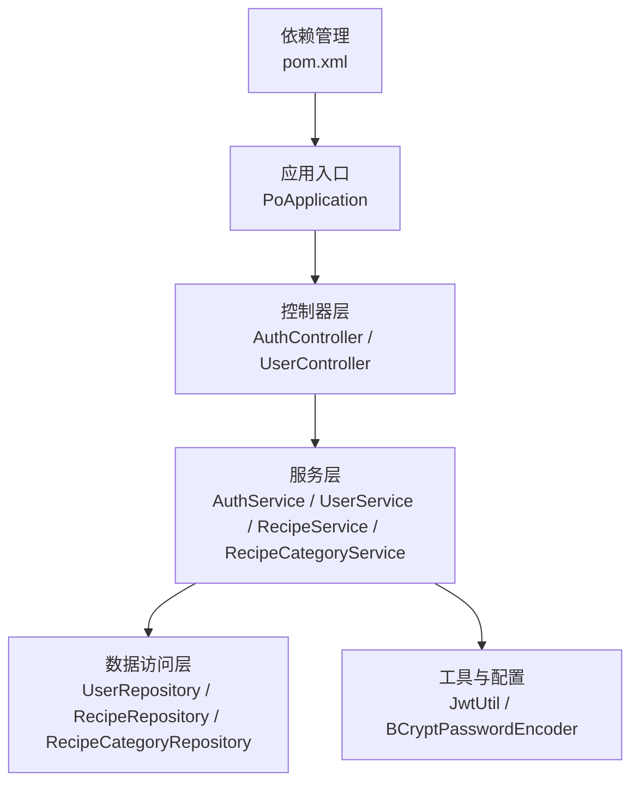
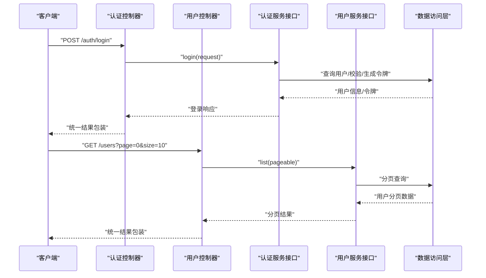
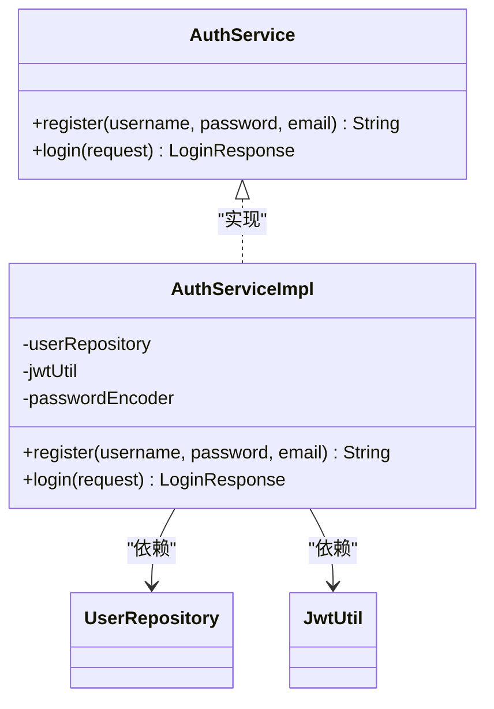
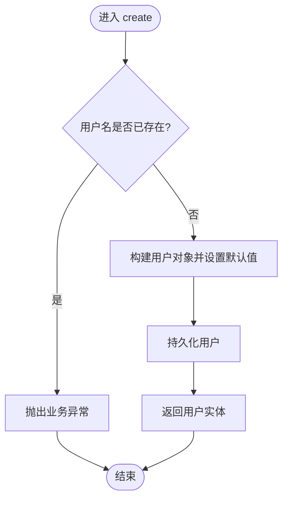
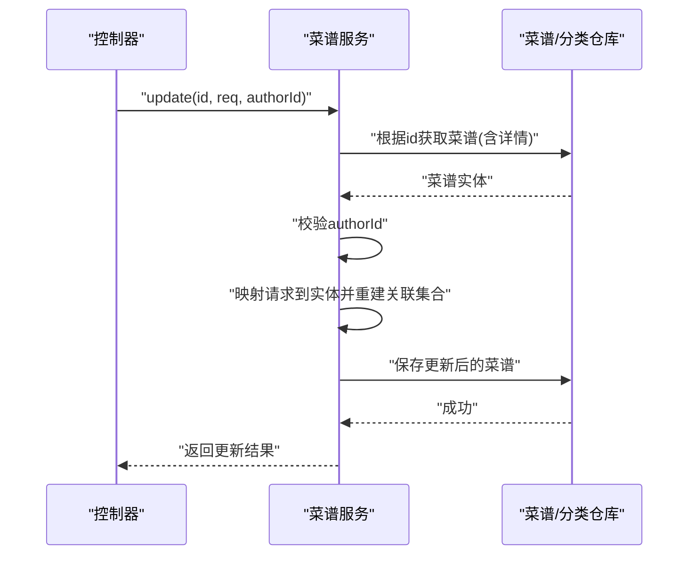
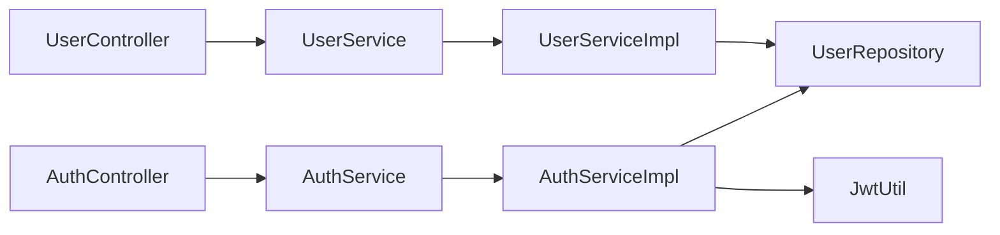

# 服务层模式

<cite>
**本文引用的文件**
- [PoApplication.java](file://java_server/po/src/main/java/com/goodzheng/po/PoApplication.java)
- [pom.xml](file://java_server/po/pom.xml)
- [AuthService.java](file://java_server/po/src/main/java/com/goodzheng/po/service/AuthService.java)
- [AuthServiceImpl.java](file://java_server/po/src/main/java/com/goodzheng/po/service/impl/AuthServiceImpl.java)
- [UserService.java](file://java_server/po/src/main/java/com/goodzheng/po/service/UserService.java)
- [UserServiceImpl.java](file://java_server/po/src/main/java/com/goodzheng/po/service/impl/UserServiceImpl.java)
- [RecipeService.java](file://java_server/po/src/main/java/com/goodzheng/po/service/RecipeService.java)
- [RecipeServiceImpl.java](file://java_server/po/src/main/java/com/goodzheng/po/service/impl/RecipeServiceImpl.java)
- [RecipeCategoryService.java](file://java_server/po/src/main/java/com/goodzheng/po/service/RecipeCategoryService.java)
- [RecipeCategoryServiceImpl.java](file://java_server/po/src/main/java/com/goodzheng/po/service/impl/RecipeCategoryServiceImpl.java)
- [AuthController.java](file://java_server/po/src/main/java/com/goodzheng/po/controller/AuthController.java)
- [UserController.java](file://java_server/po/src/main/java/com/goodzheng/po/controller/UserController.java)
</cite>

## 目录
1. [简介](#简介)
2. [项目结构](#项目结构)
3. [核心组件](#核心组件)
4. [架构总览](#架构总览)
5. [详细组件分析](#详细组件分析)
6. [依赖关系分析](#依赖关系分析)
7. [性能考量](#性能考量)
8. [故障排查指南](#故障排查指南)
9. [结论](#结论)
10. [附录](#附录)

## 简介
本文件围绕“服务层模式”展开，结合仓库中的 Java Spring Boot 后端代码，系统阐述接口与实现分离、事务管理策略（声明式与编程式）、异常处理机制、依赖注入与组件装配、以及业务逻辑复用等关键主题。通过具体类与方法路径定位，帮助开发者构建可维护、可扩展的业务逻辑层。

## 项目结构
本项目采用典型的分层架构：控制器层负责接收请求并调用服务层；服务层封装业务规则、编排事务与领域操作；数据访问层通过 Repository 与数据库交互。应用启动入口为 Spring Boot 主类，依赖通过 Maven 管理。

图表来源
- [PoApplication.java:6-11](file://java_server/po/src/main/java/com/goodzheng/po/PoApplication.java#L6-L11)
- [pom.xml:32-115](file://java_server/po/pom.xml#L32-L115)
- [AuthController.java:11-17](file://java_server/po/src/main/java/com/goodzheng/po/controller/AuthController.java#L11-L17)
- [UserController.java:19-27](file://java_server/po/src/main/java/com/goodzheng/po/controller/UserController.java#L19-L27)

章节来源
- [PoApplication.java:6-11](file://java_server/po/src/main/java/com/goodzheng/po/PoApplication.java#L6-L11)
- [pom.xml:32-115](file://java_server/po/pom.xml#L32-L115)

## 核心组件
- 认证服务：定义注册与登录能力，实现中完成密码加密、用户校验与令牌生成。
- 用户服务：提供用户的分页查询、搜索、创建、更新、删除及批量操作，使用声明式事务保障一致性。
- 菜谱服务：封装菜谱的创建、查询、按作者/分类检索、搜索、更新与软删除，涉及多实体关联与事务边界。
- 菜谱分类服务：提供未删除分类列表查询，读事务优化。

章节来源
- [AuthService.java:6-11](file://java_server/po/src/main/java/com/goodzheng/po/service/AuthService.java#L6-L11)
- [AuthServiceImpl.java:13-46](file://java_server/po/src/main/java/com/goodzheng/po/service/impl/AuthServiceImpl.java#L13-L46)
- [UserService.java:10-27](file://java_server/po/src/main/java/com/goodzheng/po/service/UserService.java#L10-L27)
- [UserServiceImpl.java:16-104](file://java_server/po/src/main/java/com/goodzheng/po/service/impl/UserServiceImpl.java#L16-L104)
- [RecipeService.java:10-27](file://java_server/po/src/main/java/com/goodzheng/po/service/RecipeService.java#L10-L27)
- [RecipeServiceImpl.java:19-172](file://java_server/po/src/main/java/com/goodzheng/po/service/impl/RecipeServiceImpl.java#L19-L172)
- [RecipeCategoryService.java:7-11](file://java_server/po/src/main/java/com/goodzheng/po/service/RecipeCategoryService.java#L7-L11)
- [RecipeCategoryServiceImpl.java:12-22](file://java_server/po/src/main/java/com/goodzheng/po/service/impl/RecipeCategoryServiceImpl.java#L12-L22)

## 架构总览
下图展示从 HTTP 请求到服务层再到数据访问层的调用链，体现接口与实现分离、依赖注入与事务边界的协作方式。

图表来源
- [AuthController.java:19-27](file://java_server/po/src/main/java/com/goodzheng/po/controller/AuthController.java#L19-L27)
- [UserController.java:30-43](file://java_server/po/src/main/java/com/goodzheng/po/controller/UserController.java#L30-L43)
- [AuthService.java:6-11](file://java_server/po/src/main/java/com/goodzheng/po/service/AuthService.java#L6-L11)
- [UserService.java:10-14](file://java_server/po/src/main/java/com/goodzheng/po/service/UserService.java#L10-L14)

## 详细组件分析

### 认证服务（AuthService / AuthServiceImpl）
- 设计要点
  - 接口定义注册与登录方法，职责清晰，便于替换实现或扩展。
  - 实现类使用构造器注入 UserRepository 与 JwtUtil，并通过 BCrypt 进行密码加密。
  - 登录流程包含用户存在性校验、密码匹配、令牌生成与响应组装。
- 事务策略
  - 当前实现未显式标注事务注解，适合轻量且无跨资源一致性的场景；若后续引入多写操作，建议增加 @Transactional 以保障原子性。
- 异常处理
  - 抛出运行时异常表示业务错误（如用户名已存在、凭证错误），由控制器捕获并转换为统一响应。

图表来源
- [AuthService.java:6-11](file://java_server/po/src/main/java/com/goodzheng/po/service/AuthService.java#L6-L11)
- [AuthServiceImpl.java:13-46](file://java_server/po/src/main/java/com/goodzheng/po/service/impl/AuthServiceImpl.java#L13-L46)

章节来源
- [AuthService.java:6-11](file://java_server/po/src/main/java/com/goodzheng/po/service/AuthService.java#L6-L11)
- [AuthServiceImpl.java:13-46](file://java_server/po/src/main/java/com/goodzheng/po/service/impl/AuthServiceImpl.java#L13-L46)
- [AuthController.java:19-39](file://java_server/po/src/main/java/com/goodzheng/po/controller/AuthController.java#L19-L39)

### 用户服务（UserService / UserServiceImpl）
- 设计要点
  - 接口覆盖 CRUD 与批量操作，支持分页与关键词搜索。
  - 实现类使用构造器注入 UserRepository，并对写操作使用声明式事务。
- 事务策略
  - 读方法使用 @Transactional(readOnly = true) 提升性能与并发安全。
  - 写方法使用 @Transactional 保证原子性；批量更新状态在单事务内加载、修改并保存。
- 异常处理
  - 对不存在的数据抛出运行时异常，由控制器统一捕获并返回错误码与消息。

图表来源
- [UserServiceImpl.java:42-61](file://java_server/po/src/main/java/com/goodzheng/po/service/impl/UserServiceImpl.java#L42-L61)

章节来源
- [UserService.java:10-27](file://java_server/po/src/main/java/com/goodzheng/po/service/UserService.java#L10-L27)
- [UserServiceImpl.java:16-104](file://java_server/po/src/main/java/com/goodzheng/po/service/impl/UserServiceImpl.java#L16-L104)
- [UserController.java:67-96](file://java_server/po/src/main/java/com/goodzheng/po/controller/UserController.java#L67-L96)

### 菜谱服务（RecipeService / RecipeServiceImpl）
- 设计要点
  - 接口定义菜谱的创建、查询、按作者/分类检索、搜索、更新与删除。
  - 实现类处理复杂对象映射（食材、步骤），并在更新时清空再重建关联集合，确保数据一致性。
- 事务策略
  - 写操作（创建、更新、删除）使用 @Transactional；读操作使用只读事务以提升性能。
- 权限与校验
  - 更新与删除前校验作者身份，防止越权操作。
- 数据完整性
  - 通过 Repository 的复合查询与过滤条件（如软删除标记）保证数据可见性与一致性。

图表来源
- [RecipeServiceImpl.java:99-140](file://java_server/po/src/main/java/com/goodzheng/po/service/impl/RecipeServiceImpl.java#L99-L140)

章节来源
- [RecipeService.java:10-27](file://java_server/po/src/main/java/com/goodzheng/po/service/RecipeService.java#L10-L27)
- [RecipeServiceImpl.java:19-172](file://java_server/po/src/main/java/com/goodzheng/po/service/impl/RecipeServiceImpl.java#L19-L172)

### 菜谱分类服务（RecipeCategoryService / RecipeCategoryServiceImpl）
- 设计要点
  - 接口仅暴露未删除分类列表查询，职责单一。
  - 实现类使用只读事务，并按排序字段与 ID 升序返回结果。
- 事务策略
  - 读操作使用 @Transactional(readOnly = true)。

章节来源
- [RecipeCategoryService.java:7-11](file://java_server/po/src/main/java/com/goodzheng/po/service/RecipeCategoryService.java#L7-L11)
- [RecipeCategoryServiceImpl.java:12-22](file://java_server/po/src/main/java/com/goodzheng/po/service/impl/RecipeCategoryServiceImpl.java#L12-L22)

## 依赖关系分析
- 组件耦合
  - 控制器仅依赖服务接口，降低与实现的耦合度，便于测试与替换。
  - 服务层通过构造器注入 Repository 与工具类，职责清晰。
- 外部依赖
  - 通过 pom.xml 引入 Spring Web、JPA、MyBatis-Plus、Redis、JWT、验证与安全等组件。
- 潜在循环依赖
  - 当前未发现循环引用；服务之间保持松耦合。

图表来源
- [AuthController.java:11-17](file://java_server/po/src/main/java/com/goodzheng/po/controller/AuthController.java#L11-L17)
- [UserController.java:19-27](file://java_server/po/src/main/java/com/goodzheng/po/controller/UserController.java#L19-L27)
- [AuthService.java:6-11](file://java_server/po/src/main/java/com/goodzheng/po/service/AuthService.java#L6-L11)
- [UserService.java:10-27](file://java_server/po/src/main/java/com/goodzheng/po/service/UserService.java#L10-L27)
- [AuthServiceImpl.java:13-19](file://java_server/po/src/main/java/com/goodzheng/po/service/impl/AuthServiceImpl.java#L13-L19)
- [UserServiceImpl.java:16-21](file://java_server/po/src/main/java/com/goodzheng/po/service/impl/UserServiceImpl.java#L16-L21)

章节来源
- [pom.xml:32-115](file://java_server/po/pom.xml#L32-L115)

## 性能考量
- 只读事务
  - 所有查询方法使用 @Transactional(readOnly = true)，有助于数据库优化与连接池管理。
- 分页与索引
  - 列表与搜索使用 Pageable，建议在关键字字段建立合适索引以提升查询性能。
- 批量操作
  - 批量删除与批量状态更新在单事务内执行，减少往返次数；注意大数据量时的内存占用。
- 缓存与异步
  - 当前未使用缓存；对于热点数据可考虑引入 Redis 缓存策略。

[本节为通用指导，不直接分析具体文件]

## 故障排查指南
- 常见异常
  - 用户名已存在、用户不存在、无权操作等运行时异常在服务层抛出，由控制器捕获并返回统一错误响应。
- 定位方法
  - 查看对应服务方法的异常抛出点与控制器 catch 分支，确认错误码与消息是否符合预期。
- 事务回滚
  - 若出现部分写入成功的情况，检查方法是否处于事务边界内，并确保异常未被吞掉。

章节来源
- [AuthServiceImpl.java:21-46](file://java_server/po/src/main/java/com/goodzheng/po/service/impl/AuthServiceImpl.java#L21-L46)
- [UserServiceImpl.java:23-104](file://java_server/po/src/main/java/com/goodzheng/po/service/impl/UserServiceImpl.java#L23-L104)
- [AuthController.java:19-39](file://java_server/po/src/main/java/com/goodzheng/po/controller/AuthController.java#L19-L39)
- [UserController.java:45-122](file://java_server/po/src/main/java/com/goodzheng/po/controller/UserController.java#L45-L122)

## 结论
本项目在服务层实现了清晰的接口与实现分离，使用构造器注入与声明式事务管理，配合控制器层的统一异常处理，形成了稳定、可维护的业务逻辑层。推荐在后续演进中：
- 将业务异常抽象为自定义异常类型，统一错误码与消息规范。
- 对复杂写操作进一步细化事务边界，必要时引入编程式事务控制。
- 对高频读操作引入缓存与合适的索引策略，提升整体性能。

[本节为总结性内容，不直接分析具体文件]

## 附录
- 依赖注入与组件装配
  - 使用 @Service 与 @RequiredArgsConstructor 实现构造器注入，避免字段注入带来的循环依赖风险。
- 业务逻辑复用
  - 将跨实体的通用逻辑抽取为私有方法（如 mapToEntity），提高可读性与复用性。
- 最佳实践
  - 接口优先：对外暴露接口，隐藏实现细节。
  - 事务最小化：仅在需要的事务方法上标注，读方法使用只读事务。
  - 异常规范化：服务层抛出自定义业务异常，控制器统一捕获并返回标准响应。

[本节为通用指导，不直接分析具体文件]