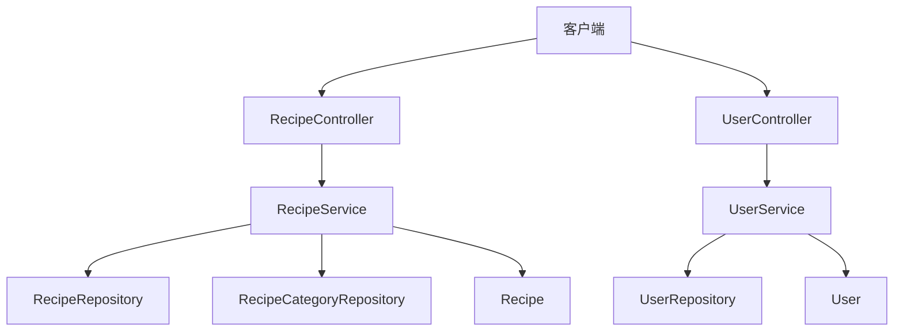
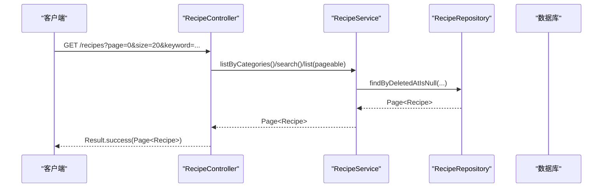
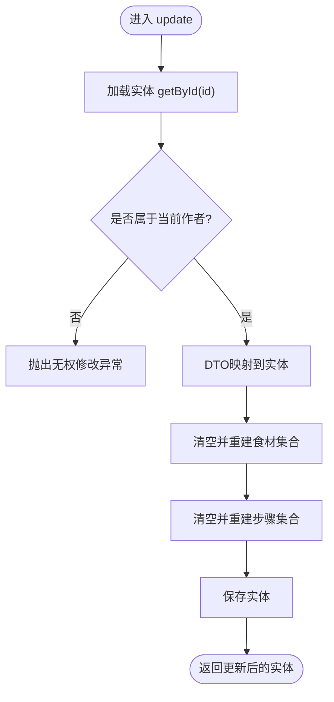
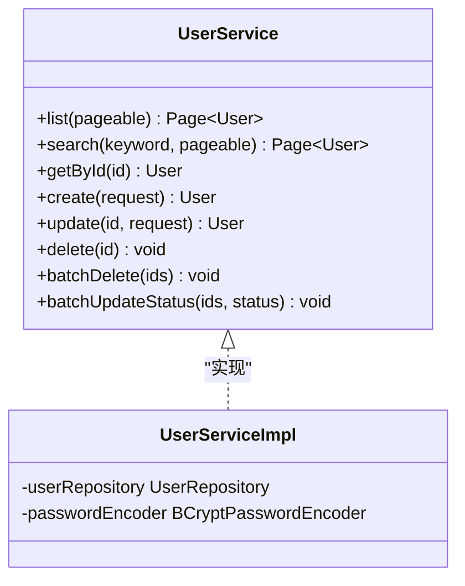
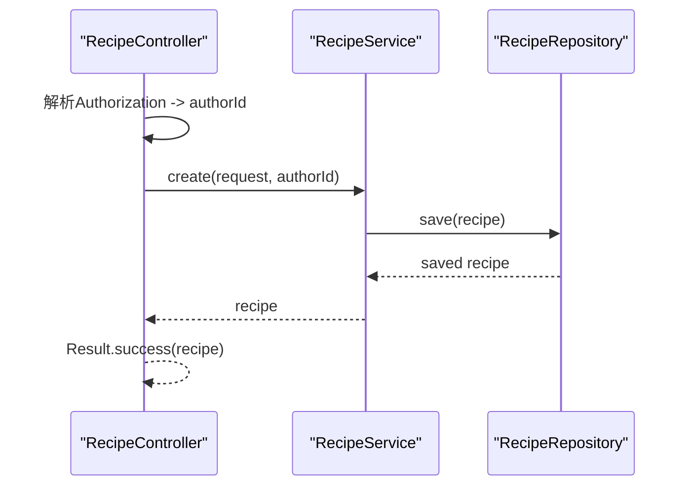
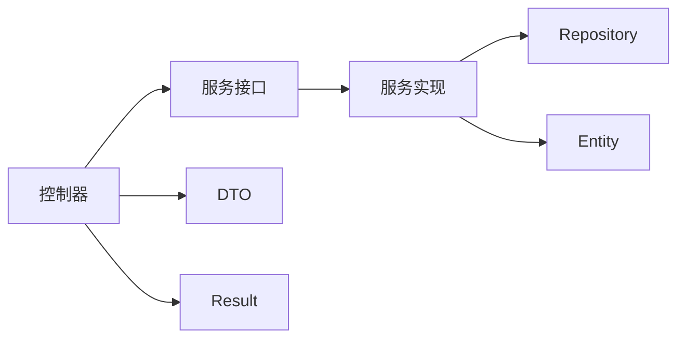

# 服务接口设计

<cite>
**本文引用的文件**
- [RecipeService.java](file://java_server/po/src/main/java/com/goodzheng/po/service/RecipeService.java)
- [UserService.java](file://java_server/po/src/main/java/com/goodzheng/po/service/UserService.java)
- [AuthService.java](file://java_server/po/src/main/java/com/goodzheng/po/service/AuthService.java)
- [RecipeCategoryService.java](file://java_server/po/src/main/java/com/goodzheng/po/service/RecipeCategoryService.java)
- [RecipeServiceImpl.java](file://java_server/po/src/main/java/com/goodzheng/po/service/impl/RecipeServiceImpl.java)
- [UserServiceImpl.java](file://java_server/po/src/main/java/com/goodzheng/po/service/impl/UserServiceImpl.java)
- [RecipeController.java](file://java_server/po/src/main/java/com/goodzheng/po/controller/RecipeController.java)
- [UserController.java](file://java_server/po/src/main/java/com/goodzheng/po/controller/UserController.java)
- [Result.java](file://java_server/po/src/main/java/com/goodzheng/po/dto/Result.java)
- [RecipeRequest.java](file://java_server/po/src/main/java/com/goodzheng/po/dto/RecipeRequest.java)
- [UserRequest.java](file://java_server/po/src/main/java/com/goodzheng/po/dto/UserRequest.java)
- [Recipe.java](file://java_server/po/src/main/java/com/goodzheng/po/entity/Recipe.java)
- [User.java](file://java_server/po/src/main/java/com/goodzheng/po/entity/User.java)
</cite>

## 目录
1. [简介](#简介)
2. [项目结构](#项目结构)
3. [核心组件](#核心组件)
4. [架构总览](#架构总览)
5. [详细组件分析](#详细组件分析)
6. [依赖关系分析](#依赖关系分析)
7. [性能考量](#性能考量)
8. [故障排查指南](#故障排查指南)
9. [结论](#结论)
10. [附录：接口契约与示例](#附录接口契约与示例)

## 简介
本技术文档聚焦于Spring Boot服务层接口的设计原则与实践，围绕RecipeService、UserService等核心接口，系统阐述接口方法的命名规范、参数设计与返回值约定；解释接口与实现分离的优势及如何通过接口抽象业务逻辑；并提供分页查询、条件搜索、CRUD等常见场景的接口设计模式与最佳实践。

## 项目结构
本项目采用分层架构：
- 控制器层（controller）：负责HTTP请求解析、参数校验、调用服务层并统一返回Result包装。
- 服务层（service + impl）：定义领域能力边界，封装业务规则、事务与数据访问编排。
- 数据访问层（repository）：基于Spring Data JPA提供持久化操作。
- 数据传输对象（dto）：用于跨层传递输入输出数据，包含校验注解。
- 实体（entity）：映射数据库表结构。

图示来源
- [RecipeController.java:18-119](file://java_server/po/src/main/java/com/goodzheng/po/controller/RecipeController.java#L18-L119)
- [UserController.java:19-132](file://java_server/po/src/main/java/com/goodzheng/po/controller/UserController.java#L19-L132)
- [RecipeService.java:10-27](file://java_server/po/src/main/java/com/goodzheng/po/service/RecipeService.java#L10-L27)
- [UserService.java:10-27](file://java_server/po/src/main/java/com/goodzheng/po/service/UserService.java#L10-L27)

章节来源
- [RecipeController.java:18-119](file://java_server/po/src/main/java/com/goodzheng/po/controller/RecipeController.java#L18-L119)
- [UserController.java:19-132](file://java_server/po/src/main/java/com/goodzheng/po/controller/UserController.java#L19-L132)

## 核心组件
- RecipeService：菜谱领域的业务能力抽象，涵盖创建、查询、更新、删除、按作者/分类/关键词检索、分页等。
- UserService：用户管理能力抽象，涵盖列表、搜索、详情、创建、更新、删除、批量操作等。
- AuthService：认证授权能力抽象，注册与登录。
- RecipeCategoryService：菜谱分类的基础查询能力。

这些接口体现了“面向接口编程”的原则：控制器仅依赖接口，不感知具体实现；业务变更在实现层完成，不影响上层调用。

章节来源
- [RecipeService.java:10-27](file://java_server/po/src/main/java/com/goodzheng/po/service/RecipeService.java#L10-L27)
- [UserService.java:10-27](file://java_server/po/src/main/java/com/goodzheng/po/service/UserService.java#L10-L27)
- [AuthService.java:6-11](file://java_server/po/src/main/java/com/goodzheng/po/service/AuthService.java#L6-L11)
- [RecipeCategoryService.java:7-11](file://java_server/po/src/main/java/com/goodzheng/po/service/RecipeCategoryService.java#L7-L11)

## 架构总览
服务层通过Repository访问数据，使用Spring Data JPA进行持久化；控制器将HTTP请求转换为DTO并调用服务方法，最终统一以Result包装响应。

图示来源
- [RecipeController.java:51-68](file://java_server/po/src/main/java/com/goodzheng/po/controller/RecipeController.java#L51-L68)
- [RecipeServiceImpl.java:73-97](file://java_server/po/src/main/java/com/goodzheng/po/service/impl/RecipeServiceImpl.java#L73-L97)

章节来源
- [RecipeController.java:51-68](file://java_server/po/src/main/java/com/goodzheng/po/controller/RecipeController.java#L51-L68)
- [RecipeServiceImpl.java:73-97](file://java_server/po/src/main/java/com/goodzheng/po/service/impl/RecipeServiceImpl.java#L73-L97)

## 详细组件分析

### 接口设计原则
- 命名规范
  - 动词+名词：create/getById/list/search/update/delete/batchDelete/batchUpdateStatus等，语义清晰。
  - 查询类方法优先返回Page<T>或List<T>，明确分页与集合语义。
  - 写操作返回受影响的实体或void，避免无意义的包装。
- 参数设计
  - 分页统一使用Pageable，由控制器组装PageRequest，便于排序与页码控制。
  - 条件查询使用明确的过滤参数（如authorId、categoryIds、keyword），避免模糊的Map传参。
  - 安全相关参数（如authorId）从认证上下文解析后传入服务层，保证权限边界。
- 返回值约定
  - 服务层直接返回领域对象或分页对象，不在服务层做HTTP包装；HTTP包装在控制器层统一处理为Result。
  - 异常通过RuntimeException抛出，由控制器捕获并转为错误Result。

章节来源
- [RecipeService.java:10-27](file://java_server/po/src/main/java/com/goodzheng/po/service/RecipeService.java#L10-L27)
- [UserService.java:10-27](file://java_server/po/src/main/java/com/goodzheng/po/service/UserService.java#L10-L27)
- [Result.java:7-31](file://java_server/po/src/main/java/com/goodzheng/po/dto/Result.java#L7-L31)

### RecipeService 职责与边界
- 职责
  - 菜谱的完整生命周期管理：创建、读取、更新、删除（软删除）。
  - 多条件查询：按作者、分类、关键词检索，均支持分页。
- 边界
  - 权限校验：更新与删除需校验authorId，防止越权修改他人数据。
  - 数据一致性：复杂写入（食材、步骤）在事务中完成，确保关联数据完整性。
- 典型流程
  - 创建：接收DTO，映射到实体，填充关联集合，保存并返回实体。
  - 更新：先获取实体并校验归属，再替换关联集合并保存。
  - 删除：软删除，设置删除时间戳。

图示来源
- [RecipeServiceImpl.java:99-140](file://java_server/po/src/main/java/com/goodzheng/po/service/impl/RecipeServiceImpl.java#L99-L140)

章节来源
- [RecipeService.java:10-27](file://java_server/po/src/main/java/com/goodzheng/po/service/RecipeService.java#L10-L27)
- [RecipeServiceImpl.java:26-172](file://java_server/po/src/main/java/com/goodzheng/po/service/impl/RecipeServiceImpl.java#L26-L172)

### UserService 职责与边界
- 职责
  - 用户基础CRUD与批量操作：列表、搜索、详情、创建、更新、删除、批量删除、批量状态更新。
- 边界
  - 唯一性约束：用户名唯一，创建时检查重复。
  - 密码安全：密码加密存储，更新时可选更新。
  - 批量操作：使用批量API提升性能。
- 典型流程
  - 创建：校验用户名存在性，构建用户实体，默认值填充，保存。
  - 更新：选择性字段覆盖，密码可选更新。
  - 批量：批量删除与批量状态更新，减少往返次数。

图示来源
- [UserService.java:10-27](file://java_server/po/src/main/java/com/goodzheng/po/service/UserService.java#L10-L27)
- [UserServiceImpl.java:16-105](file://java_server/po/src/main/java/com/goodzheng/po/service/impl/UserServiceImpl.java#L16-L105)

章节来源
- [UserService.java:10-27](file://java_server/po/src/main/java/com/goodzheng/po/service/UserService.java#L10-L27)
- [UserServiceImpl.java:16-105](file://java_server/po/src/main/java/com/goodzheng/po/service/impl/UserServiceImpl.java#L16-L105)

### AuthService 职责与边界
- 职责
  - 用户注册与登录，返回令牌或会话信息。
- 边界
  - 输入校验：用户名、密码、邮箱等必填项在服务层或控制器层校验。
  - 安全：密码加密、令牌生成与验证由工具类配合完成。

章节来源
- [AuthService.java:6-11](file://java_server/po/src/main/java/com/goodzheng/po/service/AuthService.java#L6-L11)

### RecipeCategoryService 职责与边界
- 职责
  - 提供未删除的分类列表，按排序字段升序返回。
- 边界
  - 只读查询，不涉及写操作。

章节来源
- [RecipeCategoryService.java:7-11](file://java_server/po/src/main/java/com/goodzheng/po/service/RecipeCategoryService.java#L7-L11)

### 控制器与服务层的协作
- 控制器负责：
  - 解析请求头中的Authorization，提取用户身份并转换为userId。
  - 组装分页参数PageRequest，调用服务层对应方法。
  - 统一捕获异常并包装为Result。
- 服务层负责：
  - 业务规则与数据一致性。
  - 通过Repository执行持久化操作。

图示来源
- [RecipeController.java:28-39](file://java_server/po/src/main/java/com/goodzheng/po/controller/RecipeController.java#L28-L39)
- [RecipeServiceImpl.java:26-60](file://java_server/po/src/main/java/com/goodzheng/po/service/impl/RecipeServiceImpl.java#L26-L60)

章节来源
- [RecipeController.java:28-39](file://java_server/po/src/main/java/com/goodzheng/po/controller/RecipeController.java#L28-L39)
- [RecipeServiceImpl.java:26-60](file://java_server/po/src/main/java/com/goodzheng/po/service/impl/RecipeServiceImpl.java#L26-L60)

## 依赖关系分析
- 控制器依赖服务接口，不依赖实现类，降低耦合。
- 服务实现依赖Repository与实体，封装领域逻辑。
- DTO作为输入载体，携带校验注解，确保输入合法性。
- Result作为统一输出载体，屏蔽内部异常细节。

图示来源
- [RecipeController.java:18-119](file://java_server/po/src/main/java/com/goodzheng/po/controller/RecipeController.java#L18-L119)
- [RecipeService.java:10-27](file://java_server/po/src/main/java/com/goodzheng/po/service/RecipeService.java#L10-L27)
- [RecipeServiceImpl.java:19-172](file://java_server/po/src/main/java/com/goodzheng/po/service/impl/RecipeServiceImpl.java#L19-L172)
- [Result.java:7-31](file://java_server/po/src/main/java/com/goodzheng/po/dto/Result.java#L7-L31)

章节来源
- [RecipeController.java:18-119](file://java_server/po/src/main/java/com/goodzheng/po/controller/RecipeController.java#L18-L119)
- [RecipeService.java:10-27](file://java_server/po/src/main/java/com/goodzheng/po/service/RecipeService.java#L10-L27)
- [RecipeServiceImpl.java:19-172](file://java_server/po/src/main/java/com/goodzheng/po/service/impl/RecipeServiceImpl.java#L19-L172)
- [Result.java:7-31](file://java_server/po/src/main/java/com/goodzheng/po/dto/Result.java#L7-L31)

## 性能考量
- 分页查询：统一使用Pageable，避免全量拉取；控制器侧指定默认排序（如createdAt降序）。
- 批量操作：用户模块提供batchDelete与batchUpdateStatus，减少数据库往返。
- 只读事务：查询方法标注只读事务，优化连接池与锁行为。
- 软删除：通过deletedAt字段过滤，避免物理删除带来的级联开销。
- 关联集合重建：更新时先清空再重建，确保数据一致性与排序稳定。

[本节为通用性能建议，不直接分析具体文件]

## 故障排查指南
- 常见异常
  - 资源不存在：服务层抛出运行时异常，控制器捕获并返回404。
  - 权限不足：更新/删除时authorId不匹配，返回400或401。
  - 用户名重复：创建用户时检查唯一性，返回400。
- 定位思路
  - 查看控制器try-catch块与Result.error的使用位置。
  - 检查服务层异常抛出点与事务边界。
  - 核对DTO校验注解与控制器@Valid的使用。

章节来源
- [RecipeController.java:28-108](file://java_server/po/src/main/java/com/goodzheng/po/controller/RecipeController.java#L28-L108)
- [UserController.java:45-121](file://java_server/po/src/main/java/com/goodzheng/po/controller/UserController.java#L45-L121)
- [RecipeServiceImpl.java:62-70](file://java_server/po/src/main/java/com/goodzheng/po/service/impl/RecipeServiceImpl.java#L62-L70)
- [UserServiceImpl.java:42-60](file://java_server/po/src/main/java/com/goodzheng/po/service/impl/UserServiceImpl.java#L42-L60)

## 结论
本项目通过清晰的接口定义与实现分离，实现了高内聚、低耦合的服务层设计。RecipeService与UserService分别承担菜谱与用户领域的核心能力，遵循统一的命名、参数与返回约定，结合控制器层的统一Result包装与异常处理，形成了稳定的API契约。分页、条件搜索、CRUD等常见场景均有良好的扩展性与可维护性。

[本节为总结性内容，不直接分析具体文件]

## 附录：接口契约与示例
- 分页查询
  - 接口：Page<T> list(Pageable pageable)
  - 说明：统一分页参数，控制器组装PageRequest并指定排序。
  - 参考路径：[RecipeService.java:16](file://java_server/po/src/main/java/com/goodzheng/po/service/RecipeService.java#L16)、[UserService.java:12](file://java_server/po/src/main/java/com/goodzheng/po/service/UserService.java#L12)
- 条件搜索
  - 接口：Page<T> search(String keyword, Pageable pageable)
  - 说明：关键词搜索，控制器根据参数选择不同服务方法。
  - 参考路径：[RecipeService.java:22](file://java_server/po/src/main/java/com/goodzheng/po/service/RecipeService.java#L22)、[UserService.java:14](file://java_server/po/src/main/java/com/goodzheng/po/service/UserService.java#L14)
- CRUD操作
  - 创建：T create(Request req, ...)
  - 读取：T getById(Long id)
  - 更新：T update(Long id, Request req, ...)
  - 删除：void delete(Long id, ...)
  - 参考路径：[RecipeService.java:12-26](file://java_server/po/src/main/java/com/goodzheng/po/service/RecipeService.java#L12-L26)、[UserService.java:16-22](file://java_server/po/src/main/java/com/goodzheng/po/service/UserService.java#L16-L22)
- 批量操作
  - 接口：void batchDelete(List<Long> ids)、void batchUpdateStatus(List<Long> ids, String status)
  - 说明：提升批量处理的效率，减少数据库往返。
  - 参考路径：[UserService.java:24-26](file://java_server/po/src/main/java/com/goodzheng/po/service/UserService.java#L24-L26)
- 统一响应
  - 接口：Result<T>
  - 说明：包含code、message、data，提供success/error静态工厂方法。
  - 参考路径：[Result.java:7-31](file://java_server/po/src/main/java/com/goodzheng/po/dto/Result.java#L7-L31)

章节来源
- [RecipeService.java:12-26](file://java_server/po/src/main/java/com/goodzheng/po/service/RecipeService.java#L12-L26)
- [UserService.java:12-26](file://java_server/po/src/main/java/com/goodzheng/po/service/UserService.java#L12-L26)
- [Result.java:7-31](file://java_server/po/src/main/java/com/goodzheng/po/dto/Result.java#L7-L31)