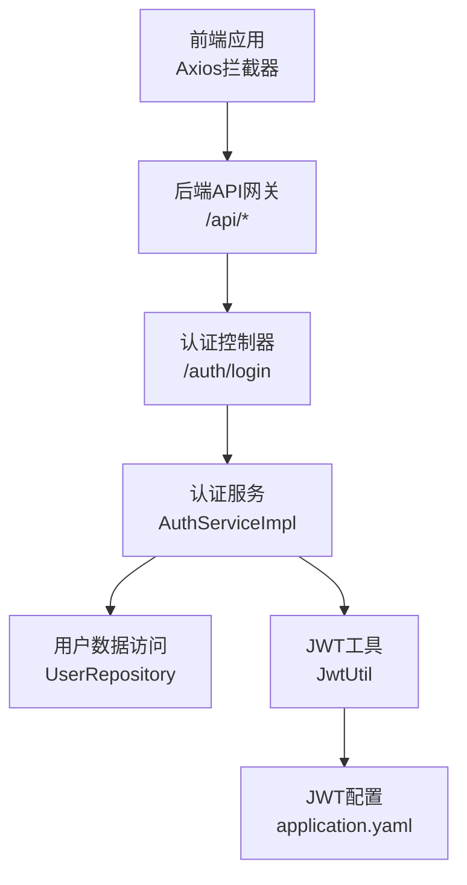
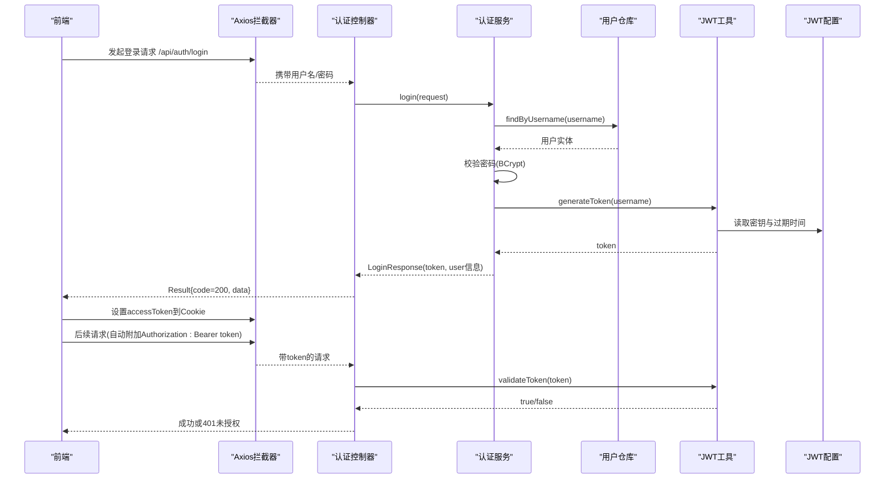
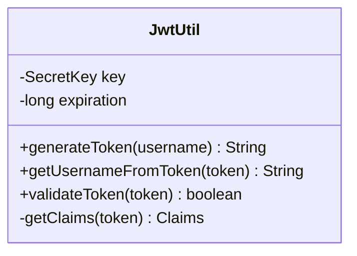
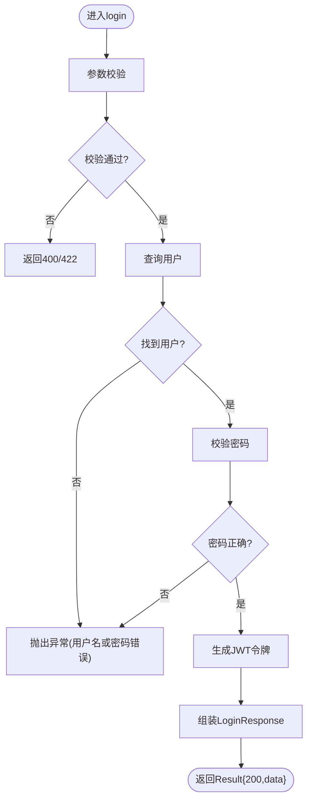
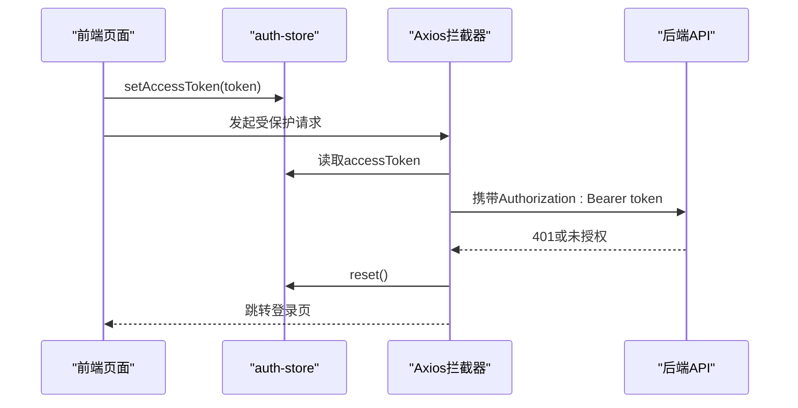
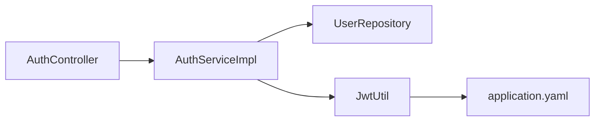

# JWT令牌认证

<cite>
**本文引用的文件**
- [JwtUtil.java](file://java_server/po/src/main/java/com/goodzheng/po/util/JwtUtil.java)
- [AuthController.java](file://java_server/po/src/main/java/com/goodzheng/po/controller/AuthController.java)
- [AuthService.java](file://java_server/po/src/main/java/com/goodzheng/po/service/AuthService.java)
- [AuthServiceImpl.java](file://java_server/po/src/main/java/com/goodzheng/po/service/impl/AuthServiceImpl.java)
- [LoginRequest.java](file://java_server/po/src/main/java/com/goodzheng/po/dto/LoginRequest.java)
- [LoginResponse.java](file://java_server/po/src/main/java/com/goodzheng/po/dto/LoginResponse.java)
- [Result.java](file://java_server/po/src/main/java/com/goodzheng/po/dto/Result.java)
- [User.java](file://java_server/po/src/main/java/com/goodzheng/po/entity/User.java)
- [application.yaml](file://java_server/po/src/main/resources/application.yaml)
- [axios.ts](file://web_client/shadcn-admin/src/lib/axios.ts)
- [auth-store.ts](file://web_client/shadcn-admin/src/stores/auth-store.ts)
</cite>

## 目录
1. [简介](#简介)
2. [项目结构](#项目结构)
3. [核心组件](#核心组件)
4. [架构总览](#架构总览)
5. [详细组件分析](#详细组件分析)
6. [依赖关系分析](#依赖关系分析)
7. [性能与安全考量](#性能与安全考量)
8. [故障排查指南](#故障排查指南)
9. [结论](#结论)
10. [附录：API调用示例与前端使用](#附录api调用示例与前端使用)

## 简介
本技术文档围绕JWT令牌认证机制，系统阐述后端令牌的生成、验证与刷新策略，以及前后端在登录流程中的协作方式。重点覆盖以下方面：
- 签名算法与密钥管理、过期时间配置
- JwtUtil工具类的实现原理（创建、解析、校验）
- 登录接口对用户凭证的校验与JWT返回
- 前端存储与携带令牌进行后续请求认证
- 完整的JWT工作流程图与API调用示例

## 项目结构
本项目采用前后端分离架构：
- 后端（Spring Boot）提供REST API，包含认证控制器、服务层、数据访问层与JWT工具类
- 前端（React + TanStack Router + Axios）负责用户交互、状态管理与HTTP拦截器处理

图表来源
- [AuthController.java:19-27](file://java_server/po/src/main/java/com/goodzheng/po/controller/AuthController.java#L19-L27)
- [AuthServiceImpl.java:35-46](file://java_server/po/src/main/java/com/goodzheng/po/service/impl/AuthServiceImpl.java#L35-L46)
- [JwtUtil.java:25-53](file://java_server/po/src/main/java/com/goodzheng/po/util/JwtUtil.java#L25-L53)
- [application.yaml:107-109](file://java_server/po/src/main/resources/application.yaml#L107-L109)

章节来源
- [AuthController.java:11-27](file://java_server/po/src/main/java/com/goodzheng/po/controller/AuthController.java#L11-L27)
- [application.yaml:107-109](file://java_server/po/src/main/resources/application.yaml#L107-L109)

## 核心组件
- JwtUtil：负责JWT令牌的生成、解析与校验，基于HMAC-SHA密钥与可配置的过期时间
- AuthController：暴露登录与注册接口，统一响应封装
- AuthServiceImpl：业务逻辑实现，包括密码校验、用户查询与令牌签发
- LoginRequest/LoginResponse：登录请求与响应的数据结构
- Result：统一响应包装
- application.yaml：JWT密钥与过期时间等安全配置
- 前端axios.ts：请求拦截器自动附加Authorization头，并处理401未授权
- auth-store.ts：持久化accessToken到Cookie，并提供重置方法

章节来源
- [JwtUtil.java:13-53](file://java_server/po/src/main/java/com/goodzheng/po/util/JwtUtil.java#L13-L53)
- [AuthController.java:11-27](file://java_server/po/src/main/java/com/goodzheng/po/controller/AuthController.java#L11-L27)
- [AuthServiceImpl.java:13-46](file://java_server/po/src/main/java/com/goodzheng/po/service/impl/AuthServiceImpl.java#L13-L46)
- [LoginRequest.java:6-14](file://java_server/po/src/main/java/com/goodzheng/po/dto/LoginRequest.java#L6-L14)
- [LoginResponse.java:6-14](file://java_server/po/src/main/java/com/goodzheng/po/dto/LoginResponse.java#L6-L14)
- [Result.java:7-30](file://java_server/po/src/main/java/com/goodzheng/po/dto/Result.java#L7-L30)
- [application.yaml:107-109](file://java_server/po/src/main/resources/application.yaml#L107-L109)
- [axios.ts:34-86](file://web_client/shadcn-admin/src/lib/axios.ts#L34-L86)
- [auth-store.ts:25-53](file://web_client/shadcn-admin/src/stores/auth-store.ts#L25-L53)

## 架构总览
下图展示了从前端发起登录到后端签发JWT，再到后续受保护请求鉴权的完整流程。

图表来源
- [AuthController.java:19-27](file://java_server/po/src/main/java/com/goodzheng/po/controller/AuthController.java#L19-L27)
- [AuthServiceImpl.java:35-46](file://java_server/po/src/main/java/com/goodzheng/po/service/impl/AuthServiceImpl.java#L35-L46)
- [JwtUtil.java:25-53](file://java_server/po/src/main/java/com/goodzheng/po/util/JwtUtil.java#L25-L53)
- [application.yaml:107-109](file://java_server/po/src/main/resources/application.yaml#L107-L109)
- [axios.ts:42-86](file://web_client/shadcn-admin/src/lib/axios.ts#L42-L86)

## 详细组件分析

### JwtUtil工具类
- 功能职责
  - 生成令牌：以用户名为subject，设置issuedAt与expiration，使用HMAC密钥签名
  - 解析令牌：通过verifyWith构建解析器，获取payload并提取subject
  - 校验令牌：捕获异常判断是否有效（签名错误或过期）
- 关键参数
  - 密钥：从配置项jwt.secret读取，Base64解码后作为HMAC密钥
  - 过期时间：从配置项jwt.expiration读取，单位毫秒
- 复杂度与性能
  - 生成/解析均为O(1)操作，开销主要来自加密计算
  - 建议在高并发场景下复用实例（已作为Spring单例组件）

图表来源
- [JwtUtil.java:13-53](file://java_server/po/src/main/java/com/goodzheng/po/util/JwtUtil.java#L13-L53)

章节来源
- [JwtUtil.java:13-53](file://java_server/po/src/main/java/com/goodzheng/po/util/JwtUtil.java#L13-L53)
- [application.yaml:107-109](file://java_server/po/src/main/resources/application.yaml#L107-L109)

### 认证控制器与服务
- 控制器
  - POST /api/auth/login：接收登录请求，调用服务层，统一返回Result
  - 错误处理：捕获运行时异常并返回401错误码
- 服务实现
  - 根据用户名查询用户，校验密码（BCrypt）
  - 成功后调用JwtUtil生成token，组装LoginResponse返回
- 数据结构
  - LoginRequest：包含username与password，使用NotBlank校验
  - LoginResponse：包含id、token、username、nickname

图表来源
- [AuthController.java:19-27](file://java_server/po/src/main/java/com/goodzheng/po/controller/AuthController.java#L19-L27)
- [AuthServiceImpl.java:35-46](file://java_server/po/src/main/java/com/goodzheng/po/service/impl/AuthServiceImpl.java#L35-L46)
- [LoginRequest.java:6-14](file://java_server/po/src/main/java/com/goodzheng/po/dto/LoginRequest.java#L6-L14)
- [LoginResponse.java:6-14](file://java_server/po/src/main/java/com/goodzheng/po/dto/LoginResponse.java#L6-L14)

章节来源
- [AuthController.java:11-27](file://java_server/po/src/main/java/com/goodzheng/po/controller/AuthController.java#L11-L27)
- [AuthServiceImpl.java:13-46](file://java_server/po/src/main/java/com/goodzheng/po/service/impl/AuthServiceImpl.java#L13-L46)
- [LoginRequest.java:6-14](file://java_server/po/src/main/java/com/goodzheng/po/dto/LoginRequest.java#L6-L14)
- [LoginResponse.java:6-14](file://java_server/po/src/main/java/com/goodzheng/po/dto/LoginResponse.java#L6-L14)

### 前端存储与请求认证
- 存储策略
  - accessToken保存在Cookie中，键名固定为随机字符串常量
  - 提供set/reset方法用于登录成功时写入与退出时清理
- 请求拦截
  - 自动从store读取accessToken并附加到Authorization头
  - 对后端统一响应格式进行解包，非200则拒绝Promise
- 未授权处理
  - 当收到401时，提示“登录已过期”，清空本地状态并重定向至登录页

图表来源
- [auth-store.ts:25-53](file://web_client/shadcn-admin/src/stores/auth-store.ts#L25-L53)
- [axios.ts:42-86](file://web_client/shadcn-admin/src/lib/axios.ts#L42-L86)

章节来源
- [auth-store.ts:25-53](file://web_client/shadcn-admin/src/stores/auth-store.ts#L25-L53)
- [axios.ts:34-86](file://web_client/shadcn-admin/src/lib/axios.ts#L34-L86)

## 依赖关系分析
- 组件耦合
  - AuthController依赖AuthService，松耦合便于扩展
  - AuthServiceImpl依赖UserRepository与JwtUtil，职责清晰
  - JwtUtil仅依赖配置与JJWT库，无外部状态
- 外部依赖
  - JJWT：用于JWT的编解码与签名
  - Spring Security BCrypt：用于密码哈希校验
  - MySQL/HikariCP：数据库连接池
- 潜在循环依赖
  - 当前分层清晰，未发现循环引用

图表来源
- [AuthController.java:11-27](file://java_server/po/src/main/java/com/goodzheng/po/controller/AuthController.java#L11-L27)
- [AuthServiceImpl.java:13-46](file://java_server/po/src/main/java/com/goodzheng/po/service/impl/AuthServiceImpl.java#L13-L46)
- [JwtUtil.java:13-53](file://java_server/po/src/main/java/com/goodzheng/po/util/JwtUtil.java#L13-L53)
- [application.yaml:107-109](file://java_server/po/src/main/resources/application.yaml#L107-L109)

章节来源
- [AuthController.java:11-27](file://java_server/po/src/main/java/com/goodzheng/po/controller/AuthController.java#L11-L27)
- [AuthServiceImpl.java:13-46](file://java_server/po/src/main/java/com/goodzheng/po/service/impl/AuthServiceImpl.java#L13-L46)
- [JwtUtil.java:13-53](file://java_server/po/src/main/java/com/goodzheng/po/util/JwtUtil.java#L13-L53)
- [application.yaml:107-109](file://java_server/po/src/main/resources/application.yaml#L107-L109)

## 性能与安全考量
- 性能
  - JWT生成/解析为CPU密集型但单次耗时极低；在高并发下建议保持单例并使用高效加密库
  - 建议将敏感配置（如密钥）放入环境变量或密钥管理服务，避免硬编码
- 安全
  - 使用强随机密钥与足够长度（已在配置中提供Base64编码的密钥）
  - 合理设置过期时间（默认一天），结合前端提前过期检测减少边界问题
  - 传输层必须启用HTTPS，防止中间人攻击窃取令牌
  - 密码使用BCrypt哈希存储，避免明文泄露
  - 建议增加黑名单或短期刷新令牌机制以实现强制失效（当前未实现）

[本节为通用指导，不直接分析具体文件]

## 故障排查指南
- 登录失败
  - 检查用户名是否存在、密码是否正确（BCrypt匹配）
  - 查看控制器返回的错误码与消息
- 401未授权
  - 确认前端是否携带Authorization头
  - 检查JWT是否过期（前端已做提前30秒过期检测）
  - 核对后端密钥与过期时间配置是否一致
- 跨域问题
  - 控制器已开启跨域，确保前端请求域名与协议一致

章节来源
- [AuthController.java:19-27](file://java_server/po/src/main/java/com/goodzheng/po/controller/AuthController.java#L19-L27)
- [AuthServiceImpl.java:35-46](file://java_server/po/src/main/java/com/goodzheng/po/service/impl/AuthServiceImpl.java#L35-L46)
- [axios.ts:61-83](file://web_client/shadcn-admin/src/lib/axios.ts#L61-L83)

## 结论
本项目实现了基于JWT的无状态认证机制：后端通过JwtUtil签发与校验令牌，前端通过Axios拦截器自动携带令牌并在401时重定向登录。整体设计简洁、职责清晰，具备良好的可扩展性。后续可考虑引入刷新令牌、黑名单与更细粒度的权限控制以提升安全性与灵活性。

[本节为总结，不直接分析具体文件]

## 附录：API调用示例与前端使用
- 登录接口
  - 方法：POST
  - 路径：/api/auth/login
  - 请求体：包含username与password
  - 响应：Result{code=200, data=LoginResponse{id, token, username, nickname}}
- 后续受保护请求
  - 在Authorization头中携带Bearer token
  - 若返回401，前端将自动清理状态并跳转登录页

章节来源
- [AuthController.java:19-27](file://java_server/po/src/main/java/com/goodzheng/po/controller/AuthController.java#L19-L27)
- [LoginRequest.java:6-14](file://java_server/po/src/main/java/com/goodzheng/po/dto/LoginRequest.java#L6-L14)
- [LoginResponse.java:6-14](file://java_server/po/src/main/java/com/goodzheng/po/dto/LoginResponse.java#L6-L14)
- [Result.java:16-30](file://java_server/po/src/main/java/com/goodzheng/po/dto/Result.java#L16-L30)
- [axios.ts:42-86](file://web_client/shadcn-admin/src/lib/axios.ts#L42-L86)