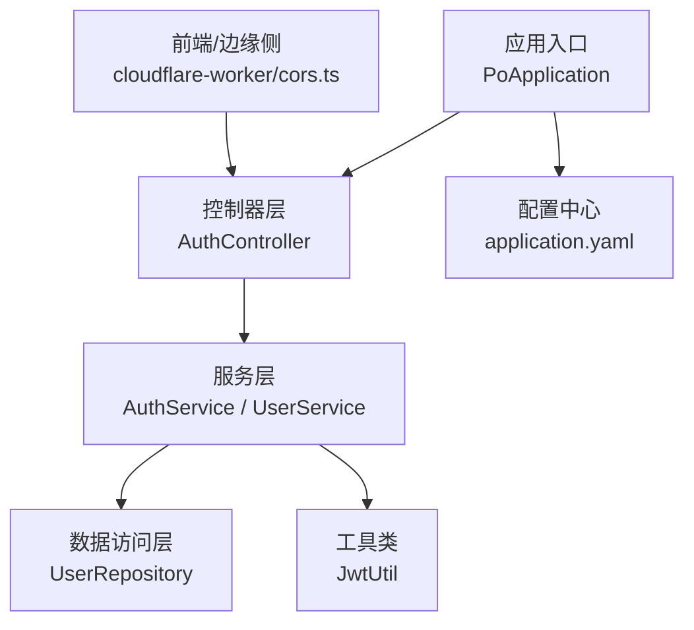
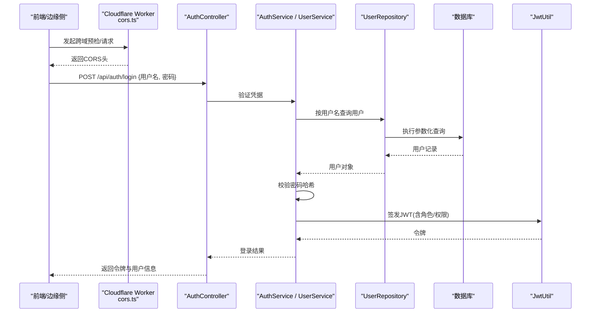
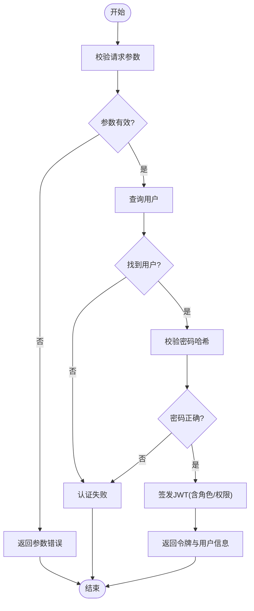
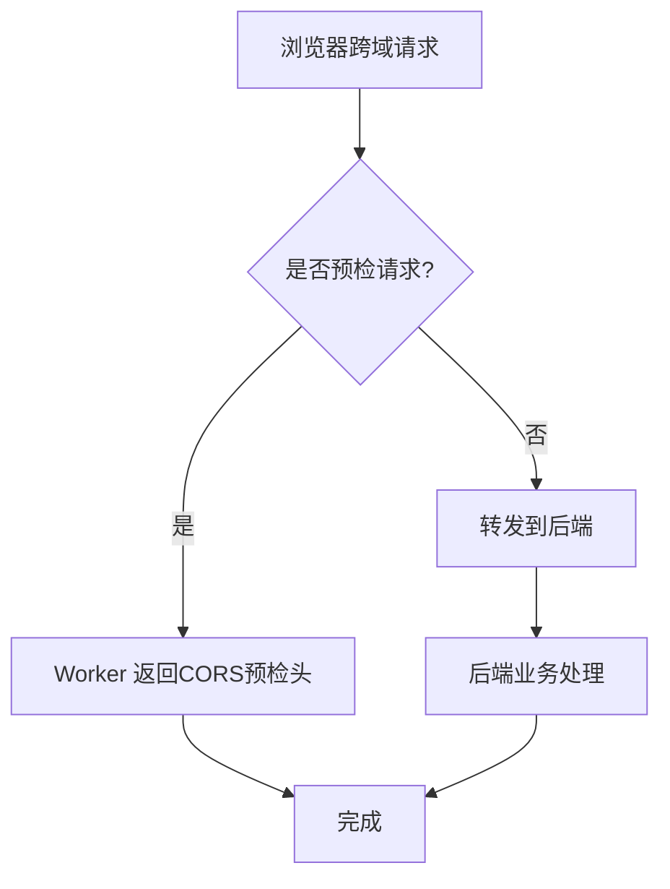
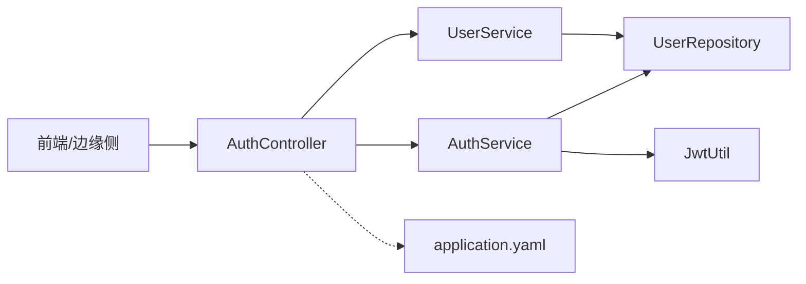

# 安全策略与防护

<cite>
**本文引用的文件**
- [PoApplication.java](file://java_server/po/src/main/java/com/goodzheng/po/PoApplication.java)
- [application.yaml](file://java_server/po/src/main/resources/application.yaml)
- [AuthController.java](file://java_server/po/src/main/java/com/goodzheng/po/controller/AuthController.java)
- [JwtUtil.java](file://java_server/po/src/main/java/com/goodzheng/po/util/JwtUtil.java)
- [UserRepository.java](file://java_server/po/src/main/java/com/goodzheng/po/repository/UserRepository.java)
- [UserService.java](file://java_server/po/src/main/java/com/goodzheng/po/service/UserService.java)
- [AuthService.java](file://java_server/po/src/main/java/com/goodzheng/po/service/AuthService.java)
- [User.java](file://java_server/po/src/main/java/com/goodzheng/po/entity/User.java)
- [LoginRequest.java](file://java_server/po/src/main/java/com/goodzheng/po/dto/LoginRequest.java)
- [LoginResponse.java](file://java_server/po/src/main/java/com/goodzheng/po/dto/LoginResponse.java)
- [cors.ts](file://web_client/po-admin/cloudflare-worker/src/utils/cors.ts)
</cite>

## 目录
1. [简介](#简介)
2. [项目结构](#项目结构)
3. [核心组件](#核心组件)
4. [架构总览](#架构总览)
5. [详细组件分析](#详细组件分析)
6. [依赖关系分析](#依赖关系分析)
7. [性能与安全权衡](#性能与安全权衡)
8. [故障排查指南](#故障排查指南)
9. [结论](#结论)
10. [附录：最佳实践清单](#附录最佳实践清单)

## 简介
本文件围绕本项目的安全策略与防护措施，系统梳理密码加密存储、SQL注入防护、XSS与CSRF防护、Spring Security（如启用）与拦截器、基于角色的访问控制（RBAC）、跨域资源共享（CORS）、敏感数据加密传输与存储（HTTPS与密钥管理），以及常见漏洞的防护建议。文档以代码级事实为依据，辅以架构图与时序图，帮助读者快速理解并落地安全配置。

## 项目结构
后端采用 Spring Boot 应用，入口为启动类；认证相关控制器位于 controller 包，JWT 工具在 util 包，用户实体与仓库在 entity 与 repository 包，服务层在 service 包；前端包含一个 Cloudflare Worker 示例，其中提供 CORS 处理逻辑。配置文件集中在 application.yaml，包含数据库、Redis、日志、Actuator 与 JWT 等关键配置项。

图示来源
- [PoApplication.java:1-14](file://java_server/po/src/main/java/com/goodzheng/po/PoApplication.java#L1-L14)
- [application.yaml:1-109](file://java_server/po/src/main/resources/application.yaml#L1-L109)
- [AuthController.java](file://java_server/po/src/main/java/com/goodzheng/po/controller/AuthController.java)
- [JwtUtil.java](file://java_server/po/src/main/java/com/goodzheng/po/util/JwtUtil.java)
- [UserRepository.java](file://java_server/po/src/main/java/com/goodzheng/po/repository/UserRepository.java)
- [AuthService.java](file://java_server/po/src/main/java/com/goodzheng/po/service/AuthService.java)
- [UserService.java](file://java_server/po/src/main/java/com/goodzheng/po/service/UserService.java)
- [cors.ts](file://web_client/po-admin/cloudflare-worker/src/utils/cors.ts)

章节来源
- [PoApplication.java:1-14](file://java_server/po/src/main/java/com/goodzheng/po/PoApplication.java#L1-L14)
- [application.yaml:1-109](file://java_server/po/src/main/resources/application.yaml#L1-L109)

## 核心组件
- 认证控制器：负责登录请求校验、调用认证服务生成令牌并返回响应。
- 认证服务：封装登录流程、权限判断与令牌签发逻辑。
- 用户服务：封装用户查询、角色/权限读取等通用能力。
- 用户仓库：通过 JPA/ORM 访问用户表，避免手写 SQL。
- JWT 工具：负责令牌签名、过期时间、载荷构建与解析。
- 配置中心：集中管理数据库、缓存、日志、监控与 JWT 密钥等。

章节来源
- [AuthController.java](file://java_server/po/src/main/java/com/goodzheng/po/controller/AuthController.java)
- [AuthService.java](file://java_server/po/src/main/java/com/goodzheng/po/service/AuthService.java)
- [UserService.java](file://java_server/po/src/main/java/com/goodzheng/po/service/UserService.java)
- [UserRepository.java](file://java_server/po/src/main/java/com/goodzheng/po/repository/UserRepository.java)
- [JwtUtil.java](file://java_server/po/src/main/java/com/goodzheng/po/util/JwtUtil.java)
- [application.yaml:105-109](file://java_server/po/src/main/resources/application.yaml#L105-L109)

## 架构总览
下图展示了从浏览器到后端的认证与鉴权链路，包括前端/边缘侧的 CORS 处理、后端控制器的参数校验与服务层调用、JWT 的签发与校验、以及数据访问层的受保护查询。

图示来源
- [AuthController.java](file://java_server/po/src/main/java/com/goodzheng/po/controller/AuthController.java)
- [AuthService.java](file://java_server/po/src/main/java/com/goodzheng/po/service/AuthService.java)
- [UserService.java](file://java_server/po/src/main/java/com/goodzheng/po/service/UserService.java)
- [UserRepository.java](file://java_server/po/src/main/java/com/goodzheng/po/repository/UserRepository.java)
- [JwtUtil.java](file://java_server/po/src/main/java/com/goodzheng/po/util/JwtUtil.java)
- [cors.ts](file://web_client/po-admin/cloudflare-worker/src/utils/cors.ts)

## 详细组件分析

### 认证与授权流程（登录与令牌）
- 输入校验：控制器接收登录请求体，进行基础格式校验后再进入服务层。
- 凭据校验：服务层通过仓库查询用户，比对密码哈希值。
- 令牌签发：使用 JWT 工具根据用户身份与角色生成令牌，设置合理过期时间。
- 响应封装：统一返回结构中包含令牌与必要用户信息。

图示来源
- [AuthController.java](file://java_server/po/src/main/java/com/goodzheng/po/controller/AuthController.java)
- [AuthService.java](file://java_server/po/src/main/java/com/goodzheng/po/service/AuthService.java)
- [UserService.java](file://java_server/po/src/main/java/com/goodzheng/po/service/UserService.java)
- [UserRepository.java](file://java_server/po/src/main/java/com/goodzheng/po/repository/UserRepository.java)
- [JwtUtil.java](file://java_server/po/src/main/java/com/goodzheng/po/util/JwtUtil.java)

章节来源
- [AuthController.java](file://java_server/po/src/main/java/com/goodzheng/po/controller/AuthController.java)
- [AuthService.java](file://java_server/po/src/main/java/com/goodzheng/po/service/AuthService.java)
- [UserService.java](file://java_server/po/src/main/java/com/goodzheng/po/service/UserService.java)
- [UserRepository.java](file://java_server/po/src/main/java/com/goodzheng/po/repository/UserRepository.java)
- [JwtUtil.java](file://java_server/po/src/main/java/com/goodzheng/po/util/JwtUtil.java)

### 密码加密存储策略
- 存储要求：数据库中仅保存密码哈希值，禁止明文存储。
- 算法选择：建议使用抗暴力破解的哈希算法（如 BCrypt/Argon2），并配合随机盐。
- 校验流程：登录时计算输入密码的哈希并与存储值比对。
- 迁移建议：对历史明文或弱哈希进行渐进式迁移。

章节来源
- [application.yaml:23-28](file://java_server/po/src/main/resources/application.yaml#L23-L28)
- [User.java](file://java_server/po/src/main/java/com/goodzheng/po/entity/User.java)
- [AuthService.java](file://java_server/po/src/main/java/com/goodzheng/po/service/AuthService.java)

### SQL注入防护
- ORM优先：通过 JPA/ORM 提供的 Repository 接口进行查询，避免拼接 SQL。
- 参数化查询：如需原生 SQL，必须使用参数绑定与类型转换。
- 输入白名单：对排序字段、枚举型参数进行白名单校验。
- 最小权限：数据库账号仅授予必要权限，限制 DDL/DML 范围。

章节来源
- [UserRepository.java](file://java_server/po/src/main/java/com/goodzheng/po/repository/UserRepository.java)
- [application.yaml:35-41](file://java_server/po/src/main/resources/application.yaml#L35-L41)

### XSS 攻击防护
- 输出编码：所有动态渲染内容需进行上下文相关的转义编码。
- CSP 策略：部署内容安全策略，限制脚本来源与执行环境。
- 富文本处理：若允许富文本，使用白名单过滤与沙箱渲染。
- 前端加固：避免使用 innerHTML 等危险 API，优先使用框架安全的绑定方式。

章节来源
- [application.yaml:61-67](file://java_server/po/src/main/resources/application.yaml#L61-L67)

### CSRF 保护机制
- 无状态会话：采用 JWT 时，服务端不依赖 Cookie Session，天然规避多数 CSRF 场景。
- 同源策略：严格限定允许的 Origin，并在必要时启用 SameSite Cookie。
- 敏感操作校验：对写操作增加额外校验（如自定义 Header 或 Token）。

章节来源
- [application.yaml:105-109](file://java_server/po/src/main/resources/application.yaml#L105-L109)

### Spring Security 与拦截器（RBAC）
- 现状说明：当前未显式引入 Spring Security 配置；可通过添加安全过滤器链实现 RBAC。
- 建议方案：
  - 注册全局拦截器/过滤器，解析 JWT 并加载用户角色/权限至安全上下文。
  - 使用注解或表达式对控制器方法进行方法级授权控制。
  - 将角色/权限与资源映射，实现细粒度访问控制。
- 与现有流程集成：在认证通过后，将角色/权限写入 JWT 载荷，后续请求由拦截器校验。

章节来源
- [PoApplication.java:1-14](file://java_server/po/src/main/java/com/goodzheng/po/PoApplication.java#L1-L14)
- [JwtUtil.java](file://java_server/po/src/main/java/com/goodzheng/po/util/JwtUtil.java)
- [AuthService.java](file://java_server/po/src/main/java/com/goodzheng/po/service/AuthService.java)

### 跨域资源共享（CORS）
- 边缘侧处理：在 Cloudflare Worker 中统一处理预检与响应头，确保只放行可信源。
- 后端兜底：在后端也配置 CORS，作为双重保障，且遵循最小开放原则。
- 安全考虑：
  - 仅允许已知域名，禁用通配符 * 用于敏感接口。
  - 谨慎暴露凭证（Cookie/Authorization），仅在必要时开启。
  - 结合 Referer/Origin 校验，防止伪造来源。

图示来源
- [cors.ts](file://web_client/po-admin/cloudflare-worker/src/utils/cors.ts)

章节来源
- [cors.ts](file://web_client/po-admin/cloudflare-worker/src/utils/cors.ts)

### 敏感数据传输与存储（HTTPS 与密钥管理）
- HTTPS：生产环境务必启用 TLS，强制重定向到 HTTPS，关闭不安全协议。
- 密钥管理：
  - JWT 密钥不应硬编码在源码中，应通过环境变量或密钥管理服务注入。
  - 数据库密码、Redis 密码等敏感配置应从外部配置中心或密钥库读取。
- 传输安全：对所有接口强制 HTTPS，启用 HSTS，限制 Cookie 属性（Secure、SameSite）。
- 日志脱敏：避免记录敏感字段（密码、令牌、身份证号等）。

章节来源
- [application.yaml:23-28](file://java_server/po/src/main/resources/application.yaml#L23-L28)
- [application.yaml:43-53](file://java_server/po/src/main/resources/application.yaml#L43-L53)
- [application.yaml:105-109](file://java_server/po/src/main/resources/application.yaml#L105-L109)

## 依赖关系分析
- 控制器依赖服务层，服务层依赖仓库与工具类。
- JWT 工具被认证服务使用，用于签发与解析令牌。
- 配置中心集中管理连接串、密码、超时与 JWT 密钥等。
- 前端/边缘侧通过 CORS 与后端交互，确保跨域安全。

图示来源
- [AuthController.java](file://java_server/po/src/main/java/com/goodzheng/po/controller/AuthController.java)
- [AuthService.java](file://java_server/po/src/main/java/com/goodzheng/po/service/AuthService.java)
- [UserService.java](file://java_server/po/src/main/java/com/goodzheng/po/service/UserService.java)
- [UserRepository.java](file://java_server/po/src/main/java/com/goodzheng/po/repository/UserRepository.java)
- [JwtUtil.java](file://java_server/po/src/main/java/com/goodzheng/po/util/JwtUtil.java)
- [application.yaml:1-109](file://java_server/po/src/main/resources/application.yaml#L1-L109)

章节来源
- [application.yaml:1-109](file://java_server/po/src/main/resources/application.yaml#L1-L109)

## 性能与安全权衡
- 连接池与超时：合理设置数据库与 Redis 连接池大小与超时，避免资源耗尽与雪崩。
- 令牌过期：JWT 设置合理过期时间，结合刷新令牌机制降低频繁重登风险。
- 限流与防暴破：对登录接口实施速率限制与账户锁定策略。
- 缓存策略：对只读数据采用缓存，但注意缓存污染与失效一致性。

章节来源
- [application.yaml:23-53](file://java_server/po/src/main/resources/application.yaml#L23-L53)
- [application.yaml:105-109](file://java_server/po/src/main/resources/application.yaml#L105-L109)

## 故障排查指南
- 登录失败：检查用户名是否存在、密码哈希是否正确、JWT 密钥是否一致。
- 跨域报错：确认前端/边缘侧与后端均配置了正确的 Origin 与允许的方法/头。
- 数据库连接异常：核对连接串、账号密码、网络连通性与防火墙策略。
- 缓存异常：检查 Redis 地址、端口、密码与连接池配置。
- 日志定位：查看应用日志与 Actuator 指标，定位瓶颈与异常堆栈。

章节来源
- [application.yaml:68-95](file://java_server/po/src/main/resources/application.yaml#L68-L95)
- [application.yaml:23-53](file://java_server/po/src/main/resources/application.yaml#L23-L53)

## 结论
本项目已具备基础的认证与配置能力，建议在以下方面持续强化：
- 全面启用 HTTPS 与严格 CORS 策略。
- 采用强哈希算法存储密码，完善密钥管理与轮换机制。
- 通过 ORM 与参数化查询杜绝 SQL 注入。
- 引入 Spring Security 或等效拦截器链，实现基于角色的访问控制。
- 建立统一的输入校验、输出编码与日志脱敏规范，系统性降低安全风险。

## 附录：最佳实践清单
- 密码与密钥
  - 使用抗暴力破解的哈希算法存储密码，定期轮换密钥。
  - 通过环境变量或密钥管理服务注入敏感配置，禁止硬编码。
- 传输安全
  - 全站 HTTPS，启用 HSTS，限制 Cookie 属性。
  - 对跨域请求进行严格的 Origin 白名单校验。
- 数据安全
  - 使用 ORM/参数化查询，避免 SQL 注入。
  - 输出编码与 CSP 防护 XSS，富文本走白名单过滤。
- 访问控制
  - 基于 JWT 的角色/权限模型，服务端统一校验。
  - 对敏感接口增加二次校验与限流。
- 可观测性
  - 开启必要的 Actuator 端点，结合日志与指标进行安全审计。
  - 对异常与告警建立闭环处置流程。