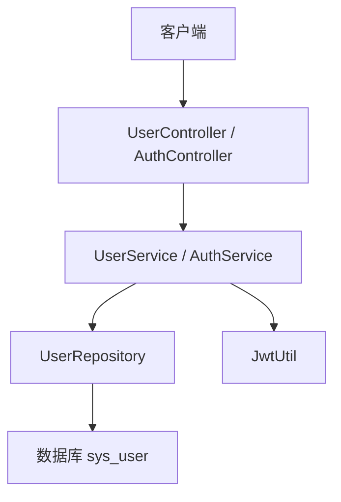
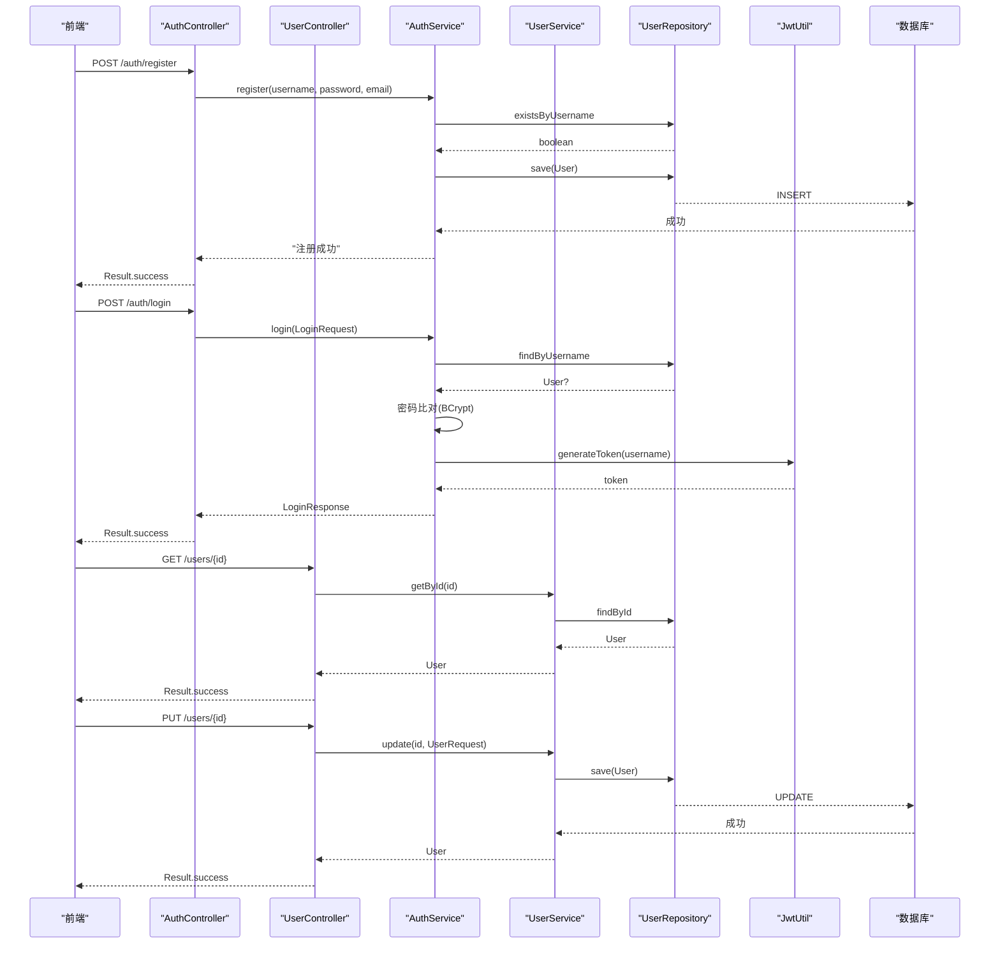
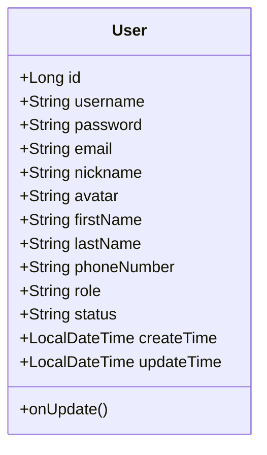
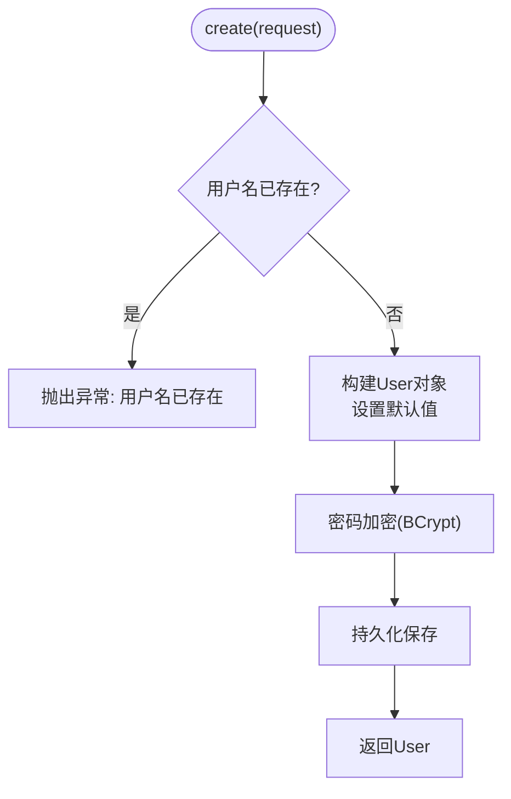
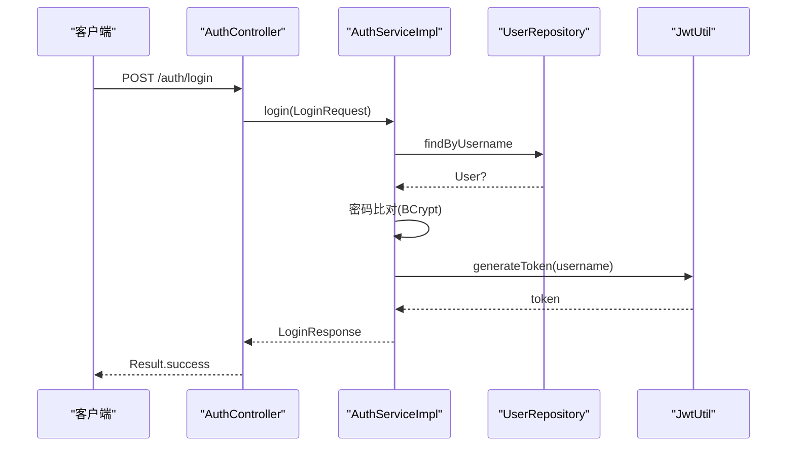
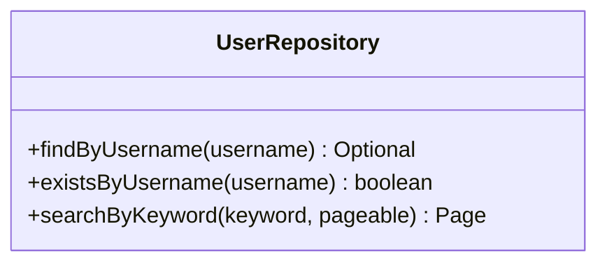
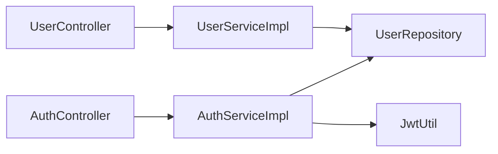

# 用户管理功能

<cite>
**本文引用的文件**
- [User.java](file://java_server/po/src/main/java/com/goodzheng/po/entity/User.java)
- [UserService.java](file://java_server/po/src/main/java/com/goodzheng/po/service/UserService.java)
- [UserServiceImpl.java](file://java_server/po/src/main/java/com/goodzheng/po/service/impl/UserServiceImpl.java)
- [UserRepository.java](file://java_server/po/src/main/java/com/goodzheng/po/repository/UserRepository.java)
- [UserController.java](file://java_server/po/src/main/java/com/goodzheng/po/controller/UserController.java)
- [AuthController.java](file://java_server/po/src/main/java/com/goodzheng/po/controller/AuthController.java)
- [AuthService.java](file://java_server/po/src/main/java/com/goodzheng/po/service/AuthService.java)
- [AuthServiceImpl.java](file://java_server/po/src/main/java/com/goodzheng/po/service/impl/AuthServiceImpl.java)
- [LoginRequest.java](file://java_server/po/src/main/java/com/goodzheng/po/dto/LoginRequest.java)
- [LoginResponse.java](file://java_server/po/src/main/java/com/goodzheng/po/dto/LoginResponse.java)
- [UserRequest.java](file://java_server/po/src/main/java/com/goodzheng/po/dto/UserRequest.java)
- [JwtUtil.java](file://java_server/po/src/main/java/com/goodzheng/po/util/JwtUtil.java)
</cite>

## 目录
1. [简介](#简介)
2. [项目结构](#项目结构)
3. [核心组件](#核心组件)
4. [架构总览](#架构总览)
5. [详细组件分析](#详细组件分析)
6. [依赖关系分析](#依赖关系分析)
7. [性能与优化](#性能与优化)
8. [故障排查指南](#故障排查指南)
9. [结论](#结论)
10. [附录：API 参考与最佳实践](#附录api-参考与最佳实践)

## 简介
本文件围绕“用户管理”业务，系统梳理注册、登录、信息更新等核心流程的实现。重点说明：
- UserService 服务层对用户数据的 CRUD 操作，包括数据校验、密码加密存储与持久化。
- User 实体类的设计模式、字段约束与业务规则。
- UserRepository 数据访问层的 JPA 查询实现与性能优化策略。
- 结合 Controller 与 DTO 的完整调用链路，提供可操作的代码示例路径与最佳实践建议。

## 项目结构
后端采用典型的分层架构：
- 控制器层（Controller）：接收 HTTP 请求，参数校验，统一响应封装。
- 服务层（Service）：业务编排、事务控制、安全处理（密码加密）。
- 数据访问层（Repository）：基于 Spring Data JPA 的查询与持久化。
- 实体与 DTO：领域模型与数据传输对象，承载数据约束与序列化控制。
- 工具类：JWT 令牌生成与解析。

图表来源
- [UserController.java:19-133](file://java_server/po/src/main/java/com/goodzheng/po/controller/UserController.java#L19-L133)
- [AuthController.java:11-41](file://java_server/po/src/main/java/com/goodzheng/po/controller/AuthController.java#L11-L41)
- [UserServiceImpl.java:16-106](file://java_server/po/src/main/java/com/goodzheng/po/service/impl/UserServiceImpl.java#L16-L106)
- [AuthServiceImpl.java:13-48](file://java_server/po/src/main/java/com/goodzheng/po/service/impl/AuthServiceImpl.java#L13-L48)
- [UserRepository.java:13-27](file://java_server/po/src/main/java/com/goodzheng/po/repository/UserRepository.java#L13-L27)
- [JwtUtil.java:13-56](file://java_server/po/src/main/java/com/goodzheng/po/util/JwtUtil.java#L13-L56)

章节来源
- [UserController.java:19-133](file://java_server/po/src/main/java/com/goodzheng/po/controller/UserController.java#L19-L133)
- [AuthController.java:11-41](file://java_server/po/src/main/java/com/goodzheng/po/controller/AuthController.java#L11-L41)

## 核心组件
- User 实体：定义用户主键、用户名、密码、邮箱、昵称、头像、姓名、电话、角色、状态、创建与更新时间等字段；通过注解进行唯一性与非空约束，并自动维护更新时间。
- UserService 接口与实现：提供分页列表、关键字搜索、按 ID 获取、创建、更新、删除、批量删除、批量状态更新等方法；在创建与更新时进行密码加密与默认值填充。
- UserRepository：继承 JpaRepository，提供按用户名查找、存在性检查、以及基于关键字的多字段模糊搜索分页查询。
- Auth 相关：AuthController 暴露登录与注册接口；AuthServiceImpl 完成注册时的唯一性校验与密码加密、登录时的密码比对与 JWT 签发。
- JwtUtil：负责根据配置生成、验证与解析 JWT 令牌。

章节来源
- [User.java:8-58](file://java_server/po/src/main/java/com/goodzheng/po/entity/User.java#L8-L58)
- [UserService.java:10-27](file://java_server/po/src/main/java/com/goodzheng/po/service/UserService.java#L10-L27)
- [UserServiceImpl.java:16-106](file://java_server/po/src/main/java/com/goodzheng/po/service/impl/UserServiceImpl.java#L16-L106)
- [UserRepository.java:13-27](file://java_server/po/src/main/java/com/goodzheng/po/repository/UserRepository.java#L13-L27)
- [AuthController.java:11-41](file://java_server/po/src/main/java/com/goodzheng/po/controller/AuthController.java#L11-L41)
- [AuthServiceImpl.java:13-48](file://java_server/po/src/main/java/com/goodzheng/po/service/impl/AuthServiceImpl.java#L13-L48)
- [JwtUtil.java:13-56](file://java_server/po/src/main/java/com/goodzheng/po/util/JwtUtil.java#L13-L56)

## 架构总览
下图展示从前端到数据库的端到端调用链，涵盖注册、登录、用户信息查询与更新。

图表来源
- [AuthController.java:19-39](file://java_server/po/src/main/java/com/goodzheng/po/controller/AuthController.java#L19-L39)
- [AuthServiceImpl.java:21-46](file://java_server/po/src/main/java/com/goodzheng/po/service/impl/AuthServiceImpl.java#L21-L46)
- [UserController.java:45-85](file://java_server/po/src/main/java/com/goodzheng/po/controller/UserController.java#L45-L85)
- [UserServiceImpl.java:35-81](file://java_server/po/src/main/java/com/goodzheng/po/service/impl/UserServiceImpl.java#L35-L81)
- [UserRepository.java:13-27](file://java_server/po/src/main/java/com/goodzheng/po/repository/UserRepository.java#L13-L27)
- [JwtUtil.java:25-33](file://java_server/po/src/main/java/com/goodzheng/po/util/JwtUtil.java#L25-L33)

## 详细组件分析

### 用户实体 User 设计
- 标识与约束
  - 主键 id：自增 Long。
  - 用户名 username：非空、唯一、长度限制。
  - 密码 password：非空，JSON 序列化忽略。
  - 其他可选字段：email、nickname、avatar、firstName、lastName、phoneNumber。
  - 角色 role：默认 admin。
  - 状态 status：默认 active，用于账户生命周期管理。
  - 时间戳：createTime 不可更新，updateTime 自动更新。
- 业务规则
  - 用户名全局唯一。
  - 密码以密文形式存储，不对外暴露。
  - 更新时间由框架钩子自动维护。

图表来源
- [User.java:8-58](file://java_server/po/src/main/java/com/goodzheng/po/entity/User.java#L8-L58)

章节来源
- [User.java:8-58](file://java_server/po/src/main/java/com/goodzheng/po/entity/User.java#L8-L58)

### 用户服务层 UserServiceImpl
- 读取操作
  - list：分页查询所有用户。
  - search：按关键字在多字段上进行模糊匹配的分页查询。
  - getById：按 ID 获取用户，不存在抛异常。
- 写入操作
  - create：校验用户名唯一性，设置默认值（如昵称、角色、状态），对密码进行 BCrypt 加密后保存。
  - update：仅更新非空字段，username 不允许修改；若传入新密码则加密覆盖。
  - delete/batchDelete：单删与批量删除。
  - batchUpdateStatus：批量更新用户状态。
- 事务与只读
  - 读取方法标注只读事务，提升并发性能与安全性。
  - 写操作方法标注事务，保证一致性。

图表来源
- [UserServiceImpl.java:42-61](file://java_server/po/src/main/java/com/goodzheng/po/service/impl/UserServiceImpl.java#L42-L61)

章节来源
- [UserServiceImpl.java:23-106](file://java_server/po/src/main/java/com/goodzheng/po/service/impl/UserServiceImpl.java#L23-L106)

### 认证服务层 AuthServiceImpl
- 注册
  - 校验用户名唯一性。
  - 构造用户对象，密码加密后保存。
- 登录
  - 按用户名查找用户。
  - 使用 BCrypt 比对明文密码与密文。
  - 生成 JWT 令牌，返回包含用户基本信息与令牌的响应。

图表来源
- [AuthController.java:19-27](file://java_server/po/src/main/java/com/goodzheng/po/controller/AuthController.java#L19-L27)
- [AuthServiceImpl.java:35-46](file://java_server/po/src/main/java/com/goodzheng/po/service/impl/AuthServiceImpl.java#L35-L46)
- [JwtUtil.java:25-33](file://java_server/po/src/main/java/com/goodzheng/po/util/JwtUtil.java#L25-L33)

章节来源
- [AuthServiceImpl.java:21-46](file://java_server/po/src/main/java/com/goodzheng/po/service/impl/AuthServiceImpl.java#L21-L46)

### 数据访问层 UserRepository
- 内置方法
  - findByUsername：按用户名精确查找。
  - existsByUsername：用户名存在性检查。
- 自定义查询
  - searchByKeyword：对 username、email、firstName、lastName 进行大小写不敏感的多字段模糊匹配，支持分页。
- 性能要点
  - 使用 LIKE 配合 LOWER 函数实现跨字段模糊搜索。
  - 分页查询避免全表扫描。

图表来源
- [UserRepository.java:13-27](file://java_server/po/src/main/java/com/goodzheng/po/repository/UserRepository.java#L13-L27)

章节来源
- [UserRepository.java:13-27](file://java_server/po/src/main/java/com/goodzheng/po/repository/UserRepository.java#L13-L27)

### 控制器层与 DTO
- UserController
  - 提供用户列表、详情、当前用户信息、创建、更新、删除、批量删除、批量状态更新等 REST 接口。
  - 统一使用 Result 封装响应，捕获运行时异常并返回错误码与消息。
  - 通过 Authorization 头中的 Bearer Token 解析当前用户 ID。
- AuthController
  - 提供登录与注册接口，委托 AuthService 处理业务。
- DTO
  - UserRequest：用户创建/更新的数据载体，包含必填校验。
  - LoginRequest：登录请求体，包含用户名与密码的必填校验。
  - LoginResponse：登录响应体，包含用户标识、令牌与基本信息。

章节来源
- [UserController.java:19-133](file://java_server/po/src/main/java/com/goodzheng/po/controller/UserController.java#L19-L133)
- [AuthController.java:11-41](file://java_server/po/src/main/java/com/goodzheng/po/controller/AuthController.java#L11-L41)
- [UserRequest.java:6-29](file://java_server/po/src/main/java/com/goodzheng/po/dto/UserRequest.java#L6-L29)
- [LoginRequest.java:6-14](file://java_server/po/src/main/java/com/goodzheng/po/dto/LoginRequest.java#L6-L14)
- [LoginResponse.java:6-14](file://java_server/po/src/main/java/com/goodzheng/po/dto/LoginResponse.java#L6-L14)

## 依赖关系分析
- 控制器依赖服务层，服务层依赖数据访问层与工具类。
- 认证流程中，AuthService 依赖 UserRepository 与 JwtUtil。
- 用户管理流程中，UserService 依赖 UserRepository 与密码编码器。

图表来源
- [UserController.java:19-133](file://java_server/po/src/main/java/com/goodzheng/po/controller/UserController.java#L19-L133)
- [AuthController.java:11-41](file://java_server/po/src/main/java/com/goodzheng/po/controller/AuthController.java#L11-L41)
- [UserServiceImpl.java:16-106](file://java_server/po/src/main/java/com/goodzheng/po/service/impl/UserServiceImpl.java#L16-L106)
- [AuthServiceImpl.java:13-48](file://java_server/po/src/main/java/com/goodzheng/po/service/impl/AuthServiceImpl.java#L13-L48)
- [UserRepository.java:13-27](file://java_server/po/src/main/java/com/goodzheng/po/repository/UserRepository.java#L13-L27)
- [JwtUtil.java:13-56](file://java_server/po/src/main/java/com/goodzheng/po/util/JwtUtil.java#L13-L56)

章节来源
- [UserServiceImpl.java:16-106](file://java_server/po/src/main/java/com/goodzheng/po/service/impl/UserServiceImpl.java#L16-L106)
- [AuthServiceImpl.java:13-48](file://java_server/po/src/main/java/com/goodzheng/po/service/impl/AuthServiceImpl.java#L13-L48)

## 性能与优化
- 分页与排序
  - 列表与搜索均使用分页，避免一次性加载大量数据。
  - 列表默认按创建时间倒序，便于查看最新用户。
- 模糊搜索
  - 多字段 LIKE 查询需关注索引；建议在常用搜索字段建立合适索引以提升性能。
- 事务边界
  - 读操作使用只读事务，减少锁竞争。
  - 写操作使用事务，确保一致性。
- 密码加密
  - 使用 BCrypt 进行哈希存储，兼顾安全性与兼容性。
- 批量操作
  - 批量删除与批量状态更新减少往返次数，提高吞吐。

[本节为通用性能建议，不直接分析具体文件]

## 故障排查指南
- 用户名已存在
  - 注册或创建用户时，若用户名重复将抛出异常。请检查输入或清理冲突数据。
- 用户不存在
  - 获取详情或删除时，若 ID 不存在会抛出异常。请确认 ID 有效性。
- 用户名或密码错误
  - 登录失败时，可能是用户名错误或密码不匹配。请核对凭据。
- 权限与令牌
  - 获取当前用户信息需要有效的 Authorization 头；令牌无效或过期会导致鉴权失败。

章节来源
- [UserServiceImpl.java:42-90](file://java_server/po/src/main/java/com/goodzheng/po/service/impl/UserServiceImpl.java#L42-L90)
- [AuthServiceImpl.java:21-46](file://java_server/po/src/main/java/com/goodzheng/po/service/impl/AuthServiceImpl.java#L21-L46)
- [UserController.java:45-133](file://java_server/po/src/main/java/com/goodzheng/po/controller/UserController.java#L45-L133)

## 结论
本项目实现了完整的用户管理与认证能力：
- 通过 UserService 提供稳健的 CRUD 与批量操作，并在关键路径上应用事务与只读优化。
- 通过 BCrypt 保障密码安全存储与比对。
- 通过 JPA Repository 提供高效的分页与模糊搜索。
- 通过 Auth 模块实现注册与登录，并以 JWT 作为无状态鉴权方案。
整体设计清晰、职责分明，具备良好的可扩展性与可维护性。

[本节为总结性内容，不直接分析具体文件]

## 附录：API 参考与最佳实践

### API 概览
- 认证
  - POST /auth/register：注册新用户
  - POST /auth/login：登录获取令牌
- 用户管理
  - GET /users：分页列表（支持 keyword）
  - GET /users/{id}：用户详情
  - GET /users/me：当前用户信息（需 Authorization）
  - POST /users：创建用户
  - PUT /users/{id}：更新用户
  - DELETE /users/{id}：删除用户
  - DELETE /users/batch：批量删除
  - PUT /users/batch/status：批量更新状态

章节来源
- [AuthController.java:19-39](file://java_server/po/src/main/java/com/goodzheng/po/controller/AuthController.java#L19-L39)
- [UserController.java:29-122](file://java_server/po/src/main/java/com/goodzheng/po/controller/UserController.java#L29-L122)

### 数据模型与约束
- UserRequest
  - 必填：用户名
  - 可选：密码、邮箱、姓名、电话、角色、状态、昵称、头像
- LoginRequest
  - 必填：用户名、密码
- LoginResponse
  - 返回：用户 ID、令牌、用户名、昵称

章节来源
- [UserRequest.java:6-29](file://java_server/po/src/main/java/com/goodzheng/po/dto/UserRequest.java#L6-L29)
- [LoginRequest.java:6-14](file://java_server/po/src/main/java/com/goodzheng/po/dto/LoginRequest.java#L6-L14)
- [LoginResponse.java:6-14](file://java_server/po/src/main/java/com/goodzheng/po/dto/LoginResponse.java#L6-L14)

### 业务流程示例（以路径引用代替代码片段）
- 用户注册
  - 入口：POST /auth/register
  - 逻辑：唯一性校验 -> 密码加密 -> 持久化
  - 参考路径：[注册流程:21-33](file://java_server/po/src/main/java/com/goodzheng/po/service/impl/AuthServiceImpl.java#L21-L33)
- 用户登录
  - 入口：POST /auth/login
  - 逻辑：按用户名查找 -> 密码比对 -> 生成 JWT
  - 参考路径：[登录流程:35-46](file://java_server/po/src/main/java/com/goodzheng/po/service/impl/AuthServiceImpl.java#L35-L46)
- 创建用户
  - 入口：POST /users
  - 逻辑：唯一性校验 -> 默认值填充 -> 密码加密 -> 持久化
  - 参考路径：[创建用户:42-61](file://java_server/po/src/main/java/com/goodzheng/po/service/impl/UserServiceImpl.java#L42-L61)
- 更新用户
  - 入口：PUT /users/{id}
  - 逻辑：非空字段覆盖 -> 可选密码加密覆盖 -> 持久化
  - 参考路径：[更新用户:63-81](file://java_server/po/src/main/java/com/goodzheng/po/service/impl/UserServiceImpl.java#L63-L81)
- 获取当前用户
  - 入口：GET /users/me
  - 逻辑：解析 Authorization 中的 Bearer Token -> 获取用户 ID -> 查询详情
  - 参考路径：[当前用户:55-64](file://java_server/po/src/main/java/com/goodzheng/po/controller/UserController.java#L55-L64)

### 最佳实践
- 输入校验
  - 使用 DTO 的校验注解在前端与后端双重校验，减少非法输入进入服务层。
- 密码安全
  - 始终使用 BCrypt 存储与比对密码，不在日志中输出敏感信息。
- 事务与只读
  - 读操作使用只读事务，写操作使用事务，明确边界。
- 分页与搜索
  - 列表与搜索必须分页；模糊搜索字段考虑建立索引。
- 错误处理
  - 控制器统一捕获异常并返回结构化错误响应，便于前端处理。
- 鉴权
  - 受保护接口需校验 Authorization 头中的有效令牌，避免越权访问。

[本节为通用最佳实践，不直接分析具体文件]