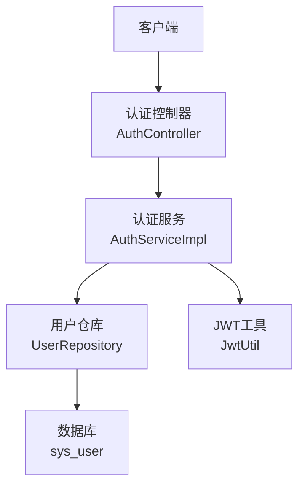
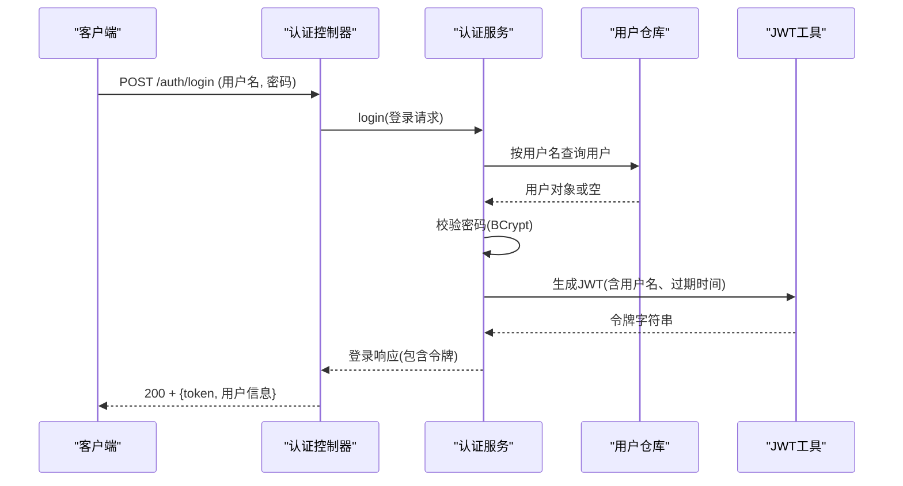
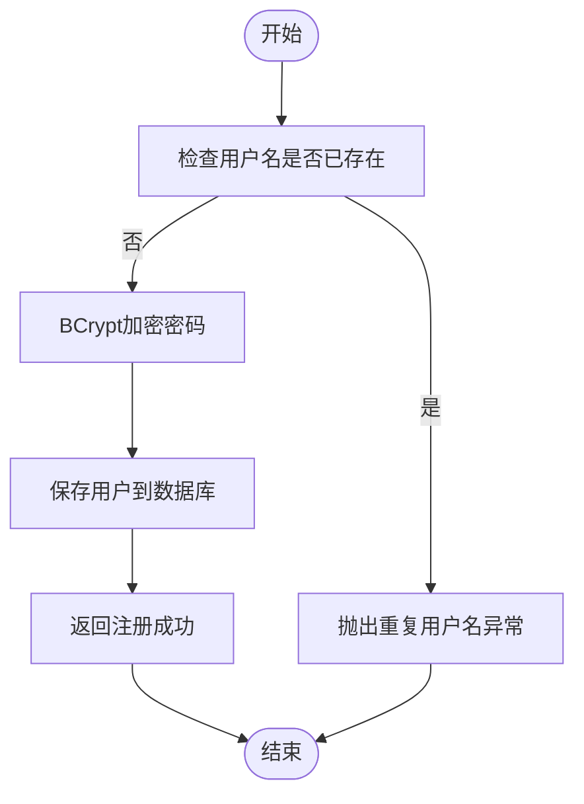
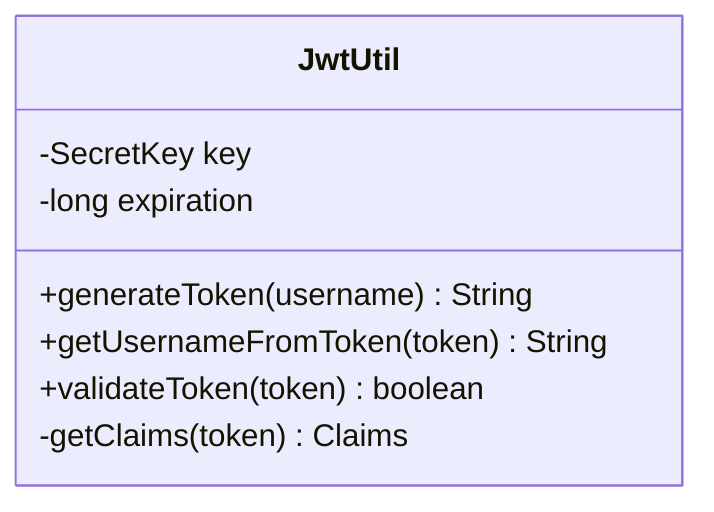
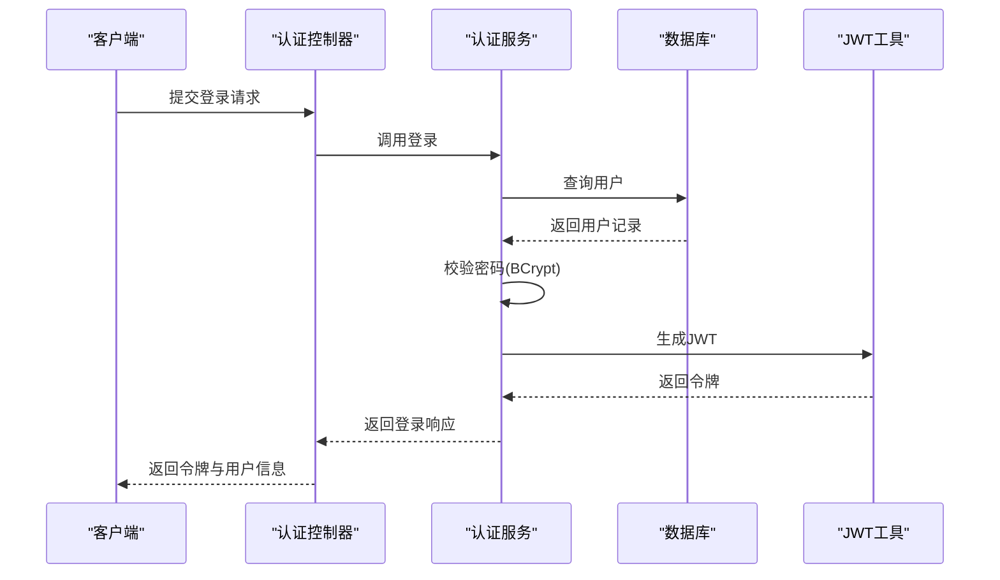

# 用户认证模块

<cite>
**本文引用的文件**
- [AuthController.java](file://java_server/po/src/main/java/com/goodzheng/po/controller/AuthController.java)
- [AuthServiceImpl.java](file://java_server/po/src/main/java/com/goodzheng/po/service/impl/AuthServiceImpl.java)
- [AuthService.java](file://java_server/po/src/main/java/com/goodzheng/po/service/AuthService.java)
- [JwtUtil.java](file://java_server/po/src/main/java/com/goodzheng/po/util/JwtUtil.java)
- [User.java](file://java_server/po/src/main/java/com/goodzheng/po/entity/User.java)
- [LoginRequest.java](file://java_server/po/src/main/java/com/goodzheng/po/dto/LoginRequest.java)
- [LoginResponse.java](file://java_server/po/src/main/java/com/goodzheng/po/dto/LoginResponse.java)
</cite>

## 目录
1. [简介](#简介)
2. [项目结构](#项目结构)
3. [核心组件](#核心组件)
4. [架构总览](#架构总览)
5. [详细组件分析](#详细组件分析)
6. [依赖关系分析](#依赖关系分析)
7. [性能与安全考量](#性能与安全考量)
8. [故障排查指南](#故障排查指南)
9. [结论](#结论)
10. [附录：API调用示例与流程图](#附录api调用示例与流程图)

## 简介
本文件为用户认证模块的安全架构文档，聚焦于基于JWT的令牌认证机制、用户注册与登录流程、密码加密存储策略、以及权限控制（RBAC）的设计与实现建议。文档同时提供完整的认证流程图与API调用示例，帮助读者理解并落地安全的用户认证与授权方案。

## 项目结构
认证相关代码集中在后端Java服务中，采用分层架构：
- 控制器层：对外暴露认证接口（登录、注册）
- 服务层：封装业务逻辑（校验、密码处理、令牌签发）
- 工具层：JWT生成与验证
- 数据模型：用户实体、请求/响应DTO
- 持久化：通过Repository访问数据库（由Spring Data JPA驱动）



图表来源
- [AuthController.java:11-39](file://java_server/po/src/main/java/com/goodzheng/po/controller/AuthController.java#L11-L39)
- [AuthServiceImpl.java:13-46](file://java_server/po/src/main/java/com/goodzheng/po/service/impl/AuthServiceImpl.java#L13-L46)
- [JwtUtil.java:13-54](file://java_server/po/src/main/java/com/goodzheng/po/util/JwtUtil.java#L13-L54)
- [User.java:8-58](file://java_server/po/src/main/java/com/goodzheng/po/entity/User.java#L8-L58)

章节来源
- [AuthController.java:11-39](file://java_server/po/src/main/java/com/goodzheng/po/controller/AuthController.java#L11-L39)
- [AuthServiceImpl.java:13-46](file://java_server/po/src/main/java/com/goodzheng/po/service/impl/AuthServiceImpl.java#L13-L46)
- [JwtUtil.java:13-54](file://java_server/po/src/main/java/com/goodzheng/po/util/JwtUtil.java#L13-L54)
- [User.java:8-58](file://java_server/po/src/main/java/com/goodzheng/po/entity/User.java#L8-L58)

## 核心组件
- 认证控制器：提供登录与注册接口，统一返回结果包装
- 认证服务：实现注册校验、密码比对、令牌签发
- JWT工具：负责令牌的生成、解析与校验
- 用户实体：定义用户信息、角色、状态等字段
- DTO：登录请求与响应结构

章节来源
- [AuthController.java:11-39](file://java_server/po/src/main/java/com/goodzheng/po/controller/AuthController.java#L11-L39)
- [AuthService.java:6-11](file://java_server/po/src/main/java/com/goodzheng/po/service/AuthService.java#L6-L11)
- [AuthServiceImpl.java:13-46](file://java_server/po/src/main/java/com/goodzheng/po/service/impl/AuthServiceImpl.java#L13-L46)
- [JwtUtil.java:13-54](file://java_server/po/src/main/java/com/goodzheng/po/util/JwtUtil.java#L13-L54)
- [User.java:8-58](file://java_server/po/src/main/java/com/goodzheng/po/entity/User.java#L8-L58)
- [LoginRequest.java:6-14](file://java_server/po/src/main/java/com/goodzheng/po/dto/LoginRequest.java#L6-L14)
- [LoginResponse.java:6-14](file://java_server/po/src/main/java/com/goodzheng/po/dto/LoginResponse.java#L6-L14)

## 架构总览
认证流程采用“无状态”的JWT模式：
- 注册：校验唯一性 -> 密码加密 -> 落库
- 登录：校验凭据 -> 签发JWT -> 返回令牌
- 鉴权：后续请求携带令牌，服务端解析并验证



图表来源
- [AuthController.java:19-27](file://java_server/po/src/main/java/com/goodzheng/po/controller/AuthController.java#L19-L27)
- [AuthServiceImpl.java:35-46](file://java_server/po/src/main/java/com/goodzheng/po/service/impl/AuthServiceImpl.java#L35-L46)
- [JwtUtil.java:25-33](file://java_server/po/src/main/java/com/goodzheng/po/util/JwtUtil.java#L25-L33)

## 详细组件分析

### 认证控制器（AuthController）
- 职责：接收登录/注册请求，参数校验，调用服务层，统一返回Result包装
- 关键点：
  - 登录接口使用@Valid进行入参校验
  - 异常捕获后返回统一错误码与消息
  - 跨域配置允许前端调用

章节来源
- [AuthController.java:11-39](file://java_server/po/src/main/java/com/goodzheng/po/controller/AuthController.java#L11-L39)

### 认证服务（AuthServiceImpl）
- 职责：注册与登录的核心业务逻辑
- 注册流程：
  - 检查用户名唯一性
  - 使用BCrypt对密码进行加密存储
  - 保存用户并返回成功提示
- 登录流程：
  - 根据用户名获取用户
  - 使用BCrypt比对明文密码与密文
  - 校验通过后签发JWT并组装响应



图表来源
- [AuthServiceImpl.java:21-33](file://java_server/po/src/main/java/com/goodzheng/po/service/impl/AuthServiceImpl.java#L21-L33)

章节来源
- [AuthServiceImpl.java:21-46](file://java_server/po/src/main/java/com/goodzheng/po/service/impl/AuthServiceImpl.java#L21-L46)

### JWT工具（JwtUtil）
- 职责：生成、解析、校验JWT
- 要点：
  - 密钥从配置项读取并进行Base64解码
  - 签发时设置主题（用户名）、签发时间、过期时间
  - 校验时通过签名验证与解析Claims，异常即视为无效



图表来源
- [JwtUtil.java:13-54](file://java_server/po/src/main/java/com/goodzheng/po/util/JwtUtil.java#L13-L54)

章节来源
- [JwtUtil.java:13-54](file://java_server/po/src/main/java/com/goodzheng/po/util/JwtUtil.java#L13-L54)

### 用户实体（User）
- 关键字段：
  - username：唯一用户名
  - password：加密后的密码（忽略序列化）
  - role：默认角色为admin
  - status：账户状态（active/inactive/invited/suspended）
  - createTime/updateTime：审计时间戳

章节来源
- [User.java:8-58](file://java_server/po/src/main/java/com/goodzheng/po/entity/User.java#L8-L58)

### DTO（LoginRequest / LoginResponse）
- LoginRequest：包含用户名与密码，使用注解进行非空校验
- LoginResponse：包含用户ID、令牌、用户名、昵称

章节来源
- [LoginRequest.java:6-14](file://java_server/po/src/main/java/com/goodzheng/po/dto/LoginRequest.java#L6-L14)
- [LoginResponse.java:6-14](file://java_server/po/src/main/java/com/goodzheng/po/dto/LoginResponse.java#L6-L14)

## 依赖关系分析
- 控制器依赖服务接口，便于替换实现
- 服务依赖仓库与JWT工具，解耦了安全与业务
- 实体与DTO清晰分离，避免敏感字段泄露
- 通过Spring Security的BCrypt进行密码哈希，降低安全风险

```mermaid
graph LR
AuthController --> AuthServiceImpl
AuthServiceImpl --> UserRepository
AuthServiceImpl --> JwtUtil
User <..> UserRepository
```

图表来源
- [AuthController.java:11-39](file://java_server/po/src/main/java/com/goodzheng/po/controller/AuthController.java#L11-L39)
- [AuthServiceImpl.java:13-46](file://java_server/po/src/main/java/com/goodzheng/po/service/impl/AuthServiceImpl.java#L13-L46)
- [User.java:8-58](file://java_server/po/src/main/java/com/goodzheng/po/entity/User.java#L8-L58)

章节来源
- [AuthController.java:11-39](file://java_server/po/src/main/java/com/goodzheng/po/controller/AuthController.java#L11-L39)
- [AuthServiceImpl.java:13-46](file://java_server/po/src/main/java/com/goodzheng/po/service/impl/AuthServiceImpl.java#L13-L46)

## 性能与安全考量
- 密码加密：使用BCrypt，具备盐值与自适应成本，抗彩虹表与暴力破解
- 令牌安全：
  - 仅包含必要声明（如用户名），减少泄露面
  - 设置合理过期时间，配合刷新策略降低重放风险
  - 传输层强制HTTPS，防止中间人攻击
- 输入校验：使用JSR-303注解进行基础校验，结合服务端二次校验
- 错误信息：统一错误码与消息，避免泄露内部细节
- 扩展建议：
  - 增加IP白名单、设备指纹、验证码等风控措施
  - 引入令牌黑名单或短期短命令牌+刷新令牌机制
  - 对敏感操作增加二次确认

[本节为通用指导，不直接分析具体文件]

## 故障排查指南
- 登录失败：
  - 检查用户名是否存在、密码是否正确（BCrypt匹配）
  - 查看统一异常返回的错误码与消息
- 注册失败：
  - 用户名冲突会抛出异常，需确保唯一性
- 令牌问题：
  - 校验失败通常由签名错误或过期引起
  - 检查配置中的密钥与过期时间

章节来源
- [AuthController.java:19-39](file://java_server/po/src/main/java/com/goodzheng/po/controller/AuthController.java#L19-L39)
- [AuthServiceImpl.java:21-46](file://java_server/po/src/main/java/com/goodzheng/po/service/impl/AuthServiceImpl.java#L21-L46)
- [JwtUtil.java:25-54](file://java_server/po/src/main/java/com/goodzheng/po/util/JwtUtil.java#L25-L54)

## 结论
该认证模块以JWT为核心，实现了简洁高效的无状态认证。通过BCrypt保障密码安全，统一的控制器与服务层设计提升了可维护性与可扩展性。建议在现有基础上补充拦截器/过滤器以实现细粒度权限控制（RBAC），并引入刷新令牌与风控策略，进一步提升安全性与用户体验。

[本节为总结性内容，不直接分析具体文件]

## 附录：API调用示例与流程图

### API定义
- 登录
  - 方法：POST
  - 路径：/auth/login
  - 请求体：{username, password}
  - 响应：统一Result包装，包含token与用户信息
- 注册
  - 方法：POST
  - 路径：/auth/register
  - 参数：username, password, email（可选）
  - 响应：统一Result包装，包含成功消息

章节来源
- [AuthController.java:19-39](file://java_server/po/src/main/java/com/goodzheng/po/controller/AuthController.java#L19-L39)
- [LoginRequest.java:6-14](file://java_server/po/src/main/java/com/goodzheng/po/dto/LoginRequest.java#L6-L14)
- [LoginResponse.java:6-14](file://java_server/po/src/main/java/com/goodzheng/po/dto/LoginResponse.java#L6-L14)

### 完整认证流程图（登录）


图表来源
- [AuthController.java:19-27](file://java_server/po/src/main/java/com/goodzheng/po/controller/AuthController.java#L19-L27)
- [AuthServiceImpl.java:35-46](file://java_server/po/src/main/java/com/goodzheng/po/service/impl/AuthServiceImpl.java#L35-L46)
- [JwtUtil.java:25-33](file://java_server/po/src/main/java/com/goodzheng/po/util/JwtUtil.java#L25-L33)

### 基于角色的访问控制（RBAC）实现建议
- 在JWT中嵌入角色信息（例如roles数组），或在服务端缓存用户角色映射
- 使用拦截器/过滤器在请求进入控制器前：
  - 解析并校验JWT
  - 提取用户身份与角色
  - 根据资源所需权限进行授权判断
- 在控制器或方法上使用注解标注所需角色，由拦截器统一处理
- 未通过校验的请求返回401/403，并通过统一错误格式返回

[本节为概念性说明，不直接分析具体文件]