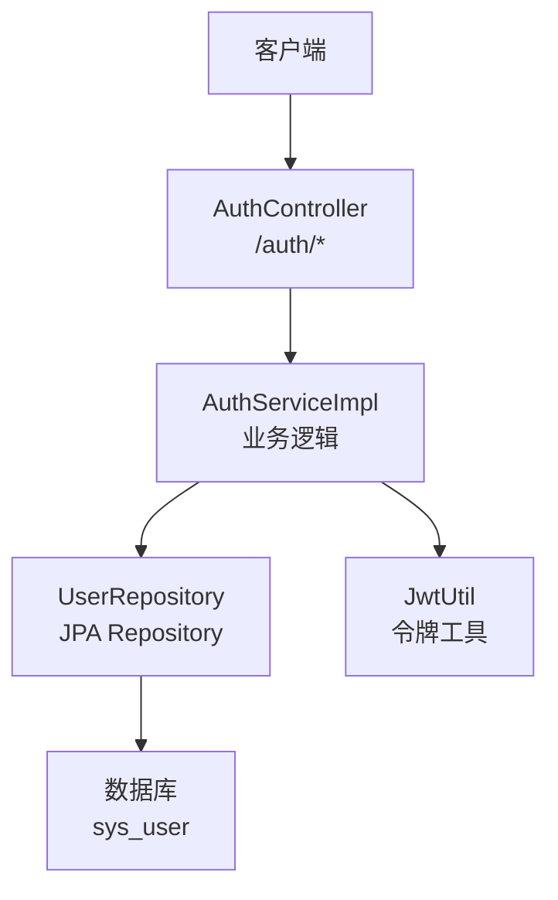
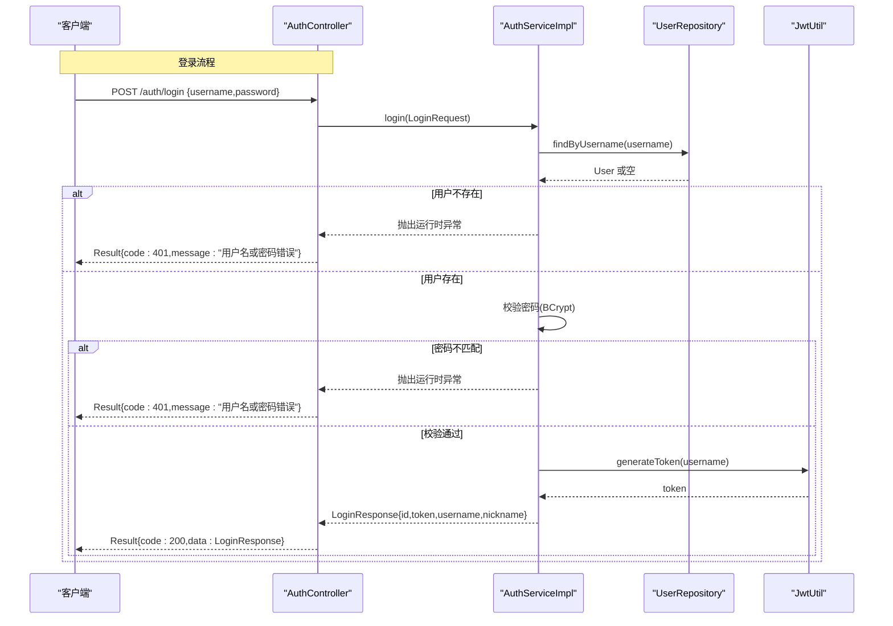
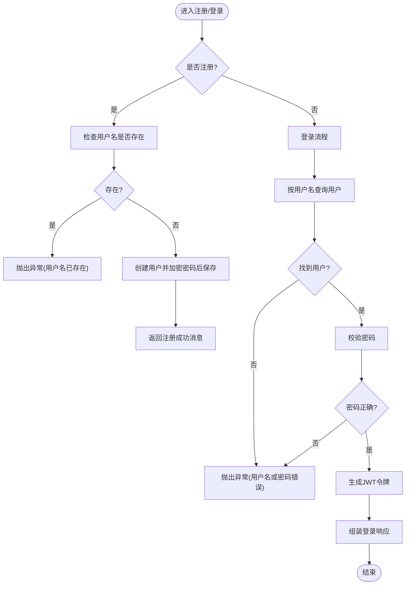
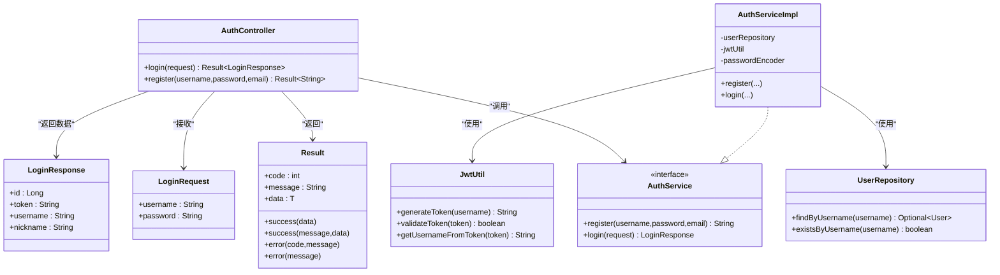

# 认证控制器接口

<cite>
**本文引用的文件**
- [AuthController.java](file://java_server/po/src/main/java/com/goodzheng/po/controller/AuthController.java)
- [AuthService.java](file://java_server/po/src/main/java/com/goodzheng/po/service/AuthService.java)
- [AuthServiceImpl.java](file://java_server/po/src/main/java/com/goodzheng/po/service/impl/AuthServiceImpl.java)
- [Result.java](file://java_server/po/src/main/java/com/goodzheng/po/dto/Result.java)
- [LoginRequest.java](file://java_server/po/src/main/java/com/goodzheng/po/dto/LoginRequest.java)
- [LoginResponse.java](file://java_server/po/src/main/java/com/goodzheng/po/dto/LoginResponse.java)
- [UserRequest.java](file://java_server/po/src/main/java/com/goodzheng/po/dto/UserRequest.java)
- [User.java](file://java_server/po/src/main/java/com/goodzheng/po/entity/User.java)
- [UserRepository.java](file://java_server/po/src/main/java/com/goodzheng/po/repository/UserRepository.java)
- [JwtUtil.java](file://java_server/po/src/main/java/com/goodzheng/po/util/JwtUtil.java)
</cite>

## 目录
1. [简介](#简介)
2. [项目结构](#项目结构)
3. [核心组件](#核心组件)
4. [架构总览](#架构总览)
5. [详细组件分析](#详细组件分析)
6. [依赖关系分析](#依赖关系分析)
7. [性能与安全性考虑](#性能与安全性考虑)
8. [故障排查指南](#故障排查指南)
9. [结论](#结论)
10. [附录：API 参考](#附录api-参考)

## 简介
本章节面向集成方，提供认证相关接口的完整说明，覆盖登录(/auth/login)与注册(/auth/register)的请求参数、响应格式、错误处理机制，以及服务层业务逻辑（用户凭证校验、权限相关字段、异常处理）。同时解释统一响应体 Result 的设计模式与使用方式，并提供 HTTP 请求示例、JSON 数据格式和错误码说明，帮助开发者正确对接认证功能。

## 项目结构
认证能力由以下层次组成：
- 控制器层：对外暴露 REST 接口，负责参数接收与结果封装
- 服务层：实现认证业务逻辑（注册、登录、密码加密、令牌生成）
- 数据访问层：用户实体与仓库查询
- 工具层：JWT 令牌生成与校验
- DTO/Entity：请求/响应模型与数据库映射

图表来源
- [AuthController.java:11-39](file://java_server/po/src/main/java/com/goodzheng/po/controller/AuthController.java#L11-L39)
- [AuthServiceImpl.java:13-46](file://java_server/po/src/main/java/com/goodzheng/po/service/impl/AuthServiceImpl.java#L13-L46)
- [UserRepository.java:13-25](file://java_server/po/src/main/java/com/goodzheng/po/repository/UserRepository.java#L13-L25)
- [JwtUtil.java:13-54](file://java_server/po/src/main/java/com/goodzheng/po/util/JwtUtil.java#L13-L54)

章节来源
- [AuthController.java:11-39](file://java_server/po/src/main/java/com/goodzheng/po/controller/AuthController.java#L11-L39)
- [AuthServiceImpl.java:13-46](file://java_server/po/src/main/java/com/goodzheng/po/service/impl/AuthServiceImpl.java#L13-L46)
- [UserRepository.java:13-25](file://java_server/po/src/main/java/com/goodzheng/po/repository/UserRepository.java#L13-L25)
- [JwtUtil.java:13-54](file://java_server/po/src/main/java/com/goodzheng/po/util/JwtUtil.java#L13-L54)

## 核心组件
- AuthController：定义 /auth/login 与 /auth/register 两个接口，统一返回 Result<T>
- AuthServiceImpl：实现注册与登录流程，包含用户名唯一性检查、密码 BCrypt 加密、JWT 签发
- Result：统一响应包装，包含 code、message、data
- LoginRequest/LoginResponse：登录请求与响应数据结构
- User/UserRepository：用户实体与数据访问
- JwtUtil：基于配置的密钥与过期时间生成/校验 JWT

章节来源
- [AuthController.java:11-39](file://java_server/po/src/main/java/com/goodzheng/po/controller/AuthController.java#L11-L39)
- [AuthService.java:6-11](file://java_server/po/src/main/java/com/goodzheng/po/service/AuthService.java#L6-L11)
- [AuthServiceImpl.java:13-46](file://java_server/po/src/main/java/com/goodzheng/po/service/impl/AuthServiceImpl.java#L13-L46)
- [Result.java:7-30](file://java_server/po/src/main/java/com/goodzheng/po/dto/Result.java#L7-L30)
- [LoginRequest.java:6-14](file://java_server/po/src/main/java/com/goodzheng/po/dto/LoginRequest.java#L6-L14)
- [LoginResponse.java:6-14](file://java_server/po/src/main/java/com/goodzheng/po/dto/LoginResponse.java#L6-L14)
- [User.java:8-58](file://java_server/po/src/main/java/com/goodzheng/po/entity/User.java#L8-L58)
- [UserRepository.java:13-25](file://java_server/po/src/main/java/com/goodzheng/po/repository/UserRepository.java#L13-L25)
- [JwtUtil.java:13-54](file://java_server/po/src/main/java/com/goodzheng/po/util/JwtUtil.java#L13-L54)

## 架构总览
认证流程采用“控制器 -> 服务 -> 仓储/工具”的分层架构：
- 控制器仅做参数绑定、校验与结果封装
- 服务层集中处理业务规则（唯一性、密码校验、令牌生成）
- 仓储层负责持久化与查询
- 工具层提供无状态令牌能力

图表来源
- [AuthController.java:19-27](file://java_server/po/src/main/java/com/goodzheng/po/controller/AuthController.java#L19-L27)
- [AuthServiceImpl.java:21-46](file://java_server/po/src/main/java/com/goodzheng/po/service/impl/AuthServiceImpl.java#L21-L46)
- [UserRepository.java:16-16](file://java_server/po/src/main/java/com/goodzheng/po/repository/UserRepository.java#L16-L16)
- [JwtUtil.java:25-33](file://java_server/po/src/main/java/com/goodzheng/po/util/JwtUtil.java#L25-L33)

## 详细组件分析

### 控制器层：AuthController
- 路径与注解
  - 基础路径：/auth
  - 跨域：允许所有来源
- 接口列表
  - POST /auth/login：登录
  - POST /auth/register：注册
- 参数与校验
  - 登录：请求体为 LoginRequest，使用 @Valid 进行非空校验
  - 注册：表单参数 username、password、email（可选）
- 返回值
  - 统一使用 Result<T> 包装成功或失败信息
- 异常处理
  - 登录异常捕获并返回 401
  - 注册异常捕获并返回 400

章节来源
- [AuthController.java:11-39](file://java_server/po/src/main/java/com/goodzheng/po/controller/AuthController.java#L11-L39)

### 服务层：AuthService 与 AuthServiceImpl
- 职责
  - 注册：检查用户名唯一性，加密密码后保存用户
  - 登录：根据用户名查找用户，校验密码，生成 JWT 并组装响应
- 关键逻辑
  - 用户名唯一性：通过 UserRepository.existsByUsername 判断
  - 密码安全：使用 BCryptPasswordEncoder 进行哈希与比对
  - 令牌签发：调用 JwtUtil.generateToken 生成 JWT
- 异常策略
  - 用户名已存在：抛出运行时异常，控制器捕获返回 400
  - 用户名或密码错误：抛出运行时异常，控制器捕获返回 401

图表来源
- [AuthServiceImpl.java:21-46](file://java_server/po/src/main/java/com/goodzheng/po/service/impl/AuthServiceImpl.java#L21-L46)
- [UserRepository.java:16-18](file://java_server/po/src/main/java/com/goodzheng/po/repository/UserRepository.java#L16-L18)
- [JwtUtil.java:25-33](file://java_server/po/src/main/java/com/goodzheng/po/util/JwtUtil.java#L25-L33)

章节来源
- [AuthService.java:6-11](file://java_server/po/src/main/java/com/goodzheng/po/service/AuthService.java#L6-L11)
- [AuthServiceImpl.java:13-46](file://java_server/po/src/main/java/com/goodzheng/po/service/impl/AuthServiceImpl.java#L13-L46)

### 统一响应：Result
- 设计模式
  - 泛型 Result<T> 统一封装 code、message、data
  - 提供 success/error 静态工厂方法简化构造
- 常见用法
  - 成功：Result.success(data) 或 Result.success(message, data)
  - 失败：Result.error(code, message) 或 Result.error(message)
- 约定
  - code 表示业务状态码（如 200、400、401、500）
  - message 描述具体信息
  - data 承载业务数据或为空

章节来源
- [Result.java:7-30](file://java_server/po/src/main/java/com/goodzheng/po/dto/Result.java#L7-L30)

### 数据模型：LoginRequest / LoginResponse / User
- LoginRequest
  - 字段：username、password（均非空）
- LoginResponse
  - 字段：id、token、username、nickname
- User（实体）
  - 关键字段：id、username、password、email、nickname、role、status、createTime、updateTime
  - 约束：username 唯一；密码字段在序列化时忽略

章节来源
- [LoginRequest.java:6-14](file://java_server/po/src/main/java/com/goodzheng/po/dto/LoginRequest.java#L6-L14)
- [LoginResponse.java:6-14](file://java_server/po/src/main/java/com/goodzheng/po/dto/LoginResponse.java#L6-L14)
- [User.java:8-58](file://java_server/po/src/main/java/com/goodzheng/po/entity/User.java#L8-L58)

### 令牌工具：JwtUtil
- 配置项
  - jwt.secret：用于签名的密钥（Base64 解码）
  - jwt.expiration：令牌过期时长（毫秒）
- 能力
  - generateToken(username)：生成 JWT
  - validateToken(token)：校验令牌有效性
  - getUsernameFromToken(token)：解析用户名

章节来源
- [JwtUtil.java:13-54](file://java_server/po/src/main/java/com/goodzheng/po/util/JwtUtil.java#L13-L54)

## 依赖关系分析
- 控制器依赖服务接口，降低耦合度
- 服务实现依赖仓储与工具类，完成业务编排
- 仓储基于 JPA 抽象数据库操作
- 工具类无状态，便于横向扩展

图表来源
- [AuthController.java:11-39](file://java_server/po/src/main/java/com/goodzheng/po/controller/AuthController.java#L11-L39)
- [AuthService.java:6-11](file://java_server/po/src/main/java/com/goodzheng/po/service/AuthService.java#L6-L11)
- [AuthServiceImpl.java:13-46](file://java_server/po/src/main/java/com/goodzheng/po/service/impl/AuthServiceImpl.java#L13-L46)
- [UserRepository.java:13-25](file://java_server/po/src/main/java/com/goodzheng/po/repository/UserRepository.java#L13-L25)
- [JwtUtil.java:13-54](file://java_server/po/src/main/java/com/goodzheng/po/util/JwtUtil.java#L13-L54)
- [Result.java:7-30](file://java_server/po/src/main/java/com/goodzheng/po/dto/Result.java#L7-L30)
- [LoginRequest.java:6-14](file://java_server/po/src/main/java/com/goodzheng/po/dto/LoginRequest.java#L6-L14)
- [LoginResponse.java:6-14](file://java_server/po/src/main/java/com/goodzheng/po/dto/LoginResponse.java#L6-L14)

## 性能与安全性考虑
- 性能
  - 登录路径涉及一次数据库查询与一次 JWT 生成，整体开销较低
  - 建议对高频查询添加缓存（如 Redis）以降低数据库压力
- 安全性
  - 密码使用 BCrypt 哈希存储，避免明文泄露
  - JWT 签名使用强密钥，注意密钥管理与轮换
  - 建议启用 HTTPS 传输，防止中间人攻击
  - 可结合角色/权限字段（User.role）进行后续鉴权控制

[本节为通用指导，不直接分析具体文件]

## 故障排查指南
- 常见问题
  - 登录失败：检查用户名是否存在、密码是否正确；确认数据库连接正常
  - 注册失败：检查用户名是否重复；确认邮箱等字段是否符合预期
  - 令牌问题：检查 jwt.secret 与 jwt.expiration 配置是否正确
- 定位方法
  - 查看控制器捕获的异常信息与返回码
  - 在服务层日志中确认密码校验与令牌生成步骤
  - 使用 Postman/curl 复现请求，核对请求体与参数

章节来源
- [AuthController.java:19-39](file://java_server/po/src/main/java/com/goodzheng/po/controller/AuthController.java#L19-L39)
- [AuthServiceImpl.java:21-46](file://java_server/po/src/main/java/com/goodzheng/po/service/impl/AuthServiceImpl.java#L21-L46)
- [JwtUtil.java:19-54](file://java_server/po/src/main/java/com/goodzheng/po/util/JwtUtil.java#L19-L54)

## 结论
本项目提供了简洁清晰的认证接口与服务实现，采用分层设计与统一响应体，便于前后端协作与扩展。建议在生产环境完善密钥管理、HTTPS 部署与权限控制，以提升系统的安全性与可维护性。

[本节为总结，不直接分析具体文件]

## 附录：API 参考

### 通用响应体：Result
- 字段
  - code：整数，业务状态码
  - message：字符串，提示信息
  - data：任意类型，业务数据
- 常用状态码
  - 200：成功
  - 400：请求参数错误或业务校验失败
  - 401：认证失败（用户名或密码错误）
  - 500：服务器内部错误

章节来源
- [Result.java:7-30](file://java_server/po/src/main/java/com/goodzheng/po/dto/Result.java#L7-L30)

### 登录接口：POST /auth/login
- 请求头
  - Content-Type: application/json
- 请求体（LoginRequest）
  - username：字符串，必填
  - password：字符串，必填
- 成功响应（Result<LoginResponse>）
  - data 对象字段：
    - id：长整型，用户ID
    - token：字符串，JWT 令牌
    - username：字符串，用户名
    - nickname：字符串，昵称
- 失败响应
  - code=401，message 提示“用户名或密码错误”

HTTP 请求示例
- 请求
  - POST /auth/login
  - Body: {"username":"testuser","password":"yourpassword"}
- 成功响应
  - {
      "code": 200,
      "message": "success",
      "data": {
        "id": 1,
        "token": "eyJhbGciOiJIUzI1NiIsInR5cCI6IkpXVCJ9...",
        "username": "testuser",
        "nickname": "测试用户"
      }
    }
- 失败响应
  - {
      "code": 401,
      "message": "用户名或密码错误",
      "data": null
    }

章节来源
- [AuthController.java:19-27](file://java_server/po/src/main/java/com/goodzheng/po/controller/AuthController.java#L19-L27)
- [LoginRequest.java:6-14](file://java_server/po/src/main/java/com/goodzheng/po/dto/LoginRequest.java#L6-L14)
- [LoginResponse.java:6-14](file://java_server/po/src/main/java/com/goodzheng/po/dto/LoginResponse.java#L6-L14)
- [AuthServiceImpl.java:35-46](file://java_server/po/src/main/java/com/goodzheng/po/service/impl/AuthServiceImpl.java#L35-L46)

### 注册接口：POST /auth/register
- 请求头
  - Content-Type: application/x-www-form-urlencoded
- 请求参数
  - username：字符串，必填
  - password：字符串，必填
  - email：字符串，可选
- 成功响应（Result<String>）
  - data：字符串，通常为“注册成功”
- 失败响应
  - code=400，message 提示“用户名已存在”或其他校验错误

HTTP 请求示例
- 请求
  - POST /auth/register
  - Form: username=testuser&password=yourpassword&email=test@example.com
- 成功响应
  - {
      "code": 200,
      "message": "success",
      "data": "注册成功"
    }
- 失败响应
  - {
      "code": 400,
      "message": "用户名已存在",
      "data": null
    }

章节来源
- [AuthController.java:29-39](file://java_server/po/src/main/java/com/goodzheng/po/controller/AuthController.java#L29-L39)
- [AuthServiceImpl.java:21-33](file://java_server/po/src/main/java/com/goodzheng/po/service/impl/AuthServiceImpl.java#L21-L33)

### 其他相关模型
- UserRequest：用户相关请求模型（含更多字段），可用于扩展注册或用户信息管理
- User：用户实体，包含 role、status 等字段，可用于后续权限与状态控制

章节来源
- [UserRequest.java:6-29](file://java_server/po/src/main/java/com/goodzheng/po/dto/UserRequest.java#L6-L29)
- [User.java:8-58](file://java_server/po/src/main/java/com/goodzheng/po/entity/User.java#L8-L58)