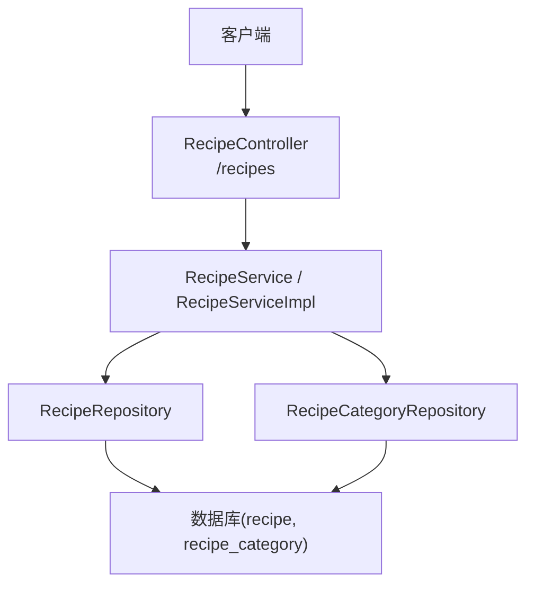
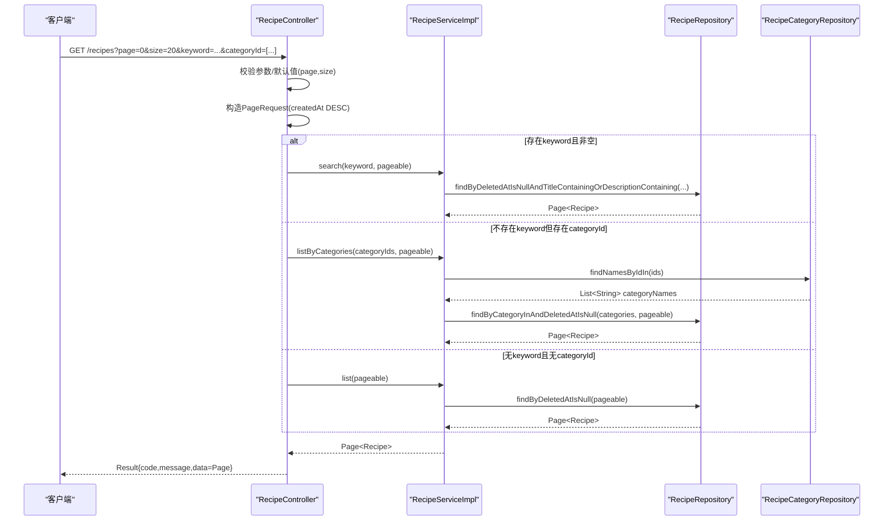
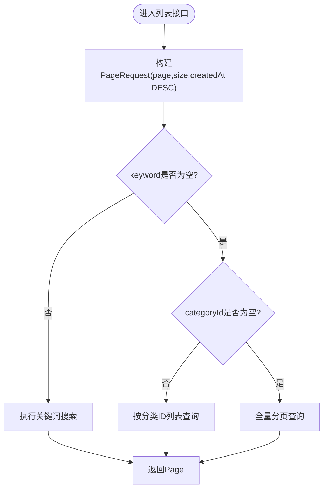
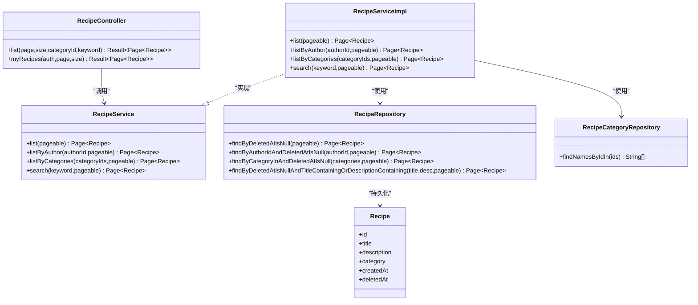

# 搜索与分页功能

<cite>
**本文引用的文件**
- [RecipeController.java](file://java_server/po/src/main/java/com/goodzheng/po/controller/RecipeController.java)
- [RecipeService.java](file://java_server/po/src/main/java/com/goodzheng/po/service/RecipeService.java)
- [RecipeServiceImpl.java](file://java_server/po/src/main/java/com/goodzheng/po/service/impl/RecipeServiceImpl.java)
- [RecipeRepository.java](file://java_server/po/src/main/java/com/goodzheng/po/repository/RecipeRepository.java)
- [RecipeCategoryRepository.java](file://java_server/po/src/main/java/com/goodzheng/po/repository/RecipeCategoryRepository.java)
- [Recipe.java](file://java_server/po/src/main/java/com/goodzheng/po/entity/Recipe.java)
- [RecipeCategory.java](file://java_server/po/src/main/java/com/goodzheng/po/entity/RecipeCategory.java)
- [Result.java](file://java_server/po/src/main/java/com/goodzheng/po/dto/Result.java)
</cite>

## 目录
1. [简介](#简介)
2. [项目结构](#项目结构)
3. [核心组件](#核心组件)
4. [架构总览](#架构总览)
5. [详细组件分析](#详细组件分析)
6. [依赖关系分析](#依赖关系分析)
7. [性能考虑](#性能考虑)
8. [故障排查指南](#故障排查指南)
9. [结论](#结论)
10. [附录：API调用示例](#附录api调用示例)

## 简介
本技术文档聚焦于菜谱的“搜索与分页”能力，覆盖以下要点：
- 分页查询实现机制：使用 PageRequest、排序规则（按 createdAt 降序）、页码与页面大小参数处理。
- 搜索功能：关键词搜索、分类筛选等高级查询条件。
- 复杂查询组合逻辑：keyword 与 categoryId 的优先级处理。
- 分页响应数据结构：总记录数、当前页、每页大小等。
- API 调用示例：不同搜索场景的请求参数与响应结果。
- 性能优化建议：索引设计与查询优化策略。

## 项目结构
后端采用典型的分层架构：控制器层接收请求并组装分页参数；服务层编排业务逻辑；仓储层提供数据访问方法；实体层定义数据模型。

图表来源
- [RecipeController.java:52-68](file://java_server/po/src/main/java/com/goodzheng/po/controller/RecipeController.java#L52-L68)
- [RecipeServiceImpl.java:73-97](file://java_server/po/src/main/java/com/goodzheng/po/service/impl/RecipeServiceImpl.java#L73-L97)
- [RecipeRepository.java:20-34](file://java_server/po/src/main/java/com/goodzheng/po/repository/RecipeRepository.java#L20-L34)
- [RecipeCategoryRepository.java:10-16](file://java_server/po/src/main/java/com/goodzheng/po/repository/RecipeCategoryRepository.java#L10-L16)

章节来源
- [RecipeController.java:52-68](file://java_server/po/src/main/java/com/goodzheng/po/controller/RecipeController.java#L52-L68)
- [RecipeServiceImpl.java:73-97](file://java_server/po/src/main/java/com/goodzheng/po/service/impl/RecipeServiceImpl.java#L73-L97)

## 核心组件
- 控制器：负责解析分页参数 page、size，构建 PageRequest，并按优先级选择查询路径（关键词 > 分类 > 全量）。
- 服务：封装具体查询逻辑，包括按作者、按分类、关键词搜索等。
- 仓储：基于 Spring Data JPA 的方法命名与自定义 @Query 实现分页与过滤。
- 实体：Recipe 包含标题、描述、分类、时间戳等字段；RecipeCategory 用于分类名称映射。
- 统一返回：Result<T> 包装分页对象 Page<Recipe>，便于前端消费。

章节来源
- [RecipeController.java:52-68](file://java_server/po/src/main/java/com/goodzheng/po/controller/RecipeController.java#L52-L68)
- [RecipeService.java:16-22](file://java_server/po/src/main/java/com/goodzheng/po/service/RecipeService.java#L16-L22)
- [RecipeRepository.java:20-34](file://java_server/po/src/main/java/com/goodzheng/po/repository/RecipeRepository.java#L20-L34)
- [Result.java:10-31](file://java_server/po/src/main/java/com/goodzheng/po/dto/Result.java#L10-L31)

## 架构总览
下图展示了从请求到响应的完整流程，重点体现分页参数与排序、搜索与分类筛选的组合逻辑。

图表来源
- [RecipeController.java:52-68](file://java_server/po/src/main/java/com/goodzheng/po/controller/RecipeController.java#L52-L68)
- [RecipeServiceImpl.java:73-97](file://java_server/po/src/main/java/com/goodzheng/po/service/impl/RecipeServiceImpl.java#L73-L97)
- [RecipeRepository.java:20-34](file://java_server/po/src/main/java/com/goodzheng/po/repository/RecipeRepository.java#L20-L34)
- [RecipeCategoryRepository.java:10-16](file://java_server/po/src/main/java/com/goodzheng/po/repository/RecipeCategoryRepository.java#L10-L16)

## 详细组件分析

### 分页与排序机制
- 分页参数：page（默认0）、size（默认20），由控制器直接传入 PageRequest.of。
- 排序规则：始终按 createdAt 降序排列，确保最新菜谱优先展示。
- 软删除过滤：所有列表查询均排除已删除记录（deletedAt IS NULL）。

图表来源
- [RecipeController.java:52-68](file://java_server/po/src/main/java/com/goodzheng/po/controller/RecipeController.java#L52-L68)
- [RecipeRepository.java:20-34](file://java_server/po/src/main/java/com/goodzheng/po/repository/RecipeRepository.java#L20-L34)

章节来源
- [RecipeController.java:52-68](file://java_server/po/src/main/java/com/goodzheng/po/controller/RecipeController.java#L52-L68)
- [RecipeRepository.java:20-34](file://java_server/po/src/main/java/com/goodzheng/po/repository/RecipeRepository.java#L20-L34)

### 搜索功能（关键词）
- 关键词匹配范围：标题与描述字段进行模糊匹配（含或关系）。
- 实现方式：通过仓储方法名派生查询，自动附加 deletedAt IS NULL 条件。
- 适用场景：用户输入关键词快速定位相关菜谱。

章节来源
- [RecipeRepository.java:32-34](file://java_server/po/src/main/java/com/goodzheng/po/repository/RecipeRepository.java#L32-L34)
- [RecipeServiceImpl.java:92-97](file://java_server/po/src/main/java/com/goodzheng/po/service/impl/RecipeServiceImpl.java#L92-L97)

### 分类筛选（categoryId）
- 输入为分类 ID 列表，服务层先根据 ID 获取分类名称集合，再按名称集合进行 OR 查询。
- 优势：解耦前端与分类名称，避免前端维护分类字符串。
- 注意：当同时提供 keyword 与 categoryId 时，以 keyword 为准（优先级更高）。

章节来源
- [RecipeServiceImpl.java:85-90](file://java_server/po/src/main/java/com/goodzheng/po/service/impl/RecipeServiceImpl.java#L85-L90)
- [RecipeCategoryRepository.java:14-16](file://java_server/po/src/main/java/com/goodzheng/po/repository/RecipeCategoryRepository.java#L14-L16)
- [RecipeRepository.java:29-30](file://java_server/po/src/main/java/com/goodzheng/po/repository/RecipeRepository.java#L29-L30)

### 复杂查询条件组合与优先级
- 优先级顺序：keyword > categoryId > 全量列表。
- 若 keyword 为空且 categoryId 为空，则返回全部未删除菜谱的分页结果。
- 该策略保证在存在更精确的关键词时，优先满足语义匹配。

章节来源
- [RecipeController.java:52-68](file://java_server/po/src/main/java/com/goodzheng/po/controller/RecipeController.java#L52-L68)

### 分页响应数据结构
- 外层统一包装：Result<T>，包含 code、message、data。
- data 为 Page<Recipe>，典型字段包括：
  - content：当前页数据列表
  - number：当前页码（从0开始）
  - size：每页大小
  - totalElements：总记录数
  - totalPages：总页数
  - sort：排序信息
  - first/last：是否首页/末页
- 前端可直接读取上述字段进行分页控件渲染。

章节来源
- [Result.java:10-31](file://java_server/po/src/main/java/com/goodzheng/po/dto/Result.java#L10-L31)
- [RecipeController.java:52-68](file://java_server/po/src/main/java/com/goodzheng/po/controller/RecipeController.java#L52-L68)

### 类与依赖关系图

图表来源
- [RecipeController.java:52-68](file://java_server/po/src/main/java/com/goodzheng/po/controller/RecipeController.java#L52-L68)
- [RecipeService.java:16-22](file://java_server/po/src/main/java/com/goodzheng/po/service/RecipeService.java#L16-L22)
- [RecipeServiceImpl.java:73-97](file://java_server/po/src/main/java/com/goodzheng/po/service/impl/RecipeServiceImpl.java#L73-L97)
- [RecipeRepository.java:20-34](file://java_server/po/src/main/java/com/goodzheng/po/repository/RecipeRepository.java#L20-L34)
- [RecipeCategoryRepository.java:10-16](file://java_server/po/src/main/java/com/goodzheng/po/repository/RecipeCategoryRepository.java#L10-L16)
- [Recipe.java:10-93](file://java_server/po/src/main/java/com/goodzheng/po/entity/Recipe.java#L10-L93)

## 依赖关系分析
- 控制器依赖服务接口，便于替换实现与测试。
- 服务实现依赖两个仓储：RecipeRepository 与 RecipeCategoryRepository，前者负责菜谱主表查询，后者负责分类名称映射。
- 仓储通过 Spring Data JPA 方法命名约定生成 SQL，减少样板代码。
- 实体字段设计影响查询性能与索引策略（如 title、description、category、createdAt、deletedAt）。

章节来源
- [RecipeController.java:52-68](file://java_server/po/src/main/java/com/goodzheng/po/controller/RecipeController.java#L52-L68)
- [RecipeServiceImpl.java:73-97](file://java_server/po/src/main/java/com/goodzheng/po/service/impl/RecipeServiceImpl.java#L73-L97)
- [RecipeRepository.java:20-34](file://java_server/po/src/main/java/com/goodzheng/po/repository/RecipeRepository.java#L20-L34)
- [RecipeCategoryRepository.java:10-16](file://java_server/po/src/main/java/com/goodzheng/po/repository/RecipeCategoryRepository.java#L10-L16)
- [Recipe.java:10-93](file://java_server/po/src/main/java/com/goodzheng/po/entity/Recipe.java#L10-L93)

## 性能考虑
- 索引建议
  - 复合索引：(deleted_at, created_at) 用于全量列表与作者列表的快速过滤与排序。
  - 全文检索：对 title、description 建立全文索引或使用搜索引擎（如 Elasticsearch）替代 LIKE 模糊查询，提升关键词搜索性能。
  - 分类字段：category 可建立普通索引以支持分类筛选。
- 查询优化
  - 避免 N+1：详情查询已使用 JOIN FETCH 预加载 ingredients 与 steps；列表查询仅返回必要字段。
  - 控制分页大小：合理设置 size（如 20-50），避免过大导致内存压力。
  - 缓存热点：对热门分类或高频关键词结果做短期缓存（如 Redis），降低数据库压力。
- 其他
  - 软删除字段 deleted_at 参与所有列表查询，确保一致性。
  - 如需更复杂的多维筛选（难度、标签、时长等），建议引入专用查询服务或搜索引擎。

[本节为通用性能建议，不直接分析具体文件]

## 故障排查指南
- 常见错误
  - 404：菜谱不存在或已被软删除。
  - 401：鉴权失败（“我的菜谱”接口需要有效 JWT）。
  - 400：参数校验失败或业务异常（如无权修改他人菜谱）。
- 排查步骤
  - 检查请求参数 page、size 是否越界或非法。
  - 确认 keyword 与 categoryId 是否同时传入，理解优先级行为。
  - 查看日志中抛出的运行时异常消息，定位具体原因。
  - 验证数据库是否存在对应记录及 deleted_at 状态。

章节来源
- [RecipeController.java:28-49](file://java_server/po/src/main/java/com/goodzheng/po/controller/RecipeController.java#L28-L49)
- [RecipeController.java:70-83](file://java_server/po/src/main/java/com/goodzheng/po/controller/RecipeController.java#L70-L83)
- [RecipeServiceImpl.java:62-71](file://java_server/po/src/main/java/com/goodzheng/po/service/impl/RecipeServiceImpl.java#L62-L71)
- [RecipeServiceImpl.java:99-151](file://java_server/po/src/main/java/com/goodzheng/po/service/impl/RecipeServiceImpl.java#L99-L151)

## 结论
本实现通过清晰的层级分工与 Spring Data JPA 的能力，提供了稳定高效的菜谱搜索与分页能力。关键词优先、分类次之、全量兜底的组合策略兼顾了易用性与性能。配合合理的索引与缓存策略，可在数据规模增长时保持良好体验。

[本节为总结性内容，不直接分析具体文件]

## 附录：API调用示例
以下为常用场景的请求与响应说明（以 JSON 形式示意）：

- 场景一：关键词搜索
  - 请求
    - 方法：GET
    - 路径：/recipes?keyword=红烧&page=0&size=20
  - 响应
    - code: 200
    - message: success
    - data:
      - content: [Recipe 对象数组]
      - number: 0
      - size: 20
      - totalElements: 总数
      - totalPages: 总页数
      - sort: {direction: DESC, property: createdAt}

- 场景二：按分类筛选
  - 请求
    - 方法：GET
    - 路径：/recipes?categoryId=1&categoryId=2&page=0&size=20
  - 响应
    - 结构与场景一相同，content 为指定分类下的菜谱列表

- 场景三：全量分页（无筛选）
  - 请求
    - 方法：GET
    - 路径：/recipes?page=0&size=20
  - 响应
    - 结构与场景一相同，content 为全部未删除菜谱

- 场景四：我的菜谱（需鉴权）
  - 请求
    - 方法：GET
    - 路径：/recipes/mine?page=0&size=20
    - 头部：Authorization: Bearer <token>
  - 响应
    - 结构与场景一相同，content 为当前作者的菜谱列表

- 注意事项
  - 当同时传入 keyword 与 categoryId 时，以 keyword 为准。
  - 默认排序为 createdAt 降序，确保最新菜谱优先。
  - 所有列表均排除已删除记录（deletedAt IS NULL）。

章节来源
- [RecipeController.java:52-68](file://java_server/po/src/main/java/com/goodzheng/po/controller/RecipeController.java#L52-L68)
- [RecipeController.java:70-83](file://java_server/po/src/main/java/com/goodzheng/po/controller/RecipeController.java#L70-L83)
- [Result.java:10-31](file://java_server/po/src/main/java/com/goodzheng/po/dto/Result.java#L10-L31)
- [RecipeRepository.java:20-34](file://java_server/po/src/main/java/com/goodzheng/po/repository/RecipeRepository.java#L20-L34)
- [RecipeServiceImpl.java:73-97](file://java_server/po/src/main/java/com/goodzheng/po/service/impl/RecipeServiceImpl.java#L73-L97)