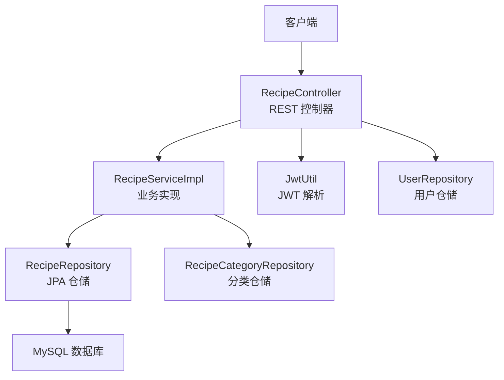
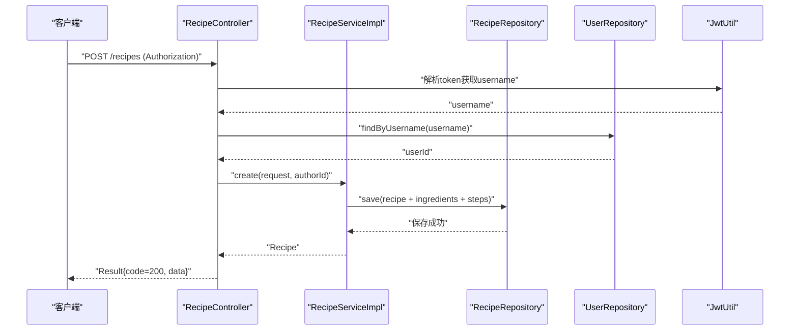
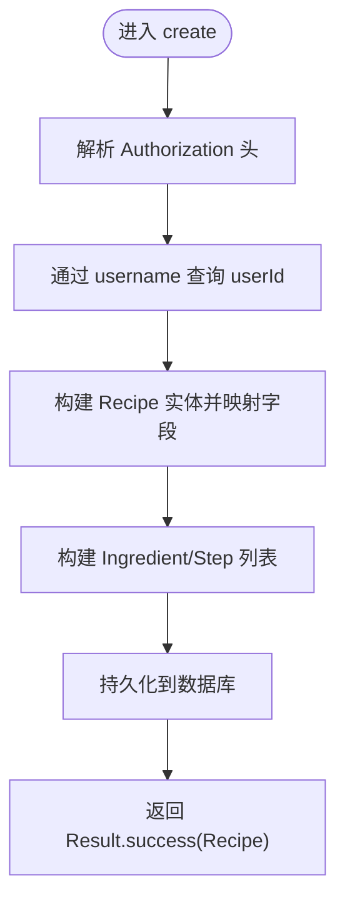
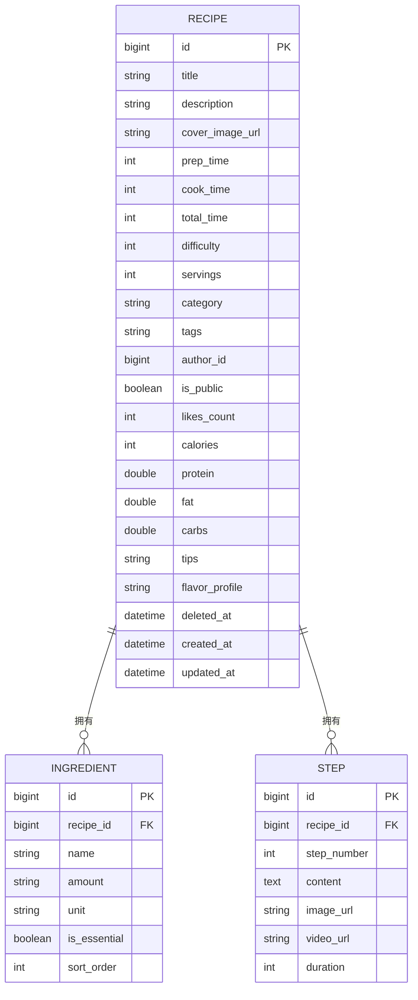
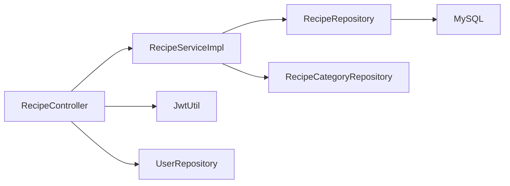

# 菜谱CRUD操作

<cite>
**本文引用的文件**
- [RecipeController.java](file://java_server/po/src/main/java/com/goodzheng/po/controller/RecipeController.java)
- [RecipeService.java](file://java_server/po/src/main/java/com/goodzheng/po/service/RecipeService.java)
- [RecipeServiceImpl.java](file://java_server/po/src/main/java/com/goodzheng/po/service/impl/RecipeServiceImpl.java)
- [RecipeRepository.java](file://java_server/po/src/main/java/com/goodzheng/po/repository/RecipeRepository.java)
- [RecipeRequest.java](file://java_server/po/src/main/java/com/goodzheng/po/dto/RecipeRequest.java)
- [Result.java](file://java_server/po/src/main/java/com/goodzheng/po/dto/Result.java)
- [Recipe.java](file://java_server/po/src/main/java/com/goodzheng/po/entity/Recipe.java)
- [Ingredient.java](file://java_server/po/src/main/java/com/goodzheng/po/entity/Ingredient.java)
- [Step.java](file://java_server/po/src/main/java/com/goodzheng/po/entity/Step.java)
- [JwtUtil.java](file://java_server/po/src/main/java/com/goodzheng/po/util/JwtUtil.java)
- [User.java](file://java_server/po/src/main/java/com/goodzheng/po/entity/User.java)
- [UserRepository.java](file://java_server/po/src/main/java/com/goodzheng/po/repository/UserRepository.java)
- [application.yaml](file://java_server/po/src/main/resources/application.yaml)
</cite>

## 目录
1. [简介](#简介)
2. [项目结构](#项目结构)
3. [核心组件](#核心组件)
4. [架构总览](#架构总览)
5. [详细组件分析](#详细组件分析)
6. [依赖关系分析](#依赖关系分析)
7. [性能考虑](#性能考虑)
8. [故障排查指南](#故障排查指南)
9. [结论](#结论)
10. [附录：API调用示例](#附录api调用示例)

## 简介
本技术文档围绕“菜谱”实体的完整CRUD能力，系统阐述后端接口设计、请求参数校验、业务逻辑处理、数据持久化与响应格式。重点覆盖以下HTTP接口：
- POST /recipes：创建菜谱（需鉴权）
- GET /recipes/{id}：查询菜谱详情
- PUT /recipes/{id}：更新菜谱（需鉴权）
- DELETE /recipes/{id}：删除菜谱（软删除，需鉴权）

同时说明JWT鉴权流程、权限控制策略、错误处理机制以及典型API调用示例。

## 项目结构
后端采用Spring Boot分层架构：
- 控制器层：接收HTTP请求，进行基础参数校验与统一响应封装
- 服务层：实现业务规则、事务边界与领域逻辑
- 仓储层：基于JPA的数据库访问与分页/搜索查询
- 实体与DTO：定义数据模型与入参校验
- 工具类：JWT令牌解析与验证
- 配置：应用端口、上下文路径、数据库与Redis等

图表来源
- [RecipeController.java:18-119](file://java_server/po/src/main/java/com/goodzheng/po/controller/RecipeController.java#L18-L119)
- [RecipeServiceImpl.java:19-174](file://java_server/po/src/main/java/com/goodzheng/po/service/impl/RecipeServiceImpl.java#L19-L174)
- [RecipeRepository.java:13-35](file://java_server/po/src/main/java/com/goodzheng/po/repository/RecipeRepository.java#L13-L35)
- [JwtUtil.java:13-55](file://java_server/po/src/main/java/com/goodzheng/po/util/JwtUtil.java#L13-L55)
- [UserRepository.java:13-26](file://java_server/po/src/main/java/com/goodzheng/po/repository/UserRepository.java#L13-L26)

章节来源
- [application.yaml:4-8](file://java_server/po/src/main/resources/application.yaml#L4-L8)
- [RecipeController.java:18-119](file://java_server/po/src/main/java/com/goodzheng/po/controller/RecipeController.java#L18-L119)

## 核心组件
- 控制器：提供RESTful接口，统一返回Result包装体；对写操作进行JWT鉴权并解析authorId
- 服务：封装创建、读取、更新、删除、分页、按作者/分类查询、关键字搜索等业务逻辑
- 仓储：提供预加载详情、软删除过滤、按作者/分类/关键字查询等JPA方法
- DTO：RecipeRequest使用Jakarta Validation进行入参校验；Result为统一响应结构
- 实体：Recipe及其关联的Ingredient、Step；支持软删除字段deletedAt
- 工具：JwtUtil负责JWT生成与解析；UserRepository用于根据用户名查找用户ID

章节来源
- [RecipeController.java:18-119](file://java_server/po/src/main/java/com/goodzheng/po/controller/RecipeController.java#L18-L119)
- [RecipeService.java:10-27](file://java_server/po/src/main/java/com/goodzheng/po/service/RecipeService.java#L10-L27)
- [RecipeServiceImpl.java:19-174](file://java_server/po/src/main/java/com/goodzheng/po/service/impl/RecipeServiceImpl.java#L19-L174)
- [RecipeRepository.java:13-35](file://java_server/po/src/main/java/com/goodzheng/po/repository/RecipeRepository.java#L13-L35)
- [RecipeRequest.java:10-65](file://java_server/po/src/main/java/com/goodzheng/po/dto/RecipeRequest.java#L10-L65)
- [Result.java:7-31](file://java_server/po/src/main/java/com/goodzheng/po/dto/Result.java#L7-L31)
- [Recipe.java:10-92](file://java_server/po/src/main/java/com/goodzheng/po/entity/Recipe.java#L10-L92)
- [JwtUtil.java:13-55](file://java_server/po/src/main/java/com/goodzheng/po/util/JwtUtil.java#L13-L55)

## 架构总览
整体调用链：客户端发起HTTP请求 → Controller解析参数与鉴权 → Service执行业务逻辑 → Repository访问数据库 → 返回统一Result响应。

图表来源
- [RecipeController.java:28-39](file://java_server/po/src/main/java/com/goodzheng/po/controller/RecipeController.java#L28-L39)
- [RecipeServiceImpl.java:26-60](file://java_server/po/src/main/java/com/goodzheng/po/service/impl/RecipeServiceImpl.java#L26-L60)
- [RecipeRepository.java:13-18](file://java_server/po/src/main/java/com/goodzheng/po/repository/RecipeRepository.java#L13-L18)
- [JwtUtil.java:25-37](file://java_server/po/src/main/java/com/goodzheng/po/util/JwtUtil.java#L25-L37)
- [UserRepository.java:13-16](file://java_server/po/src/main/java/com/goodzheng/po/repository/UserRepository.java#L13-L16)

## 详细组件分析

### 接口设计与请求参数校验
- 路由前缀：/api（由应用上下文决定），实际访问路径为 /api/recipes
- 统一响应：Result<T>包含code、message、data
- 入参校验：RecipeRequest使用@NotBlank、@NotNull等注解进行校验，未通过将触发参数校验异常
- 鉴权头：Authorization: Bearer <token>

章节来源
- [application.yaml:4-8](file://java_server/po/src/main/resources/application.yaml#L4-L8)
- [Result.java:7-31](file://java_server/po/src/main/java/com/goodzheng/po/dto/Result.java#L7-L31)
- [RecipeRequest.java:10-65](file://java_server/po/src/main/java/com/goodzheng/po/dto/RecipeRequest.java#L10-L65)
- [RecipeController.java:18-119](file://java_server/po/src/main/java/com/goodzheng/po/controller/RecipeController.java#L18-L119)

### 创建菜谱（POST /recipes）
- 鉴权：从Authorization头提取Bearer token，解析出username，再查表得到authorId
- 业务：构造Recipe实体，映射DTO字段，批量构建Ingredient与Step集合，持久化
- 返回：Result.success(新建的Recipe)

图表来源
- [RecipeController.java:28-39](file://java_server/po/src/main/java/com/goodzheng/po/controller/RecipeController.java#L28-L39)
- [RecipeServiceImpl.java:26-60](file://java_server/po/src/main/java/com/goodzheng/po/service/impl/RecipeServiceImpl.java#L26-L60)
- [JwtUtil.java:25-37](file://java_server/po/src/main/java/com/goodzheng/po/util/JwtUtil.java#L25-L37)
- [UserRepository.java:13-16](file://java_server/po/src/main/java/com/goodzheng/po/repository/UserRepository.java#L13-L16)

章节来源
- [RecipeController.java:28-39](file://java_server/po/src/main/java/com/goodzheng/po/controller/RecipeController.java#L28-L39)
- [RecipeServiceImpl.java:26-60](file://java_server/po/src/main/java/com/goodzheng/po/service/impl/RecipeServiceImpl.java#L26-L60)

### 查询详情（GET /recipes/{id}）
- 行为：通过ID预加载详情（JOIN FETCH ingredients/steps），若不存在或已软删除则抛出运行时异常
- 返回：Result.success(Recipe)

章节来源
- [RecipeController.java:41-49](file://java_server/po/src/main/java/com/goodzheng/po/controller/RecipeController.java#L41-L49)
- [RecipeServiceImpl.java:62-71](file://java_server/po/src/main/java/com/goodzheng/po/service/impl/RecipeServiceImpl.java#L62-L71)
- [RecipeRepository.java:16-18](file://java_server/po/src/main/java/com/goodzheng/po/repository/RecipeRepository.java#L16-L18)

### 更新菜谱（PUT /recipes/{id}）
- 鉴权：同创建流程，解析authorId
- 权限：仅允许修改自己创建的菜谱，否则抛异常
- 行为：替换食材与步骤列表，更新主字段，持久化
- 返回：Result.success(更新后的Recipe)

章节来源
- [RecipeController.java:85-96](file://java_server/po/src/main/java/com/goodzheng/po/controller/RecipeController.java#L85-L96)
- [RecipeServiceImpl.java:99-140](file://java_server/po/src/main/java/com/goodzheng/po/service/impl/RecipeServiceImpl.java#L99-L140)

### 删除菜谱（DELETE /recipes/{id}）
- 鉴权：同创建流程，解析authorId
- 权限：仅允许删除自己创建的菜谱，否则抛异常
- 行为：软删除，设置deletedAt为当前时间
- 返回：Result.success("删除成功", null)

章节来源
- [RecipeController.java:98-109](file://java_server/po/src/main/java/com/goodzheng/po/controller/RecipeController.java#L98-L109)
- [RecipeServiceImpl.java:142-151](file://java_server/po/src/main/java/com/goodzheng/po/service/impl/RecipeServiceImpl.java#L142-L151)

### 其他查询接口
- 分页列表：GET /recipes?page=&size=&categoryId[]=&keyword=
- 我的菜谱：GET /recipes/mine?page=&size=（需鉴权）

章节来源
- [RecipeController.java:51-83](file://java_server/po/src/main/java/com/goodzheng/po/controller/RecipeController.java#L51-L83)
- [RecipeServiceImpl.java:73-97](file://java_server/po/src/main/java/com/goodzheng/po/service/impl/RecipeServiceImpl.java#L73-L97)
- [RecipeRepository.java:20-35](file://java_server/po/src/main/java/com/goodzheng/po/repository/RecipeRepository.java#L20-L35)

### 数据模型与关系

图表来源
- [Recipe.java:10-92](file://java_server/po/src/main/java/com/goodzheng/po/entity/Recipe.java#L10-L92)
- [Ingredient.java:9-41](file://java_server/po/src/main/java/com/goodzheng/po/entity/Ingredient.java#L9-L41)
- [Step.java:9-39](file://java_server/po/src/main/java/com/goodzheng/po/entity/Step.java#L9-L39)

## 依赖关系分析
- 控制器依赖服务、JWT工具与用户仓储
- 服务依赖JPA仓储与分类仓储
- 仓储依赖数据库方言与连接池配置
- 实体间通过OneToMany/ManyToOne建立一对多关系

图表来源
- [RecipeController.java:18-119](file://java_server/po/src/main/java/com/goodzheng/po/controller/RecipeController.java#L18-L119)
- [RecipeServiceImpl.java:19-174](file://java_server/po/src/main/java/com/goodzheng/po/service/impl/RecipeServiceImpl.java#L19-L174)
- [RecipeRepository.java:13-35](file://java_server/po/src/main/java/com/goodzheng/po/repository/RecipeRepository.java#L13-L35)
- [JwtUtil.java:13-55](file://java_server/po/src/main/java/com/goodzheng/po/util/JwtUtil.java#L13-L55)
- [UserRepository.java:13-26](file://java_server/po/src/main/java/com/goodzheng/po/repository/UserRepository.java#L13-L26)

章节来源
- [application.yaml:23-41](file://java_server/po/src/main/resources/application.yaml#L23-L41)

## 性能考虑
- 详情查询使用JOIN FETCH预加载ingredients与steps，避免N+1问题
- 列表与搜索均基于Pageable分页，减少单次响应体积
- 软删除通过deletedAt过滤，保证查询一致性
- 连接池与线程数已在配置中优化，可根据负载调整

[本节为通用性能建议，不直接分析具体文件]

## 故障排查指南
- 参数校验失败：检查RecipeRequest中的必填字段是否缺失或格式不正确
- 鉴权失败：确认Authorization头格式为“Bearer <token>”，且token有效
- 无权限：确保当前用户为菜谱作者
- 资源不存在：检查id是否存在或已被软删除
- 数据库异常：检查连接配置、表结构与索引

章节来源
- [RecipeController.java:28-109](file://java_server/po/src/main/java/com/goodzheng/po/controller/RecipeController.java#L28-L109)
- [RecipeServiceImpl.java:62-151](file://java_server/po/src/main/java/com/goodzheng/po/service/impl/RecipeServiceImpl.java#L62-L151)
- [application.yaml:23-41](file://java_server/po/src/main/resources/application.yaml#L23-L41)

## 结论
该实现以清晰的层次划分与统一的响应封装，提供了完整的菜谱CRUD能力。通过JWT鉴权与作者权限校验保障数据安全，结合预加载与分页查询提升性能。建议在后续迭代中补充全局异常处理器与更细粒度的权限控制。

[本节为总结性内容，不直接分析具体文件]

## 附录：API调用示例
以下为各接口的调用示例（基于应用上下文/api）：

- 创建菜谱
  - 方法：POST
  - 路径：/api/recipes
  - 请求头：
    - Authorization: Bearer <token>
    - Content-Type: application/json
  - 请求体示例：
    - {
        "title": "红烧肉",
        "description": "经典家常菜",
        "difficulty": 2,
        "servings": 4,
        "category": "家常菜",
        "tags": "下饭,肉类",
        "isPublic": true,
        "calories": 600,
        "protein": 25.0,
        "fat": 35.0,
        "carbs": 10.0,
        "tips": "小火慢炖",
        "flavorProfile": "咸香微甜",
        "ingredients": [
          {"name": "五花肉", "amount": "500g", "unit": "克", "isEssential": true, "sortOrder": 1},
          {"name": "冰糖", "amount": "30g", "unit": "克", "isEssential": false, "sortOrder": 2}
        ],
        "steps": [
          {"stepNumber": 1, "content": "切块焯水", "imageUrl": "", "videoUrl": "", "duration": 5},
          {"stepNumber": 2, "content": "炒糖色后翻炒", "imageUrl": "", "videoUrl": "", "duration": 10}
        ]
      }
  - 成功响应：
    - {
        "code": 200,
        "message": "success",
        "data": { /* Recipe 对象 */ }
      }

- 查询详情
  - 方法：GET
  - 路径：/api/recipes/{id}
  - 成功响应：
    - {
        "code": 200,
        "message": "success",
        "data": { /* Recipe 对象（含 ingredients、steps） */ }
      }

- 更新菜谱
  - 方法：PUT
  - 路径：/api/recipes/{id}
  - 请求头：
    - Authorization: Bearer <token>
    - Content-Type: application/json
  - 请求体：同创建时的RecipeRequest结构
  - 成功响应：
    - {
        "code": 200,
        "message": "success",
        "data": { /* 更新后的 Recipe */ }
      }

- 删除菜谱
  - 方法：DELETE
  - 路径：/api/recipes/{id}
  - 请求头：
    - Authorization: Bearer <token>
  - 成功响应：
    - {
        "code": 200,
        "message": "删除成功",
        "data": null
      }

- 分页列表
  - 方法：GET
  - 路径：/api/recipes?page=0&size=20&categoryId[]=1&keyword=红烧
  - 成功响应：
    - {
        "code": 200,
        "message": "success",
        "data": { /* Page<Recipe> */ }
      }

- 我的菜谱
  - 方法：GET
  - 路径：/api/recipes/mine?page=0&size=20
  - 请求头：
    - Authorization: Bearer <token>
  - 成功响应：
    - {
        "code": 200,
        "message": "success",
        "data": { /* Page<Recipe> */ }
      }

章节来源
- [RecipeController.java:28-109](file://java_server/po/src/main/java/com/goodzheng/po/controller/RecipeController.java#L28-L109)
- [Result.java:7-31](file://java_server/po/src/main/java/com/goodzheng/po/dto/Result.java#L7-L31)
- [RecipeRequest.java:10-65](file://java_server/po/src/main/java/com/goodzheng/po/dto/RecipeRequest.java#L10-L65)
- [application.yaml:4-8](file://java_server/po/src/main/resources/application.yaml#L4-L8)