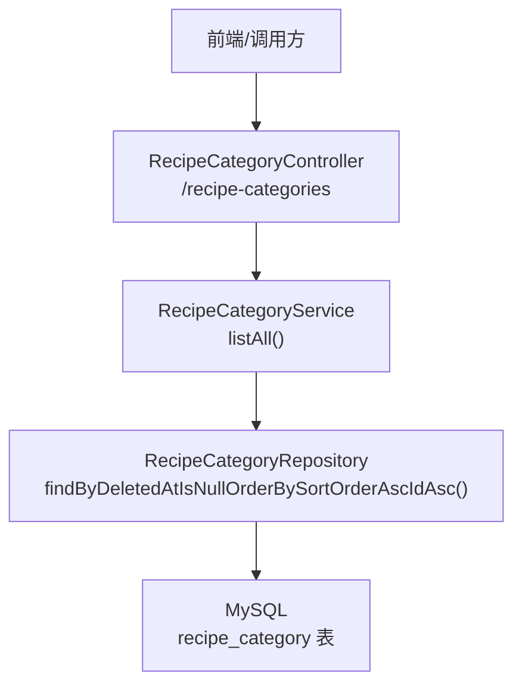
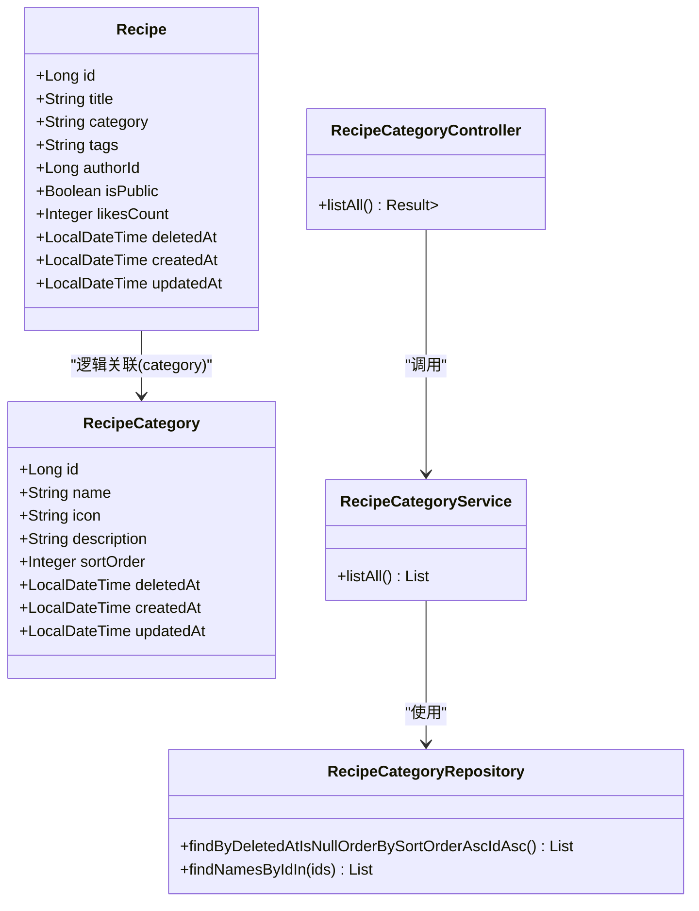
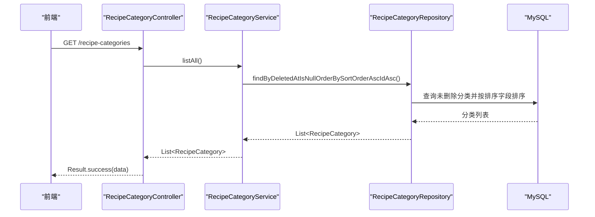
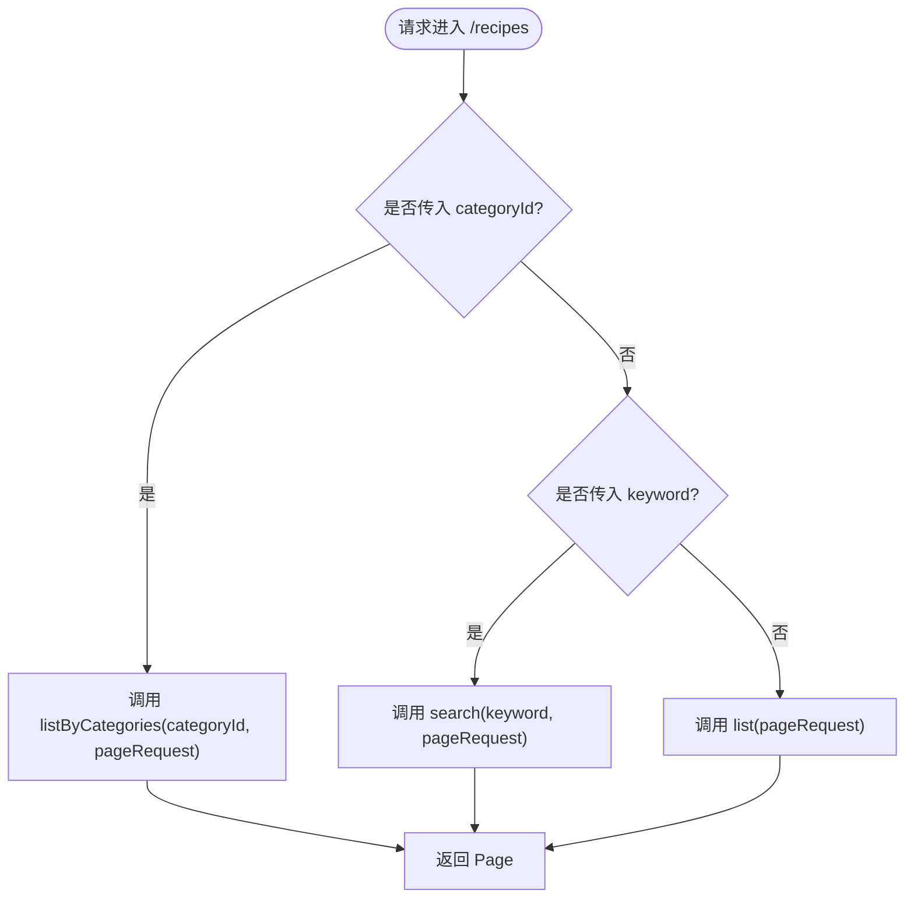
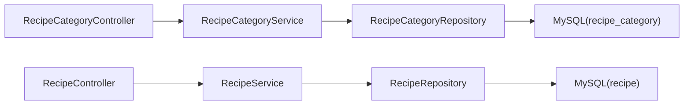

# 菜谱分类管理

<cite>
**本文引用的文件**
- [RecipeCategory.java](file://java_server/po/src/main/java/com/goodzheng/po/entity/RecipeCategory.java)
- [RecipeCategoryController.java](file://java_server/po/src/main/java/com/goodzheng/po/controller/RecipeCategoryController.java)
- [RecipeCategoryService.java](file://java_server/po/src/main/java/com/goodzheng/po/service/RecipeCategoryService.java)
- [RecipeCategoryServiceImpl.java](file://java_server/po/src/main/java/com/goodzheng/po/service/impl/RecipeCategoryServiceImpl.java)
- [RecipeCategoryRepository.java](file://java_server/po/src/main/java/com/goodzheng/po/repository/RecipeCategoryRepository.java)
- [Result.java](file://java_server/po/src/main/java/com/goodzheng/po/dto/Result.java)
- [Recipe.java](file://java_server/po/src/main/java/com/goodzheng/po/entity/Recipe.java)
- [RecipeController.java](file://java_server/po/src/main/java/com/goodzheng/po/controller/RecipeController.java)
- [application.yaml](file://java_server/po/src/main/resources/application.yaml)
- [data-category.sql](file://java_server/po/src/main/resources/data-category.sql)
</cite>

## 目录
1. [简介](#简介)
2. [项目结构](#项目结构)
3. [核心组件](#核心组件)
4. [架构总览](#架构总览)
5. [详细组件分析](#详细组件分析)
6. [依赖关系分析](#依赖关系分析)
7. [性能考虑](#性能考虑)
8. [故障排查指南](#故障排查指南)
9. [结论](#结论)
10. [附录：API调用示例与最佳实践](#附录api调用示例与最佳实践)

## 简介
本技术文档围绕“菜谱分类管理”功能，系统性说明分类的CRUD能力、分类与菜谱的关联关系、数据模型设计、业务规则（唯一性、排序、软删除）、以及如何在菜谱查询中按分类进行筛选。同时提供完整的API调用示例、数据完整性约束与异常处理机制说明，帮助开发者快速理解并正确使用该模块。

## 项目结构
后端采用Spring Boot + JPA分层架构：
- 控制器层：暴露REST接口，统一返回Result封装
- 服务层：实现业务逻辑与事务控制
- 仓储层：基于JpaRepository提供数据访问能力
- 实体层：定义数据库表映射与字段约束
- 配置与数据：应用配置、初始化数据脚本

图表来源
- [RecipeCategoryController.java:11-28](file://java_server/po/src/main/java/com/goodzheng/po/controller/RecipeCategoryController.java#L11-L28)
- [RecipeCategoryService.java:7-11](file://java_server/po/src/main/java/com/goodzheng/po/service/RecipeCategoryService.java#L7-L11)
- [RecipeCategoryServiceImpl.java:12-23](file://java_server/po/src/main/java/com/goodzheng/po/service/impl/RecipeCategoryServiceImpl.java#L12-L23)
- [RecipeCategoryRepository.java:10-17](file://java_server/po/src/main/java/com/goodzheng/po/repository/RecipeCategoryRepository.java#L10-L17)

章节来源
- [application.yaml:1-109](file://java_server/po/src/main/resources/application.yaml#L1-L109)
- [data-category.sql:1-39](file://java_server/po/src/main/resources/data-category.sql#L1-L39)

## 核心组件
- 实体 RecipeCategory：定义分类的数据结构与约束（名称唯一、排序权重、软删除、时间戳）
- 控制器 RecipeCategoryController：对外暴露分类查询接口
- 服务 RecipeCategoryService / Impl：封装查询逻辑，声明只读事务
- 仓储 RecipeCategoryRepository：提供按未删除且排序的查询方法，以及按ID批量获取名称的方法
- 通用响应 Result：统一返回码、消息与数据体
- 关联实体 Recipe：通过 category 字段与分类建立逻辑关联（字符串存储），并提供分页列表支持按分类ID过滤

章节来源
- [RecipeCategory.java:8-45](file://java_server/po/src/main/java/com/goodzheng/po/entity/RecipeCategory.java#L8-L45)
- [RecipeCategoryController.java:11-28](file://java_server/po/src/main/java/com/goodzheng/po/controller/RecipeCategoryController.java#L11-L28)
- [RecipeCategoryService.java:7-11](file://java_server/po/src/main/java/com/goodzheng/po/service/RecipeCategoryService.java#L7-L11)
- [RecipeCategoryServiceImpl.java:12-23](file://java_server/po/src/main/java/com/goodzheng/po/service/impl/RecipeCategoryServiceImpl.java#L12-L23)
- [RecipeCategoryRepository.java:10-17](file://java_server/po/src/main/java/com/goodzheng/po/repository/RecipeCategoryRepository.java#L10-L17)
- [Result.java:7-31](file://java_server/po/src/main/java/com/goodzheng/po/dto/Result.java#L7-L31)
- [Recipe.java:10-92](file://java_server/po/src/main/java/com/goodzheng/po/entity/Recipe.java#L10-L92)

## 架构总览
分类管理遵循标准三层架构，结合JPA进行数据持久化；菜谱查询通过分类ID进行过滤，体现分类在搜索中的应用。

图表来源
- [RecipeCategory.java:8-45](file://java_server/po/src/main/java/com/goodzheng/po/entity/RecipeCategory.java#L8-L45)
- [Recipe.java:10-92](file://java_server/po/src/main/java/com/goodzheng/po/entity/Recipe.java#L10-L92)
- [RecipeCategoryController.java:11-28](file://java_server/po/src/main/java/com/goodzheng/po/controller/RecipeCategoryController.java#L11-L28)
- [RecipeCategoryService.java:7-11](file://java_server/po/src/main/java/com/goodzheng/po/service/RecipeCategoryService.java#L7-L11)
- [RecipeCategoryRepository.java:10-17](file://java_server/po/src/main/java/com/goodzheng/po/repository/RecipeCategoryRepository.java#L10-L17)

## 详细组件分析

### 数据模型与约束
- 分类实体 RecipeCategory
  - 主键：自增id
  - 名称：非空、长度限制、唯一约束（保证分类名称唯一）
  - 图标、描述：可选文本
  - 排序：整数权重，越小越靠前
  - 软删除：deletedAt为空表示有效记录
  - 时间戳：创建时间、更新时间（自动维护）
- 菜谱实体 Recipe
  - 分类字段：category为字符串类型，用于存储分类标识或名称（当前实现以字符串形式关联）
  - 其他：标题、描述、封面、难度、人数、标签、作者、公开状态、点赞数等
  - 软删除与时间戳：同分类实体

章节来源
- [RecipeCategory.java:8-45](file://java_server/po/src/main/java/com/goodzheng/po/entity/RecipeCategory.java#L8-L45)
- [Recipe.java:10-92](file://java_server/po/src/main/java/com/goodzheng/po/entity/Recipe.java#L10-L92)

### 分类查询接口（GET /recipe-categories）
- 功能：获取所有未删除的分类，按sortOrder升序、id升序排列
- 安全：无需登录（跨域已开启）
- 返回：统一Result包装的List<RecipeCategory>

图表来源
- [RecipeCategoryController.java:19-27](file://java_server/po/src/main/java/com/goodzheng/po/controller/RecipeCategoryController.java#L19-L27)
- [RecipeCategoryService.java:7-11](file://java_server/po/src/main/java/com/goodzheng/po/service/RecipeCategoryService.java#L7-L11)
- [RecipeCategoryServiceImpl.java:18-22](file://java_server/po/src/main/java/com/goodzheng/po/service/impl/RecipeCategoryServiceImpl.java#L18-L22)
- [RecipeCategoryRepository.java:12-12](file://java_server/po/src/main/java/com/goodzheng/po/repository/RecipeCategoryRepository.java#L12-L12)

章节来源
- [RecipeCategoryController.java:11-28](file://java_server/po/src/main/java/com/goodzheng/po/controller/RecipeCategoryController.java#L11-L28)
- [RecipeCategoryServiceImpl.java:12-23](file://java_server/po/src/main/java/com/goodzheng/po/service/impl/RecipeCategoryServiceImpl.java#L12-L23)

### 分类与菜谱的关联及按分类筛选
- 关联方式：Recipe.category为字符串字段，用于与分类建立逻辑关联（当前实现未使用外键）
- 筛选方式：RecipeController.list接口支持categoryId参数（List<Long>），在服务层根据分类ID集合进行过滤，返回分页结果
- 应用场景：首页推荐、分类页展示、搜索时按分类维度聚合

图表来源
- [RecipeController.java:51-68](file://java_server/po/src/main/java/com/goodzheng/po/controller/RecipeController.java#L51-L68)
- [Recipe.java:40-46](file://java_server/po/src/main/java/com/goodzheng/po/entity/Recipe.java#L40-L46)

章节来源
- [RecipeController.java:51-68](file://java_server/po/src/main/java/com/goodzheng/po/controller/RecipeController.java#L51-L68)
- [Recipe.java:40-46](file://java_server/po/src/main/java/com/goodzheng/po/entity/Recipe.java#L40-L46)

### 分类管理的业务逻辑
- 唯一性验证：通过数据库唯一约束保障分类名称唯一
- 排序与层级：当前实体未包含父级ID字段，层级关系可通过sortOrder分组或业务约定实现（如功能分类、菜系分类、饮食方式三类种子数据）
- 软删除：deletedAt为空视为有效记录，查询时排除已删除项
- 事务：查询操作声明只读事务，提升并发性能

章节来源
- [RecipeCategory.java:17-34](file://java_server/po/src/main/java/com/goodzheng/po/entity/RecipeCategory.java#L17-L34)
- [RecipeCategoryRepository.java:12-12](file://java_server/po/src/main/java/com/goodzheng/po/repository/RecipeCategoryRepository.java#L12-L12)
- [RecipeCategoryServiceImpl.java:18-22](file://java_server/po/src/main/java/com/goodzheng/po/service/impl/RecipeCategoryServiceImpl.java#L18-L22)
- [data-category.sql:6-38](file://java_server/po/src/main/resources/data-category.sql#L6-L38)

### 扩展点与后续优化建议
- 若需严格父子层级关系，可在实体中增加parentId字段，并在查询时递归组装树形结构
- 若需强一致的外键关联，可将Recipe.category改为Long类型的categoryId，并建立外键约束
- 可引入缓存（如Redis）对分类列表进行缓存，减少重复查询压力

[本节为概念性内容，不直接分析具体文件]

## 依赖关系分析
- 控制器依赖服务，服务依赖仓储，仓储依赖数据库
- 分类列表查询路径短、无复杂计算，适合缓存
- 菜谱查询可按分类ID过滤，形成“分类→菜谱”的检索链路

图表来源
- [RecipeCategoryController.java:11-28](file://java_server/po/src/main/java/com/goodzheng/po/controller/RecipeCategoryController.java#L11-L28)
- [RecipeCategoryService.java:7-11](file://java_server/po/src/main/java/com/goodzheng/po/service/RecipeCategoryService.java#L7-L11)
- [RecipeCategoryRepository.java:10-17](file://java_server/po/src/main/java/com/goodzheng/po/repository/RecipeCategoryRepository.java#L10-L17)
- [RecipeController.java:18-68](file://java_server/po/src/main/java/com/goodzheng/po/controller/RecipeController.java#L18-L68)

章节来源
- [application.yaml:23-41](file://java_server/po/src/main/resources/application.yaml#L23-L41)

## 性能考虑
- 查询优化：分类列表查询已按sortOrder和id排序，避免应用层排序开销
- 事务策略：查询使用只读事务，有助于数据库优化器选择更优执行计划
- 连接池：HikariCP默认配置满足一般场景，可根据QPS调整最大连接数
- 缓存建议：分类列表变化频率低，可引入Redis缓存，设置合理过期时间

[本节为通用性能建议，不直接分析具体文件]

## 故障排查指南
- 唯一性冲突：新增或更新分类名称时，若违反唯一约束将抛出异常；应在上层捕获并返回友好错误信息
- 软删除数据可见性：确保查询条件排除deletedAt不为空的记录
- 分类ID过滤无效：检查传入的categoryId是否为空列表，以及服务层是否正确实现按ID过滤
- 跨域问题：控制器已启用跨域，若仍失败请检查浏览器CORS策略与服务端配置

章节来源
- [RecipeCategoryController.java:19-27](file://java_server/po/src/main/java/com/goodzheng/po/controller/RecipeCategoryController.java#L19-L27)
- [RecipeCategoryRepository.java:12-12](file://java_server/po/src/main/java/com/goodzheng/po/repository/RecipeCategoryRepository.java#L12-L12)
- [RecipeController.java:51-68](file://java_server/po/src/main/java/com/goodzheng/po/controller/RecipeController.java#L51-L68)

## 结论
本模块实现了分类的基础查询能力，并通过统一Result封装返回数据；分类与菜谱通过字符串字段建立逻辑关联，支持按分类ID进行菜谱筛选。数据模型具备唯一性、排序、软删除等关键约束，满足常见业务需求。后续可扩展父子层级、外键关联与缓存以提升灵活性与性能。

[本节为总结性内容，不直接分析具体文件]

## 附录：API调用示例与最佳实践

### 基础信息
- 服务根路径：/api（见应用配置）
- 分类接口前缀：/recipe-categories
- 统一响应体：Result{code, message, data}

章节来源
- [application.yaml:4-7](file://java_server/po/src/main/resources/application.yaml#L4-L7)
- [Result.java:7-31](file://java_server/po/src/main/java/com/goodzheng/po/dto/Result.java#L7-L31)

### 分类管理接口
- 查询所有分类
  - 方法：GET
  - 路径：/api/recipe-categories
  - 认证：无需登录
  - 返回：Result<List<RecipeCategory>>
  - 排序：按sortOrder升序、id升序
  - 示例：
    - curl "http://localhost:8080/api/recipe-categories"
    - 预期返回：code=200, message="success", data=[...分类列表...]

章节来源
- [RecipeCategoryController.java:19-27](file://java_server/po/src/main/java/com/goodzheng/po/controller/RecipeCategoryController.java#L19-L27)
- [RecipeCategoryServiceImpl.java:18-22](file://java_server/po/src/main/java/com/goodzheng/po/service/impl/RecipeCategoryServiceImpl.java#L18-L22)

### 按分类筛选菜谱
- 分页列表
  - 方法：GET
  - 路径：/api/recipes
  - 参数：
    - page：页码（默认0）
    - size：每页大小（默认20）
    - categoryId：分类ID列表（可选）
    - keyword：关键词（可选）
  - 行为：
    - 若传入categoryId且非空，则按分类ID过滤
    - 若传入keyword，则执行关键词搜索
    - 否则返回全部分页列表
  - 示例：
    - curl "http://localhost:8080/api/recipes?page=0&size=20&categoryId=1&categoryId=2"
    - 预期返回：Result<Page<Recipe>>

章节来源
- [RecipeController.java:51-68](file://java_server/po/src/main/java/com/goodzheng/po/controller/RecipeController.java#L51-L68)

### 数据完整性与异常处理
- 唯一性：分类名称唯一，违反时将抛出运行时异常，由控制器统一捕获并返回错误码与消息
- 软删除：查询仅返回未删除分类；删除操作应设置deletedAt
- 事务：查询使用只读事务，避免意外写操作
- 统一错误：Result.error(code, message)用于返回业务异常

章节来源
- [RecipeCategory.java:17-34](file://java_server/po/src/main/java/com/goodzheng/po/entity/RecipeCategory.java#L17-L34)
- [RecipeCategoryController.java:19-27](file://java_server/po/src/main/java/com/goodzheng/po/controller/RecipeCategoryController.java#L19-L27)
- [Result.java:16-31](file://java_server/po/src/main/java/com/goodzheng/po/dto/Result.java#L16-L31)

### 初始数据
- 分类种子数据：包含功能分类、菜系分类、饮食方式三类，便于演示与测试
- 执行方式：在数据库中执行data-category.sql

章节来源
- [data-category.sql:1-39](file://java_server/po/src/main/resources/data-category.sql#L1-L39)