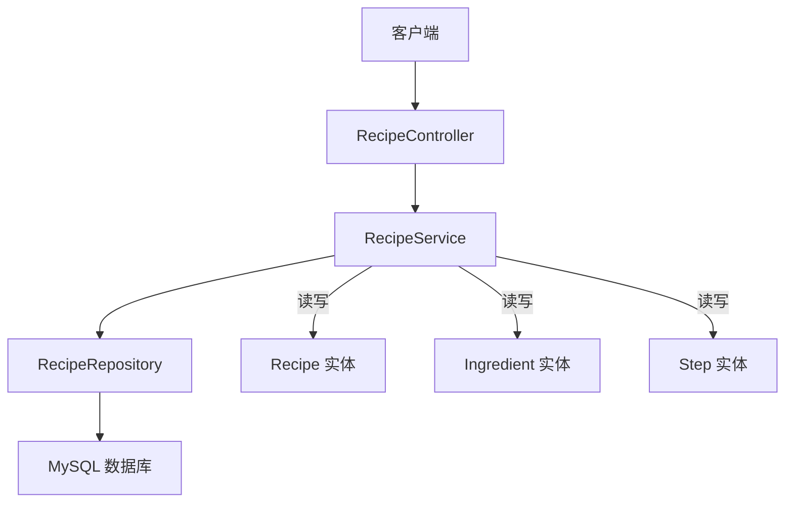
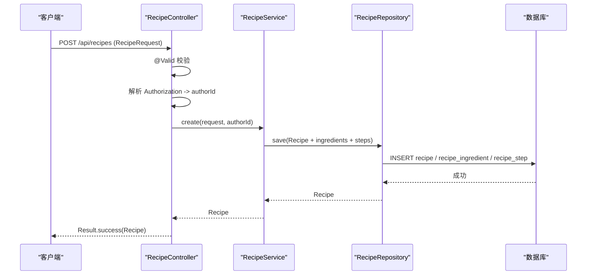
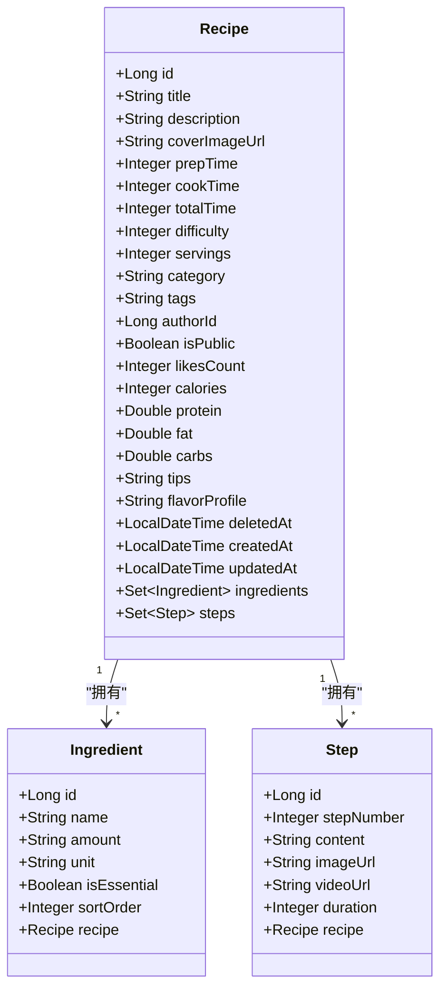
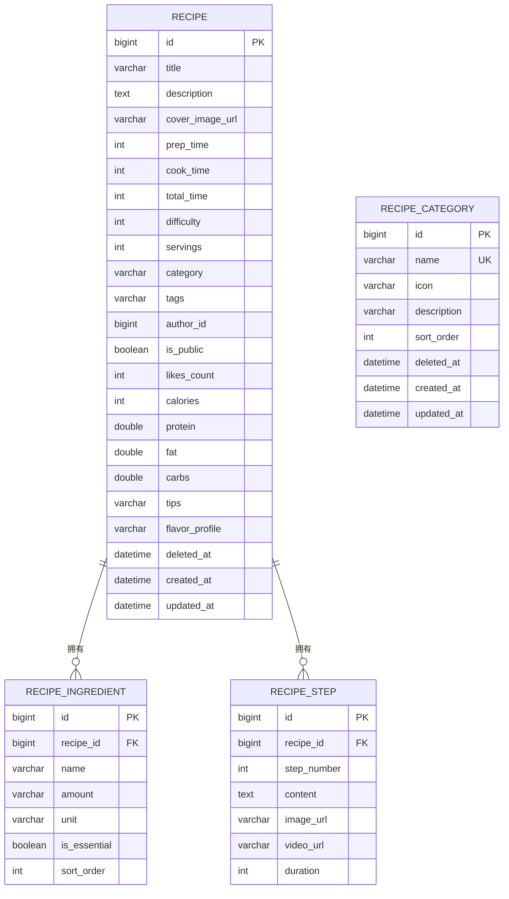
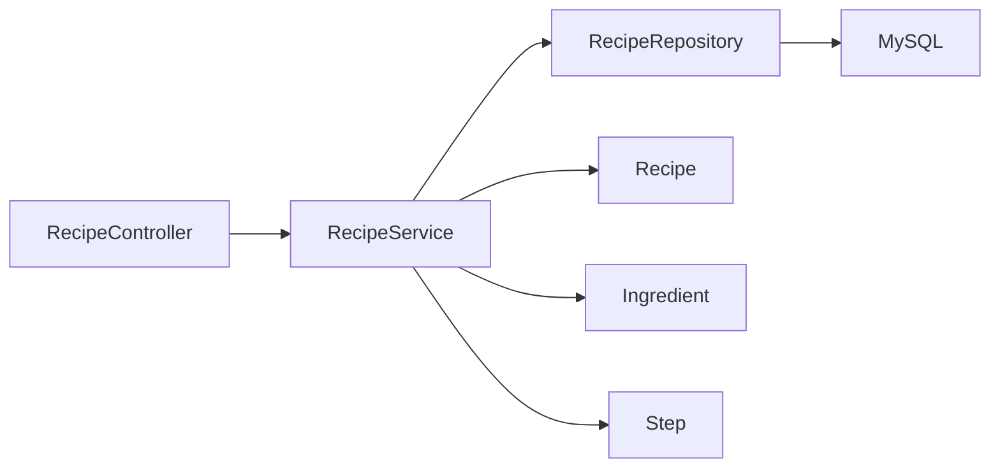

# 菜谱数据模型

<cite>
**本文引用的文件**
- [Recipe.java](file://java_server/po/src/main/java/com/goodzheng/po/entity/Recipe.java)
- [Ingredient.java](file://java_server/po/src/main/java/com/goodzheng/po/entity/Ingredient.java)
- [Step.java](file://java_server/po/src/main/java/com/goodzheng/po/entity/Step.java)
- [RecipeCategory.java](file://java_server/po/src/main/java/com/goodzheng/po/entity/RecipeCategory.java)
- [RecipeRequest.java](file://java_server/po/src/main/java/com/goodzheng/po/dto/RecipeRequest.java)
- [RecipeController.java](file://java_server/po/src/main/java/com/goodzheng/po/controller/RecipeController.java)
- [RecipeService.java](file://java_server/po/src/main/java/com/goodzheng/po/service/RecipeService.java)
- [RecipeRepository.java](file://java_server/po/src/main/java/com/goodzheng/po/repository/RecipeRepository.java)
- [application.yaml](file://java_server/po/src/main/resources/application.yaml)
- [data-hunan.sql](file://java_server/po/src/main/resources/data-hunan.sql)
- [data-category.sql](file://java_server/po/src/main/resources/data-category.sql)
</cite>

## 目录
1. [简介](#简介)
2. [项目结构](#项目结构)
3. [核心组件](#核心组件)
4. [架构总览](#架构总览)
5. [详细组件分析](#详细组件分析)
6. [依赖关系分析](#依赖关系分析)
7. [性能考虑](#性能考虑)
8. [故障排查指南](#故障排查指南)
9. [结论](#结论)
10. [附录](#附录)

## 简介
本技术文档围绕“菜谱”领域的数据模型展开，系统阐述 Recipe、Ingredient、Step、RecipeCategory 等实体的字段定义、数据类型与业务含义；说明实体间的一对多关系（如 Recipe 与 Ingredient、Recipe 与 Step）；描述 DTO 对象 RecipeRequest 的数据传输格式与校验规则；解释 JPA 注解的使用与映射配置；梳理数据验证机制；给出数据库表结构设计要点（主键、外键、索引等）；并提供 ER 图与示例数据。

## 项目结构
后端采用 Spring Boot + JPA/Hibernate 的分层架构：
- Controller 层：接收请求、参数校验、调用服务并返回统一结果
- Service 层：业务编排与事务边界
- Repository 层：基于 Spring Data JPA 的查询抽象
- Entity 层：JPA 实体映射到数据库表
- DTO 层：用于入参/出参的数据传输对象
- 配置文件：应用配置、JPA 行为、连接池等

图表来源
- [RecipeController.java:18-119](file://java_server/po/src/main/java/com/goodzheng/po/controller/RecipeController.java#L18-L119)
- [RecipeService.java:10-27](file://java_server/po/src/main/java/com/goodzheng/po/service/RecipeService.java#L10-L27)
- [RecipeRepository.java:13-35](file://java_server/po/src/main/java/com/goodzheng/po/repository/RecipeRepository.java#L13-L35)
- [Recipe.java:10-92](file://java_server/po/src/main/java/com/goodzheng/po/entity/Recipe.java#L10-L92)
- [Ingredient.java:9-41](file://java_server/po/src/main/java/com/goodzheng/po/entity/Ingredient.java#L9-L41)
- [Step.java:9-39](file://java_server/po/src/main/java/com/goodzheng/po/entity/Step.java#L9-L39)

章节来源
- [application.yaml:16-41](file://java_server/po/src/main/resources/application.yaml#L16-L41)
- [RecipeController.java:18-119](file://java_server/po/src/main/java/com/goodzheng/po/controller/RecipeController.java#L18-L119)
- [RecipeService.java:10-27](file://java_server/po/src/main/java/com/goodzheng/po/service/RecipeService.java#L10-L27)
- [RecipeRepository.java:13-35](file://java_server/po/src/main/java/com/goodzheng/po/repository/RecipeRepository.java#L13-L35)

## 核心组件
- Recipe：菜谱主实体，包含标题、描述、封面图、时间、难度、份数、分类、标签、作者、可见性、点赞数、营养信息、提示、风味、软删除标记及创建/更新时间戳；通过一对多关联管理食材与步骤集合。
- Ingredient：菜谱的食材项，包含名称、用量、单位、是否必需、排序；通过多对一关联到 Recipe。
- Step：菜谱的步骤项，包含步骤序号、内容、图片/视频链接、耗时；通过多对一关联到 Recipe。
- RecipeCategory：菜谱分类维度（功能分类、菜系、饮食方式等），提供分类元数据。
- RecipeRequest：DTO，承载创建/更新菜谱的请求体，包含基础字段、扩展字段以及嵌套的食材与步骤列表，并使用 Bean Validation 进行入参校验。

章节来源
- [Recipe.java:10-92](file://java_server/po/src/main/java/com/goodzheng/po/entity/Recipe.java#L10-L92)
- [Ingredient.java:9-41](file://java_server/po/src/main/java/com/goodzheng/po/entity/Ingredient.java#L9-L41)
- [Step.java:9-39](file://java_server/po/src/main/java/com/goodzheng/po/entity/Step.java#L9-L39)
- [RecipeCategory.java:8-45](file://java_server/po/src/main/java/com/goodzheng/po/entity/RecipeCategory.java#L8-L45)
- [RecipeRequest.java:10-65](file://java_server/po/src/main/java/com/goodzheng/po/dto/RecipeRequest.java#L10-L65)

## 架构总览
下图展示了从 HTTP 请求到持久化的关键流程，包括参数校验、身份解析、服务处理与仓储访问。

图表来源
- [RecipeController.java:28-39](file://java_server/po/src/main/java/com/goodzheng/po/controller/RecipeController.java#L28-L39)
- [RecipeService.java:12-12](file://java_server/po/src/main/java/com/goodzheng/po/service/RecipeService.java#L12-L12)
- [RecipeRepository.java:13-35](file://java_server/po/src/main/java/com/goodzheng/po/repository/RecipeRepository.java#L13-L35)
- [application.yaml:23-41](file://java_server/po/src/main/resources/application.yaml#L23-L41)

## 详细组件分析

### 实体：Recipe
- 标识与表映射
  - 使用 @Entity/@Table(name="recipe") 映射到表 recipe
  - 主键 id 自增
- 核心字段与业务含义
  - title：菜谱标题，必填，长度限制
  - description：菜谱描述
  - coverImageUrl：封面图 URL
  - prepTime/cookTime/totalTime：准备时间、烹饪时间、总时间（分钟）
  - difficulty：难度等级（1-简单，2-中等，3-困难），必填
  - servings：建议食用人数
  - category：分类（字符串，便于快速筛选）
  - tags：标签，逗号分隔字符串（如“下饭,低脂,快手菜”）
  - authorId：作者 ID（外键语义，指向用户）
  - isPublic：是否公开
  - likesCount：点赞数
  - calories/protein/fat/carbs：营养信息
  - tips/flavorProfile：小贴士与风味特征
  - deletedAt：软删除时间戳
  - createdAt/updatedAt：审计时间戳，@PreUpdate 自动更新 updatedAt
- 关联关系
  - @OneToMany(mappedBy="recipe", cascade=ALL, orphanRemoval=true) 关联 Ingredient 集合，按 sortOrder 排序
  - @OneToMany(mappedBy="recipe", cascade=ALL, orphanRemoval=true) 关联 Step 集合，按 stepNumber 排序

图表来源
- [Recipe.java:10-92](file://java_server/po/src/main/java/com/goodzheng/po/entity/Recipe.java#L10-L92)
- [Ingredient.java:9-41](file://java_server/po/src/main/java/com/goodzheng/po/entity/Ingredient.java#L9-L41)
- [Step.java:9-39](file://java_server/po/src/main/java/com/goodzheng/po/entity/Step.java#L9-L39)

章节来源
- [Recipe.java:10-92](file://java_server/po/src/main/java/com/goodzheng/po/entity/Recipe.java#L10-L92)

### 实体：Ingredient
- 映射到表 recipe_ingredient
- 字段：name（必填）、amount、unit、isEssential（默认必需）、sortOrder（默认排序）
- 关系：@ManyToOne(fetch=LAZY) 指向所属 Recipe，使用 @JoinColumn(name="recipe_id") 建立外键

章节来源
- [Ingredient.java:9-41](file://java_server/po/src/main/java/com/goodzheng/po/entity/Ingredient.java#L9-L41)

### 实体：Step
- 映射到表 recipe_step
- 字段：stepNumber（必填）、content（TEXT）、imageUrl、videoUrl、duration（分钟）
- 关系：@ManyToOne(fetch=LAZY) 指向所属 Recipe，使用 @JoinColumn(name="recipe_id") 建立外键

章节来源
- [Step.java:9-39](file://java_server/po/src/main/java/com/goodzheng/po/entity/Step.java#L9-L39)

### 实体：RecipeCategory
- 映射到表 recipe_category
- 字段：name（唯一）、icon、description、sortOrder、deletedAt、createdAt、updatedAt
- 用途：为菜谱提供多维分类能力（功能分类、菜系、饮食方式等）

章节来源
- [RecipeCategory.java:8-45](file://java_server/po/src/main/java/com/goodzheng/po/entity/RecipeCategory.java#L8-L45)

### DTO：RecipeRequest 与校验规则
- 顶层字段
  - title：@NotBlank，必填
  - difficulty：@NotNull，必填
  - 其他可选字段：description、coverImageUrl、prepTime、cookTime、totalTime、servings、category、tags、isPublic、营养信息、tips、flavorProfile
- 嵌套集合
  - ingredients：List<IngredientItem>，级联 @Valid 校验
    - IngredientItem：name(@NotBlank)、amount、unit、isEssential、sortOrder
  - steps：List<StepItem>，级联 @Valid 校验
    - StepItem：stepNumber(@NotNull)、content(@NotBlank)、imageUrl、videoUrl、duration
- 作用：作为创建/更新接口入参，集中约束业务规则，避免脏数据进入持久化层

章节来源
- [RecipeRequest.java:10-65](file://java_server/po/src/main/java/com/goodzheng/po/dto/RecipeRequest.java#L10-L65)
- [RecipeController.java:28-39](file://java_server/po/src/main/java/com/goodzheng/po/controller/RecipeController.java#L28-L39)

### JPA 注解与映射要点
- @Entity/@Table/@Column/@Id/@GeneratedValue：定义实体、表名、列约束与主键策略
- @OneToMany(mappedBy=..., cascade=ALL, orphanRemoval=true)：维护 Recipe 与子实体的双向关系，支持级联保存/删除与孤儿清理
- @OrderBy：保证集合读取顺序（ingredients.sortOrder、steps.stepNumber）
- @ManyToOne/@JoinColumn：在子实体中声明父实体引用与外键列
- @PreUpdate：自动刷新 updatedAt

章节来源
- [Recipe.java:10-92](file://java_server/po/src/main/java/com/goodzheng/po/entity/Recipe.java#L10-L92)
- [Ingredient.java:9-41](file://java_server/po/src/main/java/com/goodzheng/po/entity/Ingredient.java#L9-L41)
- [Step.java:9-39](file://java_server/po/src/main/java/com/goodzheng/po/entity/Step.java#L9-L39)

### 数据验证机制
- 控制器层使用 @Valid 触发 Bean Validation，对 RecipeRequest 进行校验
- 校验规则集中在 DTO 注解中（@NotBlank、@NotNull 等）
- 错误由控制器捕获并封装为统一错误响应

章节来源
- [RecipeController.java:28-39](file://java_server/po/src/main/java/com/goodzheng/po/controller/RecipeController.java#L28-L39)
- [RecipeRequest.java:10-65](file://java_server/po/src/main/java/com/goodzheng/po/dto/RecipeRequest.java#L10-L65)

### 数据库表结构设计
- 表 recipe（对应 Recipe 实体）
  - 主键：id（自增）
  - 非空约束：title、difficulty、authorId、isPublic、likesCount
  - 文本与长度限制：title、description、coverImageUrl、category、tags、tips、flavorProfile
  - 数值型：prepTime、cookTime、totalTime、servings、calories、protein、fat、carbs、likesCount
  - 布尔型：isPublic
  - 时间戳：deletedAt、createdAt、updatedAt
  - 索引建议：
    - 查询优化：authorId、category、deletedAt、createdAt
    - 搜索优化：title、description（全文或 LIKE 前缀）
- 表 recipe_ingredient（对应 Ingredient 实体）
  - 主键：id
  - 外键：recipe_id（指向 recipe.id）
  - 非空约束：name、isEssential、sortOrder
  - 索引建议：recipe_id、sort_order
- 表 recipe_step（对应 Step 实体）
  - 主键：id
  - 外键：recipe_id（指向 recipe.id）
  - 非空约束：step_number、content
  - 索引建议：recipe_id、step_number
- 表 recipe_category（对应 RecipeCategory 实体）
  - 主键：id
  - 唯一约束：name
  - 非空约束：sort_order
  - 索引建议：sort_order

章节来源
- [Recipe.java:10-92](file://java_server/po/src/main/java/com/goodzheng/po/entity/Recipe.java#L10-L92)
- [Ingredient.java:9-41](file://java_server/po/src/main/java/com/goodzheng/po/entity/Ingredient.java#L9-L41)
- [Step.java:9-39](file://java_server/po/src/main/java/com/goodzheng/po/entity/Step.java#L9-L39)
- [RecipeCategory.java:8-45](file://java_server/po/src/main/java/com/goodzheng/po/entity/RecipeCategory.java#L8-L45)
- [application.yaml:23-41](file://java_server/po/src/main/resources/application.yaml#L23-L41)

### ER 图

图表来源
- [Recipe.java:10-92](file://java_server/po/src/main/java/com/goodzheng/po/entity/Recipe.java#L10-L92)
- [Ingredient.java:9-41](file://java_server/po/src/main/java/com/goodzheng/po/entity/Ingredient.java#L9-L41)
- [Step.java:9-39](file://java_server/po/src/main/java/com/goodzheng/po/entity/Step.java#L9-L39)
- [RecipeCategory.java:8-45](file://java_server/po/src/main/java/com/goodzheng/po/entity/RecipeCategory.java#L8-L45)

### 示例数据
- 湖南菜谱种子数据（包含 10 道经典湘菜），每条记录均包含 recipe、recipe_ingredient、recipe_step 的插入语句，演示了标题、描述、时间、难度、份数、分类、标签、营养信息、步骤与食材的完整结构。
- 分类种子数据（功能分类、菜系、饮食方式），演示了分类维度的初始化。

章节来源
- [data-hunan.sql:1-204](file://java_server/po/src/main/resources/data-hunan.sql#L1-L204)
- [data-category.sql:1-39](file://java_server/po/src/main/resources/data-category.sql#L1-L39)

## 依赖关系分析
- 控制器依赖服务与工具类：
  - RecipeController 依赖 RecipeService、JwtUtil、UserRepository
- 服务层依赖仓储：
  - RecipeService 通过 RecipeRepository 完成 CRUD 与复杂查询
- 仓储层依赖 JPA：
  - RecipeRepository 继承 JpaRepository，提供分页、条件查询、JOIN FETCH 预加载
- 实体间耦合：
  - Recipe 与 Ingredient、Step 通过 @OneToMany/@ManyToOne 形成强关联，级联操作简化维护

图表来源
- [RecipeController.java:18-119](file://java_server/po/src/main/java/com/goodzheng/po/controller/RecipeController.java#L18-L119)
- [RecipeService.java:10-27](file://java_server/po/src/main/java/com/goodzheng/po/service/RecipeService.java#L10-L27)
- [RecipeRepository.java:13-35](file://java_server/po/src/main/java/com/goodzheng/po/repository/RecipeRepository.java#L13-L35)

章节来源
- [RecipeController.java:18-119](file://java_server/po/src/main/java/com/goodzheng/po/controller/RecipeController.java#L18-L119)
- [RecipeService.java:10-27](file://java_server/po/src/main/java/com/goodzheng/po/service/RecipeService.java#L10-L27)
- [RecipeRepository.java:13-35](file://java_server/po/src/main/java/com/goodzheng/po/repository/RecipeRepository.java#L13-L35)

## 性能考虑
- 懒加载与预加载
  - 子实体默认 LAZY 加载，详情查询使用 JOIN FETCH 预加载 ingredients/steps，避免 N+1 问题
- 分页与排序
  - 列表接口使用 Pageable 分页，默认按 createdAt 降序
- 连接池与 JPA
  - HikariCP 连接池大小、超时等参数已配置；Hibernate DDL 自动更新便于开发环境迭代
- 索引设计
  - 建议在常用查询字段（authorId、category、deletedAt、title、description）建立索引以提升检索性能

章节来源
- [RecipeRepository.java:16-34](file://java_server/po/src/main/java/com/goodzheng/po/repository/RecipeRepository.java#L16-L34)
- [application.yaml:23-41](file://java_server/po/src/main/resources/application.yaml#L23-L41)

## 故障排查指南
- 参数校验失败
  - 现象：创建/更新接口返回 400 错误
  - 原因：RecipeRequest 中的必填字段未满足 @NotBlank/@NotNull
  - 处理：检查请求体字段是否符合校验规则
- 认证失败
  - 现象：需要认证的接口返回 401
  - 原因：Authorization 头缺失或 JWT 解析失败
  - 处理：确保携带正确的 Bearer Token，且用户名存在
- 懒加载异常
  - 现象：获取详情后访问 ingredients/steps 抛出 LazyInitializationException
  - 原因：未在视图层或查询时预加载
  - 处理：使用 findByIdWithDetails 或通过 JOIN FETCH 预加载

章节来源
- [RecipeController.java:28-39](file://java_server/po/src/main/java/com/goodzheng/po/controller/RecipeController.java#L28-L39)
- [RecipeController.java:70-83](file://java_server/po/src/main/java/com/goodzheng/po/controller/RecipeController.java#L70-L83)
- [RecipeRepository.java:16-18](file://java_server/po/src/main/java/com/goodzheng/po/repository/RecipeRepository.java#L16-L18)

## 结论
本数据模型以 Recipe 为核心，通过一对多关系组织食材与步骤，配合 DTO 校验与 JPA 映射，实现了清晰的领域建模与稳健的数据持久化。结合合理的索引设计与分页查询，可支撑高并发场景下的菜谱浏览与编辑需求。示例数据与分类种子数据有助于快速搭建与演示系统功能。

## 附录
- 配置要点
  - 数据源与连接池：HikariCP 最大连接数、超时等
  - JPA：DDL 自动更新、SQL 输出开关、OpenInView 模式
  - 文件上传：最大文件大小与请求大小限制
- 参考路径
  - 实体定义：[Recipe.java](file://java_server/po/src/main/java/com/goodzheng/po/entity/Recipe.java)、[Ingredient.java](file://java_server/po/src/main/java/com/goodzheng/po/entity/Ingredient.java)、[Step.java](file://java_server/po/src/main/java/com/goodzheng/po/entity/Step.java)、[RecipeCategory.java](file://java_server/po/src/main/java/com/goodzheng/po/entity/RecipeCategory.java)
  - DTO 与校验：[RecipeRequest.java](file://java_server/po/src/main/java/com/goodzheng/po/dto/RecipeRequest.java)
  - 控制器与服务：[RecipeController.java](file://java_server/po/src/main/java/com/goodzheng/po/controller/RecipeController.java)、[RecipeService.java](file://java_server/po/src/main/java/com/goodzheng/po/service/RecipeService.java)
  - 仓储与查询：[RecipeRepository.java](file://java_server/po/src/main/java/com/goodzheng/po/repository/RecipeRepository.java)
  - 配置与数据：[application.yaml](file://java_server/po/src/main/resources/application.yaml)、[data-hunan.sql](file://java_server/po/src/main/resources/data-hunan.sql)、[data-category.sql](file://java_server/po/src/main/resources/data-category.sql)