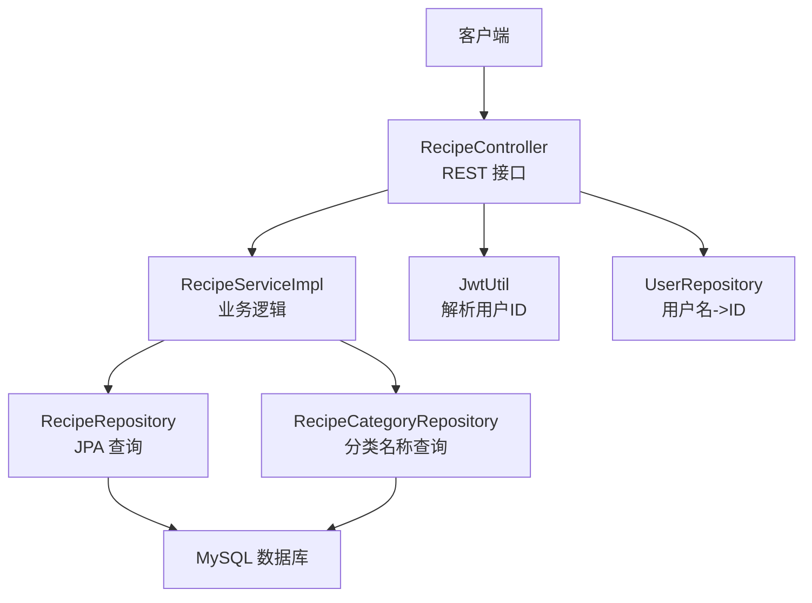
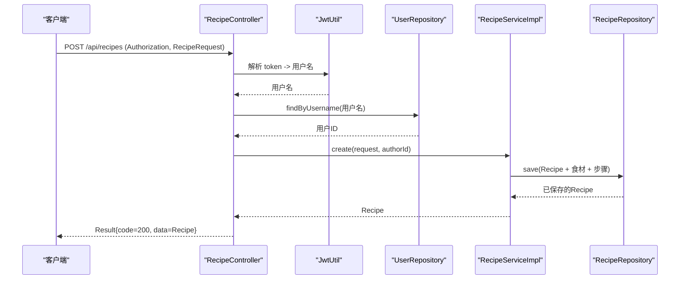
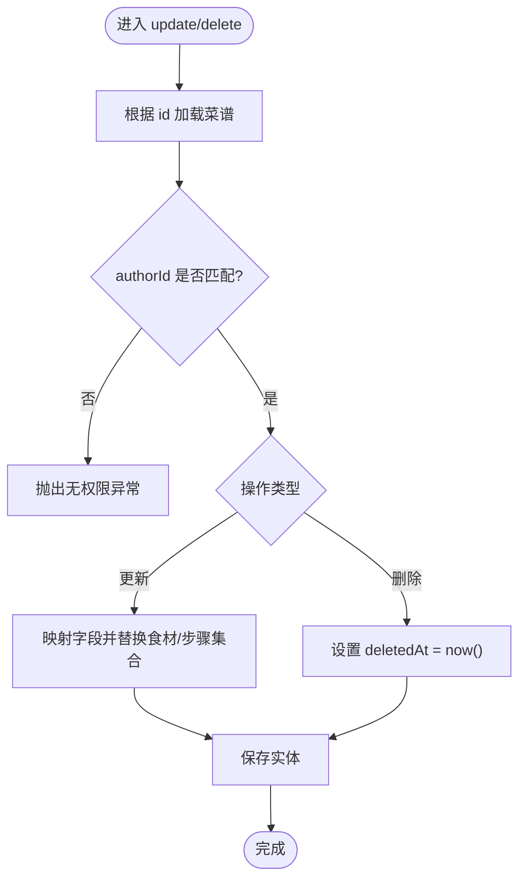
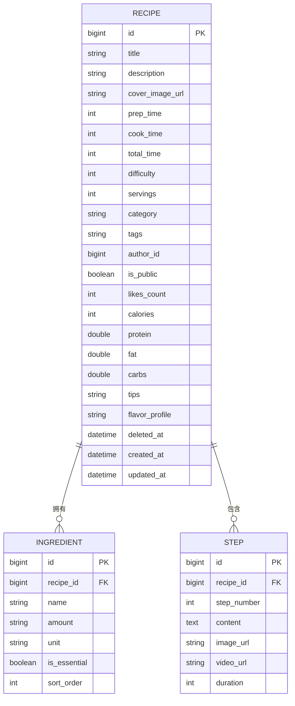
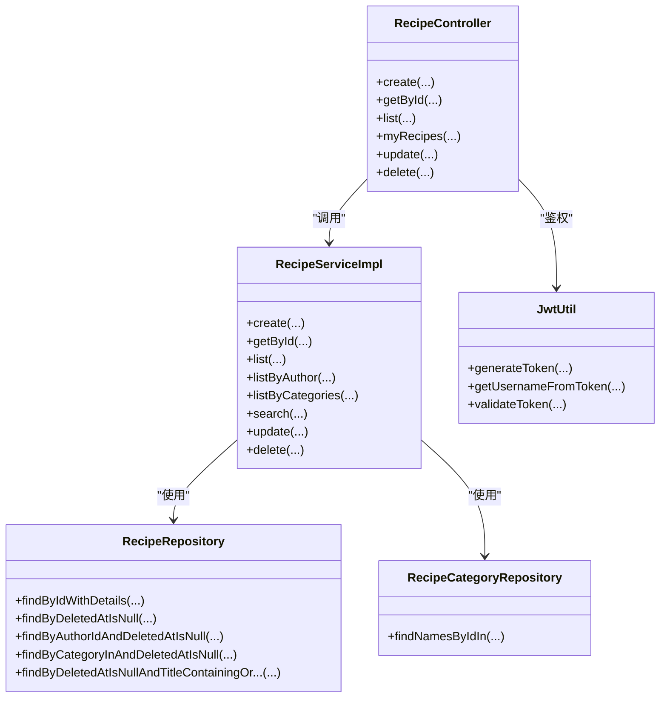

# 菜谱管理模块

<cite>
**本文引用的文件**
- [RecipeController.java](file://java_server/po/src/main/java/com/goodzheng/po/controller/RecipeController.java)
- [RecipeService.java](file://java_server/po/src/main/java/com/goodzheng/po/service/RecipeService.java)
- [RecipeServiceImpl.java](file://java_server/po/src/main/java/com/goodzheng/po/service/impl/RecipeServiceImpl.java)
- [RecipeRepository.java](file://java_server/po/src/main/java/com/goodzheng/po/repository/RecipeRepository.java)
- [RecipeCategoryRepository.java](file://java_server/po/src/main/java/com/goodzheng/po/repository/RecipeCategoryRepository.java)
- [Recipe.java](file://java_server/po/src/main/java/com/goodzheng/po/entity/Recipe.java)
- [Ingredient.java](file://java_server/po/src/main/java/com/goodzheng/po/entity/Ingredient.java)
- [Step.java](file://java_server/po/src/main/java/com/goodzheng/po/entity/Step.java)
- [RecipeCategory.java](file://java_server/po/src/main/java/com/goodzheng/po/entity/RecipeCategory.java)
- [RecipeRequest.java](file://java_server/po/src/main/java/com/goodzheng/po/dto/RecipeRequest.java)
- [Result.java](file://java_server/po/src/main/java/com/goodzheng/po/dto/Result.java)
- [JwtUtil.java](file://java_server/po/src/main/java/com/goodzheng/po/util/JwtUtil.java)
- [application.yaml](file://java_server/po/src/main/resources/application.yaml)
</cite>

## 目录
1. [简介](#简介)
2. [项目结构](#项目结构)
3. [核心组件](#核心组件)
4. [架构总览](#架构总览)
5. [详细组件分析](#详细组件分析)
6. [依赖关系分析](#依赖关系分析)
7. [性能考虑](#性能考虑)
8. [故障排查指南](#故障排查指南)
9. [结论](#结论)
10. [附录：API 参考与调用示例](#附录api-参考与调用示例)

## 简介
本技术文档聚焦于“菜谱管理模块”，覆盖 RESTful API 设计、业务逻辑实现、数据访问层设计与高级查询（分页、排序、过滤、搜索）等。文档面向不同技术背景的读者，提供从高层到代码级的逐步深入说明，并附带完整的接口规范与错误处理策略，帮助快速集成与排错。

## 项目结构
后端采用典型的分层架构：
- 控制器层：接收 HTTP 请求，参数校验，统一响应封装
- 服务层：业务编排、权限校验、事务控制
- 仓储层：JPA Repository，定义复杂查询与分页
- 实体层：JPA 实体映射，包含软删除、时间戳、关联关系
- DTO 层：入参校验与数据传输对象
- 工具层：JWT 解析与鉴权辅助

图表来源
- [RecipeController.java:18-119](file://java_server/po/src/main/java/com/goodzheng/po/controller/RecipeController.java#L18-L119)
- [RecipeServiceImpl.java:19-174](file://java_server/po/src/main/java/com/goodzheng/po/service/impl/RecipeServiceImpl.java#L19-L174)
- [RecipeRepository.java:13-35](file://java_server/po/src/main/java/com/goodzheng/po/repository/RecipeRepository.java#L13-L35)
- [RecipeCategoryRepository.java:10-17](file://java_server/po/src/main/java/com/goodzheng/po/repository/RecipeCategoryRepository.java#L10-L17)
- [JwtUtil.java:13-55](file://java_server/po/src/main/java/com/goodzheng/po/util/JwtUtil.java#L13-L55)

章节来源
- [RecipeController.java:18-119](file://java_server/po/src/main/java/com/goodzheng/po/controller/RecipeController.java#L18-L119)
- [application.yaml:1-109](file://java_server/po/src/main/resources/application.yaml#L1-L109)

## 核心组件
- 控制器：提供菜谱的创建、详情、列表、我的菜谱、更新、删除接口；支持按分类与关键字筛选与分页
- 服务：实现创建/更新时的实体映射与级联保存、软删除、权限校验、分页与搜索
- 仓储：定义预加载详情、软删除过滤、作者/分类/关键字查询等
- 实体：菜谱主表及食材、步骤一对多关系；支持软删除与时间戳
- DTO：入参校验规则与嵌套结构（食材、步骤）
- 工具：JWT 解析获取当前用户 ID

章节来源
- [RecipeController.java:18-119](file://java_server/po/src/main/java/com/goodzheng/po/controller/RecipeController.java#L18-L119)
- [RecipeService.java:10-27](file://java_server/po/src/main/java/com/goodzheng/po/service/RecipeService.java#L10-L27)
- [RecipeServiceImpl.java:26-174](file://java_server/po/src/main/java/com/goodzheng/po/service/impl/RecipeServiceImpl.java#L26-L174)
- [RecipeRepository.java:13-35](file://java_server/po/src/main/java/com/goodzheng/po/repository/RecipeRepository.java#L13-L35)
- [Recipe.java:10-92](file://java_server/po/src/main/java/com/goodzheng/po/entity/Recipe.java#L10-L92)
- [Ingredient.java:9-41](file://java_server/po/src/main/java/com/goodzheng/po/entity/Ingredient.java#L9-L41)
- [Step.java:9-39](file://java_server/po/src/main/java/com/goodzheng/po/entity/Step.java#L9-L39)
- [RecipeRequest.java:10-65](file://java_server/po/src/main/java/com/goodzheng/po/dto/RecipeRequest.java#L10-L65)
- [Result.java:7-31](file://java_server/po/src/main/java/com/goodzheng/po/dto/Result.java#L7-L31)
- [JwtUtil.java:13-55](file://java_server/po/src/main/java/com/goodzheng/po/util/JwtUtil.java#L13-L55)

## 架构总览
下图展示一次“创建菜谱”的请求在系统中的流转过程，包括鉴权、参数校验、业务组装与持久化。

图表来源
- [RecipeController.java:28-39](file://java_server/po/src/main/java/com/goodzheng/po/controller/RecipeController.java#L28-L39)
- [JwtUtil.java:25-37](file://java_server/po/src/main/java/com/goodzheng/po/util/JwtUtil.java#L25-L37)
- [RecipeServiceImpl.java:26-60](file://java_server/po/src/main/java/com/goodzheng/po/service/impl/RecipeServiceImpl.java#L26-L60)
- [RecipeRepository.java:13-18](file://java_server/po/src/main/java/com/goodzheng/po/repository/RecipeRepository.java#L13-L18)

## 详细组件分析

### 控制器层：RESTful API 设计
- 基础路径：/api/recipes（应用上下文为 /api）
- 认证方式：请求头 Authorization: Bearer <token>
- 统一响应：Result<T>，包含 code、message、data

| 方法 | 路径 | 说明 | 关键参数 | 返回 |
|---|---|---|---|---|
| POST | /api/recipes | 创建菜谱 | 请求体 RecipeRequest；Header: Authorization | Result<Recipe> |
| GET | /api/recipes/{id} | 获取详情 | 路径 id | Result<Recipe> |
| GET | /api/recipes | 分页列表 | page, size, categoryId[], keyword | Result<Page<Recipe>> |
| GET | /api/recipes/mine | 我的菜谱 | Header: Authorization; page, size | Result<Page<Recipe>> |
| PUT | /api/recipes/{id} | 更新菜谱 | 路径 id；请求体 RecipeRequest；Header: Authorization | Result<Recipe> |
| DELETE | /api/recipes/{id} | 软删除 | 路径 id；Header: Authorization | Result<String> |

- 分页默认：page=0, size=20，默认排序 createdAt 降序
- 过滤：categoryId[] 多选分类；keyword 标题/描述模糊匹配
- 鉴权：通过 Authorization 头中的 JWT 解析出用户名，再查用户 ID 作为 authorId

章节来源
- [RecipeController.java:18-119](file://java_server/po/src/main/java/com/goodzheng/po/controller/RecipeController.java#L18-L119)
- [application.yaml:4-7](file://java_server/po/src/main/resources/application.yaml#L4-L7)
- [Result.java:7-31](file://java_server/po/src/main/java/com/goodzheng/po/dto/Result.java#L7-L31)

### 服务层：业务逻辑实现
- 创建：将 DTO 映射为实体，设置 authorId，级联保存食材与步骤
- 详情：使用 JOIN FETCH 预加载关联，避免懒加载异常；检查软删除状态
- 列表：仅返回未软删除记录；支持按作者、分类集合、关键字搜索
- 更新：校验作者权限；替换食材与步骤集合；保存变更
- 删除：软删除，记录 deletedAt

图表来源
- [RecipeServiceImpl.java:99-151](file://java_server/po/src/main/java/com/goodzheng/po/service/impl/RecipeServiceImpl.java#L99-L151)

章节来源
- [RecipeServiceImpl.java:26-174](file://java_server/po/src/main/java/com/goodzheng/po/service/impl/RecipeServiceImpl.java#L26-L174)

### 数据访问层：JPA 实体与仓库
- 实体关系
  - Recipe 与 Ingredient、Step 为一对多，级联保存与删除，有序排列
  - 软删除字段 deletedAt 用于逻辑删除
  - 时间戳 createdAt/updatedAt 自动维护
- 仓库方法
  - 详情：JOIN FETCH 预加载 ingredients/steps
  - 列表：按 deletedAt 为空过滤
  - 作者：按 authorId 过滤
  - 分类：按 category 或 category IN 列表过滤
  - 搜索：标题/描述包含关键字

图表来源
- [Recipe.java:10-92](file://java_server/po/src/main/java/com/goodzheng/po/entity/Recipe.java#L10-L92)
- [Ingredient.java:9-41](file://java_server/po/src/main/java/com/goodzheng/po/entity/Ingredient.java#L9-L41)
- [Step.java:9-39](file://java_server/po/src/main/java/com/goodzheng/po/entity/Step.java#L9-L39)

章节来源
- [RecipeRepository.java:13-35](file://java_server/po/src/main/java/com/goodzheng/po/repository/RecipeRepository.java#L13-L35)
- [RecipeCategoryRepository.java:10-17](file://java_server/po/src/main/java/com/goodzheng/po/repository/RecipeCategoryRepository.java#L10-L17)
- [Recipe.java:10-92](file://java_server/po/src/main/java/com/goodzheng/po/entity/Recipe.java#L10-L92)

### 高级查询：分页、排序、过滤、搜索
- 分页与排序
  - 默认：page=0, size=20，按 createdAt 降序
  - 可通过 PageRequest 自定义排序与页码
- 过滤
  - 分类：支持单个或多个分类（IN），内部先根据分类 ID 列表查询名称，再按名称过滤
  - 作者：仅返回指定作者的菜谱
- 搜索
  - 关键字同时匹配标题与描述（OR 条件）
- 软删除
  - 所有列表/搜索均排除 deletedAt 不为空的记录

章节来源
- [RecipeController.java:51-68](file://java_server/po/src/main/java/com/goodzheng/po/controller/RecipeController.java#L51-L68)
- [RecipeServiceImpl.java:73-97](file://java_server/po/src/main/java/com/goodzheng/po/service/impl/RecipeServiceImpl.java#L73-L97)
- [RecipeRepository.java:20-35](file://java_server/po/src/main/java/com/goodzheng/po/repository/RecipeRepository.java#L20-L35)

## 依赖关系分析
- 控制器依赖服务与工具：
  - 通过 JwtUtil 解析 token，再通过 UserRepository 获取 authorId
  - 调用 RecipeService 执行具体业务
- 服务依赖仓储：
  - RecipeRepository 负责菜谱 CRUD 与复杂查询
  - RecipeCategoryRepository 负责分类名称查询以支持按分类过滤
- 实体间关系：
  - Recipe 与 Ingredient、Step 一对多，级联操作
  - 软删除与时间戳由实体生命周期回调维护

图表来源
- [RecipeController.java:18-119](file://java_server/po/src/main/java/com/goodzheng/po/controller/RecipeController.java#L18-L119)
- [RecipeServiceImpl.java:19-174](file://java_server/po/src/main/java/com/goodzheng/po/service/impl/RecipeServiceImpl.java#L19-L174)
- [RecipeRepository.java:13-35](file://java_server/po/src/main/java/com/goodzheng/po/repository/RecipeRepository.java#L13-L35)
- [RecipeCategoryRepository.java:10-17](file://java_server/po/src/main/java/com/goodzheng/po/repository/RecipeCategoryRepository.java#L10-L17)
- [JwtUtil.java:13-55](file://java_server/po/src/main/java/com/goodzheng/po/util/JwtUtil.java#L13-L55)

章节来源
- [RecipeController.java:18-119](file://java_server/po/src/main/java/com/goodzheng/po/controller/RecipeController.java#L18-L119)
- [RecipeServiceImpl.java:19-174](file://java_server/po/src/main/java/com/goodzheng/po/service/impl/RecipeServiceImpl.java#L19-L174)

## 性能考虑
- 预加载优化：详情查询使用 JOIN FETCH 预加载食材与步骤，避免 N+1 问题
- 软删除过滤：列表与搜索均基于 deletedAt 过滤，减少无效数据
- 分页与排序：默认按创建时间倒序，合理设置 page/size 避免大结果集
- 连接池：HikariCP 配置了最大连接数与超时，建议根据负载调优
- 缓存：预留 Redis 配置，可在热点数据（如分类列表）引入缓存层

[本节为通用性能建议，不直接分析具体文件]

## 故障排查指南
- 常见错误与定位
  - 401 未授权：Authorization 缺失或 token 无效；检查 JwtUtil 解析流程
  - 404 不存在：id 对应的菜谱不存在或已被软删除；检查 getById 与软删除判断
  - 400 参数错误：DTO 校验失败（必填项、格式）；检查 RecipeRequest 注解
  - 无权限修改/删除：authorId 不匹配；确认登录用户与菜谱作者一致
- 日志与监控
  - 开启 show-sql 观察 SQL
  - Actuator 暴露 health/info/metrics/prometheus，便于健康检查与指标采集
- 配置检查
  - 数据库连接、Redis、JWT 密钥与过期时间是否正确

章节来源
- [RecipeController.java:28-109](file://java_server/po/src/main/java/com/goodzheng/po/controller/RecipeController.java#L28-L109)
- [RecipeServiceImpl.java:62-151](file://java_server/po/src/main/java/com/goodzheng/po/service/impl/RecipeServiceImpl.java#L62-L151)
- [application.yaml:35-48](file://java_server/po/src/main/resources/application.yaml#L35-L48)
- [application.yaml:84-94](file://java_server/po/src/main/resources/application.yaml#L84-L94)

## 结论
本模块以清晰的三层架构实现了菜谱的完整生命周期管理，结合 JPA 预加载与软删除机制，兼顾性能与数据一致性。通过统一的 Result 响应与严格的 DTO 校验，提升了接口的健壮性与可维护性。建议在后续迭代中引入缓存与更细粒度的权限控制，进一步优化体验与安全。

## 附录：API 参考与调用示例

### 统一响应格式
- 结构：Result<T>
  - code：状态码（200 成功，其他为错误码）
  - message：提示信息
  - data：业务数据

章节来源
- [Result.java:7-31](file://java_server/po/src/main/java/com/goodzheng/po/dto/Result.java#L7-L31)

### 接口清单与示例

- 创建菜谱
  - 方法：POST
  - 路径：/api/recipes
  - 请求头：Authorization: Bearer <token>
  - 请求体：RecipeRequest（包含 title、difficulty、ingredients、steps 等）
  - 响应：Result<Recipe>

- 获取详情
  - 方法：GET
  - 路径：/api/recipes/{id}
  - 响应：Result<Recipe>

- 分页列表
  - 方法：GET
  - 路径：/api/recipes?page=0&size=20&categoryId[]=1&categoryId[]=2&keyword=湘菜
  - 响应：Result<Page<Recipe>>

- 我的菜谱
  - 方法：GET
  - 路径：/api/recipes/mine?page=0&size=20
  - 请求头：Authorization: Bearer <token>
  - 响应：Result<Page<Recipe>>

- 更新菜谱
  - 方法：PUT
  - 路径：/api/recipes/{id}
  - 请求头：Authorization: Bearer <token>
  - 请求体：RecipeRequest
  - 响应：Result<Recipe>

- 删除菜谱（软删除）
  - 方法：DELETE
  - 路径：/api/recipes/{id}
  - 请求头：Authorization: Bearer <token>
  - 响应：Result<String>

章节来源
- [RecipeController.java:28-109](file://java_server/po/src/main/java/com/goodzheng/po/controller/RecipeController.java#L28-L109)
- [application.yaml:4-7](file://java_server/po/src/main/resources/application.yaml#L4-L7)

### 错误处理策略
- 控制器捕获运行时异常并转换为 Result.error(code, message)
- 典型错误码
  - 400：参数错误或业务校验失败
  - 401：鉴权失败
  - 404：资源不存在或已软删除
- 建议前端根据 code 进行提示与跳转

章节来源
- [RecipeController.java:28-109](file://java_server/po/src/main/java/com/goodzheng/po/controller/RecipeController.java#L28-L109)
- [Result.java:16-31](file://java_server/po/src/main/java/com/goodzheng/po/dto/Result.java#L16-L31)