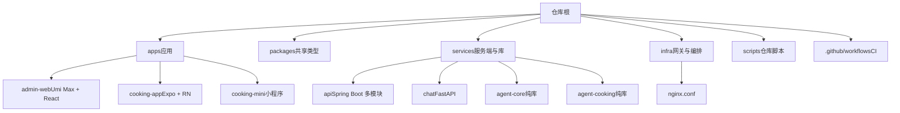
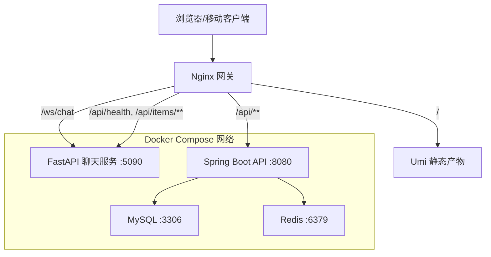
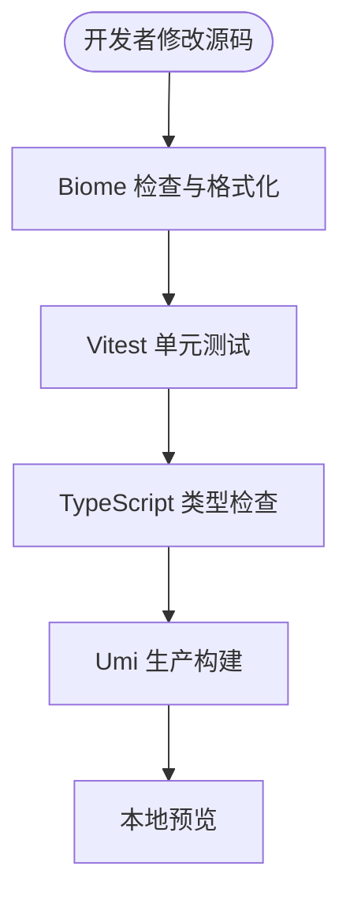
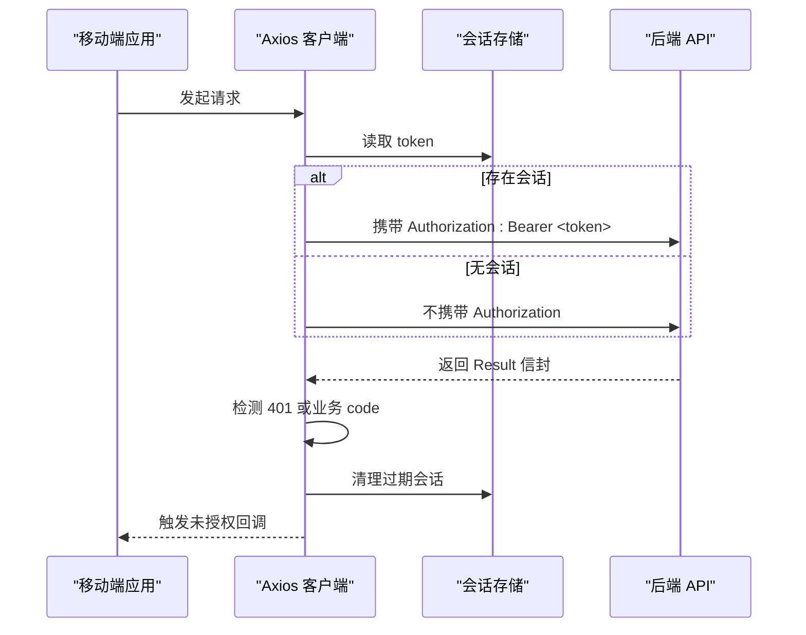
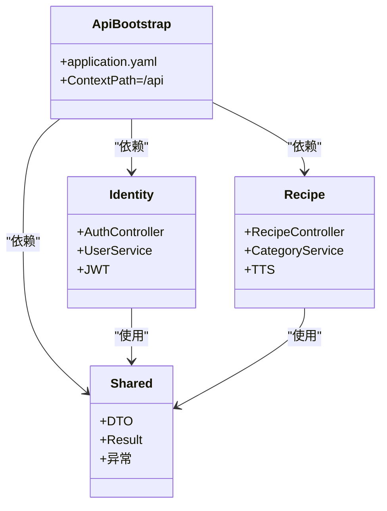
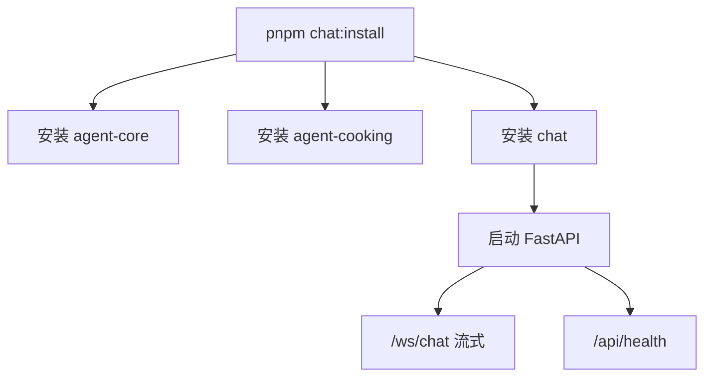
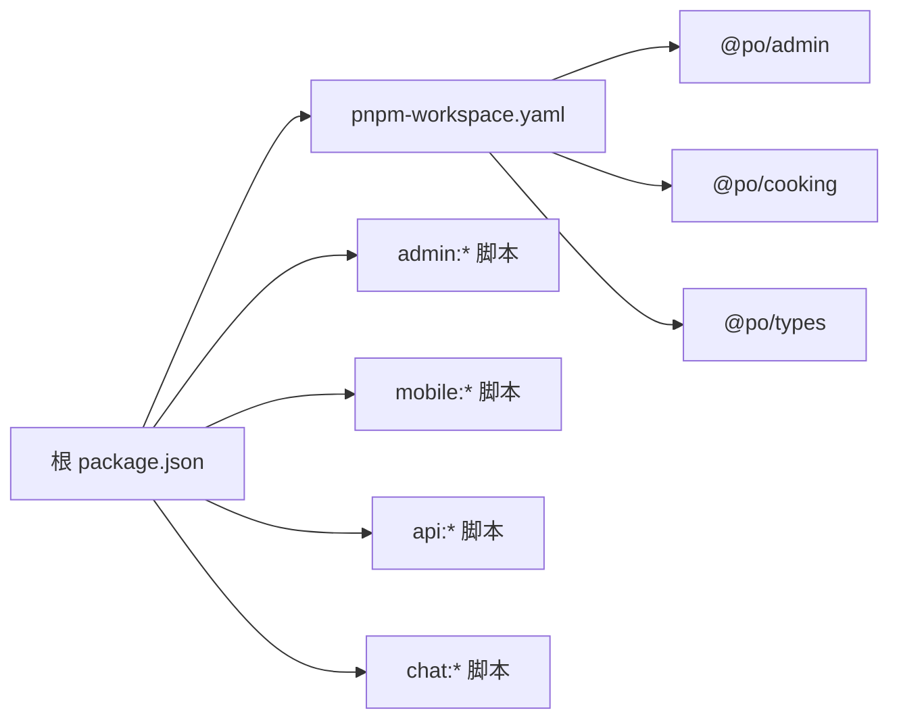

# 开发指南

<cite>
**本文引用的文件**   
- [README.md](file://README.md)
- [package.json](file://package.json)
- [.github/workflows/ci.yml](file://.github/workflows/ci.yml)
- [.commitlintrc.cjs](file://.commitlintrc.cjs)
- [.lintstagedrc](file://.lintstagedrc)
- [pnpm-workspace.yaml](file://pnpm-workspace.yaml)
- [apps/admin-web/package.json](file://apps/admin-web/package.json)
- [apps/admin-web/biome.json](file://apps/admin-web/biome.json)
- [apps/admin-web/vitest.config.ts](file://apps/admin-web/vitest.config.ts)
- [apps/admin-web/src/app.test.tsx](file://apps/admin-web/src/app.test.tsx)
- [apps/admin-web/src/requestErrorConfig.test.ts](file://apps/admin-web/src/requestErrorConfig.test.ts)
- [apps/admin-web/tests/setupTests.ts](file://apps/admin-web/tests/setupTests.ts)
- [apps/cooking-app/package.json](file://apps/cooking-app/package.json)
- [apps/cooking-app/jest.config.js](file://apps/cooking-app/jest.config.js)
- [apps/cooking-app/src/__tests__/auth-client.test.ts](file://apps/cooking-app/src/__tests__/auth-client.test.ts)
- [services/api/pom.xml](file://services/api/pom.xml)
- [services/chat/pyproject.toml](file://services/chat/pyproject.toml)
- [services/agent-core/pyproject.toml](file://services/agent-core/pyproject.toml)
</cite>

## 目录
1. [引言](#引言)
2. [项目结构](#项目结构)
3. [核心组件](#核心组件)
4. [架构总览](#架构总览)
5. [详细组件分析](#详细组件分析)
6. [依赖关系分析](#依赖关系分析)
7. [性能与质量保障](#性能与质量保障)
8. [调试与排错指南](#调试与排错指南)
9. [新功能开发流程](#新功能开发流程)
10. [分支管理与发布流程](#分支管理与发布流程)
11. [常见问题解答](#常见问题解答)
12. [开发环境配置指南](#开发环境配置指南)
13. [结论](#结论)

## 引言
本开发指南面向仓库所有贡献者，目标是建立统一的代码风格、Git 工作流、提交规范、代码审查流程、测试策略、调试方法、安全扫描与发布流程。本项目为全栈 Monorepo：前端使用 Umi Max + React + Ant Design，移动端使用 Expo + React Native，后端 Java Spring Boot 提供业务 API，Python FastAPI 提供聊天服务，Agent 编排由纯库 po-agent-core 和垂直 Agent po-agent-cooking 组成，基础设施通过 Docker Compose 与 Nginx 网关统一编排。

## 项目结构
仓库采用分层与领域混合的组织方式：
- apps：应用层，包含管理端 admin-web 与移动端 cooking-app，以及小程序 cooking-mini。
- packages：共享包，当前为 TypeScript 类型包 @po/types。
- services：服务端模块，包含 Java Spring Boot 单体聚合 services/api、FastAPI 聊天服务 services/chat、Agent 核心库 services/agent-core、烹饪助手库 services/agent-cooking。
- infra：基础设施，Nginx 网关配置。
- scripts：仓库根脚本，封装各服务安装、启动、部署命令。
- .github/workflows：持续集成流水线。

**图表来源**
- [README.md:16-34](file://README.md#L16-L34)
- [pnpm-workspace.yaml:1-5](file://pnpm-workspace.yaml#L1-L5)

**章节来源**
- [README.md:1-34](file://README.md#L1-L34)
- [pnpm-workspace.yaml:1-5](file://pnpm-workspace.yaml#L1-L5)

## 核心组件
- 管理端 admin-web：基于 Umi Max 4、React 19、Ant Design 6、React Query 5、Vitest 4、Biome；提供路由、国际化、Mock、OpenAPI 生成、构建与预览脚本。
- 移动端 cooking-app：基于 Expo SDK 57、React Native、expo-router、NativeWind、React Query、Jest；提供 Android/iOS/Web 开发与构建命令。
- 共享类型 @po/types：前后端共享的 TypeScript 类型定义，供 admin-web 与 cooking-app 引用。
- 后端 api：Java 17 + Spring Boot 4 + MyBatis-Plus + MySQL + Redis + JWT；Maven reactor 聚合 shared、identity、recipe、api-bootstrap。
- 聊天服务 chat：Python 3.11 + FastAPI + WebSocket + LangGraph；装配 agent-core 与 agent-cooking，支持流式问答与健康检查。
- Agent 核心 agent-core：纯库，提供 supervisor、事件流翻译、语义路由、记忆等能力。
- 烹饪助手 agent-cooking：纯库，提供菜谱检索、详情、分类工具与 ReAct 子图，注册进 chat 宿主。

**章节来源**
- [README.md:5-14](file://README.md#L5-L14)
- [apps/admin-web/package.json:1-31](file://apps/admin-web/package.json#L1-L31)
- [apps/cooking-app/package.json:1-71](file://apps/cooking-app/package.json#L1-L71)
- [services/api/pom.xml:1-34](file://services/api/pom.xml#L1-L34)
- [services/chat/pyproject.toml:1-29](file://services/chat/pyproject.toml#L1-L29)
- [services/agent-core/pyproject.toml:1-30](file://services/agent-core/pyproject.toml#L1-L30)

## 架构总览
请求统一从 Nginx 网关进入，按路径前缀分流到 chat 或 api：
- /ws/chat → chat:5090（WebSocket 流式聊天）
- /api/health、/api/items/** → chat:5090（FastAPI 接口）
- /api/**（其余）→ api:8080（Spring Boot，context-path=/api）
- / → Nginx 静态资源（Umi 产物，history 回退 index.html，带 hash 资源长缓存）

**图表来源**
- [README.md:36-44](file://README.md#L36-L44)
- [README.md:47-57](file://README.md#L47-L57)

**章节来源**
- [README.md:36-57](file://README.md#L36-L57)

## 详细组件分析

### 管理端 admin-web 开发规范
- 代码风格：使用 Biome 进行格式化与 Lint，配置文件位于 apps/admin-web/biome.json；忽略 .umi、mock、dist、node_modules 等目录；JSX 运行时为 reactClassic，单引号格式。
- 测试框架：Vitest 4，运行环境 happy-dom，全局配置在 vitest.config.ts；测试文件匹配 src/**/*.{test,spec}.{ts,tsx}；覆盖率 provider v8，排除 .umi、ant-design-pro 生成代码与样式文件。
- 测试约定：app 初始化逻辑、错误处理拦截器、用户状态获取与重定向等均有单元测试覆盖；setupTests.ts 提供 localStorage、Worker、MessageChannel、matchMedia、ResizeObserver 等环境模拟。
- 常用命令：
  - pnpm admin:dev：构建共享类型后启动开发服务器。
  - pnpm admin:build：生产构建。
  - pnpm admin:lint：Biome + TypeScript 检查。
  - pnpm admin:test：Vitest 运行。
  - pnpm admin:typecheck：构建并执行 tsc --noEmit。

**图表来源**
- [apps/admin-web/package.json:7-31](file://apps/admin-web/package.json#L7-L31)
- [apps/admin-web/biome.json:1-59](file://apps/admin-web/biome.json#L1-L59)
- [apps/admin-web/vitest.config.ts:1-40](file://apps/admin-web/vitest.config.ts#L1-L40)

**章节来源**
- [apps/admin-web/package.json:1-31](file://apps/admin-web/package.json#L1-L31)
- [apps/admin-web/biome.json:1-59](file://apps/admin-web/biome.json#L1-L59)
- [apps/admin-web/vitest.config.ts:1-40](file://apps/admin-web/vitest.config.ts#L1-L40)
- [apps/admin-web/src/app.test.tsx:1-165](file://apps/admin-web/src/app.test.tsx#L1-L165)
- [apps/admin-web/src/requestErrorConfig.test.ts:1-269](file://apps/admin-web/src/requestErrorConfig.test.ts#L1-L269)
- [apps/admin-web/tests/setupTests.ts:1-106](file://apps/admin-web/tests/setupTests.ts#L1-L106)

### 移动端 cooking-app 开发规范
- 技术栈：Expo SDK 57、React Native、expo-router、NativeWind、React Query、Jest。
- 测试框架：jest-expo，配置在 jest.config.js；模块别名 @/ 映射到 src；CSS 使用 mock；setupFilesAfterEnv 指向 jest.setup.ts。
- 常用命令：
  - pnpm mobile:start：启动 Expo 开发服务器。
  - pnpm mobile:android / ios / web：运行目标平台。
  - pnpm mobile:lint：Biome 检查。
  - pnpm mobile:typecheck：tsc --noEmit。
  - pnpm mobile:test：Jest 运行。
- 认证客户端测试：验证 Authorization 头注入、未登录会话处理、401 响应与 Axios 异常的统一处理。

**图表来源**
- [apps/cooking-app/src/__tests__/auth-client.test.ts:1-138](file://apps/cooking-app/src/__tests__/auth-client.test.ts#L1-L138)

**章节来源**
- [apps/cooking-app/package.json:1-71](file://apps/cooking-app/package.json#L1-L71)
- [apps/cooking-app/jest.config.js:1-9](file://apps/cooking-app/jest.config.js#L1-L9)
- [apps/cooking-app/src/__tests__/auth-client.test.ts:1-138](file://apps/cooking-app/src/__tests__/auth-client.test.ts#L1-L138)

### 后端 api 开发规范
- Maven reactor 聚合 shared、identity、recipe、api-bootstrap；父 POM 设置 spring-boot.run.skip=true，仅 api-bootstrap 可执行。
- 依赖管理：统一声明 mybatis-plus-spring-boot4-starter 与 jsqlparser 版本；编译期启用 Lombok。
- 常用命令：
  - pnpm api:install：安装依赖到本地 Maven 仓库。
  - pnpm api:start：reactor 内构建依赖并启动 api-bootstrap。
  - pnpm api:verify：全模块 mvn verify。
- 测试策略：CI 中通过 mvn verify 执行单元测试与上下文加载；数据库与 Redis 通过服务容器提供。

**图表来源**
- [services/api/pom.xml:1-34](file://services/api/pom.xml#L1-L34)

**章节来源**
- [services/api/pom.xml:1-96](file://services/api/pom.xml#L1-L96)

### 聊天服务 chat 与 Agent 开发规范
- chat：FastAPI + Uvicorn，暴露 /api/health、/api/items、/ws/chat；依赖 po-agent-core。
- agent-core：纯库，提供语义路由、supervisor、记忆、事件流；可选 redis/sqlite 扩展；pytest 异步模式 auto。
- agent-cooking：纯库，提供菜谱工具与 ReAct 子图；pytest 复用 chat 的 .venv。
- 常用命令：
  - pnpm chat:install：按依赖序安装 agent-core → agent-cooking → chat。
  - pnpm chat:start：启动 FastAPI 聊天服务。
  - pnpm chat:test：运行 pytest。
  - pnpm agentcore:test / agentcooking:test：分别运行两个纯库的 pytest。

**图表来源**
- [services/chat/pyproject.toml:1-29](file://services/chat/pyproject.toml#L1-L29)
- [services/agent-core/pyproject.toml:1-30](file://services/agent-core/pyproject.toml#L1-L30)

**章节来源**
- [services/chat/pyproject.toml:1-29](file://services/chat/pyproject.toml#L1-L29)
- [services/agent-core/pyproject.toml:1-30](file://services/agent-core/pyproject.toml#L1-L30)

## 依赖关系分析
Monorepo 依赖管理：
- pnpm workspace 管理 apps/*、apps/*/cloudflare-worker、packages/*。
- 根 package.json 提供统一脚本，协调 types:build、admin:*、api:*、chat:*、mobile:*、mini:*。
- CI 固定 Node 22、pnpm 10.28.1、Java 17、Python 3.11，冻结锁文件安装，确保一致性。

**图表来源**
- [package.json:1-55](file://package.json#L1-L55)
- [pnpm-workspace.yaml:1-5](file://pnpm-workspace.yaml#L1-L5)

**章节来源**
- [package.json:1-55](file://package.json#L1-L55)
- [pnpm-workspace.yaml:1-5](file://pnpm-workspace.yaml#L1-L5)

## 性能与质量保障
- 前端质量：Biome 规则推荐集，关闭部分严格规则以适配现有代码；Vitest 覆盖率 v8，报告 text/json/html；TypeScript 严格类型检查。
- 移动端质量：Biome 检查、TypeScript 类型检查、Jest 单测；CI 中 jest --runInBand 串行执行避免并发问题。
- 后端质量：Maven verify 阶段执行单元测试与上下文加载；CI 提供 MySQL 8.4 与 Redis 7 服务容器。
- Python 质量：pytest 运行 agent-core、agent-cooking、chat 三套测试；CI 按依赖序安装本地包。

**章节来源**
- [apps/admin-web/biome.json:33-50](file://apps/admin-web/biome.json#L33-L50)
- [apps/admin-web/vitest.config.ts:25-38](file://apps/admin-web/vitest.config.ts#L25-L38)
- [.github/workflows/ci.yml:14-48](file://.github/workflows/ci.yml#L14-L48)
- [.github/workflows/ci.yml:49-78](file://.github/workflows/ci.yml#L49-L78)
- [.github/workflows/ci.yml:79-127](file://.github/workflows/ci.yml#L79-L127)
- [.github/workflows/ci.yml:128-161](file://.github/workflows/ci.yml#L128-L161)

## 调试与排错指南
- 前端调试：
  - 使用 pnpm admin:dev 启动开发服务器，默认端口 8000；若被占用会自动退到 8001/8002。
  - 使用 pnpm admin:test 与 pnpm admin:test:ui 运行 Vitest 与 UI。
  - 使用 pnpm admin:analyze 分析构建体积。
- 移动端调试：
  - 使用 pnpm mobile:start 启动 Expo；Android 模拟器需 adb reverse 或使用 10.0.2.2。
  - 使用 pnpm mobile:test 运行 Jest；必要时调整 jest-expo 配置。
- 后端调试：
  - 使用 pnpm api:start 启动 Spring Boot；可通过 SERVER_PORT 临时换端口。
  - 使用 docker compose logs -f api 跟踪日志；actuator 健康检查 http://127.0.0.1:8080/api/actuator/health。
- 聊天服务调试：
  - 使用 pnpm chat:start 启动 FastAPI；健康检查 http://127.0.0.1:5090/api/health。
  - 使用 pnpm chat:test 运行 pytest；必要时检查 agent-core 与 agent-cooking 的安装顺序。
- 常见环境问题：
  - Windows JDK 路径与 JAVA_HOME 配置；推荐使用 scripts/run-service.mjs 自动定位 JDK。
  - 端口冲突：web 与 admin dev server 都使用 8000，compose 运行时需停止 web 或修改 admin .env PORT。
  - 环境变量：.env 模板复制后填写 MYSQL_*、JWT_SECRET、WEB_PORT、PY_SERVER_CORS_ORIGINS 等。

**章节来源**
- [README.md:124-195](file://README.md#L124-L195)
- [README.md:196-217](file://README.md#L196-L217)
- [README.md:59-86](file://README.md#L59-L86)

## 新功能开发流程
标准流程建议：
1. 创建功能分支：从 main 拉取最新代码，创建 feature/<功能名> 分支。
2. 实现功能：遵循代码风格规范，编写单元测试与必要文档。
3. 本地验证：
   - 前端：pnpm admin:lint && pnpm admin:test && pnpm admin:typecheck。
   - 移动端：pnpm mobile:lint && pnpm mobile:typecheck && pnpm mobile:test。
   - 后端：pnpm api:verify。
   - Python：pnpm chat:test、pnpm agentcore:test、pnpm agentcooking:test。
4. 提交代码：遵循 Conventional Commits 规范，Husky + commitlint 校验；lint-staged 对 admin-web 改动执行 biome check --write。
5. 推送并创建 Pull Request：等待 CI 通过，至少一名 reviewer 批准。
6. 合并与发布：main 分支触发 CI，按流水线构建与验证。

**章节来源**
- [README.md:228-231](file://README.md#L228-L231)
- [.commitlintrc.cjs:1-2](file://.commitlintrc.cjs#L1-L2)
- [.lintstagedrc:1-9](file://.lintstagedrc#L1-L9)
- [package.json:46-53](file://package.json#L46-L53)

## 分支管理与发布流程
- 分支模型：
  - main：稳定分支，CI 自动运行 frontend/mobile/api/chat 四个 job。
  - feature/*：功能分支，完成后合并至 main。
  - hotfix/*：紧急修复分支，快速合并至 main 并打标签。
- 发布流程：
  - 前端：pnpm admin:build 构建 Umi 产物，Docker 多阶段构建镜像，Nginx 托管静态资源。
  - 后端：mvn verify 通过后，使用 scripts/deploy-api.sh 或 pnpm api:deploy 部署。
  - 聊天服务：pnpm chat:deploy 或 scripts/deploy-chat.sh 部署。
  - 基础设施：docker-compose up -d --build 重建并滚动更新；nginx.conf 只读挂载，reload 即时生效。

**章节来源**
- [.github/workflows/ci.yml:1-12](file://.github/workflows/ci.yml#L1-L12)
- [README.md:88-123](file://README.md#L88-L123)
- [package.json:17-27](file://package.json#L17-L27)

## 常见问题解答
- 为什么 pnpm api:start 不需要手动配置 JAVA_HOME？
  - scripts/run-service.mjs 会优先使用终端 JAVA_HOME，否则在 ~/.jdks/ 下按 17 优先挑选可用 JDK。
- 为什么 admin dev server 与 compose web 都使用 8000 端口？
  - compose 运行时 netstat 查看 8000 占用；可停止 web 或在 apps/admin-web/.env 设置 PORT=8001。
- 为什么移动端 Android 模拟器需要 10.0.2.2？
  - Metro 代理 HTTP 但不代理 WebSocket 升级；Android 模拟器需用 10.0.2.2 或 adb reverse。
- 为什么 chat 服务连接不上时不会报错？
  - 聊天服务连不上 LLM 时自动降级为本地菜谱规则，界面仍可用。
- 如何生成强 JWT 密钥？
  - 使用 openssl rand -base64 48 或 printf 'your-random-secret-at-least-32-bytes!!' | base64 -w0。

**章节来源**
- [README.md:128-137](file://README.md#L128-L137)
- [README.md:171-183](file://README.md#L171-L183)
- [README.md:80-86](file://README.md#L80-L86)

## 开发环境配置指南
前置依赖：
- Node ≥ 22、pnpm 10、JDK 17、Python 3.11、本地 MySQL 8.4 与 Redis。
- Windows 注意事项：PowerShell 与 Git Bash 命令差异；JAVA_HOME 配置建议使用用户级环境变量。

首次部署：
- cp .env.example .env，编辑 MYSQL_* 与 JWT_SECRET。
- docker compose up -d --build 构建并后台启动 5 个服务。
- 入口 http://localhost:${WEB_PORT}，冒烟验证 actuator 与 health。

日常运维：
- docker compose ps/logs/restart/up/down 管理服务。
- nginx.conf 只读挂载，改完 reload 即时生效。

本地开发：
- Spring Boot：pnpm api:start。
- FastAPI：pnpm chat:install && pnpm chat:start。
- 管理端：pnpm install && pnpm admin:dev。
- 移动端：cp apps/cooking-app/.env.example apps/cooking-app/.env && pnpm mobile:start。

**章节来源**
- [README.md:124-195](file://README.md#L124-L195)
- [README.md:88-123](file://README.md#L88-L123)
- [README.md:59-86](file://README.md#L59-L86)

## 结论
本指南明确了仓库的代码风格、Git 工作流、提交规范、测试策略、调试方法与发布流程。团队成员应遵循 pnpm workspace 与 Maven reactor 的统一脚本，使用 Husky + commitlint 保证提交质量，通过 CI 流水线验证前端、移动端、后端与 Python 服务。新功能开发应从 main 拉取分支，完成本地验证与单测后提交 PR，经审查合并至 main 后触发自动化构建与部署。